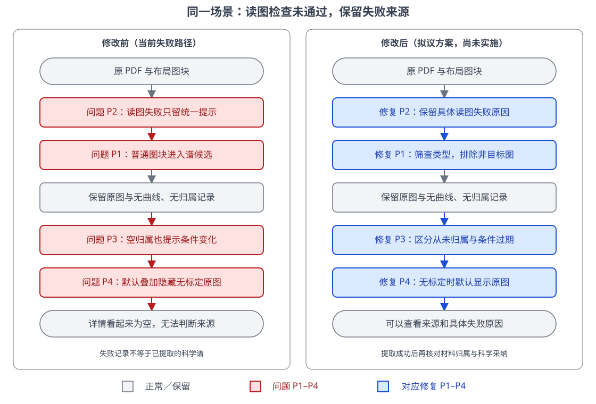

# 为什么谱记录没有材料归属，打开又为空

2026-11-02；查清提取、归属与空白详情的因果链。

**结论：这 35 条都是失败占位，没有成功提取的数据可以分配；程序还误收了非目标图，并隐藏了已保存的原图。**

本机只读核查上传任务 `5dab6b2fb9fa46998f180d71c3742d43`：35 条记录的曲线、标定、归属均为空；35 张原图从配置的对象存储读取，哈希全部相符。两份原 PDF 哈希也相符。

- **P1 误收图**：文档布局中的普通图块会绕过谱关键词筛选。补充材料第 5 页有电子 DOS、第 11 页为能带、第 14 页为焓图；截图打开的第 19 页集合 `959aad7e…` 实为费米面，不是声子 DOS／α²F。
- **P2 提取中断**：任务模型为 `deepseek-v4-pro`。一次六位数字读图检查未通过，后续所有图均跳过模型标定和曲线提取，逐图写入相同占位。异常细节未保留，尚不能断定是能力、服务还是返回格式问题。
- **P3 提示失真**：空归属也被判为 `state_missing`，于是显示“条件已变化”，不能据此认定用户改过材料。
- **P4 原图被隐藏**：默认叠加模式需要标定；缺少标定时只有切换“仅原图”才显示原图，因此默认页面看起来全空。

功能路径：上传解析→图源发现→读图标定→曲线提取／状态归属→谱列表→独立详情。

依据：[历史核查](../../specs/137-phonon-spectra-digitization/assignment-audit-20261019.md)、[#137](https://github.com/JLU-ICCMS-MaYuan/SC-Wiki/issues/137)、[找图](../../../backend/spectra/discovery.py)、[任务](../../../backend/spectra/jobs.py)、[过期判断](../../../backend/services/spectra.py)、[默认模式](../../../frontend/src/components/SpectrumDetailView.tsx)、[原图分支](../../../frontend/src/components/SpectrumFigure.tsx)。

**建议**：先保留并定位读图失败的具体原因，同时修正筛图和空记录显示。真正的谱应按图注、材料和压力归属；费米面等不应硬塞进谱模块。沿用 #137 的来源、版本及独立采纳约束。

本次仅调查，未改代码、重跑模型或更新草稿。右图未实施。
