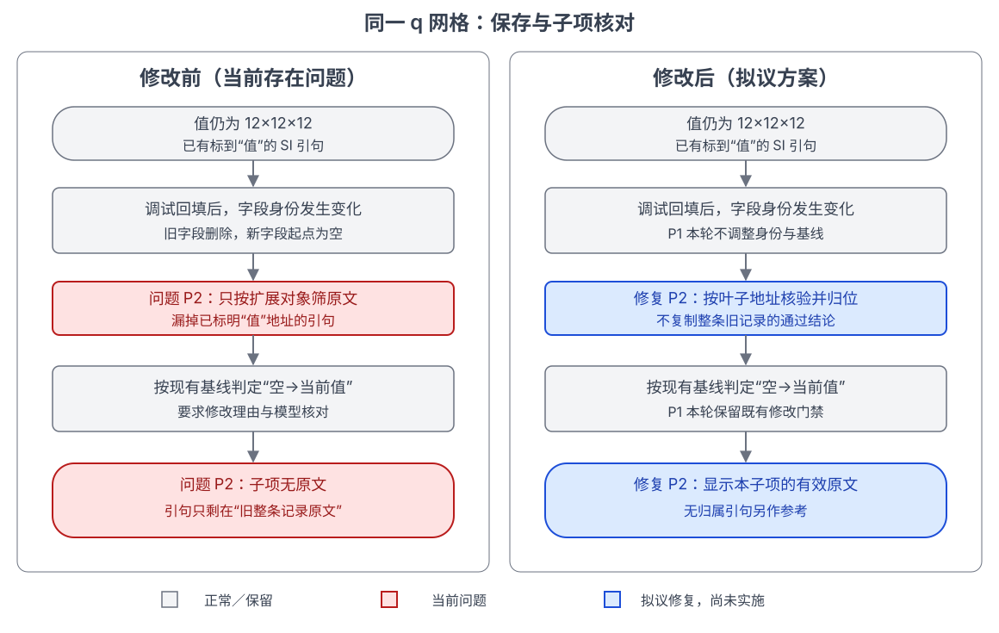

# 值没变，为何要求理由并展示旧整条原文？

2026-11-02 只读调查，解释同一 q 网格的两个现象；方案未实施。

**修订结论：用户补充，曾在调试时向原表单重新填写字段内容。目标 1 本轮不修改；仅继续讨论目标 2 的字段原文归属。**

复算仅证明身份变化触发新增判定，不能证明正常使用发生误判。重新解析 PDF 能否避免尚未验证。

## 事实与原因

本机 MySQL `127.0.0.1:3307/scwiki` 的上传任务 `5dab6b2fb9fa46998f180d71c3742d43`，150 GPa、235 K 记录：

- 07:25:29 的基线把旧键 `877f5e42…` 记为删除、新键 `99fe2302…` 记为新增；两边值都是 `12×12×12`。内存副本去掉 `field_key` 即重现旧键。应用设置补号后身份切换，于是比较“空→12×12×12”。本次按用户补充的调试回填理解，不调整身份、基线或修改门禁。
- 当前引句 0 条，整条参考 7 条，其中已有标到 `extensions.1.value_raw` 的 SI 第 3 页引句。代码匹配对象地址 `extensions.1`，漏掉叶子地址，只留整条参考；前端遂显示“未找到依据”和“旧整条记录原文”。“旧”指绑定范围，不表示论文过时。

## 约束与拟议处理

功能路径：上传草稿→计算条件设置→字段身份／修改基线→来源拆分→侧栏审核。

沿用[#147](../../specs/147-two-stage-field-review/approval-submit-consistency.md)修改门禁与[#109](../../specs/109-field-evidence-and-ai-suggestions/spec.md)来源规则。仅建议明确叶子引句核验后归位，无归属原文仅作参考，不复制整条旧通过；不修正现有调试草稿的基线。

核验：只读重建详情、内存复算身份，图已渲染；未写业务数据或调用模型。

依据：[补号](../../../frontend/src/components/CalculationConditionFields.tsx)、[身份与拆分](../../../backend/ingest/property_field_review.py)、[修改比较](../../../backend/ingest/field_review.py)、[侧栏](../../../frontend/src/components/EvidenceWorkflow.tsx)。下一步讨论是否按上述边界进入 Issue／Spec。
