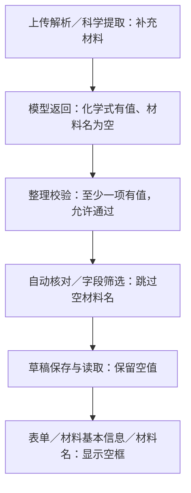

# 问题1：材料名为什么为空

结论：空值来自本次重新提取，随后未被补全。

重跑前，第4—6张卡的材料名分别为CaH2、CaH2、CaH4。重跑时，模型只填写化学式，材料名返回null。现有规则允许两项至少填一项，空材料名又不在自动核对补全名单中，因此空值进入生成结果、数据库和页面。迁移未清除此字段。

建议让模型核实并补全材料名；保留“名称与化学式至少一项”的既有规则。标红与说明矛盾留到问题2展开。本次仅调查。

[核查依据](evidence-1.json)
