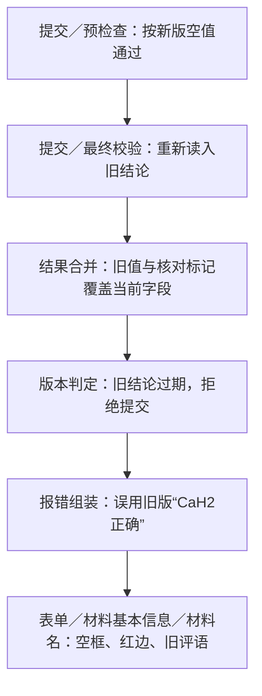

# 问题2：为什么标红却说当前值正确

结论：新版空值与旧版评语被混用。

“CaH2正确”评价的是重跑前的材料名。预检查排除了旧结论，最终提交却重新读入旧结论，让它覆盖当前字段的值和核对标记。旧结论已过期，所以拒绝提交；报错又直接使用旧评语，页面据此画红框、显示“正确”。当前核对摘要也未把旧评语标为历史。

建议：当前字段决定值和核对规则；结论必须匹配当前版本，过期明确说明；旧评语仅在历史中展示。

已只读复现三卡409错误，与截图文字一致。本次未修改代码或草稿。此前验收遗漏留到问题3展开。

[核查依据](evidence-2.json)
