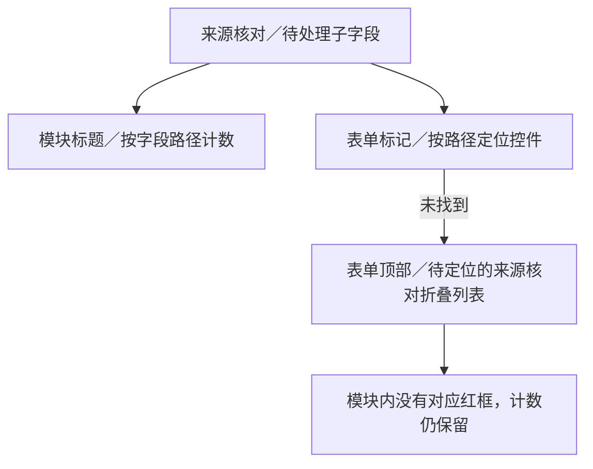

# 为什么有待处理计数却看不到红框

计数统计后台子字段，标红却要求找到主表单控件。名称、单位、值类型在侧栏设置中；超导计算适用关系也没有对应输入框。定位失败时，问题被放到表单顶部折叠的“待定位的来源核对”，模块仍计数，所以此处可能没有红框。

隔离副本已复现5项、0红框；此为机制复现，不冒充截图当时五项清单。当前保存稿为11项、3处红框、8项未定位。

建议计数按可见字段归并，任一子项待处理即标红对应字段，并在侧栏说明；内部关联由系统核验。本次未改业务代码或草稿。

[核查依据](evidence.json)
