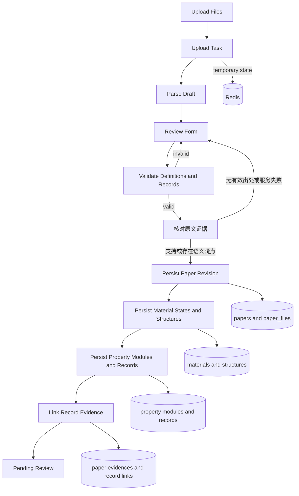

# 上传数据结构与表单映射

## 三入口统一展示

上传校对、审核编辑和论文详情共用研究材料展示。研究材料从当前材料状态汇总，显示名称、化学式及状态入口；不恢复独立文本框。论文级材料关系已按 [#127](../../specs/127-retire-material-relations/spec.md) 退役，三入口均无独立关系控件或核对项。材料基本区在桌面分三行：首行材料名、化学式、元素种类数、材料维度、晶系、空间群符号及群号；第二行类型、仅理论显示的结构优化核处理及压强；第三行结构家族。类型只接受理论、实验、未说明，mixed 已从契约退役，旧值明确报错，不自动映射。材料状态默认展开，可手动折叠，核对通过不会删除保留字段。

上传与审核编辑的结构家族使用单一浮动标签和框下多选提示，单行框高及文字样式与同排元素种类数、材料维度一致；结构家族独占第三行，多项或长名称保持单行，仅标签轨道横向滚动，框高固定，输入及清空按钮留在轨道外；窄屏基本字段改为单列。来源标记将组合控件与内部输入归为同一个入口，核对结果反复更新也不会额外插入加粗标题；多选、自由输入、删除及清空沿用现有分类值契约。此行为按 [#94 三行及单几何设计](../../specs/94-property-record-editor/spec.md) 替代 #109 的自然增高方案。

结构附件复用 `CrystalStructureView`：宽容器左右等宽，左侧真实 3Dmol 模型，右侧晶格参数、按 a/b/c 向量逐行排列的矩阵和原子位置；原子位置默认分数坐标，可切直角坐标。模型与表格来自同一个解析模型，候选、晶胞及格式切换一起更新。窄容器上下排列，数值表内部滚动。无有效结构时明确显示空态或已识别参数和缺失原因，不显示上一结构的数据。

材料状态只保留一层主卡片，结构候选区位于物性模块之前；物性模块使用分隔标题、记录就地折叠，不再叠加模块与记录方框。PDF 结构候选缺少完整坐标或未通过 ASE 校验时，结构区显示已提取的晶胞参数、来源与缺失原因，不生成 3Dmol 模型；材料归属不唯一的候选仍需人工分配。

未分配结构候选也可展开已提取参数、来源文件页码与原文引句；失败项可以排除，不能采用。结构提取不再仅凭空间群／晶格词汇生成候选；坐标表支持 PDF 私有区希腊字母、常见表题及多化合物。旧 Markdown 丢失坐标列关系时读取原可搜索 PDF 的行布局，已有完整行时保留 Markdown；自动归属同时核对报告化学式、空间群与压力。位点多重性、坐标舍入或化学计量不符时保留原因，匹配到材料状态不会自动解除模型校验失败。旧草稿不因查看而重解析或回填。

原文打印小数导致的位点误差可在末位半单位的舍入范围内求解报告空间群的对称约束；仅在兼容稳定子唯一、逐坐标调整不越界且严格多重性与整体化学计量通过时生成派生结构。原始坐标、派生坐标、舍入半宽和改变量分别保留，结构面板明确显示派生依据；候选仍需人工确认。范围外冲突保持失败，不通过放大空间群展开容差消除错误。
除费米能级 DOS 外，物性记录在字段下方提供紧凑原文证据行，可展开查看文件、页码和引句；无引句时显示论文推断、通用知识或待核对提示。字段级来源核对侧栏继续负责查看模型判断、建议和人工理由。
电子性质中的费米能级 DOS 直接显示紧凑输入，不再重复显示记录摘要、记录折叠、定义选择或行下证据摘要；文本镜像值只显示名称、值类型、原始值、单位。定义版本、证据、删除、错误提示及只读约束保留；其他值类型仍有对应规范值编辑入口。
每个材料状态最多一个当前 DOS。相同副本归为一项，完整原始记录及各自证据保存在已有 payload；不同来源值、单位或条件不会自动选首条或取平均，没有明确当前值时留空等待核对。原文侧栏顶部只读对照各候选，返回主表单聚焦原始值，窄屏仅滚动字段行。修改后可立即填写人工依据；编辑或保存说明不删除来源差异，只有有效人工确认才说明当前值已核对。草稿允许待决定状态，正式保存拒绝空值、第二个当前 DOS 及未显式处理的旧重复记录；不同状态分别保存，未执行历史批量清理。
四类性质记录均取消逐条“复制记录”入口；“删除记录”位于对应主输入行右端，字段超宽时仅输入区横向滚动，按钮保持可见。该规则也覆盖测量/预测 Tc 和热力学稳定性专用表单。删除沿原稳定记录键和删除元数据处理，保留其他记录的输入与证据；只读不显示删除入口，独立添加与折叠规则保持。移除复制入口本身不归并或删除已有记录；DOS 按上述单项规范化规则处理。见 [#94 记录操作](../../specs/94-property-record-editor/spec.md)。
文本物性的原始值与文本值完全相同时表单只显示一份输入，编辑时同步保存两列；已有两列含义不同时仍分别显示，不丢失原始报告值。

模型和数据区在宽容器各固定 400px 高；窄容器模型 280px、数据区 400px，宽度随容器适配。右侧长内容内部滚动，原子数量不撑高整行。此视图不再显示模型底部重复元素图例，旋转/缩放/重置工具位于画布内；其他独立查看器保留图例。上传草稿、审核编辑及只读入口的结构区默认收起，标题采用与物性模块一致的轻量行，显示箭头、晶体结构和简短状态；不重复材料名、不保留灰色大容器。材料归属由外层状态卡表达，当前候选的来源核对入口收起时仍可达。上传、空态、文件名、结构提示及模型和数据详情均在展开体内。支持键盘，隐藏而不卸载模型，重开保留候选、晶胞、格式、坐标和模型视角。只读可以展开、切换视图和下载，不显示上传、采用、排除及恢复动作。论文只读详情复用物性模块折叠外观。上传新结构后自动展开。折叠不修改科学数据或触发保存、核对失效。

上传保存、提交及科学状态修改保存时同步研究材料汇总；单纯打开历史记录不回填数据库。论文详情只读，并把结构模型放回所属材料状态，移除侧栏重复模型及结构原文块。相关实现与验证见 [Issue #103](../../specs/103-property-evidence-review/quickstart.md)。

每张状态卡只保存一份规范结构几何和一种结构优化核处理。理论状态可选未说明、经典静态优化、量子非谐优化（SSCHA），保存为 `material_states.structure_optimization`；非理论须为 unknown。核处理与声子／EPC 计算近似独立。不同优化几何分别建卡，同一几何的原胞／惯用胞及 CIF／POSCAR 复用现有派生表示，不另存 StructureModel。前端、草稿契约及数据库唯一约束均阻止同卡第二份规范几何，原始附件和 Evidence 保留。保存、返修、同值判断、谱依赖及完整导出携带该字段。

部署此版本前须应用 `20261015_0094` 迁移。迁移合并 0052/0137 双头，发现 mixed、多几何、旧明确核处理或冲突草稿时先中止，不删除数据。本机 127.0.0.1:3307/scwiki 已经在停写与数据库/Redis 备份后应用此迁移，完整结构核验及三份原有草稿真实读取通过；非法状态、非理论核处理及多结构请求返回带字段定位的 400，原草稿保持。其他环境仍须分别应用与验收。

## 功能说明

上传功能处理一份以论文 revision 为根、以材料状态为核心的层级草稿。用户上传论文和结构附件后，
系统在 Redis 中保存解析运行态；已经执行科学来源核对的草稿另在 MySQL 持久保存；正式提交前，前后端依据同一版本化
`FormDefinition` 校验模块化物性记录，提交事务只写 MySQL 目标契约。

本文只描述“超导数据去中心化上传”当前实际使用的数据结构。账号、审核事件、检索索引、外部数据集
和图表组合不属于本表单的直接写入范围。

## 数据存放分层

| 存放位置 | 数据 | 生命周期 | 作用 |
| --- | --- | --- | --- |
| Redis | `upload_task` 状态、上传文件清单、AI 解析草稿、用户校对结果、清理时间 | 创建任务后到任务清理或提交完成 | 支撑异步解析和可恢复校对，不是正式科研数据 |
| 文件存储 | 原始 PDF/TXT/MD、补充材料、CIF/POSCAR 附件 | 上传后保留；正式提交时作为论文文件保存 | 保存原始来源和结构附件 |
| MySQL | 论文 revision、材料状态、结构、模块化物性记录、定义和 Evidence | 用户提交后成为待审核正式记录 | 审核、检索和论文详情的关系型事实来源 |

“草稿”指可校对的 `draft` JSON，核对后由 `scientific_upload_drafts` 持久保存；提交成功前不会形成论文业务记录。“论文 revision”指
`papers.content_revision`。科学实体都携带或可追溯到 `paper_id + paper_revision`，不会把不同版本的
材料、结构、记录或 Evidence 混在一起。

管理员保存时可创建新材料/结构家族并保存当前版本关联，普通上传者仍不自动创建全站目录。论文级材料家族保存须非空，结构家族允许清空；保存后重开使用正式分类，旧提交快照仅用于尚无论文级家族关联的首次待审回填。详见 [#100](../../specs/100-quick-review-status/spec.md)。

上传的默认解析与可选 PDF 新链路在全文汇总后共用论文级材料家族判断：模型结合本文材料和原文，先选择数据库当前目录中语义适合的家族，服务端核验目录 ID、别名与可定位引句；确实不适合现有项时才保留待确认的新名称。分类理由和证据随草稿保存，人工改选后旧判断不能继续支持新值。目录或判断失败时其他草稿字段仍可校对，材料家族保持空值并提示人工选择；正式创建新目录项仍归管理员审核流程。详见 [#120](../../specs/120-upload-llm-extraction-quality/spec.md)。

## 表单与持久化映射

### 计算方法的字段语义

电子结构方法保存DFT、Hartree–Fock等电子理论，泛函（如PBE）、软件（如VASP、Quantum ESPRESSO）分别保存。DFPT和有限位移是声子／响应方法，通过现有计算条件扩展保存，例如键为`electron_phonon.phonon_method`；阶段及来源继续随记录保存。未知方法不被强制归为DFT，其他有原文依据的电子理论也不受DFT/HF枚举限制。

两种提取入口、全文Methods阅读及补空采用相同语义约束；错误分类会要求模型纠正或保留缺口。核对同时检查字段类别和可定位原文，历史DFPT电子方法即使原文出现DFPT也不再获得有效支持，旧接受或理由不绕过类别检查。旧值和历史出处仍可查看；已接受的正确修正候选、人工填写的DFT及其他科学字段保持。这里只修正分类，不批量修改历史草稿。相关验证与在线模型边界见 [#139 方法语义验收](../../specs/139-table-parameters-shared-methods/method-semantics-validation.md)。

### QE 泛函按原文记录

泛函必须有对应软件的报告依据。QE 未报告时保持空白，不从 VASP 的 PBE、软件默认值或相似工作流推算；空白可选条件不要求人工确认。明确报告的 QE 泛函仍可提取和关联，已有人工值不会被通用补空覆盖。

旧 `vasp_pbe_to_qe_v1` 已撤销，只保留历史读取；专用推断、通用建议及新提取候选均不能重新补入无依据的 QE 泛函。新规则及定向处理范围见[#139 计算条件自动核对](../../specs/139-table-parameters-shared-methods/condition-auto-review.md)。

### 数据映射

一个论文草稿可包含多个材料状态。同一化学式在不同压力、温度、磁场、理论/实验条件或空间群下，
应作为不同材料状态录入。

| 表单分组 | 关键字段 | 是否可重复 | 落库去向 |
| --- | --- | --- | --- |
| 论文基本信息 | 标题、期刊名、年份、期号、卷号、起始页码、DOI、摘要、作者 | 否 | `papers` |
| 论文分类与 AI 摘要 | 论文类型、超导体类别、材料家族、摘要、关键词、方法、主要发现、研究动机 | 材料家族可多选 | `papers`、`material_families`、`paper_material_families` |
| 上传文件 | 文件角色、原文件名、存储路径、SHA-256、大小、媒体类型、排序 | 是 | `paper_files` |
| 材料状态 | 材料名、化学式、元素数、材料维度、晶系、压力、温度、磁场、状态类型、结构优化核处理、报告空间群、备注 | 是，核心重复单元；材料名与化学式至少一项 | `material_states`；有化学式时关联 `chemical_systems`、`superconductors` |
| 结构家族 | 结构家族名称、是否主家族 | 每个状态可多选，最多一个主项 | `structure_families`、`material_state_structure_families` |
| 结构模型 | CIF/POSCAR 文本、格式、空间群、晶胞、原子数、计算方法、来源位置 | 每个状态最多一份规范几何，其他表示按需派生 | `structure_models` |
| 物性模块 | 超导、动力学、热力学、电子性质 | 按需添加和删除，保留已有显示顺序 | `property_modules` |
| 物性记录 | 类型、物性代码、原始值、规范值、单位、方法、代表标记、定义版本 | 每个模块可有多条 | `property_records` |
| Conditions 与参数 | 计算或实验 Conditions、lambda、omega log、mu*、网格、展宽及预留扩展字段 | 每条记录独立拥有 | `property_records.payload_json` |
| 论文证据 | 字段路径、章节、页码范围、原文引句 | 是 | `paper_chunks`、`paper_evidences`、`property_record_evidences` |

上传校对与管理员编辑共用书目行，顺序为期刊名、年份、期号、卷号、起始页码、DOI。
六列宽度比例为 4:1:1:1:1:4；窄屏保持一行并可在行内横向滚动。期号使用独立可空文本
`issue_number`（最长 100 字符），支持 `S1`、`3-4`，解析未报告时留空，不从年份或卷号猜测。
草稿归一化、保存重载和正式提交均保留期号。“起始页码”沿用 `pages` 文本，历史页码范围与
文章编号原样保留，DOI 校验及错误定位保持有效。（[Issue #99](../../specs/99-paper-metadata-row/spec.md)）
书目行的内部最小宽度为 1080px，横向滚动限制在该行容器内，不强制扩宽整个页面。
管理员保存期号时，非文本或超过 100 字符返回 `invalid_issue_number`；旧论文为空仍可编辑，
清空后重载保持空态。真实保存、详情与布局的验收边界见 [书目信息验收](../../specs/99-paper-metadata-row/validation.md)。

首批物性模块为 `superconductive_properties`、`dynamical_properties`、
`thermodynamic_properties` 和 `electronic_properties`。模块只在用户实际添加时提交；记录通过
`record_key` 在模块内保持稳定身份。预测 Tc 必须使用 `calculation_conditions`，测量 Tc 必须使用
`experimental_conditions`，两类 Conditions 互斥且都属于当前记录。

记录标题、定义选择和“添加记录”菜单仅显示类型、方法，不显示模板版本号；内部仍保留
`definition_key + definition_version`。每条记录默认展开，可在编辑态和只读态独立折叠；收起摘要
显示类型、方法、名称及结果（Tc 使用当前规范值，普通物性使用原始值），服务端校验或定义加载错误仍可见。新增、复制、删除其他条目不会
改变原记录的折叠状态，折叠也不会修改科学数据。

自定义性质使用 `record_type=property`、`property_code=custom` 和非空
`custom_property_key` 作为论文内稳定身份；预测 Tc、测量 Tc 及其他规范性质的
`custom_property_key` 始终为空。编辑器切换定义和加载历史 v2 草稿时会清理标准记录上的残留键，
自定义记录缺少键时优先从 `record_key` 补足稳定键；记录值、Conditions、Evidence、`record_key` 和定义版本保持不变。定义切换、旧草稿兼容及错误定位的验收入口见 [Issue #97](../../specs/97-property-definition-switch-cleanup/quickstart.md)。

“添加记录”的选项来自该物性模块已发布的记录定义，每个定义键取最新已发布版本；定义列表不可用时
使用内置候选引用，实际表单仍需加载对应定义。选项数量不由 AI 从当前论文或材料状态识别出的方法数决定。
同一状态可以保存多条相同或不同方法的 Tc，以及自定义性质；每条记录独立保存结果与条件。

测量 Tc 的实验 Conditions 使用一个多行文本框，当前描述写入本条
`payload.experimental_conditions.description`，保留换行；不再用六个固定输入和扩展字段编辑器。
旧记录没有 description 时，在界面中把原条件字段转换为可读文本；编辑后以 description 为当前显示
来源（空字符串也有效），同时保留旧字段和 Evidence，避免丢失原始信息。计算 Conditions 及非核心参数仍使用
原有结构化表单。（[Issue #94](../../specs/94-property-record-editor/spec.md)）

预测 Tc 的常用行按 λ、ωlog、名称、值类型、Tc/μ*、代表结果排列；范围显示两组 Tc/μ*，
只标 Tc、μ*，每组使用相同的 #F4F3FF 淡紫背景、圆角且无分组外边框。内部以 Tc 小值配
μ* 大值、Tc 大值配 μ* 小值，编辑中不移动输入组。测量 Tc 不增加理论参数。所有核心输入保持单行，
卡片较窄时仅在输入行横向滚动；实验条件独占一行。λ、ωlog、μ* 不在下方参数区重复显示。
μ* 范围复用 `payload.parameters.extensions` 的 `key=mu_star,value_kind=range`；标量和范围不并存，
未知端点不补值，包装参数和范围扩展的 Evidence 在编辑时保留。已有标量 μ* 作为共用参数显示，
未编辑不改写；保存/重载/复制、状态导出及详情摘要保留相应参数。非空参数必须为有限非负数，
临时非法参数不能被当作留空保存。
Tc 直接修改 value_number，范围修改上下界；不再显示“原始记录”或要求第二次填写数值。
当前类型对应的值是唯一来源，兼容列 value_raw 随当前值生成，数值和范围的 unit_raw 为 K，
文本和布尔的单位为空。前端加载、编辑、应用核对建议及后端保存共用各自的转换规则，
保存与导出不再保留被更正的旧 Tc 写法。缺少 raw 的有效 Tc 可以保存；前后端均拒绝无效当前值，残留旧 raw 不能用于补救。普通物性契约不变。
临时小数或指数在输入框内保持文本，无效规范值为 null，上传草稿保存和管理员保存均先校验，
防止提交旧值；零值有效。Tc 摘要读取当前规范值，清空后提示待填写；代表结果继续受已有唯一性
规则约束。只读时同样只有当前值入口且控件禁用。旧 raw 字段核对提示定位到当前 Tc，
核对候选不再提供独立 raw/单位编辑；准备确认使用与保存一致的当前值表示。
字段核对仍通过标签与稳定记录身份定位。既有论文版本、修改历史、论文文件及 Evidence 不删除，
也不批量改写数据库中的历史数据。当前值、布局、隔离保存与导出验收见 [Issue #94 验收说明](../../specs/94-property-record-editor/quickstart.md)；此能力不依赖非超导模块的自定义定义扩展。

材料状态编辑器按 `DraftMaterialState` 对象引用复用未修改卡片；修改一个状态时，其他状态的字段树不
重新构造。空间群符号自由输入保存在输入控件本地，选择标准候选、清空或失焦时才写回草稿；候选选择
仍同步写入空间群编号和晶系。物性记录编辑器按 `record_key` 隔离记录更新，动态 Schema 和客户端校验
结果按定义与记录引用缓存，定义绑定只在记录定义身份变化时重新加载或绑定。上述优化不改变 Redis 草稿
字段、自动保存时机、校验语义和提交接口。（[Issue #96](../../specs/96-upload-form-performance/spec.md)）

上传草稿和管理员编辑共用晶系联动：手动选择“未知”（包括再次选择已选中的“未知”）时，
一次清空当前状态的报告空间群符号和编号，以显式 `null` 保存；失焦和保存重载不会恢复旧值。
鼠标与键盘均可操作，后续输入有效群号或选择标准符号仍按原规则填写晶系。
加载历史记录本身不清理字段，其他材料状态、结构附件和物性不因这次选择而被编辑，
只读入口不发出修改。核对流程沿用实际科学字段变更通知与内容版本检查。
（[Issue #105](../../specs/105-crystal-unknown-reset/spec.md)）

这里的清空只针对用户填写的报告空间群，不覆盖结构文件解析出的对称性信息，也不更换材料状态的
稳定身份。保存请求明确携带两个字段的 `null`，而不是省略字段；因此重新读取不会把旧空间群带回。
当前空字段不再作为待核对科学项，依赖这些条件的物性断言按新内容重新判断，不能沿用旧确认。
鼠标、键盘及保存重载的验收路径见 [晶系未知联动验证](../../specs/105-crystal-unknown-reset/quickstart.md)。

材料状态缓存同时比较当前卡片的元素种类数临时输入；非法输入即时显示原有错误提示，但不写入草稿，
也不使其他材料状态卡片重新渲染。（[Issue #102](https://github.com/JLU-ICCMS-MaYuan/SC-Wiki/issues/102)）
例如输入 `0` 或 `119` 时，当前卡片显示“请输入 1–118 的整数”，保存载荷仍保留此前合法的
元素数。提示刷新不依赖草稿对象变化，不改变自动保存规则；五卡片回归验证只重绘当前卡片。

数值、范围、文本和布尔值通过固定核心列表达；`payload_json` 只保存定义声明的 Conditions、参数和
预留扩展字段。`0` 与 `false` 是有效值，不能按空值丢弃。每条记录绑定不可变的
`definition_key + definition_version`，后端依据该版本执行 JSON Schema、JSON Pointer 和业务规则校验。
记录通过可选 `structure_key=structure-{id}` 引用同一论文 revision、同一材料状态内的结构；Conditions
不重复保存 `structure_id`。完整 MaterialState 导出使用相同的 `structure_key` 标识结构并精确校验引用，
引用无法解析时返回 `409 export_incomplete`。

## MySQL 关系

### 论文、材料与结构

| 表 | 主键与主要关联 | 保存内容 |
| --- | --- | --- |
| `papers` | `id`；`content_revision` 是当前内容版本 | 书目信息、审核状态、上传者和 LLM 富化字段 |
| `paper_files` | `paper_id + paper_revision` | 正文、补充材料和附件元数据 |
| `paper_chunks` | 关联文件与论文 revision | 从正文切分出的可引用文本块 |
| `paper_evidences` | 关联 Chunk 与论文 revision | 字段路径、章节、页码和原文引句 |
| `chemical_systems` | 属于 `paper_id + paper_revision` | 元素体系键和元素列表 |
| `superconductors` | 属于 `paper_id + paper_revision`，关联化学体系 | 化学式、规范化化学式、组成和显示名 |
| `material_states` | 属于论文 revision，关联一个超导体 | 压力、温度、磁场、状态类型、结构优化核处理、晶系、报告空间群和备注 |
| `structure_models` | 关联材料状态与论文 revision | 结构文本、格式、哈希、空间群、晶胞和计算来源 |

`chemical_systems` 和 `superconductors` 都由论文 revision 拥有。同名 LaH10 出现在两篇论文时使用
不同主键，跨论文查询通过规范化学式、组成和体系键聚合，不通过共享材料实体关联。

### 模块化物性与定义

| 表 | 主键与主要关联 | 保存内容 |
| --- | --- | --- |
| `property_modules` | 关联一个 `material_state`；模块代码在该状态内唯一 | 按需挂载的模块及已有显示顺序 |
| `property_records` | 关联模块、材料状态、论文 revision 和定义版本 | 固定检索列、值、单位、方法、代表标记和 `payload_json` |
| `property_record_evidences` | `property_record_id` ↔ `paper_evidence_id`，要求同 revision | 记录级或字段路径级来源 |
| `property_evidence_checks` | 关联当前论文 revision 与物性记录；记录删除时级联清理 | 内容和来源摘要、规则版本、模型结论与理由、证据快照 |
| `form_definitions` | `definition_key + version` 唯一 | JSON Schema、UI 提示、规则、状态和校验和 |
| `form_definition_audit_events` | 关联定义及操作者 | 发布、停用、升级、回滚和管理员提升审计 |

发布后的定义不可原地修改；停用版本仍可解释历史记录，但不能用于新建记录。记录升级与回滚均显式
执行并写审计事件，不会在读取时自动改写。管理员可将已批准的论文内自定义性质提升为全站定义；
提升不改变源记录、Evidence 或历史定义绑定。

`record_key` 在所属模块内标识记录，可以在不同材料状态或模块间复用。新记录未显式携带
`source_fingerprint` 时，后端按材料状态主键、模块键、记录键生成指纹；已有记录编辑时保留原指纹。
指纹用于记录身份去重，不代表论文或段落：多个记录可以共享论文和同一 Evidence，也不会因此被合并。
科学值变化由 `record_checksum` 表达，不改变已有来源身份。
指纹取值顺序为“已存在记录的数据库指纹 → 新记录显式提供的指纹 → 按完整作用域计算的缺省指纹”。
缺省值由三项身份组成的规范 JSON 数组计算 SHA-256，不仅取局部 `record_key`；数据库唯一约束继续保留，
不通过迁移重写历史指纹或自动合并记录来消除冲突。真实提交、重复保存及共享证据的验证见
[来源指纹验收](../../specs/98-scoped-record-fingerprint/validation.md)；提交后旧解析入口的权限回溯见
[上传任务生命周期](pdf-ingestion.md)。

### 证据保留与核对结果

压强数值区支持连续输入和粘贴，问题标签独立打开核对。清空规范值表示未知，同时清空 pressure_value_gpa、pressure_raw、pressure_unit_raw、pressure_min_gpa、pressure_max_gpa；零保留，未完成的小数或指数不会误删条件。原始值、单位和范围在折叠区域编辑，修改规范值不自动覆盖原始记录。上传规范化只对缺失字段读取旧条件，显式 null 保持为空。

解析草稿的单个 `evidence` 与多条 `evidences` 在表单边界合并、去重；空数组不会覆盖已有单证据。
编辑和保存保留原文来源，复制保留候选来源，新记录须重新核对。正式关联按材料状态、模块和记录联合
定位，不用全论文范围的 `record_key` 查找目标，允许不同状态或模块使用相同局部键。

`scientific_evidence_checks` 保存全部科学项的 unchecked、supported、uncertain、unsupported 和 missing，以及模型、理由、建议、来源版本与审核员裁决草稿。稳定 item_key 与当前字段路径分开，保存或排序后仍对应原科学项。修改使相关内容摘要失效，旧结果可查看但不能批准；纯补入证据不改变科学内容版本。

后台每组完成后持久保存，预检查不调用模型。`scientific_upload_drafts` 保存已核对草稿与最新生命周期，Redis 丢失后可恢复；必要原文不被普通到期清理删除。上传创建论文的事务将结果按稳定身份转为 paper 目标。Go 正式批准事务写入 `scientific_evidence_sources`、原文证据及历史，再删除临时核对项，失败全部回滚。

结构附件来源保存在 `scientific_structure_origins`，记录认证提交者、真实原始文件及解析依据；提交者不等同于作者。管理员可对无直接论文支持或提供者未知的内容逐条说明推理/专业判断依据后完成确认；保留人工来源，不能伪造原始提供者或论文引句。元素计数及明确原始单位的压力、温度转换由程序复核输入与规则。

## 提交流程

正式提交校验完整草稿、定义和物性证据核对结果，再在事务中写入论文 revision、材料状态、结构、模块、记录、
Evidence 关联与核对快照。有出处但存在语义疑点时进入待审；无出处或内容版本变化时停止提交。
任一校验失败都不会留下部分正式科研数据。旧缓存草稿只在输入边界单向转换为
Schema v2；v2 载荷和规范 property identity 不会再次被旧转换覆盖，正式持久化不再双写旧科学表。
模块化物性校验错误返回完整的 `material_states[i].property_modules[j].records[k]` 字段路径和
`issues[]` 具体消息，上传页面会汇总全部问题并展开、标记和聚焦首个可用错误位置。数据库完整性错误转为脱敏的可操作提示，不返回 SQL 或表名；无法确定具体记录时定位到可确认的表单范围，不伪造唯一记录位置。
来源指纹唯一约束冲突单独返回 `source_identity_conflict` 问题，明确说明内部身份冲突、无需修改科学数据，
不再误报局部记录键重复。相关修复与验收见 [Issue #98 Spec](../../specs/98-scoped-record-fingerprint/spec.md)。

## 关键约束

- 一个材料状态必须关联同一论文 revision 的超导体；结构、记录和 Evidence 不得跨 revision。
- 压力范围必须两端同时存在或同时缺失，且最小值不大于最大值；压力、温度和磁场数值不得为负。
- 报告空间群编号为空或位于 1 到 230；它不等同于结构文本解析出的确认空间群。
- 一个材料状态可关联多个结构家族，但最多一个主结构家族。
- 非空物性模块不能隐式级联删除；先显式处理记录，再删除模块。
- 每个“论文 revision + MaterialState + Tc 记录类型 + 方法”最多一条代表 Tc。
- 上传者提交普通科学数据须有当前来源内可复核的 Evidence；管理员批准或重新批准时也可使用已保存、绑定当前内容与来源版本的逐条人工决定，不能仅凭整篇审核意见绕过核对。结构提供者来源与确定性派生来源按上述独立规则核验，历史迁移不伪造缺失证据。
- 自定义字段只能出现在定义预留分组中，不能覆盖固定核心字段或系统键。

## 代码依据

- `backend/models.py`：Python SQLAlchemy 目标模型及数据库约束。
- `goserver/models/models.go`：Go 目标表映射。
- `backend/ingest/upload_contracts.py`：Schema v2 上传契约和旧草稿边界转换。
- `backend/ingest/property_modules.py`：模块化记录规范化与校验。
- `backend/ingest/scientific_drafts.py`：正式提交事务。
- `backend/services/form_definition_service.py`：定义生命周期和校验。
- `frontend/src/components/PropertyModuleEditor.tsx`：模块与记录编辑器。
- `frontend/src/lib/propertyModules.ts`：物性记录身份归一化与历史草稿兼容。
- `frontend/src/components/UploadTaskEditor.tsx`：提交错误汇总和问题定位。
- `frontend/src/components/SchemaDrivenRecordForm.tsx`：定义驱动表单。
- `frontend/src/lib/formDefinitions.ts`：记录定义加载、版本筛选及实验条件文本校验。
- `tests/01_decentralized_uploading/property-record-editor.test.tsx`：单框、标题、独立折叠与原始信息保留验证。
- `backend/tests/test_property_record_conditions.py`：逐记录条件从 AI 提取调用、归一化到持久化及导出的往返验证。

## 当前边界

#114 的可选 PDF 新链路直接输出模块化物性记录，按材料、压力、方法、判据和每条
记录的 payload 保留区别；后端组装科学候选，全文汇总不再重写这些值。未知实验方法
保持 unknown，不因属于实验结果就填为 resistivity；部署需后续方法定义迁移
`20260924_0114`。Claim 定位通过不替代既有科学语义核对和人工审核。

当前 revision 的 PDF 结构与区域定位另存于文档表，通过 `paper_evidence_locators`
关联原 Evidence。返修或管理员编辑采用新引句时重新定位，升版后归新当前 revision；
旧版仍只保留既有修改历史，不承诺旧全文档案。流程见 [PDF 解析管线](pdf-parsing-pipeline.md)。

- 解析运行态由 Redis 管理，已核对草稿另有 MySQL 恢复快照，正式提交后通过 `papers.upload_task_id` 回溯来源任务。
- 结构附件只有经用户确认后才持久化为 `structure_models`；浏览器中的结构候选不等于正式记录。
- 本文描述应用当前目标契约和隔离 MySQL 已验证行为，不表示任一生产数据库已经执行迁移。
- 审核后的向量发布、检索索引和 Neo4j/Qdrant 生命周期不属于上传表单直接写入范围。

## 相关变更记录

- [Feature #90：MaterialState 模块化物性与动态表单](../../specs/90-unified-superconductor-properties/spec.md)
- [Feature #94：物性记录标题、实验条件文本与独立折叠](../../specs/94-property-record-editor/spec.md)
- [Bug #96：上传解析记录表单选项编辑延迟](../../specs/96-upload-form-performance/spec.md)
- [Feature #103：物性证据保留、自动补证与人工裁决](../../specs/103-property-evidence-review/spec.md)

## 声子谱与提取质量（#137）

已认可的 #161 人工编辑器接入正式详情代码：有权限者可修改原图像素点、标定及零频依据，服务端创建新谱运行并保留历史，旧采纳和积分失效；权限/版本冲突不会覆盖新结果。未执行历史数据批量更新。交互、调参及SQLite/MySQL验证边界见[人工编辑与联动调参](spectrum-manual-editor-demo.md)。

当前代码提供独立谱集合/运行，关联论文revision、来源文件和材料状态，按动力学 DOS、超导 α²F/累计 λ 归类，并进入独立详情。上传校对、管理员编辑和只读详情通过新标签页查看单图三模式、点来源、分项质量及JSON/CSV下载；材料状态导出同时包含谱。数值不进入标量PropertyRecord。

质量包含图像观测/重建/缺口、刻度残差、抵框像素、原/候选λ与ωlog相对同条件论文报告的偏差、累计谱逐频段像素范围、留出误差、DOS模式数及敏感性。不生成统一准确率；缺参考或定义不清明确不可比较，3N与联合积分关系不是独立精度证明。

自动找图和模型标定在独立RQ任务中运行，服务器校验并提取；模型/图像不可用不阻断论文其他解析。修正标定重提取生成新run，原观测保留，逐谱采纳失效。审核者可完整或限定频段采纳，公开读取同时要求论文当前批准revision和当前谱采纳；限定频段的点与候选导出同步裁剪。

该路径此前已在隔离 MySQL、RQ、HTTP 和三个真实浏览器入口验证。2026-10-15 本机 3307/scwiki 已完成 20261014_0137 迁移并通过完整结构核验，三个已有草稿的谱列表均经实际网关返回 200 空列表；历史任务不会因迁移自动生成谱。Linux/macOS 部署版本清单及结构快照已同步。独立详情按 #154/#155 改为四区展示，移除重复校对工作区；原有标定与审核组件仍保留供维护流程使用，只读用户保留查看交互。GPT-6-sol 的 H3S/合成谱完整自动标定曾因服务 503 未验收，本次不重测模型或宣称所有 PDF 自动提取通过。详见 [#137验证](../../specs/137-phonon-spectra-digitization/validation.md)与[正式合同](../../specs/137-phonon-spectra-digitization/contracts/production.md)。

生产谱算法 v2 支持橄榄黄曲线；旧任务无可选 IR 时从原 PDF 找图，同宽且上下相接的原生图碎片按 PDF 坐标组合，矢量图优先按谱图注和绘图框定位。纯文字页不再仅因提到谱而进入读图。空失败结果和有未解决问题的发现任务显示“待核对”、保留 HTTP 原因并允许重试；图集合数与实际曲线数分开记录。这些改动不自动采纳谱，材料归属不唯一时仍待分配。见 [La-Sc-H 平台验证](../../specs/137-phonon-spectra-digitization/validation.md#la-sc-h-正式平台提取与修复2026-10-15)。

## 四类性质的统一编辑与详情入口

电子、动力学、热力学与超导记录共用紧凑常用行。补充参数及计算条件每条独立成行，空区只显示“新增字段”；文本框初始约 110px，随内容扩宽、清空回缩，宽度不足时在本行滚动。固定计算条件只使用当前定义适用的字段。普通物性继续区分原始值和规范值，预测 Tc 保持 λ/ωlog 前置及 Tc/μ* 的逆向端点配对，测量实验条件仍是单个多行框。

材料状态标题在展开与折叠时均显示“空间群符号 · 化学式 · 压强（单位）”，直接读取当前输入；零压有效，缺失明确提示，不推测空间群，也不据此替代 state_key。

热力学模块可“新增稳定性记录”。记录沿用已发布自定义性质定义，版本化信息保存在 payload.thermodynamic_stability，并按形成能 ΔE、形成焓 ΔH、形成 Gibbs 自由能 ΔG、未说明分别保存独立口径。每份口径包含稳定性、above-hull 数值与单位、温度、ZPE、分解路径及来源说明。ΔE/ΔH 使用 0 K，ΔG 不默认 300 K；ZPE 未说明与明确未计入分开。未知数值留空，不稳定时才录入 above-hull，切换依据不复制另一依据的结论。前后端校验并沿现有 payload_json 保存及完整导出，无新增数据库表或迁移。

动力学模块引用声子 DOS，超导模块引用 α²F/累计 λ；同一集合按 curve.kind 归类，即使没有标量记录也能显示谱归属。摘要包含来源、频域、提取与采纳状态，点击进入独立 `/spectra/:collectionId` 页面。查看入口使用原生新标签链接，不触发主表单保存，原页未保存输入保留。详情按已保存目标、材料状态和集合/运行身份读取；过期地址提供打开最新结果。展示单图三模式与保持来源轴向的提取数据、指标和定高滚动点表，沿原鉴权接口导出 JSON/CSV；不把归一化候选混入原始密度对比。

该前端消费 #137 的谱 API；谱存储、迁移、自动提取和目标部署验收属于 #137。服务不可用时显示错误，不生成演示曲线，不把谱塞入标量 PropertyRecord，也不放宽 stale、逐谱采纳或公开范围。当前统一表单、真实保存链与隔离验证记录见 [#94 验收说明](../../specs/94-property-record-editor/quickstart.md)。

四类性质模块本身默认折叠，点击标题或通过键盘可独立展开；仅有谱结果的模块也采用相同交互。收起保留未保存输入和内部记录的展开状态，状态随 module_key 保留，已有显示顺序保持；模块折叠不调用科学数据 onChange。标题可提示已有校验问题，删除工具栏与折叠动作分开。上传、返修、管理员及只读入口共用此行为。单条记录的默认展开规则保持原样。

模块标题不再提供上下移动或其他手动排序入口；仍按已有数据顺序显示并保留 display_order 合同，不强制重排历史数据。空模块删除后仍保持剩余模块的相对顺序。

每个可编辑材料状态的“添加物性模块”下拉位于该状态的全部已有模块及谱展示之后，保持卡片内全宽；无标量模块时仍位于结构及谱展示后。新增只向当前状态末尾追加，入口继续位于新增模块之后，已有顺序、输入与折叠状态保持。只读不显示添加入口；菜单仍排除当前已有模块类型，不增加悬浮或自动滚动。见[#94 US19](../../specs/94-property-record-editor/module-add-bottom-demo.md)。

### 已确认谱入口的正式行为（#137 / T023）

谱摘要按材料状态和谱类型归类，每类只有一个当前入口：元素投影 DOS 合并为“查看声子 DOS”入口，α²F 与同集合累计 λ 合并为超导族；只有累计 λ 时明确显示“查看累计 λ”，不声称已有 α²F 数值。谱摘要、空态及提示位于相应性质模块的折叠体内，默认随模块收起；没有标量记录而只有谱数据时同样采用模块折叠，展开后保留独立详情入口；无谱状态显示禁用空态，不借用其他压力的曲线。主表不展开谱图和点表，未归属或原材料状态已删除的谱另列“待确认归属”。

独立详情显示材料与来源、单图三模式、积分与参考比较、定高滚动点表及带来源 CSV／JSON；DOS 可选择全部或单分波，轴向沿用来源，逐点差为绝对值。未得到数值的候选可检查真实原图及失败原因，不生成示例曲线。返回后在材料状态异步加载完成时展开并聚焦原状态；未归属详情返回待确认区域。

“待确认归属”的数量只统计已有曲线或真实标定的集合；没有数值也没有标定的失败／无谱图结果列入默认收起的“谱提取记录”，保留来源、失败原因与独立详情入口。空记录详情不要求给不存在的数值指定材料；同页后续成功不会自动删除或认领旧曲线。查看谱不再触发保存或重复刷新列表；原主表单输入留在原标签页，详情读取已保存条件。自动提取与确认归属等写操作仍遵循原保存/版本约束。

有编辑权限且具有有效标定的用户可确认归属；复用既有标定重提取接口、目标及集合版本检查，按新状态重算质量，旧采纳失效，原运行保留。排队或失败运行保留真实标定供入口归类，不能将其当成已经提取的数值；公开与审核权限保持既有规则。上述交互已用正式组件、实际平台提取数据副本、隔离 MySQL／HTTP、真实浏览器及 390px 检查；不代表未完成的自动科学提取验收已通过。

## 字段编辑与来源核对影响

上传和返修的材料、论文及物性编辑共用字段影响计算：按稳定身份比较实际值，合并原生事件与组件通知；同值、失焦、折叠或排序不会单独造成新失效。核处理修改不会让元素种类数、空间群号及晶系整组临时变红，也不会清空无关项的人工说明；保存失败与重试保持该隔离。元素数依赖化学式，标准群号/晶系依赖报告符号，单位换算依赖原始数值和单位；真实输入或来源变化、材料身份与物性科学条件变化仍需核对。部分派生项旧摘要可能需要一次重新核对，不自动迁移旧确认。实现及四入口 MySQL 回滚验证边界见 [#109 US11](../../specs/109-field-evidence-and-ai-suggestions/field-isolation-validation.md)。

## 预测 Tc 的多方法与多组输入

预测数值记录使用共享表单：λ／ωlog独立一行；“超导转变温度 Tc”为普通标题，每种预测方法一行，可增删多个Tc／μ*组合，“新增字段”增加方法行。每个Tc前竖向居中的选框指向明确的方法、μ*和Tc，同一材料状态跨方法最多一个代表；清空或删除不自动改选。计算条件独立保留新增字段。

每个明确组合继续按单值科学记录保存，payload.tc_group v1只组织共同参数和方法行，JSON／返修／导出保持逐记录。旧范围不自动改值或选择端点；明确编辑/选点时才拆分，原表示保留为历史，未配对μ*不猜。无分组历史记录各自成组。后端检查分组条件一致及唯一代表，并将未提交但仍保留的记录纳入校验；分组身份与范围历史不属于当前科学断言。

Methods 来源关联按软件、阶段及适用范围补空。白名单条件完成全部正文／SI 核查、证据有效且无例外时可按规则通过；其余保留待核对。结构优化泛函和收敛阈值不能复制给 QE，未报告参数留空。定向旧任务修复必须备份并复查版本，不能以新任务通过代替旧草稿已保存。验证边界见[#94实施记录](../../specs/94-property-record-editor/tc-multi-result-implementation.md)及[#139 当前规则](../../specs/139-table-parameters-shared-methods/condition-auto-review.md)。

## 预测记录的字段设置侧栏

预测Tc的λ、ωlog、各Tc/μ*点及计算条件以紧凑方框显示名称和当前值，点击名称打开右侧设置。固定字段可改名称和原始单位标注，科学key/类型保持；补充计算条件支持文本、数值、范围和布尔。新增先设置，应用后加入；取消不写入，只读可查看。打开侧栏后字段或目标记录已变化时拒绝覆盖。

标注随现有payload保存、返修和导出；规范Tc/ωlog仍以K保存，单位标注不会自动换算。标注/科学值改变沿现有科学指纹保守地使旧来源待核对。结构优化扩展保留数据与导出，但不在超导计算主区展开；EPC泛函不无条件从结构PBE补入，仅允许上文具有来源和工作流依据的QE推断。

实现及验证边界见[#94字段侧栏记录](../../specs/94-property-record-editor/tc-field-sidebar-demo.md)。本行为适用于预测Tc共享编辑入口，其他性质/测量表单保持既有规则。

## 字段来源、设置与修改历史

预测 Tc 标题只作说明，方法只核对自身，λ、ωlog、各 Tc／μ* 及计算条件按子项独立定位。字段名打开设置，独立标记打开来源；共同字段只按明确组身份共享，旧整条记录核对只作历史参考，不自动拆成多个通过结论。

共享侧栏使用“字段设置 / 来源核对 / 历史记录”三页签。原文首次展开，人工修改记录、AI 理由和历史首次收起，四块均可独立折叠；切换页签保留未应用设置及已加载的原 PDF。全部问题保留在主页面独立“待处理项”，不在字段侧栏底部堆叠其他问题的红色按钮。

点击科学字段名称和核对标记都进入上述同一个侧栏，分别默认选中设置页和来源页；尚无核对结果的字段仍保留三个页签和来源空态。取消不写值，应用只改当前字段，完成后关闭侧栏。名称入口的完整上传编辑器补验见[修复记录](../../specs/109-field-evidence-and-ai-suggestions/field-name-sidebar-fix.md)。

新保存及核对事件显示实际操作者或模型、带时区的发生时间、动作摘要及可展开的前后值；旧记录缺作者、时间或时区时明确标注缺失。普通改值不等于核对或批准，依赖变化也不冒充用户修改。上传、返修、管理员共用科学字段与版本契约。

“查看原 PDF 区域”从已授权原文件按来源身份、哈希和可靠引句定位；支持页码、高亮、放大及失败重试。缺可选区域 IR 的旧任务可从同一原 PDF 文字层唯一定位，预览不要求可用模型配置，仍需用户和文件权限。实际 LaSc₂H₂₄ 原 PDF、JWT/MySQL、隔离候选证据及验证边界见 [#109 正式实施验证](../../specs/109-field-evidence-and-ai-suggestions/field-review-implementation-validation.md)。

## 主表单状态与来源说明分离

来源核对理由不再进入表单校验消息、整组红色警告、字段辅助文本或模块长摘要。主表单保留字段状态标记及材料/模块的待处理数量；真正的输入、定义和保存错误仍在原路径提示。完整来源理由位于当前字段侧栏，以短状态和普通段落展示，三页签、四块折叠及原PDF查看保持。独立待处理导航仍覆盖全部问题，展示简化不改变审核资格或批准条件。

上传、返修与管理员编辑共用上述规则；只读保留字段查看和模块展开入口，禁止修改和核对写入。实时只读草稿尚无有效核对目标时显示来源空态，不复用其他版本的结论。实际宿主、只读、原PDF和隔离候选验证边界见[#109展示设计与验证](../../specs/109-field-evidence-and-ai-suggestions/source-review-presentation.md)。

## 2026-10-20：优化方式与结构资料收录修订

材料状态按结构优化流程区分，同一材料／压力下的静态优化与SSCHA状态分别保留；仅有非谐声子证据不能指定SSCHA结构优化。原文模型先关联优化工作流及表行，再由程序组装；未知或冲突保持可核查，不按压力补猜。核处理与表格分组分别留痕，防止值在汇总或合并时丢失。

修改结构优化核处理不再让同一状态的整组物性、计算软件和网格连带失效；仅字段本身、明确直接输入及来源适用范围变化才重新核对。响应提供 `state_dependencies` 与 `record_dependencies`；前后端共用相同含义，保留Tc／μ*配对及派生输入关系。原始压强／单位／上下限折叠编辑区已移除，主压强控件与既有真实范围和原文来源保留。

论文结构资料只收录完整可建模结构；已在材料状态卡展示的模型不重复列入独立资料区。缺参数或原子位置的观测不再生成独立资料及人工决定，原PDF保留。历史非模型资料不进入当前查询／下载，旧客户端字段不产生新的非模型记录；完整模型的来源、规范几何确认及公开审核边界不变。本节覆盖前文相冲突的旧展示与收录规则。

设计与验证入口：[状态修复](../../specs/120-upload-llm-extraction-quality/state-review-convergence-20261020.md)、[核对依赖](../../specs/109-field-evidence-and-ai-suggestions/state-review-convergence-20261020.md)、[结构收录](../../specs/49-pdf-crystal-structure-extraction/state-review-convergence-20261020.md)。

### 正式详情、历史和零频采样（#154 / #155）

- 材料状态每类谱只显示一个当前入口：优先最新有数据的提取记录，时间相同时按稳定 ID 排序；这仅确定展示版本，不授予科学采纳。旧合并集合、拆分集合及各自旧运行可由维护者在提取历史中查看与导出。公开用户不能读取未审查历史；历史比较标记失效，不将当前条件套在旧运行上。
- 新发现的集合身份使用同一来源下的材料状态和曲线类型/投影，不因模型 panel_id 改名或频段微调产生新的同类身份。旧库记录保留，不执行批量清理。
- α²F 入口范围只依据其自身曲线；累计 λ 的边界假设不参与。当前α²F只用独立ωlog作谱形参考，显示绝对及相对偏差；论文λ用于幅值归一化，取消λ独立准确度对比和幅值说明必填。缺参考不连带隐藏其他可计算结果，详见[相对谱归一化](alpha2f-relative-calibration.md)。限定频段采纳不套用完整运行积分。
- DOS 重新计算分别提供逐曲线像素面积（像素·THz）、完整共同尺度下的面积占比、按 3N 的共同归一化及原始绝对密度检查。缺少 N 不影响有效曲线面积，失败曲线不隐藏其他独立面积；化学式只提供原子数比例，原胞 N 仍依赖结构证据。
- 共同归一化要求标准原子投影、完整且不重复的分波、共同尺度、可信原胞 N、完整频段依据及无裁峰。所有分波共用 C=3N/总像素面积；逐元素积分与 3Ns 比较，保留绝对/非负相对偏差，不分别强制归一化、不输出满足判断。归一化总和不是独立准确性验证；原始绝对密度积分单独显示。
- 完整频段使用标定中的 frequency_range_confirmed（默认 false，并检查采样覆盖来源频段）或已有明确高频零边界；到达图框末端本身不自动确认完整。详情可切换相对像素与按 3N 的密度刻度，仅在共同基线可用时提供，不改变原始像素和连线。
- 新结果随重算保存为新版本，人工保存后旧派生结果清空；历史、失效和限定频段不冒充当前完整结果。公开部分分波时移除总占比、共同系数及归一化候选，只保留完整公开曲线的独立面积。CSV 使用当前按曲线网格保存的归一化候选，同时保留原始幅值。实现及隔离验证见 [DOS 相对积分与共同归一化](../../specs/164-dos-relative-normalization/validation.md)。
- spectra-production-v3 必须从原图识别零频刻度，以零点约束线性标定并在真实零频像素位置采样；亚像素位置由原图像素插值读取。未识别零刻度/坐标越界时保留失败原因，零频幅值不可读保留 missing 并标记待核对，不制造边界零幅值。历史 v2 数值不改写，仍如实提示未覆盖零频。
- 已通过正式组件测试、隔离 SQLite HTTP 权限与历史导出、数学回归及正式 App 路由的浏览器验证。浏览器使用真实存量谱的只读快照，不冒充实际业务网关端到端。290 GPa 原图只读重算从零频开始，但零频幅值不可读且 α²F 独立幅值依据未确认；未回填或采纳这些结果。
- 现有本机日志有谱请求代理到 8080 被拒绝的记录，未能唯一对应用户截图中的某次 500。当前列表读取成功，新入口移除了查看前保存的依赖；不能据此保证服务离线时仍能读取。详情提供错误和重试。验证见 [#154](../../specs/154-alpha2f-detail-demo/production-validation.md)、[#155](../../specs/155-phonon-dos-detail-demo/production-validation.md)。

### 子图裁切、比例与叠加

谱详情的 02/03 在桌面左右排列、窄屏上下排列；三模式使用灰底紫色滑动选项，遵守减少动态效果偏好。原图、数据和叠加共用当前谱子图图框及原图全局像素坐标，保留图框长宽比，不再按峰值拉宽。旧记录可在已有 ROI 邻域检测四条灰黑长边，显示范围不包含相邻压力或谱；无可靠边框则提示待核对。新的标定允许独立 display_bbox 显示框，服务器校验包含 roi 和图内边界，显示裁切不改写谱点。α²F 叠加用红线和白色细底线，可调强度；原图共用频率刻度在裁切图旁重绘，幅值依据未确认时不把累计 λ 标尺重标成 α²F 数值轴。已用 290 GPa 真实存量谱快照验证排除 350 GPa、DOS 与色散；不是新模型自动裁切或科学数据重提取验收。见 [调研与验证](../../specs/154-alpha2f-detail-demo/crop-research.md)。

### 文字彩边伪峰防护（v4）

宽松颜色补读现要求严格本色或色相明确的暗色邻域支持，避免把图例文字的低饱和彩边当作谱线；同一扫描行/列的多个不相连候选保留为待核对缺口，不平均到空白位置，也不让插值跨越歧义行。真实连续窄峰与纯净暗色虚线保留。逐点质量和 CSV 记录被拒绝候选数、候选段数和重建阻断信息。

290 GPa α²F 的 y=423 行已通过同图反事实定位：旧代码把真实642像素与文字737/763像素平均成空白714，模型漏排除文字是诱因。按用户修复要求，仅该本机集合通过正式任务函数生成 v4 新运行；旧运行哈希、其他集合和人工表单不变，没有新模型调用。其他重叠候选及零频/独立幅值依据仍待核对，不自动采纳。证据见 [伪峰诊断](../../specs/154-alpha2f-detail-demo/false-peak-diagnosis.md)。
