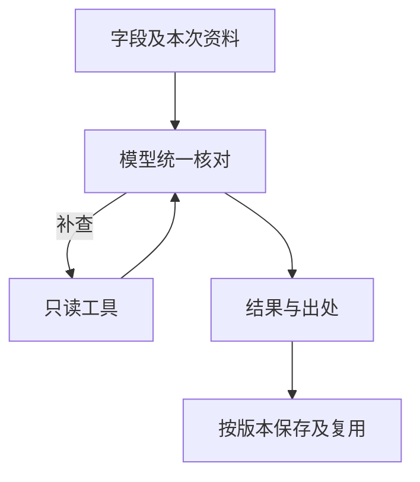

# 统一模型核对与复用

第3阶段与主动核对共用模型工具循环：模型查证来源、定位、值、关系及唯一自纠；程序绑定实际资料，检查类型、权限和版本后逐批保存。有效结果复用，保护人工内容；技术失败保留成功项，整篇批准独立。

预算及工具范围保留。见[#194](../../specs/194-unified-model-review/spec.md)。

已登记的软件参数组为空时，候选回填仅按实际目标建立所需容器，其他空软件组保持为空；不把空父级误作可直接写入的对象，也不覆盖非空错误内容。此项修复及真实网页验证边界见[#194验收](../../specs/194-unified-model-review/validation.md)。
