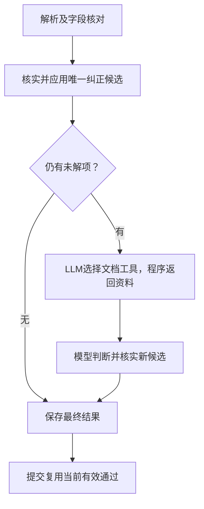

# 字段自检、补查与提交复用

解析先按当前原文判断字段；系统生成、未被人工处理且有唯一来源答案的候选，会应用后再核实最终值。不覆盖人工修改或确认，不把系统错误作为正式字段证据。

补查仅访问本任务已验证的正文与附件；一次最多12次行动、每工具最多2次重试。工具成功不等于科学通过；越界、取消及技术失败有明确结果，已有科学不通过不被技术异常抹去。

后置的原PDF连续引句复查已删除。提取来源验证、首页题录核验、版本、权限和按需原文预览保留。科学来源优先用服务器编号引用，避免模型重写引句。

字段区分通过、处理中、待核对和处理失败；不再提供独立待处理导航。详细原因和恢复操作在对应侧栏，旧版本意见有提示。只读场景不引导不可执行的写入操作。

本次不修复历史草稿状态，不代为提交；人工历史归#192。源码：`extraction_correction.py`、`field_document_followup.py`、`evidenceStatus.ts`。关联#184、#188、#190、#191。
