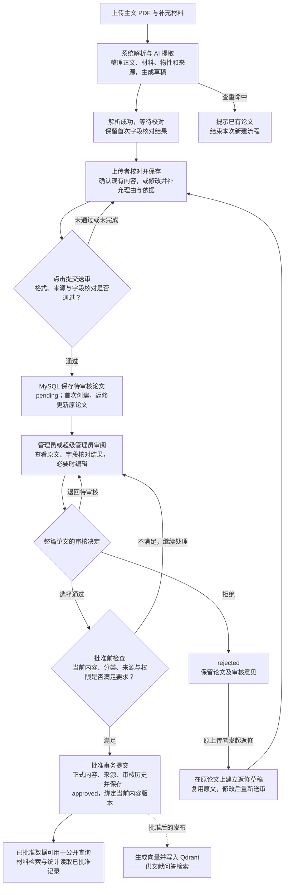

# PDF 解析管线

## 功能说明

本功能描述上传任务从文件接收到生成待校对草稿、再到提交落库与发布向量索引的完整处理链路，是 01 目录的主线文档。文件校验与摄入约束见 [PDF 摄入](pdf-ingestion.md)；晶体结构附件的审核与默认结构选择见 [上传、审核与默认结构](upload-review-and-default-selection.md)。

## 从 PDF 上传到审核入库的主流程

上传 PDF 后，系统先生成可校对草稿；上传者处理字段问题并提交，系统将论文写入 MySQL 等待管理员审核；管理员批准后，该版本才作为已审核数据对外提供。

**“写入数据库”有两个不同节点：提交送审时已创建待审核记录，最终批准时再确认正式内容、来源与审核历史，并标记为已批准。** 解析成功、保存草稿、字段核对通过，都不能代替整篇论文批准。

下图只保留主干及主要分支。正文角色确认、具体解析工具、单字段操作、附件分配、取消和技术重试等细节，留在后文及关联文档。

### 读图时需要区分的几个动作

| 动作 | 实际结果 |
| --- | --- |
| 解析完成、保存草稿 | 得到可继续编辑的内容。例如提取出某材料在某压强下的 Tc 及原文位置；仍未创建本次上传的待审核论文。草稿、文件、核对结果等可以分别持久化，不等于论文已批准。 |
| 字段核对与人工处理 | 判断当前字段的值、理由和依据能否用于送审。例如修改 Tc 后，只对受影响字段及真实依赖重新核对；同版本有效结果复用。正常输入和保存不启动模型核对。 |
| 提交送审 | 先保存，再检查格式和当前字段结果，必要时核对修改后的字段；全部满足要求才在事务中创建 `pending` 论文、材料状态、物性、结构和来源关联。结构只写入符合确认与校验条件的候选。 |
| 管理员批准 | 管理员和超级管理员是两个可执行审核的角色，不是必须依次通过的两级审批；不能审核自己的论文。当前工作台的编辑先暂存，批准事务将暂存内容、来源、审核历史及 `approved` 状态一并提交；检查失败则保留待处理输入。 |
| 拒绝后返修 | 由原上传者针对 `rejected` 论文发起。复用已有文件，在同一论文 ID 上提交新内容版本，回到 `pending` 再审；“退回待审核”只是保留待审状态，与上传者返修入口不同。 |
| 批准后发布向量索引 | 主业务数据的批准先提交，再执行向量发布。发布失败可以返回 `publication_pending`，已提交的批准不回滚，因此批准成功不代表问答索引已经建立。 |

待审核记录已入库，但不作为已批准科学数据进入材料检索、物性工具和统计。论文列表另按身份控制可见性：登录用户可以查看待审论文，匿名用户只看已批准论文，不能将“待审核”理解为“只有管理员能看”。

本节按当前代码核对主流程，未为编写文档重新上传真实 PDF、调用模型或执行审核。单字段的三个模型入口和结果复用规则见[逐字段审核流程图](../02_Decentralized_Maintenance_and_Verification/literature-and-record-review.md#逐字段审核流程图)，返修细节见[已拒绝论文返修](pdf-ingestion.md#已拒绝论文返修)。

主要实现依据：

- 解析与草稿：`backend/ingest/upload_jobs.py` 的 `_process_upload_task`。
- 校对和提交：`frontend/src/components/UploadTaskEditor.tsx` 的 `saveDraft`、`submit`；`backend/api/rag.py` 的 `_submit_upload_draft_locked`、`_create_pending_paper`。
- 当前工作台批准：`frontend/src/pages/AdminPaperEditPage.tsx`、`frontend/src/pages/AdminPage.tsx` → `backend/api/evidence.py` 的 `commit_field_review` → `backend/services/field_review_commit.py` 的 `commit_review`；拒绝和退回由 `goserver/handlers/admin.go` 的 `ReviewPaper` 处理。
- 返修与发布：`backend/services/paper_revisions.py` 的 `submit_draft`；`backend/api/rag.py` 的 `publish_approved_paper`。
- 论文可见性：`goserver/handlers/papers.go` 的 `ListPapers`；科学记录读取规则见[混合检索](../05_Retrieval-Augmented_AI_Question_Answering/hybrid-retrieval.md)。

## 入口与任务创建

- 前端入口是 `/upload`。用户声明一组文件，每个文件带 `client_id`、`role`（`main` / `supplementary` / `attachment`）、文件名和大小；支持 PDF、TXT、MD、CIF、POSCAR，单文件最大 50 MB，同时上传最多 3 个。
- `POST /api/upload-tasks`（`backend/api/upload_tasks.py`）调用 `create_task`：任务状态存入 Redis（带 TTL），同一用户活动任务上限 100；`TASK_ID_PATTERN` 为 32 位十六进制。请求只保存文件声明，不保存界面语言或展示建议副本。
- 上传的原始文件落盘到 `upload_PDFs/{task_id}/`，状态中记录 `sha256`、大小和角色。
- “开始上传并解析”后，任务被推入 RQ 队列 `scwiki-upload`，由 worker 容器（`rq worker --with-scheduler scwiki-upload`）执行 `backend.ingest.upload_jobs.process_upload_task`（`backend/ingest/upload_jobs.py`）。
- 本地开发环境由 `watchfiles` 监视 `backend/` 下的 Python 源码；源码变化时完整重启上传 Worker 子进程，避免长期运行进程继续使用旧模块缓存。Docker Worker 仍随容器启动并使用既有并发配置。
- 上传 Worker 注册队列级异常回调：如果 RQ 在导入或调用业务入口前失败，且对应上传任务仍处于运行态，任务会以 `error_code=upload_worker_execution_failed` 进入可重试的 `failed`，保留失败前阶段并使用固定安全错误摘要；已经由业务流程写入的终态不会被覆盖。
- 入队时把当前请求的 LLM 配置写入独立的 `upload:llm:{task_id}` Redis 瞬态键；Worker 开始处理时加载该配置，解析成功、失败、取消或任务清理时删除该键。公开任务状态最多返回 `llm_provider`，不包含密钥或完整配置。
- `/api/upload-tasks` 在 Docker 部署中由 Go 未匹配路由转发到 Python FastAPI；前端按约 2 秒间隔轮询 `/api/upload-tasks/{task_id}` 与 `/parsing` 获取进度。

## 五阶段状态机

`process_upload_task` 把处理过程划分为五个阶段，`stage_index` 与前端“第 X/5 步”一一对应：

| 步骤 | status / stage | 行为 | 主要产物 |
| --- | --- | --- | --- |
| 1 | 保存原始文件 | 文件落盘并记录哈希 | `upload_PDFs/{task_id}/` |
| 2 | `extracting` | 提取论文正文 | `parsed_markdown/{task_id}/{file_id}.md`、合并稿 `parsed_markdown/{task_id}.md` |
| 3 | `reading` | AI 分段阅读 | `review_artifacts/{task_id}/` 分段结果与 manifest |
| 4 | `summarizing` | AI 汇总草稿 | 归一化草稿（Redis）、`result.json` 快照 |
| 5 | `ready` | 等待用户校对 | 终态清理排程 |

### 第 2 步：提取论文正文（extracting）

- PDF 经 `pdf_extractor.py` 转为带页标记（`<!-- page: N -->`）的 Markdown；TXT/MD 直接读取；已提取过的文件直接复用缓存的 `.md`。
- CIF/POSCAR 原生附件不走文本提取，而是经 ASE 校验（`structure_extractor.build_structure_candidate`）生成结构候选；校验失败的候选标记为 `blocked`，等待人工处理。
- 任务解析生成的结构候选以 `material_state_ref="unassigned:*"` 标记，需在校对页「未分配结构候选」区分配到具体材料状态并确认（`material_state_ref` 变为 `material_states[N]`、`confirmation=confirmed`）后才会在提交时写入 `structure_models`；未确认的候选只作为附件文件保存，不落库。（[Issue #77](https://github.com/JLU-ICCMS-MaYuan/SC-Wiki/issues/77)）
- 非结构 PDF 的正文还会经 `extract_structure_candidates` 从文本中抽取结构候选。
- 多文件任务逐文件处理并更新 `extraction_status`。全部文本提取后先依据文件名、标题、作者、摘要、DOI、章节及 SI 图表编号评估角色；唯一可靠主文自动纠正声明角色，歧义则进入 `needs_role_review`，在任何分段模型调用前等待用户带版本确认。恢复后复用已提取文本。`compare_file_identities` 随后按最终有效角色比较可信首页标题和论文自身 DOI，结果及来源/规则版本写入 `consistency`；页码、页眉页脚、通用 SI 标题、章节及参考文献条目不冒充身份，无法可靠识别则留空。未知不等于匹配，也不制造冲突。
- 文件身份检查不比较人工校对表单，不调用模型。真正冲突时，提交确认框列出具体文件、字段和两边值；确认令牌绑定当前差异、文件角色及哈希，过期确认不能继续。历史误报仅经已授权定向修正处理，不自动批量重写其他草稿。验证边界见 [#135 身份检查修复](../../specs/135-multi-file-main-detection/identity-consistency-validation.md)。
- 正文为空时直接失败（`论文正文为空，无法生成可校对草稿`）。

### 第 3 步：AI 分段阅读（reading）

结构化候选先校验计算条件扩展结构，再执行方法语义与原文依据检查。扩展使用带非空键的对象数组；空值／空对象转为空数组，本次已识别的 `electron_phonon → phonon_method` 文本分组有界转为标准数组。其他对象形状、非对象数组项，以及没有阶段标记的已知条件扩展明确拒绝，避免结构错误使检查崩溃或绕过软件归属检查。现有有限纠错和失败次数不变，不能通过丢弃条件或撤销原文检查来获得成功。见 [#172](../../specs/172-phonon-method-parsing/spec.md)。

相关字段修复按 `AGENTS.md` 从必要正文／补充材料来源重跑受影响字段，复用未改动的文字提取，保留失败响应重放与真实字段重新提取两类证据。字段通过不代表全篇覆盖、正式提交或整站验收通过。

覆盖排除清单中只有表号而没有行号的提议不会使整篇提取失败，也不具有有效排除资格；保留诊断后进入逐行检查。未覆盖段落的分类读取完整目标、相邻页上下文和已有记录，不能把跨页续句或已有结果概述误作新数据。直接引句在分段阶段校验，改写公式、拼接文字或不属于声明来源的引句利用既有有限纠错处理，不能推迟到整篇汇总才发现。

- `chunker.py` 把合并前的各文件 Markdown 切成 `Chunk`，`_chunks_with_preamble` 为每个文件补一个前言段；分段清单写入 `review_artifacts/{task_id}/chunk_manifest.json`，每段状态在 `waiting / processing / completed / failed` 间流转。
- 读取前由 `_merge_extraction_windows` 把相邻小段合并为约 12000 字符的提取窗口（`EXTRACTION_WINDOW_CHARS`），页码取窗口起点所在页，再逐窗口调用 `_read_chunk`（使用当前请求选择的 OpenAI 兼容 LLM），减少过细分段造成的上下文断裂与调用次数。分段中的 AI 生成研究材料、方法和核心发现必须为英文；服务端在写入 `review_artifacts/{task_id}/chunks/` 前拒绝这些字段中的中日韩字符。论文标题、摘要和 `quote` 属于来源文本，保持输入语言，不翻译也不拦截；`quote` 可能来自 PDF 文本提取或 OCR，不承诺与扫描版逐字一致。
- 分段结果以 JSON 存到 `review_artifacts/{task_id}/chunks/`；未能通过既有有限纠错的科学格式、来源及生成语言错误会使任务失败。不完整的排除提议单独进入覆盖审查，不等于科学结果可放行。
- 每完成一段更新 `completed_chunks / total_chunks`，前端进度条（如“4/28 段”）即来源于此。分段缓存契约版本为 14（`CHUNK_RESULT_SCHEMA_VERSION`），旧缓存重读时重新提取。

### 第 4 步：AI 汇总草稿（summarizing）

- `_summary_classification_candidates` 先过滤掉非当前论文的过期证据，再把分段候选交给 `complete_json(SUMMARY_SYSTEM_PROMPT, ...)` 汇总为一份结构化草稿。
- 理论论文的 `theoretical_subtype` 先检查主汇总给出的结论、理由与本文贡献引句；合格时采用首轮结果，不合格时才由专门 LLM 阅读有效正文与补充材料。参考文献不作本文贡献，只有软件名也不足以确认类型。重试仍无可靠依据时留给人工核对，已有首值保留为待审候选。（[#128](../../specs/128-fulltext-theoretical-subtype/spec.md)）
- 汇总 prompt（`SUMMARY_SYSTEM_PROMPT`）与正文提取（`extractor.py`）要求 AI 生成的叙述字段使用英文；关键词另走作者列表优先的专门流程，能定位的作者原词保留原语言，缺少作者列表时 AI 全文提炼词仍须英文。汇总归一化后、写入草稿和审核快照前会再次校验生成字段语言。标题、摘要、作者、原始数值、单位和 `quote` 保持来源语言。Worker 以验证后的 canonical draft 预填选项框和输入框；字段建议在提取后单独生成，通过字段名打开侧栏查看；只有非空且能定位的 `quote` 才作为论文片段显示。某字段无来源依据时保持为空，不编造内容。（[Issue #74](https://github.com/JLU-ICCMS-MaYuan/SC-Wiki/issues/74)、[#85](https://github.com/JLU-ICCMS-MaYuan/SC-Wiki/issues/85)、[#129](https://github.com/JLU-ICCMS-MaYuan/SC-Wiki/issues/129)）
- 主汇总同时提炼研究驱动力，按连续编号逐行输出并给出有效主文原句。程序检查格式和引句；首轮合格不发起专门调用，失败才定向重试，并把未读主文、模型未生成、引句未定位、格式不合格等原因分别记录。两次结果无法判优时保留首值和冲突提示。科学记录由分段候选经程序组装，主汇总不得改写 Tc、压力、方法及条件。
- 正文 PDF 在 Worker 中额外提交给本地 GROBID 的 `processFulltextDocument` 接口。GROBID 返回的 TEI `biblStruct` 会提取 DOI、题名、作者、年份和原始引文，随论文版本保存到 `paper_references`；GROBID 不可用或解析不完整时保存状态，不由 LLM 猜造引用边。（[Issue #81](https://github.com/JLU-ICCMS-MaYuan/SC-Wiki/issues/81)）
- `_normalize_draft` 把草稿归一化为当前数据契约：论文元信息（含单选 `superconductor_kind` 和多选 Material family）、`material_states`（材料、压强/温度/磁场、计算与实验上下文、`tc_results`、More type labels）、分类证据等。旧草稿的状态级 `superconductor_kind` 只在读取时一次性提升：唯一的非 `unknown` 值保留，冲突时回退 `unknown`；新提交拒绝该旧字段。
- 化学式解析（`parse_formula_composition`）支持括号分组与 Unicode 下标，拒绝不配对或空括号；材料字段只在能唯一确定完整化学式时写入化学式（如 `(H2S)2H2` 不再截成 `H2S`），否则原文保留为材料名，替代式的元素数按组分统计；与空间群符号查表一致的空间群编号、晶系作为派生核对项随符号核对。（[Issue #120](https://github.com/JLU-ICCMS-MaYuan/SC-Wiki/issues/120)）
- 汇总后执行查重：先按归一化 DOI（`normalize_doi`）查 `papers`，再按原始文件 SHA-256 查；命中即进入 `_handle_duplicate`，任务以 `duplicate` 状态短路结束。
- 草稿写入 Redis（`save_draft`），同时把 `ai_values` 与证据快照（分类证据、材料状态各字段证据）写入 `review_artifacts/{task_id}/result.json`。
- 当前本机 S3 模式下，Worker 从对象键按需取得原文件，解析产物完整上传后才把版本化 `artifact_manifest` 发布到任务状态；节点内 Markdown 与 JSON 仅供本次执行使用。正式送审的 `result.json` 使用按任务 ID 可找回的私有对象键，任务状态过期后审核 API 仍可读取。
- 理论二级类型的临时全文分析由服务端保存，含综合理由、可定位支撑片段、模型和来源版本；客户端修改当前值不能伪造分析资格。该字段的来源核对把片段标为全文归纳依据，不称论文逐字记载的枚举；仅 Methods 或软件名不能独立授予 `supported`。本机 H3S 草稿已定向复核为 `calculation`，理由同时比较结果、讨论与方法；正式已批准论文未批量修改。

### 第 5 步：等待用户校对（ready）

- `processing_status=succeeded`，任务进入可校对状态；`_schedule_terminal_cleanup` 通过 RQ scheduler 排程终态清理。
- 取消（`cancelled`）与失败同样进入终态清理排程；业务解析异常使用 `error_code=paper_processing_failed`，RQ 入口边界异常使用 `error_code=upload_worker_execution_failed`，两者都记录 `failed_stage` 并可在文件仍有效时重新解析。清理由 `cleanup_upload_task` 执行。

## 任务详情入口

上传记录在文件名旁显示“提取内容用时”，按任务累计整组文件从后台开始正文提取到进入等待校对的运行时间，
覆盖分段读取、汇总与解析阶段字段核对。上传、排队、等待人工确认正文角色不计入；确认后恢复解析继续累计。
解析中按秒显示，进入等待校对、失败、取消或发现重复时固定，重新解析开始新一轮计时。
完成后的刷新、重开与编辑不会改变用时。尚未开始的新任务显示“尚未开始”；旧任务缺少可靠记录时显示“未记录”，不进行历史回填。
列表每3秒在上次读取完成后检查仍可能变化的任务，浏览器后台节流可能延迟更新，重新获焦立即刷新。
计时随任务状态保存在Redis，已有受保护草稿的状态快照也保留该字段；未产生受保护快照的任务仍受既有Redis保留边界约束。
本功能通过状态与存取测试、SQLite快照恢复、真实上传页面的隔离浏览器验证及前端构建；未执行生产部署或外部PDF解析服务验收。
详见 [#170 验证记录](../../specs/170-upload-extraction-duration/validation.md)。

上传页只保留上传与任务概览；点击任务条框普通区域，在新标签页打开 `/upload/tasks/:taskId`，原页面继续保留待上传文件与选择状态。详情由地址任务和服务端权限确定，不再依据浏览器旧活动任务缓存展开。账号或任务变化时重建工作区，旧请求的迟到响应不覆盖新目标；无权限或任务失效时不展示旧表单。已提交任务沿用正式论文跳转。

详情复用既有解析进度、分段结果、校对编辑、来源核对和提交功能，顶部提供“返回上传记录”。主表单未保存或保存中时，关闭标签页、刷新或通过普通返回链接离页会触发浏览器保护；人工证据草稿继续使用原有保护。浏览器可能限制原生提示，不能保证强制结束进程时保存未完成输入。原列表重新获得焦点会刷新任务索引；不新增数据表或任务接口。验证边界见 [#140](../../specs/140-upload-task-detail-page/validation.md)。

## 用户校对与提交落库

### 解析差异的分类与责任

上传和返修的校对编辑器用独立只读面板展示解析差异，分为页码/页脚/水印、公式与文字表示、同一内容分块、表格单元对应、相名与化学式、符号/单位或文字六类；缺少诊断的旧草稿明确显示尚待分类。默认展示类别、数量及系统已核实/待系统查证/需要用户判断，同类代表例和完整原始记录按需展开。原PDF区域复用现有鉴权定位入口，点击才加载，不因输入或保存启动模型。

“系统已核实”只指所列差异按具体规则可解释，不是科学字段审核通过。页脚等结合版面位置判断，表示比较保留正负号、上下标、数值和单位，表格比较单元位置、文字与跨度；不能仅凭相同数字或解析器多数票批准。未知影响明确保留，已建立的块引用仅称“解析时证据关联”，不代表当前编辑后的字段正确。谱图及仅页码/引句的关联仍未完整建立。

题录单独显示当前值和依据。年份分歧或疑似下载/打印日期时，服务端核对原PDF摘要，使用同DOI、同标题且出版日期年份一致的Crossref资料；GROBID缺DOI时必须在同源PDF首页找到草稿DOI。查询失败、原文件不可读或身份不符不伪造核验成功。原候选、下载日期和修正历史保留。题录字段修改后，旧诊断不再证明新值已经核实。

来源快照只在外部草稿加载/安全刷新时更新；无关输入不重新分类或扫描整张表单。旧任务可通过受控脚本重建诊断，默认只读，明确应用时备份并在任务锁内核对草稿、文件和任务状态。当前没有自动持续处理“待系统查证”的后台队列，不批量批准科学值。实现与验证边界见[#172差异分类验收](../../specs/172-phonon-method-parsing/difference-triage-validation.md)。

### 保存与提交

- 用户校对后先保存草稿，再执行共享的物性证据预检查；正式提交调用 `POST /api/rag/upload-tasks/{task_id}/submit`（`backend/api/rag.py`）。保存与提交共用任务锁，重复提交按已提交结果幂等返回。创建、文件上传和任务状态查询仍使用 `/api/upload-tasks`。
- `_create_pending_paper` 在一个数据库事务内完成：
  - 创建 `Paper`（`review_status=pending`、`content_revision=1`、`upload_task_id` 关联任务、论文级 `superconductor_kind`）与 `PaperFile`（角色、存储路径、SHA-256、排序）。
  - `persist_scientific_draft`（`backend/ingest/scientific_drafts.py`）把草稿落成科学实体图：`superconductors` → `material_states` → `structure_models`（含经用户确认的原生 CIF/POSCAR 附件，服务端重新 ASE 校验并以常规晶胞 CIF 为规范表示，不信任浏览器提交的校验/哈希字段）及 `property_modules` → `property_records`，并返回证据链接目标。计算和实验条件保存在各记录的 `payload_json`。
  - 预检查和正式提交共用 `source_chunks` 分段及页码传播；按文件、片段、页码和原文引句联合定位，写入 `paper_chunks`、`paper_evidences` 并挂接 `add_scientific_evidence_link`。同页多个片段通过引句区分，过时片段编号可由同文件唯一引句重新定位；不能唯一定位时返回记录路径与具体原因。
  - 经核对的多条证据及模型结论由后台保存到 `scientific_evidence_checks`；提交事务按稳定身份转接到正式论文，统一十进制摘要避免精度表示导致重复核对。
  - 违反完整性约束时整体回滚，返回 409 `scientific_data_integrity_error`。
- `_record_submitted_upload` 把 `ai_values / user_values / evidence` 快照写回 `result.json`，`cleanup_transient_data` 清理临时数据但保留审核快照；任务状态置为 `submitted`。

## 提交前补证与核对

上传解析完成首次字段核对；编辑和“保存”只保存实际变化，不在页面打开、输入或保存后启动科学重核。LLM 另外两个入口是点击提交后的必要字段审核，以及侧栏主动“大模型核对”。

- 认可现有值、AI 理由和依据时，点击“人工审核通过”，不填写额外理由，保存真实人工决定并消除本字段红框。
- 未修改且当前版本尚待确认的字段同样可直接人工通过。已通过或免审的灰色按钮旁显示明确状态；修改待核对不以灰色冒充完成，缺少人工记录或未完成模型核对时明确拒绝。通过后未变化的字段提交直接复用。
- α²F、phDOS 解析结果随论文提交保存，不要求逐谱审核，不参与提交模型核对；其质量提示不阻断送审。
- 最终保存同步迁移当前字段审核及依据，不再被旧空间群/结构引句重新拦截；文件编号转换不等于科学来源改变。作者角色及分类选择保留，送审快照按论文 ID/版本归档，与原解析产物分离；任务清理后可读，重复提交不新建论文。
- 不认可时点击“人工审核不通过”，保留原内容并展开人工修改记录；保存修改理由和证据或无证据说明，不自动授予通过。
- 点击提交先做程序检查，再只核对尚未核对的人工修改；同版本有效人工通过、解析通过、主动模型通过和免审空值直接复用。
- 原样科学不通过或未解决项目继续阻止提交；模型失败给出对应字段、具体理由和依据，技术故障不伪造科学错误。已有通过项保留。
- 主动核对只处理当前字段，成功保存通过结果；提交时内容未再变化则复用。修改记录缺项明确提示，未修改主动核对不要求新增修改理由。

核对记录持久保存在 MySQL，来源类别、原文及历史保留；普通说明或旧接受标记不能冒充正式人工决定。三个流程图见[论文与记录审核](../02_Decentralized_Maintenance_and_Verification/literature-and-record-review.md#逐字段审核流程图)。

所有数据字段名均可点击，包括书目、空字段及只读结构参数。只有未解决的科学问题标红，每个字段按自己的核对结果标记，不借无关字段标红；无浮动标签时使用区域标题或文字入口。折叠状态显示去重问题数量；点击或键盘激活说明文字打开右侧覆盖抽屉，关闭后焦点返回。抽屉在来源页先展示原文、AI 理由及人工审核按钮，下方在不认可或修改时显示人工修改记录，不设“当前内容”区，也不重复主表单的编辑控件或原始 JSON。文本依据直接显示真实文件与位置、引句；可信 PDF 图像区域打开字段时加载，失败时保留文字和位置。来源加载中、失败、确实无依据及历史版本分别提示，不把空摘要当成没有原文。有效的论文推断与通用知识推测在解析完成时补入主表单空值，侧栏只说明依据、推断与局限；历史明确接受草稿仍按原版本机制处理。通用知识推测可无论文引句，但不得伪造来源，正式批准仍需管理员依据。结构附件显示真实提交者、原始文件及解析依据，不要求手动选择片段或编辑引句。

模型归纳、分类和提炼字段由服务端标记 `check_mode=synthesis`。当前值有具体核对理由且来源有效时，侧栏“AI 理由”说明本文依据如何支持该值；即使状态为 `supported`，也不回退成“原文直接记载，无需额外推断”。理由空缺或仅有套话时显示重核提示，不单凭引句授予模型归纳的支持资格。H3S 当前草稿的材料家族已可在侧栏读到富氢材料归入“氢基超导体”的判断；作者原列关键词、原文摘录、确定性派生和人工改写仍按各自来源显示。未人工批量改写旧论文。

人工修改的理由与证据独立于论文原文保存。当前编辑区只显示“人工修改判断理由”及互斥的“提供证据 / 不提供证据”选项：提供证据时上传 PNG/JPEG/WebP 图片、UTF-8 TXT/MD 文本文件或有效 PDF；不提供证据时填写缺证理由。文件来源说明由文件名生成，无须另填；单文件最大 10 MiB、单字段最多 5 项。旧直接文字证据仍可只读查看。草稿可暂存不完整说明，明确提交时每个实际修改字段均须填写简短理由，并按当前附件或缺证理由校验；改回原值不要求新说明。人工修改仍须经主动或提交时的模型核对，通过后才可送审，不会把人工说明改称原文支持。文件通过鉴权接口预览，不进入论文原文检索语料；可搜索 PDF 的文字实际进入审核输入后才标为 AI 已读，无文本层时保持未读。部署需先执行 `20261009_0126` 迁移。

人工证据区支持文件选择、拖拽 PNG/JPEG/WebP、UTF-8 TXT/MD/PDF，以及区域聚焦后的截图粘贴（`Cmd/Ctrl+V`）；三种入口共用人工附件校验与上传。主表单修改后即可显示人工说明或待同步入口；查看不调用模型、不保存主表单，明确保存/上传时才先保存主值、刷新字段版本、再写说明及文件。会话草稿按目标、稳定字段和值隔离，切换选项/字段、关闭重开侧栏和迟到响应不会清空输入；获焦刷新在人工草稿存在时暂停。分阶段失败如实反馈并保留待处理项，未上传文件不能被称为已保存；已保存内容刷新后从服务端恢复，离页有未保存人工输入时提示处理。见 [#138 验证与边界](../../specs/138-manual-evidence-input-reliability/quickstart.md)；Safari 与真实 MySQL 完整业务链仍待验收。

后台把各字段结果及已定位证据写入核对存储；未找到证据的判断也持久保存。已核对草稿及必要原文不按普通 TTL 清理，刷新、离页和缓存丢失后均可恢复。正式提交仍按版本和权限重新校验。

等待后台核对时持续显示进度条与已等待时间。排队和未知总量显示动态等待条，开始分组后按实际完成组数
显示“已核对 X/Y 组原文”和百分比，并提示当前正在核对哪一组。计时不会推动完成百分比，取消与超时流程保持有效。

## 审核通过与向量发布

- 提交后的论文进入待审核队列，审核决策属于 02 目录的论文与记录审核。
- 审核通过后，管理员调用 `POST /api/papers/{paper_id}/publish`：`embed_and_index_chunks`（`backend/ingest/embedder.py`）把 `paper_chunks` 内容向量化并写入 Qdrant `paper_chunks` collection，此后 RAG 检索可用；论文未通过审核时调用返回 409 `paper_not_approved`。

## 实验条件提取

分段和全文汇总共用实验条件提示：以样品、制备方式、测量方法、测量装置、外场和压力不确定度
六方面引导 AI 输出英文自由描述，只使用原文事实，不要求六项齐全，不把缺失条件补成猜测。
每条测量 Tc 的条件分别写入该条 `experimental_conditions.description`，经既有草稿转换进入
`property_modules[].records[].payload.experimental_conditions.description`。同材料状态下的多条
测量结果不共享或相互覆盖条件；预测 Tc 保持计算 Conditions。分段缓存契约版本为 14，旧缓存
重读时重新提取。对应表单采用单个多行框；定义版本继续保存在数据内。（[Issue #94](../../specs/94-property-record-editor/spec.md)）

此链路通过模拟 LLM 返回、执行真实分段与汇总调用、草稿归一化、记录校验、SQLite 持久化及导出
验证；外部模型针对具体论文的输出质量仍需据原文审核。

## 当前边界与待核验

- 旧 Neo4j 作者及其他论文关系同步（`backend/ingest/sync_neo4j.py`）仍不在上传链路中自动触发；材料 `STUDIES` 同步已由 [#127](../../specs/127-retire-material-relations/spec.md) 移除。Issue #81 的论文引用图不依赖旧同步，公开查询直接读取 MySQL 中的 `paper_references`。
- `backend/ingest/PIPELINE.md` 描述的 `enrich_papers.py` → `clean_results/*.json` → `key_properties` 链路属于旧 `pipeline.py` 摄入路径；当前多文件上传链路不经过 `enrich_single` 与 `key_properties`。
- 解析质量依赖服务端默认 LLM 配置（`LLM_*` / `DEEPSEEK_*`）或用户请求中的临时配置；向量化发布仍独立依赖 Embedding 配置（`EMBEDDING_*`）与 Qdrant，用户供应商切换不改变 Embedding。

## 代码与测试

- 任务 API：`backend/api/upload_tasks.py`；提交与发布：`backend/api/rag.py`。
- 解析主流程：`backend/ingest/upload_jobs.py`；任务状态与存储：`backend/ingest/upload_tasks.py`、`upload_contracts.py`。
- 提取与分段：`pdf_extractor.py`、`chunker.py`、`extractor.py`；结构候选：`structure_extractor.py`；落库：`scientific_drafts.py`；向量化：`embedder.py`。
- 测试：`backend/tests/test_upload_workflow.py`、`tests/01_decentralized_uploading/`；其中 `test_issue91_upload_worker_recovery.py` 使用隔离 Redis 和真实 RQ Worker 覆盖入口导入失败边界。
- 共享核对：`backend/ingest/property_evidence.py`、`backend/api/evidence.py`、`frontend/src/components/EvidenceWorkflow.tsx`。现有 sc-wiki MySQL、真实模型及页面验收记录见 [#103 验证路径](../../specs/103-property-evidence-review/quickstart.md)。

共享抽屉区分未核对和 AI 未找到来源；理由/候选连续输入合并保存，失败暂停自动重试并保留输入。上传者和管理员可按当前版本认可现有内容，正式人工通过供提交复用；修改记录仍需填写说明并通过模型核对。上传者的字段确认不代替管理员对整篇论文的最终批准。未核对草稿不会让后台漏查。

字段来源按 `paper_quote`、`paper_inference`、`general_knowledge` 区分直接记载、论文推断与通用知识推测；后两类经校验后自动补空值，保存与当前内容版本绑定的 AI 理由，不覆盖非空提取值。来源核对页不重复表单值，当前值编辑放在字段设置页；顶部不再逐项铺开已接受记录。内容或来源变化后历史只读可查，批准后仍保留来源类别和人工理由。详见 [#109 设计与验收](../../specs/109-field-evidence-and-ai-suggestions/quickstart.md)与 [#148 侧栏编辑](../../specs/148-sidebar-field-editing/validation.md)。

## 唯一四工具默认解析与区域证据

上传页不再提供方案选择，新任务固定 `parser_profile=complementary`。MinerU 4.0.6 basic OCR 是完整正文/补充的主干；Docling 2.130.0 CPU 补强表格页，Marker 2.0.0 本地 Surya/llama.cpp 补强公式/图像、破损文字和空页。GROBID 分别读取当前论文 header、参考文献表和正文引文目标；有效正文题录优先使用 GROBID，缺字段经原文提取和人工核对。四个解析工具本地运行，DeepSeek 接收选中内容做科学提取，JSON 请求显式关闭 thinking；Marker 的额外 LLM 修订关闭，本地 VLM 仍运行。

新 API 仅接受缺省/null/complementary，其他值返回 422。历史任务沿用已有方案及 IR，不自动重解析；TXT/MD 与结构附件保留原路由。其他适配器保留供历史内部读取，不作为新用户可选项。

重型解析在独立子进程运行，默认 900 秒超时，取消/超时先给清理机会再终止进程组；失败保留解析错误码，不换
其他全篇方案。补强裁剪原 PDF 页并映射回原页号，实际请求页和跳过理由保留。GROBID HTTP 请求前后检查取消，单请求最长 90 秒。成功结果保存任务 IR，再产生带页码的文本供分段读取。新方案不复用旧
Markdown；分段缓存检查方案和文本摘要。区域统一为左上原点 PDF 点坐标，缺少表格
单元格坐标时只保存行列、跨度和限制。
互补 IR 保留全部原始块、原引擎版本、来源类别及差异；模型读取和覆盖审核只使用选中块。原始 JSON、日志和组件账本按唯一运行目录留存；提取尝试分别保存原模型响应。校对页可展开解析差异。
本机 macOS 的上传 RQ Worker 使用 `SpawnWorker`，避免 fork 后加载 PDF/ML 原生库引发异常退出；
workhorse 意外结束时上传与来源核对任务都收敛到失败态，不继续显示运行中。

新 PDF 任务按连续页读取完整 IR 块与表格单元，使用版本 1 领域契约直接生成
`property_modules[].records[]`，不经过旧 tc_results 中转。未知方法保持 unknown，
每条结果保留独立条件与多页证据。全文汇总只生成书目与叙述，后端对科学候选精确
去重和组装，不由汇总模型重写数值或合并不同条件。TXT/MD 保留原提取与有界转换。
科学引用可显式选择输入块 `quote_id=block_id`，服务器仅从本次文件/页/块映射展开原文，避免模型改写 LaTeX；位置有效不代表语义成立。范围参数写入 `parameters.extensions`，不取端点作标量；Tc 的明确压力错挂被拒绝。
关键词先在当前论文主文查找明确的“关键词 / Keywords”栏；找到且可定位时，按作者原词和顺序预填，包括中文原词。未找到可靠列表时，专门流程读取全部有效正文窗口，排除参考文献后提炼 3–8 个英文词，并保存代表性原文片段；任一窗口阅读失败、正文不足或证据无效时留空并说明原因。校对侧栏区分“作者原列关键词”和“AI 全文提炼”，人工改值不复用旧分析；不再只凭标题、摘要与概要补词。Tc 以外的自动物性仅接受 `band_gap`、`dos_fermi` 两项，并归入电子性质专用定义；未注册的非 Tc 项带原文位置与理由留在覆盖审计，不自动进入自定义性质。该定义需要应用 `20261009_0115` 迁移，既有用户自定义记录不受此限制。
上传校对页重新获得焦点时会重读同一任务草稿及来源状态，让后台或协作补入的关键词出现在已打开的页面；存在未保存编辑、保存中或提交中时不覆盖本地输入。刷新失败保留当前草稿，下一次获得焦点可重试。
旧文本解析方案产生的未注册普通物性同样只留在 `unclassified_properties.json` 审计产物；不会改写此前已保存的用户自定义记录。结构表按物相拆分，已验证的空间群允许补足其晶系强制约束的晶胞参数，并在候选推导信息中标注；空间群和压力唯一匹配时才自动绑定材料状态。
领域候选转为 Claim 后，校验文件、页码、解析器版本、来源类别、块、区域
和原文；未知或有歧义的定位不自动通过。覆盖检查独立记录未覆盖页、结果段落、表格行
及图像/公式。有限补证只给同值候选补已验证出处，最多 12 次工具行动，每工具最多
2 次重试。仍有问题时保存检查产物并使用既有 failed 终态，不伪造 ready。
`ir_ready`、`claims_ready`、`coverage_checked`、`needs_review` 只作为 reading 子状态，
原五阶段不变。原文定位通过不代表科学语义正确，提交与批准继续经过现有核对和人工边界。

2026-10-08 实测（2014 H3S 主文 + 补充材料，Docling 2.130.0 CPU）验证了上述边界：
两个文件均成功产出 IR（合计约 3 分钟，含首次模型权重加载）；领域提取提示词原先未
给出 `method_code` 合法枚举，模型输出自由文本方法名导致契约校验稳定失败，现已把
predicted/measured 方法枚举写入提示词，服务端再把常见同义写法映射到枚举、无法识别
回退 `unknown` 并在 `method_raw` 保留原文，不再因方法名丢弃整篇解析。

覆盖检查自 2026-10-09（#122）起支持显式排除：领域提取契约新增 `coverage_exclusions`
（块/表行/页定位 + 受控类别：非结果内容、背景引用、无数据图、表头/单位行、模型范围外、
无法读取 + 理由），提取后对仍未覆盖项执行一次定向分类调用（每文件一次），明确非结果的
项转为带理由排除，确实需要提取的超导数据保持未覆盖并按文件计数写入失败信息。被排除项
不再计入未覆盖；`unreadable` 类别、以及疑似结果段落被大面积申报为"非结果内容"（超过
50% 且疑似块不少于 4 个）时保留人工复核。文本层为空的图/公式块是当前方案不读图像的
能力边界，只记录计数不要求覆盖。排除不是证据，全部处置（类别、理由、定位）记入
coverage.json 供审计。2014 H3S 实测：补充材料覆盖检查 complete（45 行晶格/坐标表
诚实标注模型范围外），主文仅剩 1 项需提取的谱函数段落明确列出，不再无差别整任务失败。
科学内容超出当前模块（能带隙、晶格参数、谱函数）时按 `out_of_model_scope` 记录，
后续注册相应模块后自然转为候选。

正式提交在原论文事务内保存 IR、文档块和 `paper_evidence_locators`，定位重新绑定
当前论文文件。升版沿现有当前代级联规则更新，不提供旧 revision 全文档案。
证据抽屉可按需请求 `/api/rag/evidence/region`，服务端校验目标归属和源文件哈希，
返回从原 PDF 直接渲染的 300 DPI 局部 PNG 与高亮区域；文字只截取引用句及同栏上下三行，
图表显示可信区域和邻近说明，不显示整页。图片按原始像素尺寸滚动，点击可弹出更大视窗，再点击缩回；
截图不保存。旧 `legacy` 来源虽未保存 IR 区域坐标，但可在点击时校验原 PDF 哈希，
文本层唯一匹配后补出实际页码；旧解析页码与 PDF 不符时以原 PDF 为准。没有文本层、
引句重复、文件变化或渲染失败时明确说明原因，原有引句仍可查看，不猜测位置。
当前待审标题优先核对正文主 PDF 首页，作者优先核对首页署名；已批准论文不批量改写。
历史审核条目不因此获得旧版本 PDF 浏览能力。

四工具默认已按维护者 2026-10-14 的明确确认接入，真实 H3S/补充和 CaH6 的边界见 [四工具验证](../../specs/136-complementary-pdf-parsing/validation.md)，不以少量案例宣称所有版式准确率。原生 PDF LLM 质量不属于当前默认验收。此前隔离环境
已通过 HTTP/JWT、Redis/RQ、MySQL、Go 审核与返修端到端；模型响应固定注入，向量
发布使用测试替身。本机已执行 #114 三张定位表的增量迁移，不代表其他部署实例已
升级。验证范围见 [#114 验证记录](../../specs/114-multimodal-pdf-upload-agent/validation.md)。

维护者可用 `python -m backend.ingest.pdf_benchmark` 对逐篇积累的标注与成对运行结果做离线
比较，生成逐论文/逐类别的记录 F1、条件关联、区域定位、漏记录和资源报告。失败或
缺失论文保留分母，重复预测不能加分；缺少实测资源时保留空值。默认门要求版本 1
逐论文明细报告，核对当前已出现的类别不退步；未出现类别保留未验证状态。合成集及只有汇总数字的早期报告不能开启默认门。此工具不启动完整上传任务，
也不证明人工标注或独立事务验收的真实性；当前仍无真实基准报告。

配套 `pdf_benchmark_runner` 可调用本机 API 批量上传固定文件清单、轮询实际 Worker、
按原文件哈希导出 AI 初始结果与 IR 区域，并逐篇落盘。不会提交或批准论文，缺少
Token/GPU/费用实测数据时保持为空；CPU 只记录 Worker 进程自身时间。

历史 `UPLOAD_PARSER_STAGE=shadow` 对照能力保留；新任务不走 legacy 默认/灰度选择。历史对照先复制并校验同一上传文件，
再使用配置的新方案生成内部产物。用户旧草稿、凭据、缓存及任务列表与对照隔离，
对照任务不能通过公开 API 补证或提交，不写科学数据库。结果比较只使用两份 AI 初始
产物，保存差异与失败原因；新方案失败不改变父任务，父任务取消后对照停止。
多个 Worker 可并行执行，单 Worker 顺序执行。完整灰度重新选择/回退验收仍待完成。

返修或管理员编辑采用新引句时，共享持久层在当前 IR 重建区域关联。后续迁移
`20260924_0114` 补齐 Tc 方法定义，本机已新增 9 个缺失定义，核对原定义校验和未变；
没有改写科学记录。回退应用保留已发布定义，避免破坏记录引用。

## 表格参数与共用计算设置

提取按表行联合读取表头、分组、单位、表题及表注，保留近似与原行身份；λ、ωlog 和 μ* 在逐结果边界归一化，不从状态级广播到不同方法。明确反向 Tc–μ* 配对使用两端控件，未配对范围只保留报告范围。过大结构化表按完整行组读取，无法分开的原块保留预算失败。

最终直接 Claim 门之后，共享上下文读取全部有效 main／SI 原块，先提取可定位的原子设置，再由当前任务模型判断各结果的适用／排除范围。主 EPC 字段与结构优化、SSCHA、AIMD 等阶段扩展分开；推断维持 uncertain，已有局部或人工值不覆盖，未报告参数留空。参数值与适用范围在现有来源理由入口分别定位。

来源关联随现有 payload JSON 保存，提交时转换文件 ID；科学值、物相／压力、有效文件 SHA 或角色变化使旧解释失效。同一标准空间群符号补出一致群号视为等价。大 JSON 核对结果按 ID 保持版本顺序，避免在 MySQL 中对整段 JSON 排序；没有新增表、定义迁移或数据库全局配置。

页侧原生文字层明确确认为下载 URL 水印、文件 SHA 与区域匹配且未被科学 Claim 引用的窄长版面块，可记录为非结果排除并保留核验信息；不可读科学内容、无原生文字层或文件不符仍走人工复核门。稳定区间不替代逐结果明确压力，通用字段的分批核对失败保留原因且不阻断独立 Methods 关联。

La–Sc–H 已通过表格／Methods 专项、隔离 MySQL、正式组件浏览器及完整 Worker 验证；最终真实任务 ready，7 个压力状态中的 8 行参数和阶段条件逐项比较通过，详见 [#139 验收记录](../../specs/139-table-parameters-shared-methods/validation.md)。总结／研究驱动力仍可能要求人工核对；历史人工草稿不批量重写。

### 已完成草稿的受控重跑

内部重跑指定原草稿内容哈希时，保存前在任务锁内再次核对；期间发生编辑会拒绝覆盖当前草稿和解析初稿。普通解析与既有重试次数保持原流程；本次原任务恢复与字段收尾证据见 [#172全流程验收](../../specs/172-phonon-method-parsing/full-run-validation.md)。
