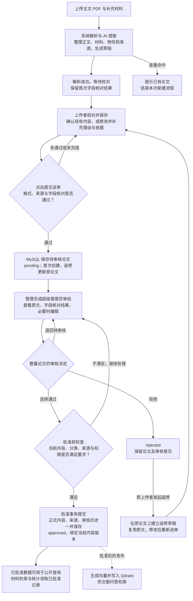

# PDF 解析管线

## 功能说明

本功能描述上传任务从文件接收到生成待校对草稿、再到提交落库与发布向量索引的完整处理链路，是 01 目录的主线文档。文件校验与摄入约束见 [PDF 摄入](pdf-ingestion.md)；晶体结构附件的审核与默认结构选择见 [上传、审核与默认结构](upload-review-and-default-selection.md)。

## 候选合并与完整性检查

当前科学整理复用候选去向，保留原记录、理由及原文来源；程序检查候选完整交代、实际目标和来源，不把整理后未再次出现的旧数字单独判为遗漏。原提取到确定性组装的真实漏项保护继续执行。相关原候选与整理理由进入已有字段科学核对，模型查证压力、方法和独立配对的合并关系；映射完整不授予科学通过。不增加独立核对轮次，当前版本有效结果仍复用。实现与验证边界见[#210](../../specs/210-candidate-coverage/spec.md)。

## 从 PDF 上传到审核入库的主流程

科学记录组装后执行 [#176 固定表单整理](../../specs/176-scientific-form-filling/validation.md)：LLM 联合候选与原文判断重复、方法及配对，并定向查缺；程序检查候选去向、来源和数值保留，随后继续最终 Claim 与字段核对。该职责与只生成论文信息的摘要调用分开。PDF 使用 IR 完整原块，不把 Markdown 定位注释作为证据；不从曲线提取 Tc。模型仍未能确定的内容保留具体诊断，既有草稿不会自动重写。

模型科学字段先按固定清单检查，再添加服务器生成的Tc分组和历史方法元数据；服务器身份不作为模型越界字段拒绝。合法空软件组在对应软件内补值，网格和带单位数量复用已登记字段类型。自动整理或字段核对出现技术失败时保留已有预览和结果，任务显示失败及原因；只有自动流程正常结束才显示待校对。详情、页面摘要与提交共用确定性派生规则，结构文件通过后其晶胞、体积与原子数不再被摘要误报待核对；真实文件变化仍使派生依据失效。摘要只读取投影字段，并在程序内按编号选择当前版本，避免大型来源JSON参与数据库排序。相关旧要求和验证记录见[#176全流程跟进](../../specs/176-scientific-form-filling/full-reparse-20261102.md)。

**[打开 HTML 交互流程图](pdf-review-flow.html)**：统一在“主流程”视图展示主干与主要分支；点击“01 解析与草稿”或解析节点，进入独立的[解析程序流程图](pdf-parsing-flow.html)页面；点击“批准前检查”，进入独立的[批准检查程序流程图](pdf-approval-check-flow.html)页面。子页面用处理节点、菱形判断及连线展示内部控制流、主要分支与失败出口，提供返回主图入口；其他主图节点仍可点击查看概要。HTML 与相邻 CSS、JavaScript 文件可直接本地打开，无需构建或联网。下方保留 Mermaid 图与文字说明，便于在 Markdown 中阅读。

解析程序图中的“生成字段核对结果与候选”可点击，在新标签页打开[字段核对内部流程](pdf-field-evidence-flow.html)，展开批次结果、受限补空、上下文关联、最终版本与来源核对。原始解析区域、采用文本、备选文本和题录来源仍随草稿保存；不再生成独立差异分类或责任待办。

字段核对页同时提供[逐字段规则库](pdf-field-evidence-flow.html#field-catalog)，覆盖题录、分类、叙述、材料状态、结构、四类物性记录、计算条件、开放扩展及独立谱处理。可按中文名称、实际字段键、区域、核对方式或报错关键词筛选；每项显示来源、程序检查、模型职责、候选规则、依赖、故障表现、修正路径及源码行号。目录区分专门过程、共用机制、程序派生与非科学审核元数据；提示词要求不写成程序已经强制保证。开放 payload 与未来自定义字段按模板覆盖，本机发布定义是只读快照，不代表所有运行目标都已有相同定义。

`generate_upload_suggestions` 按字段批进入统一模型工具循环，通常最多20项，含计算条件时最多12项；初始提供最多约120000字符的完整来源块及其余目录，模型可继续读取、搜索或查看原页。来源定位、值、配对、适用范围、补查及纠错由同一流程判断，程序不再用独立文本匹配重新裁决科学支持；实际来源身份、类型、权限、人工保护及版本仍由程序保证。有效结果复用，按批保存；技术未完成不清空其他成功项。初次提取、科学整理、专门归纳、程序派生和整篇批准保持独立，不能按流程框数推算模型请求次数。见[#194](../../specs/194-unified-model-review/spec.md)。

解析只读预览分区发布：题录流只更新论文信息；科学组装、整理和核对分别更新材料与条件。晚到的题录空列表不清空科学预览，失败保留已生成内容；ready后读取正式可编辑稿。阶段同步不新增模型请求或改变表单布局。见[#195](../../specs/195-parsing-preview-sync/spec.md)。

上传 PDF 后，系统先生成可校对草稿；上传者处理字段问题并提交，系统将论文写入 MySQL 等待管理员审核；管理员批准后，该版本才作为已审核数据对外提供。

**“写入数据库”有两个不同节点：提交送审时已创建待审核记录，最终批准时再确认正式内容、来源与审核历史，并标记为已批准。** 解析成功、保存草稿、字段核对通过，都不能代替整篇论文批准。

下图只保留主干及主要分支。用户指定文件角色及历史角色恢复、具体解析工具、单字段操作、附件分配、取消和技术重试等细节，留在后文及关联文档。

### 读图时需要区分的几个动作

| 动作 | 实际结果 |
| --- | --- |
| 解析完成、保存草稿 | 得到可继续编辑的内容。例如提取出某材料在某压强下的 Tc 及原文位置；仍未创建本次上传的待审核论文。草稿、文件、核对结果等可以分别持久化，不等于论文已批准。 |
| 字段核对与人工处理 | 判断当前字段的值、理由和依据能否用于送审。例如修改 Tc 后，只对受影响字段及真实依赖重新核对；同版本有效结果复用。正常输入和保存不启动模型核对。 |
| 提交送审 | 先保存，再检查格式和当前字段结果，必要时核对修改后的字段；全部满足要求才在事务中创建 `pending` 论文、材料状态、物性、结构和来源关联。结构只写入符合确认与校验条件的候选。 |
| 管理员批准 | 管理员和超级管理员是两个可执行审核的角色，不是必须依次通过的两级审批；不能审核自己的论文。当前工作台的编辑先暂存，批准事务将暂存内容、来源、审核历史及 `approved` 状态一并提交；检查失败则保留待处理输入。 |
| 拒绝后返修 | 由原上传者针对 `rejected` 论文发起。复用已有文件，在同一论文 ID 上提交新内容版本，回到 `pending` 再审；“退回待审核”只是保留待审状态，与上传者返修入口不同。 |
| 批准后发布向量索引 | 主业务数据的批准先提交，再执行向量发布。发布失败可以返回 `publication_pending`，已提交的批准不回滚，因此批准成功不代表问答索引已经建立。 |

待审核记录已入库，但不作为已批准科学数据进入材料检索、物性工具和统计。论文列表另按身份控制可见性：登录用户可以查看待审论文，匿名用户只看已批准论文，不能将“待审核”理解为“只有管理员能看”。

本节按当前代码核对主流程，未为编写文档重新上传真实 PDF、调用模型或执行审核。单字段的三个模型入口和结果复用规则见[逐字段审核流程图](../02_Decentralized_Maintenance_and_Verification/literature-and-record-review.md#逐字段审核流程图)，返修细节见[已拒绝论文返修](pdf-ingestion.md#已拒绝论文返修)。

主要实现依据：

- 解析与草稿：`backend/ingest/upload_jobs.py` 的 `_process_upload_task`。
- 校对和提交：`frontend/src/components/UploadTaskEditor.tsx` 的 `saveDraft`、`submit`；`backend/api/rag.py` 的 `_submit_upload_draft_locked`、`_create_pending_paper`。
- 当前工作台批准：`frontend/src/pages/AdminPaperEditPage.tsx`、`frontend/src/pages/AdminPage.tsx` → `backend/api/evidence.py` 的 `commit_field_review` → `backend/services/field_review_commit.py` 的 `commit_review`；拒绝和退回由 `goserver/handlers/admin.go` 的 `ReviewPaper` 处理。
- 返修与发布：`backend/services/paper_revisions.py` 的 `submit_draft`；`backend/api/rag.py` 的 `publish_approved_paper`。
- 论文可见性：`goserver/handlers/papers.go` 的 `ListPapers`；科学记录读取规则见[混合检索](../05_Retrieval-Augmented_AI_Question_Answering/hybrid-retrieval.md)。

高清直接图片在统一模型入口、请求归档及预算之前检查传输边界：超过本机上游已报告的单图30000个32像素块时，按原像素生成有重叠的无损分片，保留原图编号、尺寸、摘要与像素映射；模型输出坐标仍属于完整原图。小图及有效请求不重采样，模型与科学核对规则不变。已用原PDF正文三个面板的新模型请求和IR保存重读验证；历史工具消息、其他端点更小的能力限制及整篇业务验收另按实际范围记录，见[#227分片验证](../../specs/227-scientific-chart-reading/image-patch-limit.md)。

读图v7的柱边追踪允许同色相像素比内部采样更亮，避免压缩或网格叠加引起的亮度波动被误判为柱顶；背景、异色及已有贯穿线保护保留。精读请求带读取版本，旧错误派生来源退出新提取但历史引用仍可读取；原模型定位与实际柱边分开记录。验证范围见[#227柱边修复](../../specs/227-scientific-chart-reading/bar-shading-fix.md)。

上传模型已经输出但流在正常完成原因之前结束时，记录`LLM_STREAM_INCOMPLETE`，保留半截响应并按既有5次预算重发原请求；半截内容或缺少完成标记的JSON不能进入正式结果。正常结束的非法JSON、字段错误及明确长度截断继续停止，不补写内容。范围和验证见[#224断流记录](../../specs/224-resumable-model-requests/stream-incomplete.md)。

## 入口与任务创建

### 科学图表标量读数（#227）

PDF提取在前置收录判断之前读取科学图表：模型结合原图、图注、正文/SI识别图型、材料、系列、物理量与条件，程序按坐标刻度或真实色标像素标定折线点、柱和热力格的读数。当前入口对应既有Tc、λ、ωlog和费米能级DOS来源；标量来源与α²F/phDOS曲线流程分别处理，共用原有校对和批准链。

明确数字标签保留报告值，坐标/色标估读保留约数与可解释读图精度。原图像素、坐标或色标、图号/面板、材料/系列/条件及标定事实保存在原文件身份下的DocumentIR来源块；块文字明确标注原图标定，元数据保留复现事实。读图分辨率与论文的物理测量误差分别保留。被遮挡、缺失或无法标定的点有原位来源及未解决原因。连续线按实际标记或明确条件读数，避免任意采样生成状态。

轴边界按图像位置统一验证并排序，刻度的物理值和升降方向保持原配对。主轴、条件横轴和色标共用边界验证，非法区间、刻度越界与数据越界仍拒绝；来源分别保留模型原始轴及实际标定轴。读图v4重新读取旧版本完成缓存，旧派生来源保留供已有引用，不批量改写历史科学值。实现及验证边界见[#227](../../specs/227-scientific-chart-reading/validation.md)。

独立面板裁剪不会扩大为整幅内嵌图；旧版本派生读数保留来源引用但不参与新提取。相同未读事实保持稳定块身份，全部原回执另留。IR写盘前完整校验；已知v2仅阅读顺序不同的完全相同机器未读重复块可在正常读取时保留原字节和恢复审计后有界恢复，其他来源或内容冲突继续拒绝。该恢复不授予字段支持或业务批准，见[#227验证](../../specs/227-scientific-chart-reading/validation.md)。

读图v5限定当前目标区域，区分目标未读与上下文说明；裁剪外相邻面板的说明保留在覆盖元数据中，不自动成为目标读取失败。真实逐点未读仍保留身份和原因，无面板且无目标未读理由不能宣称完成。旧版本来源/响应保留，重读不回填旧数值；未改变标定、科学字段或人工审核规则，见[#227数据模型](../../specs/227-scientific-chart-reading/data-model.md)。

正文共同概述与图中分材料结果按适用范围整理。前置判断考虑有效图中独立Tc；参考文献标题不会切掉后续SI图、表和附录，本文/引用工作的范围继续由既有模型判断。来源事实进入现有固定表单整理、字段核对和保存，不自动授予科学支持或论文批准。当前值匹配的约数限定在整理及公开摘要中保留；改值或清空不能从旧原文恢复。标准科学键和锁定摘要保持原契约。实施、实际验证及未完成业务范围见[#227](../../specs/227-scientific-chart-reading/validation.md)。

### 结构归属的原文查阅与预算（#224/#204）

结构归属先读候选几何所在的真实原页，其余原文保留可查阅目录，模型按需读取方法页或检索当前文件。未读目录不能当作引用，程序仍检查化学式、压力、物相、结构优化、准确晶格及每状态一份规范结构。来源身份和重复内容可无损传输去重；不可恢复的模型请求错误向上传播，保留检查点，避免以空结构完成态掩盖技术失败。预算不通过时保持必要原文与保护，完整来源不会由摘要替代。

### 文献类型与流程选择（#212）

本文主要贡献由模型按真实内容判断，并从已选来源中给出贡献编号；程序核验编号与正文归属。分窗流程判断及全文二级分类的汇总保留原编号的文件角色索引，区分正文贡献和SI支持，不增加汇总轮次；未改变来源门。未匹配暂停页可由上传者显式重新判断，沿用原模型、输入与草稿版本保护，不强制套用专用流程。章节小标题只是线索，缺少 Abstract、Results 等标题不会单独使有效结果失效。二级分类及后续字段核对沿用可定位的内容依据；历史分类及冻结快照不批量改写。

新任务先进行通用文本/IR读取，用本文正文及补充材料判断文章类型、主要贡献和超导机制，再选择程序登记的流程与对应表单。参考文献中的他人工作、软件名称或孤立公式不能单独决定本文适用性。当前只登记“常规超导理论计算”；匹配后才进入结构、领域候选、材料状态、填表、字段核对和谱处理，复用本轮读取制品。

未匹配、证据不足或判断调用失败进入 `needs_workflow`，处理状态为 `needs_input`。页面展示通用题录、原因和可下载的原文件，不加载科学编辑器或继续轮询，不提供手动套用当前表单的绕过入口。暂停保留已耗时间但不设置完整解析结束时间，活动和清理沿现有24小时机制；这不代表已永久收录。文件读取等技术失败仍进入 `failed`，可重试；尚未选定流程时不能改为手动填写专用表单。

流程身份和表单版本/摘要由程序生成，经草稿、正式提交元数据及整稿快照保留。整体保存继承服务器绑定，局部字段写入不能修改它。已有无绑定资料沿原版本化路径读取，不在打开页面时自动分类、重提或改写冻结历史；重新解析重新判断。未来新类型先复制现有流程作为开发起点，结合真实文献讨论、调试和验收后再登记，不提前建设全部类型。

实现依据：`parsing_workflows.py`、`upload_jobs._process_upload_task`、`paper_revisions.current_draft` 和 `manuscript_handoffs.record_handoff`。本次验证范围和未验收项见[#212验证记录](../../specs/212-typed-parsing-workflow/validation.md)，不以流程判断通过宣称整篇科学解析通过。

- 前端入口是 `/upload`。用户声明一组文件，每个文件带 `client_id`、`role`（`main` / `supplementary` / `attachment`）、文件名和大小；支持 PDF、TXT、MD、CIF、POSCAR，单文件最大 50 MB，同时上传最多 3 个。
- `POST /api/upload-tasks`（`backend/api/upload_tasks.py`）调用 `create_task`：任务状态存入 Redis（带 TTL），同一用户活动任务上限 100；`TASK_ID_PATTERN` 为 32 位十六进制。请求只保存文件声明，不保存界面语言或展示建议副本。
- 上传的原始文件落盘到 `upload_PDFs/{task_id}/`，状态中记录 `sha256`、大小和角色。
- “开始上传并解析”后，任务被推入 RQ 队列 `scwiki-upload`，由 worker 容器（`rq worker --with-scheduler scwiki-upload`）执行 `backend.ingest.upload_jobs.process_upload_task`（`backend/ingest/upload_jobs.py`）。
- 本地开发环境由 `watchfiles` 监视 `backend/` 下的 Python 源码；源码变化时完整重启上传 Worker 子进程，避免长期运行进程继续使用旧模块缓存。Docker Worker 仍随容器启动并使用既有并发配置。
- 上传 Worker 注册队列级异常回调：如果 RQ 在导入或调用业务入口前失败，且对应上传任务仍处于运行态，任务会以 `error_code=upload_worker_execution_failed` 进入可重试的 `failed`，保留失败前阶段并使用固定安全错误摘要；已经由业务流程写入的终态不会被覆盖。
- 入队时把当前请求的 LLM 配置写入独立的 `upload:llm:{task_id}` Redis 瞬态键；Worker 开始处理时加载该配置，解析成功、失败、取消或任务清理时删除该键。公开任务状态最多返回 `llm_provider`，不包含密钥或完整配置。
- `/api/upload-tasks` 在 Docker 部署中由 Go 未匹配路由转发到 Python FastAPI；前端按约 2 秒间隔轮询 `/api/upload-tasks/{task_id}` 与 `/parsing` 获取进度。

## 论文先行、分段执行与来源展示（#228—#230）

当前主入口先读取正文与补充材料，从原文独立填写论文级字段，核对并逐批保存；保存成功后才读取科学图源、判断适用流程并处理材料状态。不确定或缺依据可形成核对结论，技术失败停在论文阶段；不匹配流程时保留已完成的论文结果。论文阶段检查点绑定来源和模型，同输入可复用。材料阶段核对只处理材料字段，不再从状态静默重写已核对的研究材料清单，差异保留为对应字段问题；没有最终全表AI汇总或核对后合稿。上传、返修、正式创建及管理员科学数据保存也保留论文级清单的规范化当前值（包括显式空列表），漏传时沿已有稿继承；只有无绑定且缺该字段的旧请求才兼容派生。

科学分段保留完整原块和表行，正文不固定重复完整前页，附有限完整前文；表格必要邻页说明沿原规则保留。每任务最多两段并发，结果按原编号归位；请求上下文、连接和接收状态独立，上传模型请求共享Redis额度，沿当前上传并发配置。失败、取消及同输入检查点继续生效。并发不等于节省token，也不宣称固定提速比例。

#227读图先逐页扫描并登记图/面板，解析器图区仅作提示；每个目标区域独立读取。图中实际标定位置可在原图上下文中标记，原页轴与图例保留。文字来源在确定块内由程序计算唯一字符区间，区分精确和排版空白等价匹配，重复或未定位不取首个值。侧栏可关闭标记对照原内容；原件共享、图片按需渲染，未新增持久截图。侧栏规则只引用[#221](../../specs/221-scientific-field-sidebar/spec.md)。

界面保留兼容的任务大状态，并额外显示论文读取/填写/核对、图读取、适用性、材料提取/规划/填写/核对及失败暂停的实际阶段。实现和验证边界分别见[#228](../../specs/228-field-source-highlighting/validation.md)、[#229](../../specs/229-semantic-parallel-extraction/validation.md)、[#230](../../specs/230-paper-first-processing/validation.md)；本轮CaH6完整网页交接仍在验证，局部回归不代表整篇科学验收。

## 五阶段状态机

`process_upload_task` 把处理过程划分为五个阶段，`stage_index` 与前端“第 X/5 步”一一对应：

| 步骤 | status / stage | 行为 | 主要产物 |
| --- | --- | --- | --- |
| 1 | `saving_file` | 保存上传文件：接收文件并记录哈希 | 原文件及上传清单 |
| 2 | `extracting` | 读取文档与选择流程：通用读取、适用性判断及所选流程的来源准备 | 文档 IR、带来源正文及流程绑定 |
| 3 | `reading` | 分段提取与出处检查：提取科学候选、必要补证及覆盖检查 | `review_artifacts/{task_id}/` 分段候选、出处及覆盖记录 |
| 4 | `summarizing` | 填写表单与自动核对：论文级字段填写、材料状态与科学记录整理、字段核对、引用匹配及适用的谱处理 | 草稿、核对结果与解析制品 |
| 5 | `ready` | 等待用户校对 | 终态清理排程 |

五步条、任务列表和失败阶段提示共用上述显示名称，后台状态键和阶段编号保持原协议。第 3 步的分段计数只表示候选提取进度；全部分段完成后仍有出处／覆盖检查。第 4 步内部的 `paper_summary` 在科学表单整理与自动字段核对之前填写题录、论文总结和分类等论文级字段，并非核对完成后的最终全表汇总；后续依次进入材料状态与记录整理、字段核对、引用匹配、保存及适用的谱处理，具体当前位置沿用已有解析动态和预览提示。相关运行动态入口见 [#224](../../specs/224-resumable-model-requests/spec.md)。

`paper_summary` 是一次模型调用的阶段名，`paper.summary` 是表单中的论文总结字段；后者属于有来源支撑的归纳内容，不能把不要求逐字照抄理解为不需要科学依据。本次只修正显示名称及说明，不改变解析顺序、模型调用、字段契约或核对规则。

### 第 2 步：读取文档与选择流程（extracting）

- PDF 经 `pdf_extractor.py` 转为带页标记（`<!-- page: N -->`）的 Markdown；TXT/MD 直接读取；已提取过的文件直接复用缓存的 `.md`。
- CIF/POSCAR 原生附件不走文本提取，而是经 ASE 校验（`structure_extractor.build_structure_candidate`）生成结构候选；校验失败的候选标记为 `blocked`，等待人工处理。
- 任务解析生成的结构候选以 `material_state_ref="unassigned:*"` 标记，需在校对页「未分配结构候选」区分配到具体材料状态并确认（`material_state_ref` 变为 `material_states[N]`、`confirmation=confirmed`）后才会在提交时写入 `structure_models`；未确认的候选只作为附件文件保存，不落库。（[Issue #77](https://github.com/JLU-ICCMS-MaYuan/SC-Wiki/issues/77)）
- 非结构 PDF 的正文还会经 `extract_structure_candidates` 从文本中抽取结构候选。
- 多文件任务逐文件处理并更新 `extraction_status`。新任务的角色由三个上传区域确定，服务端以 `file_role_policy=user-specified-v1` 标记并校验一个正文及角色/格式配对，直接使用指定角色，不推断、覆盖或暂停确认。无标记历史任务才保留旧评估与 `needs_role_review` 人工恢复，复用已有提取文本。`compare_file_identities` 随后按最终有效角色比较可信首页标题和论文自身 DOI，结果及来源/规则版本写入 `consistency`；页码、页眉页脚、通用 SI 标题、章节及参考文献条目不冒充身份，无法可靠识别则留空。未知不等于匹配，也不制造冲突。
- 文件身份检查不比较人工校对表单，不调用模型。真正冲突时，提交确认框列出具体文件、字段和两边值；确认令牌绑定当前差异、文件角色及哈希，过期确认不能继续。历史误报仅经已授权定向修正处理，不自动批量重写其他草稿。验证边界见 [#135 身份检查修复](../../specs/135-multi-file-main-detection/identity-consistency-validation.md)。
- 正文为空时直接失败（`论文正文为空，无法生成可校对草稿`）。

### 第 3 步：分段提取与出处检查（reading）

结构化候选先校验计算条件扩展结构，再执行方法语义与原文依据检查。扩展使用带非空键的对象数组；空值／空对象转为空数组，本次已识别的 `electron_phonon → phonon_method` 文本分组有界转为标准数组。其他对象形状、非对象数组项，以及没有阶段标记的已知条件扩展明确拒绝，避免结构错误使检查崩溃或绕过软件归属检查。现有有限纠错和失败次数不变，不能通过丢弃条件或撤销原文检查来获得成功。见 [#172](../../specs/172-phonon-method-parsing/spec.md)。

相关字段修复按 `AGENTS.md` 从必要正文／补充材料来源重跑受影响字段，复用未改动的文字提取，保留失败响应重放与真实字段重新提取两类证据。字段通过不代表全篇覆盖、正式提交或整站验收通过。

覆盖排除清单中只有表号而没有行号的提议不会使整篇提取失败，也不具有有效排除资格；保留诊断后进入逐行检查。未覆盖段落的分类读取完整目标、相邻页上下文和已有记录，不能把跨页续句或已有结果概述误作新数据。直接引句在分段阶段校验，改写公式、拼接文字或不属于声明来源的引句利用既有有限纠错处理，不能推迟到整篇汇总才发现。

- `chunker.py` 把合并前的各文件 Markdown 切成 `Chunk`，`_chunks_with_preamble` 为每个文件补一个前言段；分段清单写入 `review_artifacts/{task_id}/chunk_manifest.json`，每段状态在 `waiting / processing / completed / failed` 间流转。
- 读取前由 `_merge_extraction_windows` 把相邻小段合并为约 12000 字符的提取窗口（`EXTRACTION_WINDOW_CHARS`），页码取窗口起点所在页，再逐窗口调用 `_read_chunk`（使用当前请求选择的 OpenAI 兼容 LLM），减少过细分段造成的上下文断裂与调用次数。分段中的 AI 生成研究材料、方法和核心发现必须为英文；服务端在写入 `review_artifacts/{task_id}/chunks/` 前拒绝这些字段中的中日韩字符。论文标题、摘要和 `quote` 属于来源文本，保持输入语言，不翻译也不拦截；`quote` 可能来自 PDF 文本提取或 OCR，不承诺与扫描版逐字一致。
- 结构化PDF走`structured_chunks`：正常窗口48000字符，单次硬上限500000字符；表格按完整行拆分并保留真实表头、跨行单元格和页内说明，边界补充有界的完整邻页非表格原块。不能再拆的完整原块可超过正常窗口，超过硬上限则明确失败；原文与来源身份不因分段而改写。窗口回归通过不代表模型提取或整篇业务验收通过，见[#114](../../specs/114-multimodal-pdf-upload-agent/spec.md)。
- 分段结果以 JSON 存到 `review_artifacts/{task_id}/chunks/`；未能通过既有有限纠错的科学格式、来源及生成语言错误会使任务失败。不完整的排除提议单独进入覆盖审查，不等于科学结果可放行。
- 每完成一段更新 `completed_chunks / total_chunks`，前端进度条（如“4/28 段”）即来源于此。分段缓存契约版本为 14（`CHUNK_RESULT_SCHEMA_VERSION`），旧缓存重读时重新提取。

### 第 4 步：填写表单与自动核对（summarizing）

- `_summary_classification_candidates` 先过滤掉非当前论文的过期证据，再把分段候选交给 `complete_json(SUMMARY_SYSTEM_PROMPT, ...)` 汇总为一份结构化草稿。
- 理论论文的 `theoretical_subtype` 先检查主汇总给出的结论、理由与本文贡献引句；合格时采用首轮结果，不合格时才由专门 LLM 阅读有效正文与补充材料。参考文献不作本文贡献，只有软件名也不足以确认类型。重试仍无可靠依据时留给人工核对，已有首值保留为待审候选。（[#128](../../specs/128-fulltext-theoretical-subtype/spec.md)）
- 能定位的作者原词保留原语言，标题、摘要、作者、原始数值、单位和 `quote` 保持来源语言。Worker 以验证后的 canonical draft 预填选项框和输入框；某字段无来源依据时保持为空， 科学字段右侧栏功能设计、原话及历史已迁移至 [#221](../../specs/221-scientific-field-sidebar/spec.md)，本处不再独立维护。
- 主汇总同时提炼研究驱动力，按连续编号逐行输出并给出有效主文原句。程序检查格式和引句；首轮合格不发起专门调用，失败才定向重试，并把未读主文、模型未生成、引句未定位、格式不合格等原因分别记录。两次结果无法判优时保留首值和冲突提示。科学记录由分段候选经程序组装，主汇总不得改写 Tc、压力、方法及条件。
- 正文 PDF 在 Worker 中额外提交给本地 GROBID 的 `processFulltextDocument` 接口。GROBID 返回的 TEI `biblStruct` 会提取 DOI、题名、作者、年份和原始引文，随论文版本保存到 `paper_references`；GROBID 不可用或解析不完整时保存状态，不由 LLM 猜造引用边。（[Issue #81](https://github.com/JLU-ICCMS-MaYuan/SC-Wiki/issues/81)）
- `_normalize_draft` 把草稿归一化为当前数据契约：论文元信息（含单选 `superconductor_kind` 和多选 Material family）、`material_states`（材料、压强/温度/磁场、计算与实验上下文、`tc_results`、More type labels）、分类证据等。旧草稿的状态级 `superconductor_kind` 只在读取时一次性提升：唯一的非 `unknown` 值保留，冲突时回退 `unknown`；新提交拒绝该旧字段。
- 化学式解析（`parse_formula_composition`）支持括号分组与 Unicode 下标，拒绝不配对或空括号；材料字段只在能唯一确定完整化学式时写入化学式（如 `(H2S)2H2` 不再截成 `H2S`），否则原文保留为材料名，替代式的元素数按组分统计；与空间群符号查表一致的空间群编号、晶系作为派生核对项随符号核对。（[Issue #120](https://github.com/JLU-ICCMS-MaYuan/SC-Wiki/issues/120)）
- 汇总后执行查重：先按归一化 DOI（`normalize_doi`）查 `papers`，再按原始文件 SHA-256 查；命中即进入 `_handle_duplicate`，任务以 `duplicate` 状态短路结束。
- 草稿写入 Redis（`save_draft`），同时把 `ai_values` 与证据快照（分类证据、材料状态各字段证据）写入 `review_artifacts/{task_id}/result.json`。
- 当前本机 S3 模式下，Worker 从对象键按需取得原文件，解析产物完整上传后才把版本化 `artifact_manifest` 发布到任务状态；节点内 Markdown 与 JSON 仅供本次执行使用。正式送审的 `result.json` 使用按任务 ID 可找回的私有对象键，任务状态过期后审核 API 仍可读取。
- 理论二级类型的临时全文分析由服务端保存，含综合理由、可定位支撑片段、模型和来源版本；客户端修改当前值不能伪造分析资格。该字段的来源核对把片段标为全文归纳依据，不称论文逐字记载的枚举；仅 Methods 或软件名不能独立授予 `supported`。本机 H3S 草稿已定向复核为 `calculation`，理由同时比较结果、讨论与方法；正式已批准论文未批量修改。

### 汇总后、等待核对前：引用匹配

程序以已解析原引文确定明确的库内书目关系；疑难候选固定交给LLM2批量核对，并同时核对库内谁引用了当前论文。结果与理由按输入签名持久保存，完成后再进入ready。解析页可在新标签查看三列匹配结果；读取和普通保存不发模型。失败及停止沿#224既有机制处理，原始引文与用户草稿保留；尚未审核的论文不提前形成公开边。实现、隔离验证及业务迁移边界见[#225](../../specs/225-citation-matching-and-static-graph/validation.md)。

### 第 5 步：等待用户校对（ready）

- `processing_status=succeeded`，任务进入可校对状态；`_schedule_terminal_cleanup` 通过 RQ scheduler 排程终态清理。
- 取消（`cancelled`）与失败同样进入终态清理排程；业务解析异常使用 `error_code=paper_processing_failed`，RQ 入口边界异常使用 `error_code=upload_worker_execution_failed`，两者都记录 `failed_stage` 并可在文件仍有效时重新解析。清理由 `cleanup_upload_task` 执行。

## 任务详情入口

上传记录在文件名旁显示“提取内容用时”，按任务累计整组文件从后台开始正文提取到进入等待校对的运行时间，
覆盖分段读取、汇总与解析阶段字段核对。上传、排队、等待人工确认正文角色不计入；确认后恢复解析继续累计。
解析中按秒显示，进入等待校对、失败、取消或发现重复时固定，重新解析开始新一轮计时。
完成后的刷新、重开与编辑不会改变用时。尚未开始的新任务显示“尚未开始”；旧任务缺少可靠记录时显示“未记录”，不进行历史回填。
同一记录行在用时旁显示本轮“解析 token”，支持查看输入与输出明细。后台按实际模型回执累计本轮自动解析、谱读图、原生PDF模型转录和上下文摘要的消耗；有用量回执但解析输出失败的请求仍计入，本地缓存或检查点复用不重复计数。
新任务及显式失败重试初始化统计，暂停后同轮继续保留累计；旧执行迟到回执不得写入新轮。部分请求缺少用量时显示已记录值并标注“统计不完整”，全部未知或历史任务没有记录时显示“未记录”，不以字符数估算或伪造0。记录随现有任务状态及受保护快照恢复；后续独立人工核对和手动重提不改变本轮消耗。
本机验证覆盖实际SDK、隔离持久化/恢复及中英文窄屏页面，并以一次真实模型39输入/5输出/44总token核对；不代表整篇PDF或生产部署验收。详情见[#170 token验证](../../specs/170-upload-extraction-duration/validation.md#2026-11-09token记录与显示)。
列表每3秒在上次读取完成后检查仍可能变化的任务，浏览器后台节流可能延迟更新，重新获焦立即刷新。
计时随任务状态保存在Redis，已有受保护草稿的状态快照也保留该字段；未产生受保护快照的任务仍受既有Redis保留边界约束。
本功能通过状态与存取测试、SQLite快照恢复、真实上传页面的隔离浏览器验证及前端构建；未执行生产部署或外部PDF解析服务验收。
详见 [#170 验证记录](../../specs/170-upload-extraction-duration/validation.md)。

上传页只保留上传与任务概览；点击任务条框普通区域，在新标签页打开 `/upload/tasks/:taskId`，原页面继续保留待上传文件与选择状态。详情由地址任务和服务端权限确定，不再依据浏览器旧活动任务缓存展开。账号或任务变化时重建工作区，旧请求的迟到响应不覆盖新目标；无权限或任务失效时不展示旧表单。已提交任务沿用正式论文跳转。

详情复用既有解析进度、分段结果、校对编辑、来源核对和提交功能，顶部提供“返回上传记录”。主表单未保存或保存中时，关闭标签页、刷新或通过普通返回链接离页会触发浏览器保护；人工证据草稿继续使用原有保护。浏览器可能限制原生提示，不能保证强制结束进程时保存未完成输入。原列表重新获得焦点会刷新任务索引；不新增数据表或任务接口。验证边界见 [#140](../../specs/140-upload-task-detail-page/validation.md)。

## 用户校对与提交落库

### 原始来源保留与字段核对

解析管线保留原 PDF、IR、采用文本、备选版本、题录差异及来源定位，不将原始区域数转成用户待办。含历史 triage 的旧草稿仍可读取和保存， 科学字段右侧栏功能设计、原话及历史已迁移至 [#221](../../specs/221-scientific-field-sidebar/spec.md)，本处不再独立维护。

科学表单沿用 #109：正文保留当前值、紧凑字段标记和待处理计数，输入错误、保存失败、权限和版本冲突仍按原规则显示。 科学字段右侧栏功能设计、原话及历史已迁移至 [#221](../../specs/221-scientific-field-sidebar/spec.md)，本处不再独立维护。
来源查看、单字段核对、人工决定、提交及批准边界保持。

出版年份核验继续保留。年份分歧或疑似下载／打印日期时，服务端核对原 PDF 摘要，使用同 DOI、同标题且出版日期年份一致的 Crossref 资料；GROBID 缺 DOI 时必须在同源 PDF 首页找到草稿 DOI。查询失败、原文件不可读或身份不符不伪造成功。原候选、下载日期和来源保留，题录修正不等于科学字段审核通过。撤回范围及实际验证见 [#180](../../specs/180-remove-parsing-triage/validation.md)。

### 保存与提交

- 用户校对后先保存草稿，再执行共享的物性证据预检查；正式提交调用 `POST /api/rag/upload-tasks/{task_id}/submit`（`backend/api/rag.py`）。保存与提交共用任务锁，重复提交按已提交结果幂等返回。创建、文件上传和任务状态查询仍使用 `/api/upload-tasks`。
- `_create_pending_paper` 在一个数据库事务内完成：
  - 创建 `Paper`（`review_status=pending`、`content_revision=1`、`upload_task_id` 关联任务、论文级 `superconductor_kind`）与 `PaperFile`（角色、存储路径、SHA-256、排序）。
  - `persist_scientific_draft`（`backend/ingest/scientific_drafts.py`）把草稿落成科学实体图：`superconductors` → `material_states` → `structure_models`（含经用户确认的原生 CIF/POSCAR 附件，服务端重新 ASE 校验并以常规晶胞 CIF 为规范表示，不信任浏览器提交的校验/哈希字段）及 `property_modules` → `property_records`，并返回证据链接目标。计算和实验条件保存在各记录的 `payload_json`。
  - 预检查和正式提交共用 `source_chunks` 分段及页码传播；按文件、片段、页码和原文引句联合定位，写入 `paper_chunks`、`paper_evidences` 并挂接 `add_scientific_evidence_link`。同页多个片段通过引句区分，过时片段编号可由同文件唯一引句重新定位；不能唯一定位时返回记录路径与具体原因。
  - 经核对的多条证据及模型结论由后台保存到 `scientific_evidence_checks`；提交事务按稳定身份转接到正式论文，统一十进制摘要避免精度表示导致重复核对。
  - 违反完整性约束时整体回滚，返回 409 `scientific_data_integrity_error`。
- `_record_submitted_upload` 把 `ai_values / user_values / evidence` 快照写回 `result.json`，`cleanup_transient_data` 清理临时数据但保留审核快照；任务状态置为 `submitted`。

## 提交前补证与核对

上传解析完成首次字段核对；编辑和“保存”只保存实际变化，不在页面打开、输入或保存后启动科学重核。科学字段右侧栏功能设计、原话及历史已迁移至 [#221](../../specs/221-scientific-field-sidebar/spec.md)，本处不再独立维护。

- 字段提示规则及相关历史已迁移至 [#220](../../specs/220-field-red-marking/spec.md)，本处不再独立定义。
- 未修改且当前版本尚待确认的字段同样可直接人工通过。已通过或免审的灰色按钮旁显示明确状态；修改待核对不以灰色冒充完成，缺少人工记录或未完成模型核对时明确拒绝。通过后未变化的字段提交直接复用。
- α²F、phDOS 解析结果随论文提交保存，不要求逐谱审核，不参与提交模型核对；其质量提示不阻断送审。
- 最终保存同步迁移当前字段审核及依据，不再被旧空间群/结构引句重新拦截；文件编号转换不等于科学来源改变。作者角色及分类选择保留，送审快照按论文 ID/版本归档，与原解析产物分离；任务清理后可读，重复提交不新建论文。
- 保存修改理由和证据或无证据说明， 科学字段右侧栏功能设计、原话及历史已迁移至 [#221](../../specs/221-scientific-field-sidebar/spec.md)，本处不再独立维护。
- 点击提交先做程序检查，再只核对尚未核对的人工修改；同版本有效人工通过、解析通过、主动模型通过和免审空值直接复用。
- 原样科学不通过或未解决项目继续阻止提交；模型失败给出对应字段、具体理由和依据，技术故障不伪造科学错误。已有通过项保留。
- 主动核对只处理当前字段，成功保存通过结果；提交时内容未再变化则复用。修改记录缺项明确提示，未修改主动核对不要求新增修改理由。

核对记录持久保存在 MySQL，来源类别、原文及历史保留；普通说明或旧接受标记不能冒充正式人工决定。三个流程图见[论文与记录审核](../02_Decentralized_Maintenance_and_Verification/literature-and-record-review.md#逐字段审核流程图)。

字段提示规则及相关历史已迁移至 [#220](../../specs/220-field-red-marking/spec.md)，本处不再独立定义。

模型归纳、分类和提炼字段由服务端标记 `check_mode=synthesis`。当前值有具体核对理由且来源有效时，也不回退成“原文直接记载， 科学字段右侧栏功能设计、原话及历史已迁移至 [#221](../../specs/221-scientific-field-sidebar/spec.md)，本处不再独立维护。
理由空缺或仅有套话时显示重核提示，不单凭引句授予模型归纳的支持资格。作者原列关键词、原文摘录、确定性派生和人工改写仍按各自来源显示。 科学字段右侧栏功能设计、原话及历史已迁移至 [#221](../../specs/221-scientific-field-sidebar/spec.md)，本处不再独立维护。
未人工批量改写旧论文。

人工修改的理由与证据独立于论文原文保存。当前编辑区只显示“人工修改判断理由”及互斥的“提供证据 / 不提供证据”选项：提供证据时上传 PNG/JPEG/WebP 图片、UTF-8 TXT/MD 文本文件或有效 PDF；不提供证据时填写缺证理由。文件来源说明由文件名生成，无须另填；单文件最大 10 MiB、单字段最多 5 项。旧直接文字证据仍可只读查看。草稿可暂存不完整说明，明确提交时每个实际修改字段均须填写简短理由，并按当前附件或缺证理由校验；改回原值不要求新说明。人工修改仍须经主动或提交时的模型核对，通过后才可送审，不会把人工说明改称原文支持。文件通过鉴权接口预览，不进入论文原文检索语料；可搜索 PDF 的文字实际进入审核输入后才标为 AI 已读，无文本层时保持未读。部署需先执行 `20261009_0126` 迁移。

人工证据区支持文件选择、拖拽 PNG/JPEG/WebP、UTF-8 TXT/MD/PDF，以及区域聚焦后的截图粘贴（`Cmd/Ctrl+V`）；三种入口共用人工附件校验与上传。主表单修改后即可显示人工说明或待同步入口；查看不调用模型、不保存主表单，明确保存/上传时才先保存主值、刷新字段版本、再写说明及文件。会话草稿按目标、稳定字段和值隔离， 科学字段右侧栏功能设计、原话及历史已迁移至 [#221](../../specs/221-scientific-field-sidebar/spec.md)，本处不再独立维护。
分阶段失败如实反馈并保留待处理项，未上传文件不能被称为已保存；已保存内容刷新后从服务端恢复，离页有未保存人工输入时提示处理。见 [#138 验证与边界](../../specs/138-manual-evidence-input-reliability/quickstart.md)；Safari 与真实 MySQL 完整业务链仍待验收。

后台把各字段结果及已定位证据写入核对存储；未找到证据的判断也持久保存。已核对草稿及必要原文不按普通 TTL 清理，刷新、离页和缓存丢失后均可恢复。正式提交仍按版本和权限重新校验。

等待后台核对时持续显示进度条与已等待时间。排队和未知总量显示动态等待条，开始分组后按实际完成组数
显示“已核对 X/Y 组原文”和百分比，并提示当前正在核对哪一组。计时不会推动完成百分比，取消与超时流程保持有效。

## 审核通过与向量发布

- 提交后的论文进入待审核队列，审核决策属于 02 目录的论文与记录审核。
- 审核通过后，管理员调用 `POST /api/papers/{paper_id}/publish`：`embed_and_index_chunks`（`backend/ingest/embedder.py`）把 `paper_chunks` 内容向量化并写入 Qdrant `paper_chunks` collection，此后 RAG 检索可用；论文未通过审核时调用返回 409 `paper_not_approved`。

## 实验条件提取

分段和全文汇总共用实验条件提示：以样品、制备方式、测量方法、测量装置、外场和压力不确定度
六方面引导 AI 输出英文自由描述，只使用原文事实，不要求六项齐全，不把缺失条件补成猜测。
每条测量 Tc 的条件分别写入该条 `experimental_conditions.description`，经既有草稿转换进入
`property_modules[].records[].payload.experimental_conditions.description`。同材料状态下的多条
测量结果不共享或相互覆盖条件；预测 Tc 保持计算 Conditions。分段缓存契约版本为 14，旧缓存
重读时重新提取。对应表单采用单个多行框；定义版本继续保存在数据内。（[Issue #94](../../specs/94-property-record-editor/spec.md)）

此链路通过模拟 LLM 返回、执行真实分段与汇总调用、草稿归一化、记录校验、SQLite 持久化及导出
验证；外部模型针对具体论文的输出质量仍需据原文审核。

## 当前边界与待核验

- 旧 Neo4j 作者及其他论文关系同步（`backend/ingest/sync_neo4j.py`）仍不在上传链路中自动触发；材料 `STUDIES` 同步已由 [#127](../../specs/127-retire-material-relations/spec.md) 移除。Issue #81 的论文引用图不依赖旧同步，公开查询直接读取 MySQL 中的 `paper_references`。
- `backend/ingest/PIPELINE.md` 描述的 `enrich_papers.py` → `clean_results/*.json` → `key_properties` 链路属于旧 `pipeline.py` 摄入路径；当前多文件上传链路不经过 `enrich_single` 与 `key_properties`。
- 解析质量依赖服务端默认 LLM 配置（`LLM_*` / `DEEPSEEK_*`）或用户请求中的临时配置；向量化发布仍独立依赖 Embedding 配置（`EMBEDDING_*`）与 Qdrant，用户供应商切换不改变 Embedding。

## 代码与测试

- 任务 API：`backend/api/upload_tasks.py`；提交与发布：`backend/api/rag.py`。
- 解析主流程：`backend/ingest/upload_jobs.py`；任务状态与存储：`backend/ingest/upload_tasks.py`、`upload_contracts.py`。
- 提取与分段：`pdf_extractor.py`、`chunker.py`、`extractor.py`；结构候选：`structure_extractor.py`；落库：`scientific_drafts.py`；向量化：`embedder.py`。
- 测试：`backend/tests/test_upload_workflow.py`、`tests/01_decentralized_uploading/`；其中 `test_issue91_upload_worker_recovery.py` 使用隔离 Redis 和真实 RQ Worker 覆盖入口导入失败边界。
- 现有 sc-wiki MySQL、真实模型及页面验收记录见 [#103 验证路径](../../specs/103-property-evidence-review/quickstart.md)。 科学字段右侧栏功能设计、原话及历史已迁移至 [#221](../../specs/221-scientific-field-sidebar/spec.md)，本处不再独立维护。

理由/候选连续输入合并保存，失败暂停自动重试并保留输入。 科学字段右侧栏功能设计、原话及历史已迁移至 [#221](../../specs/221-scientific-field-sidebar/spec.md)，本处不再独立维护。
上传者和管理员可按当前版本认可现有内容，正式人工通过供提交复用；修改记录仍需填写说明并通过模型核对。上传者的字段确认不代替管理员对整篇论文的最终批准。未核对草稿不会让后台漏查。

字段来源按 `paper_quote`、`paper_inference`、`general_knowledge` 区分直接记载、论文推断与通用知识推测；后两类经校验后自动补空值，保存与当前内容版本绑定的 AI 理由，不覆盖非空提取值。来源核对页不重复表单值， 科学字段右侧栏功能设计、原话及历史已迁移至 [#221](../../specs/221-scientific-field-sidebar/spec.md)，本处不再独立维护。
内容或来源变化后历史只读可查，批准后仍保留来源类别和人工理由。科学字段右侧栏功能设计、原话及历史已迁移至 [#221](../../specs/221-scientific-field-sidebar/spec.md)，本处不再独立维护。

## 唯一四工具默认解析与区域证据

上传页不再提供方案选择，新任务固定 `parser_profile=complementary`。MinerU 4.0.6 basic OCR 是完整正文/补充的主干；Docling 2.130.0 CPU 补强表格页，Marker 2.0.0 本地 Surya/llama.cpp 补强公式/图像、破损文字和空页。材料候选已明确引用的真实备用原块按文件、页、版本、摘要和引句补入填写的只读来源视图，原IR主备路由保持；未引用备用块和派生读图事实不据此混入原文，后续来源门与科学核对保持。GROBID 分别读取当前论文 header、参考文献表和正文引文目标；有效正文题录优先使用 GROBID，缺字段经原文提取和人工核对。四个解析工具本地运行，DeepSeek 接收选中内容做科学提取，JSON 请求显式关闭 thinking；Marker 的额外 LLM 修订关闭，本地 VLM 仍运行。

新 API 仅接受缺省/null/complementary，其他值返回 422。历史任务沿用已有方案及 IR，不自动重解析；TXT/MD 与结构附件保留原路由。其他适配器保留供历史内部读取，不作为新用户可选项。

重型解析在独立子进程运行，默认 900 秒超时，取消/超时先给清理机会再终止进程组；失败保留解析错误码，不换
其他全篇方案。补强裁剪原 PDF 页并映射回原页号，实际请求页和跳过理由保留。GROBID HTTP 请求前后检查取消，单请求最长 90 秒。成功结果保存任务 IR，再产生带页码的文本供分段读取。新方案不复用旧
Markdown；分段缓存检查方案和文本摘要。区域统一为左上原点 PDF 点坐标，缺少表格
单元格坐标时只保存行列、跨度和限制。
互补 IR 保留全部原始块、原引擎版本、来源类别及差异；常规读取使用选中块，必要冲突按下述规则交接，覆盖计数只统计选中区域。原始 JSON、日志和组件账本按唯一运行目录留存；提取尝试分别保存原模型响应。校对页可展开解析差异。

必要冲突在失败续跑时定向交接：旧提取明确无法读取的主干块，可附同页同区域的已保存备选原块和经SHA核验的PDF原页重新提取；不改写OCR或按引擎优先级替换科学答案。重提窗口保留原块去向和备选引句，完整IR校验引用，覆盖计数仍只统计主干选中区域；仍未解决则继续报错。同输入有效结果复用，原页、提示和契约变化参与交接缓存身份，见[#136计划](../../specs/136-complementary-pdf-parsing/plan.md)。

规划与初始提取的物相归属冲突也可回交遗漏的原始上下文：只交接同文件、同材料/压力且该窗口实际拥有记录的原块与原页，不把规划答案当来源、不直接覆盖条件。读图升级保留旧块时，通过原文件/页定位当前上下文，旧派生值不进入新提取；原有跨物相保护及科学核对保持，见[#136计划](../../specs/136-complementary-pdf-parsing/plan.md)。
本机 macOS 的上传 RQ Worker 使用 `SpawnWorker`，避免 fork 后加载 PDF/ML 原生库引发异常退出；
workhorse 意外结束时上传与来源核对任务都收敛到失败态，不继续显示运行中。

新 PDF 任务按连续页读取完整 IR 块与表格单元，使用版本 1 领域契约直接生成
`property_modules[].records[]`，不经过旧 tc_results 中转。未知方法保持 unknown，
每条结果保留独立条件与多页证据。全文汇总只生成书目与叙述，后端对科学候选精确
去重和组装，不由汇总模型重写数值或合并不同条件。TXT/MD 保留原提取与有界转换。
科学引用可显式选择输入块 `quote_id=block_id`，服务器仅从本次文件/页/块映射展开原文，避免模型改写 LaTeX；位置有效不代表语义成立。范围参数写入 `parameters.extensions`，不取端点作标量；Tc 的明确压力错挂被拒绝。
关键词先在当前论文主文查找明确的“关键词 / Keywords”栏；找到且可定位时，按作者原词和顺序预填，包括中文原词。未找到可靠列表时，专门流程读取全部有效正文窗口，排除参考文献后提炼 3–8 个英文词，并保存代表性原文片段；任一窗口阅读失败、正文不足或证据无效时留空并说明原因。人工改值不复用旧分析； 科学字段右侧栏功能设计、原话及历史已迁移至 [#221](../../specs/221-scientific-field-sidebar/spec.md)，本处不再独立维护。
Tc 以外的自动物性仅接受 `band_gap`、`dos_fermi` 两项，并归入电子性质专用定义；未注册的非 Tc 项带原文位置与理由留在覆盖审计，不自动进入自定义性质。该定义需要应用 `20261009_0115` 迁移，既有用户自定义记录不受此限制。
上传校对页重新获得焦点时会重读同一任务草稿及来源状态，让后台或协作补入的关键词出现在已打开的页面；存在未保存编辑、保存中或提交中时不覆盖本地输入。刷新失败保留当前草稿，下一次获得焦点可重试。
旧文本解析方案产生的未注册普通物性同样只留在 `unclassified_properties.json` 审计产物；不会改写此前已保存的用户自定义记录。结构表按物相拆分，已验证的空间群允许补足其晶系强制约束的晶胞参数，并在候选推导信息中标注；空间群和压力唯一匹配时才自动绑定材料状态。
领域候选转为 Claim 后，校验文件、页码、解析器版本、来源类别、块、区域
和原文；未知或有歧义的定位不自动通过。覆盖检查独立记录未覆盖页、结果段落、表格行
及图像/公式。有限补证只给同值候选补已验证出处，最多 12 次工具行动，每工具最多
2 次重试。仍有问题时保存检查产物并使用既有 failed 终态，不伪造 ready。
`ir_ready`、`claims_ready`、`coverage_checked`、`needs_review` 只作为 reading 子状态，
原五阶段不变。原文定位通过不代表科学语义正确，提交与批准继续经过现有核对和人工边界。

2026-10-08 实测（2014 H3S 主文 + 补充材料，Docling 2.130.0 CPU）验证了上述边界：
两个文件均成功产出 IR（合计约 3 分钟，含首次模型权重加载）；领域提取提示词原先未
给出 `method_code` 合法枚举，模型输出自由文本方法名导致契约校验稳定失败，现已把
predicted/measured 方法枚举写入提示词，服务端再把常见同义写法映射到枚举、无法识别
回退 `unknown` 并在 `method_raw` 保留原文，不再因方法名丢弃整篇解析。

覆盖检查自 2026-10-09（#122）起支持显式排除：领域提取契约新增 `coverage_exclusions`
（块/表行/页定位 + 受控类别：非结果内容、背景引用、无数据图、表头/单位行、模型范围外、
无法读取 + 理由），提取后对仍未覆盖项执行一次定向分类调用（每文件一次），明确非结果的
项转为带理由排除，确实需要提取的超导数据保持未覆盖并按文件计数写入失败信息。分类调用使用固定输入身份及条目数的严格输出，遗漏、重复、未知身份或非法类别不作为有效部分答卷；输入及逐尝试响应分别留证。被排除项
不再计入未覆盖；`unreadable` 类别、以及疑似结果段落被大面积申报为"非结果内容"（超过
50% 且疑似块不少于 4 个）时保留人工复核。文本层为空的图/公式块是当前方案不读图像的
能力边界，只记录计数不要求覆盖。排除不是证据，全部处置（类别、理由、定位）记入
coverage.json 供审计。2014 H3S 实测：补充材料覆盖检查 complete（45 行晶格/坐标表
诚实标注模型范围外），主文仅剩 1 项需提取的谱函数段落明确列出，不再无差别整任务失败。
科学内容超出当前模块（能带隙、晶格参数、谱函数）时按 `out_of_model_scope` 记录，
后续注册相应模块后自然转为候选。

正式提交在原论文事务内保存 IR、文档块和 `paper_evidence_locators`，定位重新绑定
当前论文文件。升版沿现有当前代级联规则更新，不提供旧 revision 全文档案。服务端校验目标归属和源文件哈希，
返回从原 PDF 直接渲染的 300 DPI 局部 PNG 与高亮区域； 科学字段右侧栏功能设计、原话及历史已迁移至 [#221](../../specs/221-scientific-field-sidebar/spec.md)，本处不再独立维护。
图片按原始像素尺寸滚动，点击可弹出更大视窗，再点击缩回；
截图不保存。旧 `legacy` 来源虽未保存 IR 区域坐标，但可在点击时校验原 PDF 哈希，
文本层唯一匹配后补出实际页码；旧解析页码与 PDF 不符时以原 PDF 为准。没有文本层、
引句重复、文件变化或渲染失败时明确说明原因，原有引句仍可查看，不猜测位置。
当前待审标题优先核对正文主 PDF 首页，作者优先核对首页署名；已批准论文不批量改写。
历史审核条目不因此获得旧版本 PDF 浏览能力。

本地解析子进程给`NO_PROXY`/`no_proxy`追加回环直连条目，保留原排除项及外网代理；主进程GROBID健康、题录和旧引用入口也仅对回环目标直连。父进程环境和系统代理不改，非回环目标沿原代理配置，避免本机服务健康却被系统代理返回502；真实partial等元数据状态继续保留。真实原PDF及IR重读范围见[#136验证](../../specs/136-complementary-pdf-parsing/validation.md)。

四工具默认已按维护者 2026-10-14 的明确确认接入，真实 H3S/补充和 CaH6 的边界见 [四工具验证](../../specs/136-complementary-pdf-parsing/validation.md)，不以少量案例宣称所有版式准确率。原生 PDF LLM 质量不属于当前默认验收。此前隔离环境
已通过 HTTP/JWT、Redis/RQ、MySQL、Go 审核与返修端到端；模型响应固定注入，向量
发布使用测试替身。本机已执行 #114 三张定位表的增量迁移，不代表其他部署实例已
升级。验证范围见 [#114 验证记录](../../specs/114-multimodal-pdf-upload-agent/validation.md)。

维护者可用 `python -m backend.ingest.pdf_benchmark` 对逐篇积累的标注与成对运行结果做离线
比较，生成逐论文/逐类别的记录 F1、条件关联、区域定位、漏记录和资源报告。失败或
缺失论文保留分母，重复预测不能加分；缺少实测资源时保留空值。默认门要求版本 1
逐论文明细报告，核对当前已出现的类别不退步；未出现类别保留未验证状态。合成集及只有汇总数字的早期报告不能开启默认门。此工具不启动完整上传任务，
也不证明人工标注或独立事务验收的真实性；当前仍无真实基准报告。

配套 `pdf_benchmark_runner` 可调用本机 API 批量上传固定文件清单、轮询实际 Worker、
按原文件哈希导出 AI 初始结果与 IR 区域，并逐篇落盘。不会提交或批准论文，缺少
Token/GPU/费用实测数据时保持为空；CPU 只记录 Worker 进程自身时间。

历史 `UPLOAD_PARSER_STAGE=shadow` 对照能力保留；新任务不走 legacy 默认/灰度选择。历史对照先复制并校验同一上传文件，
再使用配置的新方案生成内部产物。用户旧草稿、凭据、缓存及任务列表与对照隔离，
对照任务不能通过公开 API 补证或提交，不写科学数据库。结果比较只使用两份 AI 初始
产物，保存差异与失败原因；新方案失败不改变父任务，父任务取消后对照停止。
多个 Worker 可并行执行，单 Worker 顺序执行。完整灰度重新选择/回退验收仍待完成。

返修或管理员编辑采用新引句时，共享持久层在当前 IR 重建区域关联。后续迁移
`20260924_0114` 补齐 Tc 方法定义，本机已新增 9 个缺失定义，核对原定义校验和未变；
没有改写科学记录。回退应用保留已发布定义，避免破坏记录引用。

## 表格参数与共用计算设置

提取按表行联合读取表头、分组、单位、表题及表注，保留近似与原行身份；λ、ωlog 和 μ* 在逐结果边界归一化，不从状态级广播到不同方法。明确反向 Tc–μ* 配对使用两端控件，未配对范围只保留报告范围。过大结构化表按完整行组读取，无法分开的原块保留预算失败。

最终直接 Claim 门之后，共享上下文读取全部有效 main／SI 原块，先提取可定位的原子设置，再由当前任务模型判断各结果的适用／排除范围。主 EPC 字段与结构优化、SSCHA、AIMD 等阶段扩展分开；推断维持 uncertain，已有局部或人工值不覆盖，未报告参数留空。参数值与适用范围在现有来源理由入口分别定位。

来源关联随现有 payload JSON 保存，提交时转换文件 ID；科学值、物相／压力、有效文件 SHA 或角色变化使旧解释失效。同一标准空间群符号补出一致群号视为等价。大 JSON 核对结果按 ID 保持版本顺序，避免在 MySQL 中对整段 JSON 排序；没有新增表、定义迁移或数据库全局配置。

页侧原生文字层明确确认为下载 URL 水印、文件 SHA 与区域匹配且未被科学 Claim 引用的窄长版面块，可记录为非结果排除并保留核验信息；不可读科学内容、无原生文字层或文件不符仍走人工复核门。稳定区间不替代逐结果明确压力，通用字段的分批核对失败保留原因且不阻断独立 Methods 关联。

La–Sc–H 已通过表格／Methods 专项、隔离 MySQL、正式组件浏览器及完整 Worker 验证；最终真实任务 ready，7 个压力状态中的 8 行参数和阶段条件逐项比较通过，详见 [#139 验收记录](../../specs/139-table-parameters-shared-methods/validation.md)。总结／研究驱动力仍可能要求人工核对；历史人工草稿不批量重写。

### 已完成草稿的受控重跑

内部重跑指定原草稿内容哈希时，保存前在任务锁内再次核对；期间发生编辑会拒绝覆盖当前草稿和解析初稿。普通解析与既有重试次数保持原流程；本次原任务恢复与字段收尾证据见 [#172全流程验收](../../specs/172-phonon-method-parsing/full-run-validation.md)。

## 方法字段的适用范围

结构工作流关联只更新优化目标、实际几何约束与对应来源，不决定物性记录的近似。电子理论、声子技术和振动处理分别提取；EPC条件仅在其材料、相、压力、阶段及结果关系成立时复用。多压力图题中的单个标量不能任选压力；跨页文字须连同相邻页读取。

新生成不使用混装approximation；旧值只作历史读取。提取、整理、条件补空、局部写入及来源核对均检查类别与范围；明确电子—声子修正可保留，但不能靠自造引句建立关系。错类字段保留问题和原始响应，不删除带隙、DOS、Tc或人工记录来获得通过。详见[#181验收](../../specs/181-physical-method-scope/validation.md)。

## 题录补全与基础字段模型查证（#196—#200）

统一核对工具循环可按当前论文DOI读取Crossref正式题录，由模型结合原文DOI与标题确认身份后补卷期页。外部题录保留独立来源链接，不能冒充PDF原句或早期版页码；查询失败不伪造完成。GROBID连接失败保留具体类别，Worker启动检查当前服务，历史任务结果不因服务恢复被改写。

未知超导类型也进入模型核对，声子介导机制可支持常规分类并保留论文推断身份。元素数、晶系、群号及压强由同一模型流程结合原文、计算或查表依据核实，不因可推导而跳过；模型读取当前材料、压力和结果点，不能以150 GPa段落否定200 GPa结果。通过结果绑定最终版本后保存复用，已有人工决定受保护。

字段提示规则及相关历史已迁移至 [#220](../../specs/220-field-red-marking/spec.md)，本处不再独立定义。

模型核对物性子项时同时获得实际记录类型、物性代码和扩展字段键值，避免把声子条件放入电子DOS，或在论文中搜索程序内部键名。本机原CaH6稿已完整重跑并自动补核，必要未完成项为0，三项人工确认及SQL／Redis一致性已验证；未报告的可选值保持空。运行边界见[#199本机记录](../../specs/199-basic-field-model-review/runtime-application.md)。

## 新版字段与规范结构（#203/#204）

### AI生成时的固定字段限制（#205）

结构化PDF分段提取和科学候选整理通过严格JSON Schema限制输出，嵌套科学字段取自#203清单；模型不能创建人工扩展或服务器身份。字段结构不合规时本地拒绝，保留原响应，不为新增键再调用模型纠错；接口拒绝严格模式时明确报错，不静默降级。已有来源范围、科学语义判断与查源流程保持，结构合法不代表科学结论正确。

模型输出限制只作用于上述生成入口，人工新增仍通过既有入口保存和重读；其他普通JSON调用未被全局改为严格模式。不确定值可给候选或留空，理由及人工审核沿既有字段来源流程保存。当前LLM2流式接口已通过小型对抗/非法结构探测及真实CaH4来源提取与整理；其他供应商尚未证明支持。证据与验收边界见[#205验证记录](../../specs/205-ai-fixed-field-output/validation.md)。

### 字段核对的真实原页读取（#206）

统一字段核对向模型提供现有只读工具的严格参数定义。工具目录依据当前资料生成：文本窗口没有图块时不提供inspect_figure，只有任务PDF清单存在时提供read_original_page。文字页读取不代表看过图片，模型不能以figure_id等自造参数调用工具。

原页读取沿存储层核验文件身份、大小和SHA，再渲染指定PDF页面，将真实图像送入下一次模型请求；原生工具调用与返回使用同一调用编号配对，避免模型反复请求已返回的同页。来源动作记录文件SHA及页码，review_images_read在图像进入成功模型调用后才为true；仅渲染成功或调用超时不冒充已读。

科学结果仍使用已有理由、来源和候选流程，不改业务字段或人工决定。CaH4第10页真实验证用两次模型调用得到50 GPa候选及原图依据，隔离保存重读后human_confirmed仍为false，未改用户原稿。当前LLM2已实测，其余接口不宣称兼容；证据见[#206验证记录](../../specs/206-pdf-page-tool-contract/validation.md)。

新提取和补全过程遵守固定字段清单；退役方法范围和压力辅助键不能由组装器带回。软件参数按 QE、EPW、SSCHA 分组，科学适用性仍需其字段原文支持；程序不以另一个同义范围字段替代 method_scope。

新PDF结构识别由AI联读真实原页、表头和内容，既有完整坐标/Wyckoff几何解码保留为后处理，不以固定英文表头决定有无结构。带独立位点的已核对原行直接进入已有空间群展开，PDF上划线编码差异不再误拒绝同一报告符号；派生表示保留原始坐标、实际行来源和推导标识。固定内部描述经原文行、数值、单位、组成和几何校验后才进入归属；不修改矛盾数值。 科学字段右侧栏功能设计、原话及历史已迁移至 [#221](../../specs/221-scientific-field-sidebar/spec.md)，本处不再独立维护。
读取失败、图像渲染、成功看图及原生工具回执分别留证。原生结构读取每次请求只计一次行动，继续调用保留先前匹配回执，图片按实际附件顺序携带文件、PDF页与摘要；12次行动上限保持，真正耗尽仍报告未完成。
结构请求对已读来源目录仅列身份及页码；工具历史中与本次sources原文、块身份及页码完全一致的重复块改传引用。完整原文仍在本次输入，未匹配块保留原内容；原始工具返回与实际模型回执分别归档，不删除原生消息或降低科学校验。该压缩独立于后面的科学分段窗口，见[#204](../../specs/204-automatic-state-structure/validation.md)。

结构抽取候选只在解析内部临时存在。模型联合正文、SI、表头、结构表、压力与优化方法决定归属；程序检查来源、真实原子组成、压力、静态/准简谐/SSCHA 几何和每卡一份结构，再写 material_states[].structure。原胞/惯用胞与 CIF/POSCAR 是该结构的派生表示。完整伴随材料可有独立状态而没有 Tc；不会制造 Tc 记录。

已有人工结构冲突时保留人工内容。未定位项进入已有兜底核对记录。 科学字段右侧栏功能设计、原话及历史已迁移至 [#221](../../specs/221-scientific-field-sidebar/spec.md)，本处不再独立维护。
自动填草稿不授予科学审核通过。根 structure_candidates、structural_observations 不进入新正式草稿；原始解析制品、失败响应和冻结历史继续保留。永久结构的 metadata_json 承接来源、校验及派生表示，不复用 method_parameters 改变旧含义。

验证覆盖真实 CaH6 字段重提及 LaSc2H24/LaSc2 结构归属、隔离 MySQL 保存和新会话重读。尚不能据此认定整篇 HTTP/RQ 上传成功；实际页面“材料状态类型”缺失的旧现场仍未复现。详见两份 Spec 验收记录。

字段提示规则及相关历史已迁移至 [#220](../../specs/220-field-red-marking/spec.md)，本处不再独立定义。

### 材料状态规划与自动谱的完成边界（#211）

科学候选进入正式填写前，模型综合正文、SI、结构表和目标谱图注建立材料状态清单，再将每个原候选分配到该清单。压力不确定的标量不再因此产生另一张未知压力卡；引用到原PDF的存疑记录可在同一规划请求读取经过摘要验证的原页。暂填归属保持具体疑问及现有字段核对，不授予人工通过。状态规划的来源交接使用原IR块，不能用Markdown临时编号替代。

当前固定表单的所有计算参数均由程序逐项列出核对键，模型通过该键的final_value补空，不再使用旧整包condition_additions旁路；参数类型和人工扩展规则不变。自动谱父子任务保留执行归属，中断只收敛所属运行；已完成字段稿未被人工修改时，可仅续跑谱。重试仍按#170新轮次计时，不把阶段续跑时长冒充整篇耗时。

自动谱处理在同一次上传Worker中完成，随后才发布ready并结算解析耗时；手动重提仍为独立任务。0条曲线不表示任务继续运行，技术失败如实报告。只读解析预览不提前请求尚未形成的正式谱列表。实际验证范围及未完成边界见[#211验收](../../specs/211-state-first-spectra/validation.md)。

## 合法空条件的表单投影（#205）

严格模型协议中未提供的可选计算条件按既有null语义解码。预测Tc内部表单仍需要固定Conditions容器，因此合法缺省在正式后处理中投影为空对象，不生成软件、参数或科学值。非法字段、错误类型及来源错误继续拒绝；不用一次额外模型调用补程序固定容器。固定原响应重放和真实网页重跑的边界见[#205验收](../../specs/205-ai-fixed-field-output/validation.md)。

## 引用图与单记录归属（#211）

状态规划对候选原依据引用的正文/SI图页去重传入同次模型调用，已填压力初猜也会核图。模型核对物理量、材料、物相、条件与单位；附近能带图的压力不能直接给电子DOS。受限控制协议可单独纠正记录到已有状态，原数值、身份、旧来源及同级结果保留；跨材料、已知不同物相或优化条件仍拒绝。请求/原页摘要和响应分别留档，规划结论不代替既有科学核对。实现及真实网页边界见[#211验收](../../specs/211-state-first-spectra/validation.md)。

## 提取生成中的可引用来源（#205）

每次结构化提取按实际IR绑定可引用的非空文字块、文件及页码；空表格/图容器保留作背景，不当作文字引句。生成协议把逐字引句和整块引用作为互斥模式，字段和既有科学契约不变。连续引句、身份组合、范围及科学检查仍在正式后处理执行；失败响应不删除或修补。实现与真实新上传边界见[#205验收](../../specs/205-ai-fixed-field-output/validation.md)。

## Tc方法身份与逐结果原文（#189）

共同方法按显式稳定编号保存，逐温度结果的method_raw及来源分别保持；标准方法不因McMillan与McMillan equation等原文写法不同而推翻已有关系。其他/未知需明确共同描述，不能仅靠枚举合并。目录版本2、引用版本1及逐点原文标记保持旧数据兼容，方法含义/关系变化使相关核对失效；普通保存不追加模型调用。计算组标题统一为“计算方法 · N 个温度”，方法名称不依赖数量。隔离与真实来源验证及未完成网页范围见[#189验收](../../specs/189-tc-shared-context/validation.md)。

## 仅范围Tc材料的收录

新解析按[#211 FR-009](../../specs/211-state-first-spectra/spec.md)执行材料收录：综合完整正文和补充材料，只有Tc范围或单侧界限且没有具体Tc的材料不进入专用提取和表单卡，原文与排除理由留在后台。任一来源提供具体Tc时保留该材料。判断复用现有全文路由调用，结构读取及材料规划沿用，不能因结构兼容解码重新引入。历史资料不批量改写，固定科学字段及数据库约束保持。

流式模型调用除网络读取超时外，以同一read_timeout检查是否仍有有效内容或原生工具参数；持续空白不能无限延长调用。严格输出失败仍保留失败且不追加纠错，正常/异常结束关闭连接。该超时表示技术失败，不是科学审核结论。

仅图示而没有文字数值区间的Tc不等同于仅范围Tc，不据此排除材料；压力范围或引用工作也不充当本文Tc范围。取消中的迟到解析进度不能把任务恢复为活动或ready，原子状态规则保留取消并由Worker既有分支收尾，见[#25](../../specs/25-upload-task-lifecycle/spec.md)。

结构原页请求的完整文本按source_id、页码和内容只提供一次，已读索引和工具回执不反复复制同一原文；文件、块、bbox和原始回执保留程序完整目录及original_context，图片与原生调用ID不变，未知结果不擅自删除。结构工具的block_id枚举使用现成source_id短别名，执行前精确还原原块并走原权限和定位检查；与最近原生工具回执全值相等的当前观察只引用其tool_call_id，完整内容保留于工具历史。原行识别兼容Y(4a)这类前置独立位点标签和后置标签，按已报告空间群展开，原始坐标与引句不变，派生CIF单独标识。

上传解析请求现由 [#224 可恢复运行器](../../specs/224-resumable-model-requests/spec.md) 管理：临时连接、超时、无输出、限流和服务故障按服务端等待时间／递增错峰重试，同一请求每轮最多5次（含首次），连续5次失败后自动暂停并保留草稿与成功检查点，显示最后错误及请求ID，用户手动继续时重新计数；明确额度耗尽、鉴权及参数等固定错误立即停止。在五步条下显示实际文件、页、动作、请求计时、错误及记录。科学核对与严格字段契约保持。非上传宿主沿原调用预算。

### 模型请求停止、恢复与记忆（#224）

统一JSON调用在运行器预算、归档和缓存身份计算前补齐明确的JSON输出指令，传输层幂等检查，覆盖普通JSON及原生工具路径；工具仍返回原生调用及JSON参数。既有严格生成schema、本地字段和工具参数校验保持，不以提示词替代校验。结构读取旧提示缺少JSON导致请求条件不满足的修复及真实单请求边界见[#224](../../specs/224-resumable-model-requests/spec.md)。

上传任务提供“停止并保留进度／继续解析”。当前本机10个Worker配置不变，临时错误原地等待占用名额；停止通过执行代次阻止旧进度写回，关闭请求或定向停止本任务RQ作业，依据RQ实际停止结果收敛。暂停任务及草稿保留到主动清理，仍计入100活动任务上限；刷新不停止。断开本地连接不保证上游不再计算或计费。

完整模型响应先原子落盘，再供后续整理；继续时重建确定性编排并复用同请求完整响应，仅重发未完成请求。身份、原文件哈希、当前草稿及模型不一致时明确拒绝旧上下文，不拿缓存覆盖用户当前值。原始请求、工具历史、图片关联及失败留证，迟到结果隔离；公开动态只返回安全字段，默认显示最近100条，可主动加载更早过程记录；完整失败按调用归档。

LangMem 0.0.30滚动摘要直接接入现有LangChain/LangGraph。先去重，只有已在当前原文提供的旧回执过程可以摘要，当前科学原文、图片、数值、引用和有效审核不能由摘要替代。摘要请求本身同样支持持久响应复用和停止；压缩无效或必要内容仍超限明确停止。普通输入、保存不增加模型调用。

固定JSON输入在重复文本去重后仍超预算时，可以共享重复科学子树、按列传输同字段对象数组；发送前完整解码、核验全树相等及摘要，输出禁止携带内部编码引用。此过程只减少传输重复，不合并材料、记录或来源；输入预算仍为96000，唯一必要内容无法容纳时停止。原始请求与实际发送请求分别归档，见[#224验证](../../specs/224-resumable-model-requests/validation.md)。

准备过程同时满足调用方已有字符门；程序按source_id回绑的来源目录可先分组再做结构共享，重复短来源身份也保留共享。材料规划的固定枚举/整数类型直接读取#203契约，结构归属的显式模型调用同样传严格契约，原页来源稳定排序以支持恢复复用。优化关联的模型视图仅投影当前IR证明由程序生成的定位标记，科学文字及页标记保持，原始来源和可逆位置表完整留证；模型继续从原文判断方法及适用范围，技术请求失败与科学疑点分开。没有提高96000 token或现有字符上限，普通输入和保存不增加模型调用。

互补适用条件补读及旧恢复检查点共用原件/派生判定：旧chart_reading/chart_unresolved只能辅助找回原页，不能再作为原始补充依据回灌新提取。source-scope-handoff-v2重新绑定当前上下文，保留IR历史并重提受影响窗口；原页经现有定位渲染器以600 DPI读取并记图像摘要，超单图上限继续沿既有无损分片。

已验证原生Safari停止／继续、超过两次真实503、真实正文/SI结构读取、LangMem真实摘要与隔离回放；整篇校对和五阶段业务结果仍以[本轮报告](../../../tests/TestForRealScenario/Peng2017-20261106-result.md)为准，不能由组件验证推定完成。

当前结构优化与状态规划请求按各自职责投影，完整科学记录由宿主保留；同一来源的重复引句可引用唯一原文块及字符区间。状态规划保留完整文字和必要原图，实际超限时按候选组请求并以原身份归位。材料填写优先读取当前组引用原块，其他来源可定向读取；按下面的小组流程主动分组，组内预算分组不增加每候选四轮上限，失败保留前组结果和原候选。DOS来源档案属于宿主，只在模型字段检查后恢复，不能由AI新增。这些输入组织变化不改变字段白名单或科学接受规则。

解析暂停时，详情页继续只读展示当前已生成的论文及材料检查点；不会用空正式草稿代替已保存的阶段内容。继续解析仍复用已完成结果。

材料状态规划和结构归属完成后，默认每2个材料状态一组，按“填写 → 原Claim来源门 → 本组字段核对 → 正式草稿保存”串行执行。前组成功保存才记录检查点、开始下一组；停止和技术失败保留已完成前缀。核对请求限定本组稳定state_key，字段位置仍用全稿索引，论文和其他组不改写。当前组实际来源优先预读，其他原文保留目录和查源工具；没有将其他组完整表单加入请求。必要输入仍受96k预算限制，单状态过大时如实停止，不保证按数量绝对消除超限。详情沿已有轮询显示组号、当前动作及已保存材料数。

论文阶段续跑从原解析文本构建相同来源窗口，后续读图器添加的派生读数/未读说明保留给材料阶段，不因此重跑已完成论文。原文件摘要、原始解析文字或模型身份实际变化仍使检查点失效。

## 高清区域与同一主模型反馈（#232—#234）

发现阶段使用至少300 DPI原页图，解析器图区、原PDF图片和矢量绘图聚类只作为提示；模型仍盘点每个原页。发现提示统一为页面0—1000坐标，再映射回PDF点坐标。首次取Fig保留整图、全部面板及完整图注，精读直接从原PDF至少600 DPI渲染；原始低清位图分辨率另记，放大不会新增细节。图注编号/段落不确定时保留整页及限制，不宣称完整定位。

区域用pdf-region-v2固定原文件摘要、页、CropBox、旋转、实际框、父图、跨页关联与渲染参数；图/表/文字/公式分别保留其上下文。六类图像动作返回结构化回执与独立实际图片，接到任务起始的同一视觉主模型，不新增第二视觉后端或模型选择。文字识别使用原文字层和已登记OCR，不冒称已部署额外OCR模型。

标量由模型提供材料、系列、条件和图形观察，再由程序标定/跟踪柱边；谱线保留专用数字化、积分和像素坐标；结构保留原文行、几何校验与展开。结构首次完整发现后，局部反馈只修订失败项；宿主按稳定读取身份复用同源同版本的成功结果，不要求重填全表，不把复用计为新提取。成功项不在局部修订枚举中，重复或未知身份拒绝；遗漏的失败项继续保留疑点，不能因局部报告消失。受影响项继续通过原来源和几何校验；实现及验证边界见[#234](../../specs/234-image-feedback-repair/validation.md)。字段核对只按需查图，不重新执行全篇提取。越界、空白误裁、柱边或几何疑点回到具体面板/元素，工具实际调整后再由原模型核对；重复无进展动作不无限执行。技术失败继续走#224的五次暂停和完整响应恢复。

官方OpenAI端点使用Responses；第三方兼容网关保留其实测协议。官方Flash的严格Schema通过原生报告函数传输，仍经服务端Schema校验，不能用自由文本冒充工具回执。实际接口兼容与科学读数分别验收：GPT真实Fig.4局部读图及正式后处理/保存重读通过，Flash同图局部科学读数及正式IR保存重读已通过；双模型整篇五阶段仍未完成。此前509项后端回归和四宿主契约不代表整篇五阶段或目标环境已部署。证据与限制见[#232共享验收](../../specs/232-complete-pdf-regions/implementation-validation.md)及[#233](../../specs/233-unified-image-tool/validation.md)、[#234](../../specs/234-image-feedback-repair/validation.md)。

## 采用图片来源与快照（#235）

字段核对的实际精读定位由服务端绑定到采用来源；正式交接先展开既有共享来源引用，再冻结当时的定位、解析结果和必要原件引用。原PDF、定位和结果长期保留，干净PNG按需生成并缓存，快照不嵌入base64或重复复制图片。图像缓存键按物理来源/页/框/渲染参数生成，业务file_id或父区域变化不重复生成同一像素。

历史查看按原快照权限，用旧原件和旧定位重建；不拿当前IR替代旧解释。公开RAG优先批准快照，读取图片前每次检查论文批准状态和来源归属；缓存命中不构成授权。没有新目录的旧记录保留有界原IR读取兼容。缓存缺失/损坏可以程序重建，不需模型重新定位；渲染版本或原件不一致则拒绝。

清理接口只处理明确定位的派生PNG及校验信息，不能删原件、历史引用或必要失败证据；不自动批量清理其他论文。实际SQL交接、原件替换、权限、重建和存储/耗时边界见[#235验收](../../specs/235-rebuildable-visual-sources/validation.md)。

来源/快照与谱的存储边界已在独立MySQL 8.4.2补验收：原六项专用验证实际通过，三组并发操作均只有一次成功写入；扩展79项零跳过。七项过期测试已按现行字段/工作稿/来源压缩契约修正，隔离源码综合525项通过。SQLite轮的MySQL专用跳过已有单独实跑证据；这不代替Flash科学读数或整篇业务验收，详见[补验收记录](../../specs/232-complete-pdf-regions/mysql-and-baseline-validation.md)。

### 图片工具目录与原文上下文选择

图片工具列出当前原始对象；有同页完整父表且其bbox包含单元格时，共用父表图片入口，孤立或越界单元格保留独立入口。IR、全文、图片、科学候选和历史引用继续保留。原文/OCR回执只返回当前原始文字，动作缓存按current-original-context-v2取源，历史动作结果可保留读取。该目录选择不增加人工核对步骤或改变模型、字段及96000请求预算。实现和真实来源验证见[#234目录预算修复](../../specs/234-image-feedback-repair/catalog-budget-fix.md)。

### 盘点几何错误与定位观察

前置盘点遇到真实重复/无效区域时，错误页可由原模型结合新渲染的原图/图注纠正；合法页保持，重复无新依据停止，原重复/完整性保护继续执行。图片工具提供无标签像素框/轴线/刻度/色块及坐标分辨率，原模型仍判读科学标签、条件与关系，原标定程序计算值。分析副本不改变发送给模型的原图。Flash本篇实际科学验收与边界见[#234记录](../../specs/234-image-feedback-repair/flash-fig4-scientific-validation.md)，不等于整篇业务通过。

### 柱图局部修订与可复用范围

当前图读从原PDF像素核验零基线、柱边分辨率、朝内/朝外刻度与印刷数字行。跨框端点文字须有实际图框边线支持；程序只处理几何，不识别数值或从正文结果反推坐标。无法从图框分辨的独立柱高保留未读，不能写成零值；明确的人工作出科学裁定沿既有表单处理。

图读v10到v11按原来源复核，只重读失败面板和共享轴修正的真实依赖，成功原块及历史保持。精读图携带返回原目标的坐标映射，不替换原图2。实际工具取图后，科学未读保留原因并继续后续校对；错误坐标、轴、身份、范围和严格格式不按未读吞掉。真实Flash正文38条及SI16条专项与复用范围见[#227验证](../../specs/227-scientific-chart-reading/validation.md#2026-11-11-双模型黑盒排障专项)，两模型完整五阶段业务验收仍未完成。

官方DeepSeek的严格工具请求使用其/beta入口和$def传输表示，本地仍校验原规范Schema。传输适配可将已完整绑定的文件/块标识可逆编码为短ID，原始科学文本不改变；模型回执恢复原身份后再走原枚举、来源与保存检查。预算按实际工具Schema计算，成功规范请求缓存仍可复用。新AI结构报告与旧几何解码统一执行已有全文范围排除，被排除原候选和理由留后台事件；最终表单范围保护保持。详见[#205验证](../../specs/205-ai-fixed-field-output/validation.md#2026-11-11-官方deepseek严格工具传输补齐)，完整业务黑盒仍未完成。

状态规划的成功检查点还需通过既有候选完整性、材料条件与来源校验。业务校验失败的原响应完整留证，正常继续只请求未完成步骤；JSON格式合法不代表可复用有效科学结果。范围外且没有候选/结果归属的空状态按已有全文决定排除并留档；任何原候选指向错误材料/条件仍拒绝，不根据自然语言理由猜改序号。

同一目标图的数值化／核验工具已经实际像素验证成功的柱观察，也纳入局部修订的有效结果清单；模型后续只修失败点和真实依赖，最后仍明确提交目标图完成报告。不同精读图的坐标系不直接合并，失败邻点不享有旧通过资格。坐标越界反馈显示原边界及越界刻度，保持原拒绝条件和动作预算；真实验证边界见[#234验收](../../specs/234-image-feedback-repair/validation.md)。
