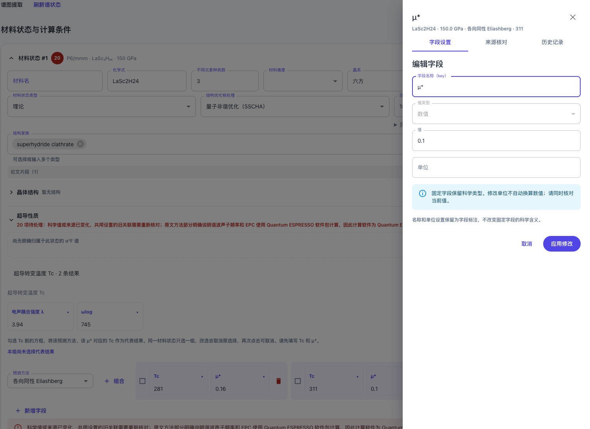
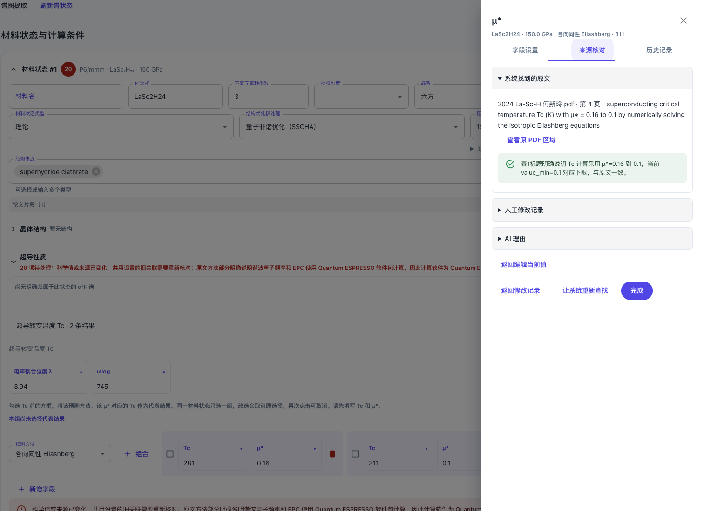
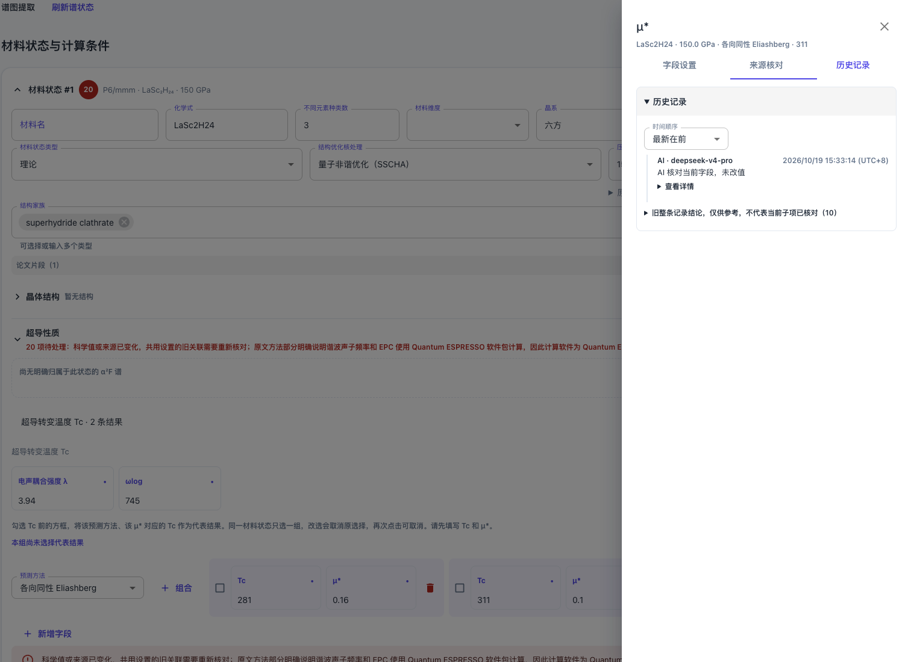
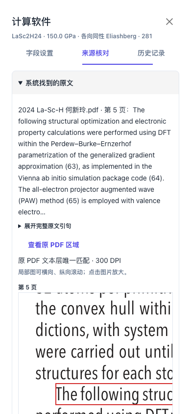

# 字段名称入口与 Demo 一致性修复

## 问题及既有设计

科学字段右侧栏功能设计、原话及历史已迁移至 [#221](../221-scientific-field-sidebar/spec.md)，本处不再独立维护。
原图字节、尺寸和哈希见[图片清单](assets/name-entry-images.json)，用户完整原话已追加到 spec.md。

本轮重新读取了远程 [Issue #109](https://github.com/JLU-ICCMS-MaYuan/SC-Wiki/issues/109)、本地 Spec 和已认可 Demo。科学字段右侧栏功能设计、原话及历史已迁移至 [#221](../221-scientific-field-sidebar/spec.md)，本处不再独立维护。
独立核对标记进来源/历史； 科学字段右侧栏功能设计、原话及历史已迁移至 [#221](../221-scientific-field-sidebar/spec.md)，本处不再独立维护。
科学字段右侧栏功能设计、原话及历史已迁移至 [#221](../221-scientific-field-sidebar/spec.md)，本处不再独立维护。

这是主路径实现遗漏。科学字段右侧栏功能设计、原话及历史已迁移至 [#221](../221-scientific-field-sidebar/spec.md)，本处不再独立维护。
前次验收从核对入口开始，不能证明名称入口完成，T069/T072 的原验收结论覆盖不足。内容没有获得删除授权，用户要求没有歧义。

## 修复行为

- 字段名称通知所在表单的核对定位组件，复用已经匹配到当前字段节点的稳定记录身份，核对标记继续默认进入“来源核对”。 科学字段右侧栏功能设计、原话及历史已迁移至 [#221](../221-scientific-field-sidebar/spec.md)，本处不再独立维护。
- 科学字段右侧栏功能设计、原话及历史已迁移至 [#221](../221-scientific-field-sidebar/spec.md)，本处不再独立维护。
- 取消不写值，应用修改只更新当前字段， 科学字段右侧栏功能设计、原话及历史已迁移至 [#221](../221-scientific-field-sidebar/spec.md)，本处不再独立维护。
- 只读保留查看权限。不新增另一套数值编辑器。 科学字段右侧栏功能设计、原话及历史已迁移至 [#221](../221-scientific-field-sidebar/spec.md)，本处不再独立维护。

## 验证

新增组合测试从名称按钮进入，覆盖 μ*、λ、计算软件、无核对项的 ωlog、只读、四块内容可达、当前字段来源/历史、切页签保留输入、取消以及应用后只改 μ*。现有核对入口、关闭、PDF 显示和重试测试一并回归。

最终从精确暂存索引导出独立候选验证：7 个测试文件共 80 项通过，TypeScript/Vite 生产构建通过。测试文件为 field-review-layout、scientific-evidence-markers、calculation-field-settings、evidence-workflow、evidence-drawer-close、issue114-evidence-region、evidence-image-region；无后端协议或数据库修改。

浏览器使用完整正式 `UploadTaskEditor`，读取 LaSc₂H₂₄ 原任务草稿和预检的只读快照，共 7 个材料状态、402 个核对项。科学字段右侧栏功能设计、原话及历史已迁移至 [#221](../221-scientific-field-sidebar/spec.md)，本处不再独立维护。
科学字段右侧栏功能设计、原话及历史已迁移至 [#221](../221-scientific-field-sidebar/spec.md)，本处不再独立维护。
[浏览器结果](assets/us12-name-entry-browser.json)。

浏览器 HTTP 身份、自动核对响应和人工说明读取为隔离夹具；自动核对只返回既有预检快照，不调用模型。PDF 请求通过既有只读桥接进入正式区域路由并读取原文件，实际解码 1106×412 裁剪图。没有修改用户真实任务，也没有把本次描述为普通登录 HTTP 全链验收。

