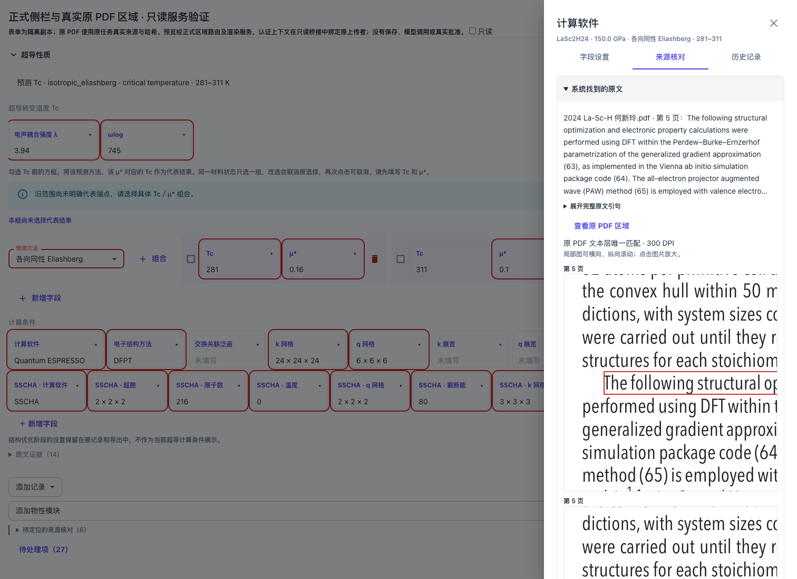
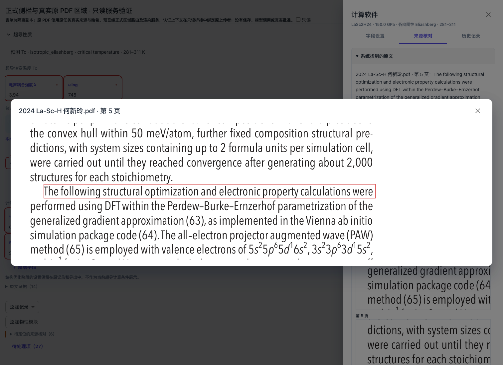
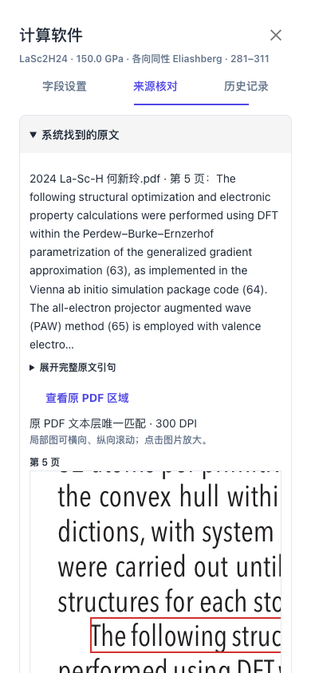

# US12 正式实施与原 PDF 验证

关联 [Issue #109](https://github.com/JLU-ICCMS-MaYuan/SC-Wiki/issues/109)，复用 #94 的紧凑科学字段设置。用户已认可三页签及折叠 Demo，并明确授权正式实施及原 PDF 功能验收。远程 Issue 继续开放；本记录不替代尚未确认的 Issue 正文追加稿，也不关闭其他用户故事。

## 已落地行为

- 侧栏分为“字段设置 / 来源核对 / 历史记录”。系统找到的原文首次展开，人工修改记录、AI 理由及历史记录首次收起，四块均独立折叠。切换页签保留已加载的原 PDF 与未应用设置。
- “超导转变温度 Tc”是普通标题。预测方法只核对方法自身；λ、ωlog、每个 Tc／μ*、固定计算条件和补充条件各自具有稳定审核身份、来源与历史。字段名继续负责设置，独立标记负责来源核对。
- 侧栏末尾不再复制全部问题的红色按钮；问题总数和主页面独立“待处理项”导航保留，未定位项也有入口。
- 新保存事件记录实际认证用户、UTC 时间、字段自身前后值及设置变更；真实 AI 调用记录实际模型与动作，核对与补空区分。普通改值、人工确认和正式批准保持各自语义。
- 旧整条记录结论仅作折叠的历史参考，不能批量授予新子项通过资格。没有记录的作者、时间或时区明确显示缺失，不从任务所有者或数据库行创建时间推定。
- 科学子项的建议、保存、返修、来源转接及导出沿原记录契约；整体科学校验、准备版本与主表单值一致性、理由和批准门禁保留。

## 可复查验证

生产代码与测试先精确暂存，再从 Git 索引导出独立候选运行。没有把共享工作区的 #120/#135 未暂存代码或新增模块复制进去。

| 验证层 | 结果及实际覆盖 |
| --- | --- |
| 前端 12 个定向测试文件 | 99 项通过；真实共享表单和工作流组合、细项归属、页签、折叠、设置草稿、只读、历史、来源切换、旧响应与图片失败重试、Tc 配对和字段补充。 |
| 后端 12 个定向测试文件 | 120 项通过；细项版本/依赖、范围拆成单值后的稳定身份、建议整体校验、科学数据/证据转接、人工证据及真实区域服务的权限、来源身份与哈希。 |
| 模型配置独立回归 | 11 项通过；进程不加载本机编号模型目录及业务 `.env`，不修改真实模型设置。原 PDF 与预检不依赖可用模型，用户认证仍必需。 |
| 隔离 MySQL 3 个专项文件 | 8 项通过；旧整条结论不授信、服务端 AI 事件幂等及转接、人工确认、实际 JWT 登录的返修/管理员保存历史、同值不追加、客户端伪造日志拒绝、旧版本 409、Tc 组保存重开/返修/导出、科学条件持久化。数据库名限定 `scwiki_issue139_test_*`。 |
| 独立候选生产构建 | TypeScript 与 Vite 构建通过；保留既有 3Dmol `eval` 和资源体积提示。 |
| 独立 Chrome 浏览器 | [完整结果](assets/us12-implemented-browser.json)；正式组件、真实原 PDF、正式区域路由及渲染服务，JavaScript 异常 0。390px 侧栏实际宽度及滚动宽度均为 390px。 |

定向后端文件：`test_property_field_review.py`、`test_pdf_region_fallback.py`、`test_scientific_drafts.py`、`test_upload_workflow.py`、`test_evidence_draft_version.py`、`test_property_evidence.py`、`test_evidence_proposals.py`、`test_scientific_evidence.py`、`test_issue139_scientific_context.py`、`test_issue139_workflow.py`、`test_issue114_native_pdf.py`、`test_issue109_manual_evidence.py`。MySQL 专项为 `test_field_review_mysql.py`、`test_tc_groups_mysql.py`、`test_issue139_persistence.py`。前端文件及逐项断言见本次测试改动与上述浏览器结果。

## 原 PDF 实测

- 论文 DOI：`10.1073/pnas.2401840121`，原任务 `c16cc627a0c04dc8ad4289624d1da80a`，文件 `2024 La-Sc-H 何新玲.pdf`。
- 原文件 SHA-256：`7fccce6780e71f826519256542a5416f5b256e1aa2b546b68e194468688e2bbd`。
- 使用原任务 150 GPa 计算软件来源中现存的长引句，服务实际返回第 5 页两张 300 DPI 裁剪图；浏览器解码尺寸分别为 1106×412 和 1108×897。
- 显示页码、高亮及完整引句展开，点击放大弹窗实际为 1448×504；关闭返回来源。折叠、切换页签不重新请求 PDF，主动重复加载仍可显示；只读模式仍可查看。长引句仅缩短首屏显示，定位请求仍发送完整引句。
- 修复两处已复现故障：旧任务缺可选对象存储区域 IR 时，回到同一已授权原 PDF 文字层唯一定位；PDF 查看不再被失效模型选择或模型登录要求阻断。原文件权限、文件身份、SHA-256 和无法唯一定位的拒绝逻辑保留。
- 图片失败可重试；切换来源或目标后迟到响应不能恢复旧图。这些反例由正式组件测试和真实区域路由测试覆盖。

## 事实边界与未覆盖项

PDF 浏览器验证使用仅绑定原上传者认证上下文的只读桥接：区域请求继续进入正式 FastAPI 路由、所属权限校验、真实存储文件与正式渲染；预检使用独立表单副本，人工说明读取为空夹具。桥接禁止业务保存和模型任务，不修改原任务。不能把这项证据写成普通登录界面的 PDF HTTP 全链验收，也不能把空人工说明夹具写成人工历史验收。真实身份保存历史由另行运行的 JWT／MySQL 专项验证。

未运行真实新上传模型链、未改写 LaSc₂H₂₄ 业务草稿、未执行正式提交或批准。原任务计算条件的历史关联范围不是本轮界面修改的自动修订对象；不会借展示区域功能改写科学来源资格。

扩展运行旧返修和管理员全套回归时出现失败：旧夹具建立同状态两条几何结构，被现存单几何唯一约束拒绝；部分旧提交测试未补人工修改理由，被 `manual_evidence_incomplete` 拒绝。干净 HEAD 与本轮候选抽取同一用例对照，`test_resubmit_is_atomic_idempotent_and_can_start_next_round` 均返回相同的 400／缺人工理由；`test_pending_pressure_edit_preserves_graph_and_legal_definition_rollback[admin]` 的既有夹具均被 `uq_structure_models_single_geometry` 拒绝。未通过项不能描述为全套通过，也不为旧预期放松科学或人工依据门禁。

## 复查步骤

1. 使用现有上传或返修草稿，在正式编辑页点击具体字段的核对标记；核对标题及方法没有聚合兄弟字段问题。
2. 分别切换三页签，输入设置后切走再返回；折叠原文、人工、AI 和历史，确认当前草稿与问题数不变。
3. 原文中点击“查看原 PDF 区域”，核对文件名、页码、真实文字与高亮，点击裁剪图放大再关闭；折叠重开及切页签后仍可见。
4. 通过正常登录保存某个字段后刷新，展开该字段历史，核对真实用户、发生时间和前后值。只改 μ* 时，Tc 可以需要重核，但历史不能声称其值也被人工修改。
5. 使用无权用户、错误文件身份、变更原文件哈希、旧保存版本作拒绝反例。拒绝后保留原引句、未保存输入及可读错误，不赋予新的通过资格。
