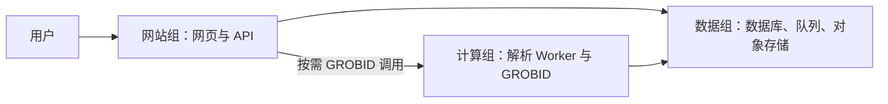

# 实施计划：三组服务独立编排

**Issue**：[ #132](https://github.com/JLU-ICCMS-MaYuan/SC-Wiki/issues/132)

**日期**：2026-10-12

**输入**：[Spec](spec.md)、[Research](research.md)、[数据模型](data-model.md)、[部署契约](contracts/deployment.md)、[迁移契约](contracts/migration.md)。

## 技术上下文

Linux Docker Engine 与 Compose v2.24+；当前开发机可用 Compose v5.1.2 仅为工具事实，不代表生产运行验收。Go 1.25、Python 3.12、MySQL 8.4、按源端兼容版本固定的 Redis、Neo4j 5、Qdrant 与现有 HTTP 栈；#131 提供 S3 客户端，数据组沿用单节点 Garage（2026-10-21 用户确认 #146 方案）。版本以固定发布清单为部署输入，禁止 latest。

测试分为 Compose 配置、CLI 角色和生命周期测试、真实认证依赖检查、隔离容器单机与真实两机验收。三机业务验收由 #133 负责，拓扑/配置支持由本 Feature 提供。

三个逻辑组初期同机，之后迁移位置；箭头不表示新的公开 API，Worker 从数据组队列消费任务。

## 实现组织

- `docker/compose.app.yaml`、`compose.data.yaml`、`compose.compute.yaml` 为唯一三组服务定义；跨机端口通过独立覆写配置发布。共享基础配置采用 YAML 扩展字段或共用 env 模板，禁止复制整个服务定义。
- `scripts/deploy.py` 负责解析/校验、项目命名与本机 Compose 调用；不实现 SSH 分发、远程安装或自定义容器调度器。`docker/compose.yaml` 旧聚合入口按 Research D1 退役。
- `backend/scripts/check_dependencies.py` 提供真实连接检查；Go/Python 分别接入角色 readyz。Qdrant 客户端工厂统一业务、健康与索引脚本；Go Redis 解析 URL 并支持认证。
- `backend/scripts/run_migrations.py` 增加显式目标与只读兼容检查入口，保留既有迁移保护；生产启动取消自动改库依赖，本地脚本分支保持现状。
- `docker/deploy/` 保存无秘密的 env 示例、版本清单格式和存储接管/迁移说明；运行配置和凭据不提交。

## 需求映射

| 来源 | 设计 | 验证 |
| --- | --- | --- |
| FR-001～FR-003 / US1 | 三项目与薄组合命令 | SC-001、SC-002；容器身份与配置矩阵 |
| FR-004～FR-006 / US3 | 统一端点认证、私网覆写、就绪检查 | SC-003、SC-005；故障/网络矩阵 |
| FR-007、FR-011 / US3 | 发布清单与显式迁移 | SC-003、SC-005；只读启动与 schema 不匹配 |
| FR-008、FR-009 / US2 | 存储身份与迁移清单 | SC-004；接管、恢复和回退 |
| FR-010、FR-012 | 原生兼容、角色范围、脱敏报告 | SC-001、SC-005；CLI 与本地回归 |

## 阶段与依赖

依赖 #131 的生产 S3 配置与引用迁移。先建立版本/连接检查与 CLI 测试，再拆 Compose，随后实现显式迁移和旧存储接管，最后真实两机演练。与 #133 共同修改 `docker/compose.compute.yaml`、`backend/scripts/run_upload_workers.py` 等触点时必须串行。

## 质量门与风险

存储卷身份必须来自实测，不能默认 Docker 项目名前缀；常规启动不可写 schema；发布 digest 可追溯；源数据始终保留。本轮缺少目标云机器，真实运行验收属于未完成实施任务，不阻碍规划质量检查，也不能标为通过。

遵守 KISS/YAGNI：只提供三组 Compose 与薄命令，不引入集群控制面。DRY：生产配置和客户端工厂共用。认证、就绪、迁移分别承担明确职责，不由存活接口执行数据修复。

## 文档与关联

实现后使用 Overview Skill 回写部署技术分析、运行时、schema 和数据迁移文档，更新 README 与部署说明；#14 只作为健康检查关联，不随本轮规划关闭。全局一致性分析见 [analysis.md](analysis.md)。
