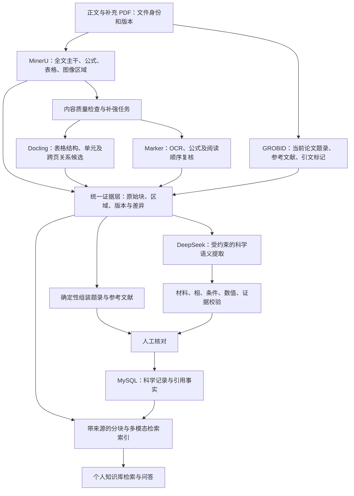

# MinerU 为核心的四工具组织方案

日期：2026-10-13。**架构提案，尚未实现或验收**。来源为用户最新明确要求、当前仓库与 [社区调研](four-tool-community.md)。上一版以 Docling 为骨架的实验不能作为本方案已实现的证据。

## 先分清当前实现与目标

当前上传 Worker 对有效正文 PDF 调用本机 GROBID 的 `processFulltextDocument`，`backend/services/citation_graph.py::parse_grobid_tei` 主要消费 `listBibl/biblStruct`。输出参考文献 DOI、题名、作者、年份与原引文，提交时保存到 `paper_reference_extractions` 和 `paper_references`。引用匹配采用 DOI，或规范化标题与年份的唯一匹配，LLM 不生成引用边。

这是参考文献表的题录信息，不等同于当前上传论文的题录表单。现有代码没有把 TEI 的 `teiHeader` 作为当前论文标题、作者、DOI、期刊等字段的主来源；也没有把正文引文标记与参考文献的对应关系接到统一科学证据层。GROBID 本身支持这些能力，但项目尚未充分消费。

本轮对本机 `127.0.0.1:8070` 的 0.8.1 服务做了 H3S 实际探测：2.086 秒返回当前论文标题、DOI `10.1038/srep06968`、10 位作者、发表日期 2014-11-10、48 条参考文献及 49 个带目标的正文引文标记。header 中未取到期刊名，说明专门工具也有缺口。原始 TEI、解析引用和摘要保存在 `demo/complementary-pdf/grobid-capability-probe/20261013T091338Z/`；没有写数据库，未联网补全题录。49 个引文标记不等于 49 条唯一论文引用边。

另一个待处理边界：当前 parse_grobid_tei 在没有 listBibl 时退回扫描全部 biblStruct。四工具适配时必须明确隔离 header 与 bibliography，避免把当前论文题录误记为参考文献；本轮只记录风险，没有修改生产解析代码。

上一轮 demo 没有调用 GROBID。Docling 2.130.0 为本机 CPU 文本层/表格解析，MinerU 4.0.6 为本机 basic OCR，Marker 2.0.0 为本机 Surya/llama.cpp；远端 DeepSeek 接收它们的结构化结果，生成科学候选和叙述字段。下载模型权重不等于把 PDF 交给云端解析。

## 建议数据流

## 四工具的职责与边界

| 组件 | 默认职责 | 触发与交付 | 不能混淆的边界 |
| --- | --- | --- | --- |
| MinerU | 每份正文/补充全文主干；识别正文、公式、表格与图像区域 | 生成统一文档块、读序、区域和原始输出，是后续内容选择的基础 | 核心不等于所有字段永远覆盖其他工具；也不等于 basic OCR 已代表其最佳效果 |
| GROBID | 当前论文题录与参考文献；保留正文引文锚点 | 正文固定执行；补充若有独立参考文献也按文件保存，不覆盖正文题录 | 题录来自 header，参考文献来自 bibliography；二者不能混用。引用关系不能靠 DeepSeek 猜测 |
| Docling | 表格结构和可定位单元的补强候选 | 表格列合并、单元关系不清、跨页归属疑点等内容任务；保留原始单元结构 | 不固定其为全文骨架，不默认其表格必正确；跨页行归属仍需证据 |
| Marker | 对有疑点内容给出独立 OCR、公式和读序候选 | 数学符号破损、公式识别分歧、双栏读序疑点、图注绑定等任务 | 不是“第三票”；不以多数决定科学真值。它也能做表格，但本方案需避免常态重复整篇处理 |

没有疑点的正文沿用 MinerU。只把所需补强块、对应行/公式、必要上下文和差异交给 DeepSeek；各引擎完整原始结果留在审计层。若引擎实际 API 只能按页或全文运行，需如实区分“执行范围”与“下游选用范围”，不能把少用几块描述成少运行了整篇解析。

质量规则先用可解释信号：空内容、表格列/行不一致、阅读顺序跳跃、公式不完整、不同候选的数字/符号差异。不能只靠引擎自报置信度选最高分；不同引擎分数未标定。符号修复、单位换算和科学条件归属分别留证据，不以清理格式为名改数值。

## DeepSeek 的位置

DeepSeek 负责理解科学语义，例如把“184 K at 250 GPa”绑定到正确材料、物相、压力和方法，以及生成研究方法、主要发现、研究动机等字段。它不承担 PDF 原始坐标提取，不取代 GROBID 的参考文献事实，也不能把三个重复全文自行压成唯一可信答案。

材料/相/压力等状态身份应先作为显式候选保存，再让记录绑定对应状态；绑定后做冲突与覆盖核验。上一轮 250/300 GPa 被挂到 200 GPa，说明单纯要求模型“分开压力”不足，需要把这种归属错误纳入结构化检查及原文复核。

书目主值优先来自可核对的 GROBID header；缺失或矛盾时使用其他解析器对应首页证据补充并保留来源，不静默覆盖。摘要原文与 DeepSeek 总结分开。标题、DOI、参考文献等有明确原文的字段应尽量确定性组装，减少自由生成。

## 知识库与科研数据库的两个出口

知识库关心可检索、可回答和可引用：按章节、表格、图像、公式分块，关联文件、页面、区域和论文身份，再做 embedding 和检索。问答可以读取未转成物性表的原文内容，但必须显示来源与审核状态。

科研数据库关心字段和值是否成立：材料—状态—物性—计算/实验条件—证据的关系通过校验和审核后进入 MySQL。向量相似、LLM 总结和概念关系不能直接当成科学记录或引用事实。SC-Wiki 已有 MySQL、Qdrant 和引用图基础，优先复用，不为四工具组合引入新的数据库平台。

## 仍需验证的设计点

- MinerU 作为核心时，先比较现有 basic OCR 与其适合本机/部署环境的更高能力配置；暂未选定新的 tier 或远端服务，不把 API 示例当本机性能。
- GROBID header 和正文引文锚点目前尚未接入表单/统一 IR；需要独立适配及相同 PDF/页码身份核验。
- Docling/Marker 的补强触发率、实际运行粒度、重复输入压缩和新增错误，需要多篇文献验证。
- thinking 是否保留由 [实际开关对照](reasoning-comparison.md) 决定；不能先把“关闭推理”写成架构原则。
- 四工具生产接入仍需用户审阅本方案、更新 Plan/接口与验收范围；本轮没有修改生产默认。
