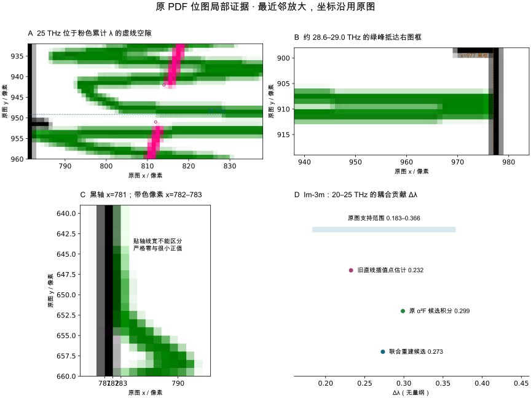

# H3S 谱数字化科学复核更正与联合重建

日期：2026-10-14。关联 [Issue #137](https://github.com/JLU-ICCMS-MaYuan/SC-Wiki/issues/137)。复核者：Codex（AI）；范围为原文、原图与数字化结果，未重跑作者 DFPT。

## 当前结论

**撤回“Im-3m 在 20–25 THz 已证实有 28.5% 局部误差”的结论。** 该百分比把粉色虚线空隙内的直线插值当确切读数，属于复核方法错误。此处原 α²F 候选与原图支持范围相容，不能据此认定作者计算错误。

H/S 同一 PHDOS 坐标框支持采用共同尺度的通常约定，可在保存约定、像素来源及投影定义假设的前提下归一化并定量使用。可见 α²F 可提供有物理约束和像素误差的重建候选；Im-3m 边框遮挡区保留掩膜，不能声称唯一恢复峰顶。

`conditional_quantitative_use=true` 表示按用途和限制可定量分析；`quantitative_ml_approved=false`、`training_ready=false` 表示未把整套曲线无条件批准为作者原始训练真值，**不表示一律只能定性使用**。未通过无条件图像标签验收也不等于原计算有问题。

## 原图位置证据

标注是原 PDF 984×1246 内嵌位图的派生材料，采用最近邻放大，原图与原始点不变：

- A：25 THz 对应原图 y≈949.17，穿过粉色累计 λ 虚线空隙。两侧最近真实观测为 24.82681、25.67701 THz；空隙不能当精确读数。
- B：约 28.6–29.0 THz，绿色 α²F 上下分支延伸到右框 x=977，框处像素为黑色，闭合峰顶不完整。这里支持“边框遮挡，真实峰顶尚不唯一”；不能从两像素报警推算截去多少，也不证明作者计算错误。
- C：黑零轴 x=781，绿色贴轴像素 x=782–783。线宽、抗锯齿与黑轴遮挡使严格零与很小正值难区分。Im-3m 参考带的不可分辨幅值为约 [0,0.04580]；按零是分辨率候选，不是物理零值证明。
- D：原图支持的 Δλ 范围同时包含旧直线点估计、原 α²F 积分和联合候选；不能用两种点估计的差代替测量误差。

## 20–25 THz 为什么出现 28.5%

旧比较使用 Δλ=0.232463 的直线插值点估计，与 α²F 积分 0.298697 比较，得到 +28.5%。该百分比的算术没有错，但把分母当真值的前提不成立。

现以两侧真实累计 λ 点的像素包络加半像素表示读图范围，在空隙仅使用累计 λ 非减约束：

| 量 | 图像支持值 |
| --- | --- |
| C(20 THz) | 0.446249–0.514897 |
| C(25 THz) | 0.697961–0.812376 |
| ΔC(20–25 THz) | **0.183063–0.366127** |
| 原 α²F 候选积分 | **0.298697，相容** |
| 联合重建候选积分 | **0.273147，相容** |

范围是可见像素及单调性支持的保守读图范围，不是统计置信区间，也没有涵盖所有轴标定误差。频段审核限制在真实观测域内，图框端值延续点不能作为观测。保留旧点估计作诊断，但不再称其差为真实误差。

## 联合重建与核验

新增 `joint_reconstruction.py`，以绿色原图像素包络限定 α²F 的可见幅值，用粉色真实观测点约束累计 λ，同时满足

$$C(\nu)=2\int_0^\nu \frac{\alpha^2F(t)}{t}\,dt.$$

零轴偏移限定为一个累计 λ 幅值像素；继承已有零频与高频边界假设。原观测、原重建、零基线候选全部保留，新序列独立输出。裁边处只输出带掩膜候选，不向不可见区声称外推峰顶。

每五个真实粉色观测点留出一个，用其他粉点与绿色像素约束重建，再预测留出点；最后用全部观测产生导出候选。**正文 λ、ωlog 不进入拟合，也不用于选参数。** 留出的是累计 λ 读数，其同频绿色信息仍参与约束，不能冒充独立实验。

| 指标 | R3m / 130 GPa | Im-3m / 200 GPa |
| --- | ---: | ---: |
| 真实累计 λ 点 / 留出点 | 350 / 70 | 350 / 70 |
| 留出 RMSE / 像素 | 0.464 | 0.528 |
| 留出最大绝对偏差 / 像素 | 2.383 | 2.142 |
| 全点拟合 RMSE / 像素 | 0.429 | 0.494 |
| 联合候选完整积分 λ | 2.07066 | 2.18081 |
| 联合候选 ωlog / K | 1037.81 | 1258.29 |
| 正文 λ / ωlog / K | 2.07 / 1125.1 | 2.19 / 1334.6 |

联合候选总 λ 接近正文，但 ωlog 仍有偏差，尤其对低频、细小权重敏感；不为匹配正文而调整谱。所有预先固定的 5 THz 频段，联合候选均落在累计曲线的图像支持范围内。原候选 R3m 各段相容；Im-3m 仅首个可读频率到 5 THz 的原候选 0.05482 超出 [0,0.04577]，联合候选修正到该范围内。不能删除这一剩余边界。

积分与同一联合累计曲线相等是施加的约束，**不是独立准确度证据**；核验依据是留出点预测、原绿色包络和原图位置。图像本身丢失的信息仍不能唯一恢复。

## DOS 为什么不能只靠 3N 证明准确度

采用共同轴约定，对两分波之和施加一个因子：

$$g_i(\nu)=\frac{12}{\int(g_H^{raw}+g_S^{raw})d\nu}\,g_i^{raw}(\nu).$$

此式可恢复“每原胞、每 THz”的模式数密度。H/S 共享 PHDOS 坐标框是合理的共同尺度证据；此前因缺少作者明确声明就整体拒绝定量用途，表述过严。仍保存“完整元素投影与共同尺度”的约定，不把它说成取得作者原始文件。

总积分 12 是公式输入。如果把一个峰错误地从 20 THz 移到 25 THz，再归一化，总面积仍可为 12，所以它不能验证峰位置。若误读 H:S 幅值比例，总面积同样能为 12。需要分别检查原图包络、频率标定与元素模式数，而不是认为作者计算有误。

若作者投影为完整、正交笛卡尔元素投影，H/S 面积目标为 9/3；现候选 S 为 3.34239 / 3.11904（对该条件目标 +11.4% / +4.0%）。保留偏差，不分别缩放 H/S 来凑答案；它可能来自图像分辨率、投影约定或提取，不能凭这一步裁定源计算错误。

## 追溯与验证

- 当前数值及用途结论绑定在 [v5 JSON](h3s-2014-scientific-review-v5.json)，指纹覆盖来源、标定、版本及材料状态；数据变化拒绝旧复核。
- [v4 报告](scientific-review.md)与旧 JSON 保留历史，已注明失效结论。
- 联合积分矩阵与独立自适应求积一致；合成已知谱、虚线空隙、有噪声留出点及正文参考扰动验证均通过。共 40 项定向测试通过，实际重建与导出核验见 [validation.md](validation.md)。
- 原正文 18.4%+82.6%=101% 的文字异常仍保留，不猜改。作者原始谱可进一步缩小误差；本次没有取得该文件，不伪造确认。
- 本次仍是独立 demo，不改生产数据库、不关闭 #137；正式集成 T008 未执行。
