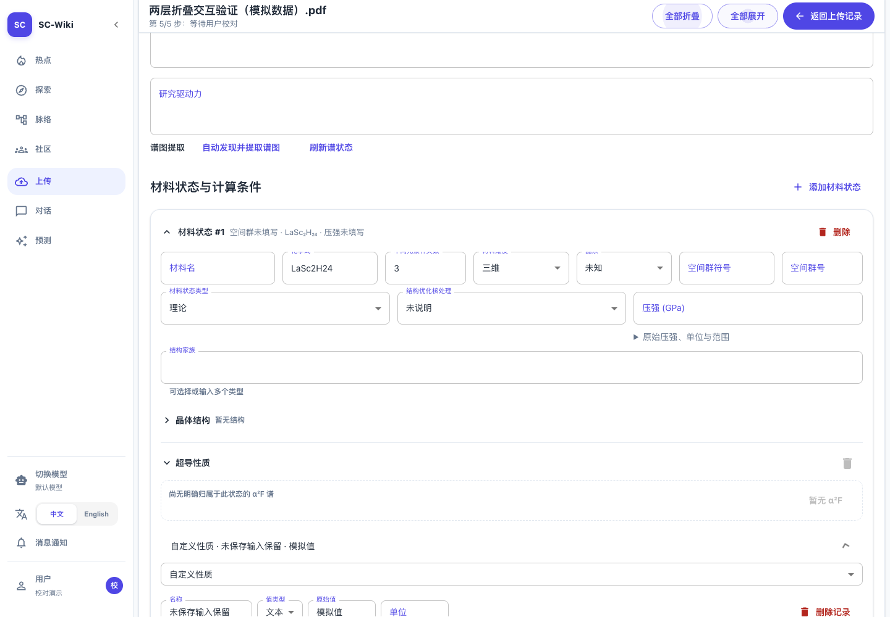
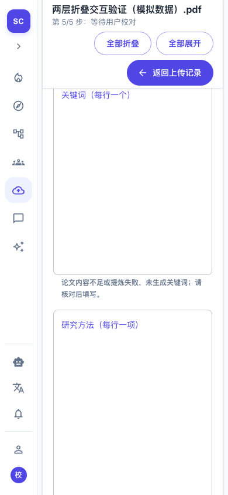

# 验收记录

## 结论与源码范围

2026-10-19，FR-001～006、SC-001～003在本地验证完成。独立目录由原始HEAD归档，仅叠加本次源码、测试及夹具增量；未包含工作区原有的上传解析、角色识别等修改。源码基线和SHA-256见[校验清单](assets/verified-source.json)，提交前需与暂存内容逐一核对。

## 自动化回归

- 新增`upload-expand-collapse-all.test.tsx`：5项通过。真实MaterialStatesEditor、PropertyModuleEditor和Portal参与交互；仅隔离网络响应。
- 独立副本运行新增测试、`material-states-editor.test.tsx`、`upload-task-navigation.test.tsx`、`structure-attachment-collapse.test.tsx`：4份、44项通过。
- `property-module-collapse.test.tsx`的5项相关行为回归通过；排除下面已在原始HEAD复现的1项旧断言。合计49项通过。
- TypeScript及`npm run build`通过；Vite保留现有大分包和第三方eval提示。

本机Node 26测试使用`NODE_OPTIONS=--no-experimental-webstorage`，避免Node的全局Web Storage遮蔽jsdom存储；不修改应用代码或系统配置。

### 已确认的既有失败

`property-module-collapse.test.tsx`中的“折叠标题保留外部校验问题提示”预期完整文案“1 项待处理：请检查当前值”，当前生产组件只显示“1 项待处理”。原始HEAD、未叠加本次修改时单独执行同样失败；其余5项模块交互验证通过。本次未改该组件文案或旧测试，不将该项报告为通过；该差异不阻断本次两层折叠验收。

## 浏览器验收

使用系统Chrome、真实上传任务路由和生产组件。先验证共享工作区，再验证独立副本构建产物；后者共11组检查通过，页面脚本错误0。最终数据见[浏览器记录](assets/browser-validation.json)，可复用[验证脚本](assets/browser-check.mjs)和`tests/fixtures/issue141/draft.json`。

- 顶部只有一组按钮，桌面位于“返回上传记录”左侧，随操作栏保持可达。
- 两个材料状态、八个模块的初始规则、全部展开/收起、单项重开、重复展开通过。
- 未保存输入及输入节点保持；记录内部独立收起状态保持。
- Space/Enter操作及英文按钮通过。
- 1440px桌面与390px窄屏通过；390px收起及展开时整页scrollWidth均不超过390px。
- 从干净草稿开始只执行折叠/展开，额外保存或解析请求数为0。输入编辑触发的既有5秒自动保存仍保留，所有请求均被夹具拦截。

运行浏览器脚本时以`PLAYWRIGHT_MODULE`指定临时安装的playwright-core入口，以`CHECK_URL`指定待验证本地任务地址；可用`CHROME_PATH`指定浏览器。脚本只在mayuan分支写入截图及结果。没有新增项目依赖。

## 需求与证据对应

| 需求 | 证据 |
| --- | --- |
| FR-001、FR-006 / SC-003 | Portal测试、按钮唯一性、键盘和英文测试、桌面/窄屏截图、构建 |
| FR-002、FR-003 / SC-001 | 两卡八模块全部切换及重开材料保持内部收起 |
| FR-004、FR-005 / SC-002 | 重复操作、输入节点与内容、结构及其他区域隔离、记录独立状态、无新增写请求 |

原图IMG-001已逐字节归档，SHA-256和3840×1954尺寸见Spec；已从归档路径解码查看并确认红框位置。

## 边界与交付

浏览器使用明确标注的模拟材料、账号及API响应，未保存真实任务或调用模型，不代表真实账号完整提交链或生产部署。只提交本次增量；原有工作区修改保留。未授权推送，Issue中的Spec使用仓库相对路径，远程双向链接继续待验证，#141保持开放。
