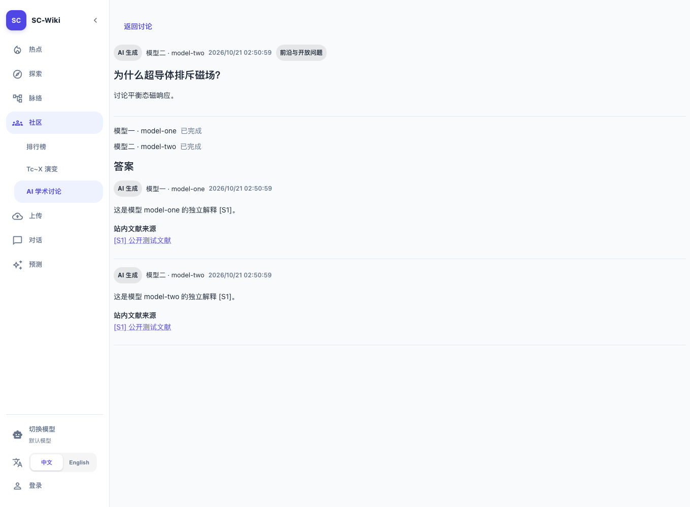
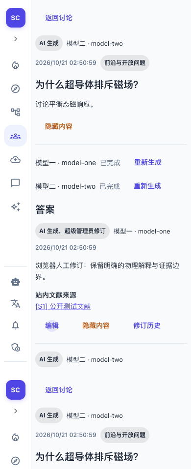

# 实施与验收记录

对应 [Issue #142](https://github.com/JLU-ICCMS-MaYuan/SC-Wiki/issues/142)。本次完成源码、隔离验收和文档；未迁移业务库、部署或推送。远程 Spec 链接待推送后核验，因此 Issue 保持开放。

## 验证结果

| 验证 | 结果与边界 | 证据 |
| --- | --- | --- |
| Go 全量 | `go test ./...` 通过；常规运行中显式要求隔离库的用例跳过，随后在集成脚本中实际执行 | [日志](assets/go-tests.txt) |
| Python 与部署 | 60 通过、23 按原有环境条件跳过；包含新增 9 项选题、引用及配置边界测试 | [日志](assets/python-tests.txt) |
| 前端 | 社区、排行榜/图表、新闻及侧栏共 52 项通过 | [日志](assets/frontend-tests.txt) |
| 生产构建 | TypeScript 与 Vite 构建通过；沿用现有 3Dmol eval 和大包提示 | [日志](assets/build.txt) |
| 真实 MySQL/Redis | 新增迁移升级→降级→升级；有 AI 内容时拒绝破坏性降级；隔离库自动清理 | [集成日志](assets/integration.txt) |
| 模型任务 | 两个真实本机 HTTP 上游、真实 RQ 消费，验证共享资料、各自凭据、部分失败与重试、并发完成、任务重放、终态凭据清理 | [集成日志](assets/integration.txt) |
| 冲突与恢复 | 真实 HTTP 请求期间并发人工修订；下架保护、引用撤回；启动正式双消费者命令，在请求期间杀掉该测试进程及后代，推进隔离超时时钟后验证失败恢复 | [集成日志](assets/integration.txt) |
| 浏览器 | 实际 Go/Python AI 路由及生产构建，访客/user/admin/superadmin 四身份，桌面和 390px 窄屏、中文/英文；6 组检查通过，脚本错误 0 | [检查](assets/browser.json) |

浏览器使用一次性测试账号和论文，模型选择菜单返回隔离目录夹具。站内检索传输使用固定公开片段；数据库批准状态、版本、引用、任务及发布检查走真实代码。未调用真实商业模型供应商，没有科学准确性或目标环境 Qdrant/Embedding 端到端验收结论。

## 关键修复与实现依据

- 真实启动测试发现 `__main__` 内消费者无法被 spawn 反序列化，消费者移入 `backend.community.worker`。
- macOS fork work horse 触发 Objective-C 崩溃，macOS 改用 RQ SpawnWorker；Linux 保持常规 Worker。没有通过关闭系统 fork 安全检查绕过故障。
- 模型完成后另开事务汇总批次，避免跨模型反向锁等待及旧快照；并发完成与重复执行已经验证。
- 保存模型阅读过的全部资料依赖，公开页面只列实际引用；未显式引用的输入资料撤回后，同样不继续公开基于该资料生成的正文。
- 问题准备失败可从详情的模型状态重试对应批次；答案失败只重试该模型。无网络搜索接口。

## 可复查命令

在已加载项目环境变量的开发环境运行：

```bash
(cd goserver && go test ./...)
python -m pytest -q backend/tests/test_community_generation.py tests/02_maintenance_and_verification/test_local_deployment.py tests/02_maintenance_and_verification/test_local_environment.py tests/07_researcher_community_forum/test_news_compose.py
node frontend/node_modules/vitest/vitest.mjs run --config vitest.config.ts tests/07_researcher_community_forum tests/02_identity_governance/sidebar-navigation.test.tsx
npm --prefix frontend run build
python tests/07_researcher_community_forum/verify-ai-community.py --browser
```

最后一条需要本机 MySQL 创建隔离测试库的权限、Redis 可执行文件，并设置 `PLAYWRIGHT_MODULE` 和 `CHROMIUM_PATH`。脚本从 `.env` 只读获取 MySQL 连接配置，仅创建/删除自身随机命名的 `scwiki_issue142_test_*` 数据库；使用随机端口的新 Redis，不清理或迁移业务库。所有模型 HTTP 请求均发到脚本创建的本机夹具。

## 界面证据





## 交付边界

- 本地源码验证完成，不代表业务环境已启用。新功能需要配套迁移、Go/Python/前端版本和 community-worker。
- README、社区 Overview、迁移头与结构清单、Docker 和本地启动配置已同步。
- 当前已有其他任务的未提交修改，仅提交本任务文件及 README 对应段落。
- Issue/Spec 双向远程链接未验证，不自动推送或关闭 Issue。

## 独立提交候选复验

从暂存索引导出独立代码目录，未复制其他任务的未提交改动；新增 Python 9 项测试与前端生产构建再次通过。README 索引只包含社区段落，原有上传修改留在工作区。
