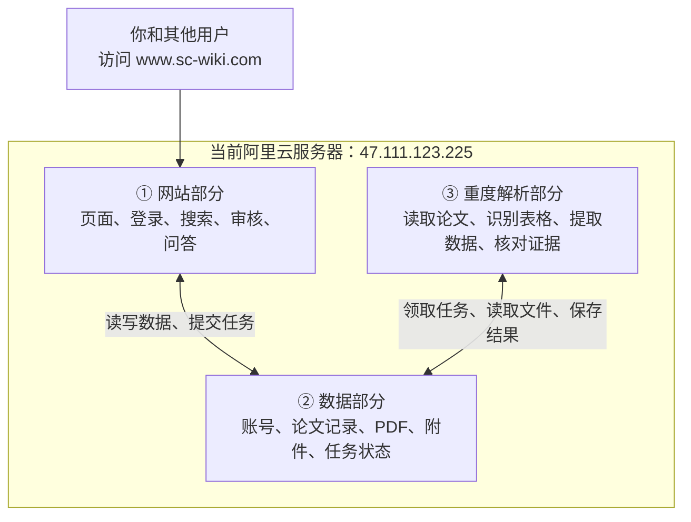

# Feature 规格：阿里云单机上线与完整数据迁移

**Issue**：[ #146](https://github.com/JLU-ICCMS-MaYuan/SC-Wiki/issues/146)
**日期**：2026-10-21
**状态**：用户已确认部署框架并明确要求实施；实际验收未完成。

## 原始需求记录

PLEASE IMPLEMENT THIS PLAN:
# SC-Wiki 部署框架：现在一台，未来三台

## 一、服务器里面放什么

**三个部分现在住在同一台服务器里，但分别管理。**

例如：解析程序需要更新，只重启解析部分；数据库继续运行，用户仍然可以登录、搜索和查看已有论文。

网站部分也包含处理登录、搜索等请求的后端程序，不只是几个网页文件。

## 二、以后怎么拆成三台机器

| 阶段 | 机器 A | 机器 B | 机器 C |
|---|---|---|---|
| 现在 | 网站＋数据＋解析 | — | — |
| 增加第二台 | 网站＋解析 | 数据 | — |
| 增加第三台 | 网站 | 数据 | 解析 |

为此，现在就做好三件事：

- **分别开关。** 三个部分可以独立启动、停止和更新。
- **地址可改。** 将来搬走数据部分，只需修改连接地址和完成数据迁移，业务代码不应因换机器重写。
- **文件集中保管。** PDF、附件和解析结果放在数据部分。解析机器只有临时文件，不能保存唯一一份重要资料。

本次会验证这些边界。将来机器断网、死机后的复杂任务恢复，继续放在已有的 **#133** 中完成，不要求现在购买另外两台服务器。

## 三、代码和数据怎么搬

**代码走 Docker Hub，数据单独搬。**

- 代码：从你确认的 `mayuan` 最新提交开始，补齐部署改动，验证后构建镜像，再放到服务器运行。记录每个镜像的具体版本，保证知道服务器运行的是哪份代码。
- 数据：先备份本机数据库、草稿、论文、附件和检索资料，再上传到服务器恢复。
- 密钥：数据库密码、模型密钥等单独配置，不放进公开代码或镜像。

正式复制数据前，暂时停止本机新增写入，让正在解析的任务完成。复制后核对记录和文件内容，确认没有漏搬或损坏。

**本机原始数据和备份都保留。** 上线后，用户产生的新数据保存在服务器，本机开发数据不会自动覆盖线上数据。

## 四、怎么按 Issue 和 Spec 推进

可以把它们理解为：

- **Issue 是任务单：** 记录要做什么、现在做到哪里、还缺什么。
- **Spec 是施工说明：** 写清三个部分怎么分、数据怎么搬、什么结果才算成功。

具体顺序：

1. 建立本次上线任务，关联之前的 #130、#131、#132、#133。
2. 确认施工说明，先完成三个部分的独立部署配置。
3. 在服务器安装 Docker，准备网站入口和 HTTPS。
4. 先演练恢复，再迁移正式数据。
5. 验证网站功能，开放使用，补齐操作说明。

备案暂不阻塞准备。若最后域名访问遇到外部限制，会明确说明原因。代码修改验证后提交；需要推送新增提交时，按仓库规则单独确认。

## 五、做到什么程度才算交付

不能只以“首页能打开”为标准，必须确认：

- **访问正常：** `https://www.sc-wiki.com` 可用，HTTP 和不带 `www` 的地址自动跳转。
- **旧数据还在：** 原有账号、论文、草稿和附件能正常使用，迁移前后的内容核对一致。
- **主要功能可用：** 登录、搜索、上传解析、校对审核、问答和后台任务完成实际验证。
- **三个部分能独立管理：** 停止解析不影响已有资料访问；更新网站不重建数据库。
- **数据能恢复：** 重建容器不丢数据，并实际演练一次从备份恢复。
- **你知道怎么维护：** 交付更新、备份、恢复、查看日志的方法，以及当前运行版本。

最终得到的是：**一个能通过域名使用、带着现有数据、可以维护，并且为未来拆机做好准备的网站。**

## 附件与推断来源

用户提供的 DNS 截图显示 www 和根域 A 记录指向目标服务器；已独立通过 DNS 查询核对。图片仅作辅助材料，实施依据为实际 DNS，不推断备案状态。图片原件位于用户提供的微信临时目录，尚未归档。
工程默认：使用 Caddy 管理证书，保留 Garage；这是已讨论的具体方案，不要求新增机器。

## 背景与需求结论

按已经确认的三组边界完成单机首次上线。网站组包括公开 API、RAG、社区与资讯服务，计算组承担解析和证据核对，数据组保管持久事实。真实两机与三机验收不在本次范围。
初始基线按用户“mayuan 最新提交”取实施时的 1024c5d；该提交继承此前确认的 1e114de。后续部署改动形成独立提交，发布记录固定最终 SHA/digest。

## 用户场景与验收

### US1：通过域名使用现有网站（P1）

用户访问 HTTPS 域名，登录后查找与读取现有资料；HTTP 和裸域名跳转到 www HTTPS。
独立验收：外网证书、重定向、网页刷新、登录和授权文件读取真实成功。

### US2：完整带走业务数据（P1）

维护者在暂停写入且任务排空后备份，在目标空存储恢复。源数据不删除。
独立验收：表数量与摘要、对象键与完整内容摘要、图与向量、草稿状态及过期语义一致；恢复演练通过。

### US3：分别维护网站和解析（P1）

维护者停止解析或更新网站，不停止或重建数据库及其存储。
独立验收：数据容器身份和数据不变；解析停止时登录、检索、已有资料读取成功。

## 功能需求

- FR-001：提供 HTTPS www 域名及 HTTP、裸域名跳转。
- FR-002：三组以独立项目管理，跨组地址、认证可配置，同机不公开数据端口。
- FR-003：所有持久业务文件按对象存储契约读取，计算仅使用私有临时目录与可重建缓存。
- FR-004：一致性备份覆盖业务库、必要 Redis 状态、图、向量、对象和登记的本地引用；源数据保留。
- FR-005：镜像、引擎、schema 和迁移记录可追溯，日常启停不隐式迁移 schema。
- FR-006：真实验证主要业务，交付更新、备份、恢复和故障检查说明。
- FR-007：敏感配置不进入 Git、镜像和普通日志，数据恢复不复活失效凭据与锁。

## 成功标准

- SC-001：US1 的所有外网检查成功。
- SC-002：US2 的数据清单完整核对，独立恢复通过；没有源数据删除。
- SC-003：US3 生命周期操作不改变数据容器身份或内容。
- SC-004：上传解析、校对提交、审核、搜索、RAG、社区、资讯按真实路径验收，未验证外部能力明确记录。
- SC-005：运行制品与发布记录一致，容器重建数据保留，运维命令可执行。

## 关键实体与边界

发布清单记录应用/引擎制品身份；迁移清单记录备份来源、时间、内容摘要与必要转换。两者不成为新的业务事实来源。
冻结失败、未排空任务、对象缺失、schema 不兼容或恢复校验失败时不得开放写入。开放写入后回退须先保全新增数据。

## 假设、依赖与范围外

依赖 #131 已实现对象协议、#132 独立编排设计；其真实多机条件不能由本次替代。#133 完整任务恢复、高可用、额外机器、双向同步不实施。备案按用户要求不阻塞准备，实际访问受阻则不得标 SC-001 通过。

## 澄清与最终确认

用户先回复“认可。”，随后完整粘贴框架并明确“PLEASE IMPLEMENT THIS PLAN”。本 Spec 是该框架的编号化表达；没有扩大多机与恢复范围。Git push 仍需独立授权。
当前无未决架构选择；具体镜像 digest 和源端版本由实际核验填写，不编造值。

