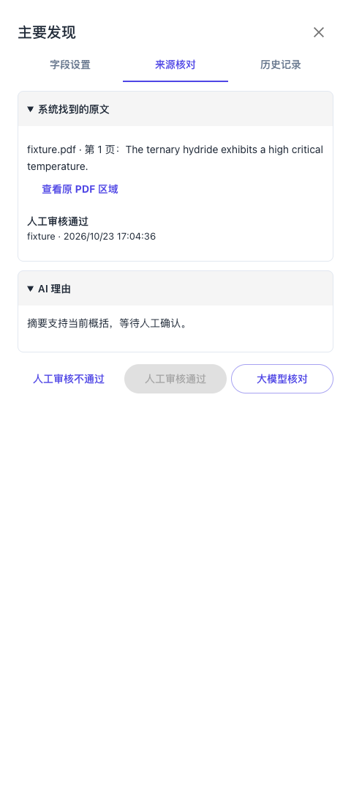

# 人工审核按钮与红框状态回归

关联 [Issue #147](https://github.com/JLU-ICCMS-MaYuan/SC-Wiki/issues/147)，保留 [#148](../148-sidebar-field-editing/spec.md) 的同行按钮布局。日期：2026-10-23。

## 原始需求记录

有一个问题，我在核对 Cah6 那个文章时候发现的。标红的框，点击“人工核对通过”后，没有变成灰色不可核对的状态，以此来告诉用户你可以做下一个事情了。那些没有标红不需要人工核对的框，为什么打开侧边栏之后还显示“人工核对通过”是可以点击的，没有变灰，这不合理啊！如果他没标红，就应该是灰色的“人工核对通过”。当然了他的“人工核对不通过”需要保持可以点击，这样我就可以自己主动发现问题后进行人工修改了。
而且点击人工核对通过后，应该按钮变灰，退出侧边栏，然后标红消失。你这些都没做到。

你使用 issue 和 spec 来帮完成. 看看需不需要新建 issue

### 用户提供的定位信息

[http://127.0.0.1:5173/upload/tasks/7070620afbfc45deb9ab22dae31badd3](http://127.0.0.1:5173/upload/tasks/7070620afbfc45deb9ab22dae31badd3)。比如Cah2 材料状态 3 的结构优化核处理。

## 归属与边界

这是 #147 正式人工决定与状态复用主路径的回归，不另建重复 Issue。只修正按钮可用性、决定保存后的当前状态和迟到响应保护；不修改科学值、证据、审核权限或模型入口，不批量处理用户草稿。新闻功能的并发未提交改动不属于本轮。

## 已确定的需求

- FR-025：人工通过仅在当前字段确实仍标红，且现有版本、权限和合法性检查允许时可用。未标红、已人工通过、已模型通过或免审字段的通过按钮禁用；正常可编辑查看时“不通过”仍可用。只读、加载、保存中、未应用设置及未保存修改的版本保护继续有效。
- FR-026：通过决定保存成功后，同字段变为通过、按钮禁用、侧栏关闭、原字段红框及待处理数量更新。重新打开、刷新时保持该状态。保存失败保留侧栏和原问题；旧摘要、旧详情或旧决定响应不能覆盖较新的状态，也不能关闭后来打开的其他字段。
- SC-020：红框、无红框、人工通过、模型通过、免审、已拒绝、保存中及失败的按钮矩阵通过，且“不通过”入口未被一并禁用。
- SC-021：保存到状态、关闭与标记更新的路径通过；同版本重开与提交复用，迟到摘要／详情不恢复旧红框。

## 实施与验证映射

| 需求 | 事实来源／职责 | 任务 | 验证 |
|---|---|---|---|
| FR-025 / SC-020 | 后端字段详情与现有红框谓词；前端共用实际字段状态 | T020 | 按钮矩阵组件与后台详情测试 |
| FR-026 / SC-021 | 正式决定响应是当前结果；摘要／详情版本保护 | T020 | 延迟响应、保存失败与重开浏览器检查，MySQL 回滚测试 |

前后端共同约束人工通过的可用性；同版本已保存决定仍幂等返回，不新增重复记录。核对保存不调用模型，不写科学数据。以下区分真实草稿的只读检查与隔离交互验证，不把需求描述当作真实用户页面已复现的证据。

## 已核实的问题与修复

对用户指定的本机草稿仅作只读查询：CaH2 第 3 个材料状态的结构优化核处理是 `classical_static`，已有正式人工通过记录；摘要返回 `supported`、`human_confirmed=true`。修复前详情仍返回 `can_approve=true`。这直接证明通过按钮资格有误，不代表真实决定未保存，不需要重新解析 PDF。

前端原判断仅依赖 `can_approve`，没有结合主表单红框状态；后端也未排除已通过或无需人工确认的字段。本轮在两端补齐当前未解决问题判定。通过与不通过分开控制，保留只读、加载、保存中、未保存或过期内容的原版本保护。

另外修复两条代码上可复现的状态更新路径：旧摘要迟到可能覆盖刚保存的决定；决定保存期间切换侧栏或修改无关字段时，原代码可能连原字段状态也跳过更新。现按本字段当前值保护结果，原字段成功结果仍更新，只在仍为当前侧栏会话时关闭；旧摘要和详情不覆盖已保存决定。响应缺少真实决定或通过状态时按技术错误处理，保留问题。这些隔离复现不能直接证明用户当时未关闭／仍标红的完整原因。

## 验证结果

- `approval-state.test.tsx`、`two-stage-review.test.tsx`、`paper-field-settings.test.tsx`：39 项通过。覆盖无红框、人工／模型通过、免审、待提交、过期保护、保存中／失败、异常响应、重开、旧摘要迟到及切换字段后的成功回写。
- `test_field_decisions_mysql.py`：7 项通过；外层事务回滚，不改真实草稿。覆盖持久化人工决定、摘要和重开、同版本幂等、提交复用、已有模型通过不能重复人工通过但可拒绝、权限和版本保护。原持久化夹具用可选书目项测试人工通过，与新需求不符，现明确以必需待确认项测试该保存路径，不放宽生产规则。
- `human-field-review-browser.mjs`：真实上传路由在隔离 HTTP 夹具下通过。确认保存后关闭、红框消失、同版本重开和刷新后通过置灰而拒绝可用；人工记录仍正常保存。模型任务 0，未操作真实用户论文。
- TypeScript 与 Vite 生产构建通过；既有 3Dmol eval 与大分包警告保留。工作区并发的新闻、诺奖功能改动不属于本轮提交范围。

本轮只读目标核查与浏览器材料归档在 `assets/2026-10-23-approval-state-validation.json` 及对应截图。当前功能总览已同步。不授权推送，Issue 保持开放，远程文档链接仍待核验。

