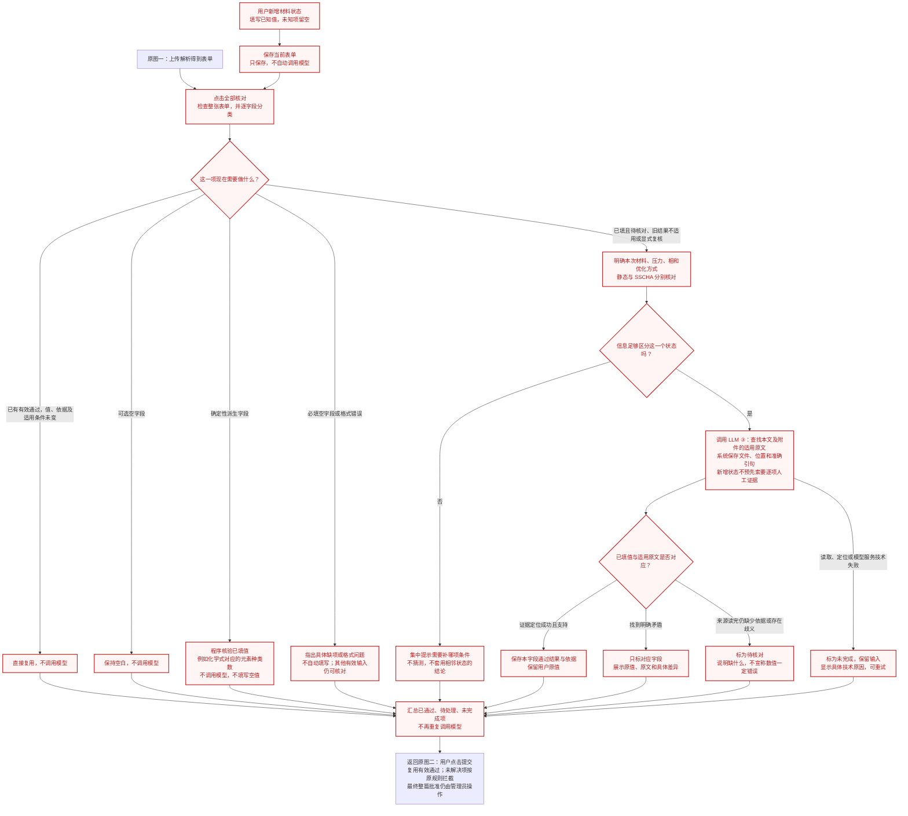

# 新增材料状态与全部核对（修订草案）

关联 [Issue #147](https://github.com/JLU-ICCMS-MaYuan/SC-Wiki/issues/147)，接入[既有三个流程图](review-flow.md)。

状态：本轮交付为流程设计，业务代码与真实草稿均未修改。用户已确定空字段策略；整版修订待审阅，不将本文件当作已实现的 Overview。红色节点表示本轮新增设计，红色不是字段审核失败标志。

## 一句话说明

用户新增一张材料状态表，填写自己知道的内容。点击“全部核对”后，系统先自动从当前论文和附件中寻找证据，逐项检查已填写的值；空字段不自动填写，也不给自动补全建议。用户不需要先给每个字段贴引句或写一份理由。

## 图四：接入原图的新增状态分支

遇到冲突或缺证时，用户可按提示修改或补充，再保存并主动核对；图中省略回到顶部的长回路，避免连线遮挡阅读。

## 哪些字段核对、哪些不核对

“全部”指查看整个表单并分类，不是把每个字段都重新问模型，也不是自动生成所有空值。

| 当前字段情况 | 程序做什么 | 调用模型吗 |
|---|---|---|
| 新增状态中已填写的科学内容，尚未核对 | 自动查找论文依据，并核对该状态下的字段值 | 是；先查证，不先索要逐项人工说明 |
| 已有有效模型通过或人工通过；值、依据、适用条件均未变 | 直接复用 | 否 |
| 只移动了行位置、调整展示顺序 | 按稳定身份找回原结果 | 否 |
| 物理含义相同但表示变化 | 按已定义的等价规则判断；不能凭外观猜测 | 确定性等价可复用，否则只核对受影响字段 |
| 以前通过，但该字段依赖的材料、压力、物相或优化方式改变 | 旧结果保留为历史，重新核对适用性 | 只调用受影响字段 |
| 已填但没有证据、以前未通过或依据定位失败，用户明确点击全部核对 | 发起本次主动查证/复核 | 是；既有普通人工修改分支仍按原规则准备已编辑内容 |
| 元素种类数等确定性派生字段已填写 | 按明确规则核验；例如 La、Sc、H 为三种元素 | 否；依赖无效或歧义则待处理，不伪造论文引句 |
| 可选字段为空 | 保持空白 | 否 |
| 必填字段为空 | 显示缺项；不能提交整篇，不补值 | 否；不必阻止其他已填且条件充分的字段核对 |
| 格式错误、缺少区分状态的必要条件 | 提示具体缺项；同一状态共享缺项集中提示 | 不向模型发送无法唯一归属的字段 |
| 超时、附件无法读取、引句定位技术失败 | 标未完成并保留其他字段通过结果 | 用户重试时仅重试未完成部分 |

空值不能用真假值判断，数值 0、false 等合法输入不等于未填写。部分填写的表格/数组只核对有内容的项，空单元格不自动生成。未填写的状态不自动增加 Tc、λ、ωlog 等记录或模块。

同版本明确科学不通过时，重复点击“提交”不自动重问；“全部核对”是用户明确发起的主动复核，允许检查未解决项，但不因此反复核对已经有效通过的其他字段。双击不重复排队，核对期间发生新编辑时旧结果不能覆盖新值。

## 自动找证据与人工说明的边界

1. 用户手工填写字段值，并不意味着证据必须也由用户手工填写。新增状态首次查证只要求输入格式和状态身份足够明确；用户可以自愿提供页码或附件帮助定位，但不是必做前置步骤。
2. 自动查证只能使用当前论文及其附件。引用其他论文、外部材料或用户自有计算时，必须保留真实来源类别，不能伪装成本论文原文。
3. 找到适用证据时，保存该字段的真实文件、页码/段落和准确原文，再记录模型如何据此判断；不把“系统提取”伪造成“用户亲自确认”。
4. 找到冲突或查证仍不充分时，不覆盖用户原值，不自动清空字段；只提示具体缺口。用户可修改、清空可选字段、补充条件、主动复核，或按原人工材料规则补证据/理由。
5. 不要求每一字段使用不同的引句。同一段原文确实同时支持材料化学式、结构维度等多个字段时，可复用同一来源，但每个字段仍有独立的适用性结论。静态结果不自动成为 SSCHA 的证据。
6. 自动查证成功后无需用户逐项再点人工通过。程序保存模型通过，不制造人工通过记录；管理员整篇批准职责不变。

## 给模型的条件要写清楚什么

这不是在提示词里笼统加一句“请仔细区分”。SC-Wiki 必须把这一行真实保存的条件传给模型，例如：

| 条件 | 静态状态 | SSCHA 状态 |
|---|---|---|
| 材料 | LaSc₂H₂₄ | LaSc₂H₂₄ |
| 压力 | 300 GPa | 300 GPa |
| 结构优化方式 | 静态优化 | SSCHA，考虑量子非谐效应 |
| 当前核对字段及值 | 材料维度：三维 | 材料维度：三维 |
| 其他适用条件 | 当前行已填的物相、温度、磁场、软件及计算阶段等 | 当前行已填的对应信息，缺少时明确缺少 |

模型要分别回答“引句讲的是哪个状态”“支持哪个字段”。共同材料信息可以共享出处，但共享必须有适用性依据；空间群、晶格、Tc 等不能因为化学式和压力相同就直接继承另一状态的通过结果。结果的有效性要与该字段实际依赖的条件绑定；不能把一个无关备注修改扩大成整张表重新核对。

## 从这次现象得到的说明与修复边界

- `state-300-sscha` 只是一个内部编号，指“后来在草稿中单独登记的 300 GPa SSCHA 材料状态”。“新增”只描述增加了一行，不能用来判断是人填写、模型提取还是已经审核。
- 既往应用记录证明当时经过模型读取、工作流区分和按原表拆分得到 8 个状态，并非整行无依据复制静态状态。超导数据与状态基本字段有不同的证据/结果记录；部分超导项通过不能证明所有基本字段均有有效证据。
- SC-Wiki 的修改判断读取字段变更记录中的旧值，再与当前值比较；新增行的旧值为空，是“以前没有这一格”，不是“现在字段为空”。模型未参与这个程序判断。
- 该系统整理写入被记录为人工新增，后续套用了人工修改规则；新设计必须分别记录用户提供的值、模型从 PDF 得到的值、系统拆分/搬移产生的行，以及谁点击了操作，不得把操作者与科学内容来源混为一谈。
- 论文原文存在、模型判断支持、引用能准确定位、字段审核通过，是四件相互关联但不等同的事。系统必须真实完成对应步骤，不只保存一句“有依据”。
- “引句定位失败”指无法在指定文件中找回模型声称引用的那句话，不等于“字段数值错误”。有来源文件失败、格式错误等技术原因时标未完成；只有实际读完材料仍无适用依据时才报告缺证；冲突则展示具体相反原文。
- 当前代码存在“降为缺证后仍拼接模型原肯定理由/无需修改建议”的矛盾显示。草案要求分别显示“模型的判断”和“出处验证结果”，最终用户结论不得同时宣称通过与缺证。历史失败记录保留，不直接改成通过。

## 草案需求与验收

- FR-019 / SC-014：用户新增状态并填写已知值后，可主动全部核对；首次查证不要求逐字段人工理由或附件。新增、编辑、保存均零模型调用，点击主动核对后仅必要项调用。
- FR-020 / SC-015：只核对已填内容，不自动补空值、给补全建议或新增物性记录；可选空项跳过、必填空项提示、0 等合法值正常核对。
- FR-021 / SC-016：批量操作逐字段复用有效结果，只复核未解决或实际依赖条件变化项；同版本提交复用批量核对结果，科学失败与技术未完成分开。
- FR-022 / SC-017：状态级核对明确包含优化方式及必要适用条件，300 GPa 静态与 SSCHA 可被区分；缺条件时集中提示，跨状态来源只在明确适用时共享。
- FR-023 / SC-018：自动从论文与附件取回准确出处；用真实引用验证支持/冲突，不把定位技术失败显示为科学不通过，也不保留相互矛盾的最终结论。
- FR-024 / SC-019：区分创建操作、值来源、证据来源及审核结果；直接 PDF 提取、用户新增、系统拆分三类均能独立审计，不伪造人工确认，不覆盖现有手工输入。

本轮只校验文档图形与规则一致性，不运行真实模型、不迁移审核结果、不修复当前草稿。实施任务需在整版流程审阅后再形成；#147 保持开放。

## 原始截图材料

图片是问题现象的证据，不把截图中既有提示当作本轮新要求。

| 原文件标识 | 本轮顺序 | 归档路径 | 内容 |
|---|---|---|---|
| codex-clipboard-73e7574c-8e6b-4b10-9945-e7e745699d4c.png | 1 | assets/2026-10-22-new-state-red-fields.png | 300 GPa SSCHA 材料状态的字段标红 |
| codex-clipboard-2b1b9042-b916-45c5-8e9d-965ba5c59b5f.png | 2 | assets/2026-10-22-new-state-missing-source.png | 原文未找到、理由矛盾及人工通过不可点击 |

## 原始需求记录

嗯嗯，有次也引出来一个新的问题，若用户自己新增了一个材料状态，怎么为其填写材料状态里面的证据。我觉得这个肯定要自动化。比如这个新增的材料状态肯定每个证据和字段都需要人填写，没填的都是空的。然后可以通过点击“全部核对“按钮。来为整个表单审核。这里就涉及到哪些字段需要核对，哪些不需要核对。你看看这个部分怎么加到之前提到的那个程序流程图里面。新增加的这个部分用红色框红色字表示。

### 空字段策略确认

只核对已填值，空字段不自动补全

### 对上一轮说明的十二条批注原话

1. 这是什么意思? 什么叫做新增了 state-300-sscha.这个英语单词代表什么意思？
2. 你说的“系统”是什么系统，是SC-Wiki 的代码还是 LLM 大模型？为什么会把这个热工新增的字段标记为空值。我记得这个部分是我看了论文之后要求你产生 300 GPa 的 sscha 的一个材料状态，300GPa 的静态优化的材料状态。我以为你还核对我的要求之后，产生这个材料状态之后里面的数据也是按照解析 pdf 的方式产生的。
3. 为什么你会把他判断为修改后的值？是什么标志或者要求让你判断为是修后的值？
4. 看不懂啊？？？？大白话解释一下。
5. 这个很关键。为什么模型文字与证据没接上。大白话解释啊！！！！
6. 这是什么意思？大白话解释一下？
7. 什么叫做引用失败？？？？
8. 对啊。也就说 sscha 优化的这个材料状态是你直接把静态优化的材料状态拷贝过来的。所以才导致很多字段没有证据。是吗？那为什么超导性质这个词条有证据没有标红。
9. 你要怎么明确？
10. 你给这条意见意思是原本程序拿到原文片段后核对字段值失败后，会显示有依据但是无需修改吗？？？？？
11. 新状态是什么意思？如果是直接解析得到的材料状态是新还是 旧？如果是人工手动添加的状态是新还是旧？
12. 对的，而且如果用户手动增加材料状态，那也不应该怎么办？总不能每个条目都让用户添加证据把？？？？？？？
