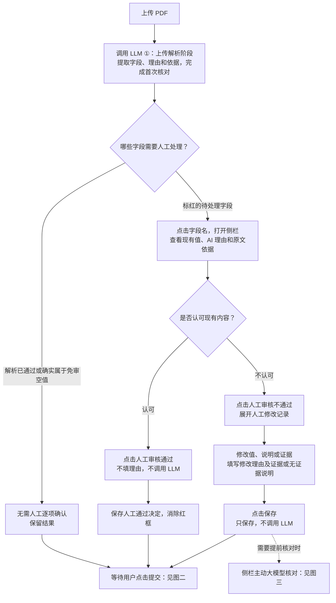
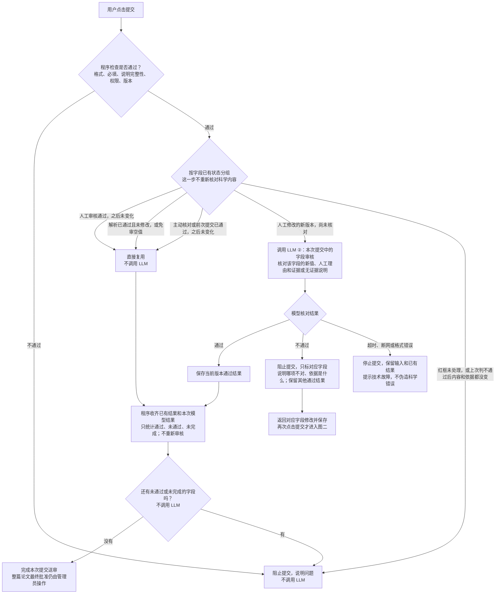
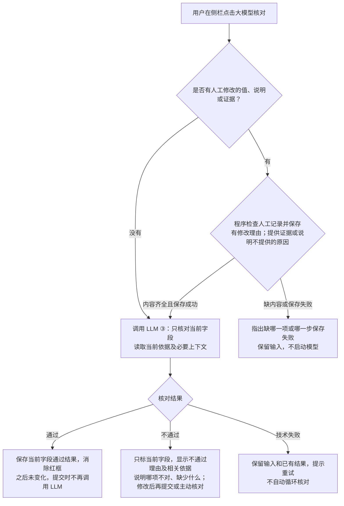

# 人工认可与三个模型调用入口

关联 [Issue #147](https://github.com/JLU-ICCMS-MaYuan/SC-Wiki/issues/147)。日期：2026-10-22。

**状态：本轮已更新需求和流程图，尚未实施本文件新增的人工审核按钮及对应后台决定。**

## 本轮结论

“人工审核通过”表示认可当前 AI 填写的值、AI 理由和 AI 提供的依据。点击即保存人工决定并消除该字段红框；不显示理由输入框，不要求补充理由，不调用模型。同内容、同依据和同适用范围提交时复用。

“人工审核不通过”表示不认可其中某项，展开人工修改记录。用户修改值、补充说明或证据后点击“保存”；保存本身不调用模型，也不代表审核通过。

LLM 仅有三个调用入口：①上传解析，②点击提交后核对尚未核对的人工修改，③侧栏主动点击“大模型核对”。第二个入口不是新增的后台自动任务，也不会在保存后自行执行。

## 图一：上传解析及人工处理

解析中断或模型技术失败应提示任务未完成，不能当成解析已通过。打开侧栏、查看原文、编辑、保存、人工通过、不通过均不自行调用模型。

## 图二：点击提交后，哪些字段调用 LLM？

“只把这些修改交给模型”具体指图中的 LLM ②：**只有用户已经点击提交，并且某字段存在尚未核对的人工修改，才核对该字段。**不是多出第四个模型入口。一次提交可有多个修改字段，但每个字段分别保存结果。

“没有红框”应对应有效通过或免审，不能用前端颜色代替后台结果。编辑后暂时去掉旧红框的字段仍待提交检查；解析失败、未加载到状态也不等于通过。同版本已有科学失败时直接阻止，不能靠反复点击提交重问模型；修改内容或依据、或主动点击“大模型核对”后再判断。

### 图二末尾只是在汇总结果，不是多审核一次

例如一篇表单有 100 项，其中 96 项已有有效通过或免审，4 项是本次需要模型核对的修改。模型返回 3 项通过、1 项不通过：程序只把这些已有结果放到一起，知道仍有 1 项没有解决，因此暂不提交。它不会重新阅读那 96 项、重新扫描 PDF，或再问模型一遍。待 4 项都通过后，才完成整篇提交；先通过一项不能提前提交整篇。

程序还须确认提交期间没有并发修改，把已审核的内容提交出去；这是版本校验，不是新的科学审核。图中的“必需”从来不是要求每个可选空字段都填写；未报告且免审的空字段不算未完成。

### “同版本已核对失败”的具体含义

指上一次模型已经给出了**科学核对不通过**的结果，而当前字段的值、人工理由、证据和适用条件都还与当时相同。这里的“版本”指这组内容，不是软件版本，也不是点击提交的次数。

假设用户填了 Tc=340 K，模型指出所提供原文只支持另一个温度，已显示不通过理由。用户什么都没改又点击提交：系统仍显示原来的理由，不自动问模型第二次。可以修改字段、补充说明或证据再提交；也可以明确点击侧栏“大模型核对”发起一次主动复核。

超时、断网和回答格式错误属于技术失败，没有得到科学结论，不属于上述“原样仍不通过”；应保留输入并允许技术重试。不得用科学不通过的缓存锁住技术故障。

## 图三：侧栏主动模型核对

### 人工记录“完整”具体检查什么

这些要求只针对人工修改分支；未修改现有内容而主动核对，不凭空要求填写修改理由；“人工审核通过”分支仍不设理由输入。

1. **人工修改理由已填写**：简短说明为何修改当前字段；即使提供证据也要填写。
2. **明确选择证据方式**：选择提供证据，或不提供证据。
3. **选择提供证据**：至少一项有效人工证据已保存；选择了文件但上传失败或尚未上传，不算保存成功。
4. **选择不提供证据**：填写不提供的原因；这不是系统已经认可该原因，也不是伪造论文原文。
5. **当前值、说明、附件均已保存成功**：保存冲突或上传失败时明确提示，不拿旧输入去核对。

程序这里只检查有没有填写、有没有保存，不调用模型评价理由是否成立；科学上是否成立由随后 LLM ②或③ 判断。已保存且未变的材料不需要重复填写或上传。普通草稿编辑可以保留半成品，真正发起核对／提交时不能无声忽略缺失说明。

### 核对不通过必须说明原因

LLM ②和③都须在当前字段的“AI 理由”区写清：哪项内容未通过、与哪条原文或人工证据不对应、还缺什么依据。能定位时附真实文件及页码或段落；无相关依据时明确“未找到支持当前值的适用依据”，不能编造引句。保留原输入及其他字段的有效通过结果，不以“核对失败”四个字代替具体理由。技术错误单独说明，不包装成科学问题。

## 按钮及侧栏约定

| 按钮 | 用途 | 是否填写人工理由 | 是否调用 LLM |
|---|---|---|---|
| 人工审核通过 | 认可现有值、AI 理由和依据；保存真实人工确认 | 否，该分支没有理由输入区 | 否 |
| 人工审核不通过 | 不认可现有内容，展开人工修改记录 | 修改分支填写 | 否 |
| 保存 | 保存修改值、人工记录和人工证据 | 按人工修改记录规则填写 | 否 |
| 大模型核对 | 主动核对当前字段 | 使用已保存的现有依据及人工记录 | 是，入口③ |
| 提交 | 程序检查后复用通过结果，核对尚未核对的修改 | 不重复填写已有说明 | 条件满足时调用入口② |

保留“字段设置／来源核对／历史记录”页签；来源页把原文、AI 理由和人工通过／不通过按钮放在一起，下方为人工修改记录。不把人工记录输入框放进认可分支。不新增“推翻 AI 并补理由”的第四种操作。旧科学输入不因点击不通过被清空；不通过而尚未处理时阻止提交。

修改、补充或替换依据后属于修改分支，不能把“人工审核通过”用作免除该新版本模型审核的通道。人工通过仍需满足权限、格式和同版本要求；成功记录真实操作者及时间，不伪造模型判断或论文出处。

## 替代关系与未实施边界

- 此前讨论曾选择“可以通过，冲突时补理由”，此前流程图也把“推翻 AI 明确否定或缺证结论”写入认可分支。这是历史方案，**已被本轮明确要求替代**；认可分支不再承担此语义，也没有理由输入。
- 2026-10-21 原始 #147 方案的“完成仅保存、不代表通过”保留在原话历史；最新产品约定区分“保存”和“人工审核通过”。仅保存记录仍不能变成通过；正式人工确认可以作为同版本提交的有效结果。
- #109 的来源区分、#139 的计算条件规则与 QE 泛函留空、#144 的无关字段隔离、#145 的局部保存与避免重复检查继续有效。
- 现有基线实现和测试记录保留；本轮仅建档与改图，不把新按钮、人工通过复用或来源加载修复宣称为已实施，不修改 Overview。

## 新增需求与验收

- FR-011 / SC-006：认可分支只有人工审核通过，不出现裁决或修改理由输入；点击、刷新、重开、同版本提交均不调用模型，红框消除，保留真实人工确认记录。
- FR-012 / SC-007：模型调用只能由图一、图二、图三标明的三个入口触发；提交逐字段区分复用、新修改待核对、同版本失败及未处理问题。测试对每个入口和不调用分支计数。
- FR-013 / SC-008：不认可后只展开人工修改记录；保存不调用模型；提交才核对未经核对的修改；主动核对已通过后提交不再重核。
- FR-014 / SC-009：区分来源加载中、失败、确实无来源、旧版本来源；读取同字段同版本原文，不能把未加载当无证据。此项沿用前轮规划，仍待实施。
- FR-015 / SC-010：解决对应字段旧候选待选标记，不连带清除其他科学问题；原字段值、原文、AI 理由和历史均保留。
- FR-016 / SC-011：提交末尾仅汇总本次及已有结果、校验提交版本，不重复审核科学内容；100 项中 96 项复用、4 项待审的场景验证复用项零模型请求，任一修改项失败时不提交整篇。
- FR-017 / SC-012：模型明确不通过且输入未变化时，重复提交保留原理由、不新增模型任务；值／理由／证据真正改变可进入提交核对，显式主动核对可启动新任务；技术失败可重试，不当成科学失败缓存。
- FR-018 / SC-013：人工说明完整性按本文件五项要求明确提示；未修改主动核对不要求新增理由；LLM ②和③科学不通过均提供对应字段、具体理由和真实依据或缺口。

## 原始需求记录（完整追加）

### 上轮对完整流程的描述

所以说，当前的逻辑是：
上传解析+LLM 模型之后，有部分需要人工标红审核的，然后点击字段键弹出侧边栏，然后点击人工审核通过。就代表认可 AI 填写的字段值，和 AI的理由和 AI 提供的证据。如果点击人工审核不通过，就带把不认可 AI 填写的 字段值，或者理由，或者证据，然后上传新的字段值，理由或者证据。这是当前的解析后的流程。然后人工审完成后，点击提交按钮，此时再调用大模型审核人工填写的修改过的内容。对于点击了人工审核通过 或者 当时没有标红的框都不会调用大模型二次审核。这是当前的流程。

我希望你能综合#147之前的所有方案好好再仔仔细细看一次。顺一次这个流程，画一个流程图，然后做一个 demo 的样式，特别是侧边栏的样式。使用 issue 和 spec 的技能。

### 本轮修正

不理解这里的：人工认可当前内容分支下，为什么会推翻 AI，为什么会明确否定或确证据？我已经认可了，说明 AI 给的没问题？为什么需要我补理由。这个分支下，就没有可以让人工填写的理由的地方。这个分支意味着我点击了人工任何认可通过之类的按钮。

第2个地方我不理解，为什么会突然出现一个“只把这些修改交给模型”？我完全不知道你要表达什么。我记得只有 3 个地方或者 3 个场景会调用 LLM 模型：1. 第一次解析，2 提交的时候。你的流程图里面没有画出来提交的收，哪些情况需要调用 LLM，哪些情况不调用 LLM。3 侧边栏点击模型核对的时候。

再次完善这个流程图，并且修改 issue 和 spec

### 本轮补充：提交汇总、原样不通过与说明完整性

所以说第一个流程图里面的：不认可现有内容，人工审核不通过修改值，理由，证据后，点击保存，此时不调用模型。等提交的时候，就会走：逐字段判断，人工修改的新版，然后调用 LLM 模型核对。也可以主动点击“大模型核对”那个按钮，开始审核。对吗？如图 1,2

我不理解的是，为什么下面多出来一个“所有必需字段均通过或免审”？这里是在做什么操作？审核什么东西啊？好奇怪！ 如图 3

另一个是：我能理解红框未处理就阻止提交。但是不理解：什么叫做同版本已核对失败？这是什么情况会出现的？如图 4

图 5的保存成功且必需说明完整的说明完整的要求是什么？另外如果核对不通过，建议给出不通过的理由。

你来再次完善流程图并且回答我的问题

## 附件材料

附件为用户对上一版流程图的标注，不将图片中的旧方案文字作为新指令。

| 稳定 ID | 本轮顺序 | 归档路径 | 内容与可读取状态 |
|---|---|---|---|
| codex-clipboard-52a4dfe2-ce1a-44fb-a90b-3bc1c778f061.png | 1 | assets/2026-10-22-flow-approval-correction.png | 认可分支不应要求理由；原图已归档 |
| codex-clipboard-021a86b5-7060-48b9-b2f2-fe51c437d66c.png | 2 | assets/2026-10-22-flow-submit-correction.png | 模型调用缺少提交场景说明；原图已归档 |

后续这一轮五张图的顺序单独编号，均为用户对前一版流程图的批注：

| 稳定 ID | 本轮顺序 | 归档路径 | 问题及可读取状态 |
|---|---|---|---|
| codex-clipboard-6ac1f6b1-7990-4849-a236-1a0755f98c37.png | 1 | assets/2026-10-22-flow-save-path.png | 人工不认可后的保存路径；原图已归档 |
| codex-clipboard-edd76388-e579-41d8-b817-e9adeb15a3a1.png | 2 | assets/2026-10-22-flow-submit-path.png | 提交时修改内容进入模型；原图已归档 |
| codex-clipboard-467b8e53-450f-495b-8c36-2cb630e68d00.png | 3 | assets/2026-10-22-flow-result-summary.png | 汇总结果是否在重复审核；原图已归档 |
| codex-clipboard-28c33080-c0cb-47d3-8758-0810f7223f47.png | 4 | assets/2026-10-22-flow-unchanged-failure.png | 原样不通过的含义；原图已归档 |
| codex-clipboard-af87af1f-c143-4af1-a0a6-43df5b767c20.png | 5 | assets/2026-10-22-flow-manual-requirements.png | 人工记录具体要求；原图已归档 |

## 文档影响

更新本 Issue、Spec、Plan、Tasks、数据模型和接口契约的规划说明，保留历史原话及已有实现验证。本轮未改业务代码，不更新当前功能总览；新规则实施后再按实际验收更新总览。文档本地提交，不推送，远程 Spec 链接待验证。
