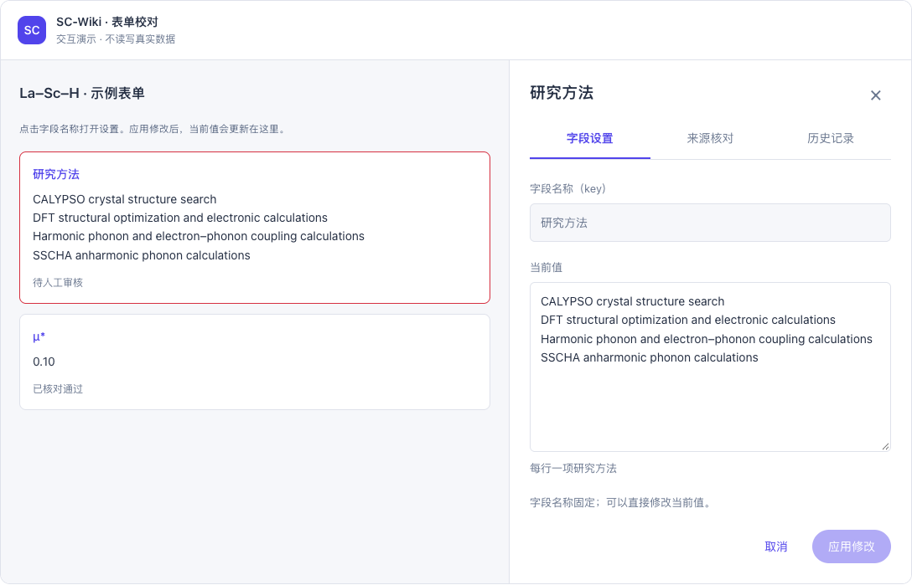
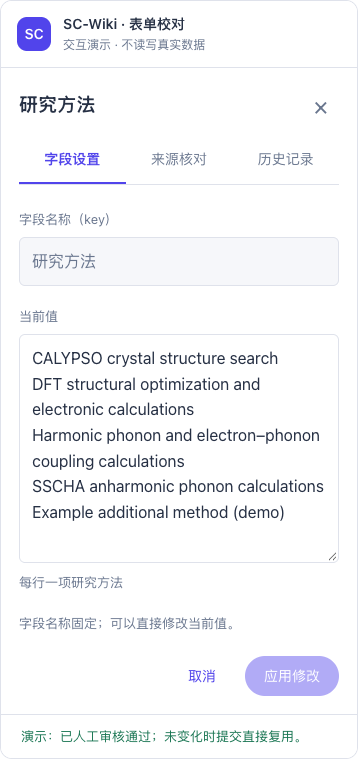
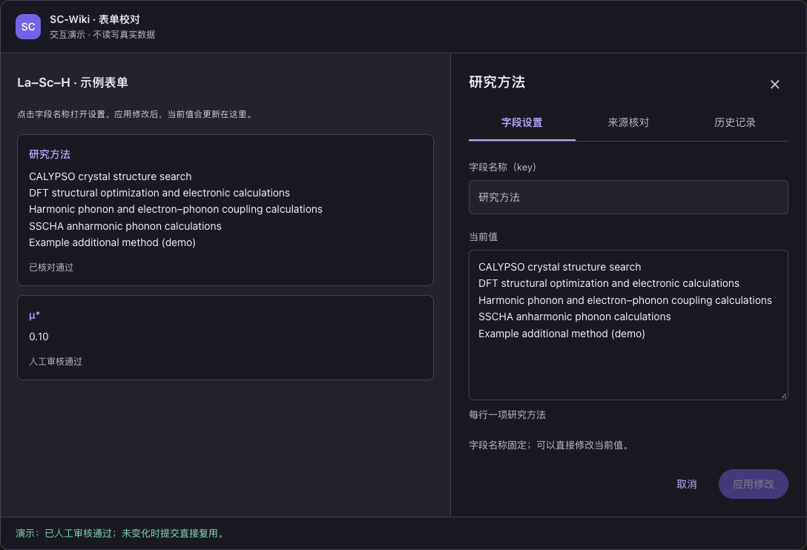

# 侧栏键值编辑交互演示

日期：2026-10-22。关联 [Issue #148](https://github.com/JLU-ICCMS-MaYuan/SC-Wiki/issues/148)。

## 本轮原话

你先做一个 demo，给我看看，

## 演示范围

[交互片段](assets/sidebar-demo.fragment.html) 以现有紫色界面为参照，展示主表单预览和右侧抽屉。默认打开“研究方法”：字段名称只读，当前值在侧栏直接编辑。另有 μ* 示例，用于检查名称、值、固定数值类型和单位标注仍可见。

- 保留字段设置／来源核对／历史记录三个页签；切换保留未应用输入。
- 应用修改只更新演示中的当前字段；取消不更新，× 关闭前对未应用修改提供继续编辑或放弃选项。
- 去掉两个重复返回按钮；关闭后可点击主表单字段名重新打开。
- 人工认可不要求理由，演示保存决定后关闭；不认可展开人工记录。保存人工记录保留侧栏，模拟模型核对作为独立动作。
- “大模型核对（模拟）”明确为演示结果，不实际调用模型；示例原文不冒充真实论文依据。

## 数据边界

全部状态只在本次演示内存中；刷新恢复示例，不写主应用、数据库、localStorage 或真实文件服务。文件控件只演示选择及文件名，不上传附件。它不是正式功能实现，也不证明真实科学判断通过。

## 验证

Chrome 在可视化预览容器内完成 21 项检查，页面脚本异常 0，真实 API 请求 0。结果清单见 [验证记录](assets/demo-validation.json)。

检查覆盖：名称与多行值、固定论文名称只读、去除返回按钮、未应用时不能直接认可、切页签保留输入、取消、仅当前字段应用、人工记录缺项提示、保存保持侧栏、模拟核对、μ* 四项设置、无效数值拒绝、无理由认可、关闭保护、放弃未应用内容及 390px 窄屏无横向溢出。

预览工具的长内容需要足够高的浏览器视口进行坐标点击检查；最终桌面自动化视口为 1120×1700，窄屏为 390×1200。分别检查了浅色和深色外观。截图只证明独立演示，不当作正式页面验收。

## 后续边界

正式的控件接入、数据转换和保存请求仍按 tasks.md 中未完成任务实施；本轮不把 Demo 写进当前功能 Overview，也不宣称侧栏缺失问题已经修复。

## 预览超时后的显示补强

用户报告内联预览出现 `TimeoutError: MCP sandbox RPC timed out`。本轮将默认字段名称、当前值和主表单状态直接放入首屏标记，脚本尚未执行时也能显示内容；交互初始化复用输入框中的示例值。设计和正式业务实现不变。

本地 Chrome 验证：屏蔽全部外部资源时，预览字段在约 109 ms 内可读取，切换页签保留输入、应用修改、μ* 设置、模拟核对和 390px 窄屏检查通过；脚本异常及 API 请求均为 0。另验证禁用脚本时首屏仍包含名称和完整当前值。预览包装器会请求图标库，演示本身不依赖该库。

这些检查不能证明聊天宿主的 MCP RPC 已恢复，也不能证明原超时由演示代码导致。本轮重新发送内联预览，不将首屏补强描述为 RPC 根因修复。

## 再次排查：聊天预览启动超时

用户再次反馈演示有问题后，读取了 2026-10-22 的 Codex 桌面日志。19:45:27 和 19:51:27 均记录了 `visualization_sandbox.init_failed`，错误为 `MCP sandbox RPC timed out`；此前预览文档已有 `sandbox_document_committed` 记录。这确认失败出现在聊天预览初始化阶段，但尚不足以确定内部通信为何没有完成。普通 Chrome 检查通过不能替代聊天预览验收，上一次重新发送未解决该入口的问题。

为让用户继续查看设计，本次把同一份演示通过仅监听本机的临时 HTTP 服务直接提供给独立浏览器页，响应明确使用 UTF-8，不经过聊天内联预览入口。当前地址为 `http://127.0.0.1:8768/sidebar-field-demo.html`，服务结束后该地址失效。

本地 Chrome 实测约 58 ms 可读到字段；中文、切页签保留输入、应用修改、μ* 设置、模拟模型核对、人工认可和 390px 窄屏检查通过，脚本异常和外部请求均为 0。已请求 Codex 打开该浏览器页，工具返回排队状态，不能据此声称用户已看到页面。此次未继续修改演示布局或业务代码，也未将独立页面可用称为聊天 RPC 已修复。
