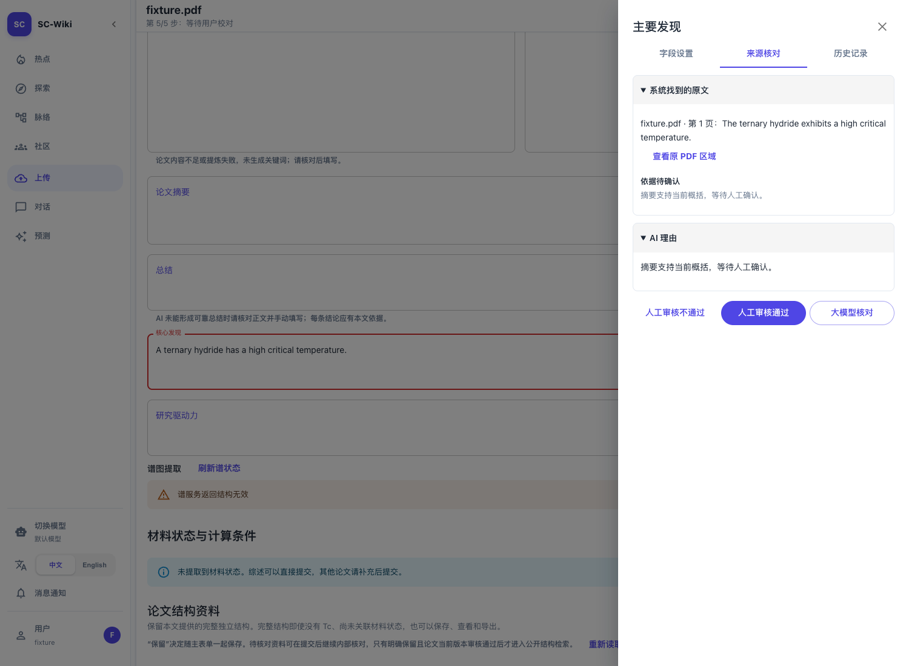

# 正式侧栏实现与验证

日期：2026-10-22。关联 [Issue #148](https://github.com/JLU-ICCMS-MaYuan/SC-Wiki/issues/148)。

## 已实现

- 七类论文文本／列表字段通过 `ReviewPaperTextField` 接入现有配置事件。当前值仍属于父表单，侧栏只暂存尚未应用的文本；应用只更新本字段，取消不应用，页签切换不丢输入。
- 固定名称只读；文本字段不添加无意义的单位或类型。科学字段仍显示原来的名称、值、类型和单位。
- 移除两个重复返回按钮，三个审核按钮同排。未应用修改时审核按钮禁用，并明确提示先应用或取消；×／Escape 关闭提供继续或放弃选择。
- 设置拒绝覆盖同字段的外部更新并保留输入，无关字段更新不阻止应用。只读字段可查看而不可应用；复杂工作区未适配通用编辑时显示可读名称和值。
- 管理员两个列表同时更新原始显示文本和父草稿。已有 `draft-state` 请求提供保存基线，避免 Go 详情的 JSON 文本与 Python 草稿数组发生伪冲突。查看无摘要字段只定位身份，不再先保存其他未保存修改。

## 验证结果

机器记录见 [目标与基线结果](assets/implementation-validation.json) 和 [浏览器结果](assets/implementation-browser.json)。

| 验证 | 结果与边界 |
|---|---|
| 真实宿主组件 | `paper-field-settings.test.tsx` 13 项通过：上传、返修、管理员、七类字段、列表保存、原始空行和逗号、取消、长文本、空值、只读、同字段并发、无改无请求和缺少摘要时查看不保存 |
| 科学设置 | `calculation-field-settings.test.tsx` 6 项通过：既有计算条件／Tc、范围／布尔、并发、只读及重新打开后的未应用状态 |
| 两阶段审核 | `two-stage-review.test.tsx` 14 项通过：μ* 设置、独立字段、人工认可、主动核对、版本及结果复用 |
| 人工证据 | `manual-evidence-section.test.tsx` 7 项通过 |
| 浏览器页面 | 上传、返修、管理员、超级管理员四条真实前端路径：七类字段查看、页签暂存、关闭保护、单字段保存、503 保存失败重试及刷新读取全部通过；每种角色模型请求均为 0 |
| 按钮与窄屏 | 1440、390、320px 同行及无横向溢出；三个审核动作沿用原回调 |
| #147 人工流程 | `human-field-review-browser.mjs` 通过：加载原文、无理由认可、刷新、人工不通过、保存说明保留侧栏；人工说明写入 1 次，模型任务 0 |
| 构建 | `npm run build` 通过，含 TypeScript；保留既有 3Dmol eval 和大分包警告 |

上传、返修和管理员的真实宿主测试在修改前复现了设置页缺失。另一个新增测试先复现了管理员列表保存前值的 JSON／数组不一致，修正后通过。不能只以 Demo 截图作为正式路径的验收依据。

## 扩展回归的已存在失败

另运行 `field-review-layout.test.tsx`、`source-review-presentation.test.tsx`、`evidence-field-isolation.test.tsx`。本轮有 15 项失败；从修改前 `ac6ec8b` 导出源码至临时目录重跑，同样 15 项失败，逐项失败集合完全一致。部分断言仍按旧 `/preflight`、旧“完成”按钮及旧红框状态构造夹具，与 #147 当前合同不同。此处如实保留失败，未为使测试变绿而改回旧行为或改写无关测试。具体名称见机器记录。

## 截图与验证限制

截图为真实前端代码在隔离数据下的页面，未使用用户论文测试。HTTP 保存与读取由隔离内存夹具响应，并严格检查 `before` 与版本；它证明前端路由和请求内容，不等于真实 MySQL、真实论文保存及真实 LLM 科学判断已经验收。本轮不写真实草稿，不调用实际模型。未授权推送，远程 Spec 链接保持待验证，Issue 不因此关闭。
