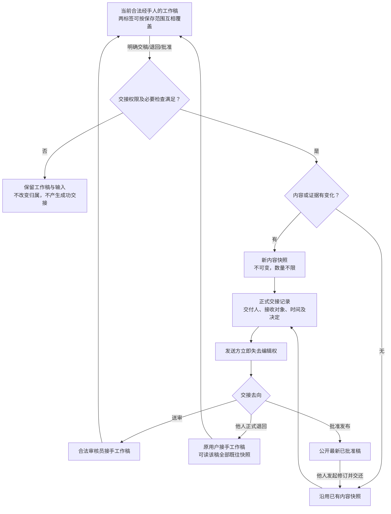

# 历史讨论材料：科学表单交接快照、工作稿归属与共享证据

**原 Issue**：#182，已于 2026-10-30 按用户更正后的明确要求删除；独立科学方法需求 #181 保留。

**创建日期**：2026-10-30

**材料性质**：已退出活动规格的历史讨论原文。以下保留旧草案和原始用户需求，便于按目标拆分时核对遗漏；所有旧 FR、SC、保存范围及文档结论均不再作为实施依据。

目标 1 已独立建档为 [#183](https://github.com/JLU-ICCMS-MaYuan/SC-Wiki/issues/183)，见[字段证据规格草稿](../183-field-evidence-bundle/spec.md)。其他目标分别审阅和建档，不能沿用本旧总草案冒充其确认。本目录不维护新的 Issue 状态或实施待办；实际行动状态以新建的平台 Issue 为准。

特别注意：用户后来明确“只覆盖实际修改项”，旧草案的“整稿覆盖整稿／字段保存覆盖配套资料”不再适用；侧栏不保留“历史”页签，整稿快照入口需在其他位置设置。相关 [demo](demo/handoff-snapshots.html) 仍只供目标 2、7 的布局讨论，不表示业务已实现。

**原建档类型**：`type:feature`。用户后来要求按目标分别新建 Issue 和 Spec，原先“不自动拆成多个 Issue”的组织方式已被取代。

## 附件与推断来源

- 依据本次侧边讨论可见的用户请求和批注整理。原始需求保留 7 段请求和 35 项批注，包含早期术语解释背景；此前 AI 说明只是批注上下文，不独立作为用户要求。
- 本轮无新增图片，`images: []`；不把父对话参考截图冒充本轮已归档附件。
- 用户后来明确的“无变化不新增内容快照”“工作稿允许覆盖”“交出后须由他人退回才可再编辑”优先，旧原话仍保留。
- 保存范围、内容判等和展示等具体化列入整版审阅，不冒称已逐条确认。
- 当前源码、远程 Issue 与并行 #181 仅只读核对；本需求未实现，不写成已落地的 Overview。

## 背景与目标

逐字段保存改值、核对、采纳和模型中间回答，使字段依赖、历史恢复、来源复制及存储难以把握。本需求以“当前工作稿＋内容快照＋交接记录”代替永久逐字段历史，同时把同一计算资料下的 Tc 多点共同内容只保存一份。

这是已采纳方向的独立 type:feature 文档草稿，不代表实现已授权或完成。2026-10-30 最新要求进一步明确：正式交出后原经手人失去编辑权，不能自行取回，必须经其他合法经手人正式退回。

## 需求结论与新旧取舍

- 只有当前工作稿可改；已交出内容快照不可修改，不能通过旧标签页、直接接口或自行复制同一稿件工作稿继续越过交接。
- 每次正式交接都记录交付人、接收对象、时间和决定；若内容与证据完全相同，则复用已有快照，不复制相同内容。数量不限，不限定四个，不按用户或审核员固定单双号。
- 最近用户明确的“内容未改不新增快照”优先于早先“每次脱手都新增快照”的笼统说法；最近“交出后须经别人退回”限定覆盖许可的范围。
- 当前经手人可以在两个标签页共享同一工作稿，以最后保存成功者为准；这是工作稿覆盖，不是允许旧页面修改已交出的稿件。字段保存覆盖字段资料，明确整稿保存覆盖整稿，均不做持续自动合并。
- 用户被退回稿件后可看该稿件此前全部正式交接快照。只读历史权限不等于工作稿编辑权，也不扩展为全站任意论文、他人未交出工作稿访问权。
- 已公开稿需要修订时，由有权处理的其他经手人正式交还原用户；用户以该批准快照为底稿编辑。旧批准版继续公开，新版审核通过后再切换。
- 不再永久保留逐字段改值、核对、候选采纳或模型中间回答时间线，不再承诺恢复任意中间值时找回其旧通过结果。当前必要的值、证据、理由、核对结论与身份仍需保存。
- 字段当前资料明确绑定字段身份、表单位置、当前值、单位/类型、原文位置及证据、理由与当前结果。同组资料按需读取，不再把旧来源总清单和完整校验记录逐字段永久复制进历史。
- 同一材料状态、相同电子结构与声子计算方案和参数、同一 Tc 方法下，可有多个 μ*–Tc 点；共同方法、已报告 λ/ωlog、计算条件和共同出处只保存一份。点仅保留不同的 μ*、Tc、配对和真正不同的依据；不强制每点独立上传证据。
- SCDFT 可表示 μ* 不适用，不能强填0或惯例值；有特殊实现按原文处理。方法归属遵守 #181 的电子结构、声子技术、振动处理和结构优化分层。

## 当前实现核对（只读，不是新方案已落地）

已读取远程Issue正文、本地Spec及当前mayuan源码；新Issue查重未发现同范围开放事项，#35仅覆盖上传清理与原审核快照生命周期，不能代替本次业务交接重构。

- backend/services/field_review_commit.py::review_history_snapshot 当前仍归档逐字段完整结果及共享旧上下文；去重修复不等于业务历史已简化。
- backend/ingest/field_drafts.py::save_fields / save_note 与 backend/ingest/scientific_evidence.py::save_results / backend/ingest/evidence_audit.py 仍保存字段变更、理由或审核事件；不能只隐藏侧栏而继续无限追加。
- backend/services/paper_revisions.py::require_rejected 仅允许已拒绝返修；当前没有本文规划的公开稿他人交还闭环。
- backend/ingest/tc_groups.py::tc_collection_issues 验证共同条件一致，但#94明确每点沿用一条记录且共同资料逐条保存；真正只存一份共同资料需修改契约，不是改科学结果。
- 共享工作区正在并行实现#181，包含未提交代码、迁移、测试和文档；本次只新增本Issue目录，不纳入其改动，不声称其目标环境已迁移。

参考官方科学资料：EPW输入文档 https://docs.epw-code.org/doc/Inputs.html （muc / eliashberg / liso / laniso）、QE EPC流程 https://www.quantum-espresso.org/Doc/ph_user_guide/node10.html 、SCDFT原始理论 https://arxiv.org/abs/cond-mat/0408685 。这些说明共同资料可复用和SCDFT输入不宜强套经验μ*，不意味着官方软件规定了本项目数据库结构。

## 用户故事与验收场景

### US1：简单可靠的当前工作稿（P1）

经手人反复编辑、保存数值/证据/理由，只更新一份工作稿，无逐字段永久历史。两个标签页都可保存，后保存成功覆盖对应保存范围；输入不触发整表扫描、科学重核或模型。

验收：两页分别将同一 Tc 改为230和220并先后保存，最后为220；另一页不得因版本较旧被迫冲突合并。保存失败保留本地输入且不假称成功。

### US2：交出后锁定，其他人退回后才可再改（P1）

用户交稿成功后，即使保留旧页面或刷新，也不得继续修改该稿件。合法审核员接手建立工作稿；正式退回后原用户才恢复工作稿编辑。

验收：交接成功瞬间发送方保存接口失权；旧标签/迟到自动保存/直接请求均不能越权。交接失败则原工作稿及归属保留。换角色或自我转派不能替代“其他人正式退回”。

### US3：交接有记录，相同稿件不重复保存（P1）

正式送审、返修送审、审核退回或拒绝、批准等都留下交接。内容改变才形成新快照，同内容复用。

验收：用户提交快照1，审核员只改决定而不改字段/证据时批准仍指向快照1；变化后提交则是新快照。同次操作重试不多出交接或快照，超过四轮仍能继续。

### US4：公开后修订与连续公开（P1）

收到退回的已公开批准稿后，原用户以其为底稿修订，历史稿不变；新稿批准前公开页持续使用旧批准稿。

验收：公开快照2→其他合法经手人发回原用户→修改交出新快照3→审核员通过；若审核员未改内容，公开直接采用已批准的3，不强造4；若改过内容则采用新的批准快照。

### US5：整稿快照和交接清晰展示（P1）

默认当前工作稿，另有“交接记录与快照”入口。列表按整稿交接展示时间、交出人→接收对象、操作、快照新建/沿用及查看入口；某一快照可被多次交接引用。

验收：“查看整稿”在新标签页打开只读完整表单，顶部显示该快照和所选交接信息，字段侧栏显示当时证据/理由/核对结果，不读取当前工作稿覆盖旧证据；无字段历史页签或模型调用。用户可读获授稿件的全部既往快照。

### US6：当前字段资料可定位、可核对（P1）

能同时确定表单中的哪个字段、该字段当前值及其证据在原文的位置。核对上下文与证据归属分开，原文定位准确不能冒充科学含义支持。

验收：原文写λ=1.5的引句不能直接证明Tc=230 K；Tc需关联报告Tc的依据。真实共同表格可被多个点引用，不要求重复上传。

### US7：同一计算资料下的 Tc 多点不重复共同信息（P1）

共同计算资料→Tc方法及特有设置→多个μ*–Tc点。显示、保存、重读、送审、导出和快照保持配对与来源；不必为每点再复制方法及共同条件。

验收：同组至少三点，只保存一份共同资料，各点μ*–Tc不串位；删前一点不串字段；不同实际共同条件不混组；SCDFT不适用μ*的记录可正常表达。

## 功能需求

- FR-001：系统区分当前可编辑工作稿、不可变内容快照、正式交接记录与当前公开引用，不能用同一可覆盖对象同时承担草稿与历史。
- FR-002：当前经手人的反复输入、普通保存、自动保存和中间模型回答不新增永久内容快照或字段历史。
- FR-003：当前工作稿统一保存本次实际值、证据、必要说明及当前核对结论；核对信息属于当前状态，不是无限版本时间线。
- FR-004：同一工作稿的合法标签页允许后一次保存成功覆盖先一次保存成功，不以“来自旧页面”为由拒绝本来允许的覆盖。
- FR-005：保存范围明确：字段保存覆盖该字段及其配套资料，明确整稿保存覆盖当前整稿；不得把保存后覆盖与不可变快照混同。该保存范围说明是本草案对用户原话的具体化，须随整版审阅。
- FR-006：保存时避免将另一个字段的来源或结论拼到本字段；稳定身份绑定材料、共同参数组、方法、结果点和科学字段，不以数组位置作为唯一身份。
- FR-007：输入只更新当前编辑内容与必要轻量标记；输入和普通/自动保存不调用模型、不全量核对、不遍历整篇历史、不反复扫描整表或强制另一标签刷新。
- FR-008：保留中文组合输入、中间数值、光标、真实错误、失败恢复与局部更新；主动保存覆盖不等于允许迟到响应抹掉更新的本地未保存输入。
- FR-009：正式交出成功后，发送方立即失去该稿件编辑权，服务端而非页面按钮负责执行；已打开页面、刷新和直接接口不能继续保存。
- FR-010：原发送方只有经其他合法经手人正式退回/交还才能重新获得工作稿；不得自行撤回、换角色、自我转派或复制旧快照到同一稿件的新工作稿来绕过。快照新规则不默许自审或扩大既有审核资格。
- FR-011：接收者以收到的快照复制工作稿，不能直接改原快照；同一人再次接手按新一轮处理，仍不改以往交出的版本。
- FR-012：只有合法交接完成才改变经手归属；失败、超时或部分写入不得产生“已交出但资料丢失”或“失败却失去原稿”的状态。
- FR-013：每次新的正式交接记录交付人、接收对象、服务端时间、处理决定、意见及引用的内容快照；同一次操作重试返回同一结果。
- FR-014：内容快照保存完整表单、当前采用证据及随稿必要说明，不把每个字段带着的legacy_evidences/validation_record和无限中间运行对象再次整包归档。
- FR-015：内容/证据有变化时交接创建新快照；完全不变复用已有快照。快照数不限、编号不固定到4，客户端不得重新从1自行编号或混淆稿件。
- FR-016：交付人、时间、接收对象、通过/退回等流程信息单独变化，只形成新的交接信息，不复制相同内容快照。
- FR-017：快照证据与稿件内容固定；新工作稿替换、清空或删除当前证据时，旧快照中的证据不得随之变化或消失。
- FR-018：仅最新审核通过的稿件可成为当前公开版；最新生成的待审或退回稿不能因为编号较新就公开。
- FR-019：已公开稿修订时，其他合法经手人可正式交还原用户，以该公开快照为底稿；原用户不能自行取回已交出的稿件。
- FR-020：修订期间继续公开原批准版；新稿批准成功后统一切换公开引用及相关读取边界，发布索引失败与已批准事务区分。
- FR-021：原用户获交还稿件后，可查看该稿此前全部正式交接快照及相应资料，不局限本人曾创建的版本；不因此获得全站任意论文或他人未交出的工作稿访问权。
- FR-022：编辑权失效与已获授历史只读权限分开；交稿后仍可依授权只读查看已交出的稿件，不能把“可查看”当“可修改”。
- FR-023：默认编辑工作稿，交接列表按需打开；列表不一次读取所有完整快照或每个字段的旧历史。
- FR-024：交接列表至少显示时间、发送→接收、动作、快照编号、新建/沿用以及查看整稿；查看整稿在新标签只读展示，顶部展示所选交接信息，字段来源读取该快照对应版本。
- FR-025：取消逐字段改值、核对、采纳和AI中间回答的永久时间线及字段历史页签；放弃恢复任意中间旧值时找回历史通过结果的保证。
- FR-026：仍保留当前值/证据/必要理由/当前有效决定；同值同源的当前有效通过可复用，真实改值不借用无效旧结论；不能因取消历史而让每次保存或提交全量重核。
- FR-027：程序定位哪个字段，须能还原其材料状态、共同资料组、方法、结果点与字段身份；证据定位须记录真实可核验的文件、页码、块/区域/表格位置及原文或原图，未知位置不编造。
- FR-028：当前字段值、证据定位、证据内容、采用说明及当前结果统一可查，不再把父记录整份旧来源清单冒充每个字段自己的直接证据。
- FR-029：核对时可按需读取该字段所属计算组的共同条件；完整校验上下文不能代替“这条证据支持这个字段”的科学判断。
- FR-030：一个确定材料状态下，同一电子结构/声子计算资料及参数、同一Tc方法的多个μ*–Tc点，只保存一份真正共同的方法、已报告λ/ωlog、软件/条件与共同出处；方法专属设置仍归该方法。
- FR-031：各点保持μ*和Tc准确配对及稳定身份；没有特殊出处时不要求每点重复上传；真有不同依据时明确记该点来源，新增/删除/重读/导出不串位。
- FR-032：不能仅因方法名、材料名或压强相同就自动合并不同实际计算资料；遵守用户已界定的共同条件范围与#181科学语义分层。
- FR-033：SCDFT支持μ*不适用，不强填0或惯例值；特殊实现仅按可靠原文表达，不强制要求所有方法均有μ*或λ/ωlog。
- FR-034：草稿可保留尚未通过或不完整输入，失败不丢；正式交接按动作执行必要的输入、来源和权限规则，不得把旧审核结果错误附到新值上。
- FR-035：只在明确操作需要时核对最终值和必要依赖；当前值改变不意味着每个按键都调用模型、重算科学结论或扫描所有材料。
- FR-036：存量历史与旧稿的兼容/迁移须有明确边界和可回退验证；本需求建档不授权删除、批量改写真实历史或用户稿件，也不得通过读取页面自动改库。

## 关键实体

- 当前工作稿：当前合法经手人持有的可覆盖内容，一份稿件不能靠多个浏览器页面获得多个互相独立的持久事实源。
- 内容快照：交接时已冻结的一版完整内容及证据，供后续阅读和复制工作稿，不能编辑。
- 交接记录：一次正式交付的参与者、时间、决定、意见及使用的快照；可多次引用同一内容。
- 当前字段资料：字段位置与身份、值/类型/单位、当前证据/位置/说明及当前核对状态。
- 共同计算资料组、Tc方法、结果点：共享资料与不同μ*–Tc结果分层表达，保留真实科学适用范围。
- 当前公开引用：指向最新审核通过的稿件，工作稿变化不直接改公开内容。

## 成功标准

- SC-001：同一工作稿连续100次编辑/保存不增加永久字段历史或内容快照，当前值、证据及最新结果正确。（FR-001～008、025）
- SC-002：两个标签分别保存同一字段230→220，最终为最后成功保存的220；字段保存与整稿保存覆盖范围可明确验证，不出现旧版冲突阻挡允许的保存。（FR-004～006）
- SC-003：固定隔离大稿输入期间模型请求、全量核对刷新和整表字段扫描均为0；四类科学表单及侧栏局部更新、中文输入和中间值保持。（FR-007、008、035）
- SC-004：正式交接后原经手人旧标签、刷新和直接保存请求均不能写；只有另一合法经手人正式退回后恢复工作稿写入，自我退回不能绕过。（FR-009～012）
- SC-005：字段/证据未改的交接只新增一次交接信息，内容快照数量不增；变化后的交接只新增一份快照，多次重试不重复。（FR-013～016）
- SC-006：至少10轮交接及同一人多次接手，快照无四份上限、身份不混、编号与实际引用稳定。（FR-011、015）
- SC-007：旧快照中的Tc=230K及其证据在新工作稿改为220K并替换证据后完全不变，读取旧稿不会取到当前新证据。（FR-014、017）
- SC-008：公开版2→他人交还→用户修订→新提交→新版批准；新批准前公开内容一直等于2，新批准后才切换，失败/退回不切换。（FR-018～020）
- SC-009：用户可读获交还稿件的全部既往正式快照，无法读取其他未获授权稿件及他人未交出草稿；可读历史不恢复写权限。（FR-021、022）
- SC-010：默认页不加载完整历史；交接列表元数据与只读完整快照按明确点击加载，新标签查看无需模型且无字段历史页签。（FR-023～025）
- SC-011：每个当前科学字段可定位表单目标、值与确切依据；“λ原句位置准确但不支持Tc”的反例不被当作Tc原文通过。（FR-027～029）
- SC-012：同一实际共同资料及方法至少3个μ*–Tc点，共同信息只存一份，配对/共同与特殊证据在保存、重读、快照和导出保持；删除前点不串后点。（FR-030～032）
- SC-013：SCDFT不适用μ*案例可完整表达和送审，未知/未报告参数不被默认值补满；电子/声子/振动/优化语义不退回混装字段。（FR-032、033）
- SC-014：当前不变的有效结论提交零重复模型调用；新值旧通过反例不能通过，未通过/保存失败不丢当前输入。（FR-026、034、035）
- SC-015：存储规模按实际稿件内容和真实共同资料增长，不随每个科学叶子重复复制整条上下文；不得用截断/丢证据达到缩小。（FR-014、028～031）
- SC-016：保存/交接/快照/归属切换的各失败边界及重复请求均有恢复验证，不出现半交接、已交出仍可写或失败后丢稿。（FR-008、012、013、034）
- SC-017：form-contract、mutation与受影响回归覆盖上传、返修、管理员、超级管理员完整宿主；既有失败有独立基线，不冒称远端合并门已配置。（FR-007、008、034～036）

## 新流程图

## 旧规则覆盖与依赖

| 旧入口 | 旧要求/实际行为 | 本需求如何处理 |
|---|---|---|
| #93 论文历史可见性 | 历史管理员专属 | 为获交还稿件的用户开放该稿完整既往快照，只读范围与编辑权分开；不开放全站任意历史 |
| #94 多Tc实施决定 | 每个μ*–Tc点一条记录，共同资料逐条保存 | 改成真实共同资料只存一份，保留方法/结果点/代表点及原布局；不是改科学结果 |
| #108 返修 | 仅rejected，原用户提交后只读 | 扩展公开稿修订与正式交还；补“交出失权、他人退回才复权”，不让用户自己撤回 |
| #109 / #147 / #169 | 字段时间线、旧结论/候选保留 | 停止新增永久字段历史，当前资料随交接保留；不再承诺任意旧值恢复历史通过 |
| #144 / #145 / #174 | 保存/核对分离、性能及冲突拒绝 | 保留性能、局部更新、稳定身份、失败恢复；以允许覆盖替代当前工作稿旧版本拒绝，不放宽已交出/快照权限 |
| #35 | 上传快照、产物保留与清理 | 明确交接快照不随临时任务清理丢失；本轮不实际改存量生命周期 |
| #139 / #176 / #177 / #181 | 共用条件、固定表单、单字段核对及方法语义 | 保留科学身份、来源、定向检查与真实依赖；不恢复harmonic/DFT混装，不在保存时全表核对 |
| #179 / #180 | 用户指定文件身份，撤销误增诊断分流 | 维持当前各自边界，不因新历史页面重新加入已取消解析差异功能 |

关联上述Issue；一个独立Feature，不擅自重开/关闭其他Issue，不重写其旧原话。本稿只是拟替代条款的需求基线，未实现前不能写成Overview现状。

## 假设与待整版审阅事项

- 已确认的产品方向按上述用户原话整理；当前整份文档仍是草稿，不能借“新建Issue和Spec”当作后续实现授权。
- 保存范围、必要说明/理由在内容判等中的口径，是对现有讨论的具体化：随稿填写的说明/证据改变属于内容，单独审批决定/时间/经手人改变只记交接；须在整版审阅时核对。
- 编辑权仅由当前工作流归属授予，管理员角色不能用旧页面绕过已交出约束；审核员如何从现有待审队列接手、公开后由哪些合法审核角色发起交还，在后续Plan/契约中明确，不自动增加“任何用户自取”能力。
- 存储表结构、API名称、迁移批次、旧数据保留期限均未在本轮承诺；不得用猜测补成已确认技术方案。尤其旧历史删除/改写和目标运行环境迁移须另行明确授权。

## 澄清记录

- 原先“每次脱手新增快照”以用户后来“字段内容和证据完全没改就不需新快照”修订为：交接必记录，内容变化才新增内容快照；两段原话均保留。
- 原先建议两个标签页互不覆盖，被用户明确改为允许后保存覆盖。该许可仅适用于当前合法经手人的工作稿，不适用于已交出或公开的不可变版本。
- “快照1～4”只是示例，用户明确数量不限；同一人多次接手仍是不同轮次，不能覆盖以前交出的版本。
- 用户放弃字段修改/核对/候选采纳的完整历史时间线，也放弃恢复任意旧中间值时复用历史通过的要求。字段当前状态和同值同源有效资格仍保留。
- 用户明确旧批准稿在新修订通过前持续公开；获得退回稿的用户可以查看该稿全部既往正式快照，不仅限自己提交的版本。
- 用户最后补充：交出去就是交出去了，须经别人正式退回才能重新编辑。FR-009～012及SC-004明确覆盖旧标签、直接请求、迟到保存、自我退回与正常他人退回。
- Tc共享的范围按用户定义的同一材料状态、电子/声子方法参数和同一Tc求解方法理解；“点的对应关系”只要求μ*与Tc准确配对，不强制每点重复提交相同依据。SCDFT允许μ*不适用。

## 关联规格与实施前核对入口

- [论文历史可见性 #93](../93-paper-version-visibility-and-naming/spec.md)：FR-001/005需要按获交还稿件的只读权限范围协调。
- [多方法多点 Tc #94](../94-property-record-editor/tc-multi-result-implementation.md)：逐点沿用旧记录与共同资料逐条存储，是需要被新共享模型替换的旧决定；原布局及代表结果语义保留。
- [拒绝后返修 #108](../108-rejected-paper-revision/spec.md)：FR-001/010扩展为合法交还与已公开稿修订，不允许发送者自行取回。
- [字段历史 #109](../109-field-evidence-and-ai-suggestions/field-review-history-demo.md)：FR-045～048中永久字段历史部分停止作为新流程要求；真实来源与当前决定保持。
- [两阶段审核 #147](../147-two-stage-field-review/spec.md)：FR-003/004/006的历史保留及旧值历史恢复保证调整；保存/审核分离和当前资格仍需满足。
- [候选应用 #169](../169-field-ai-candidates/spec.md)：FR-004/006中永久采纳历史与旧候选存档不继续无限增长；当前精确候选应用和实际人工认可保留。
- [局部保存 #145](../145-field-review-efficiency/spec.md)与[表单约束 #174](../174-form-processing-contract/spec.md)：保留性能、稳定身份和真实提示；工作稿允许覆盖替代旧版本冲突拒绝，不得解除交出后的编辑权限制。
- [固定表单填写 #176](../176-scientific-form-filling/spec.md)、[单字段核对 #177](../177-sidebar-field-review/spec.md)及[科学方法范围 #181](../181-physical-method-scope/spec.md)：保持真实方法语义、共同资料适用范围、输入/保存不调用模型，不能在保存侧栏时再扫描整篇。
- [撤销误增诊断 #180](../180-remove-parsing-triage/spec.md)：字段证据定位不是被取消的解析差异分类功能，不借本需求恢复该功能。

原PDF、附件、必要解析响应及技术验证资料仍按原约束处理；取消逐字段永久历史不等于授权删除这些资料或存量历史。后续Plan须逐项协调旧契约，不在本次建档中改写其他任务的Spec或代码。

## 范围外事项

本次只创建需求Issue和Spec草稿及需求检查表，不实现程序、迁移数据库、删除旧历史、覆盖用户草稿、代替用户审核、调用模型重提论文、构建或发布镜像、推送Git或部署。不把“SCDFT允许μ*不适用”变成所有实现一刀切无μ*；不改变独立谱的送审边界。

## Documentation Impact

- [ ] 本需求Spec与需求检查表完成整版审阅；本地草稿存在不等于已确认。
- [ ] 实现后更新 docs/overview/01_Decentralized_Uploading_of_Superconductivity_Data/ 及 docs/overview/02_Decentralized_Maintenance_and_Verification/ 的上传、审核、结构与公开版本说明，必要时同步用户入口。
- [ ] 后续Plan列出旧条款的精确替代与兼容边界，不改写历史用户原话；相关旧Issue的写入另按授权流程处理。
- [ ] 安装或主要操作入口变化时再更新根README；本轮不修改现状文档。
- [ ] Spec远程链接在另行授权推送后实际核验；未推送前仅登记本地相对路径“远程链接待验证”，Issue保持OPEN。

## 最终草案状态

用户已明确要求“新建 issue 和 spec。尽量记全了，不要有遗漏”，授权本次建档；这不是对尚未展示的完整Spec逐条确认，也不包含实现、存量删除、迁移、推送或部署授权。当前整版草稿待用户审阅，未勾选最终确认门。

## 原始需求记录

以下保留与本Feature有关的用户请求和批注，按讨论顺序逐字记录。早期术语解释问题只作背景，不冒充额外实施授权；批注对应的“此前AI说明”只用于定位批注对象，不独立视为用户要求。Skill正文、环境说明不属于产品需求。

用户请求：

> [$big-project-translator](/Users/mayuan/.codex/skills/big-project-translator/SKILL.md) 调理清晰的讲给我，并且举个例子。

此前AI说明（批注上下文）：

> 本应共享的来源和校验上下文逐字段重复复制，再整体打包进历史，造成数据膨胀并超过数据库写入限制。

用户批注原话：

> 坏了看不懂，使用 translate 翻译

用户请求：

> 回答我 [$big-project-translator](/Users/mayuan/.codex/skills/big-project-translator/SKILL.md) \

此前AI说明（批注上下文）：

> 都需要同一套“资料 A”

用户批注原话：

> 这套资料是什么？你来给我说清楚。

此前AI说明（批注上下文）：

> 先把完整资料 A 保存一份，给它一个编号，比如“A001”。然后：
>
> Tc 保存：“我的结论是什么，依据见 A001。”
> λ 保存：“我的结论是什么，依据见 A001。”
> μ* 保存：“我的结论是什么，依据见 A001。”

用户批注原话：

> 这样做也会有问题吧。如果我对 Tc 修改了产生 a0001，然后我没保存，又产生 a0001，那么这两个 会不会冲突。你好好读一读代码。帮我看看我的顾虑有没有道理。

用户请求：

> 我当前保留每个字段的历史是一个很无用的设计，一方面我其实设计的并不好，另一方面是我几乎从不看历史记录。我在想当前的设计是不是太复杂了。我根本把握不住。
>
> 我希望能简化整个历史。就是一次提交形成一个快照，这个快照就是这个用户，在这个时间提交时的内容的快照保留。然后审核员审核后在进入数据库后就是最终的样子。然后可能还有其他可能，我希望你能帮我列一个流程图。我们来看看需要在哪些位置设置快照。
>
> 这样即使在单次修改里面修改无论多少次，都会不断覆盖原来的值。不会产生复杂的历史。证据也会随着一起不断覆盖。帮我规划规划。

此前AI说明（批注上下文）：

> 旧来源清单 legacy_evidences

用户批注原话：

> 无法理解，这个内容。大白话解释。

此前AI说明（批注上下文）：

> 完整校验记录 validation_record

用户批注原话：

> 无法理解

此前AI说明（批注上下文）：

> 整条记录

用户批注原话：

> 整条记录是指整个解析的表单，还是当前这个材料状态的超导性质的这个 Tc 组。

用户请求：

> 我还希望你能帮我看看当前的设计代码和之前的 issue 和 spec 有没有冲突的地方。然后在重述一下这个计划。
> 如果在当前版本公开之后还需要修订，那么就把审核员的快照 2 那个版本踢回给传入的用户，让他修改这个快照 2，修改后变成快照 3 然后再给审核员。原则就是只要他离开当前这个人，就记录一个快照。不论是不是同一个人经手，只要离开这个人，就产生新的快照，回来这个人手里之后，可以在这个快照基础上修改再产生新的快照。
>
> 把整体在复述一次。流程图也重新产生一次。

此前AI说明（批注上下文）：

> **legacy_evidences：这条计算结果原来附带的“出处清单”

用户批注原话：

> 就是初次解析 pdf 得到的每个字段的证据

此前AI说明（批注上下文）：

> *validation_record：核对某个字段时，用来对照的那条计算结果。

用户批注原话：

> `legacy_evidences` 里面的内容被 LLM 模型拿来进行核对当前表单里面的字段填写的是不是对的临时文件是吧。它会随着每次人工修改或者大模型修改。但是这个理由会进入数据库，以供未来审核员查看。

此前AI说明（批注上下文）：

> **“整条记录”比整个 Tc 组还可能更细。它不是整份解析表单，而是后台的一条预测 Tc 记录：通常对应一个方法下的一个 Tc–μ 结果点，也可能是一条旧的范围记录。例如同组的“230 K／μ=0.10”和“215 K／μ*=0.13”，通常是两条记录，各自还带方法、参数和条件。

用户批注原话：

> 一般来说一个计算方法会有多个 mu 对应的 Tc。这是不需要为每个 mu 的 Tc 附带计算方法，参数和条件。你可以联网搜搜 qe 和 epw，scdft，看看我说的是不是有道理。

用户请求：

> 当然了你肯定也理解，并不是只允许存储 4 个快照，只要脱手离开当前用户或者管理员，就保留一次快照。公开的始终是最后一版最新的快照。满足你说的**建议修订期间继续公开**
>
> 再来回答一次。 [$big-project-translator](/Users/mayuan/.codex/skills/big-project-translator/SKILL.md)  条理清晰。给我你总计的内容。

此前AI说明（批注上下文）：

> **建议修订期间继续公开快照2，快照4批准后再切换。

用户批注原话：

> 认可

此前AI说明（批注上下文）：

> 不能保证每一条都是当前字段独有的证据

用户批注原话：

> 完整校验记录就是在解决这个“不能保证”问题吗？

此前AI说明（批注上下文）：

> 新方案可以保留本次交稿时采用的理由和证据，不再保留编辑过程中每一次中间回答

用户批注原话：

> 认可

此前AI说明（批注上下文）：

> 多个 μ 对应多个 Tc，共同方法、参数和条件可以只存一份*，这个方向有道理，但前提是它们确实使用同一套基础计算资料。Annotation 3

用户批注原话：

> 对的

此前AI说明（批注上下文）：

> 各结果点仍保留自己的对应关系和特殊依据。

用户批注原话：

> 什么意思？

此前AI说明（批注上下文）：

> 合并不同压力、结构、近似或不同计算设置的数据。

用户批注原话：

> 这个肯定不能乱合并啊。你理解的是什么东西啊。我咋不懂了。我说的是对于一个材料状态（即一个压强，化学，空间，优化方法下的同样的电子结构，声子计算方法参数下的 ，同一个 Tc 计算方法下的可以有多个 mu 算出来多个 Tc）

此前AI说明（批注上下文）：

> 另外，SCDFT 不能统一强制填写 μ*。原始 SCDFT 理论强调不依赖经验参数；数据结构应允许“μ* 不适用”，特殊实现则按论文实际报告保存。

用户批注原话：

> 认可

此前AI说明（批注上下文）：

> #109 字段历史要求 (line 28)、#147、#169 要保留逐字段修改、核对或采纳历史

用户批注原话：

> 放弃这个要求了

此前AI说明（批注上下文）：

> #147 (line 54)要求恢复原值时复用历史通过结果

用户批注原话：

> 放弃这个要求。

此前AI说明（批注上下文）：

> #108 (line 40)只允许已拒绝论文返修，代码也限制为 rejected

用户批注原话：

> 认可

此前AI说明（批注上下文）：

> #93 (line 17)只允许管理员访问论文历史

用户批注原话：

> 用户可以看到退回到自己手里的数据表单的之前的全部都历史快照。

此前AI说明（批注上下文）：

> #94 的正式数据决定 (line 11)规定每个 Tc–μ* 点是一条记录，共同参数逐条保存	存储合同需要修改：界面已经共用，底层仍重复；真正只存一份共同资料需要调整数据组织

用户批注原话：

> 你要干什么？？？？没看懂。

此前AI说明（批注上下文）：

> 但这些规则仍应保留：当前字段是否通过、改值后旧结论是否失效、保存失败不丢输入、并发时不覆盖别人。不留字段历史，不等于取消当前核对状态。

用户批注原话：

> 你给的都是疑问句？我也不知道你到底想怎么做。你是说：不论当前字段是否通过，不论改值后旧结论是否失效，不论是不是保存失败，都不能丢掉输入、并发时不覆盖别人。什么时候我需要并发了？

此前AI说明（批注上下文）：

> 工作稿只有当前状态。
> 当前经手人反复修改数值、证据和理由，覆盖自己的工作稿，不增加永久快照。

用户批注原话：

> 认可。

此前AI说明（批注上下文）：

> 正式交稿必留快照。
> 用户送审、审核员退回、审核员批准，都是正式交付。即使正文没改，只要确实完成了一次新的交付，也留下新的交接记录。

用户批注原话：

> 如果数据表单里面的字段内容和证据一点没修改，一点点都没有，就不需要保存新的快照。

此前AI说明（批注上下文）：

> 收到快照后，复制出工作稿。
> 修改工作稿，不直接修改已经冻结的快照。再次交出去，生成下一份快照。

用户批注原话：

> 认可。

此前AI说明（批注上下文）：

> 快照保存完整稿件。
> 包括表单内容、当前采用的证据、必要理由、核对结果、交付人、接收对象、时间和处理决定。后台临时校验对象不再整包塞进去。

用户批注原话：

> 认可。

用户请求：

> 回答我 。 [$big-project-translator](/Users/mayuan/.codex/skills/big-project-translator/SKILL.md)

此前AI说明（批注上下文）：

> 这些信息应一起展示

用户批注原话：

> 你准备怎么展示?给我详细的方案?

此前AI说明（批注上下文）：

> 只是“通过、退回、经手人、时间”这些流程信息变化，则记在交接记录里。

用户批注原话：

> 认可

此前AI说明（批注上下文）：

> 已经交出的快照保持不变

用户批注原话：

> 没明白什么意思

此前AI说明（批注上下文）：

> 不再保留逐字段改值、核对、采纳的完整历史时间线。Annotation 8
> 不再保证“改回某个旧值，就能找回当时的通过结果”；按当前数据和当前有效依据判断。Annotation 9

用户批注原话：

> 我再加一个理由：之所以不保留历史记录，就是因为这个记录保留起来太复杂了很多字段都会互相牵连，而且会为一个表单增加很大的存储要求。

此前AI说明（批注上下文）：

> 并不能保证旧来源清单里的每条资料都属于当前字段

用户批注原话：

> 为什么不能保证？是因为旧来源清单找资料的证据找的不准就会导致他校验的不准吗？有没有可能把这两个合并成一个呢？既保留这个这个字段的位置，又表留这个字段的证据，这个字段的值。

此前AI说明（批注上下文）：

> 真的修改了值或证据	原通过不能自动代表新内容；核对受影响项，无关项保持

用户批注原话：

> 看不懂

此前AI说明（批注上下文）：

> 同一稿件开了两个标签页	旧页面不能悄悄盖掉新页面已保存的内容，应提示冲突

用户批注原话：

> 如果开了 2 个标签页，可以重复覆盖，只要一个标签页保存了，另一个标签页保存就覆盖。保证可以互相覆盖。但是不要增加计算复杂度导致不断扫描或者刷新或者只要修改内容就在计算。懂吗？我要求过这个，你可以看看我的 issue 和 spec。

此前AI说明（批注上下文）：

> 是防止两个页面互相覆盖。它与保不保留字段历史是两

用户批注原话：

> 允许互相覆盖。这样他们就是共用一个源。

用户请求：

> 新建 issue 和 spec。尽量记全了，不要有遗漏

此前AI说明（批注上下文）：

> 下一次正式交出时，才保存新的内容快照。

用户批注原话：

> 但确实正式交出的稿不能修改，交出去就是交出去了。除非再通过别人的手退回到你的手里了。
