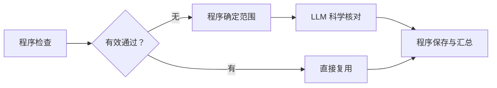

# 精简字段核对流程

**Issue**：[#184](https://github.com/JLU-ICCMS-MaYuan/SC-Wiki/issues/184)

**日期**：2026-10-30。**状态**：Spec 已确认；本次已授权实施。

## 原始需求记录

> 确认开始落地 191,190,188,184

> 认可。为此新建 issue 和 spec。你记住就行。先谈下一个。然后最后统一逐个建立 issue 和 spec

完整业务原话与授权边界见[原始需求](requirements-source.md)。下述内容是据已确认目标整理的规格，不是用户原话。无新增附件或图片，`images: []`。

## 目标与用户场景

US1（P1）：上传者提交时，已通过结果可复用，只有必要科学内容交给模型判断。优先消除额外 PDF 复查造成的重复阻断。

## 需求

- FR-001：删除模型判断之后的额外 PDF 引句复查及其调用。
- FR-002：程序检查权限、格式、版本、选择核对范围并保存结果；LLM 判断必要科学内容。
- FR-003：当前值、依据和适用条件未变的有效通过直接复用，不再调用模型。
- FR-004：保留提取时来源验证、首页题录核验及真实问题阻断。

## 验收

- SC-001：给定有效通过，提交不因额外 PDF 文字匹配失败撤回；未变项模型调用为零。
- SC-002：给定必要变化，由 LLM 核对；无权限、非法格式、版本冲突或真实不通过仍拒绝。

## 依赖与边界

关联 #147、#183，沿用现有字段、依据与审核结果，不新增实体；两项成功标准可独立验收。本次不含其余四项目标、历史批量修正或真实草稿写入。

## 确认与文档影响

本次实施授权见[授权记录](implementation-authorization.md)，本地结果见[验证](validation.md)。已实现并做隔离验收；未推送部署，远程链接待验证。范围外目标不变。
