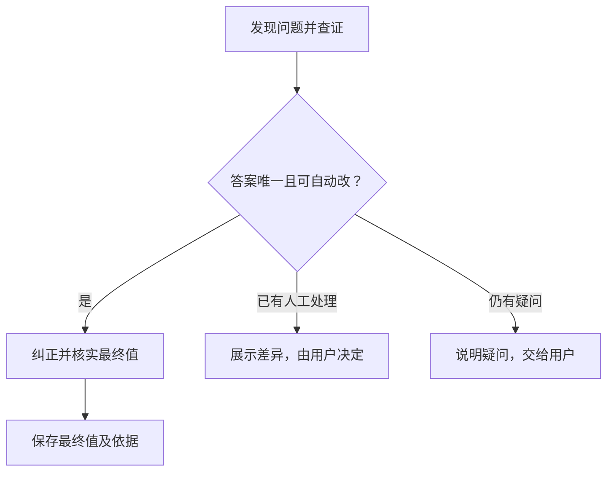

# 系统自动纠错与人工介入

**Issue**：[#188](https://github.com/JLU-ICCMS-MaYuan/SC-Wiki/issues/188)

**日期**：2026-10-30。**状态**：Spec 已确认；仅建档，未授权实施。

## 原始需求记录

> 现有的第二个目标我认可，新建 issue 和 spec。下一个

完整原话与取舍见[原始需求](requirements-source.md)。以下是对已确认目标的规格整理，不是用户原话。无新增附件或图片，`images: []`。

## 目标与场景

US1（P1）：上传者先得到经过系统查证和自检的结果，减少不必要人工核对；系统能唯一纠正的自身错误不交人重复判断。

## 需求

- FR-001：先查证原文及上下文，不能一发现问题就交人。
- FR-002：答案唯一且属于未被人工修改或确认的系统草稿时，自动纠正并核实最终值。
- FR-003：不自动覆盖人工修改或确认；对应差异交用户决定。
- FR-004：保存最终值及支撑依据，不把系统旧错误作为正式字段证据。
- FR-005：仍有歧义或依据不足时，说明具体疑问，交用户判断。

## 验收

- SC-001：给定原文能唯一恢复的错行或错值，自动纠正且依据对应，不要求人工重复审核。
- SC-002：给定人工处理项不被覆盖；给定仍不明确的项，用户能看到具体疑问。

## 依赖与边界

关联 #176、#184，沿用字段、依据与结果，不新增实体；上述场景独立验收。补查机制、侧栏改版分别管理，人工历史由 #192 承接；本次建档不改真实草稿。

## 确认与文档影响

用户已审阅本份 Spec 并回复“确认”；无新增业务决策，未进入 Plan、Tasks 或实施。实现后同步解析核对说明与 HTML 图，根 README 无新增操作。
