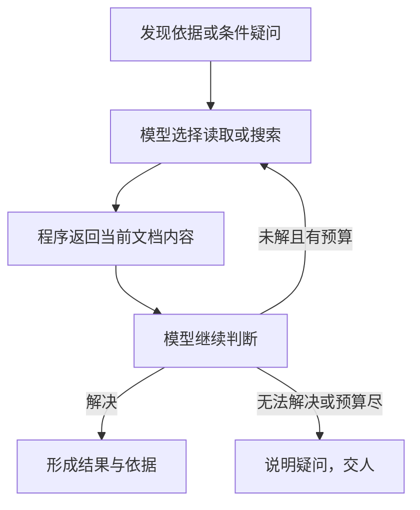

# 字段疑问的文档工具补查

**Issue**：[#190](https://github.com/JLU-ICCMS-MaYuan/SC-Wiki/issues/190)

**日期**：2026-10-30。**状态**：Spec 已确认；仅建档，未授权实施。

## 原始需求记录

> 认可

这是对已展示文档3的答复。完整批注与确认见[原始需求](requirements-source.md)；下述规格为 AI 整理，无新增附件或图片，`images: []`。

## 目标与场景

US1（P1）：上传者先获得系统借助文档工具查证的结果；优先减少本可自动解决却被交人的疑问。

## 需求

- FR-001：将已有工具接入字段疑问补查，不直接把可查证问题交人。
- FR-002：模型选择页面、原文块、表格或搜索词，程序读取并返回内容，模型据此继续判断。
- FR-003：仅访问本次任务论文及附件，不访问任意路径或无范围公网。
- FR-004：一次补查最多12次行动，每工具最多2次重试；失败与重试计入预算。
- FR-005：未解决时说明已查内容和剩余疑问，不伪造通过。

## 验收

- SC-001：给定可由上下文解决的疑问，模型使用工具获取依据并形成结果。
- SC-002：给定越界访问应拒绝；预算耗尽或仍不能解决时转人工，原因可见。

## 依赖与边界

关联 #114、#188，复用已有文档、字段及工具记录，不新增实体；上述场景独立验收。不新增 MCP、不改纠错授权及侧栏布局，不加入 #184 待删除的额外 PDF 复查。

## 确认与文档影响

用户已审阅本份 Spec 并回复“确认”；无新增业务决策，未进入 Plan、Tasks 或实施。实现后同步工具契约、解析核对说明与 HTML 图。
