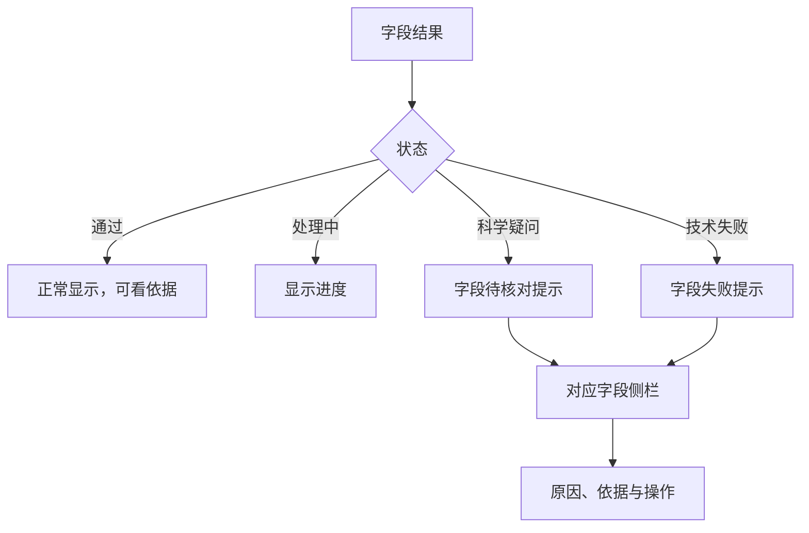

# 核对状态与字段侧栏

> 2026-11-01：本轮由[#200](../200-field-color-only/spec.md)的用户最新要求替代相关约定：字段后状态文字改为仅问题标红，完整状态仍在侧栏。下方原话与旧验收保留，不代表仍采用旧展示。

**Issue**：[#191](https://github.com/JLU-ICCMS-MaYuan/SC-Wiki/issues/191)

**日期**：2026-10-30。**状态**：Spec 已确认；本次已授权实施。

## 原始需求记录

> 确认开始落地 191,190,188,184

> 认可。

这是对已展示文档4的答复。完整批注与确认见[原始需求](requirements-source.md)；下述规格为 AI 整理。无新增附件或图片，`images: []`。

## 目标与场景

US1（P1）：校对者从字段提示进入对应侧栏处理问题，优先消除“没有提示却被提交阻断”的困惑。

## 需求

- FR-001：删除独立“待处理项”按钮及导航弹窗。
- FR-002：字段区分通过、处理中、科学疑问和技术失败；主表单只保留简短提示。
- FR-003：详细原因与依据进入对应字段侧栏，不在主表单堆积。
- FR-004：科学疑问说明需判断事项；技术失败说明失败步骤及重试方法。
- FR-005：通过项不重复要求确认；处理中无需人工介入；未完成项不可表现为已无问题。

## 验收

- SC-001：四类科学表单中无独立导航，问题字段能打开自己的侧栏；通过项仍可查依据。
- SC-002：给定科学疑问或技术失败，字段有可辨认提示，侧栏原因及操作正确；未完成不被隐藏。

## 依赖与边界

关联 #109、#184，沿用字段、来源与核对结果。仅替换 #109 保留独立导航的约定；不改科学判断、审核资格或自动纠错，人工历史由 #192 承接。场景独立验收，不新增实体。

## 确认与文档影响

本次实施授权见[授权记录](implementation-authorization.md)，本地结果见[验证](validation.md)。已实现并做隔离验收；未推送部署，远程链接待验证。范围外目标不变。
