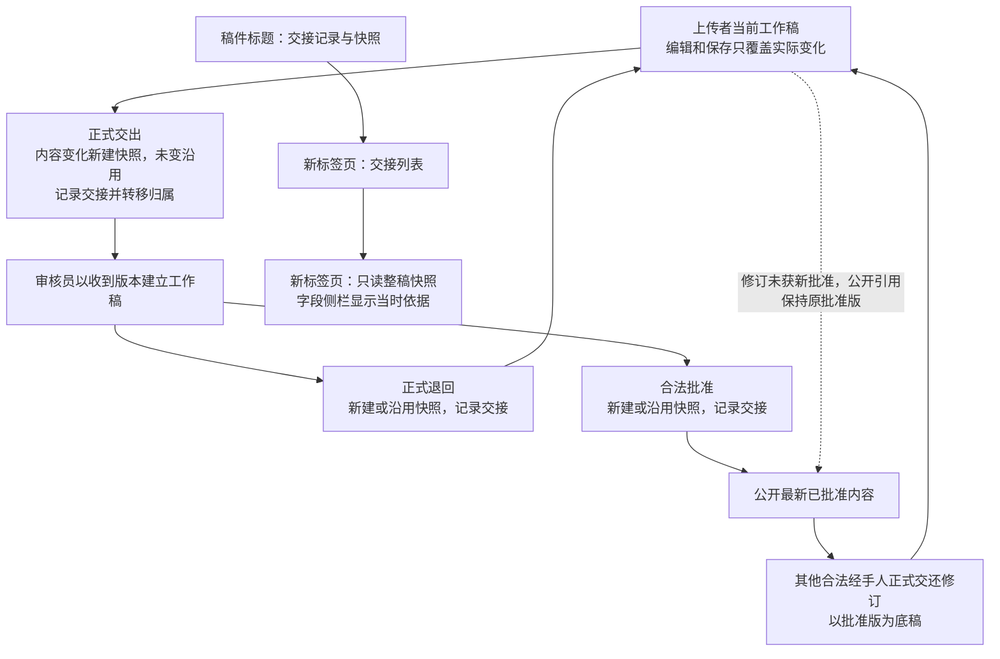

# Feature 规格：正式交接快照与整稿查看入口

**Issue**：[#192](https://github.com/JLU-ICCMS-MaYuan/SC-Wiki/issues/192)

**创建日期**：2026-10-30

**状态**：草稿。用户已确认目标 2 的页面方案及目标 7 的完整 Issue 正文，授权创建本文；完整 Spec 最终版本尚待独立审阅，不作为实现基线。

## 原始需求记录

> 我希望能简化整个历史。就是一次提交形成一个快照，这个快照就是这个用户，在这个时间提交时的内容的快照保留。然后审核员审核后在进入数据库后就是最终的样子。然后可能还有其他可能，我希望你能帮我列一个流程图。我们来看看需要在哪些位置设置快照。

> 这样即使在单次修改里面修改无论多少次，都会不断覆盖原来的值。不会产生复杂的历史。证据也会随着一起不断覆盖。帮我规划规划。

> 如果数据表单里面的字段内容和证据一点没修改，一点点都没有，就不需要保存新的快照。

> 但确实正式交出的稿不能修改，交出去就是交出去了。除非再通过别人的手退回到你的手里了。

> 用户可以看到退回到自己手里的数据表单的之前的全部都历史快照。

> 我再加一个理由：之所以不保留历史记录，就是因为这个记录保留起来太复杂了很多字段都会互相牵连，而且会为一个表单增加很大的存储要求。

> 为目标 2 再讨论： 不同意保留 “历史”页签 的入口。查看整稿正式交接快照在其他位置设置。你有什么别的好的建议吗。

> 目标 7：唯一的问题：从哪里查看快照？其页面设置和位置设置是什么样的？给我一个新的 demo 我看看。干这时候已经和目标 2 的问题很接近了

> 确认

> 把理由或核对结果的变化也算内容变化，新增完整快照

## 附件与推断来源

- 本轮没有新增用户图片，`images: []`。父对话截图未作为本轮归档图片或功能已实现的证据。
- 用户已确认[现有 HTML demo](../182-handoff-snapshot-workflow/demo/handoff-snapshots.html#entry)的稿件标题入口、独立交接列表、只读整稿与两页签字段侧栏；随后阅读完整 Issue 草案《以正式交接快照替代逐字段历史，并提供整稿查看入口》并回复“确认”。该确认是 Issue 和 Spec 草稿建档授权，不是本文最终定稿或代码实现授权。
- demo 中论文、人员、科学值、出处与交接均为模拟资料；只展示页面路径和版本关系，不证明真实权限、存储及审核已经实现。
- 更早的全部讨论、被取代的方案及原话保留在[原 #182 历史材料](../182-handoff-snapshot-workflow/spec.md)。原 Issue 已按用户明确要求删除，本 Feature 只承接交接快照与其查看入口，不恢复被取代的整稿覆盖口径。

## 背景与目标

逐字段永久保存改值、核对、候选采纳和模型中间回答，让相互依赖的字段历史难以理解，也增加重复存储。用户希望当前经手人反复编辑一份工作稿，只有正式交接才保留可回看的完整版本。

本功能区分当前工作稿、正式内容快照、交接记录和当前公开批准版。内容变更产生新快照，正式交接始终有记录；没有改内容的交接沿用快照。已交出的内容不可修改，用户从整份稿件入口查看，而不是从逐字段历史页签进入。

### 当前实现核对

- 当前审核说明及 `backend/services/field_review_commit.py::review_history_snapshot` 仍保留字段审核历史；已有上下文去重不等于停止新增永久逐字段历史。
- 当前 `backend/services/paper_revisions.py::require_rejected` 仅允许已拒绝论文返修，不等于已具备公开批准稿的正式交还修订闭环。
- 当前论文历史规则限制管理员及超级管理员读取；本需求需要按获授稿件扩大原用户的既往快照只读范围，不能扩大为全站任意历史访问。
- 现有字段侧栏仍有“字段设置／来源核对／历史”三个页签；两页签和标题入口目前是已确认 demo 方案，不是业务页面现状。

### 需求结论与变更取舍

- 工作稿反复覆盖的范围遵守 #185：只写实际修改项，不采用原 #182 旧草案的“整稿替换全部旧内容”或“字段配套资料一并覆盖”。
- 正式交接必有交接记录；字段值、采用证据、当前采用理由或字段核对结果任何一项变化，都算内容变化并新增完整快照；全部未变才复用，数量不限定四份。交接人、时间或通过／退回等流程决定单独变化不重复保存相同整稿。
- 交出成功立即失去编辑权，须其他合法经手人正式退回才恢复；新工作稿以收到的快照为基础，不修改原快照。
- 停止继续追加永久逐字段修改、核对、采纳及模型中间回答时间线，不能只隐藏页面；保留当前值、采用依据、必要理由和有效核对状态。
- 不再保证恢复任意旧中间值可找回当时通过结果；同内容同依据且当前仍有效的结果继续按既有规则复用，不能因取消历史而全量重核。
- 最新已批准版本公开，修订期间持续展示旧批准版；新编号的待审或退回快照不能自动公开。
- 目标 2 的删除历史页签与目标 7 的新查看路径作为同一功能交付；其余表单和侧栏布局保持，不顺带重设计。

## 用户场景与验收

### US1：同一人处理期间只更新工作稿（P1）

经手人多次编辑、保存、核对，只保留当前工作状态；正式交出时才记录本轮交付。

**优先级理由**：减少无用而复杂的永久历史，是本需求的直接目的。

**独立验收**：在隔离稿件中连续修改数值、理由与证据并保存，检查没有新增永久逐字段时间线或正式内容快照；交接后检查当前资料保留完整。

**验收场景**：

1. **假如** 用户反复编辑及普通／自动保存，**当** 尚未正式交出，**那么** 工作稿更新，不新增永久内容快照或逐字段中间历史。
2. **假如** 正式交出的内容发生变化，**当** 交接成功，**那么** 保存本次完整内容快照并记录交接。
3. **假如** 字段值、采用证据、当前采用理由和字段核对结果全部未改，**当** 审核员正式退回或批准，**那么** 沿用已有快照，只增加新的交接记录。
4. **假如** 已经反复交接超过四次，**当** 再次交出，**那么** 继续按相同规则工作，不因固定编号或数量上限失败。
5. **假如** 字段值与证据未改，但当前采用理由或字段核对结果变化，**当** 正式交出，**那么** 新增完整内容快照，不仅把新理由或结果放进交接记录，也不改写旧快照。

### US2：交出后锁定，收到退回稿后继续编辑（P1）

交稿成功后原经手人不能继续修改；合法接收者在收到的版本上建立工作稿，退回时再次正式交接。

**优先级理由**：确保每一份交出去的内容都能准确复现，归属清楚。

**独立验收**：以旧标签页、迟到自动保存和直接请求测试交出后失权；再通过其他合法经手人退回验证恢复编辑。

**验收场景**：

1. **假如** 用户已成功送审，**当** 旧页面继续保存，**那么** 服务端拒绝写入，不能仅靠按钮禁用。
2. **假如** 审核员正式退回一份快照，**当** 用户接收，**那么** 可在以它为基础的工作稿修改；原快照的字段和证据不变。
3. **假如** 交接失败，**当** 返回错误，**那么** 原工作稿和合法归属保留，不出现失败却失去原稿的情况。
4. **假如** 同一次交接因超时重试，**当** 重试完成，**那么** 不重复新增快照或交接，成功提交后的响应失败也不能错误撤销已经完成的交接。

### US3：公开后修订，旧批准版持续可见（P1）

已公开论文需要修订时，由其他合法经手人交还原用户，以批准版本为底稿修订；新稿批准前公开内容保持。

**优先级理由**：支持用户已明确要求的公开后修订流程，避免未经批准内容进入公开数据。

**独立验收**：公开 S2，交还修订并送审 S3；检查 S3 尚未批准时 S2 持续公开，S3 批准后才切换。

**验收场景**：

1. **假如** S2 已公开，**当** 其他合法经手人交还原用户，**那么** 用户以 S2 为底稿编辑；不能自行取回已交出稿件。
2. **假如** 新快照 S3 待审或退回，**当** 访问公开数据，**那么** 仍读取 S2。
3. **假如** 新版合法批准成功，**当** 读取公开数据，**那么** 切换到最新已批准内容；不能仅按快照编号最大值公开。

### US4：从整稿入口查看正式交接与当时内容（P1）

用户从稿件标题旁进入交接列表，再在新标签页打开完整只读快照，字段侧栏显示当时资料。

**优先级理由**：已确认的新入口取代逐字段“历史”页签，阅读单位是整份交稿。

**独立验收**：在四类宿主中验证标题入口、新标签列表、同快照不同交接与只读整稿及字段依据。

**验收场景**：

1. **假如** 稿件具有正式交接，**当** 点击标题旁“交接记录与快照”，**那么** 新标签页列出时间、交出人→接收对象、决定、快照及新建／沿用。
2. **假如** 同一 S2 被批准和交还两次交接引用，**当** 分别从交接打开整稿，**那么** 内容都是 S2，各自交接时间及决定分别显示，不改写 S2。
3. **假如** 查看冻结快照，**当** 点击某字段，**那么** 原侧栏仅有“字段设置／来源核对”，读取该快照当时的依据与理由，不读取当前工作稿覆盖。
4. **假如** 原用户收到退回稿件，**当** 查看历史，**那么** 可看该稿此前全部正式交接快照；无关稿件或他人未交出工作稿仍不可访问。

### 边界与异常场景

- 查看快照不等于获得编辑权；只读权限与当前经手人写权限分别判断，不通过换角色、自我转派或旧页面绕过正式交还。
- 内容快照和交接记录是两个对象；同一快照可以被多次交接引用，交接意见变化不能直接改写冻结内容。随稿理由与字段核对结果属于内容；交接意见及通过／退回等处理决定属于流程信息，二者不能混淆。
- 当前证据附件被替换或移除后，旧快照仍须能读取其当时资料，不能引用一个会随工作稿覆盖的内容源。
- 整稿快照读取不触发模型，不一次加载所有完整版本；网络失败和无权限必须如实提示，不用当前工作稿冒充旧快照。
- 修改字段后无效的旧核对结果不自动通过；保留当前审核门禁，不因取消历史而扩大审核资格。
- 现有存量历史不因新规则被批量删除，也不在打开页面时自动迁移；历史兼容方案后续明确。

## 需求

### 功能需求

- **FR-001**：系统必须区分当前工作稿、不可变内容快照、正式交接记录及当前公开批准引用，不能由同一个可覆盖对象同时承担草稿和历史。
- **FR-002**：输入、普通保存、自动保存及模型中间回答不得持续追加永久逐字段修改／核对／采纳时间线或正式内容快照；不能只隐藏历史界面而继续无限追加。
- **FR-003**：每次正式送审、退回、批准等交接必须记录交付人、接收对象、时间、决定、意见及引用的快照；同一次交接重试不得重复记录。
- **FR-004**：正式交接时，字段值、采用证据、当前采用理由或字段核对结果任一项变化都新增完整快照；这些内容全部未变才复用已有快照，仅交接元数据变化不复制相同整稿；快照数量不限。
- **FR-005**：交接快照保留完整表单、当前采用证据、必要理由及当前核对结果，不逐字段重复永久保存完整旧来源总清单、临时校验对象或无限中间回答。
- **FR-006**：交出成功后原经手人立即失去写权限，服务端须拒绝其旧标签页、迟到保存及直接请求，不仅依赖前端禁用。
- **FR-007**：原经手人只有经其他合法经手人正式退回／交还才能再次编辑，不能自行撤回或借角色变换、自我转派绕过；不自动扩大既有自审资格。
- **FR-008**：接收者以收到的快照建立工作稿；收到后或再次接手时修改工作稿，不修改已交出的快照。
- **FR-009**：交接失败保留合法工作稿和归属，成功交接与响应失败分别处理；重试不得重复创建快照、交接或错误回退已完成状态。
- **FR-010**：旧快照的字段、证据、理由及附件内容保持可复现，不能随当前工作稿替换、清空或删除而改变。
- **FR-011**：保留当前核对状态及有效结果复用，不再保证任意旧中间值恢复时找回历史通过结果；真实改值仍按当前资料判断，不全量重核无关项。
- **FR-012**：已公开稿修订由其他合法经手人正式交还原用户，以批准版为底稿；不能自行取回已交出稿件。
- **FR-013**：修订待审或退回期间持续公开旧批准版，新稿合法批准后才切换公开引用；不得以编号更新代替批准资格。
- **FR-014**：原用户收到退回稿件后可查看该稿此前全部正式交接快照；不得因此开放无关稿件、他人未交出工作稿或其他管理权限。
- **FR-015**：字段侧栏删除“历史”页签，保留“字段设置／来源核对”；其余表单、来源与人工记录区域不顺带重设计。
- **FR-016**：上传、返修、管理员、超级管理员稿件标题旁提供“交接记录与快照”，点击后在新标签页打开独立交接列表。
- **FR-017**：列表区分当前工作稿、最新交出快照与公开批准版，显示时间、交出人→接收对象、决定、快照编号及新建／沿用；内容与交接身份不能混同。
- **FR-018**：从交接“查看整稿”新标签页打开只读完整表单，顶部显示所选版本及交接信息；字段侧栏只读取该快照当时资料，不能混用当前工作稿。
- **FR-019**：打开列表、快照或字段资料不调用模型，列表按需读取而不一次载入所有完整快照；不新增持续扫描或后台全量刷新。
- **FR-020**：存量历史和旧稿兼容须有明确范围，建档、读取及新规则启用不授权批量删除真实历史；后续迁移及清理另行审阅和授权。
- **FR-021**：工作稿覆盖遵守 #185，字段资料对应遵守 #183，共同资料读取衔接 #189，切页行为不覆盖冻结内容；不能借本功能实施其他已拆分目标。
- **FR-022**：四类完整宿主及交接失败、重试、权限、内容冻结与公开修订均需实际验证；执行受影响回归与科学表单契约／变异检查，不以 demo 或接口存在代替生产路径通过。
- **FR-023**：对旧规则的调整限于永久逐字段历史、旧中间值恢复保证、合法返修交还和快照可见性；来源真实性、当前审核资格、必要门禁及角色边界继续有效。

### 关键实体

- **当前工作稿**：当前合法经手人可修改的稿件，反复保存仅更新真实变化项，不形成永久逐字段时间线。
- **内容快照**：正式交出时固定的一版完整内容及采用资料，后续只读，可被多次交接引用。
- **交接记录**：一次正式处理的参与者、时间、决定、意见及快照引用；与内容本身分开。
- **当前公开批准引用**：指向最新合法批准内容，待审工作稿和更大的快照编号不自动替换它。
- **历史只读授权**：允许合法查看某稿件既往正式快照，不等于当前工作稿编辑权或全站管理权限。

## 成功标准

- **SC-001**：连续编辑、普通／自动保存和中间模型处理期间永久逐字段历史及正式内容快照新增数均为 0；当前值、依据和有效状态仍可保存重读。（FR-001、002、005、011）
- **SC-002**：字段值变化、证据变化、仅理由变化、仅字段核对结果变化、全部内容未变但流程决定变化及超过四轮交接场景均符合规则：前四类正式交出时新增完整快照，全部内容未变时复用，正式交接始终有记录。（FR-003、004）
- **SC-003**：交出成功后的旧页、迟到保存和直接请求均不能写；只有其他合法经手人正式退回后恢复工作稿编辑。（FR-006～008）
- **SC-004**：交接失败、提交成功后响应失败及重试场景不丢原稿、不重复产生快照或交接、不错误撤销已完成状态。（FR-009）
- **SC-005**：新工作稿修改、清空或替换值及证据后，旧快照的值、附件、理由和当时结果保持；快照不能直接编辑。（FR-005、008、010）
- **SC-006**：公开 S2→合法交还→修订 S3 待审／退回→批准的链路中，批准前始终公开 S2，批准成功后才切换，不按最大编号公开。（FR-012、013）
- **SC-007**：获退回用户可读该稿全部既往正式快照；无关稿件、未交出工作稿和无权请求仍被拒绝，历史只读不恢复写权限。（FR-014、023）
- **SC-008**：四类宿主均符合已确认 demo 的标题入口→新标签交接列表→新标签只读整稿路径；同一快照的不同交接显示各自信息，侧栏仅两个页签且来源不串版本。（FR-015～018）
- **SC-009**：只读列表和快照浏览模型请求为 0，列表初读不携带所有完整版本；无权限及读取失败不使用当前稿冒充旧稿。（FR-018、019）
- **SC-010**：存量历史读取不自动删除或改写；当前有效结果可复用，真实改值不借用无效旧结论；工作稿局部覆盖保持 #185 范围。（FR-011、020、021）
- **SC-011**：生产路径与隔离测试覆盖前述交接、权限、冻结、公开及界面行为；受影响回归与两项表单契约检查按要求通过，其他既有失败独立基线单列。（FR-022、023）

## 假设与依赖

- Issue #192 是本功能行动状态的唯一来源。原 #182 仅保留讨论原文，不承接实施状态。
- [#35](../35-upload-cleanup-lifecycle/spec.md) 的上传与清理生命周期，以及 [#93](../93-paper-version-visibility-and-naming/spec.md) 的旧历史可见性需在后续设计核对；不能把旧管理端限制直接套到获退回用户。
- [#108](../108-rejected-paper-revision/spec.md) 的仅拒绝返修边界需扩展为合法交还和公开修订；不是开放原用户自行编辑已交出稿件。
- [#109](../109-field-evidence-and-ai-suggestions/spec.md)、[#147](../147-two-stage-field-review/spec.md)、[#169](../169-field-ai-candidates/spec.md) 的永久逐字段历史与任意旧值恢复部分按本文取代；当前来源、有效结果和必要审核门禁保留。
- [#174](../174-form-processing-contract/spec.md) 的局部更新、稳定身份及输入恢复，以及 [#183](../183-field-evidence-bundle/spec.md)、[#185](../185-changed-fields-only/spec.md)、[#187](../187-focus-draft-refresh/spec.md)、[#189](../189-tc-shared-context/spec.md) 各自边界保持，不互相冒充完成。
- #186 性能评估仍独立；#191 的字段问题侧栏处理不等于整稿交接记录，本 Feature 不恢复独立待处理导航。

## 流程图

正式交出后的原稿不可修改；图中回到工作稿仅表示经过合法退回重新取得编辑权，不表示能直接修改冻结快照。失败与重试按 FR-009 处理，不把失败画成成功转移。

## 待确认决策

- 本 Spec 完整最终版本尚待独立审阅；当前确认是完整 Issue 正文与草稿建档，不是本文定稿。
- 用户已明确随稿理由或字段核对结果变化同样新增完整快照，内容边界已确认；具体稳定判等与持久化方式留待后续 Plan，不从本文推定技术算法。
- 具体存储、交接事务边界、已有业务状态映射、旧历史有界兼容及授权接口留待后续设计审阅；建档不批准迁移、清理或真实稿件写入。
- 已确认页面路径可作为展示约束；生产实现仍须完成只读权限、失败与旧数据验证，不能用 demo 验证替代。

## 范围外事项

其他表单或侧栏改版；#183 字段证据组织、#185 局部覆盖、#186 性能优化、#187 切页载入、#189 Tc 数据重构的实施；科学值修改、自动批准或审核权限扩张。

本轮只建档和关联 demo，不修改业务代码、真实数据或环境，不执行迁移、历史删除、推送或部署。

## Documentation Impact

- 本轮新增本文及[需求检查表](checklists/requirements.md)，关联[已确认 demo](../182-handoff-snapshot-workflow/demo/handoff-snapshots.html#entry)并更新其说明，保留已有可查看路径。
- 后续设计明确内容判等、归属、权限、事务失败恢复及旧数据兼容；高影响待确认项未解决前不进入依赖它的 Plan 或实现。
- 实现后更新[上传与解析](../../overview/01_Decentralized_Uploading_of_Superconductivity_Data/pdf-ingestion.md)、[来源与保存](../../overview/01_Decentralized_Uploading_of_Superconductivity_Data/source-association-review.md)、[论文审核与历史](../../overview/02_Decentralized_Maintenance_and_Verification/literature-and-record-review.md)及公开修订使用说明；未落地不写为 Overview 当前事实。
- 未推送时 Issue 只登记本地规格路径并标注“远程链接待验证”，不构造未核验远程文件链接，不为完成链接自行推送。

## 澄清记录

- 用户先确认标题入口、独立列表、只读整稿及删除字段历史页签的 demo 方案，再确认覆盖交接、冻结、公开修订和页面的完整 Issue 正文；两次确认的对象区分保存。
- 早期“每次脱手保留快照”采用后来“内容未变不新增快照”的限定，改为每次交接有记录、内容变化才新建快照；交接数量与内容快照数量不强制相等。用户本轮进一步明确：“把理由或核对结果的变化也算内容变化，新增完整快照”，因此只有字段、证据、理由和字段核对结果全部未变才复用。
- 用户明确交出即失权，必须经其他合法经手人退回；工作稿可覆盖不能解释为已交出快照也可改。
- 修订期间保留原批准版公开，新版须获批准；“最新快照”在公开读取中指最新已批准内容，不是任何最新生成版本。
- 用户放弃逐字段永久历史和任意旧值恢复通过结果的要求，但未取消当前有效状态、来源真实性与审核门禁。
- 页面方案已确认、业务功能尚未实现；删除历史页签与停止后端永久追加必须共同验收，不只完成其中一面。

## 最终草案确认

- **Issue**：用户已阅读前轮完整正文《以正式交接快照替代逐字段历史，并提供整稿查看入口》，回复“确认”，授权本轮创建 Issue 和 Spec 草稿。
- **页面方案**：用户已确认采用 demo 的标题入口、独立交接列表、新标签只读整稿及字段侧栏两个页签。
- **内容边界澄清**：用户明确回复“把理由或核对结果的变化也算内容变化，新增完整快照”，据此更新 FR-004、US1 与 SC-002。该局部澄清不冒充全文最终确认。
- **Spec**：本文完整最终版本尚未独立确认；后续存储与兼容设计仍需审阅，不进入 Plan、Tasks 或实现。
- **授权边界**：本轮建档、demo 文档关联及仓库要求的任务内本地提交；不包含业务实现、真实历史删除、迁移、推送或部署。
