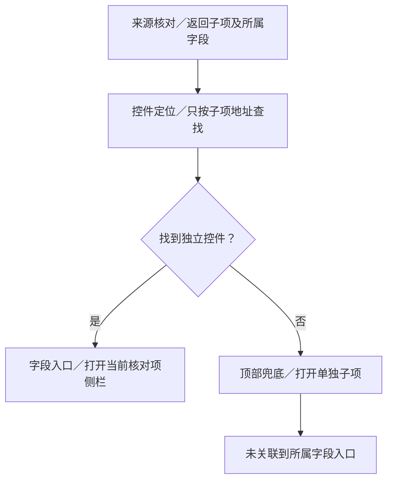

# 为什么没有归入对应字段侧栏

结论：子项归属与侧栏入口没有接通，是实现遗漏。

#147、#148要求名称、值、类型、单位独立核对，设置在同一字段侧栏；#200要求原因进侧栏。

后台已标明“声子方法的值类型”属于“声子方法”。前端定位却没用这份归属，只找独立的“值类型”输入框；找不到就放顶部。点击声子方法又只取值的核对项，未包含类型子项。隔离重放确认：直接按已有归属能打开正确设置。

涉及：来源核对→子项归属；科学表单→控件定位→统一侧栏。

建议补齐所属字段映射，在侧栏分别展示子项结论，不合并科学判定、不扩大依赖。“计算适用关系”尚缺可见归属入口，需单独处理。本次未实施。

依据：[#148](../../../148-sidebar-field-editing/spec.md)、[#200](../../../200-field-color-only/spec.md)、[代码与重放](sidebar-evidence.json)。
