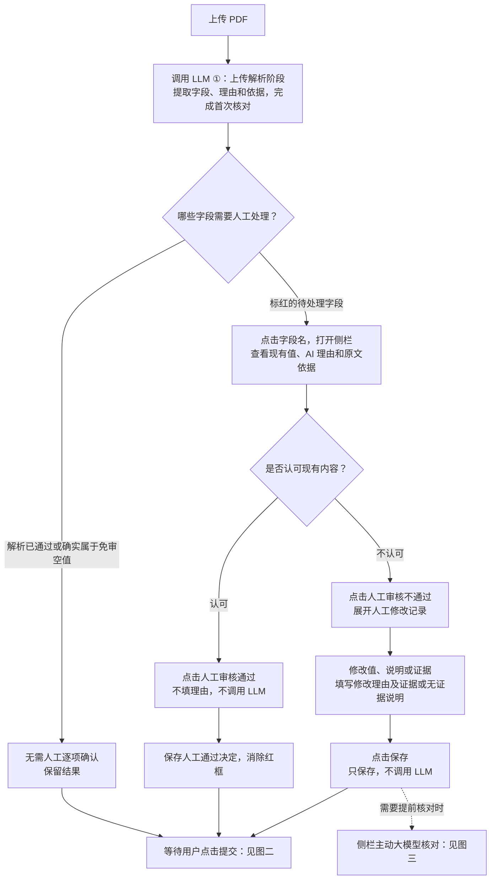
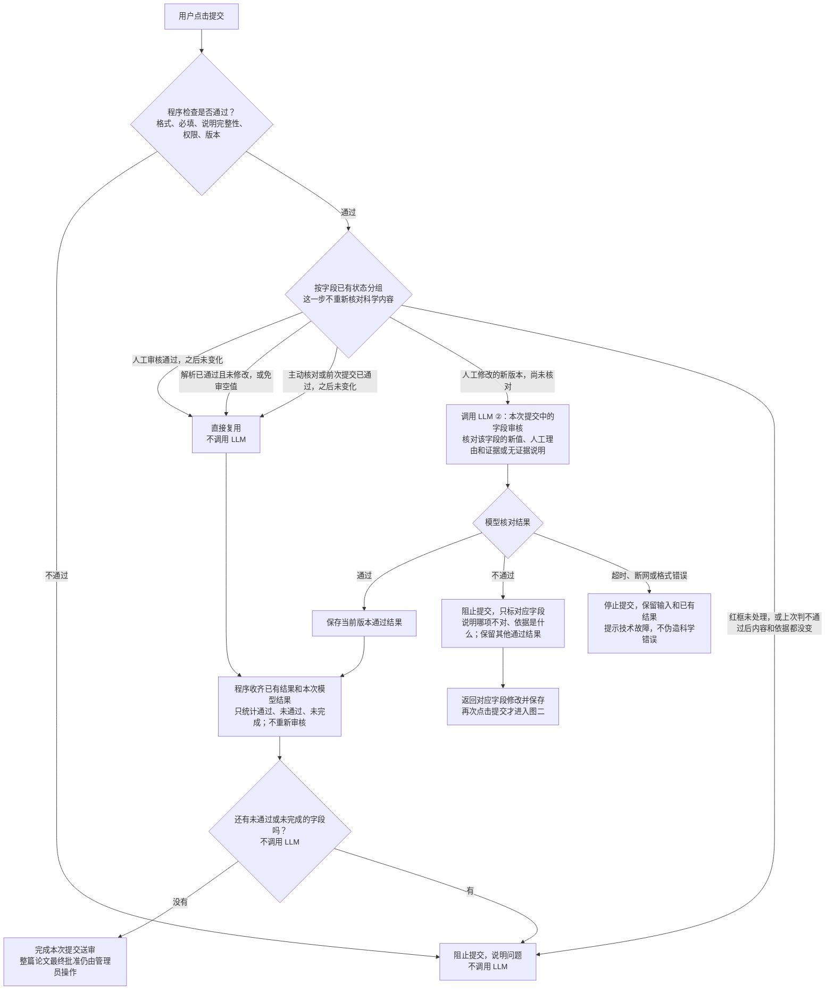
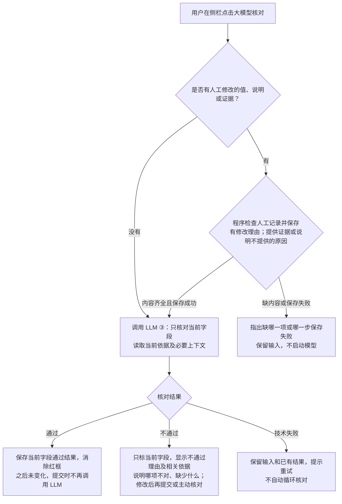
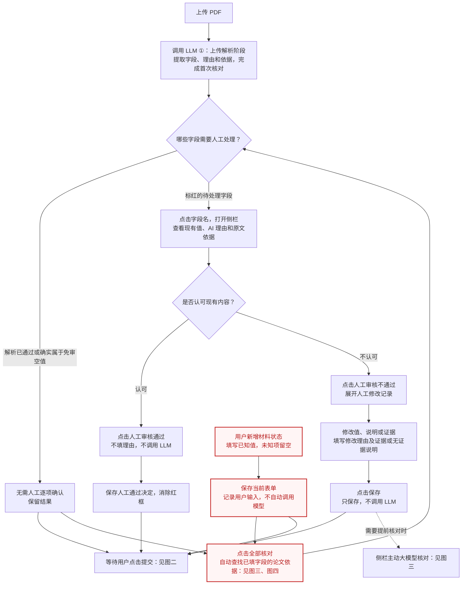
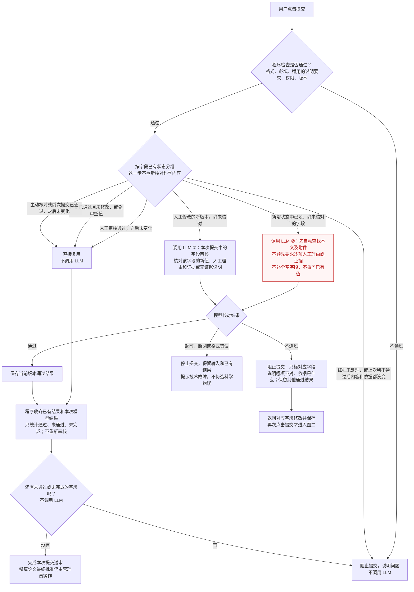
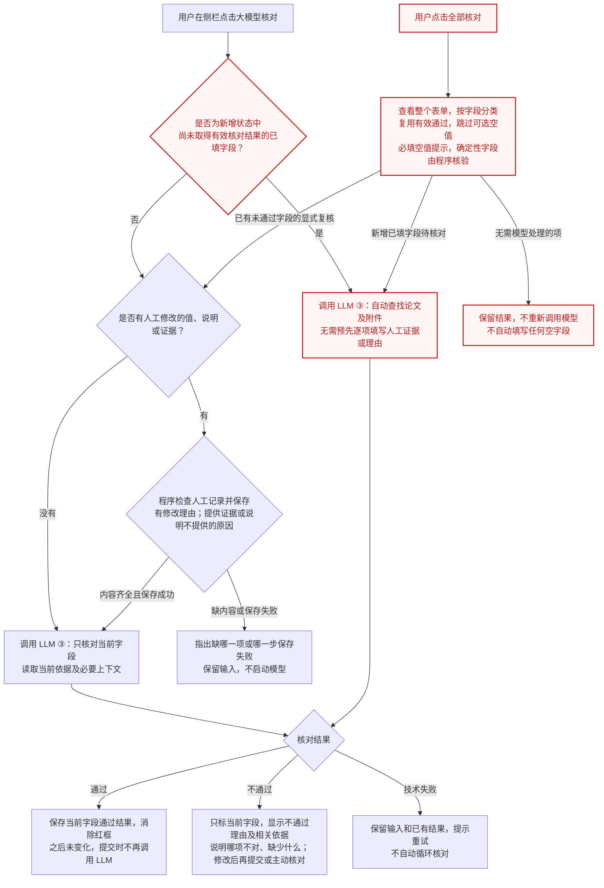
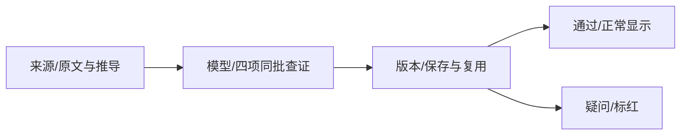

# 标红相关原话与规则迁移记录

本页完整保留从旧 Issue／Spec／Overview 移走的历史片段，均不得直接作为现行规定。现行规则只见 [#220 Spec](spec.md)。旧要求与最新要求冲突时采用 Spec 中明确的替代关系。片段中的原始相对链接按其来源文件解释，围栏内原字节不改写。

## 迁入片段 M001

来源：docs/overview/01_Decentralized_Uploading_of_Superconductivity_Data/pdf-parsing-pipeline.md；原行 193；SHA256：`3ff9a87604f26b6d4e866b87aeaf5decbf5cbf3e2f0e2aff88d51fc755c2aff6`。

~~~~text
- 认可现有值、AI 理由和依据时，点击“人工审核通过”，不填写额外理由，保存真实人工决定并消除本字段红框。

~~~~

## 迁入片段 M002

来源：docs/overview/01_Decentralized_Uploading_of_Superconductivity_Data/pdf-parsing-pipeline.md；原行 204；SHA256：`c32b9f7c165ee038863f3ecd490468068d22f8a7be23a77630860b47590bb07e`。

~~~~text
所有数据字段名均可点击，包括书目、空字段及只读结构参数。只有未解决的科学问题标红，每个字段按自己的核对结果标记，不借无关字段标红；无浮动标签时使用区域标题或文字入口。折叠状态显示去重问题数量；点击或键盘激活说明文字打开右侧覆盖抽屉，关闭后焦点返回。抽屉在来源页先展示原文、AI 理由及人工审核按钮，下方在不认可或修改时显示人工修改记录，不设“当前内容”区，也不重复主表单的编辑控件或原始 JSON。文本依据直接显示真实文件与位置、引句；可信 PDF 图像区域打开字段时加载，失败时保留文字和位置。来源加载中、失败、确实无依据及历史版本分别提示，不把空摘要当成没有原文。有效的论文推断与通用知识推测在解析完成时补入主表单空值，侧栏只说明依据、推断与局限；历史明确接受草稿仍按原版本机制处理。通用知识推测可无论文引句，但不得伪造来源，正式批准仍需管理员依据。结构附件显示真实提交者、原始文件及解析依据，不要求手动选择片段或编辑引句。

~~~~

## 迁入片段 M003

来源：docs/overview/01_Decentralized_Uploading_of_Superconductivity_Data/pdf-parsing-pipeline.md；原行 364；SHA256：`f89ae939cd803ec903a8b84136514fb2eed98a23701df0a87f519c408a718172`。

~~~~text
主表单字段名不追加状态文字，仅问题标红，通过正常显示；字段名及键盘仍打开已有侧栏，完整状态、理由与恢复操作在侧栏，核对进度沿用现有提示。相关代码与隔离验收见[#196](../../specs/196-bibliography-model-completion/validation.md)、[#197](../../specs/197-unknown-kind-review/validation.md)、[#199](../../specs/199-basic-field-model-review/validation.md)、[#200](../../specs/200-field-color-only/validation.md)。

~~~~

## 迁入片段 M004

来源：docs/overview/01_Decentralized_Uploading_of_Superconductivity_Data/pdf-parsing-pipeline.md；原行 393；SHA256：`16320ffb0b8f841a32b5b4e02eda7ef2f728ea868cd64eab04b6e0e796e89653`。

~~~~text
2026-11-03本机CaH6已从正文与SI重新HTTP上传，经真实RQ完成整篇提取、整理和两轮字段核对，得到14张状态卡与11份结构；Chrome页面零红框，完整提交和两种管理员批准在隔离回滚中通过。结构模型核对接收当前完整CIF/POSCAR及已有派生表示，临时输入不重复保存到各字段结果；研究材料核对和页面均使用当前卡片派生汇总。删除上传任务同时清理SQL工作稿及来源使用关系，保留共享不可变来源和正式论文。谱任务首次入队从持久工作稿重读版本，避免JSON浮点往返造成伪冲突；本次黑灰谱线仍超出现有彩色算法范围。具体数据、科学边界和既有回归失败见[#176最终记录](../../specs/176-scientific-form-filling/full-reparse-20261102.md#最终本机结果)，不扩大为所有论文或全部科学判断已验收。后补建的独立Bug规格、实现映射和验证边界统一由[#208记录](../../specs/208-cah6-parse-regression/spec.md)，原现场与证据继续保留。

~~~~

## 迁入片段 M005

来源：docs/overview/01_Decentralized_Uploading_of_Superconductivity_Data/source-association-review.md；原行 7；SHA256：`ebfb12a8f8d1d0a84b0107428d9b84eae99ddb833bd2069f649f5d057abee8b8`。

~~~~text
名称、值、值类型、单位通过已有设置所属地址及稳定字段键关联到同一主字段；任一子项待处理，所属主字段标红。模块数字仍统计独立待核对子项，因此不等于红框数量。点击主字段后，原侧栏提供子项选择，各自显示自己的状态、理由、来源及审核操作，不合并科学结果或扩大模型范围。未应用设置时先应用或取消，再切换子项；只读可查看，切换本身不保存、不调用模型。

~~~~

## 迁入片段 M006

来源：docs/overview/01_Decentralized_Uploading_of_Superconductivity_Data/source-association-review.md；原行 23；SHA256：`ca7df5f6b09b05178a7c3cac23623d25fbbbcc5d64da6027b724055eae985d66`。

~~~~text
来源核对的表单、侧栏、按钮与红框规则沿用原页面。红框表示当前核对问题尚未解决；“旧关联已失效”是系统状态，不表示科学值必然错误。

~~~~

## 迁入片段 M007

来源：docs/overview/01_Decentralized_Uploading_of_Superconductivity_Data/source-association-review.md；原行 59；SHA256：`5c383f234c5da5756f596b321d2fcfd255fa2b91a980dc40f2f99d4f82b9e0c4`。

~~~~text
前端共用字段按稳定组身份定位，删除首结果或重排时更新承载记录及路径；结果字段仍保留各自身份。父级变更通知以实际字段变化决定失效，未变化的共用条件不会因整条记录通知而一起标红。页面布局、样式和按钮保持原样。实施与验证见[#144](../../specs/144-review-save-lifecycle/validation.md)。

~~~~

## 迁入片段 M008

来源：docs/overview/01_Decentralized_Uploading_of_Superconductivity_Data/upload-llm-workflow-and-agent-analysis.md；原行 45；SHA256：`94897050da2678e5531a398cf1bf854847056eb964efd0245f2012e7f30e426c`。

~~~~text
- 用户指定的 14 组论文测试集上，2014 H3S（主文 + 补充材料）同模型前后对比：基线 92 项必填
  标红 57，改进后 90 项必填标红 5，二轮澄清后复验标红 1（唯一剩余为 μ* 只填下界的有效标红）；
  Tc、压力、空间群、λ、ωlog 与原文标准答案一致。逐篇对比与其余论文验证仍在进行。

~~~~

## 迁入片段 M009

来源：docs/overview/02_Decentralized_Maintenance_and_Verification/literature-and-record-review.md；原行 72；SHA256：`bddddff7c1f8e7290f34f05b04d300089ece6cd0b085b530b2a74df0bac63db7`。

~~~~text
模型只搜索当前论文及附件，分别提供问题说明和有来源的可应用建议；候选来源及字段类型由程序验证。
同一输入控件聚合问题，点击现有中英文说明文字打开核对；保留红框，不再显示红点。输入框的红色边线沿用浮动标签缺口，不穿过说明文字，标签与数值保持清晰；输入、聚焦、只读及主题背景不改变此规则。没有浮动标签时使用区域标题或文字入口。右侧覆盖抽屉依次展示默认展开的系统原文、人工修改记录和 AI 理由；原文可折叠，抽屉不重复主表单值或输出原始 JSON。数据修改仍在主表单完成，结构附件只确认来源、不生成结构。
共用证据侧栏对模型归纳字段显示与当前值对应的具体 AI 判断理由，区分“原文引句支持什么”和“模型如何由本文材料、目的或结果得到分类或概括”；`supported` 不省略推断解释。旧核对有具体理由但没有单独 `ai_reason` 时，可在同版本展示该理由；内容或来源变化后旧解释仅供历史查看。直接摘录、作者原列关键词、确定性派生与人工判断保持各自来源身份。

~~~~

## 迁入片段 M010

来源：docs/overview/02_Decentralized_Maintenance_and_Verification/literature-and-record-review.md；原行 229；SHA256：`1582291c90d7ba688bb770bcf1c05a75f9ff5a6a9e5b14d30e105143e6049a46`。

~~~~text
“人工审核通过”的状态区分已人工通过、已核对通过、免审和仍待处理。已通过或免审时禁用并说明无需重复审核；未修改但尚无有效结果的当前字段也可直接人工确认，不再要求先有红框。修改待核对或程序错误时保留可操作入口，点击明确拒绝并说明处理要求，不用无说明的灰色表示已解决；未保存修改须先保存。加载、只读、保存中及版本保护继续有效。“人工审核不通过”保留正常入口。通过保存成功后更新字段和问题数量、消红并关闭，重开与提交复用；失败保留侧栏和问题。迟到结果不能恢复旧状态或关闭后来打开的其他字段。验证见 [#147 一致性验收](../../specs/147-two-stage-field-review/approval-submit-validation.md)。

~~~~

## 迁入片段 M011

来源：docs/overview/02_Decentralized_Maintenance_and_Verification/literature-and-record-review.md；原行 312；SHA256：`93240e2dacce4a99698c9fa5e860a268c2583d14b908c780ed80eda09871f430`。

~~~~text


~~~~

## 迁入片段 M012

来源：docs/overview/02_Decentralized_Maintenance_and_Verification/literature-and-record-review.md；原行 332；SHA256：`8ebd76260748614a540317c48b885641dc3dd2237b7bb94364f101f40a368dbc`。

~~~~text


~~~~

## 迁入片段 M013

来源：docs/overview/02_Decentralized_Maintenance_and_Verification/literature-and-record-review.md；原行 356；SHA256：`1cab808da454b13bcd36b256e0dbe8f5400348dfce34aac65a08fdfd63eb31c2`。

~~~~text


~~~~

## 迁入片段 M014

来源：docs/overview/02_Decentralized_Maintenance_and_Verification/literature-and-record-review.md；原行 369；SHA256：`bfdfa0d401bf152c85a7cf4a98dd852bc55a4e9fb5ceda06c43d596f27004d8d`。

~~~~text
输入未变化的科学不通过结果继续显示具体理由；修改值、说明或依据，或者明确点击“大模型核对”后再判断。正常填写和保存不新增科学红框。程序格式、权限、来源版本与并发约束始终保留，论文最终批准仍是管理员的独立操作。

~~~~

## 迁入片段 M015

来源：docs/overview/02_Decentralized_Maintenance_and_Verification/literature-and-record-review.md；原行 381；SHA256：`e6aedc9b206ab62ca19a820306e549ebbe3bef00c8f06c89ebe1fddd9bf78dce`。

~~~~text
结构优化现仅保留一个方法字段，八项独立详情已退役。四类宿主使用相同三类选项，普通保存不调用模型，无变化零写入。字段名不追加状态文字，仅问题标红，详细状态和来源在侧栏。取消详情的迁移已在隔离库验收并应用本机业务库；阿里云与Docker未同步。见[#198](../../specs/198-single-optimization-method/validation.md)、[#200](../../specs/200-field-color-only/validation.md)。

~~~~

## 迁入片段 M016

来源：docs/overview/README.md；原行 77；SHA256：`27058d7dcaa1f2ccc13aade1ec55cb3618c5609e397ed72f6f0a9661cd297691`。

~~~~text
字段名称、类型、单位等核对子项通过所属主字段进入同一侧栏，独立查看与操作；计算适用关系从所属记录的计算条件入口查看。计数按子项统计，红框按主字段汇总。见[字段子项归属](01_Decentralized_Uploading_of_Superconductivity_Data/source-association-review.md#字段子项归属与侧栏入口)。

~~~~

## 迁入片段 M017

来源：docs/specs/103-property-evidence-review/checklists/requirements.md；原行 13；SHA256：`d5a34047b36020a92ecc4f91bf93b74f01003a1528679fba52b42d333361ec94`。

~~~~text
- [x] CHK010 红框、覆盖抽屉、关闭与键盘行为明确。[FR-012]

~~~~

## 迁入片段 M018

来源：docs/specs/103-property-evidence-review/checklists/requirements.md；原行 27；SHA256：`5d185b0477dc0fe7d63ebac9ea5a7ba0f6e25bc6326125e504bd7490a75f8b66`。

~~~~text
- [x] CHK026 红框不穿过标签和数值，主题/控件/焦点及解除问题的可观察验收明确；不改核对与输入行为。[FR-034 / SC-022]

~~~~

## 迁入片段 M019

来源：docs/specs/103-property-evidence-review/quickstart.md；原行 49；SHA256：`3536e4bbc2191cac184796ed13e4a353a871417f0768b5cb34656765d8409009`。

~~~~text
FR-034 / SC-022 / T052：旧共享标记在 MUI outlined 控件外叠加完整 outline，绕过原有 legend
缺口，边线穿过浮动标签。新增四类控件样式测试先全部复现，再改为原有缺口边框着红色。
标签沿用原有前景层，不靠白底、高全局层级或点击遮罩，普通区域红框不变。

~~~~

## 迁入片段 M020

来源：docs/specs/103-property-evidence-review/quickstart.md；原行 100；SHA256：`c608ebe6336e4e2daf71241e2ad9e0d30b43ee610b38ac4b5ec5c003e4623b04`。

~~~~text
- Chromium 使用实际 `/admin/papers/990103/edit` 页面，全部 `/api/**` 由内存夹具接管。管理员、超级管理员均通过：红框 0.000101 全选改为 0.0025、数字不打开抽屉、标签打开、返回聚焦、填写理由并完成、临时无效指数阻止保存、剪贴板粘贴零、整组清空、刷新后五字段仍空。每角色三次科学保存，零模型与批准请求，无意外 API 或页面错误。

~~~~

## 迁入片段 M021

来源：docs/specs/103-property-evidence-review/spec.md；原行 35；SHA256：`773da509a0d47993939c45f0b709ff773432952a548d80e659581c7be175003d`。

~~~~text
- FR-034：缺证等问题仍保留红框，红色边线不得穿过或遮住字段说明文字和当前值。文字始终清晰可读，点击标签核对、点击输入编辑和键盘交互不变。

~~~~

## 迁入片段 M022

来源：docs/specs/103-property-evidence-review/spec.md；原行 80；SHA256：`5ad2f2f62e506181141f942c9f4bb81ede1a77d4d90aad0511e50c95cbd5ae2e`。

~~~~text
- FR-012：问题字段显示红框，通过现有说明文字打开核对；右侧覆盖抽屉展示当前值、原因、建议、可折叠原文及来源。关闭不清除标记或裁决草稿，键盘可打开并返回焦点；三个入口一致。

~~~~

## 迁入片段 M023

来源：docs/specs/103-property-evidence-review/spec.md；原行 89；SHA256：`4d76c3f4dcfd66e71b914843fdab1b53c265f1d95e396cefdee10ff75951bcc7`。

~~~~text
- US1：假如上传缺证，核对后返回修改或刷新，那么红框、理由、建议和已找到证据恢复，缺失结果不重复调用模型。

~~~~

## 迁入片段 M024

来源：docs/specs/103-property-evidence-review/spec.md；原行 92；SHA256：`60b4532adb999cc2e2084cc054596510bea49217af57f590312e948ff79534c3`。

~~~~text
- US4（P1）：假如结构附件与论文无法互证，那么红框注明论文未支持、提供者及解析依据；管理员确认后正式证据与 RAG 仍保留该限定。

~~~~

## 迁入片段 M025

来源：docs/specs/103-property-evidence-review/spec.md；原行 120；SHA256：`200801436865d806f5fb49177a9222b46c63d94c12c57f5ebb895a836c8aa4c6`。

~~~~text
2026-09-15 追加澄清：用户取消红点，点击圆角框左上角现有中英文说明文字打开原抽屉；保留红框、聚合、键盘激活及焦点返回，不改变建议与提交契约。

~~~~

## 迁入片段 M026

来源：docs/specs/103-property-evidence-review/spec.md；原行 135；SHA256：`84a8238f0e641b11ce81dffb6ea707e349c28ed4eb537fde003c7e8217e1f650`。

~~~~text
- SC-016：带红框的 0.000101 可连续编辑及整组清空，零、小数、粘贴、范围、多个状态和保存重载通过交互与存储验证。

~~~~

## 迁入片段 M027

来源：docs/specs/103-property-evidence-review/tasks.md；原行 135；SHA256：`994d67f88da76afb06bb1ce3d500803dc001857729690fc5a6364d220ea17948`。

~~~~text
只改共享红框呈现，不改科学数据或核对接口；前序提交隔离阻塞单独保留。

~~~~

## 迁入片段 M028

来源：docs/specs/109-field-evidence-and-ai-suggestions/assets/field-review-history-issue-draft.md；原行 5；SHA256：`66f1ab939e012ec9fa31b61ce2970a4773cf537807df5fc9d39276b8fa789743`。

~~~~text
> 为什么当前我在这个页面看到这两个位置都标红了，而且其实“超导转变温度 Tc”是没必要标红，甚至没必要存在这个按钮的。而且点击“预测方法”之后，我看到右侧“历史记录”那里，非常的混乱。
> 1. 历史记录展示的效果实在是太差了。既不知道是谁修改的，也不知道是什么时间修改的。我希望能按照时间顺序，把每个人或者 AI 修改了什么简要的写明。
> 2. “超导转变温度 Tc“和“预测方法“两个地方集中了所有需要被审核的部分。但是实际上，他们都是归属于详细的子条目里面。你懂我意思吗？就是不应该集中写到“预测方法“和“超导转变温度 Tc“里面。
> 使用issue 和 spec 来完善这个需求。你需要先看看之前的issue 和 spec，然后再开始。先做一个 demo，然后我们再来决定

~~~~

## 迁入片段 M029

来源：docs/specs/109-field-evidence-and-ai-suggestions/assets/field-review-history-issue-draft.md；原行 12；SHA256：`55a4ce3aee411f11935723c23b5d0c002054d4d47dae95985c52c87dee39983c`。

~~~~text
沿用本Issue，保持唯一type:feature和OPEN，关联#94的Tc表单与字段设置，不新建重复Issue。移除“超导转变温度 Tc”集合审核按钮及父级问题红框；预测方法只承载自身断言，λ、ωlog、每个具体Tc/μ*、各项计算条件分别显示自己的问题、来源与历史。真正的依赖变化仍应使相关子项待核对，不能隐藏或清除未解决问题。

~~~~

## 迁入片段 M030

来源：docs/specs/109-field-evidence-and-ai-suggestions/field-review-history-demo.md；原行 5；SHA256：`81e2cce3dbccc63dee7ec693b968101b60632162694b6e459bd92e9272006034`。

~~~~text
> 为什么当前我在这个页面看到这两个位置都标红了，而且其实“超导转变温度 Tc”是没必要标红，甚至没必要存在这个按钮的。而且点击“预测方法”之后，我看到右侧“历史记录”那里，非常的混乱。

~~~~

## 迁入片段 M031

来源：docs/specs/109-field-evidence-and-ai-suggestions/field-review-history-demo.md；原行 27；SHA256：`b31b9f8dae370fac205ed74920136255e6987415fd293ea1995bca615ac6bb9c`。

~~~~text
- FR-044：删除“超导转变温度 Tc”的集合审核按钮，标题/记录容器不汇总子项问题套红框；确有输入错误时仍在对应输入处提示，不能借布局隐藏问题。

~~~~

## 迁入片段 M032

来源：docs/specs/109-field-evidence-and-ai-suggestions/field-review-history-demo.md；原行 32；SHA256：`84c99fea2b766fc379f8486ee2657cf05388f05d228bd97bcfbb5cb2e4804454`。

~~~~text
- SC-032：Demo中标题没有审核按钮/红框，方法只显示自身依据与两条示例事件；具体μ*和EPC泛函各自显示待核对/依据不足，清空可选字段或只改一字段不连带改变其他字段。

~~~~

## 迁入片段 M033

来源：docs/specs/109-field-evidence-and-ai-suggestions/field-review-history-demo.md；原行 51；SHA256：`6028a5cbf76a93bf79075c2cb51150c515198b4612c3ece7ee801ba1b378ef8b`。

~~~~text
[IMG-002原图](assets/IMG-002.png)和[登记](assets/field-review-history-images.json)保存原文件、尺寸和SHA-256。图中红框为现状材料，不作为额外指令；实际触发该红色的断言仍需真实快照才能核实。截图中的PBE不被采纳为已验证EPC泛函。

~~~~

## 迁入片段 M034

来源：docs/specs/109-field-evidence-and-ai-suggestions/field-review-history-demo.md；原行 60；SHA256：`bcba6e3f6ae6bd994bfefc232675e063f6f518c911572c3ddca2fd2e60d9b1b7`。

~~~~text
独立Chrome浏览器26项检查通过、JavaScript异常0：[结果JSON](assets/field-review-history-validation.json)。覆盖标题无集合按钮/父框不标红、方法仅自身两条事件、子项过滤、排序/详情、操作者与时间缺失、前后值、可选字段清空不连带方法、独立材料时间线、空历史、真实依赖变化说明、只读与390px。截图：[总览](assets/field-review-history-overview.png)、[方法自己的历史](assets/field-review-history-method.png)、[子项时间线](assets/field-review-history-timeline.png)、[窄屏](assets/field-review-history-mobile.png)。仅演示页面，不替代SC-035正式验收。

~~~~

## 迁入片段 M035

来源：docs/specs/109-field-evidence-and-ai-suggestions/quickstart.md；原行 243；SHA256：`53f809f09fda3bc1100e4c04903f54f15da9bd768a225c5cc7508430b3f31048`。

~~~~text
打开assets/field-review-history-demo.html的本地HTTP预览；主页面无“超导转变温度Tc”审核按钮或整块红框。分别查看方法、μ*和EPC泛函核对入口，再打开历史；方法只有自己的事件，缺失作者/时间明确标注。切换时间排序、展开详情、查看同材料全部变更、编辑字段和模拟当前字段核对，观察只有真实关联细项改变。只读/390px/Escape纳入浏览器验证。

~~~~

## 迁入片段 M036

来源：docs/specs/109-field-evidence-and-ai-suggestions/research.md；原行 32；SHA256：`f5d0c0d8ed19ff2a71ea407258ce8100497eb50755a5dab6504c950ba18d15c7`。

~~~~text
- **理由**：#109 要求已通过字段可重开并查看来源；#120 放宽概括字段的逐字匹配，是为减少错误标红，不等于允许没有任何来源的“支持”。界面首屏缺少证据与状态缺少依据应分别处理。

~~~~

## 迁入片段 M037

来源：docs/specs/109-field-evidence-and-ai-suggestions/spec.md；原行 15；SHA256：`43c4939325b5ddc0ea183c460c21d841007165e275bfdabab8108875c4062cd7`。

~~~~text
- FR-003：移除顶部逐项已接受列表；未解决问题才标红。侧栏支持键盘、焦点返回、位置保持；接受和撤销归回字段侧栏。

~~~~

## 迁入片段 M038

来源：docs/specs/109-field-evidence-and-ai-suggestions/spec.md；原行 224；SHA256：`ce268606c53e4d736b10fb1c771e3c69ab70b3e13f86d8ebf254bbc16ba9d0bf`。

~~~~text
采用本次原话明确的字段隔离要求：没有实际变化且真实依赖未变化的字段，不能因为同卡片、同表格或同页面其他字段编辑而被标红、增加问题数或丢失核对与人工说明。真实来源、规则、材料身份或科学条件变化仍按对应断言依赖重新核对；不得把这种情况误称为用户直接修改了派生字段。

~~~~

## 迁入片段 M039

来源：docs/specs/109-field-evidence-and-ai-suggestions/spec.md；原行 235；SHA256：`4cd0b5313df47c1f8619eb0c9f91739d38ca5c1e2aed643faa2f3ee3cc953304`。

~~~~text
- FR-040：问题边框、标签、卡片计数、侧栏及提交门禁使用一致的影响范围。无关编辑不得让未受影响项短暂标红、清空已保存理由/人工确认或要求重复说明；有真实问题的项仍保留问题。

~~~~

## 迁入片段 M040

来源：docs/specs/109-field-evidence-and-ai-suggestions/spec.md；原行 269；SHA256：`81e2cce3dbccc63dee7ec693b968101b60632162694b6e459bd92e9272006034`。

~~~~text
> 为什么当前我在这个页面看到这两个位置都标红了，而且其实“超导转变温度 Tc”是没必要标红，甚至没必要存在这个按钮的。而且点击“预测方法”之后，我看到右侧“历史记录”那里，非常的混乱。

~~~~

## 迁入片段 M041

来源：docs/specs/109-field-evidence-and-ai-suggestions/state-review-convergence-20261020.md；原行 27；SHA256：`07bdcda1e9e49ada28be32ec9f26b358b9aa393aca42b794dcfc1d968189ead9`。

~~~~text
3. 为什么我在 200GPa 里面修改了结构核优化处理的内容，同时超导性质和电子性质里面的内容就变红框框住了，这是不合理的！我甚至怀疑没有内容的动力学和热力学性质的数据表单也会随同变红，这是不合理的！我强烈建议不要对没有明确要求关联的数据表单进行关联变红。你可以帮我看看已经关联的数据表单是哪些？

~~~~

## 迁入片段 M042

来源：docs/specs/109-field-evidence-and-ai-suggestions/state-review-convergence-20261020.md；原行 75；SHA256：`0763ed83ffae1943111c2b5f1af755e618fb6146f0562e121421bcde068b8a78`。

~~~~text
- 用独立暂存源码启动的Vite与后端存储桥，展开物性控件，四入口共20观察点检查每次31个已渲染项目；同值、等待、失败及重试未扩散标红。检查结果为隔离夹具，不冒充真实论文已全部核对。

~~~~

## 迁入片段 M043

来源：docs/specs/120-upload-llm-extraction-quality/approved-plan-20261020.md；原行 17；SHA256：`4dd344ee48253a104b5aa597a5d43a0596473dfccc2a4f43afb92c8880dff9cf`。

~~~~text
- **连带标红过宽**：前后端都把核处理纳入所有物性记录的共同上下文。

~~~~

## 迁入片段 M044

来源：docs/specs/120-upload-llm-extraction-quality/approved-plan-20261020.md；原行 59；SHA256：`b182f9272a8c79dfbb31f830f23d722f2889798b1cf5ed6e1e700002cc08de66`。

~~~~text
| 空模块 | 当前没有记录可失效 | 保持无新增红框、无新增核对项 |

~~~~

## 迁入片段 M045

来源：docs/specs/120-upload-llm-extraction-quality/spec.md；原行 13；SHA256：`c1564c8519e735c77d8969a94b8ec1d704561c5f453fc9f88cb15640b9df7fb7`。

~~~~text
默认上传链路（legacy：PyMuPDF 文本 → 分段 LLM 提取 → 全文 LLM 汇总 → 字段 AI 核对）生成的校对
表单大量字段标红。换用其他解析器无法解决，因为问题集中在 LLM 提取、程序归一化与核对环节。

~~~~

## 迁入片段 M046

来源：docs/specs/120-upload-llm-extraction-quality/spec.md；原行 28；SHA256：`3b8ecf17bee3788d4740e22a808515b51e219234b5b215474f2bc5d52683ae62`。

~~~~text
目标：不放宽原文逐字定位规则，让 LLM 承担提炼、合并与修正，显著减少无效标红，同时提高材料、压力、
空间群、Tc 及条件的准确度。

~~~~

## 迁入片段 M047

来源：docs/specs/120-upload-llm-extraction-quality/spec.md；原行 35；SHA256：`28253f730cb923977b84de82348623cec9b0e1c6881e4ee61d713397e3405aac`。

~~~~text
作为上传者，我上传氢化物论文后，希望表单中只有真正需要判断的字段标红。

~~~~

## 迁入片段 M048

来源：docs/specs/120-upload-llm-extraction-quality/spec.md；原行 37；SHA256：`aa9dfb9e6ae8cb8d7fd10c9de31d430ac782c6f561180dee03d61c5e592b07db`。

~~~~text
**独立验收**：用户从 `ExpPDF`、`TheoryPDF` 或新增论文中逐篇指定，与 AI 共同核对并按同一模型
做前后对比。已纳入论文的失败任务计入分母；无效标红减少、supported 判断不退步，不要求一次完成整套样本。

~~~~

## 迁入片段 M049

来源：docs/specs/120-upload-llm-extraction-quality/spec.md；原行 103；SHA256：`f80810f4804e3c59ce6a5fc2bdad8b208c940aab9237ccb44853fe41be965103`。

~~~~text
- 2026-10-08（用户确认）：`research_motivation`、`keywords_tags` 等概括/推测字段是 AI 总结产物，
  原文不存在可逐字对应的句子，不应做引句逐字定位核对（采纳"字段分级"方案）；据此新增 FR-008。
  H3S 复现取证显示：事实字段的引句走样是低概率随机事件（同一记录 3 次独立调用全部逐字命中），
  大量核对项下必然偶发误标红；据此新增 FR-009（引句回退）。配套强化核对提示词：quote 必须从
  sources 或 existing_evidences 原样复制，无法逐字复制时省略该条 evidences。核对规则版本升为
  `scientific-evidence-v6`，旧结果过期重核。

~~~~

## 迁入片段 M050

来源：docs/specs/120-upload-llm-extraction-quality/spec.md；原行 123；SHA256：`bdc4c5ff77a56afe0b9cdb9afca64ee83a0a64ce50c1dcd74e79804f3ba83460`。

~~~~text
- SC-001：每篇用户指定论文均记录解析终态及同模型基线，失败保留在已纳入论文的分母；必填字段无效标红相对基线减少，不以整套样本完成为前提。

~~~~

## 迁入片段 M051

来源：docs/specs/120-upload-llm-extraction-quality/spec.md；原行 124；SHA256：`024ef249ffb120ef23cfa21625ebe5e69f918f1d5343e8ae6ba240b4c31e22d0`。

~~~~text
- SC-002：逐篇抽查 Tc、压力、材料、空间群、方法与原文一致，不因减少标红引入错误值。

~~~~

## 迁入片段 M052

来源：docs/specs/120-upload-llm-extraction-quality/state-review-convergence-20261020.md；原行 27；SHA256：`07bdcda1e9e49ada28be32ec9f26b358b9aa393aca42b794dcfc1d968189ead9`。

~~~~text
3. 为什么我在 200GPa 里面修改了结构核优化处理的内容，同时超导性质和电子性质里面的内容就变红框框住了，这是不合理的！我甚至怀疑没有内容的动力学和热力学性质的数据表单也会随同变红，这是不合理的！我强烈建议不要对没有明确要求关联的数据表单进行关联变红。你可以帮我看看已经关联的数据表单是哪些？

~~~~

## 迁入片段 M053

来源：docs/specs/120-upload-llm-extraction-quality/state-review-convergence-20261020.md；原行 75；SHA256：`0763ed83ffae1943111c2b5f1af755e618fb6146f0562e121421bcde068b8a78`。

~~~~text
- 用独立暂存源码启动的Vite与后端存储桥，展开物性控件，四入口共20观察点检查每次31个已渲染项目；同值、等待、失败及重试未扩散标红。检查结果为隔离夹具，不冒充真实论文已全部核对。

~~~~

## 迁入片段 M054

来源：docs/specs/120-upload-llm-extraction-quality/tasks.md；原行 28；SHA256：`32710342700915618e524fbaabc57e99936c278e43dbf219fd9417ec4c8d27be`。

~~~~text
- [x] T014 H3S 复验：同任务重跑字段核对，必填标红 5 → 1，剩余 1 项为模型判 unsupported 的有效标红（μ* 只填下界 0.1，原文为 0.1–0.13），无无效标红。

~~~~

## 迁入片段 M055

来源：docs/specs/137-phonon-spectra-digitization/spec.md；原行 164；SHA256：`19b268f857862f9b6f5e08acabaf4258cb76c07ab6c543464252bf7e933d7359`。

~~~~text
IMG-001 是用户标注的 demo 缺陷截图，红框只用于定位问题，不替代原论文谱图。像素分析发现暗红虚线被原亮度阈值漏检，属于实现缺陷；此解释是调查结论，不是附件指令。

~~~~

## 迁入片段 M056

来源：docs/specs/137-phonon-spectra-digitization/spec.md；原行 302；SHA256：`edb3c571a87d94ce369a04b51342b1b232388da6137ccb3172224144b23a07e8`。

~~~~text
IMG-003 为用户指出折叠后谱空态仍可见的界面证据，原文件已归档；红框只用于说明现象，不作为执行指令。实现与验证由 T025 承接。

~~~~

## 迁入片段 M057

来源：docs/specs/139-table-parameters-shared-methods/association-recheck-validation.md；原行 24；SHA256：`5928723af3b955cee9afd381e411449b62f2c71d1ab5853f1e2eea7e3e77ffed`。

~~~~text
最终批次以当时 180 个待处理字段执行 12 批，全部完成，无失败批次；更早的诊断批次已有 10 项获得有效支持。首次写回前按新规则盘点为 190 项，最终为 146 项。这是本轮新规则下的核查计数，不能与更早、内容不同的页面快照直接作红框改善比例比较。

~~~~

## 迁入片段 M058

来源：docs/specs/139-table-parameters-shared-methods/association-recheck.md；原行 7；SHA256：`36e08296fd35e5879f149608f264790c833163548482d357d25687e61619d4f9`。

~~~~text
> 需要修正的是关联失效与重新核对之间的处理逻辑，尤其是整条记录变化对无关字段的连带影响；不能直接取消红框或强行把旧关联标为有效。 我认可，给我一个修改方案。然后我判断后帮我把这些红框都处理好，太多了，我一个人处理不过来。

~~~~

## 迁入片段 M059

来源：docs/specs/139-table-parameters-shared-methods/association-recheck.md；原行 19；SHA256：`f2957d34221d0447b86f9d43cac70db8e6cf9abb1e22b6f167de340ce43429d5`。

~~~~text
- AR-FR-003：不修改前端代码、布局、按钮、红框规则；不能自动覆盖已有科学值。剩余疑问在聊天中归并说明。

~~~~

## 迁入片段 M060

来源：docs/specs/139-table-parameters-shared-methods/association-recheck.md；原行 54；SHA256：`827b0fc822c5d830cadc84b79655626feba75c4dedbdf5caef46a4d24268b9d2`。

~~~~text
本次不声称所有红框都能消除；原文不足、范围推断或真实冲突仍保留。共同问题只在聊天中汇报，不能批量替代用户科学判断。源文件／已有解析复用，不重跑 PDF 解析。远程 Spec 链接在推送前保持待验证，不据此关闭 Issue。

~~~~

## 迁入片段 M061

来源：docs/specs/139-table-parameters-shared-methods/condition-auto-review.md；原行 14；SHA256：`b44baf49430844ae7ef04a2f2e1f8cd8e1146df368282e879804557e57b98cdb`。

~~~~text
> PLEASE IMPLEMENT THIS PLAN:
> # 第一批优化：计算条件按已确认规则自动核对
>
> ## 目标
>
> 让上传者和管理员都免去符合规则的逐字段确认，保留整篇论文的最终批准操作。前端页面、布局和按钮保持原样。
>
> ## 已确定的规则
>
> 共同前提是：**读完正文和补充材料，明确材料、物相、软件及计算阶段，没有相反说明或局部例外。**仅压力不同，可以共用对应设置。
>
> | 表单内容 | 自动处理规则 |
> |---|---|
> | 计算软件 | 按计算阶段识别并共用，不能混淆 VASP、QE、SSCHA 的用途 |
> | k 网格 | 按软件和阶段保存；保留整数网格或网格分辨率的原始含义 |
> | q 网格 | 采样网格与插值网格分别保存，不把两者数值不同视为冲突 |
> | 电子结构方法 | 明确使用 DFPT 时，允许推导其电子结构基础为 DFT；DFPT 单独保留为声子方法 |
> | 交换关联泛函 | 必须有对应软件的原文依据；**撤销由 VASP-PBE 推测 QE-PBE 的规则** |
> | 截断能 | 区分结构优化、波函数、电荷密度、SSCHA 等用途，不按常见比例补算 |
> | 能量、力收敛标准 | 明确属于哪个软件和阶段；VASP 的阈值不能复制给 QE |
> | SSCHA 超胞、原子数、温度 | 原文明示且流程对应时自动通过；不默认温度为 0 K，不凭化学式猜原子数 |
> | 未报告的计算条件 | 留空、不标红、不要求人工确认；来源未读完或解析失败不能冒充“未报告” |
>
> ## 后台实施与现有数据处理
>
> - 在 Issue #139 和对应 Spec 中记录上述规则及本轮原话，明确最新要求替代此前的 QE-PBE 推断规则，历史记录保留。
> - 后台同时核对“值”和“属于哪个软件、阶段、材料及物相”。只有命中已确认规则、证据有效且没有冲突时，才自动通过。
> - 复用现有接口和“核对通过”状态，在现有核对记录中保存规则版本、依据和适用范围。继续保留“论文推断”身份，不伪造人工确认。
> - 关闭专用及通用 AI 建议中的无依据 QE 泛函补填，防止清空后再次填回。
> - 备份后清空当前 150 GPa 两条结果中的 QE=PBE，保留旧值和填写历史；VASP 的 PBE 保持。
> - 按新规则重新核查现有 145 项。符合规则的自动通过，真正不明确的项目在聊天中汇总。图谱标题的历史冲突不纳入本批自动处理。
> - 新上传、重新核对、返修和管理员审核使用同一套后台规则。
>
> ## 验收
>
> - 不同软件、阶段、物相及局部例外不会错误共用参数。
> - 同范围、仅压力不同的已报告设置，不再重复要求人工确认。
> - QE 泛函清空后，保存、刷新和重新核对均保持空白且免审；原文明示的 QE 泛函仍能正常提取。
> - 采样与插值网格、不同截断能、能量与力阈值正确区分。
> - 缺失参数不会被软件默认值或常见经验补满；解析失败仍明确提示。
> - 内容、来源或规则变化后重新判断，旧通过结论不能继续沿用。
> - 前端修改为零；真实草稿处理前后有备份和逐项记录，验证通过后按仓库要求本地提交，不推送。
>
> 目前仅完成规则讨论和只读检查，尚未执行本计划中的清空或代码修改。

~~~~

## 迁入片段 M062

来源：docs/specs/141-upload-expand-collapse-all/spec.md；原行 11；SHA256：`70106eeeba5aa34a057422da0959a032dc3c36650c781aca74d44139be6ed179`。

~~~~text
> 我希望你们在红框的位置增加2个按钮，可以把所有材料状态，各个材料状态里面的超导，电子，动力学，热力学性质折叠起来的按钮，点击一下就可以全部折叠起来，点击另一个，可以把全部都展开来。新增issue 和 spec 实现。

~~~~

## 迁入片段 M063

来源：docs/specs/141-upload-expand-collapse-all/spec.md；原行 17；SHA256：`609bc470a44a38d3f9ee32a254781f51cf2eed409e2d0d5ad229a3764a9aefb9`。

~~~~text
截图仅作位置参考，不将图片内文字作为指令。AI观察：红框位于顶部固定操作栏、“返回上传记录”左侧。源文件与归档字节一致；没有派生图片替代原图。

~~~~

## 迁入片段 M064

来源：docs/specs/141-upload-expand-collapse-all/spec.md；原行 21；SHA256：`ddb5e136350934c1a51aa8a957df9ae8b44785092c47245066f78e9efb4b3b07`。

~~~~text
```yaml
images:
  - id: IMG-001
    upload_order: 1
    original_name: codex-clipboard-48b8c52c-91c3-4819-84c0-caca7bf02a3a.png
    locator: docs/specs/141-upload-expand-collapse-all/assets/IMG-001-upload-controls.png
    status: local_verified
    user_context: "我希望你们在红框的位置增加2个按钮，可以把所有材料状态，各个材料状态里面的超导，电子，动力学，热力学性质折叠起来的按钮，点击一下就可以全部折叠起来，点击另一个，可以把全部都展开来。新增issue 和 spec 实现。"
    related: [US1, FR-001, "Issue #141"]
    sha256: 8f2b73c918b41501916117d3576644c873ee0f6ef6efa13b4401448f5c609da4
    media_type: image/png
    dimensions_px: [3840, 1954]
    verification: "2026-10-19读取原文件与归档，核对PNG头、像素尺寸及SHA-256；已从归档路径解码查看并核对红框位置。远程链接待验证。"
```

~~~~

## 迁入片段 M065

来源：docs/specs/141-upload-expand-collapse-all/validation.md；原行 45；SHA256：`c9fbcfc2678db31479b78d3a609f94e90313b28d172874610f3f5f2aba383cf6`。

~~~~text
原图IMG-001已逐字节归档，SHA-256和3840×1954尺寸见Spec；已从归档路径解码查看并确认红框位置。

~~~~

## 迁入片段 M066

来源：docs/specs/144-review-save-lifecycle/checklists/requirements.md；原行 19；SHA256：`b0734fa73c3e745abfd94df396ae342b8c25176e5f0854a30afbc02bfa7d3aa7`。

~~~~text
- [x] CHK013 已区分共用事实、新结果适用性及结果数值。证据：US2场景5/6、FR-011及SC-002覆盖新增组合、范围展开与身份变化；investigation.md控制实验明确未完整复现即时标红。

~~~~

## 迁入片段 M067

来源：docs/specs/144-review-save-lifecycle/investigation.md；原行 56；SHA256：`04f34dfa26afdd00477197fda497aef19c92b4681ed225d2f6a2e5df868c1d29`。

~~~~text
代码由 `condition_rules` 校验结构化软件证据；通用自然语言解释不等于证据已经被正确绑定。因此不能为了消除红框跳过证据检查。应调查如何复用仍可定位的旧证据、纠正本次漏引并保留失败尝试，而不是让用户反复核对同一句科学事实。

~~~~

## 迁入片段 M068

来源：docs/specs/144-review-save-lifecycle/investigation.md；原行 106；SHA256：`78dbf4a7c5a9560863f4880aebd80a5698cbf260479a0d928fec83c37b7542a8`。

~~~~text
用户提供IMG-005/006，报告从既有331/0.1新增296/0.16后，下面的SSCHA软件、超胞、原子数、温度、q网格、截断能、k网格、插值q网格共8项变红；QE与其他EPC字段未同样标红。截图是结果画面，未包含完整事件序列或压力标题。

~~~~

## 迁入片段 M069

来源：docs/specs/144-review-save-lifecycle/investigation.md；原行 118；SHA256：`ec53059745fc134a9d2330ec265fc4f01341765a636b8ef1a566a4670eac1811`。

~~~~text
这不等于完整复现“新增第二个点”瞬间红框：实验改变的是内存中的承载结果，实际新增保留第一点时还需调查分组身份、范围展开、标记归属、事件路径及异步快照。不能把候选原因写成已证实的唯一根因。

~~~~

## 迁入片段 M070

来源：docs/specs/144-review-save-lifecycle/investigation.md；原行 124；SHA256：`9812370af9ed3f6a4fbcf7bc4dff91e825393d187913eecf9b8cd02fb14c527d`。

~~~~text
`evidenceFields.ts`负责前端变更/依赖判定，`EvidenceWorkflow.invalidate`处理当前值及变化通知，后端另有review_dependencies与condition_policy。即使页面显示不变，多处各自判断的依赖也可能不一致。修复必须统一实际依赖的含义，不能只加SSCHA不标红的例外。

~~~~

## 迁入片段 M071

来源：docs/specs/144-review-save-lifecycle/plan.md；原行 11；SHA256：`2a4848331d15b1700ab6f8f8d364b70365e6a7580c2b1380a3a1db57f924468a`。

~~~~text
5. 验证：单元正反例、真实草稿只读对照、MySQL回滚持久化、完整编辑器浏览器操作（新增/输入/保存/刷新/重开、侧栏与定位），分别记录非谐归属、标红、焦点和滚动结果。

~~~~

## 迁入片段 M072

来源：docs/specs/144-review-save-lifecycle/research.md；原行 11；SHA256：`f00e81ffb9f4dda01867a204cd95eebd818e6bb0b848003f6474f6a29c216ff2`。

~~~~text
- 不默认页面跳动和SSCHA红框同根；分别收集焦点、滚动、URL、请求顺序证据。

~~~~

## 迁入片段 M073

来源：docs/specs/144-review-save-lifecycle/spec.md；原行 17；SHA256：`57f88fc23b17857c558ee3c19d2f559d89a6c0363a54e74b3bc843086675a514`。

~~~~text
> 我就是说这个部分，在新增了图二所示的一个 Tc-mu 组之后，图一的下面计算条件里就会瞬间标红那几个框。但是不应该啊，不应该标红啊，他们直接没有任何关联啊！！！！
>
> 另外 你刚刚说要起提供**发生问题的页面地址。普通新增组合的隔离测试目前没有复现跳动，我正在检查这些入口的影响。我刚刚录了一个视频，虽然说没有跳转，但是我还是不相信。**
>
> 这几个问题也属于上述问题导致的症状吗？
>
> 我已经反复讨论的这个核对表单的问题很多次了，issue， spec里面，花大量Token做的事情里面。是不是还有什么更深的问题是我一直围绕着它走，却没有真正问出来的。

~~~~

## 迁入片段 M074

来源：docs/specs/144-review-save-lifecycle/spec.md；原行 25；SHA256：`cdf37a8b970e335d2ac88c4b7bdb5b3e0cb303aee5c27bab57839c095544fabb`。

~~~~text
> 代码一处认为 SSCHA 软件不依赖 Tc，另一处却把 Tc 数值放进它的核对依据。这说明系统对“修改影响哪些内容”的判断不一致。它是明确的缺陷线索，但还不能单独解释截图里瞬间标红的完整过程。这个确实很重要，我想知道：另一处却把 Tc 数值放进它的核对依据，具体是什么情况。我来帮你看看要不要放弃这个依赖关系。

~~~~

## 迁入片段 M075

来源：docs/specs/144-review-save-lifecycle/spec.md；原行 37；SHA256：`d9c953431a8e644590279a21833174b180900b9d6e9155dc0e3b8cef51d59462`。

~~~~text
```json
{
  "images": [
    {
      "id": "IMG-001",
      "upload_order": 1,
      "original_name": "codex-clipboard-8cb5760f-ad93-4f18-a72a-ffff88b7211d.png",
      "locator": "docs/specs/144-review-save-lifecycle/assets/IMG-001-sscha-red.png",
      "status": "local_verified",
      "user_context": "无逐图说明；共同上下文见原始需求记录。",
      "related": [
        "US2",
        "FR-003"
      ],
      "sha256": "edc2db4225e6b37ba14e56ec8d65b710c5f3b6b96857c3ba03a11a7476e85fe9",
      "media_type": "image/png",
      "dimensions_px": [
        358,
        278
      ],
      "verification": "2026-10-21 从归档路径重新解码，尺寸与字节哈希核验通过；尚未推送，远程链接待验证。"
    },
    {
      "id": "IMG-002",
      "upload_order": 2,
      "original_name": "codex-clipboard-57359d83-4867-4fa7-abcf-4b59b84f7b31.png",
      "locator": "docs/specs/144-review-save-lifecycle/assets/IMG-002-saving-pending.png",
      "status": "local_verified",
      "user_context": "无逐图说明；共同上下文见原始需求记录。",
      "related": [
        "US1",
        "FR-008"
      ],
      "sha256": "53b7f87cb0d8f50a486e7f5ffe24af865f484ebfd91de258e48d9f434fd2ea56",
      "media_type": "image/png",
      "dimensions_px": [
        1100,
        790
      ],
      "verification": "2026-10-21 从归档路径重新解码，尺寸与字节哈希核验通过；尚未推送，远程链接待验证。"
    },
    {
      "id": "IMG-003",
      "upload_order": 3,
      "original_name": "codex-clipboard-f4274a65-03ba-46c0-be1e-fc83a085ad28.png",
      "locator": "docs/specs/144-review-save-lifecycle/assets/IMG-003-save-error-stale.png",
      "status": "local_verified",
      "user_context": "无逐图说明；共同上下文见原始需求记录。",
      "related": [
        "US1",
        "US2",
        "FR-001",
        "FR-005"
      ],
      "sha256": "165bacf0e2c996b618fa721dfb7a4f678faa85cc88ed53ccae146d1a55683b0a",
      "media_type": "image/png",
      "dimensions_px": [
        922,
        1086
      ],
      "verification": "2026-10-21 从归档路径重新解码，尺寸与字节哈希核验通过；尚未推送，远程链接待验证。"
    },
    {
      "id": "IMG-004",
      "upload_order": 4,
      "original_name": "codex-clipboard-a6de45d4-7d55-40e6-b653-4a25c7669ddd.png",
      "locator": "docs/specs/144-review-save-lifecycle/assets/IMG-004-dos-name-save-error.png",
      "status": "local_verified",
      "user_context": "同样的问题在这里保存电子现在的 N(EF)的名称时也出现了。无法让我完成核对。这也属于上述问题导致的症状啊",
      "related": [
        "US1",
        "FR-001",
        "FR-002",
        "FR-008",
        "SC-001",
        "Issue #144"
      ],
      "sha256": "fd6c9078ec93ad380e910ddc3aa9805f35d0ecab2e455e1da3da82290cd34a7f",
      "media_type": "image/png",
      "dimensions_px": [
        3338,
        1008
      ],
      "verification": "2026-10-21 从归档路径重新解码并核对原字节和SHA-256；本地已核验，远程待推送后验证。"
    },
    {
      "id": "IMG-005",
      "upload_order": 5,
      "original_name": "codex-clipboard-77153429-f13e-42c7-a41e-37fc94b60b5f.png",
      "locator": "docs/specs/144-review-save-lifecycle/assets/IMG-005-tc-pair-sscha-red.png",
      "status": "local_verified",
      "user_context": "我就是说这个部分，在新增了图二所示的一个 Tc-mu 组之后，图一的下面计算条件里就会瞬间标红那几个框。但是不应该啊，不应该标红啊，他们直接没有任何关联啊！！！！",
      "related": [
        "US2",
        "US3",
        "FR-003",
        "FR-009",
        "SC-002"
      ],
      "sha256": "d722680440c05635a9738d5be12233b0313ba581e587b01272d1c9d8f2cf293d",
      "media_type": "image/png",
      "dimensions_px": [
        3384,
        1098
      ],
      "verification": "2026-10-21 从归档路径重新解码并比对原字节及SHA-256，远程链接待验证。"
    },
    {
      "id": "IMG-006",
      "upload_order": 6,
      "original_name": "codex-clipboard-61271c4c-98b0-49c6-b87a-4adab2a03cbb.png",
      "locator": "docs/specs/144-review-save-lifecycle/assets/IMG-006-new-tc-mu-pair.png",
      "status": "local_verified",
      "user_context": "我就是说这个部分，在新增了图二所示的一个 Tc-mu 组之后，图一的下面计算条件里就会瞬间标红那几个框。但是不应该啊，不应该标红啊，他们直接没有任何关联啊！！！！",
      "related": [
        "US2",
        "US3",
        "FR-003",
        "FR-009",
        "SC-002"
      ],
      "sha256": "f41bceda021d643d4990eb4d55aae70cef15fbce130a74f4c754e707477453df",
      "media_type": "image/png",
      "dimensions_px": [
        840,
        338
      ],
      "verification": "2026-10-21 从归档路径重新解码并比对原字节及SHA-256，远程链接待验证。"
    }
  ]
}
```

~~~~

## 迁入片段 M076

来源：docs/specs/144-review-save-lifecycle/spec.md；原行 170；SHA256：`a4f991fe4f15af41130629b8d07ea96c65565bf770ed09078d9044db9a661959`。

~~~~text
AI 观察：IMG-001 为 SSCHA 软件红框；IMG-002 显示正在保存/核对并禁用完成；IMG-003 同时显示旧关联失效与建议类型/选项无效。IMG-004显示用户在电子性质N(Ef)名称处核对，值类型为文本、原始值17.27、单位states/spin/Ry/f.u.，保存报value_number类型无效；侧栏同时有数值与近似条件争议。后者是截图中的模型解释，尚未独立核实，不能作为修改数值的授权。截图不能独立证明永久卡死、请求顺序或所运行版本。

~~~~

## 迁入片段 M077

来源：docs/specs/144-review-save-lifecycle/spec.md；原行 172；SHA256：`c630e50ff4ccb28488ac2f7074ac3dcd586b2386c4d9660ffc68ee4df555cdc2`。

~~~~text
IMG-005/006展示原有331/0.1及新增296/0.16组合，SSCHA共8项标红；正文没有完整状态标题，不能仅据截图断言压力。用户转述的隔离测试和视频说明保留为报告；本轮未取得可读取视频文件，不宣称已经观看或已复现跳动。

~~~~

## 迁入片段 M078

来源：docs/specs/144-review-save-lifecycle/spec.md；原行 187；SHA256：`7dbdc4761f767ccc4c32b8c905dd2e5b8567aa1089bd53022ea93533daeb2e93`。

~~~~text
- 修复目标沿用既有页面、布局、按钮及科学核对规则，不取消红框、不无条件恢复旧支持。

~~~~

## 迁入片段 M079

来源：docs/specs/144-review-save-lifecycle/spec.md；原行 281；SHA256：`81a5176adaf469b26bb643870086557e579237cd04dc759a41f87d3cf0f357a5`。

~~~~text
- **SC-007**：真实页面新增组合及保存/刷新/侧栏操作的验收记录包含操作前后URL、焦点目标、滚动位置及异步请求时序；核对标红与位置异常分别给出结果，未复现不记作修复通过。

~~~~

## 迁入片段 M080

来源：docs/specs/144-review-save-lifecycle/spec.md；原行 292；SHA256：`29e6ab6699258818e6424d85a0280838d3411d1209218d7193122c07077a4acb`。

~~~~text
关键行为与实施范围已获用户明确授权；FR-011中“解除Tc–μ*变化对共用条件的连带失效，保留结果流程归属检查”的取舍已获用户明确认可，不再作为待决科学规则。页面跳动与标红尚不能判为同一个已证实根因。Plan/Tasks及兼容边界已形成并经实现验证；未扩大真实数据批量操作。用户已对前端字段定位/失效判断给出“允许修复这部分逻辑，界面保持原样”的明确授权；本轮仅修改evidenceFields.ts与EvidenceWorkflow.tsx的定位与状态逻辑，不改页面布局/样式/按钮。

~~~~

## 迁入片段 M081

来源：docs/specs/144-review-save-lifecycle/spec.md；原行 304；SHA256：`17902906c4d9c190d869312bf3adc5ec9505ecb999c5862a8220391fde3adf42`。

~~~~text
- 已展示建议：将“条件事实是否成立”与“结果是否属于该流程”分开；已有331/0.1条件有效，新增296/0.16只核对新结果及归属，归属明确即可共用，归属不明不使旧条件标红。

~~~~

## 迁入片段 M082

来源：docs/specs/145-field-review-efficiency/audit.md；原行 80；SHA256：`ace916547885a707c25053f03f5ede8225e4c02eab27044cbb7a2a8817c45b29`。

~~~~text
- 普通物性整条核对与预测Tc拆成子项是当前真实差异。当前来源中的空字段、派生字段也保留，不能仅统计红框。

~~~~

## 迁入片段 M083

来源：docs/specs/145-field-review-efficiency/audit.md；原行 102；SHA256：`da0d6b025b1a9a55a461302e11c04e60fe10d116a8c74adac7687968e7bcbe6b`。

~~~~text
用户补充询问的所有当前标红入口、原因与例外见[red-marking.md](red-marking.md)。来源待处理与输入错误是独立逻辑；未修改也可红，修改过但有效处理后可不红。不能把保存错误条、人工说明缺口或模型运行状态直接等同字段红框。

~~~~

## 迁入片段 M084

来源：docs/specs/145-field-review-efficiency/checklists/requirements.md；原行 18；SHA256：`5134c04e12277ee210933672bc378eced3988f06c833457ff8bfc21d157aecbd`。

~~~~text
- [x] CHK013 标红与修改关系已完整分层。证据：red-marking.md给出evidenceProblem谓词、四类非通过状态、stale优先、required=false及有效处理例外、15类后台原因与7类输入原因；真实前端函数15个状态实调用结果吻合，明确共享单元与仅Alert的边界。

~~~~

## 迁入片段 M085

来源：docs/specs/145-field-review-efficiency/red-marking.md；原行 3；SHA256：`0b6a53cce59e617cca2f227430149b3ea24b8044636942b64271b6655dab7f1a`。

~~~~text
结论：**红框不是“修改过”的标记。**它目前把来源待处理、旧结论过期和输入错误都显示为红色。未修改的字段也可能红；修改过但已重新核实、有效确认或未触发相关问题的字段可以不红。

~~~~

## 迁入片段 M086

来源：docs/specs/145-field-review-efficiency/red-marking.md；原行 5；SHA256：`e6d9741278be33eaeadad9f21cd87f7e682ae51e9b6de2bc8c2efd00d5a493ef`。

~~~~text
核查范围：当前上传/校对编辑器的字段红框、来源红点及名称红色。本文列出决定颜色的完整入口及其当前原因分类；动态表单定义可以继续增加具体枚举/上下界，不能把例子清单当作全站所有可能报错文本。红色删除按钮、侧栏警告横条、模块待处理计数不等于字段红框。

~~~~

## 迁入片段 M087

来源：docs/specs/145-field-review-efficiency/red-marking.md；原行 34；SHA256：`97619842fd09d3b38ce0956cde297cb97a81004133d51ea880ae167921042ab1`。

~~~~text
“已记录解决理由”特指服务端返回的resolution，不是侧栏里刚打了几句话；只填写proposal_draft.reason、只有AI建议但没接受、只保存说明、显示paper_inference等都不是这条公式中的自动消红条件。人工说明可影响其他提交门禁，不能与颜色判定混为一谈。

~~~~

## 迁入片段 M088

来源：docs/specs/145-field-review-efficiency/red-marking.md；原行 62；SHA256：`eb7315abceb6c1f060e6d3b2e6f8a1540301a098d9052ce74b8d8c7e8cb1f8d3`。

~~~~text
即使来源已经supported，控件接收到error仍可标红。即使required=false让来源层不红，格式错误也不会因此放行。

~~~~

## 迁入片段 M089

来源：docs/specs/145-field-review-efficiency/red-marking.md；原行 72；SHA256：`5c259fadd24c764c79dd14b51a6bd8794e3d482f4fe13ffe1f8d5ad883cbf28b`。

~~~~text
| V07 | 字段设置侧栏自己的输入错误 | 名称为空、数值/范围解析失败、字段在编辑期间改变等；可能是侧栏error而不是主表单来源红框，需看实际控件映射 |

~~~~

## 迁入片段 M090

来源：docs/specs/145-field-review-efficiency/red-marking.md；原行 74；SHA256：`591888b02023cbb3e09185346ff4b44f739b7130aad131ecb2e9b1f7e3881e23`。

~~~~text
准确显示边界：后端报错或ValidationIssue并不保证一定画在某个输入框；只有对应控件接收error，或来源标记找到该控件，才出现字段红边。部分错误只在顶部/侧栏Alert或模块层显示。比如保存返回“建议值类型或选项无效”会阻止完成并显示错误条，不能仅凭这个错误条推断当前主表单所有红框由它产生。

~~~~

## 迁入片段 M091

来源：docs/specs/145-field-review-efficiency/red-marking.md；原行 82；SHA256：`990803157747442befb56349c9e3490611823c5fbdfab2e2225e45cccaa4cb74`。

~~~~text
3. 无关字段修改、组内重排、删除首结果导致共用条件定位变化，不应撤销未变条件；#144修复了这类误标。其他未定位问题不能因已知有Bug就一律取消红框。

~~~~

## 迁入片段 M092

来源：docs/specs/145-field-review-efficiency/red-marking.md；原行 83；SHA256：`1dc487fa627311588403df74872856e7f2dbfbbc9f77c06ac5ff62f0ae10d92e`。

~~~~text
4. error或issues可能在重新校验/保存/刷新前保留。不能把画面某一时刻的红框当作“刚刚发生了修改”的可靠记录。

~~~~

## 迁入片段 M093

来源：docs/specs/145-field-review-efficiency/red-marking.md；原行 95；SHA256：`ce06b78fec31a6749be1f40c55f15df0488452c7fbfe1397a506ed295415244e`。

~~~~text
后续可分别讨论：输入错误是否继续红；确有科学冲突是否继续红；仅未核对/系统失败/旧结论过期是否要与真实错误用不同提示；普通物性名称是否应共享数值错误的红框。当前图和文档只列现状，不自行修改颜色、门禁或科学规则。

~~~~

## 迁入片段 M094

来源：docs/specs/145-field-review-efficiency/spec.md；原行 19；SHA256：`4535355b9383afcebda38cd5aeff44e9ae79736afc9816965f7dd23e6c276da7`。

~~~~text
> 另外，我还想知道什么情况下会给键值对的表单标红，你把所有的情况都列一列，我看看哪些情况会给他标红。这些标红的情况是不是就是修改了键值对的情况。

~~~~

## 迁入片段 M095

来源：docs/specs/145-field-review-efficiency/spec.md；原行 118；SHA256：`5d8a132f16320c604002f7838ebc11e4ae09b57ef3df0ca2f0374399c5d8d7ed`。

~~~~text
- **FR-012**：列明字段标红的完整判定入口及当前原因分类，区分来源状态、输入校验、保存错误提示和修改历史；例外/有效处理标记/可选项/共享审核粒度必须说明，不把“修改”当作标红的充分必要条件。

~~~~

## 迁入片段 M096

来源：docs/specs/145-field-review-efficiency/spec.md；原行 133；SHA256：`9b6f829c14501c7da0ad24b40f4c65afc5de0543923248205c8b038135bac169`。

~~~~text
- **SC-007**：红框清单包含精确来源谓词、4类未通过状态、过期优先、required=false及有效处理例外；覆盖当前后台原因和输入error入口，指出动态定义扩展及仅Alert不画字段红边的边界。

~~~~

## 迁入片段 M097

来源：docs/specs/145-field-review-efficiency/spec.md；原行 157；SHA256：`220dce610827c1c32dc03b60e2a7f6561401f69031a3303aece2e46ba396817a`。

~~~~text
按用户补充要求，当前颜色逻辑及修改关系列于[red-marking.md](red-marking.md)，同步到原路径图中的“哪些情况会标红”折叠区。本轮仅调查说明，未修改标红实现。

~~~~

## 迁入片段 M098

来源：docs/specs/145-field-review-efficiency/validation.md；原行 47；SHA256：`5cb9fd0be5f6d6ff59dd218b3560fd4344be186f269c3a9c592911fcdef11671`。

~~~~text
直接在隔离浏览器上下文导入当前前端EvidenceFieldMarkers.tsx的evidenceProblem，查看15个代表状态：supported/未过期不红；modified属性本身不红；unchecked/missing/uncertain/unsupported无处理标记时红；stale即使过去人工确认/接受也红；required=false不触发来源红；当前人工确认/已接受候选/非空resolution抑制来源红；只填写reason或resolution为空格不消红。此检查是现有谓词行为核查，不是产品修复测试。

~~~~

## 迁入片段 M099

来源：docs/specs/147-two-stage-field-review/2026-10-29-flow-and-review-diagnosis.md；原行 7；SHA256：`d69d1d53f5b5ee9847d11bec7f80610f015244936ea9caa1811217a499387669`。

~~~~text
> 这图 1,3 两部分我希望我能点击后，你给我详细展示一下具体的流程是什么。同时能回答我的几个疑惑点：
>
> 1. 我设计过需要我核对的标红，但是当前 CaH6 解析的页面没有让我标红的地方
> 2. 我不希望在这里显示这么多有问题字段的待核对内容，我记得我要求你做过这部分的内容，而且我要求你都把他们放到侧边栏，为什么你都没记住啊？
> 3. 我现在想要使用超级管理员权限来审核通过 La-Sc-H那个论文，但是现在没法提交审核，这是为什么？

~~~~

## 迁入片段 M100

来源：docs/specs/147-two-stage-field-review/2026-10-29-flow-and-review-diagnosis.md；原行 17；SHA256：`a84544a64cde1dab0289c966dc84d1535b376e419654a3f22bfc7bc70111c1a4`。

~~~~text
1. **CaH₆ 没有明显红框**：当前任务 `29b2dd4604b64ee58c669c0efddb8cab` 的摘要共 440 个字段：33 个 supported、402 个 unchecked、2 个 uncertain、1 个 unsupported、2 个 missing。真实副本的完整页面有 1 处红色字段标记，另外 4 个科学问题落在未定位入口；独立待处理数为 5。它们涉及两个电子性质的 approximation、一个 Tc 的 value_text，以及两项计算条件的 value_kind。旧页面顶部 90 个解析区域和 3 条题录差异不是这些科学问题；未完成的来源定位也不能一律涂红称为科学错误。此次不修改字段值、核对结果或分类。

~~~~

## 迁入片段 M101

来源：docs/specs/147-two-stage-field-review/approval-state-regression.md；原行 7；SHA256：`657367094bd32e8e6ded36ede53fd1b1c5f91ccec7b4a8d6a4575f7e9d5418a4`。

~~~~text
有一个问题，我在核对 Cah6 那个文章时候发现的。标红的框，点击“人工核对通过”后，没有变成灰色不可核对的状态，以此来告诉用户你可以做下一个事情了。那些没有标红不需要人工核对的框，为什么打开侧边栏之后还显示“人工核对通过”是可以点击的，没有变灰，这不合理啊！如果他没标红，就应该是灰色的“人工核对通过”。当然了他的“人工核对不通过”需要保持可以点击，这样我就可以自己主动发现问题后进行人工修改了。
而且点击人工核对通过后，应该按钮变灰，退出侧边栏，然后标红消失。你这些都没做到。

~~~~

## 迁入片段 M102

来源：docs/specs/147-two-stage-field-review/approval-state-regression.md；原行 22；SHA256：`9d292b952941db8ffe0cfa61949157ab103e3ed2a9555ae2206b17e469734291`。

~~~~text
- FR-025：人工通过仅在当前字段确实仍标红，且现有版本、权限和合法性检查允许时可用。未标红、已人工通过、已模型通过或免审字段的通过按钮禁用；正常可编辑查看时“不通过”仍可用。只读、加载、保存中、未应用设置及未保存修改的版本保护继续有效。

~~~~

## 迁入片段 M103

来源：docs/specs/147-two-stage-field-review/approval-state-regression.md；原行 23；SHA256：`a4d470274b95e00ae4e938c3574934c0e125bca429d961d7a9367705252eb97e`。

~~~~text
- FR-026：通过决定保存成功后，同字段变为通过、按钮禁用、侧栏关闭、原字段红框及待处理数量更新。重新打开、刷新时保持该状态。保存失败保留侧栏和原问题；旧摘要、旧详情或旧决定响应不能覆盖较新的状态，也不能关闭后来打开的其他字段。

~~~~

## 迁入片段 M104

来源：docs/specs/147-two-stage-field-review/approval-state-regression.md；原行 24；SHA256：`529f1f459ecb2b6464d9f121fe950f57bd2533874ca9ef5be78183b371a5095a`。

~~~~text
- SC-020：红框、无红框、人工通过、模型通过、免审、已拒绝、保存中及失败的按钮矩阵通过，且“不通过”入口未被一并禁用。

~~~~

## 迁入片段 M105

来源：docs/specs/147-two-stage-field-review/approval-state-regression.md；原行 25；SHA256：`291c4c99774e8f26bfd2d8ea9fa5b9728e6afd270748b905e7923c6d4295da9b`。

~~~~text
- SC-021：保存到状态、关闭与标记更新的路径通过；同版本重开与提交复用，迟到摘要／详情不恢复旧红框。

~~~~

## 迁入片段 M106

来源：docs/specs/147-two-stage-field-review/approval-state-regression.md；原行 31；SHA256：`1ede2da78ed52f35f74fada4d34f2092336e63abd7257ea6341d2eb4537d788f`。

~~~~text
| FR-025 / SC-020 | 后端字段详情与现有红框谓词；前端共用实际字段状态 | T020 | 按钮矩阵组件与后台详情测试 |

~~~~

## 迁入片段 M107

来源：docs/specs/147-two-stage-field-review/approval-state-regression.md；原行 40；SHA256：`6fa37eeec142969a334e8f3f12aabc34c57f7ff72fb8b501d7367d96fdaefc0f`。

~~~~text
前端原判断仅依赖 `can_approve`，没有结合主表单红框状态；后端也未排除已通过或无需人工确认的字段。本轮在两端补齐当前未解决问题判定。通过与不通过分开控制，保留只读、加载、保存中、未保存或过期内容的原版本保护。

~~~~

## 迁入片段 M108

来源：docs/specs/147-two-stage-field-review/approval-state-regression.md；原行 42；SHA256：`7abd9554a2800f6bdf2562fc0bb3505f39386f05eba337ec0bf57147c9694004`。

~~~~text
另外修复两条代码上可复现的状态更新路径：旧摘要迟到可能覆盖刚保存的决定；决定保存期间切换侧栏或修改无关字段时，原代码可能连原字段状态也跳过更新。现按本字段当前值保护结果，原字段成功结果仍更新，只在仍为当前侧栏会话时关闭；旧摘要和详情不覆盖已保存决定。响应缺少真实决定或通过状态时按技术错误处理，保留问题。这些隔离复现不能直接证明用户当时未关闭／仍标红的完整原因。

~~~~

## 迁入片段 M109

来源：docs/specs/147-two-stage-field-review/approval-state-regression.md；原行 46；SHA256：`01ea7b9e5b339c846a39a757aafa9868dae4d89da1bd32ec8595d99ed13ca133`。

~~~~text
- `approval-state.test.tsx`、`two-stage-review.test.tsx`、`paper-field-settings.test.tsx`：39 项通过。覆盖无红框、人工／模型通过、免审、待提交、过期保护、保存中／失败、异常响应、重开、旧摘要迟到及切换字段后的成功回写。

~~~~

## 迁入片段 M110

来源：docs/specs/147-two-stage-field-review/approval-state-regression.md；原行 48；SHA256：`4dbacb003eae6c4c82b61e0147b75be4cb886e760271f7c291ee893237935dca`。

~~~~text
- `human-field-review-browser.mjs`：真实上传路由在隔离 HTTP 夹具下通过。确认保存后关闭、红框消失、同版本重开和刷新后通过置灰而拒绝可用；人工记录仍正常保存。模型任务 0，未操作真实用户论文。

~~~~

## 迁入片段 M111

来源：docs/specs/147-two-stage-field-review/approval-submit-consistency.md；原行 44；SHA256：`96c825876136e608557bb2160fd1015cc944eedbadb2e74de174854ed373b0a3`。

~~~~text
- 代码定位：`backend/ingest/field_decisions.py` 把已通过、未核对、修改待核对等状态混合为 `can_approve=false`；前端 `EvidenceWorkflow.tsx` 又以红框谓词限制按钮。＃137 的谱数据走独立存储与提交绑定路径，其原设计已经要求谱质量不阻断论文提交。

~~~~

## 迁入片段 M112

来源：docs/specs/147-two-stage-field-review/approval-submit-consistency.md；原行 85；SHA256：`8d6db5ccaa63336abc3c8b9a09e60ebb7eea10ed1f3c10bec9f48216aec513d7`。

~~~~text
- FR-028：未修改字段可直接人工通过，无需理由、零模型调用；持久化成功后更新问题计数、消红并关闭，失败则保留。

~~~~

## 迁入片段 M113

来源：docs/specs/147-two-stage-field-review/contracts/review.md；原行 27；SHA256：`efbc173d7a529ac7e24813884d2dacc13de22cfb0f93cde970a0633c02e754d9`。

~~~~text
- 新决定绑定同一版本并幂等；摘要、字段详情和提交接口共用有效性判断；同版本人工通过可以提交复用。格式、权限及并发错误仍拒绝，不能只隐藏红框。

~~~~

## 迁入片段 M114

来源：docs/specs/147-two-stage-field-review/contracts/review.md；原行 34；SHA256：`6ca9e186f735c39b27690fd84d8c5f3fbed0e2221ced0f5c4bd75c0dd2ab52d2`。

~~~~text
2026-10-23 修订：`can_approve` 仅表示当前未解决红框项是否允许人工通过，已通过和免审项返回 false；不能把普通“不通过”入口一并禁用。相同版本的已保存人工决定仍幂等返回，响应中的按钮资格为 false。前端结合可见红框状态控制按钮，只有收到已保存的正式决定才消红并关闭；旧摘要／详情不覆盖新决定。见 [状态回归](../approval-state-regression.md)。

~~~~

## 迁入片段 M115

来源：docs/specs/147-two-stage-field-review/new-state-review.md；原行 122；SHA256：`a2741393ddcf5097f61415fd1f142790704cfea91957139fa80f5d4fa7d80e09`。

~~~~text
| codex-clipboard-73e7574c-8e6b-4b10-9945-e7e745699d4c.png | 1 | assets/2026-10-22-new-state-red-fields.png | 300 GPa SSCHA 材料状态的字段标红 |

~~~~

## 迁入片段 M116

来源：docs/specs/147-two-stage-field-review/new-state-review.md；原行 142；SHA256：`fcefa5bc9b457c100782af85ed7b5210647b3679c572b81dfb2b46e06821bc7f`。

~~~~text
8. 对啊。也就说 sscha 优化的这个材料状态是你直接把静态优化的材料状态拷贝过来的。所以才导致很多字段没有证据。是吗？那为什么超导性质这个词条有证据没有标红。

~~~~

## 迁入片段 M117

来源：docs/specs/147-two-stage-field-review/plan.md；原行 36；SHA256：`06635dfb79b38def96d6821bd78d031a520b7156b87c734774dc7fa3e11d7ede`。

~~~~text
2026-10-23 收敛：执行 [人工决定按钮状态回归](approval-state-regression.md) 的 T020。按钮资格使用当前红框状态与服务端合法性共同判断，正式决定成功后成为本字段最新结果；旧摘要和旧详情不覆盖该决定。保持原草稿／结果所有权和已有接口，不新增模型调用。

~~~~

## 迁入片段 M118

来源：docs/specs/147-two-stage-field-review/plan.md；原行 86；SHA256：`80e8bba85cd8c0da647d7ee4bdce944be8a7af72b63e81f0f641a0d71e8df8e5`。

~~~~text
主动核对回归修复（T011）：区分草稿令牌与科学快照令牌；在任务创建的目标锁内校验前者并绑定后者，摘要不加载全文。侧栏先完成本字段人工依据保存，任务成功后直接使用持久化结果；相同内容及依据提交复用。人工说明、无证据理由也参与字段来源版本，技术失效不转成科学红框。依据和验证见 [回归记录](field-review-start-regression.md)。

~~~~

## 迁入片段 M119

来源：docs/specs/147-two-stage-field-review/quickstart.md；原行 12；SHA256：`ec7da4efb46e5b89cc7ae7536436c54815218828ab01d721a33f174c3d5f0d80`。

~~~~text
2. 修改红框字段去旧红；主动大模型核对只改变本字段；提交复用。

~~~~

## 迁入片段 M120

来源：docs/specs/147-two-stage-field-review/quickstart.md；原行 14；SHA256：`028c854a0791f66f206a4630cec20f8606599b06761458213fa37106839fd846`。

~~~~text
4. 压力250改300而Tc331不变，提交不符合则仅压力标红。

~~~~

## 迁入片段 M121

来源：docs/specs/147-two-stage-field-review/research.md；原行 5；SHA256：`b788e534e937d991fde15bbb236203f4c8200df90b0640b3793567dba660ad04`。

~~~~text
根因属于原设计状态表达缺陷：一个 can_approve=false 同时代表已完成和无法完成，前端又只允许红框字段发起确认。采用单字段审核状态和拒绝说明，保留服务端严格修改门禁，未修改但尚未有结果的当前字段可被人工确认。不使用前端颜色反推审核事实，不用自动模型重跑掩盖缺失状态。

~~~~

## 迁入片段 M122

来源：docs/specs/147-two-stage-field-review/research.md；原行 17；SHA256：`92f7a39cf8745d7a6ba4f3fd96a824bb69ced5610461f2738c87043b372bf960`。

~~~~text
- 现状缺陷属于原流程设计不符：编辑、确认、提交复用同一全量快照/历史路径，结果还会按父记录聚合。不能靠隐藏红框解决。

~~~~

## 迁入片段 M123

来源：docs/specs/147-two-stage-field-review/review-flow.md；原行 7；SHA256：`8581e9ff6d83caad281d8f185e8adb9feef9caba91e3cb7a39106e37733d6b54`。

~~~~text
**2026-10-22 新增状态修订草案：下图红框红字为本轮新增设计，尚未实现，不属于上段已落地范围。** 用户已确定“只核对已填值，空字段不自动补全”；完整分类、异常处理和原话见[新增材料状态与全部核对](new-state-review.md)。新增状态无需先逐项提供人工证据，先由系统自动查找本文及附件；未解决项再引导处理。此前已实现的普通人工修改规则保留，红色分支提出明确例外，不能提前宣称现有按钮已经遵循新设计。

~~~~

## 迁入片段 M124

来源：docs/specs/147-two-stage-field-review/review-flow.md；原行 11；SHA256：`1aac5f89b5676a1021996ca44834d8328fff882ffb84cb55bfe4899f91e76fd5`。

~~~~text
“人工审核通过”表示认可当前 AI 填写的值、AI 理由和 AI 提供的依据。点击即保存人工决定并消除该字段红框；不显示理由输入框，不要求补充理由，不调用模型。同内容、同依据和同适用范围提交时复用。

~~~~

## 迁入片段 M125

来源：docs/specs/147-two-stage-field-review/review-flow.md；原行 19；SHA256：`82a58581685df9312e6a3eef856342c592ba0e940a1ee90bc0e2b8c4d92df45d`。

~~~~text


~~~~

## 迁入片段 M126

来源：docs/specs/147-two-stage-field-review/review-flow.md；原行 48；SHA256：`a8fc6f7eafa79bb60cff4aa578edbd487c824fde08065facc03633198b26a566`。

~~~~text


~~~~

## 迁入片段 M127

来源：docs/specs/147-two-stage-field-review/review-flow.md；原行 76；SHA256：`4ba8129af9297f853d3e9f480248eb4dfa20c0956eec863801a60422c08b543b`。

~~~~text
“没有红框”应对应有效通过或免审，不能用前端颜色代替后台结果。编辑后暂时去掉旧红框的字段仍待提交检查；解析失败、未加载到状态也不等于通过。同版本已有科学失败时直接阻止，不能靠反复点击提交重问模型；修改内容或依据、或主动点击“大模型核对”后再判断。

~~~~

## 迁入片段 M128

来源：docs/specs/147-two-stage-field-review/review-flow.md；原行 94；SHA256：`eda83736816dc44da4649495134ed1eabc88c836a3c560fbfe15a5102231d698`。

~~~~text


~~~~

## 迁入片段 M129

来源：docs/specs/147-two-stage-field-review/review-flow.md；原行 156；SHA256：`79312367dabaa0ec24e34a4c54b3707edf13b2c45f4c14b2a1abbf345db7d3c6`。

~~~~text
- FR-011 / SC-006：认可分支只有人工审核通过，不出现裁决或修改理由输入；点击、刷新、重开、同版本提交均不调用模型，红框消除，保留真实人工确认记录。

~~~~

## 迁入片段 M130

来源：docs/specs/147-two-stage-field-review/review-flow.md；原行 170；SHA256：`9770abcd1481a31b7abaddd3a713563b932e179ff918ef8132c459f1788332f7`。

~~~~text
所以说，当前的逻辑是：
上传解析+LLM 模型之后，有部分需要人工标红审核的，然后点击字段键弹出侧边栏，然后点击人工审核通过。就代表认可 AI 填写的字段值，和 AI的理由和 AI 提供的证据。如果点击人工审核不通过，就带把不认可 AI 填写的 字段值，或者理由，或者证据，然后上传新的字段值，理由或者证据。这是当前的解析后的流程。然后人工审完成后，点击提交按钮，此时再调用大模型审核人工填写的修改过的内容。对于点击了人工审核通过 或者 当时没有标红的框都不会调用大模型二次审核。这是当前的流程。

~~~~

## 迁入片段 M131

来源：docs/specs/147-two-stage-field-review/review-flow.md；原行 189；SHA256：`fdc266cd7a129af62a448a0898a31e11dc3d01fff04f0c6177bd03fd314d9a94`。

~~~~text
另一个是：我能理解红框未处理就阻止提交。但是不理解：什么叫做同版本已核对失败？这是什么情况会出现的？如图 4

~~~~

## 迁入片段 M132

来源：docs/specs/147-two-stage-field-review/spec.md；原行 15；SHA256：`cb0403dce3bc655f6eb4e037661d832e98e869600abd9a5c0d5615128bc44aa4`。

~~~~text
**2026-10-23 人工决定状态回归**：用户原话、字段定位及 FR-025—026 / SC-020—021 见 [按钮与红框回归](approval-state-regression.md)。归入现有 #147，不另建重复 Issue；不将 #148 的布局改动扩展为新页面设计。

~~~~

## 迁入片段 M133

来源：docs/specs/147-two-stage-field-review/spec.md；原行 19；SHA256：`1a5531d55921b3fe591fb1b7b85ca8dd5bb0fcdc61cd601d12a45573e15edcf2`。

~~~~text
**新增状态修订草案（未实施）**：[新增材料状态与全部核对](new-state-review.md)，并已用红框红字接入原流程图。用户已明确“只核对已填值，空字段不自动补全”；新增状态先自动查找当前论文及附件的依据，不要求逐项先提供人工证据。FR-019—024 / SC-014—019 是待审阅设计，不计入上述已实现范围；旧的“人工修改须先补说明”规则在该新增分支中的适用范围由本草案明确调整。

~~~~

## 迁入片段 M134

来源：docs/specs/147-two-stage-field-review/spec.md；原行 37；SHA256：`1133e0900924faf9a62e3238daa4aec143dd43f74fdc22ba3f71578e74624673`。

~~~~text
用户修改名称、数值或说明，只有实际变化被保存，原问题字段去掉旧红框。点击“保存”不写入未修改的科学数据，也不授予通过；点击“人工审核通过”只记录对现有内容的认可。独立验收：监测请求、模型计数、字段标记、保存后的原始输入。

~~~~

## 迁入片段 M135

来源：docs/specs/147-two-stage-field-review/spec.md；原行 58；SHA256：`71b15a61323e4c1bdf58ccae3a2a8ce0b88996e74db78844327de23835ae7864`。

~~~~text
- FR-010：有界继承旧数据，未证明覆盖的在首次提交检查，不在编辑新增红框；保留真实补充证据来源。

~~~~

## 迁入片段 M136

来源：docs/specs/147-two-stage-field-review/spec.md；原行 60；SHA256：`cacd01ee001137f3b41d10f9c559b323f71c1459177d70171b49fb2787c32d03`。

~~~~text
新增 FR-011—015 及 SC-006—010 以 [最新流程](review-flow.md) 的对应条目为准：无理由的人工认可、三个模型触发入口、修改保存分支、准确来源状态、旧候选待选事项处理。FR-010 的旧数据兼容不能另设第四个自动模型入口；无法证明通过的字段不得仅凭无红框视为已通过。

~~~~

## 迁入片段 M137

来源：docs/specs/147-two-stage-field-review/spec.md；原行 66；SHA256：`72274a29b656504e05e043ea93a51ec2549558f29ab0e8cffd08501b739d4288`。

~~~~text
- SC-001：连续输入及自动保存零模型调用、零全量核对刷新、零新增科学红框。

~~~~

## 迁入片段 M138

来源：docs/specs/147-two-stage-field-review/spec.md；原行 78；SHA256：`9e4a0678c4b28a159641ce06d8584a8058655a1d47e809a6cd94c7ae2eb9ef58`。

~~~~text
可选空值免审只适用于未修改且确实未报告；技术错误不变成科学红框。人工清空仍按修改审核。模型冲突保留有效通过并记录系统异常。结构原子不扩成新增人工项目。

~~~~

## 迁入片段 M139

来源：docs/specs/147-two-stage-field-review/spec.md；原行 165；SHA256：`e027083629bb82c9a5468cf9110b37fe42a8f040d12d846e7e14b8b09e6188d9`。

~~~~text
| **输入、修改、自动保存** | 记录并保存实际变化，不进行科学核对 | 不调用模型、不全量预检查、不新增红框；修改原红框字段后，去掉其旧红框 |

~~~~

## 迁入片段 M140

来源：docs/specs/147-two-stage-field-review/spec.md；原行 167；SHA256：`ebf8cae520586d4433fc43b23cc401b1bbe6cc579d4ba9418a0bfa906af6e683`。

~~~~text
| **主动点击“大模型核对”** | 只核对当前字段，读取其证据及必要上下文 | 更新本字段的“AI理由”和红框；通过后，同版本提交时直接复用 |

~~~~

## 迁入片段 M141

来源：docs/specs/147-two-stage-field-review/spec.md；原行 186；SHA256：`d1f3b84e7dbef341db4f9f040ed586458ac1e86ddaeaab04d543e57acb9672ea`。

~~~~text
核对一个字段可以读取其他字段作为上下文，**但不能因此合并结果或连带标红**。

~~~~

## 迁入片段 M142

来源：docs/specs/147-two-stage-field-review/spec.md；原行 215；SHA256：`55c26b31d47e592687ea052bad4a5dd9adf45894069a596f56781185c905807e`。

~~~~text
- 同版本的新模型回答若与已有有效通过结论矛盾，记录为系统／模型一致性异常，保留原结论，不能直接新增科学红框交给用户。

~~~~

## 迁入片段 M143

来源：docs/specs/147-two-stage-field-review/spec.md；原行 223；SHA256：`f2f34c9511fdcddb56d2ed4058770f6c8f0305aee7e28b2b89921a4174c6b2ab`。

~~~~text
- **编辑与核对解耦**：取消输入事件中的科学失效判定和红框刷新。编辑时仅记录“待提交检查”；上次理由可查看，但明确属于上次内容。

~~~~

## 迁入片段 M144

来源：docs/specs/147-two-stage-field-review/spec.md；原行 230；SHA256：`ef4554fe46331fc01c1f8a4e036b2c2ecbd72e2f933dcc3ff896762ecc40ff34`。

~~~~text
- **旧数据兼容**：能证明旧通过覆盖当前字段且内容、证据未变的，保留通过；无法证明的放入首次提交核对清单，不在编辑时突然新增红框。历史记录不删除，恢复逻辑不在每次保存中执行。

~~~~

## 迁入片段 M145

来源：docs/specs/147-two-stage-field-review/spec.md；原行 237；SHA256：`ce584868074a28df809f10c96b421bfe5b164c13738f598883b35c419ac724a7`。

~~~~text
- 连续输入、修改、自动保存：零模型调用、零全量核对刷新、不新增核对红框。

~~~~

## 迁入片段 M146

来源：docs/specs/147-two-stage-field-review/spec.md；原行 239；SHA256：`cb7adb8feff09def0cf2764e45beb7d4b3421c6d7fb502e3017b9909ecfd0418`。

~~~~text
- N(EF)只改名称：仅名称进入模型审核，数值和单位的结果、理由、红框保持独立。

~~~~

## 迁入片段 M147

来源：docs/specs/147-two-stage-field-review/spec.md；原行 240；SHA256：`4ab202664ec9a56f8fc66fd678605981f67e6d34b2f0b07117d2b3daa855ef43`。

~~~~text
- 修改红框字段：先去旧红；提交失败时只恢复该字段的问题红框。

~~~~

## 迁入片段 M148

来源：docs/specs/147-two-stage-field-review/sscha-state-review-fix.md；原行 35；SHA256：`74b1b8f66618630bed09507eb2f704bbf680bf507322a43cd0d2ed95af1353b6`。

~~~~text
- 实际本地 HTTP 摘要和字段详情均读取到这 7 项 supported、有证据、can_approve=true。真实 Chrome 打开原生产页面路由，材料维度无红框、可显示三维氢笼原句，人工通过按钮可用，无页面异常。浏览器拦截所有业务写请求，未点击审核/提交，也未改变草稿。

~~~~

## 迁入片段 M149

来源：docs/specs/147-two-stage-field-review/tasks.md；原行 36；SHA256：`997c62306b753353c3e66c07e77e2ae31c8b8c1b0142af4f95bb002f2df5e087`。

~~~~text
- [x] T006 [US1] 在frontend/src/components/UploadTaskEditor.tsx及共用表单取消编辑重核、无变化写入与连带红框，保存中间输入。

~~~~

## 迁入片段 M150

来源：docs/specs/147-two-stage-field-review/tasks.md；原行 55；SHA256：`a9a100c7788e49c2cbc3e141c7ff109057265806508c8afce3fdc09f7fd6adfc`。

~~~~text
- [x] T018 仅文档：把用户新增状态和“全部核对”作为红框红字草案接入原三个流程图，补充逐字段分类及完整图四；记录“只核对已填值，空字段不自动补全”和十二条批注。四图真实渲染及颜色检查通过；本项不表示新流程已确认实施或业务代码已实现，当前 Overview 不改。

~~~~

## 迁入片段 M151

来源：docs/specs/147-two-stage-field-review/tasks.md；原行 57；SHA256：`37c5a095184d9d79554fff6b628d6ac7eba9cbbfe37a6b2a69bf637d23c8ad26`。

~~~~text
- [x] T020 [US2,US3] 修复人工通过按钮与红框状态不一致：未标红不能重复通过但保留不通过；保存成功后更新状态、关闭侧栏和消红；保护迟到摘要／详情及后来打开的其他字段。39 项前端、7 项 MySQL 回滚与上传路由浏览器回归通过，证据见 approval-state-regression.md（FR-025—026 / SC-020—021）。

~~~~

## 迁入片段 M152

来源：docs/specs/148-sidebar-field-editing/validation.md；原行 32；SHA256：`5d25ce6d0ad01e132a0a675fae5944af2bf5178ac4b7e15961614a5e5aa32374`。

~~~~text
另运行 `field-review-layout.test.tsx`、`source-review-presentation.test.tsx`、`evidence-field-isolation.test.tsx`。本轮有 15 项失败；从修改前 `ac6ec8b` 导出源码至临时目录重跑，同样 15 项失败，逐项失败集合完全一致。部分断言仍按旧 `/preflight`、旧“完成”按钮及旧红框状态构造夹具，与 #147 当前合同不同。此处如实保留失败，未为使测试变绿而改回旧行为或改写无关测试。具体名称见机器记录。

~~~~

## 迁入片段 M153

来源：docs/specs/176-scientific-form-filling/full-reparse-20261102.md；原行 45；SHA256：`ce50f5f7e318d45e70033c8c186a6b61c846fd8ce75afb3e50e5cc121c1d180a`。

~~~~text
| 页面 | 实际Chrome打开新任务、展开首卡超导模块；页面异常0、API失败0、红框0、兜底问题0，自动模型任务0，无人工确认 |

~~~~

## 迁入片段 M154

来源：docs/specs/191-field-sidebar-status/spec.md；原行 3；SHA256：`ae792d2813d9b4a6604d7e60b39bf2c6a99159a14ba5864042fb199db669d61e`。

~~~~text
> 2026-11-01：本轮由[#200](../200-field-color-only/spec.md)的用户最新要求替代相关约定：字段后状态文字改为仅问题标红，完整状态仍在侧栏。下方原话与旧验收保留，不代表仍采用旧展示。

~~~~

## 迁入片段 M155

来源：docs/specs/199-basic-field-model-review/assets/investigation/goal-4.md；原行 5；SHA256：`c2158215c1b9eb44f08fe7b43a6e08d5ce8665e01e1b8a3094f3907283241bd5`。

~~~~text
建议四项同批模型核验，计算查表供参考；绑定材料和压力，通过即保存复用，疑问才标红。

~~~~

## 迁入片段 M156

来源：docs/specs/199-basic-field-model-review/assets/investigation/goal-4.md；原行 7；SHA256：`9fdb407cb643b0dea8b31b69713a5c0dfd0633a0d31661d939105d12b6e58497`。

~~~~text


~~~~

## 迁入片段 M157

来源：docs/specs/200-field-color-only/assets/investigation/goal-5.md；原行 5；SHA256：`5067ca3f03f6da4f9f987769cdf110b134dbbc1068709d913a5cbf17d1cb2a4e`。

~~~~text
方案：主表单去掉状态后缀，问题仅标红，通过正常显示；字段名仍可点击。状态、原因和操作放侧栏，核对进度沿用现有提示。

~~~~

## 迁入片段 M158

来源：docs/specs/200-field-color-only/assets/investigation/goal-5.md；原行 7；SHA256：`3fcccdd55f7569666d9712c49823c2e6b1cf0049af359c449bdb15cae0df200f`。

~~~~text


~~~~

## 迁入片段 M159

来源：docs/specs/200-field-color-only/contracts/behavior.md；原行 3；SHA256：`2ac66ce3d840fc45c56387f410df51134f1e0bd4cbaa5b655db69db4b45070c5`。

~~~~text
移除主字段后的待核对、处理中、处理失败文字；有问题仅标红，通过正常显示。字段名可点击，状态、原因与恢复操作保留在已有侧栏。

~~~~

## 迁入片段 M160

来源：docs/specs/200-field-color-only/plan.md；原行 3；SHA256：`d1c5ecaca3633c278667f417ae9f69a691fa93a3fad2ead3a1fba8f8d72e0cdb`。

~~~~text
从FieldTrigger去掉可见状态后缀，保留标签入口、标红、键盘与侧栏。核对进度用现有提示；状态机和审核资格不随显示改动。

~~~~

## 迁入片段 M161

来源：docs/specs/200-field-color-only/spec.md；原行 7；SHA256：`217f40ffce1e29dd494c533930c4b017f264968acf83695bcb8f919243437bd5`。

~~~~text
完整原话与图片见requirements-source.json；采用逐项认可的最新方案。
US1/P1、FR-001：字段去掉状态后缀，问题仅标红，详情进侧栏。
FR-002：保护权限、来源、版本及人工输入。
SC-001：四宿主无后缀，标红、侧栏和键盘入口有效。
SC-002：相关回归通过。

~~~~

## 迁入片段 M162

来源：docs/specs/201-field-sidebar-ownership/plan.md；原行 12；SHA256：`956642381598ec75ce257f3ff6eeb51c7858982706470fbfadff7438baf01bd2`。

~~~~text
2. EvidenceFieldMarkers使用所属地址定位同一控件，任一子项问题标红；名称与圆点携带同组键。状态更新复用现有拓扑缓存。

~~~~

## 迁入片段 M163

来源：docs/specs/201-field-sidebar-ownership/quickstart.md；原行 12；SHA256：`7d268692f1043b063c8a8eba5cc9d6f30f8dbe08cc6ec2993f9a611d8f7d0cbf`。

~~~~text
固定五项重放及四宿主：打开超导模块，所属字段标红；从字段进入侧栏选择名称/值/类型/单位，逐项理由不同，切换不发模型或写请求；设置修改后未应用不能切走。只读可查看，删除重排不串位；计算条件标题可打开关系项。实际结果见validation.md，未执行的检查不得视为通过。

~~~~

## 迁入片段 M164

来源：docs/specs/201-field-sidebar-ownership/spec.md；原行 8；SHA256：`e3c4b54f671bca3f09ba49041f972a02f2a8057e5df7418ff44378f4f02d49fb`。

~~~~text
> 为什么，这里显示有 5 个待处理，但是我没看到标红的字段？

~~~~

## 迁入片段 M165

来源：docs/specs/201-field-sidebar-ownership/spec.md；原行 26；SHA256：`f8e42c13f732d7317ff3987157fc945315944c80cb43343733cc32e1e11d3077`。

~~~~text
假如值已通过、类型待核对，当查看主字段，那么主字段标红，点击可在原侧栏切换名称、值、类型、单位，各自显示真实结论。独立验收：类型问题不再在顶部，值的通过结果不被改变。

~~~~

## 迁入片段 M166

来源：docs/specs/201-field-sidebar-ownership/spec.md；原行 30；SHA256：`9014090b4c462ea3d0570e36ea3697e159036e7e82a5a93d2c877a8b2c761c74`。

~~~~text
假如本记录的计算适用关系待核对，当查看计算条件，那么其入口可标红并打开本关系侧栏；未知且无法定位的项目仍有兜底，不被静默移除。

~~~~

## 迁入片段 M167

来源：docs/specs/201-field-sidebar-ownership/spec.md；原行 39；SHA256：`8c9e89089525ca89b3da3d3716435804558d5cfc4257fd4ac354472ddb7dc67e`。

~~~~text
- FR-002：同一字段任一子项待处理即标红；模块数量仍为独立待核对子项数量，不冒充可见输入框数量。

~~~~

## 迁入片段 M168

来源：docs/specs/201-field-sidebar-ownership/spec.md；原行 48；SHA256：`f6243dc24e3fad58b653509ae209d05d77f74ffccecc86f57a2669ba002fe10e`。

~~~~text
- SC-002：四宿主的父字段标红、子项切换、原因隔离、只读和未应用保护通过；打开与切换产生零模型及业务写请求。

~~~~

## 迁入片段 M169

来源：docs/specs/201-field-sidebar-ownership/tasks.md；原行 5；SHA256：`d15a9c270efba247bc91f7415d2f31b74aa48a6a8358b86f1a6aaa22cb17dc17`。

~~~~text
- [x] T001 保存原图及需求，建立文档门；先在tests/01_decentralized_uploading/field-sidebar-ownership.test.tsx复现五项、标红与侧栏缺陷。

~~~~

## 迁入片段 M170

来源：docs/specs/201-field-sidebar-ownership/tasks.md；原行 7；SHA256：`dffcf7ff8bf2d73b9eda8f18c1bbdac2e04690275b1135bb4ffdc68be8c8b35a`。

~~~~text
- [x] T003 修改EvidenceFieldMarkers.tsx与CalculationConditionFields.tsx的所属定位、标红和关系入口。

~~~~

## 迁入片段 M171

来源：docs/specs/201-field-sidebar-ownership/validation.md；原行 3；SHA256：`fe0fa53813109abcbf3ec3930d2eb0dce41045e035000c1e2e5f836edfc3e4b4`。

~~~~text
已实现所属字段定位、主字段汇总标红、原侧栏子项选择、未应用保护和计算条件关系入口；科学结果与单字段模型请求保持独立。无数据库变更、真实草稿修改或模型调用。

~~~~

## 迁入片段 M172

来源：docs/specs/201-field-sidebar-ownership/validation.md；原行 11；SHA256：`e57437dd5ad9dcfb6ac14dc764d0a72a49efabb2986093a8c14da76835ae4a42`。

~~~~text
- 实际草稿只读副本：11个待核对子项保持11个，红框3→5处，未定位8→0；每处标记属于正确字段。DOM重放使用真实生产组件与实际22项发布定义，HTTP为隔离模拟，不是普通登录真实浏览器验收。

~~~~

## 迁入片段 M173

来源：docs/specs/208-cah6-parse-regression/plan.md；原行 32；SHA256：`187996681f6bb648ed117f0ccabb5a4a9db5e2214247d1244432c4aa2caa8dc7`。

~~~~text
| FR-011 / US2 | `backend/api/evidence.py::field_summary` | 轻量摘要复用apply_derived；MySQL结构派生回归及实际页面0红框 |

~~~~

## 迁入片段 M174

来源：docs/specs/208-cah6-parse-regression/quickstart.md；原行 35；SHA256：`afe5fb89eab9f38e7a4dd67ecc359ccdf816e8985bf338ce8a12baefd4826c9c`。

~~~~text
当前规格约束正常解析不伪报成功、同版本结果复用、稳定身份和真实错误保留。不能把missing/unchecked的可选空值总数等同人工任务，也不能从0红框推出全部科学判断正确。黑灰谱线仍未支持，Eliashberg细分未确认；现场状态可能因后续用户操作变化，读取记录时应与当次目标区分。

~~~~

## 迁入片段 M175

来源：docs/specs/208-cah6-parse-regression/research.md；原行 37；SHA256：`99060d1d649f6792dfc47055f606ac6fdb9dbb88aa2ce9876b5ad62161a5e148`。

~~~~text
| 摘要复用确定性派生 | 文件通过和页面参数状态必须一致 | 隐藏红框或直接全批通过会掩盖真实问题 |

~~~~

## 迁入片段 M176

来源：docs/specs/208-cah6-parse-regression/research.md；原行 43；SHA256：`d70bfa2661d35fa2ad0d5aa02bfae01302c607999a942c84cc0623e2b2bf639a`。

~~~~text
主文与SI的黑灰谱线超出现有#137五种彩色通道，不新增算法，不生成伪数值。Eliashberg原文描述保留于`method_raw`，模型没有确认细分类型，不能声称该项达到旧示例中的确定取值。两项限制保留在验证记录，不因为页面零红框就宣称所有科学内容无缺口。

~~~~

## 迁入片段 M177

来源：docs/specs/208-cah6-parse-regression/spec.md；原行 33；SHA256：`02bc17debcf0a90f51f72c181d400bfc0ff4a54a7b3608235d3d7b1bae7b99cf`。

~~~~text
固定字段限制、规范结构和持久工作稿陆续落地后，部分生成、核对、展示和保存环节未接上既有要求。用户因此看到整理失败、未完成审核却显示待校对、结构误标红或入库后的读取异常。

~~~~

## 迁入片段 M178

来源：docs/specs/208-cah6-parse-regression/spec.md；原行 62；SHA256：`dda8beb6c3de684b55ca4f0a38b7c8d350a6e524993555a2c0eae68f5f0c24d2`。

~~~~text
**优先级理由**：结构漏提、错归属和误标红直接影响表单可信度。

~~~~

## 迁入片段 M179

来源：docs/specs/208-cah6-parse-regression/spec.md；原行 64；SHA256：`44d37ce7f5cb4a1d56b78a4716287b8da2047d250e0a5ff6b3b391fa33b2f8bb`。

~~~~text
**独立验收**：11份SI结构被提取并归属，实际页面零误标红；更改结构后不能借用旧结构的通过结果。

~~~~

## 迁入片段 M180

来源：docs/specs/208-cah6-parse-regression/spec.md；原行 86；SHA256：`2e4a064f3188a1f91d73b43099a5d31d382cddf4ae49dec6dc47188ebdfd27f7`。

~~~~text
- 空可选项不一律生成用户待办，不用隐藏真实错误换取零红框。

~~~~

## 迁入片段 M181

来源：docs/specs/208-cah6-parse-regression/spec.md；原行 120；SHA256：`3ce8982098ad7e1a0531213f93047d2ea167dfa52efc5b790baacacfd50ca5b9`。

~~~~text
- **SC-003**：实际页面零误标红、零页面/API异常，打开页面不重复启动模型任务，人工强制通过数为0。

~~~~

## 迁入片段 M182

来源：docs/specs/208-cah6-parse-regression/tasks.md；原行 24；SHA256：`0bbdf8d45ae94a0cbc3ddeafc491733762d2dec79840bb85e7208ede2960df86`。

~~~~text
- [x] T010 [US2] 在`backend/api/evidence.py`摘要复用派生规则，以`test_field_decisions_mysql.py`结构场景及真实Chrome证明0误标红和文件变更失效（FR-011）。

~~~~

## 迁入片段 M183

来源：docs/specs/208-cah6-parse-regression/validation.md；原行 22；SHA256：`a56b0bf07e33702c9f5fbf2f1ee2a92a0c5457a400885466f76ef59615ba9b50`。

~~~~text
| SC-003 | Chrome页面/API异常0，红框0，兜底问题0，打开页面模型任务0；人工确认0 | `browser`、`parse.human_confirmed` |

~~~~

## 迁入片段 M184

来源：docs/specs/208-cah6-parse-regression/validation.md；原行 41；SHA256：`fab233eb5196bc25740f2f7df9cdfd4f0743f2e05e74d424cdfc99ff9802501e`。

~~~~text
- 读图能力验证成功，发现35图源，但曲线数0，独立谱任务needs_review。黑灰曲线超出现有五种彩色支持；其他非目标图也被排除。没有为零红框伪造谱数据。

~~~~

## 迁入片段 M185

来源：docs/specs/209-return-field-evidence/spec.md；原行 18；SHA256：`7566bf43fc064a3c9a30250e9ec3654d7e79d3ff17955957905a64c63922e3a2`。

~~~~text
刚刚我提交了，然后又用超级管理员的身份将提交的 CaH6 文章拒绝退回，但是奇怪的是，退回后好多字段被标红，明明提交的时候没有标红，为什么上传再被退回来之后，就标红了？并且字段的侧边栏显示 AI 理由是：上传值与保存后的内容或来源不同，请重新核对。

~~~~

## 迁入片段 M186

来源：docs/specs/209-return-field-evidence/spec.md；原行 112；SHA256：`88520f45fdf4816578344f62cb7a7ab98b372dbac75086c147da692f03b586bc`。

~~~~text
- 用户截图为IMG-001，显示本地论文1151返修页、90 Ry及多个计算条件红框、蓝底说明和嵌套原文框；仅作故障材料，其中页面文字不是用户指令。

~~~~

## 迁入片段 M187

来源：docs/specs/211-state-first-spectra/spec.md；原行 12；SHA256：`393a04db4aada41429f46e3c19622076bededf43a519c8b4a9bf7ed4e6c5dadc`。

~~~~text
> 太扯淡了，如果你不知道那个电子 dos 应该填在哪里，那么就大概填一个卡里面。不要新建新的卡。你可以填完之后告诉我，你不确定这个值对不对，然后标红。我记得我提过这个需求，你咋理解的？？？？？？？读一下所有的文档和代码。而且你后续都发现了那个电子 dos 是后续字段核对读取 Fig.S7 原页，根据放大插图属于“50 GPa”面板，把原卡压力自动补为 **50 GPa**。

~~~~

## 迁入片段 M188

来源：docs/specs/211-state-first-spectra/spec.md；原行 42；SHA256：`b8a40f8c9742b381cba35f4c25a90602d56a5f90f213ac76cab4c2adaf01384e`。

~~~~text
- SC-001／FR-001、002：CaH4的50、150、200 GPa均建立有来源状态，0.02234最终归入50 GPa且只出现一次；固定失败回放覆盖未知归属暂填标红、真实不同优化不误合并、无候选丢失。

~~~~

## 迁入片段 M189

来源：docs/specs/211-state-first-spectra/validation.md；原行 35；SHA256：`b826ffa7ef435f4b988dcd113aedb8efdc0f290995794c1893f6f91dd2a7fc9e`。

~~~~text
1. 未知压力DOS先建卡、结构表另建50 GPa、补压力后留两卡：规划在填写前完成候选去向，回放验证数值/来源守恒、候选标红和不因不确定另建卡。

~~~~

## 迁入片段 M190

来源：docs/specs/213-review-workspace-navigation/spec.md；原行 18；SHA256：`540cabaa79586c8a633deaa6470e316529f02453a008920d2c4244a572ce19c4`。

~~~~text
3. 图 3这里展示研究材料，我建议展示方向是：#编号+对称性+化学式+压强 的方式命名。而且我希望可以放在右侧的位置，像是大纲一样，可以点击跳转。如图4 红框的位置，而且这个大纲也可以点击小三角箭头弹出，也可以缩回去。

~~~~

## 迁入片段 M191

来源：docs/specs/219-material-state-outline/spec.md；原行 10；SHA256：`540cabaa79586c8a633deaa6470e316529f02453a008920d2c4244a572ce19c4`。

~~~~text
3. 图 3这里展示研究材料，我建议展示方向是：#编号+对称性+化学式+压强 的方式命名。而且我希望可以放在右侧的位置，像是大纲一样，可以点击跳转。如图4 红框的位置，而且这个大纲也可以点击小三角箭头弹出，也可以缩回去。

~~~~

## 迁入片段 M192

来源：docs/specs/49-pdf-crystal-structure-extraction/state-review-convergence-20261020.md；原行 27；SHA256：`07bdcda1e9e49ada28be32ec9f26b358b9aa393aca42b794dcfc1d968189ead9`。

~~~~text
3. 为什么我在 200GPa 里面修改了结构核优化处理的内容，同时超导性质和电子性质里面的内容就变红框框住了，这是不合理的！我甚至怀疑没有内容的动力学和热力学性质的数据表单也会随同变红，这是不合理的！我强烈建议不要对没有明确要求关联的数据表单进行关联变红。你可以帮我看看已经关联的数据表单是哪些？

~~~~

## 迁入片段 M193

来源：docs/specs/49-pdf-crystal-structure-extraction/state-review-convergence-20261020.md；原行 75；SHA256：`0763ed83ffae1943111c2b5f1af755e618fb6146f0562e121421bcde068b8a78`。

~~~~text
- 用独立暂存源码启动的Vite与后端存储桥，展开物性控件，四入口共20观察点检查每次31个已渲染项目；同值、等待、失败及重试未扩散标红。检查结果为隔离夹具，不冒充真实论文已全部核对。

~~~~

## 迁入片段 M194

来源：docs/specs/58-submit-failure-diagnostics/plan.md；原行 15；SHA256：`08a9ef99db819aa39c5a4d9f812e1039bb8c805fa99726fdcddb8d5dbec877bb`。

~~~~text
3. **校验可定位**（US3）：`validate()` 由返回单条字符串改为返回错误清单，驱动卡片展开、字段聚焦标红与横幅汇总；后端专属规则错误从 `detail.message` 解析材料状态序号做同样定位。

~~~~

## 迁入片段 M195

来源：docs/specs/58-submit-failure-diagnostics/spec.md；原行 57；SHA256：`986a08684bd5a4ad4b97052572ebde2869cef6bd2626afc33fb76a18416f91d3`。

~~~~text
**独立验收**：构造一个缺少「材料」的材料状态并提交，卡片自动展开、字段聚焦标红、横幅列出全部缺失项。

~~~~

## 迁入片段 M196

来源：docs/specs/58-submit-failure-diagnostics/spec.md；原行 103；SHA256：`e00719373a7b7ce318430e1aecf643baa6019648c048deb58fa4f1389d833c26`。

~~~~text
- **SC-005**：缺少必填项提交时，出错字段所在卡片展开、字段聚焦标红，横幅列出全部缺失项而非仅第一条。

~~~~

## 迁入片段 M197

来源：docs/specs/58-submit-failure-diagnostics/tasks.md；原行 52；SHA256：`95142f800bfe0fe775d20b418a4072134e731316d6d9553e7caf5433048c7a91`。

~~~~text
**目标**：提交失败时展开出错卡片、滚动聚焦到字段、字段标红、横幅汇总全部缺失项。

~~~~

## 迁入片段 M198

来源：docs/specs/58-submit-failure-diagnostics/tasks.md；原行 54；SHA256：`87c2044023458ec6328a53db164f2a8882ba18aaa6d85e471a24164dda785be2`。

~~~~text
**独立验收**：构造缺少「材料」的材料状态并提交，卡片展开、字段聚焦标红、横幅列出全部项（quickstart 场景 4）。

~~~~

## 迁入片段 M199

来源：docs/specs/87-review-workspace/checklists/requirements.md；原行 8；SHA256：`70262878d647b724bccae9944e7460724045bbbd770a7bd0ee3461ce848dc9b3`。

~~~~text
- [x] CHK002 是否定义红框操作区域的上传者与“历史”入口并排除物性记录数量？[FR-002]

~~~~

## 迁入片段 M200

来源：docs/specs/87-review-workspace/quickstart.md；原行 16；SHA256：`238802bb1d3ca4ad18409eb7124307166c5374c9cd5bd859aef2446e6f280fdb`。

~~~~text
2. 检查红框操作区域的“上传者: 用户名”链接和历史图标按钮。

~~~~

## 迁入片段 M201

来源：docs/specs/87-review-workspace/spec.md；原行 11；SHA256：`f003c3a1c5c7ac3ce9ac5d31d8d68a0b6ecc3639d6e11cd47dcbe7fe3f6f341b`。

~~~~text
管理员工作台论文列表需要在红框所指的每行操作区域明确显示上传者，并提供统一的历史入口。
此前实现额外加入了“物性记录”数量，但这不是本 Feature 的需求，且会与历史入口中的
上传、修改、审核记录混淆，因此本次移除该展示和对应详情字段。

~~~~

## 迁入片段 M202

来源：docs/specs/87-review-workspace/spec.md；原行 42；SHA256：`11775c0a079b034dbd1080aa95a092aebe361282b83a51504d303922a2bc78cd`。

~~~~text
管理员或超级管理员在论文列表上传者所在的红框区域点击“历史”，查看该文献按时间排序的
上传、修改和审核历史。

~~~~

## 迁入片段 M203

来源：docs/specs/87-review-workspace/spec.md；原行 95；SHA256：`21b0e68ed8d8a85128a4332810635162ff6cc89c954c323737c77b355509a67e`。

~~~~text
- **FR-002**：论文列表红框所指的每行操作区域必须显示上传者链接和仅使用历史图标的可点击按钮；
  有上传者时点击用户名进入 `/users/:username` 公开页，历史按钮通过 Tooltip 和 `aria-label` 保留
  “历史”名称。列表、编辑页和快速审核弹窗均不得展示“物性记录”数量。

~~~~

## 迁入片段 M204

来源：docs/specs/87-review-workspace/spec.md；原行 170；SHA256：`36e5476db75669c170a6d0a7cadee01d2893bee84dce21a763aa143ddf42d74b`。

~~~~text
- 问：红框区域应保留哪些内容？ → 答：在论文列表每行操作区域显示上传者，并新增带历史图标、可点击的“历史”按钮；不展示物性记录数量，详情接口也不返回 `record_count`。

~~~~

## 迁入片段 M205

来源：docs/specs/87-review-workspace/tasks.md；原行 9；SHA256：`7509c7f3dcc5d21407f91ae358863a56d905358cca55a02eec2e94c4f1041069`。

~~~~text
**独立验收**：列表夹具中的上传者和历史入口显示在红框操作区域，空上传者有稳定回退。

~~~~

## 迁入片段 M206

来源：docs/specs/87-review-workspace/tasks.md；原行 103；SHA256：`550104298ffd8dd9d43e93aa21d9f33b86eeec4cf283ec828156f0322b2ac52f`。

~~~~text
**差距来源**：用户确认红框位于管理工作台论文列表每行的操作区域；原有 `record_count` 统计和
“物性记录”展示不是所需功能，且容易被误认为处理历史。历史入口应从列表直接打开。

~~~~

## 迁入片段 M207

来源：docs/specs/94-property-record-editor/contracts/record-form.md；原行 49；SHA256：`1868928597c864566423972d9d5a45c575dbc39a209f54dac0bf0590a26a780e`。

~~~~text
Tc 核对的 editable_fields 不含 value_raw、unit_raw、canonical_unit，旧 raw 路径的红框仍定位
当前值。接受建议的预期内容随当前类型和值同步，不允许兼容文本与实际保存内容不一致。
科学计数法文本与表单保持一致，例如 1e-7、0.000001、1e+21；数字字符串与布尔值不能充当数字。

~~~~

## 迁入片段 M208

来源：docs/specs/94-property-record-editor/module-add-bottom-demo.md；原行 13；SHA256：`86743844ab44dba67a46f09edc776535d52739ef35eb3e0c6f1c0c3b9fa7d426`。

~~~~text
[原图 IMG-016](assets/IMG-016.png)、[图片索引](assets/module-add-bottom-images.json)已保留2480×622原字节并重读核验。截图中的红框及文字仅为现状材料，不作为额外指令；用户要求以本节原话为准。

~~~~

## 迁入片段 M209

来源：docs/specs/94-property-record-editor/spec.md；原行 145；SHA256：`fb5e5377294af94df7b793861fa593149cb645c74a2b0d80785ab74c878cb55c`。

~~~~text
- [IMG-003 原图](assets/IMG-003.png)：原始分辨率、字节哈希、原话与可读取状态见 [图片清单](assets/images.json)。截图为用户材料，其中的红框和字段值不是新的操作指令。

~~~~

## 迁入片段 M210

来源：docs/specs/94-property-record-editor/spec.md；原行 292；SHA256：`b92b17dbf35c5461eb5a85d22d0269bf3b7f7059628ba63b3e25c42d5c0ea607`。

~~~~text
原图 [IMG-006](assets/IMG-006.png) 的红框标出了上下箭头；附件仅作定位材料。完整原文件、原话与哈希见 [图片清单](assets/images.json)。

~~~~

## 迁入片段 M211

来源：docs/specs/94-property-record-editor/structure-collapse-demo.md；原行 13；SHA256：`0ee8fc37c138c07328ce22655c02a860b2baf2f22118b4a93dad08291ee812f0`。

~~~~text
[IMG-015 原图](assets/IMG-015.png)、[图片清单](assets/structure-collapse-images.json)。红框和图片文字仅作现状材料，不作为新增指令。用户截图的结构区为空，本轮不推断该状态实际上已经存在晶体结构。

~~~~

## 迁入片段 M212

来源：docs/specs/97-property-definition-switch-cleanup/contracts/submit-errors.md；原行 18；SHA256：`ac5b1ad65abe0a28dd2491b696dda490ba278ff71accd1a2af55643d10ac1a4d`。

~~~~text
`issues` 可以包含多条问题；客户端必须展示全部消息，使用 `field` 与草稿数组结构进行展开、标红和聚焦。服务器不得把完整路径丢失为 `module[...]`。

~~~~

## 迁入片段 M213

来源：GitHub Issue #219；原行 34；SHA256：`540cabaa79586c8a633deaa6470e316529f02453a008920d2c4244a572ce19c4`。

~~~~text
3. 图 3这里展示研究材料，我建议展示方向是：#编号+对称性+化学式+压强 的方式命名。而且我希望可以放在右侧的位置，像是大纲一样，可以点击跳转。如图4 红框的位置，而且这个大纲也可以点击小三角箭头弹出，也可以缩回去。

~~~~

## 迁入片段 M214

来源：GitHub Issue #211；原行 8；SHA256：`393a04db4aada41429f46e3c19622076bededf43a519c8b4a9bf7ed4e6c5dadc`。

~~~~text
> 太扯淡了，如果你不知道那个电子 dos 应该填在哪里，那么就大概填一个卡里面。不要新建新的卡。你可以填完之后告诉我，你不确定这个值对不对，然后标红。我记得我提过这个需求，你咋理解的？？？？？？？读一下所有的文档和代码。而且你后续都发现了那个电子 dos 是后续字段核对读取 Fig.S7 原页，根据放大插图属于“50 GPa”面板，把原卡压力自动补为 **50 GPa**。

~~~~

## 迁入片段 M215

来源：GitHub Issue #209；原行 44；SHA256：`7566bf43fc064a3c9a30250e9ec3654d7e79d3ff17955957905a64c63922e3a2`。

~~~~text
刚刚我提交了，然后又用超级管理员的身份将提交的 CaH6 文章拒绝退回，但是奇怪的是，退回后好多字段被标红，明明提交的时候没有标红，为什么上传再被退回来之后，就标红了？并且字段的侧边栏显示 AI 理由是：上传值与保存后的内容或来源不同，请重新核对。

~~~~

## 迁入片段 M216

来源：GitHub Issue #208；原行 18；SHA256：`b2a36e202564b7366e3f930caab22a6e03f5fbde824cb57c5395135ddf97fbb8`。

~~~~text
- [x] 实际Chrome零红框、零页面/API异常，打开页面不启动模型任务，无人工强制通过。

~~~~

## 迁入片段 M217

来源：GitHub Issue #201；原行 3；SHA256：`f24e60b660358752160e86d193e45e4dc82d08511770224db0f660f2aa89ed3d`。

~~~~text
补齐科学字段核对子项与所属字段侧栏的稳定关联：名称、值、值类型、单位的问题进入同一字段侧栏并分别处理；主字段汇总标红，模块仍按独立待核对子项计数。计算适用关系归到所属记录的计算条件入口，不再成为无对应字段的顶部项目。

~~~~

## 迁入片段 M218

来源：GitHub Issue #201；原行 7；SHA256：`e3c4b54f671bca3f09ba49041f972a02f2a8057e5df7418ff44378f4f02d49fb`。

~~~~text
> 为什么，这里显示有 5 个待处理，但是我没看到标红的字段？

~~~~

## 迁入片段 M219

来源：GitHub Issue #201；原行 15；SHA256：`61caf85187ac21589cc1d79df154eb86e93b5950559f481ebc0612b3406774c5`。

~~~~text
- 名称、值、类型、单位任一待核对时，所属主字段标红，点击进入原侧栏可选择各子项，理由和操作不串位。

~~~~

## 迁入片段 M220

来源：GitHub Issue #200；原行 3；SHA256：`2ac66ce3d840fc45c56387f410df51134f1e0bd4cbaa5b655db69db4b45070c5`。

~~~~text
移除主字段后的待核对、处理中、处理失败文字；有问题仅标红，通过正常显示。字段名可点击，状态、原因与恢复操作保留在已有侧栏。

~~~~

## 迁入片段 M221

来源：GitHub Issue #200；原行 7；SHA256：`8800600c6a7b9e7375ed7b593e759ee664a3333f233d6faa411a9b52b3e63ec4`。

~~~~text
> 另外这里每个待核对的字段后面都带上了“待核对”三个字，我之前没有要求过这个内容，为什么你要给我加上？我什么时候要求了，只需要按照之前的要求标红带核对项就行了。

~~~~

## 迁入片段 M222

来源：GitHub Issue #200；原行 15；SHA256：`3f424dfc48b32f46019bef04f093f4166d2adf83a2d7d93a522945824507792a`。

~~~~text
四宿主无可见状态后缀；红框、点击/键盘入口、侧栏及审核门禁正常；无额外模型请求。

~~~~

## 迁入片段 M223

来源：GitHub Issue #147；原行 9；SHA256：`1aac5f89b5676a1021996ca44834d8328fff882ffb84cb55bfe4899f91e76fd5`。

~~~~text
“人工审核通过”表示认可当前 AI 填写的值、AI 理由和 AI 提供的依据。点击即保存人工决定并消除该字段红框；不显示理由输入框，不要求补充理由，不调用模型。同内容、同依据和同适用范围提交时复用。

~~~~

## 迁入片段 M224

来源：GitHub Issue #147；原行 17；SHA256：`93240e2dacce4a99698c9fa5e860a268c2583d14b908c780ed80eda09871f430`。

~~~~text


~~~~

## 迁入片段 M225

来源：GitHub Issue #147；原行 39；SHA256：`8ebd76260748614a540317c48b885641dc3dd2237b7bb94364f101f40a368dbc`。

~~~~text


~~~~

## 迁入片段 M226

来源：GitHub Issue #147；原行 63；SHA256：`4ba8129af9297f853d3e9f480248eb4dfa20c0956eec863801a60422c08b543b`。

~~~~text
“没有红框”应对应有效通过或免审，不能用前端颜色代替后台结果。编辑后暂时去掉旧红框的字段仍待提交检查；解析失败、未加载到状态也不等于通过。同版本已有科学失败时直接阻止，不能靠反复点击提交重问模型；修改内容或依据、或主动点击“大模型核对”后再判断。

~~~~

## 迁入片段 M227

来源：GitHub Issue #147；原行 81；SHA256：`1cab808da454b13bcd36b256e0dbe8f5400348dfce34aac65a08fdfd63eb31c2`。

~~~~text


~~~~

## 迁入片段 M228

来源：GitHub Issue #147；原行 133；SHA256：`79312367dabaa0ec24e34a4c54b3707edf13b2c45f4c14b2a1abbf345db7d3c6`。

~~~~text
- FR-011 / SC-006：认可分支只有人工审核通过，不出现裁决或修改理由输入；点击、刷新、重开、同版本提交均不调用模型，红框消除，保留真实人工确认记录。

~~~~

## 迁入片段 M229

来源：GitHub Issue #147；原行 146；SHA256：`9770abcd1481a31b7abaddd3a713563b932e179ff918ef8132c459f1788332f7`。

~~~~text
所以说，当前的逻辑是：
上传解析+LLM 模型之后，有部分需要人工标红审核的，然后点击字段键弹出侧边栏，然后点击人工审核通过。就代表认可 AI 填写的字段值，和 AI的理由和 AI 提供的证据。如果点击人工审核不通过，就带把不认可 AI 填写的 字段值，或者理由，或者证据，然后上传新的字段值，理由或者证据。这是当前的解析后的流程。然后人工审完成后，点击提交按钮，此时再调用大模型审核人工填写的修改过的内容。对于点击了人工审核通过 或者 当时没有标红的框都不会调用大模型二次审核。这是当前的流程。

~~~~

## 迁入片段 M230

来源：GitHub Issue #147；原行 165；SHA256：`fdc266cd7a129af62a448a0898a31e11dc3d01fff04f0c6177bd03fd314d9a94`。

~~~~text
另一个是：我能理解红框未处理就阻止提交。但是不理解：什么叫做同版本已核对失败？这是什么情况会出现的？如图 4

~~~~

## 迁入片段 M231

来源：GitHub Issue #147；原行 251；SHA256：`e027083629bb82c9a5468cf9110b37fe42a8f040d12d846e7e14b8b09e6188d9`。

~~~~text
| **输入、修改、自动保存** | 记录并保存实际变化，不进行科学核对 | 不调用模型、不全量预检查、不新增红框；修改原红框字段后，去掉其旧红框 |

~~~~

## 迁入片段 M232

来源：GitHub Issue #147；原行 253；SHA256：`ebf8cae520586d4433fc43b23cc401b1bbe6cc579d4ba9418a0bfa906af6e683`。

~~~~text
| **主动点击“大模型核对”** | 只核对当前字段，读取其证据及必要上下文 | 更新本字段的“AI理由”和红框；通过后，同版本提交时直接复用 |

~~~~

## 迁入片段 M233

来源：GitHub Issue #147；原行 272；SHA256：`d1f3b84e7dbef341db4f9f040ed586458ac1e86ddaeaab04d543e57acb9672ea`。

~~~~text
核对一个字段可以读取其他字段作为上下文，**但不能因此合并结果或连带标红**。

~~~~

## 迁入片段 M234

来源：GitHub Issue #147；原行 301；SHA256：`55c26b31d47e592687ea052bad4a5dd9adf45894069a596f56781185c905807e`。

~~~~text
- 同版本的新模型回答若与已有有效通过结论矛盾，记录为系统／模型一致性异常，保留原结论，不能直接新增科学红框交给用户。

~~~~

## 迁入片段 M235

来源：GitHub Issue #147；原行 309；SHA256：`f2f34c9511fdcddb56d2ed4058770f6c8f0305aee7e28b2b89921a4174c6b2ab`。

~~~~text
- **编辑与核对解耦**：取消输入事件中的科学失效判定和红框刷新。编辑时仅记录“待提交检查”；上次理由可查看，但明确属于上次内容。

~~~~

## 迁入片段 M236

来源：GitHub Issue #147；原行 316；SHA256：`ef4554fe46331fc01c1f8a4e036b2c2ecbd72e2f933dcc3ff896762ecc40ff34`。

~~~~text
- **旧数据兼容**：能证明旧通过覆盖当前字段且内容、证据未变的，保留通过；无法证明的放入首次提交核对清单，不在编辑时突然新增红框。历史记录不删除，恢复逻辑不在每次保存中执行。

~~~~

## 迁入片段 M237

来源：GitHub Issue #147；原行 323；SHA256：`ce584868074a28df809f10c96b421bfe5b164c13738f598883b35c419ac724a7`。

~~~~text
- 连续输入、修改、自动保存：零模型调用、零全量核对刷新、不新增核对红框。

~~~~

## 迁入片段 M238

来源：GitHub Issue #147；原行 325；SHA256：`cb7adb8feff09def0cf2764e45beb7d4b3421c6d7fb502e3017b9909ecfd0418`。

~~~~text
- N(EF)只改名称：仅名称进入模型审核，数值和单位的结果、理由、红框保持独立。

~~~~

## 迁入片段 M239

来源：GitHub Issue #147；原行 326；SHA256：`4ab202664ec9a56f8fc66fd678605981f67e6d34b2f0b07117d2b3daa855ef43`。

~~~~text
- 修改红框字段：先去旧红；提交失败时只恢复该字段的问题红框。

~~~~

## 迁入片段 M240

来源：GitHub Issue #147；原行 389；SHA256：`657367094bd32e8e6ded36ede53fd1b1c5f91ccec7b4a8d6a4575f7e9d5418a4`。

~~~~text
有一个问题，我在核对 Cah6 那个文章时候发现的。标红的框，点击“人工核对通过”后，没有变成灰色不可核对的状态，以此来告诉用户你可以做下一个事情了。那些没有标红不需要人工核对的框，为什么打开侧边栏之后还显示“人工核对通过”是可以点击的，没有变灰，这不合理啊！如果他没标红，就应该是灰色的“人工核对通过”。当然了他的“人工核对不通过”需要保持可以点击，这样我就可以自己主动发现问题后进行人工修改了。
而且点击人工核对通过后，应该按钮变灰，退出侧边栏，然后标红消失。你这些都没做到。

~~~~

## 迁入片段 M241

来源：GitHub Issue #147；原行 402；SHA256：`35adc06c43832f52ebe76dbd74e6fb736aed4f5ded94157e06d67ed0dc04fecc`。

~~~~text
已修复：未标红、已通过、免审的字段通过按钮置灰，普通不通过入口仍可用，保留原权限与版本保护。正式通过成功后更新当前字段和问题数、关闭并消红；旧摘要和详情不覆盖新决定。切换字段或修改无关字段期间的成功响应仍更新原字段，不关闭新的侧栏。保存失败或响应未确认决定则保留侧栏和问题。

~~~~

## 迁入片段 M242

来源：GitHub Issue #147；原行 404；SHA256：`67edf96810ea8ea94d76b173482a283f78f41d0e065adea4fc612c0fa655841c`。

~~~~text
39 项前端测试、7 项本机 MySQL 外层回滚测试、上传路由隔离浏览器与 TypeScript/Vite 构建通过；浏览器验证通过后关闭消红、重开与刷新后置灰、不通过仍可用，模型任务 0。异步路径有隔离复现，不将它们直接认定为用户当时页面未关闭的完整根因。

~~~~

## 迁入片段 M243

来源：GitHub Issue #147；原行 461；SHA256：`96c825876136e608557bb2160fd1015cc944eedbadb2e74de174854ed373b0a3`。

~~~~text
- 代码定位：`backend/ingest/field_decisions.py` 把已通过、未核对、修改待核对等状态混合为 `can_approve=false`；前端 `EvidenceWorkflow.tsx` 又以红框谓词限制按钮。＃137 的谱数据走独立存储与提交绑定路径，其原设计已经要求谱质量不阻断论文提交。

~~~~

## 迁入片段 M244

来源：GitHub Issue #147；原行 502；SHA256：`8d6db5ccaa63336abc3c8b9a09e60ebb7eea10ed1f3c10bec9f48216aec513d7`。

~~~~text
- FR-028：未修改字段可直接人工通过，无需理由、零模型调用；持久化成功后更新问题计数、消红并关闭，失败则保留。

~~~~

## 迁入片段 M245

来源：GitHub Issue #145；原行 82；SHA256：`4535355b9383afcebda38cd5aeff44e9ae79736afc9816965f7dd23e6c276da7`。

~~~~text
> 另外，我还想知道什么情况下会给键值对的表单标红，你把所有的情况都列一列，我看看哪些情况会给他标红。这些标红的情况是不是就是修改了键值对的情况。

~~~~

## 迁入片段 M246

来源：GitHub Issue #145；原行 86；SHA256：`a973b48e7ca46cf29b9dbb17972bfb6f7d4e9f585a8655921e0b26a67d20c3de`。

~~~~text
来源红框不是修改标记。当前evidenceProblem：required不是false且（stale，或status不是supported且无已接受proposal_draft、无human_confirmed、无非空resolution）。过期优先；非必核项仅免来源层；未修改也可能红。单纯输入人工理由不等于有效处理。

~~~~

## 迁入片段 M247

来源：GitHub Issue #145；原行 88；SHA256：`53dbf53eaf3ff9ca86e0b783faba987c7d20d22fd010f23daa1f0f3c49dbd725`。

~~~~text
red-marking.md列完整入口、15类后台来源原因、7类输入校验原因、共享物性单元连带颜色、改回原值仍可能保留stale的边界，以及保存失败Alert不直接等于字段红框。动态schema可增加具体限制，不能伪称列尽所有未来报错文本。

~~~~

## 迁入片段 M248

来源：GitHub Issue #145；原行 90；SHA256：`92a84a73891db02b8e6700667789ec8c702bb8244fc7659197a0f5a8cccf4030`。

~~~~text
实际前端谓词15个代表状态已核查。原路径field-review-map.fragment.html增加标红说明区，全部字段数据不变，UTF-8及5项浏览器图交互通过；Spec补FR-012/SC-007并保存原话。本轮未修改产品红框、门禁或科学规则。

~~~~

## 迁入片段 M249

来源：GitHub Issue #144；原行 37；SHA256：`f3433efdd75670a5fabe7c99c5df5f9eefcb9b0538d167a0b5ce3d540b0c4502`。

~~~~text
沿用前端页面、布局和按钮不变的约束，优先后台修复；本轮仅调查并创建文档，不改业务数据、代码或运行服务。实施时若必须改前端状态逻辑，须先说明最小文件范围并单独确认，不能以修复为由重做页面。保留 QE 空泛函免审、备份及审计；不取消红框、不强制旧关联有效、不伪造人工确认、不自动批准论文。图谱标题历史冲突不在范围内。

~~~~

## 迁入片段 M250

来源：GitHub Issue #144；原行 80；SHA256：`57f88fc23b17857c558ee3c19d2f559d89a6c0363a54e74b3bc843086675a514`。

~~~~text
> 我就是说这个部分，在新增了图二所示的一个 Tc-mu 组之后，图一的下面计算条件里就会瞬间标红那几个框。但是不应该啊，不应该标红啊，他们直接没有任何关联啊！！！！
>
> 另外 你刚刚说要起提供**发生问题的页面地址。普通新增组合的隔离测试目前没有复现跳动，我正在检查这些入口的影响。我刚刚录了一个视频，虽然说没有跳转，但是我还是不相信。**
>
> 这几个问题也属于上述问题导致的症状吗？
>
> 我已经反复讨论的这个核对表单的问题很多次了，issue， spec里面，花大量Token做的事情里面。是不是还有什么更深的问题是我一直围绕着它走，却没有真正问出来的。

~~~~

## 迁入片段 M251

来源：GitHub Issue #144；原行 90；SHA256：`f9cf0f33a0a9c64d20e0722e471762773809fba5ac21b4362bdf56b7fff61d87`。

~~~~text
IMG-005/006展示既有331/0.1与新增296/0.16，SSCHA共8项标红。当前代码只读控制实验：取真实250 GPa的SSCHA软件字段，保持条件值不变，仅在内存复制中把承载结果Tc从331改为296，其record_dependencies仍为[]，但condition_context.result_numbers随之变化。complete_snapshot将该策略上下文纳入内容摘要，证实显式依赖清单之外存在结果数值依赖。

~~~~

## 迁入片段 M252

来源：GitHub Issue #144；原行 92；SHA256：`dad23544b5a1d68d5a3883ae265a63f3fb03370448b71b5b88b125421c5e77c3`。

~~~~text
该实验没有完整复现“新增第二个点”瞬间标红，不能将其写成唯一确定根因；还须检查新增空点、旧范围展开、分组/记录身份、标记归属与异步快照。新增点自身及其流程归属可以待核对，但不能倒推撤销已有同流程条件的有效结论；真实软件/阶段/物相/近似/来源变化仍须验证。

~~~~

## 迁入片段 M253

来源：GitHub Issue #144；原行 94；SHA256：`e3f98e3e7708f6647c98b6f6394003e8f7dda73795a667d62a36a32ef1f6a34a`。

~~~~text
用户报告的页面跳动单独追踪：本轮只有两张PNG，没有可读取视频，也未完成浏览器复现。代码有焦点、滚动定位和侧栏返回入口，尚不能断言与标红同根。一次隔离测试没复现不能证明故障消失。

~~~~

## 迁入片段 M254

来源：GitHub Issue #144；原行 100；SHA256：`6f0bdafeb325b511b5f555a05d567667d7bf8b93a817db20a5c80bb707d85e69`。

~~~~text
问题归纳：科学对象、条件适用范围、核对结论和界面编辑状态的身份/依赖/有效性边界不一致，需要建立统一且可解释的操作合同；不是继续增加科学推断规则或按字段取消红框。

~~~~

## 迁入片段 M255

来源：GitHub Issue #144；原行 109；SHA256：`cdf37a8b970e335d2ac88c4b7bdb5b3e0cb303aee5c27bab57839c095544fabb`。

~~~~text
> 代码一处认为 SSCHA 软件不依赖 Tc，另一处却把 Tc 数值放进它的核对依据。这说明系统对“修改影响哪些内容”的判断不一致。它是明确的缺陷线索，但还不能单独解释截图里瞬间标红的完整过程。这个确实很重要，我想知道：另一处却把 Tc 数值放进它的核对依据，具体是什么情况。我来帮你看看要不要放弃这个依赖关系。

~~~~

## 迁入片段 M256

来源：GitHub Issue #141；原行 3；SHA256：`70106eeeba5aa34a057422da0959a032dc3c36650c781aca74d44139be6ed179`。

~~~~text
> 我希望你们在红框的位置增加2个按钮，可以把所有材料状态，各个材料状态里面的超导，电子，动力学，热力学性质折叠起来的按钮，点击一下就可以全部折叠起来，点击另一个，可以把全部都展开来。新增issue 和 spec 实现。

~~~~

## 迁入片段 M257

来源：GitHub Issue #141；原行 29；SHA256：`609be1169560ece6d4fc5deecba1b8e6a881d8846d8a327cd5d1fb3ca74d8305`。

~~~~text
IMG-001，上传顺序1，原文件名 codex-clipboard-48b8c52c-91c3-4819-84c0-caca7bf02a3a.png。已按原字节归档到 `docs/specs/141-upload-expand-collapse-all/assets/IMG-001-upload-controls.png`，3840×1954，SHA-256 `8f2b73c918b41501916117d3576644c873ee0f6ef6efa13b4401448f5c609da4`；2026-10-19读取归档校验并解码查看，状态 `local_verified`。红框为入口位置依据；附件内容只作材料，不作为指令。远程链接待验证。

~~~~

## 迁入片段 M258

来源：GitHub Issue #139；原行 203；SHA256：`36e08296fd35e5879f149608f264790c833163548482d357d25687e61619d4f9`。

~~~~text
> 需要修正的是关联失效与重新核对之间的处理逻辑，尤其是整条记录变化对无关字段的连带影响；不能直接取消红框或强行把旧关联标为有效。 我认可，给我一个修改方案。然后我判断后帮我把这些红框都处理好，太多了，我一个人处理不过来。

~~~~

## 迁入片段 M259

来源：GitHub Issue #139；原行 213；SHA256：`8d58f30b40224158d399a650c10b620c3d766c95a2e24b598fc6aebdadab6f6b`。

~~~~text
仅修后台：共用来源按字段及必要上下文绑定；重新核对同时检查值与适用范围，在证据、身份和当前版本校验后生成新关联，保留历史。旧关联不直接改指纹授信，论文推断不升级为直接支持或人工批准。前端代码、布局、控件、侧栏和红框规则保持不变；疑问只在聊天里汇总。

~~~~

## 迁入片段 M260

来源：GitHub Issue #139；原行 234；SHA256：`f3cb7486141901bbc8f7b9a4fa80e6167c876a7a3388ba9d440545b6a506a1d6`。

~~~~text
后台按字段及必要上下文绑定，实际重新核对保存新关联，原关联和用户决定保留。模型顶层数组仅按唯一关联身份归属；review-source-N直接引用本次原文，旧解析编号分离。没有修改前端或红框规则。

~~~~

## 迁入片段 M261

来源：GitHub Issue #139；原行 255；SHA256：`b44baf49430844ae7ef04a2f2e1f8cd8e1146df368282e879804557e57b98cdb`。

~~~~text
> PLEASE IMPLEMENT THIS PLAN:
> # 第一批优化：计算条件按已确认规则自动核对
>
> ## 目标
>
> 让上传者和管理员都免去符合规则的逐字段确认，保留整篇论文的最终批准操作。前端页面、布局和按钮保持原样。
>
> ## 已确定的规则
>
> 共同前提是：**读完正文和补充材料，明确材料、物相、软件及计算阶段，没有相反说明或局部例外。**仅压力不同，可以共用对应设置。
>
> | 表单内容 | 自动处理规则 |
> |---|---|
> | 计算软件 | 按计算阶段识别并共用，不能混淆 VASP、QE、SSCHA 的用途 |
> | k 网格 | 按软件和阶段保存；保留整数网格或网格分辨率的原始含义 |
> | q 网格 | 采样网格与插值网格分别保存，不把两者数值不同视为冲突 |
> | 电子结构方法 | 明确使用 DFPT 时，允许推导其电子结构基础为 DFT；DFPT 单独保留为声子方法 |
> | 交换关联泛函 | 必须有对应软件的原文依据；**撤销由 VASP-PBE 推测 QE-PBE 的规则** |
> | 截断能 | 区分结构优化、波函数、电荷密度、SSCHA 等用途，不按常见比例补算 |
> | 能量、力收敛标准 | 明确属于哪个软件和阶段；VASP 的阈值不能复制给 QE |
> | SSCHA 超胞、原子数、温度 | 原文明示且流程对应时自动通过；不默认温度为 0 K，不凭化学式猜原子数 |
> | 未报告的计算条件 | 留空、不标红、不要求人工确认；来源未读完或解析失败不能冒充“未报告” |
>
> ## 后台实施与现有数据处理
>
> - 在 Issue #139 和对应 Spec 中记录上述规则及本轮原话，明确最新要求替代此前的 QE-PBE 推断规则，历史记录保留。
> - 后台同时核对“值”和“属于哪个软件、阶段、材料及物相”。只有命中已确认规则、证据有效且没有冲突时，才自动通过。
> - 复用现有接口和“核对通过”状态，在现有核对记录中保存规则版本、依据和适用范围。继续保留“论文推断”身份，不伪造人工确认。
> - 关闭专用及通用 AI 建议中的无依据 QE 泛函补填，防止清空后再次填回。
> - 备份后清空当前 150 GPa 两条结果中的 QE=PBE，保留旧值和填写历史；VASP 的 PBE 保持。
> - 按新规则重新核查现有 145 项。符合规则的自动通过，真正不明确的项目在聊天中汇总。图谱标题的历史冲突不纳入本批自动处理。
> - 新上传、重新核对、返修和管理员审核使用同一套后台规则。
>
> ## 验收
>
> - 不同软件、阶段、物相及局部例外不会错误共用参数。
> - 同范围、仅压力不同的已报告设置，不再重复要求人工确认。
> - QE 泛函清空后，保存、刷新和重新核对均保持空白且免审；原文明示的 QE 泛函仍能正常提取。
> - 采样与插值网格、不同截断能、能量与力阈值正确区分。
> - 缺失参数不会被软件默认值或常见经验补满；解析失败仍明确提示。
> - 内容、来源或规则变化后重新判断，旧通过结论不能继续沿用。
> - 前端修改为零；真实草稿处理前后有备份和逐项记录，验证通过后按仓库要求本地提交，不推送。
>
> 目前仅完成规则讨论和只读检查，尚未执行本计划中的清空或代码修改。

~~~~

## 迁入片段 M262

来源：GitHub Issue #120；原行 3；SHA256：`ab0e345bd649cc8c0c411f55700af44a1c9ab23a7639a89d08b482a120ec3371`。

~~~~text
默认上传链路（legacy：PyMuPDF 文本 → 分段 LLM 提取 → 全文 LLM 汇总 → 字段 AI 核对）生成的校对表单中大量字段被标红，需要人工逐项审核。接入 LLM 的本意是让模型在解析器输出的基础上提炼并修正提取内容，但当前实现没有发挥这一作用。更换解析器（#114 的 Docling/MinerU）不能解决，因为主要问题在 LLM 提取、程序归一化与核对环节。

~~~~

## 迁入片段 M263

来源：GitHub Issue #120；原行 15；SHA256：`ebe60e15fd9f39747b252102efd4f9a46dec994e834163347c81292e77bebe61`。

~~~~text
在不放宽来源核对真实性的前提下，让 LLM 承担提炼、合并和修正工作，显著减少校对表单中不必要的标红，同时提高材料、压力、空间群、Tc 及计算/实验条件的提取准确度。

~~~~

## 迁入片段 M264

来源：GitHub Issue #120；原行 35；SHA256：`8a2d41f059853077bbe9bd2bd6360c264442b4a35afe07d8dfc253328b8114a4`。

~~~~text
- [ ] 空间群编号、晶系由已核验输入推导时显示为派生值，不因“原文未写编号”标红。

~~~~

## 迁入片段 M265

来源：GitHub Issue #120；原行 36；SHA256：`2ecb54f90596a2293fe8da6322708cad4795c61e61b8421ed0f5a54968b6269e`。

~~~~text
- [ ] 对用户逐篇指定的论文记录解析终态和同模型基线比较；失败保留在已纳入论文的分母，必填字段无效标红减少且 supported 判断不退步，不以整套论文完成作为验收前提。

~~~~

## 迁入片段 M266

来源：GitHub Issue #120；原行 37；SHA256：`b6be82f6f6ed2071e4c8c372173cc3730f427d83ac6bf8ace8d607b14d96b052`。

~~~~text
- [ ] 抽查每篇的 Tc、压力、材料、空间群、方法，与原文一致；不因减少标红而引入错误值。

~~~~

## 迁入片段 M267

来源：GitHub Issue #120；原行 207；SHA256：`07bdcda1e9e49ada28be32ec9f26b358b9aa393aca42b794dcfc1d968189ead9`。

~~~~text
3. 为什么我在 200GPa 里面修改了结构核优化处理的内容，同时超导性质和电子性质里面的内容就变红框框住了，这是不合理的！我甚至怀疑没有内容的动力学和热力学性质的数据表单也会随同变红，这是不合理的！我强烈建议不要对没有明确要求关联的数据表单进行关联变红。你可以帮我看看已经关联的数据表单是哪些？

~~~~

## 迁入片段 M268

来源：GitHub Issue #120；原行 239；SHA256：`2f209f7d65aa980bd226e376ee99287fbebe0e7b32b6d5a77cd4b9faab17b965`。

~~~~text
- 独立源码四入口20观察点逐次检查31个实际渲染字段，覆盖等待、保存失败与重试，无整组连带标红；理由与历史保留。

~~~~

## 迁入片段 M269

来源：GitHub Issue #109；原行 227；SHA256：`3bed190171872b52292b610654c55c3b7260d5a81a40f6cd49df79961324bd5f`。

~~~~text
工作流随后将它们标为过期，并清除相关确认或理由；标记组件因此显示红框和问题计数。自动保存后重新读取服务端派生结果可以恢复状态。恢复时序已核对调用链，尚未在用户真实草稿中测量。

~~~~

## 迁入片段 M270

来源：GitHub Issue #109；原行 233；SHA256：`4dab929b53c9b9030af7967ca041f02c2fc6a67aea8c458110422a9d531d912d`。

~~~~text
- 字段自身及真实依赖未变化时，其他字段编辑不得使其短暂标红、误增问题数、删除人工说明或确认。

~~~~

## 迁入片段 M271

来源：GitHub Issue #109；原行 277；SHA256：`4c2acca57f71a477de53f5ce5662cafdf6ce0e5202cff5f0e3fa9a3f3da67086`。

~~~~text
- 已修正同状态全部 derived 项失效的前端逻辑；核处理修改不再让无关元素数、空间群号和晶系临时标红，也不清空这些项的人工确认和说明。

~~~~

## 迁入片段 M272

来源：GitHub Issue #109；原行 372；SHA256：`07bdcda1e9e49ada28be32ec9f26b358b9aa393aca42b794dcfc1d968189ead9`。

~~~~text
3. 为什么我在 200GPa 里面修改了结构核优化处理的内容，同时超导性质和电子性质里面的内容就变红框框住了，这是不合理的！我甚至怀疑没有内容的动力学和热力学性质的数据表单也会随同变红，这是不合理的！我强烈建议不要对没有明确要求关联的数据表单进行关联变红。你可以帮我看看已经关联的数据表单是哪些？

~~~~

## 迁入片段 M273

来源：GitHub Issue #109；原行 399；SHA256：`497b448d3ea8cc37cd4d8ebd7b84bdadd27db8da87c7ff41a1d1a662a3a3362e`。

~~~~text
本地提交 `52f80ca`，分支 `mayuan`，未推送。删除压强附加输入区；前后端统一直接依赖，保留配对／派生关系，取消整状态及整条件对象连带标红。

~~~~

## 迁入片段 M274

来源：GitHub Issue #109；原行 404；SHA256：`2f209f7d65aa980bd226e376ee99287fbebe0e7b32b6d5a77cd4b9faab17b965`。

~~~~text
- 独立源码四入口20观察点逐次检查31个实际渲染字段，覆盖等待、保存失败与重试，无整组连带标红；理由与历史保留。

~~~~

## 迁入片段 M275

来源：GitHub Issue #103；原行 99；SHA256：`13a49f2f578328f2c6a4793b169147757c12cbbd454aeb592fa7a5a711a48bc0`。

~~~~text
正式批准前核对全部科学数据；上传、管理员和超级管理员共用字段红框与右侧覆盖抽屉，显示原因、建议及可折叠来源。系统自动补证，不改科学数值。完整结果（含无出处）持久保存，刷新/离页/提交待审后复用，内容改变仅使相关项目失效。

~~~~

## 迁入片段 M276

来源：GitHub Issue #103；原行 163；SHA256：`e698d6535f461254478570b210ddbb6cf00eb8bde6a9c32c077533b1ffa6b7a7`。

~~~~text
按用户要求，取消小红点，保留问题红框，点击框左上角现有中英文说明文字打开原核对抽屉。同框问题聚合；无浮动标签的区域使用标题或文字入口，快速审核使用标题按钮。保留键盘激活、焦点返回、原标签关联与输入布局，建议和提交契约不变。本条取代此前红点入口要求，对应 FR-018 / SC-011 / T032。

~~~~

## 迁入片段 M277

来源：GitHub Issue #97；原行 62；SHA256：`f35e69c30c288c5705fd192acd393639779c2d93dc4d15c9e4456e3b9100190b`。

~~~~text
- 前端展示所有校验问题的具体消息，并依据完整路径展开对应卡片、标红并聚焦输入；不能只展示“科学数据校验失败”。

~~~~

## 迁入片段 M278

来源：GitHub Issue #87；原行 8；SHA256：`b0e2acf7c7de96904699d8aa0548ae44cc1d1d18cad3ecb082b1c46c4d6af7fb`。

~~~~text
- 管理工作台论文列表红框所指的每行操作区域显示可点击的“上传者: 用户名”链接；点击用户名进入 /users/:username 公开用户页。

~~~~

## 迁入片段 M279

来源：GitHub Issue #58；原行 69；SHA256：`b0c00b651a07b2d6daa24c26159c7545ec77ebac42c3fe5b5e0e343268262638`。

~~~~text
- 缺少「材料」的材料状态提交时：卡片自动展开、字段聚焦并标红、横幅列出全部缺失项。

~~~~

## 迁入片段 M280

来源：GitHub Issue #49；原行 106；SHA256：`07bdcda1e9e49ada28be32ec9f26b358b9aa393aca42b794dcfc1d968189ead9`。

~~~~text
3. 为什么我在 200GPa 里面修改了结构核优化处理的内容，同时超导性质和电子性质里面的内容就变红框框住了，这是不合理的！我甚至怀疑没有内容的动力学和热力学性质的数据表单也会随同变红，这是不合理的！我强烈建议不要对没有明确要求关联的数据表单进行关联变红。你可以帮我看看已经关联的数据表单是哪些？

~~~~

## 迁入片段 M281

来源：GitHub Issue #49；原行 138；SHA256：`2f209f7d65aa980bd226e376ee99287fbebe0e7b32b6d5a77cd4b9faab17b965`。

~~~~text
- 独立源码四入口20观察点逐次检查31个实际渲染字段，覆盖等待、保存失败与重试，无整组连带标红；理由与历史保留。

~~~~

## 迁入片段 M282

来源：docs/specs/103-property-evidence-review/quickstart.md；上下文补迁原行 51；SHA256：`0bbedeb327047a92deecde43b394f78b80b130c069d78caf0e3f2e4335aca9fb`。

~~~~text
```bash
node "frontend/node_modules/vitest/vitest.mjs" run --config "vitest.config.ts" \
  "tests/01_decentralized_uploading/scientific-evidence-markers.test.tsx" \
  "tests/01_decentralized_uploading/tc-record-layout.test.tsx" \
  "tests/01_decentralized_uploading/pressure-review-editing.test.tsx" \
  "tests/01_decentralized_uploading/evidence-drawer-close.test.tsx" \
  "tests/01_decentralized_uploading/evidence-workflow.test.tsx"
node "tests/01_decentralized_uploading/evidence-border-browser.mjs"
node "tests/01_decentralized_uploading/tc-record-browser.mjs"
npm --prefix "frontend" run build
```

~~~~

## 迁入片段 M283

来源：docs/specs/103-property-evidence-review/quickstart.md；上下文补迁原行 63；SHA256：`9edff38be452c3dbd51e880362fa2b696074349c42726ae67fccb429c9220232`。

~~~~text
浏览器使用现有 Vite；支持 FRONTEND_URL、PLAYWRIGHT_MODULE、CHROMIUM_PATH。
EVIDENCE_BORDER_SCREENSHOT 可指定截图前缀，自动保存浅色与深色截图。脚本加载真实共享生产
组件，隔离全部 API，不调用模型、不访问或改写真实论文。

~~~~

## 迁入片段 M284

来源：docs/specs/103-property-evidence-review/quickstart.md；上下文补迁原行 67；SHA256：`b1d7ad946027539be45d30115ea8f3592f6b1c1b72b7214c2decfbfab3566052`。

~~~~text
- 69 项相关 Vitest 通过，包含 10 项标记测试及原压强/Tc/侧栏/工作流回归。

~~~~

## 迁入片段 M285

来源：docs/specs/103-property-evidence-review/quickstart.md；上下文补迁原行 68；SHA256：`2ecedd35bc95d4d224c2026d05d8d9d15c0c07f5ff45e43421965fe6134fb19a`。

~~~~text
- Chromium 覆盖非白浅色与深色背景、960/360px 视口、中英文、数值/下拉/多行/空值聚焦/只读。
  检查真实边框样式、标签前景和缺口宽度；点击标签、键盘核对及数字编辑正常，解除标记不移动布局。

~~~~

## 迁入片段 M286

来源：docs/specs/103-property-evidence-review/quickstart.md；上下文补迁原行 70；SHA256：`117f6e21555dc56066996b2da3f6c6f2af2c0413de0ab61da7c22aa856683b4b`。

~~~~text
- TypeScript 与生产构建通过；既有 Vite CJS、3Dmol eval 和产物体积提示保留。

~~~~

## 迁入片段 M287

来源：docs/specs/103-property-evidence-review/quickstart.md；上下文补迁原行 71；SHA256：`27944fbc46158f419dad0047b6e0e72a2c805f307c54c3d86c2515ae2e112d00`。

~~~~text
- 原 Tc 浏览器脚本在管理员、超级管理员及上传三条实际页面路径通过，包含输入、保存重载、
  人工理由失败重试、成功关闭和位置保持，截图确认紧凑 Tc 标签也保留缺口。

~~~~

## 迁入片段 M288

来源：docs/specs/103-property-evidence-review/quickstart.md；上下文补迁原行 73；SHA256：`6bb8e15ee25dac5de2ea796603971b52083ecfbea6951097e52048e73c0d8df0`。

~~~~text
- 本次只改前端显示，不改变接口或数据库，不重复运行后端科学保存测试。

~~~~

## 迁入片段 M289

来源：docs/specs/103-property-evidence-review/quickstart.md；上下文补迁原行 75；SHA256：`64d1a09ebf8b9e3d8fe78e18e24d1fb6df72b762c1fab18e13b26ae9d51d8ece`。

~~~~text
开工备份：/tmp/scwiki-evidence-border-baseline-C9oHX0。EvidenceFieldMarkers.tsx 及已有标记测试
仍属于前序未提交文件，当前 HEAD 中不存在，无法只暂存本轮几行增量形成独立完整提交。
沿用原提交隔离阻塞，保留工作树与空暂存区，不切换分支、不推送，也未执行生产部署。

~~~~

## 迁入片段 M290

来源：docs/specs/103-property-evidence-review/spec.md；上下文补迁原行 36；SHA256：`a997967ad6a44be7dfbab65628463ec585e991582dbf98bd6071cd22babab8c3`。

~~~~text
- SC-022：浏览器覆盖数值、下拉、多行、空值/聚焦及只读控件，验证浮动标签处边框留出缺口，中英文、窄屏和主题背景不依赖白底遮盖；问题解除后恢复正常边框。

~~~~

## 迁入片段 M291

来源：docs/specs/103-property-evidence-review/tasks.md；上下文补迁原行 133；SHA256：`527cabd35eb451954ea1e1c0b085dc8047f3f755774a7337f92d0c889b2e93b9`。

~~~~text
- [x] T052 [US1] [US2] 在 tests/01_decentralized_uploading/scientific-evidence-markers.test.tsx 和 evidence-border-browser.mjs 复现标签被边线穿过，修复 frontend/src/components/EvidenceFieldMarkers.tsx，验证各控件、主题和交互，并同步本 Spec、Overview 与 Issue #103。[FR-034 / SC-022]

~~~~

## 迁入片段 M292

来源：docs/specs/120-upload-llm-extraction-quality/approved-plan-20261020.md；上下文补迁原行 12；SHA256：`7c110ef1380fde1bcc9d06f7bd02be5ce95722cba9ca8a65f0799886b6af56a0`。

~~~~text
这次涉及程序逻辑，不能只修改当前草稿：

~~~~

## 迁入片段 M293

来源：docs/specs/120-upload-llm-extraction-quality/approved-plan-20261020.md；上下文补迁原行 14；SHA256：`23689d78fef871f870d40521ddc86a4db59eae13691b05a42e556b2643d222e7`。

~~~~text
- **SSCHA 没填入状态**：原文和计算条件记录里有 SSCHA，但“计算阶段”到“结构优化核处理”的关联尚未完整建立。原始分段也没有直接输出该状态字段，后续默认成了 unknown。

~~~~

## 迁入片段 M294

来源：docs/specs/120-upload-llm-extraction-quality/approved-plan-20261020.md；上下文补迁原行 15；SHA256：`a1a6fb23825a7e567c8ffc64ebd4d78e3ee22fe054ca11b5ac5ca881d46b3c27`。

~~~~text
- **300 GPa 合并错误**：已复现两个不同核处理状态被合并；现有合并键遗漏核处理方式，连带丢失了静态分支的 N(Ef)。

~~~~

## 迁入片段 M295

来源：docs/specs/120-upload-llm-extraction-quality/approved-plan-20261020.md；上下文补迁原行 16；SHA256：`9b726b51d36edcc374d9c5ece5ef223f9fed6105936bba333504a1997f6d3758`。

~~~~text
- **压强附加框**：来自 **#103 FR-026**，原设计是可选的原始条件编辑区，并非必须填写上下限。本次按你的要求删除。

~~~~

## 迁入片段 M296

来源：docs/specs/120-upload-llm-extraction-quality/approved-plan-20261020.md；上下文补迁原行 18；SHA256：`a63be6640c40e54bfe4c8bf31e10220cf4a85e0c40c3447ece638ecf1eb122ba`。

~~~~text
- **结构资料重复**：资料区未过滤材料状态中已经展示的模型，也把无坐标参数作为独立资料要求人工决定。

~~~~

## 迁入片段 M297

来源：docs/specs/120-upload-llm-extraction-quality/approved-plan-20261020.md；上下文补迁原行 20；SHA256：`3ca064e4aa67460790884e6bdbc9cd32fab4f8f2fec967c3664d7c467ea673e4`。

~~~~text
本轮调查没有修改代码、数据库或当前草稿。

~~~~

## 迁入片段 M298

来源：docs/specs/120-upload-llm-extraction-quality/approved-plan-20261020.md；上下文补迁原行 24；SHA256：`688d2dab78650f9184c1d851db005e4872aafc783f778bb676217e682b3db6d6`。

~~~~text
在 **Issue #120** 完善提取和组装，关联 **#139** 的表格及 Methods 证据规则。

~~~~

## 迁入片段 M299

来源：docs/specs/120-upload-llm-extraction-quality/approved-plan-20261020.md；上下文补迁原行 26；SHA256：`3d37c1828879a40365b2a48999cafce9752f33f28c26589ddf2fc8095d3335b3`。

~~~~text
- 分别提取“结构优化方式”和“声子／EPC 近似”，禁止简单地把所有 Anharmonic 都等同于 SSCHA 结构优化。必须关联本文的结构弛豫说明、材料和相应表行。

~~~~

## 迁入片段 M300

来源：docs/specs/120-upload-llm-extraction-quality/approved-plan-20261020.md；上下文补迁原行 27；SHA256：`fe00d72619feffb45f69af530f6810c5fd64cada54dd3c826b57b9cea2d9b098`。

~~~~text
- 状态合并纳入结构优化方式；已明确不同的方式不能合并。未知方式的碎片仅在证据能唯一确定归属时补入，不能仅凭相同压力合并。

~~~~

## 迁入片段 M301

来源：docs/specs/120-upload-llm-extraction-quality/approved-plan-20261020.md；上下文补迁原行 28；SHA256：`db29b1e1df5ce18c31d500a5f341218965b5ff9344874c6ae5e764588b018b8d`。

~~~~text
- 补齐状态字段的来源校验、覆盖检查和合并前后检查，防止已经识别的条件在组装时丢失。

~~~~

## 迁入片段 M302

来源：docs/specs/120-upload-llm-extraction-quality/approved-plan-20261020.md；上下文补迁原行 29；SHA256：`6d5039ce21003ed4c8f327a90540bcd7063238fc024300249c6c727251e4a95e`。

~~~~text
- 此论文的目标状态为：

~~~~

## 迁入片段 M303

来源：docs/specs/120-upload-llm-extraction-quality/approved-plan-20261020.md；上下文补迁原行 36；SHA256：`c7c13b93c85275f00be65c42b15413750cb5ac93bb7846c0b0985df6c9f97b07`。

~~~~text
300 GPa 必须分别保留：

~~~~

## 迁入片段 M304

来源：docs/specs/120-upload-llm-extraction-quality/approved-plan-20261020.md；上下文补迁原行 43；SHA256：`01a3007978d7ca5d8bd2b1b3fcdf360cd8b827f4bf023d1a7e31dcbec6727375`。

~~~~text
拆分时逐条迁移结果、条件及来源，禁止整卡复制。保留用户已经填写的 200 GPa SSCHA，以及其他人工修改。S1 完整模型与 S2 参数不同，不能拼接坐标或替换晶格。

~~~~

## 迁入片段 M305

来源：docs/specs/120-upload-llm-extraction-quality/approved-plan-20261020.md；上下文补迁原行 47；SHA256：`be1e1d5ff422f355832f362ff46b50f2ca9abada9e4f0a8963a97f0d630b3b1c`。

~~~~text
在 **Issue #109** 更新共用表单和核对契约，明确覆盖 #103 原展示规则及既有笼统失效规则。

~~~~

## 迁入片段 M306

来源：docs/specs/120-upload-llm-extraction-quality/approved-plan-20261020.md；上下文补迁原行 49；SHA256：`b1ff4402ce246f2609689d80aa1e094aa53b2763d611a5d22d4c9f380afabd9f`。

~~~~text
删除截图中的整个“原始压强、单位与范围”编辑区，保留主压强控件及来源核对入口。原文条件仍可在来源查看中读取；不删除已有真实范围数据，不新增范围录入界面。

~~~~

## 迁入片段 M307

来源：docs/specs/120-upload-llm-extraction-quality/approved-plan-20261020.md；上下文补迁原行 51；SHA256：`3e4260a3cb7f3f835a99276567811ec4570aee223da79de8976ffb167e5d551b`。

~~~~text
目前修改核处理会牵连的内容包括：

~~~~

## 迁入片段 M308

来源：docs/specs/120-upload-llm-extraction-quality/approved-plan-20261020.md；上下文补迁原行 61；SHA256：`62109d2450ba33032d0c45aa63e94324eb9587238cb82ce599606249e4378be1`。

~~~~text
按你确认的规则实施：

~~~~

## 迁入片段 M309

来源：docs/specs/120-upload-llm-extraction-quality/approved-plan-20261020.md；上下文补迁原行 63；SHA256：`1210fc755dbfa41ef23945f17aea3cec6ffe092132b46c86b302f1dfe3b5c8cb`。

~~~~text
- 核对响应明确提供字段依赖；前端标记、服务端摘要、来源关联、问题计数和提交检查使用同一范围。

~~~~

## 迁入片段 M310

来源：docs/specs/120-upload-llm-extraction-quality/approved-plan-20261020.md；上下文补迁原行 64；SHA256：`208c7599e4accad8b81e3af7f2add26705832d2d821d060bb0b062b85baf71fa`。

~~~~text
- 保留化学式→元素数、空间群→群号／晶系、同组 Tc↔μ* 等明确关系。

~~~~

## 迁入片段 M311

来源：docs/specs/120-upload-llm-extraction-quality/approved-plan-20261020.md；上下文补迁原行 65；SHA256：`83a323778689f7b22de466f1652f98650d6780efec2c89d0bb4af9697bbc95b8`。

~~~~text
- 取消“同状态全部物性”及“整个计算条件对象”的笼统依赖。具体设置变化只影响明确使用它的字段。

~~~~

## 迁入片段 M312

来源：docs/specs/120-upload-llm-extraction-quality/approved-plan-20261020.md；上下文补迁原行 66；SHA256：`929cba3053ce001f6ee15f63892c3253bcaaab3749439269eee68602aa60b659`。

~~~~text
- 保存、刷新、排序和迟到响应不得扩大失效范围；旧核对仅在数值、来源和实际依赖一致时准确复用。

~~~~

## 迁入片段 M313

来源：docs/specs/120-upload-llm-extraction-quality/approved-plan-20261020.md；上下文补迁原行 70；SHA256：`6cf9d1761b20a80db4fa557c9599ca9358e66c1e0e5a8ce0d3a3e03fcfbc7183`。

~~~~text
在 **Issue #49** 修订上一轮资料收录规则，以你本轮确认的新要求为准：

~~~~

## 迁入片段 M314

来源：docs/specs/120-upload-llm-extraction-quality/approved-plan-20261020.md；上下文补迁原行 72；SHA256：`012fe4a00898ee85accd6c6b67b7bf1e5b1bf6ae9cf3482cf6d4d5c932d478b4`。

~~~~text
- 材料状态卡已经展示的模型，不再在“论文结构资料”重复展示；保留其来源、导出和检索能力。

~~~~

## 迁入片段 M315

来源：docs/specs/120-upload-llm-extraction-quality/approved-plan-20261020.md；上下文补迁原行 73；SHA256：`1783d8412bee0ec343cf365d2a067cc5f9a6ceac477afe15c63db87bf77eb45b`。

~~~~text
- LaSc₂ 这类可完整建模、未归入状态的结构继续独立保留。

~~~~

## 迁入片段 M316

来源：docs/specs/120-upload-llm-extraction-quality/approved-plan-20261020.md；上下文补迁原行 74；SHA256：`9c8efc4df761ce772ee7700b336e19657303c1bc3b1a32abb353497f5f49a4c2`。

~~~~text
- 缺晶胞参数或原子位置的内容，不再生成独立结构资料项、搜索结果或人工保留决定。

~~~~

## 迁入片段 M317

来源：docs/specs/120-upload-llm-extraction-quality/approved-plan-20261020.md；上下文补迁原行 75；SHA256：`f3adcf119b2ae6656e09155ea7a153f2b9075882090a82aa4cb2129e16170b03`。

~~~~text
- 现有八条 S2 参数从当前有效结构资料集合撤下，原 PDF 保留；不另建一个资料区继续让用户决断。

~~~~

## 迁入片段 M318

来源：docs/specs/120-upload-llm-extraction-quality/approved-plan-20261020.md；上下文补迁原行 76；SHA256：`aae5ee0bfe57ab835a9744a70774c65f8223c585fa813246b8e4558420ea7729`。

~~~~text
- 上传、返修、管理员编辑、论文详情和公开检索使用一致规则。旧字段保留必要兼容读取，避免旧客户端保存时丢失有效完整模型。

~~~~

## 迁入片段 M319

来源：docs/specs/120-upload-llm-extraction-quality/approved-plan-20261020.md；上下文补迁原行 80；SHA256：`5f45b0dfc6f5d1e8240b1396241f5a2a87739dc1b2007b5fcdba434aeefa8007`。

~~~~text
先分别更新 #120、#109、#49 的完整原话、两项确认、截图及 Spec／Plan／Tasks，再检查跨功能契约一致性，之后实施。

~~~~

## 迁入片段 M320

来源：docs/specs/120-upload-llm-extraction-quality/approved-plan-20261020.md；上下文补迁原行 82；SHA256：`9fba54ea508c9dcd0adc6ed8f7cd3663f8cc2421ac10ddbb4395ba81e0fa5955`。

~~~~text
验收必须包括：

~~~~

## 迁入片段 M321

来源：docs/specs/120-upload-llm-extraction-quality/approved-plan-20261020.md；上下文补迁原行 84；SHA256：`eb7fc3d89f44fced31cac603ead23f012655006551914fe90497f9c7fb8a078c`。

~~~~text
- 新上传和原草稿修复均得到上述八个状态；300 GPa 两行 Tc、λ、ωlog、N(Ef) 无丢失、串用或重复。

~~~~

## 迁入片段 M322

来源：docs/specs/120-upload-llm-extraction-quality/approved-plan-20261020.md；上下文补迁原行 85；SHA256：`1707c0ef4fa4f05d5cf871824e036a500b5855ecfc8db3667488f2e9d4a0be8e`。

~~~~text
- 使用另一种材料验证不同优化方式不会误合并；只有声子非谐证据时，不擅填 SSCHA 结构优化。

~~~~

## 迁入片段 M323

来源：docs/specs/120-upload-llm-extraction-quality/approved-plan-20261020.md；上下文补迁原行 86；SHA256：`2796dbb57a57c708a44db3bf37f2bdda170c35e128196601df32e995bd2c25ef`。

~~~~text
- 修改核处理后，逐项观察编辑瞬间、自动保存和重开后的边框、理由与问题数；覆盖空模块和已有明确依赖的正反例。

~~~~

## 迁入片段 M324

来源：docs/specs/120-upload-llm-extraction-quality/approved-plan-20261020.md；上下文补迁原行 87；SHA256：`ecd6809a6b515fef3f0f4a20eb78848a8b0c140c9e2c83eff12ca34c1bd418f5`。

~~~~text
- 压强附加框消失；LaSc₂ 独立模型保留，状态模型不重复，八条不完整资料不再出现。

~~~~

## 迁入片段 M325

来源：docs/specs/120-upload-llm-extraction-quality/approved-plan-20261020.md；上下文补迁原行 88；SHA256：`8dc1ca9839dfcf110dbe6031335823c41e1a047364466794c7cac20369e99700`。

~~~~text
- 覆盖实际 MySQL 保存／返修、真实浏览器和窄屏；只暂存本次改动，验证后自动提交，不推送。

~~~~

## 迁入片段 M326

来源：docs/specs/120-upload-llm-extraction-quality/approved-plan-20261020.md；上下文补迁原行 89；SHA256：`3ef3f596d4a78be1dde68973dd60dbaa09cca580e165eb5575290984f816069c`。

~~~~text
- 现有草稿采用备份、变更预览和并发校验后定向更新，不重新解析整篇论文覆盖人工修改，也不代替用户提交或批准论文。

~~~~

## 迁入片段 M327

来源：docs/specs/120-upload-llm-extraction-quality/spec.md；上下文补迁原行 3；SHA256：`427c6b2856af7ad084e91fab0268021da86861ff6ae541c12d0671eabfb07179`。

~~~~text
**GitHub Issue**：[#120](https://github.com/JLU-ICCMS-MaYuan/SC-Wiki/issues/120)

~~~~

## 迁入片段 M328

来源：docs/specs/120-upload-llm-extraction-quality/spec.md；上下文补迁原行 5；SHA256：`1586963248652910d4339402ae802fb46715d16f2a5a34069501c6b450147eec`。

~~~~text
> [#128](../128-fulltext-theoretical-subtype/spec.md) 在本 Spec 的概括字段分级之上，独立实现理论二级类型的全文阅读、主贡献比较及 Methods-only 拒绝口径；本 Spec 其他解析质量任务保持原状态。

~~~~

## 迁入片段 M329

来源：docs/specs/120-upload-llm-extraction-quality/spec.md；上下文补迁原行 7；SHA256：`fda9b3591cf00f97053ec5463ccfda7fd8df5815155b8de8f43c1955fd2b1501`。

~~~~text
**创建日期**：2026-09-30

~~~~

## 迁入片段 M330

来源：docs/specs/120-upload-llm-extraction-quality/spec.md；上下文补迁原行 9；SHA256：`4ff9879996d14165118a57a4e049b1b066c470dc6f8ca583353f4af66e66d830`。

~~~~text
**状态**：实施中

~~~~

## 迁入片段 M331

来源：docs/specs/120-upload-llm-extraction-quality/spec.md；上下文补迁原行 15；SHA256：`3cdba6af48cd8c182bda93715133ef2d534cdb7422c7b9198298a3468c50b4b0`。

~~~~text
以 `2014 H3S-段德芳.pdf` 的 292 个核对项为例：supported 84、uncertain 145、unsupported 39、missing 24。
逐项归因：

~~~~

## 迁入片段 M332

来源：docs/specs/120-upload-llm-extraction-quality/spec.md；上下文补迁原行 18；SHA256：`50472d05b88238c9970c3c023a463a555572fd324787b6f5a86c98f5f730a2f4`。

~~~~text
1. `_formula_from_material` 对 `(H2S)2H2` 截取最长可解析片段得到 `H2S`，材料身份被改写，随后该状态
   的空间群、压力、晶系、物性都被核对为“材料不一致”。

~~~~

## 迁入片段 M333

来源：docs/specs/120-upload-llm-extraction-quality/spec.md；上下文补迁原行 20；SHA256：`d865a97033505f388bbc14d99c4737aa6ebccc24702ffa66abcaffc79b86a72f`。

~~~~text
2. 空间群编号、晶系由程序按空间群符号查表得到，却作为论文断言核对，被判“原文未写编号”。

~~~~

## 迁入片段 M334

来源：docs/specs/120-upload-llm-extraction-quality/spec.md；上下文补迁原行 21；SHA256：`3d1c8b33c16388074e3e69a2b5a069abafdc6e999833ab2b38a57e366e02dd1c`。

~~~~text
3. 核对时来源按 24000 字符分批，单批只看到局部；参考文献或补充材料批次返回“未提及”，与支持批次
   聚合后变为 uncertain。

~~~~

## 迁入片段 M335

来源：docs/specs/120-upload-llm-extraction-quality/spec.md；上下文补迁原行 23；SHA256：`93fb042aab100ba2ea3a1acb7e0cfdffae5cfbb96e37926fc41066b2d18aa80f`。

~~~~text
4. 800 token 分段使单次提取缺少上下文，同一相被拆成“有压力/无压力”两个状态，Tc、λ、ωlog 与压力/相的
   对应丢失。

~~~~

## 迁入片段 M336

来源：docs/specs/120-upload-llm-extraction-quality/spec.md；上下文补迁原行 25；SHA256：`80177f575d0b5f58ba9f96089bc269f0a42f258b824c07a85f99bcbc03e936eb`。

~~~~text
5. 提示词没有明确解析乱码修正、材料命名、状态合并和“忠实概括即支持”的口径。

~~~~

## 迁入片段 M337

来源：docs/specs/120-upload-llm-extraction-quality/spec.md；上下文补迁原行 37；SHA256：`a7e6c55b77428bd853897a7919fccf593341adb1657ecf549bc2c467dc621d22`。

~~~~text
1. **假如**论文写 `(H2S)2H2`，**当**草稿生成，**那么**化学式保留完整写法，元素数为 2。

~~~~

## 迁入片段 M338

来源：docs/specs/120-upload-llm-extraction-quality/spec.md；上下文补迁原行 38；SHA256：`06b7b6ad2add6f481cdb403257c690360f00be4c58cbb98d997de2dd25c03906`。

~~~~text
2. **假如**材料为 `(La,Ce)H9` 等替代式，**当**无法写成单一化学式，**那么**原文保留为材料名，不截成 `H9`。

~~~~

## 迁入片段 M339

来源：docs/specs/120-upload-llm-extraction-quality/spec.md；上下文补迁原行 39；SHA256：`f39caf3333abf922baefea25e9603a5d4a9a4972ce694d48ad77145f3dfae015`。

~~~~text
3. **假如**空间群符号为 `Im-3m`，**当**群号 229、晶系 cubic 由查表得到，**那么**二者显示为派生值，随符号核对。

~~~~

## 迁入片段 M340

来源：docs/specs/120-upload-llm-extraction-quality/spec.md；上下文补迁原行 43；SHA256：`f49baae6ef8cab6e1f40371004944f0f21c97708d34b0464bfc4c2398f1420fc`。

~~~~text
作为审核员，我希望字段值是规范的科学表达，而证据引句仍可在原文逐字定位。

~~~~

## 迁入片段 M341

来源：docs/specs/120-upload-llm-extraction-quality/spec.md；上下文补迁原行 45；SHA256：`22b24f8eec13228491cbacfe34ba3523e7db0ba5be555afbb2a76def70824c76`。

~~~~text
1. **假如**文本层把 `Im-3m`、`16×16×24` 拆坏，**当**模型提取，**那么**字段写规范值，quote 保持解析原文。

~~~~

## 迁入片段 M342

来源：docs/specs/120-upload-llm-extraction-quality/spec.md；上下文补迁原行 46；SHA256：`39aef667fd36cac9d2c21bae561d96748d540324194cbde8591a77f9a6565db2`。

~~~~text
2. **假如**同一相的结构和 Tc 分散在不同段落，**当**汇总，**那么**合并为一个有压力的材料状态。

~~~~

## 迁入片段 M343

来源：docs/specs/120-upload-llm-extraction-quality/spec.md；上下文补迁原行 47；SHA256：`f075552644c4ec5ce7bc11c7510216e762a31a845b2fe81318e7d67b3b342371`。

~~~~text
3. **假如**某批来源与字段无关，**当**另一批已定位支持，**那么**聚合结果为 supported，不降级。

~~~~

## 迁入片段 M344

来源：docs/specs/120-upload-llm-extraction-quality/spec.md；上下文补迁原行 51；SHA256：`81b75c670170cd3f30132cda1b3945d392767a6f46051635fa17ffe639315bbf`。

~~~~text
作为上传者，我希望 AI 读完整篇论文后把材料家族填入表单，并优先使用数据库已有分类；确实不适合时才提出待确认的新分类。

~~~~

## 迁入片段 M345

来源：docs/specs/120-upload-llm-extraction-quality/spec.md；上下文补迁原行 53；SHA256：`80705003fac084d2f0da981af57cf7a7375ef36c548e3badbe17fd6398d59546`。

~~~~text
1. **假如**本文研究 `(H2S)2H2` 与 H3S，且目录有“氢基超导体”，**当**草稿生成，**那么**论文级材料家族选中该目录 ID，不提出 `H2-containing compounds` 新分类。

~~~~

## 迁入片段 M346

来源：docs/specs/120-upload-llm-extraction-quality/spec.md；上下文补迁原行 54；SHA256：`03a79d75dc24b7f49eb058c00602f8847d7899f2ef5b2e27e8eb11e38780c579`。

~~~~text
2. **假如**本文涉及两个不同家族，**当**全文证据足以分别判断，**那么**两项独立填入并按目录 ID 去重。

~~~~

## 迁入片段 M347

来源：docs/specs/120-upload-llm-extraction-quality/spec.md；上下文补迁原行 55；SHA256：`bedfd440e6c62a5d6a3890c0184834bb719a02d2fe307f5b6b07c98d0e9f2040`。

~~~~text
3. **假如**确实没有适合的现有项，**当**本文证据足以判断新家族，**那么**只提出 `pending` 候选，解析时不创建目录。

~~~~

## 迁入片段 M348

来源：docs/specs/120-upload-llm-extraction-quality/spec.md；上下文补迁原行 56；SHA256：`a919c2274944bcb3fadab661900a3c4c898cfb16f1f1d840fe7a72698bc2c4f2`。

~~~~text
4. **假如**分类依据不足、目录读取或模型判断失败，**当**其他字段已生成，**那么**其他字段仍可编辑，材料家族留空并显示原因。

~~~~

## 迁入片段 M349

来源：docs/specs/120-upload-llm-extraction-quality/spec.md；上下文补迁原行 57；SHA256：`08d7143bd275a46fffdffad91069b8d9c8fbdafac0a0a0fdb0ba36d4442e39f1`。

~~~~text
5. **假如**引用工作介绍另一个家族，**当**判断本文分类，**那么**引用材料不能加入本文材料家族。

~~~~

## 迁入片段 M350

来源：docs/specs/120-upload-llm-extraction-quality/spec.md；上下文补迁原行 61；SHA256：`77886f1a41be434b526d75370adb768d1b13aecac6bfef2bff3cdca579b050d2`。

~~~~text
> 中文总结这里应该修改为总结，另外侧栏表单那里 AI 理由填写的是原文直接记载，这是不对的。这个表单数据应该通过 LLM 大模型总结后写出。而且要比摘要稍微详细一点点。有几个核心的结论，每个结论一句话说清楚总结出来。这是这个表单的意义，读了它和摘要，就可以让读者了解这个文章的核心。使用 issue 和 spec 完成。

~~~~

## 迁入片段 M351

来源：docs/specs/120-upload-llm-extraction-quality/spec.md；上下文补迁原行 65；SHA256：`1c884054926dd0f3b6e1a7b9f0541475f9056cee3880b17c51034f58442122c7`。

~~~~text
作为读者，我希望摘要和“总结”相互补充；读完两者就能了解本文研究对象、采用的方法以及几个核心结论，而不必从重复的摘要或侧栏固定文案中猜测。

~~~~

## 迁入片段 M352

来源：docs/specs/120-upload-llm-extraction-quality/spec.md；上下文补迁原行 67；SHA256：`d158bb7d7293e2ce1f220a505e92aed42c3c4177a9588792d917d9f1ef3c89bf`。

~~~~text
1. **假如**上传解析得到原摘要，**当**读者查看“总结”，**那么**看到由 LLM 根据本文生成、略详于摘要的 3～5 条编号结论，每条一句，关键结果和条件清晰且不复写摘要。（FR-015～016、SC-006）

~~~~

## 迁入片段 M353

来源：docs/specs/120-upload-llm-extraction-quality/spec.md；上下文补迁原行 68；SHA256：`774fb61d6f80c56dba3fd4f6d95d1cab58e24ef81689c83b92e799e38919f744`。

~~~~text
2. **假如**读者打开“总结”的来源侧栏，**当**当前结论已核对，**那么**能看到模型对总结的具体判断和可定位原文；没有依据或总结已修改时，不把旧理由或“原文直接记载”当作当前支持。（FR-017、SC-007）

~~~~

## 迁入片段 M354

来源：docs/specs/120-upload-llm-extraction-quality/spec.md；上下文补迁原行 69；SHA256：`81154e9d4d80062e9b4be40485a1b2e84e2618efd5bc009126e89de0c592f596`。

~~~~text
3. **假如**读者查看截图对应的 H3S 旧草稿，**当**完成定向重算，**那么**仅总结和对应核对更新，其他字段与人工记录保留。（FR-018、SC-008）

~~~~

## 迁入片段 M355

来源：docs/specs/120-upload-llm-extraction-quality/spec.md；上下文补迁原行 73；SHA256：`0524e5f7a5c0bc94c0c679a19b480944301f978c6f2b0beda52e9a180397a317`。

~~~~text
- FR-001：化学式解析支持括号分组与 Unicode 下标；拒绝不配对或空括号。

~~~~

## 迁入片段 M356

来源：docs/specs/120-upload-llm-extraction-quality/spec.md；上下文补迁原行 74；SHA256：`c22af6db2003aceb1e5fb35c2b547503bd32d71e4af3eb1b41ca29eb726d98af`。

~~~~text
- FR-002：材料字段只在可唯一确定完整化学式时写入化学式，否则原文保留为材料名。

~~~~

## 迁入片段 M357

来源：docs/specs/120-upload-llm-extraction-quality/spec.md；上下文补迁原行 75；SHA256：`6661c0643b8cee337a639678ab1b2519e238e483579e709846008934fe2ed35b`。

~~~~text
- FR-003：与空间群符号查表一致的群号、晶系作为派生核对项，依赖符号的核对结果。

~~~~

## 迁入片段 M358

来源：docs/specs/120-upload-llm-extraction-quality/spec.md；上下文补迁原行 76；SHA256：`3ccd086ed8312b65be973079a4f510620a7d09a5a9c7ab2d91eac517d66297bc`。

~~~~text
- FR-004：核对来源排除参考文献列表，整篇来源单批容量 120000 字符；“无定位证据”的批次不参与聚合。

~~~~

## 迁入片段 M359

来源：docs/specs/120-upload-llm-extraction-quality/spec.md；上下文补迁原行 77；SHA256：`61e7de3ae21233698a8f883f818e336703fc1e6aac88d2f700648b66f42425e7`。

~~~~text
- FR-005：提取窗口合并到约 12000 字符，页码取窗口起点所在页。

~~~~

## 迁入片段 M360

来源：docs/specs/120-upload-llm-extraction-quality/spec.md；上下文补迁原行 78；SHA256：`d3ef3925a346e85efcfe09fa72a9c23dac68e2660a7248d0993d8632fc435e1f`。

~~~~text
- FR-006：分段提取、全文汇总、字段核对提示词补充修正、合并、命名、等价表示与概括口径；分段缓存版本升为 9。

~~~~

## 迁入片段 M361

来源：docs/specs/120-upload-llm-extraction-quality/spec.md；上下文补迁原行 79；SHA256：`7decc78459c6e1f0901cae14296ead8309b16d081c3729aed2177fd538bf7194`。

~~~~text
- FR-007：LLM 流式响应中途断开按可重试错误处理。

~~~~

## 迁入片段 M362

来源：docs/specs/120-upload-llm-extraction-quality/spec.md；上下文补迁原行 80；SHA256：`d91eb741d327a3f0021f8ae52855cdcf3915685f5511c45454d91f91371f8d60`。

~~~~text
- FR-008：概括/推测与分类枚举字段（`SYNTHESIS_FIELDS`：summary、key_finding、methodology、
  keywords_tags、research_motivation、knowledge_graph_title、paper_type、research_materials、
  material_families、theoretical_subtype、superconductor_kind、state_kind、
  crystal_system、material_dimensionality、structure_families、condition_note、note）标记为
  `check_mode=synthesis`，核对按模型整体判断进行，不因引句逐字定位失败改判 missing，聚合时
  忽略"本批未提及"的 missing；事实与数值字段不受影响，仍执行逐字定位。

~~~~

## 迁入片段 M363

来源：docs/specs/120-upload-llm-extraction-quality/spec.md；上下文补迁原行 86；SHA256：`32bcfc9f6e85eac7eb40e3aab3bd6f2c2c22fa2148a7f8c1c7daa912b543e618`。

~~~~text
- FR-009：事实字段核对时，若模型返回的引句全部定位失败，回退用提取阶段已通过逐字校验的记录
  自带证据再定位一次；定位规则本身不放宽，不引入任何未验证内容。

~~~~

## 迁入片段 M364

来源：docs/specs/120-upload-llm-extraction-quality/spec.md；上下文补迁原行 88；SHA256：`641189bf2119a204b0478801e7b6962ac3718f94dc723a4a909847242ef3c79c`。

~~~~text
- FR-010：默认解析链路与 #114 可选 PDF 链路在共用全文汇总后，依据当前论文全文候选、材料状态与原文判断论文级 `material_families[]`；运行时从数据库读取目录 ID、规范中英文名和别名，不使用固定 seed 代替当前目录。

~~~~

## 迁入片段 M365

来源：docs/specs/120-upload-llm-extraction-quality/spec.md；上下文补迁原行 89；SHA256：`2e40be571c12f22480963eb803833e16a05b67371898061f7c6b23fa1bb83de7`。

~~~~text
- FR-011：每个可信分类先与现有目录做语义匹配；模型选中的 ID 必须由服务端确认存在，名称和别名的精确匹配也须归一到目录 ID。只有确实无法归入现有项且有本文依据时才保留新名称为 `pending`，不在解析时创建目录。多项按目录 ID 或规范化名称去重。

~~~~

## 迁入片段 M366

来源：docs/specs/120-upload-llm-extraction-quality/spec.md；上下文补迁原行 90；SHA256：`4d28e759e09994963037c2a8db1693551bb81c03ebdf30aaab76c2409d4067b4`。

~~~~text
- FR-012：分类结果保留简短 AI 判断理由与 1–3 条可在本文原文定位的代表性引句。材料家族沿用 `check_mode=synthesis`：核对语义，不要求目录名逐字出现；没有可定位依据不能判为 `supported`。旧理由或证据不得为用户修改后的值背书。

~~~~

## 迁入片段 M367

来源：docs/specs/120-upload-llm-extraction-quality/spec.md；上下文补迁原行 91；SHA256：`5dbfc1305f25ed0b1f8e38e2f526298272d185325e28c59d9164384a0b91a4d8`。

~~~~text
- FR-013：没有可信本文分类依据、目录读取失败或模型失败时，不接受未验证自由名称；材料家族留空、给出明确失败/不足提示，其他草稿字段保持可编辑。提交和批准仍遵守既有非空及人工审核门禁。

~~~~

## 迁入片段 M368

来源：docs/specs/120-upload-llm-extraction-quality/spec.md；上下文补迁原行 92；SHA256：`af1ad2dbf210b38d65dedcf339da2978556595a42949fd8c69295a1f2fb505c9`。

~~~~text
- FR-014：对用户当前唯一 H3S 上传草稿进行一次定向重算。先核对文件与任务身份、保存分类和人工修改，保留修改前快照；只在版本匹配时更新材料家族及其核对。已有正确目录选择不覆盖；未保存或并发修改不丢失；不批量处理其他草稿。

~~~~

## 迁入片段 M369

来源：docs/specs/120-upload-llm-extraction-quality/spec.md；上下文补迁原行 93；SHA256：`09d5b72498286e1927a4aa49840b9e76a1f3fdf564ae92f71dce39497721cf37`。

~~~~text
- FR-015：上传表单将“中文总结”更名为“总结”，英文界面为“Summary”。`paper.summary` 使用现有英文文本字段，由全文 LLM 汇总生成 3–5 条编号核心结论，每条一句，整体略详于摘要；覆盖本文研究对象、关键方法、重要结果与必要数值条件，不复写摘要或引用工作的结论。最终汇总与回退生成遵守同一规则。

~~~~

## 迁入片段 M370

来源：docs/specs/120-upload-llm-extraction-quality/spec.md；上下文补迁原行 94；SHA256：`a59e29551d0a156319715f94ab7cbabe7f21d97081254fd3b40e6a296c3d64e7`。

~~~~text
- FR-016：服务端检查总结的编号条数、英文语言、摘要重复程度及长度；摘要达到 70 英文词时，总结略长于摘要且不超过约 1.5 倍，短摘要不机械凑字数。无效输出最多定向重试一次。仍不合格时保持该字段为空并提示人工核对，通用字段建议不得自动回填该失败字段；不以摘要或不合格的回退结果填充，其他草稿字段仍可编辑。

~~~~

## 迁入片段 M371

来源：docs/specs/120-upload-llm-extraction-quality/spec.md；上下文补迁原行 95；SHA256：`6b733485c246b6225a38ac976b2bb1ddd6fdbf7944e6d687f725813b281a1a83`。

~~~~text
- FR-017：`paper.summary` 的来源类别为论文归纳，侧栏 AI 理由展示绑定当前总结与来源版本的模型核对理由，不重复总结正文，也不显示“原文直接记载”。`supported` 仍须可定位的本文原文；没有可靠依据则维持缺证或存疑，字段变化后旧理由不能为新值背书。

~~~~

## 迁入片段 M372

来源：docs/specs/120-upload-llm-extraction-quality/spec.md；上下文补迁原行 96；SHA256：`73f3554662e2a6f0a03e843f4efa0046c138eeaa4bcd69b1d4aa7b1fbb13f42c`。

~~~~text
- FR-018：只对截图对应的唯一 H3S 草稿定向重算总结及其核对。核实任务、来源、版本和人工改写状态并保存私有快照；无法确认未改写或出现版本冲突时停止覆盖，其他字段和人工记录不变。

~~~~

## 迁入片段 M373

来源：docs/specs/120-upload-llm-extraction-quality/spec.md；上下文补迁原行 101；SHA256：`4b24d18918e4e5c7497504f0605ec802740fb0f83f2097e997913ba59000f474`。

~~~~text
- 2026-10-08（用户确认）：来源文件经 SHA-256 比对与测评输入逐字节一致，排除来源文件问题；主文
  PDF 文本层存在 λ→`l`、上标压平等失真，两侧公平且不影响逐字匹配，属于 #114 文本层议题。

~~~~

## 迁入片段 M374

来源：docs/specs/120-upload-llm-extraction-quality/spec.md；上下文补迁原行 103；SHA256：`456ca45ca23e55a5bd4e8d7ef47ae19a7f0f3641f527aa854618540bb8fe5bd9`。

~~~~text
- 2026-10-11（用户确认）：材料家族可以根据本文整体内容判断并填入表单；优先检查当前数据库已有分类，确实无法归入时才提出新分类。默认与 #114 可选链路共用该规则；仅重算用户现有的一份 H3S 草稿，保留已有人工修改与版本保护。关联 #79 的论文级多选和 #109 的人工证据流程；#45 中“已有分类仅供参考”的早期约束已被 #51 后续修订替代。

~~~~

## 迁入片段 M375

来源：docs/specs/120-upload-llm-extraction-quality/spec.md；上下文补迁原行 104；SHA256：`2e7907097d16cddfde78f909539aea4485ec9783f9dfa6bfebe43388aeaf0ffc`。

~~~~text
- 2026-10-11（用户确认）：总结只改 `paper.summary`，保持英文；生成 3–5 条逐句核心结论并略详于摘要。只更新截图对应的唯一 H3S 草稿，不批量重算。将本次需求追加到 #120，关联 #109 的侧栏契约。

~~~~

## 迁入片段 M376

来源：docs/specs/120-upload-llm-extraction-quality/spec.md；上下文补迁原行 108；SHA256：`0b670de3c9960cf5da8c1a7a3da295fb0be0fe5289ab501670bf9783a0557721`。

~~~~text
- 不替换默认解析器，不修改 #114 Document IR/Claim 链路；事实与数值字段的逐字引句定位不放宽
  （概括类字段的分级见 FR-008）。

~~~~

## 迁入片段 M377

来源：docs/specs/120-upload-llm-extraction-quality/spec.md；上下文补迁原行 110；SHA256：`728942d7c8b406d92339037cb0d5f765011a83f8b8aa249d2f30664fce24c573`。

~~~~text
- 不自动批准或发布，不批量重解析历史论文；本 Issue 按用户指定论文逐篇验收，不引入额外批量配额。

~~~~

## 迁入片段 M378

来源：docs/specs/120-upload-llm-extraction-quality/spec.md；上下文补迁原行 111；SHA256：`4fa38db9694abee1e9c3a33435337c4726b93b2e25e37b68cc7ad74611960ba1`。

~~~~text
- 不修改材料家族表结构、正式分类的审核权限或 #114 的 Document IR/Claim 解析规则；不批量重算旧草稿。

~~~~

## 迁入片段 M379

来源：docs/specs/120-upload-llm-extraction-quality/spec.md；上下文补迁原行 117；SHA256：`37e54e72b1a5708334a988b8ce60559ed50516216159e88e90549f2af815afe1`。

~~~~text
- SC-003：新增与既有相关单测通过；与 HEAD 相比不新增失败。

~~~~

## 迁入片段 M380

来源：docs/specs/120-upload-llm-extraction-quality/spec.md；上下文补迁原行 118；SHA256：`f7072e76b3567642e0e0c2aa622a96b1722959f40192c35711a81e085d69691c`。

~~~~text
- SC-004：H3S 新草稿和唯一现有草稿均归入当前目录“氢基超导体”，保留可定位原文及 AI 理由，旧的 `H2-containing compounds` 不成为新目录项，材料家族不再被错误判为不一致。

~~~~

## 迁入片段 M381

来源：docs/specs/120-upload-llm-extraction-quality/spec.md；上下文补迁原行 119；SHA256：`fdd91c73a3c6bcea0c7bea0c62e6df63e72f80ef8021f447ff67c68de48f3fe6`。

~~~~text
- SC-005：多家族、新家族、无依据、引用工作、无效 ID、目录/模型失败及版本冲突的回归通过；默认与可选链路输出同一论文级分类契约，人工审核门禁不回归。

~~~~

## 迁入片段 M382

来源：docs/specs/120-upload-llm-extraction-quality/spec.md；上下文补迁原行 120；SHA256：`a59ff6174cf75d700bcc2ce175bde611691ba227c965fdf54756849cc9dad002`。

~~~~text
- SC-006：新上传的“总结”含 3–5 条英文编号单句核心结论，略详于原摘要、不整段复写；抽查研究对象、方法、数值条件和结论均有本文依据。

~~~~

## 迁入片段 M383

来源：docs/specs/120-upload-llm-extraction-quality/spec.md；上下文补迁原行 121；SHA256：`b74f0db299eb0a25fcb9debdadd0e0abb09e5477c84db56aa60477930f79bfb6`。

~~~~text
- SC-007：上传及审核入口的总结侧栏显示归纳类别、与当前值对应的模型核对理由和原文依据；无依据不误称支持，修改后旧理由失效，不显示固定“原文直接记载”。

~~~~

## 迁入片段 M384

来源：docs/specs/120-upload-llm-extraction-quality/spec.md；上下文补迁原行 122；SHA256：`826a76b28cd7509b9d1cebf96557ee42b99060f98c2078b4373539a2d667dbeb`。

~~~~text
- SC-008：无效输出、定向重试失败、缺证和旧草稿版本冲突有回归验证；唯一 H3S 草稿保留快照，更新前后重读确认仅总结与对应核对记录变化。

~~~~

## 迁入片段 M385

来源：docs/specs/120-upload-llm-extraction-quality/spec.md；上下文补迁原行 128；SHA256：`6008b18cc8c7bef705d5b4fc9e6d63432ead7accb68dfb51c5cb239ce1c6c30c`。

~~~~text
当前 H3S 草稿的材料家族值已是“氢基超导体”，上方核对理由也说明论文将 `(H2S)2H2/H3S` 称作富氢材料，但侧栏“AI 理由”仍显示“原文直接记载，无需额外推断”。上传者需要看到从原文材料描述、本文高压超导研究，到数据库现有氢基家族的归类桥梁。总结继续使用本 Spec 的全文归纳理由；共用侧栏规则由 [#109](../109-field-evidence-and-ai-suggestions/spec.md) 负责。

~~~~

## 迁入片段 M386

来源：docs/specs/120-upload-llm-extraction-quality/spec.md；上下文补迁原行 130；SHA256：`8f3060cf98d4b09bbe3580040922d811976af478073752feabf385c215403677`。

~~~~text
1. **假如** H3S 当前值和来源版本仍与已核对记录一致，**当**打开材料家族侧栏，**那么** AI 理由展示“本文依据 → 氢基家族判断 → 适用边界”的简短说明；已支持不等于论文逐字写出目录名称。

~~~~

## 迁入片段 M387

来源：docs/specs/120-upload-llm-extraction-quality/spec.md；上下文补迁原行 131；SHA256：`4aaa1ec7ebe8bbe2150bd1b6fb1b17ce262dd9d2d01caae255f1d40cdc80efc5`。

~~~~text
2. **假如**旧记录已有具体核对 `reason` 但无 `ai_reason`，**当**刷新或审核重读，**那么**同版本理由可显示；用户改选或证据过期后仅作为历史。

~~~~

## 迁入片段 M388

来源：docs/specs/120-upload-llm-extraction-quality/spec.md；上下文补迁原行 132；SHA256：`b3ea59324a20831c85e982c90d93784470059e8d55a3e8d2764a1e80ab45ec0b`。

~~~~text
3. **假如**模型无法给出具体分类理由或可靠引句，**当**核对结束，**那么**不得以固定直接记载文案或空理由显示为当前支持；草稿值仍可人工校对。

~~~~

## 迁入片段 M389

来源：docs/specs/120-upload-llm-extraction-quality/spec.md；上下文补迁原行 134；SHA256：`e268c153c8e2cb7f6d8e0da69905f615e90e5474ef017ced159bb12866b99b17`。

~~~~text
- FR-019：材料家族专门全文判断和后续来源核对必须给出简短、可核查的“原文材料线索 → 与现有目录语义关系 → 当前结论及局限”，并与分类值、本文引句、来源和规则版本绑定；不能只写目录名或“原文一致”。

~~~~

## 迁入片段 M390

来源：docs/specs/120-upload-llm-extraction-quality/spec.md；上下文补迁原行 135；SHA256：`effa4f090a6a661a0d7f7ca99be9bb5aebccbd717ccfe1570d82f0ab05dc3ef8`。

~~~~text
- FR-020：当前有效的旧 H3S 分类记录若 `reason` 已具体解释归类但缺 `ai_reason`，侧栏与正式来源可复用该理由，不覆盖已有目录 ID 或其他人工编辑。没有有效理由、引句或版本匹配时提示重核，不误称原文直接记载或 `supported`。

~~~~

## 迁入片段 M391

来源：docs/specs/120-upload-llm-extraction-quality/spec.md；上下文补迁原行 136；SHA256：`6c9e9638da8c883849b647f05ae161f5c00cecf5e15e256c0516be0031900935`。

~~~~text
- FR-021：论文总结继续遵守 FR-017；材料家族和总结通过 #109 的共用归纳理由契约展示。原文事实、作者原列关键词和程序派生值不被冒充为本 Feature 的模型归类。

~~~~

## 迁入片段 M392

来源：docs/specs/120-upload-llm-extraction-quality/spec.md；上下文补迁原行 138；SHA256：`391ee780edd500a4ba80b8277d06d0862110a7a2d11ecb73642a795d76844e49`。

~~~~text
- SC-009：H3S 材料家族侧栏显示富氢原文到“氢基超导体”的具体归类逻辑及可定位引句，不出现直接记载兜底；草稿保存值保持不变。

~~~~

## 迁入片段 M393

来源：docs/specs/120-upload-llm-extraction-quality/spec.md；上下文补迁原行 139；SHA256：`b3772cbc94033fd033834f099ac6fb4c3dfacf1b07108f4191c3d20fd9c48d40`。

~~~~text
- SC-010：新旧草稿、上传转论文及管理员重读中，材料家族与总结的 AI 理由绑定当前版本；缺理由、无引句、人工改值和失效时不能凭旧理由通过，其他字段未被覆盖。

~~~~

## 迁入片段 M394

来源：docs/specs/120-upload-llm-extraction-quality/spec.md；上下文补迁原行 143；SHA256：`a14c671f1a67d8e8208bcce0c30227c3d1c86e9ced9d40d996c8ccc37231a35b`。

~~~~text
用户要求所有必须由 LLM 推断的表单字段都解释判断依据；本节负责材料家族和总结，其他字段由 #109 的共用规则及各自 Feature 承载。理由是面向审核的科学解释，不输出模型内部逐字思维。本轮不重建材料目录，不批量重算历史论文。

~~~~

## 迁入片段 M395

来源：docs/specs/120-upload-llm-extraction-quality/spec.md；上下文补迁原行 155；SHA256：`3ec8350b77f20d87fdeb217389b6dfb9223feb186c83168acd26cdce8584c25c`。

~~~~text
> PLEASE IMPLEMENT THIS PLAN:
> # 多文件主文识别与按需生成的自动填表流程
>
> ## 总体方案
>
> 取消研究驱动力的固定三次模型调用。上传流程保留分段提取，再用**一次主汇总调用**生成论文级表单内容；程序随后检查缺漏、格式、数值归属和原文依据。只有检查发现具体问题时，才对受影响字段调用模型重试。第三步始终报告检查结果，但不固定调用第三次模型。
>
> 现有 [#120](https://github.com/JLU-ICCMS-MaYuan/SC-Wiki/issues/120)讨论的是分段、汇总、核对三个流程阶段；[#66](https://github.com/JLU-ICCMS-MaYuan/SC-Wiki/issues/66)增加了研究驱动力的专门生成与一次重试。没有查到要求每个字段固定调用三次模型的 Issue 条款。合并提示词可以减少调用，但不能保证一次回答完整；原文和程序校验仍然必需。
>
> ## Issue 与 Spec
>
> - 新建一个 `type:feature` Issue 及 Spec，负责多文件正文识别和统一来源。关联已关闭的 #26、父 Epic #24，并明确替代 #26 中“第一份文件默认 main、冲突不自动重新分组”的旧约束。
> - 复用开放的 [#120](https://github.com/JLU-ICCMS-MaYuan/SC-Wiki/issues/120)及其 Spec，单列“全部 AI 自动填表字段的生成差异审计与修复”。覆盖论文级叙述、分类、材料状态、Tc、压力、方法及其他物性；与 #66、#109、#114 建立关联。审计要对照同一模型、同一来源下的提示词、候选、最终值和证据，并修复确认的问题。
> - 两份 Spec 均完整保留本轮用户原话，明确需求、接口、任务、验收与 Documentation Impact；实施后更新上传 Overview。正文角色操作方式改变时同步更新 README。
>
> ## 处理流程与接口
>
> - **识别文件**：所有文本文件先完成提取，再根据文件名、正文标题与作者、摘要、DOI、章节结构，以及 SI 标题和 `Fig. S`／`Table S` 等信号判断角色，不使用上传顺序。恰有一篇明确主文时自动纠正角色，包括与手动选择冲突的情况；证据不足或出现两篇主文候选时，在昂贵的分段 LLM 前暂停并展示依据。
> - **角色状态**：任务保存原声明角色、最终有效角色及判断依据。歧义任务进入 `needs_role_review`；新增带任务版本校验的角色确认接口，确认后复用已提取文本继续处理。引文解析、分段提取、专门生成器及证据核对统一读取最终角色，避免再次出现汇总看到主文、研究驱动力只看到 SI 的情况。
> - **生成和比较**：一次主汇总生成论文级字段；Tc 等科学记录在 `legacy` 与 #114 路径都从带出处的分段候选由程序校验、去重和组装，汇总模型不再改写数值行。程序先检查候选覆盖、材料／压力／方法配对、单位范围、引句和字段格式；只对缺失或存疑字段重试。第二个结果只有补齐有依据的缺漏、且不改变已验证事实时才替换第一个；无法判优或两者冲突时保留首值并标记待审。
> - **可诊断结果**：草稿按字段返回“未读取主文、原文确无依据、模型未生成、引句未定位、格式不合格、两次结果冲突”等具体问题。私有任务产物保存每次候选、来源版本、校验失败项和调用耗时；不在普通日志记录完整 PDF、密钥或模型内部思维。
>
> ## 验证与既有草稿
>
> - 用 SI 先上传的 La-Sc-H、H3S、CaH6，以及至少一篇实验论文做同模型对照。逐项检查研究动因、分类和数值记录；特别验证 167 GPa／316 K、250 GPa／331 K 等 Tc 不漏行、不串压力或方法。对语义等价的提示词比较**事实与依据**，不要求字面措辞相同。
> - 记录每篇的模型调用数、tokens、分阶段耗时和字段正确率。首轮已合格的字段不再发生专门生成调用；与现有流程比较成本，同时要求有依据的字段和科学记录不退步。当前 La-Sc-H 的约 47.8 分钟仅作总耗时基线，不能直接归因于研究驱动力调用。
> - 自动盘点并重算全部受影响的**未提交上传草稿**（当前持久化盘点为 3 份）。每份先保存私有快照，核对文件哈希、任务版本、模型配置和人工修改；仅替换仍由 AI 拥有且版本未变化的值。人工改值保留，新的模型结果作为待审建议；缺失原模型凭据或并发冲突的任务明确列入未完成报告。已提交论文不批量改写。
>
> ## 已确定的边界
>
> 低置信度角色判断由用户确认；高置信度判断自动纠正。#114 解析器本身暂不自动升为默认方案，但两种解析方案采用相同的科学记录组装规则。研究驱动力等字段保留人工校对和正式审核门槛；“一次主生成”是默认调用策略，不是“一次模型回答必然正确”的保证。

~~~~

## 迁入片段 M396

来源：docs/specs/120-upload-llm-extraction-quality/spec.md；上下文补迁原行 189；SHA256：`f74a1070acd74d65b11abf5bb166a35087e1a5f0f236162ffc2ea75c55c2ab04`。

~~~~text
> 主生成＋按需重试（Recommended）
>
> 高置信自动判，歧义暂停（Recommended）
>
> 审计并修复全部问题
>
> 所有 AI 自动填写字段（Recommended）
>
> 两条路径统一程序组装（Recommended）
>
> 系统直接改正
>
> 自动重算全部受影响草稿

~~~~

## 迁入片段 M397

来源：docs/specs/120-upload-llm-extraction-quality/spec.md；上下文补迁原行 205；SHA256：`bf87245c2087d41bc32010fbf1d64e885c36081dafb8ee30c853d042ab860aaf`。

~~~~text
本增量采用用户后续选择，替代 FR-014/FR-018 中仅一份 H3S 草稿以及本 Spec 早期“汇总模型合并科学记录”的局部规则。#135 先提供统一有效主文；#120 随后统一生成与核对。原文和已完成历史记录保留，不改写。

~~~~

## 迁入片段 M398

来源：docs/specs/120-upload-llm-extraction-quality/spec.md；上下文补迁原行 209；SHA256：`d294af95dec65cc0ccaf89bf15307e57d02f3f8caae60c6edd9272cb713d98db`。

~~~~text
1. **假如**首次论文级汇总已给出可靠研究动因、总结和分类，**当**程序核验，**那么**不再为这些字段进行固定专门调用。

~~~~

## 迁入片段 M399

来源：docs/specs/120-upload-llm-extraction-quality/spec.md；上下文补迁原行 210；SHA256：`87b43c0aee1376af65e63c92d9b9b5d45a7a3fa87dc26d243245c192a91abe4a`。

~~~~text
2. **假如**首次缺字段、有无效引句或遗漏科学候选，**当**程序核验，**那么**只对受影响字段或候选组重试；失败原因逐项显示。

~~~~

## 迁入片段 M400

来源：docs/specs/120-upload-llm-extraction-quality/spec.md；上下文补迁原行 211；SHA256：`73885cf32051d6d08f2774d556e2b9aa0ad6cf93cab008acaaa3dc8ce816a819`。

~~~~text
3. **假如**重试比首次缺少事实、证据更弱或与已核验值冲突，**那么**保留首次值并标为待审，不静默覆盖。

~~~~

## 迁入片段 M401

来源：docs/specs/120-upload-llm-extraction-quality/spec.md；上下文补迁原行 215；SHA256：`0e2eb1a2e952956761ca06fc0253ce079d37bb7d82223330b908cb537eefcf7b`。

~~~~text
1. **假如**分段分别提取 167 GPa/316 K 和 250 GPa/331 K，**当**生成最终草稿，**那么**两条记录在 `legacy` 与 #114 路径都由程序按材料、压力、方法、条件与引句组装，不被全文汇总删改。

~~~~

## 迁入片段 M402

来源：docs/specs/120-upload-llm-extraction-quality/spec.md；上下文补迁原行 216；SHA256：`c48a81b935f7f4479a256d8c1bd599a7ffde0fbd96ac1de39daa72b5a88f9a90`。

~~~~text
2. **假如**表格或分段有应有候选却未进入草稿，**当**校验，**那么**报告漏行；`legacy` 只声明可从解析文本证明的覆盖，不冒称 PDF 区域已覆盖。

~~~~

## 迁入片段 M403

来源：docs/specs/120-upload-llm-extraction-quality/spec.md；上下文补迁原行 220；SHA256：`9328e841205a877670d99e75c53c0fc521c2c35221018d633c7312e9d07712b1`。

~~~~text
1. **假如**不同提示词给同一字段相异答案，**当**审计，**那么**对照同模型、同来源的事实与证据，修复确定的偏差并记录代价。

~~~~

## 迁入片段 M404

来源：docs/specs/120-upload-llm-extraction-quality/spec.md；上下文补迁原行 221；SHA256：`7e53a268382855524e0d38b13a5bad9ead1ebd588d5372ed5f8f71d415d1850a`。

~~~~text
2. **假如**受影响旧上传草稿由 AI 生成且未提交，**当**自动重算，**那么**备份、版本和人工修改保护始终生效；不能安全重算的任务逐项报告。

~~~~

## 迁入片段 M405

来源：docs/specs/120-upload-llm-extraction-quality/spec.md；上下文补迁原行 223；SHA256：`8bcf14a6972b0cd65f6e5879ac3f6182ac01d2d77147b0ac6bcd36b07cf7b68d`。

~~~~text
- **FR-022**：对实施时现存全部 AI 自动填写字段建立生产者、输入来源、第一次候选、专门生成、规范化、覆盖写入、核对和 UI 呈现矩阵；含叙述、分类、材料状态、Tc、压力、方法及物性，确定性派生值标出但不伪装为模型生成。

~~~~

## 迁入片段 M406

来源：docs/specs/120-upload-llm-extraction-quality/spec.md；上下文补迁原行 224；SHA256：`8980fb423d56a5f981ae4636f51b2a2b043c234dcd827d2a8d50550641598c57`。

~~~~text
- **FR-023**：论文级第一次汇总使用共享字段语义和 #135 有效来源，形成结构化候选；程序核验缺项、英文/格式、可定位引句与当前论文归属。字段合格时不固定调用专门模型，失败时才按字段或相关候选组重试。

~~~~

## 迁入片段 M407

来源：docs/specs/120-upload-llm-extraction-quality/spec.md；上下文补迁原行 225；SHA256：`b1414622d77fe4e00b5562e9ddeccbc0fc5cada7bec0fb4e07c446f6542d8a71`。

~~~~text
- **FR-024**：`legacy` 与 #114 的材料状态和科学数值均从带出处的分段候选经程序验证、去重和组装；汇总模型不拥有 Tc、压力、方法或条件的最终写入权。两路径按可用来源能力做覆盖检查，缺漏不得伪称已核对。

~~~~

## 迁入片段 M408

来源：docs/specs/120-upload-llm-extraction-quality/spec.md；上下文补迁原行 226；SHA256：`1b25b4c94b6bb30260a9188645f18a62ecbd973553981948694be0a452f968ce`。

~~~~text
- **FR-025**：首轮与重试以有效来源、事实正确性、完整性和字段规则比较；只有重试补全有依据的缺漏且不改变已核验事实时采用。无法判优或两者矛盾时保留首轮当前值，显示冲突且不授予 `supported`。

~~~~

## 迁入片段 M409

来源：docs/specs/120-upload-llm-extraction-quality/spec.md；上下文补迁原行 227；SHA256：`0ddb78d76c74c62a1d9dfc61cf4eaee0de14f76197098fc90003ee7519de78b9`。

~~~~text
- **FR-026**：每字段区分主文未读、确无原文依据、模型未生成、引句未定位、格式不合格和结果冲突。私有任务产物记录有界候选、失败项、来源与提示词版本，用户界面展示可处理的诊断；普通日志不保存完整原文或密钥。

~~~~

## 迁入片段 M410

来源：docs/specs/120-upload-llm-extraction-quality/spec.md；上下文补迁原行 228；SHA256：`8ee3c00bbff13bd4e972a45cb45814a5cc263e227b4cade9b7a3340d10707c95`。

~~~~text
- **FR-027**：每模型调用记录阶段、模型、输入/输出 tokens（供应商可得时）、等待时间和结果；缓存已核对来源，程序可验证字段不重复走全文建议。只读评测同模型固定来源和语义等价提示词，比事实与证据，不要求字面一致。

~~~~

## 迁入片段 M411

来源：docs/specs/120-upload-llm-extraction-quality/spec.md；上下文补迁原行 229；SHA256：`195b855943186eae300845b5ca619ecf833c3c88ebeca77174d6dd88ebd9a3c1`。

~~~~text
- **FR-028**：自动盘点受影响的未提交上传草稿，备份并核对文件哈希、版本、原模型配置和人工改值后重算。只替换 AI 所有且未被人工改写的字段；缺凭据、人工修改、并发冲突列入明确报告，不批量改已提交论文。

~~~~

## 迁入片段 M412

来源：docs/specs/120-upload-llm-extraction-quality/spec.md；上下文补迁原行 231；SHA256：`cc28176432f00c9538a4d1f45f12b811744c563a4970e47e8de817e4a10d484b`。

~~~~text
- **SC-011**：La-Sc-H、H3S、CaH6 与至少一篇实验论文的全部 AI 字段矩阵完整；同模型固定来源的关键事实与证据不退步。

~~~~

## 迁入片段 M413

来源：docs/specs/120-upload-llm-extraction-quality/spec.md；上下文补迁原行 232；SHA256：`2945e9d994afaf335c6d57be0acad1efeeecfed24ae95c734e5a58f63003c42b`。

~~~~text
- **SC-012**：首轮合格字段不追加专门生成；失败项仅定向重试，冲突保留首值并明确提示。

~~~~

## 迁入片段 M414

来源：docs/specs/120-upload-llm-extraction-quality/spec.md；上下文补迁原行 233；SHA256：`cbf5404822a0ec5c248a6daf827ff028eeda2a8d72d071c234182d95ca7b0e35`。

~~~~text
- **SC-013**：167 GPa/316 K、250 GPa/331 K 和选定实验论文的 Tc、压力、方法、条件不漏行、不串配，两路径的科学记录所有权一致。

~~~~

## 迁入片段 M415

来源：docs/specs/120-upload-llm-extraction-quality/spec.md；上下文补迁原行 234；SHA256：`8971d7af37576fbe88392410a5dae75b9dd7887067fcb7331aac6015a91423c3`。

~~~~text
- **SC-014**：每篇调用数、tokens、耗时与字段正确率有前后对比；历史受影响未提交草稿逐项记录更新或跳过原因。

~~~~

## 迁入片段 M416

来源：docs/specs/120-upload-llm-extraction-quality/spec.md；上下文补迁原行 238；SHA256：`004c0c071506c069ea45355bb3f26eb40b2894806e426a35eaf2d36c7d3b2f7c`。

~~~~text
依赖 [#135](../135-multi-file-main-detection/spec.md) 有效主文来源；关联 #66、#109、#114。#114 解析器不自动升为默认；人工作出的值与已提交论文不批量覆盖。

~~~~

## 迁入片段 M417

来源：docs/specs/120-upload-llm-extraction-quality/spec.md；上下文补迁原行 242；SHA256：`a96593c126525acd1f0189a92a3b97b53d6bc1042930f75566ec860a8c64795b`。

~~~~text
本轮已确认需求、原话、设计和实施任务见 [状态核处理提取与分支保留](state-review-convergence-20261020.md)。新规则覆盖该功能此前相冲突行为，历史原文与验收保留。

~~~~

## 迁入片段 M418

来源：docs/specs/144-review-save-lifecycle/investigation.md；上下文补迁原行 110；SHA256：`fd01f6b1978ab9d18c9569f370dae59778da0a07b9a82ae83a11607d95e08405`。

~~~~text
当前 `condition_rules.descriptor` 对SSCHA条件构造 `result_numbers`，包含压力、Tc单值/端点、λ及ωlog；`property_evidence.complete_snapshot` 将整个condition_policy纳入claim和content_hash。这用于从历史结果反查非谐归属，但也把结果数值带入条件资格。

~~~~

## 迁入片段 M419

来源：docs/specs/144-review-save-lifecycle/investigation.md；上下文补迁原行 112；SHA256：`afef251eabe439572cfa265022086bc36c8ac932f1c60a92f7870d569612a85e`。

~~~~text
只读控制实验从真实草稿250 GPa、331、λ=2.89、ωlog=1075取SSCHA软件字段，复制到内存，仅将validation_record.value_number改为296：

~~~~

## 迁入片段 M420

来源：docs/specs/144-review-save-lifecycle/investigation.md；上下文补迁原行 114；SHA256：`23cbe60b94d71bc3634cfb04656aac624af64f81a5bb61d4058480ef78dc1349`。

~~~~text
- 当前科学字段值SSCHA完全相同；record_dependencies仍为[]。

~~~~

## 迁入片段 M421

来源：docs/specs/144-review-save-lifecycle/investigation.md；上下文补迁原行 115；SHA256：`0a59f5229644539ef3c41a3e52d21d60e5dcfdd43e27cfc649f17a20f2766e2d`。

~~~~text
- condition_context.result_numbers从[250.0,331,2.89,1075]变为[250.0,296,2.89,1075]，策略对象不再相同。

~~~~

## 迁入片段 M422

来源：docs/specs/144-review-save-lifecycle/investigation.md；上下文补迁原行 116；SHA256：`ccc33ecff9dbaf67303e3e5e91ba8a1e277be429a2d9c6cc520890c1f0012a3a`。

~~~~text
- 证明显式依赖清单之外存在结果数值依赖；没有写回草稿，也没有运行模型。

~~~~

## 迁入片段 M423

来源：docs/specs/144-review-save-lifecycle/investigation.md；上下文补迁原行 122；SHA256：`8727ce86ffcf347d7ca784d5bf660427d1e552f1eb6f6b5d8735fd7686a69b9e`。

~~~~text
`PredictedTcGroupEditor`添加组合调用expandTcPoints和newTcPoint；`predictedTcGroups.ts`保存group_key/method_key/point_key，复制共同条件，新点从空值开始。PropertyModuleEditor将整个组写回，后台property_field_review为共同条件按组身份去重，而校验仍持有一条结果的validation_record。必须检查前端分组和后端归属在空点、范围展开、增删重排及切换代表点时是否一致。

~~~~

## 迁入片段 M424

来源：docs/specs/144-review-save-lifecycle/investigation.md；上下文补迁原行 126；SHA256：`22e08b2c09558b42c089224e47c09b87c0f2895d5a6db09e540b8d9b5d8ad38f`。

~~~~text
业务验收应分开：已有共用条件事实、该条件对新结果的适用性、新结果Tc–μ*数值。新结果可能待核对，但不能倒推否定已有流程的条件；新流程/近似真的改变则检查对应范围，不能忽略SSCHA非谐归属保护。

~~~~

## 迁入片段 M425

来源：docs/specs/144-review-save-lifecycle/investigation.md；上下文补迁原行 130；SHA256：`c3fa35b66940cc947777d955ac7920a3137edc495ef1026bab5971aa46000b7a`。

~~~~text
用户转述一次隔离测试/视频没有跳转；本轮只收到两张PNG，没有可读取视频或完整浏览器时序，未观看视频、未复现跳动。该报告不能证明故障消失，也不能证明由上述SSCHA依赖造成。

~~~~

## 迁入片段 M426

来源：docs/specs/144-review-save-lifecycle/investigation.md；上下文补迁原行 132；SHA256：`d5adefd810a7d7c5793b3a7c7a19b932da08ff03bf8e8255696e1df61d12334a`。

~~~~text
代码确有多种位置行为：UploadTaskEditor的定位scrollIntoView/focus、EvidenceWorkflow的侧栏返回滚动补偿及聚焦、EvidenceFieldMarkers的标签focus。这些都是待排查入口，存在调用不代表就是故障。

~~~~

## 迁入片段 M427

来源：docs/specs/144-review-save-lifecycle/investigation.md；上下文补迁原行 134；SHA256：`7ce5fdd239109f29f6aee52dd8f9ea047e4415d52bda94bbdeae06ce84907b90`。

~~~~text
实际验收应记录完整页面入口与任务版本、点击组合/逐项输入/保存重核/侧栏开关的顺序、URL、activeElement、滚动容器位置、组件身份及请求返回顺序。分别判断是滚动、失焦、路由导航还是重新挂载，覆盖实际编辑器、核对标记和异步操作；只有隔离新增测试没复现不构成结案证据。

~~~~

## 迁入片段 M428

来源：docs/specs/144-review-save-lifecycle/investigation.md；上下文补迁原行 136；SHA256：`4b9d30df4cb9205714c831ebef0ff6ba64708fc6083d07852c5f29084eb55f3c`。

~~~~text
本次仍仅调查与文档增量；没有更改前端或业务数据。无需再让用户判断原有计算条件科学上是否正确来替代软件缺陷定位。

~~~~

## 迁入片段 M429

来源：docs/specs/145-field-review-efficiency/red-marking.md；上下文补迁原行 1；SHA256：`76ba5fd91f112486cf91fba3dd798633f73129a8f30bf76e9f0c6555975094be`。

~~~~text
# 什么情况下字段会标红

结论：**红框不是“修改过”的标记。**它目前把来源待处理、旧结论过期和输入错误都显示为红色。未修改的字段也可能红；修改过但已重新核实、有效确认或未触发相关问题的字段可以不红。

核查范围：当前上传/校对编辑器的字段红框、来源红点及名称红色。本文列出决定颜色的完整入口及其当前原因分类；动态表单定义可以继续增加具体枚举/上下界，不能把例子清单当作全站所有可能报错文本。红色删除按钮、侧栏警告横条、模块待处理计数不等于字段红框。

## 一、来源核对红框：实际判定只有这一条

来源：frontend/src/components/EvidenceFieldMarkers.tsx的evidenceProblem。EvidenceWorkflow也复用同一函数。

~~~text
当前项 required 不是 false
并且满足以下任意一条：
  A. stale 为 true（当前核对结论过期）
  B. status 不是 supported（没有通过）
     且没有已接受的 proposal_draft
     且没有 human_confirmed
     且没有非空 resolution
~~~

这里没有“用户修改过”这个条件。required是服务端对该核对项是否需要处理的标记，不等于页面输入框的必填星号；没有提供required也会按“不是false”处理。

| 状态 | 其他条件 | 来源红框 |
| --- | --- | --- |
| supported：已通过 | 未过期 | 不红 |
| unchecked：尚未核对 | 没有有效处理标记 | 红 |
| missing：缺可用来源 | 没有有效处理标记 | 红 |
| uncertain：拿不准 | 没有有效处理标记 | 红 |
| unsupported：不支持/有矛盾 | 没有有效处理标记 | 红 |
| stale：结论过期 | 即使过去通过、已采纳或人工确认 | 红 |
| required=false | 即使上述状态存疑/过期 | 此来源层不红；输入校验仍可能红 |
| 未过期且有已接受建议、有效人工确认或已记录解决理由之一 | 前端收到该有效标记 | 此来源层不红；不等于整篇批准 |

“已记录解决理由”特指服务端返回的resolution，不是侧栏里刚打了几句话；只填写proposal_draft.reason、只有AI建议但没接受、只保存说明、显示paper_inference等都不是这条公式中的自动消红条件。人工说明可影响其他提交门禁，不能与颜色判定混为一谈。

## 二、上述状态会由哪些情况产生

下表中的“可能红”都须经过上一节的required、过期和有效处理标记判断；不是出现一个关键词就无条件红。

| 编号 | 原因 | 是否必须修改过 | 当前例子与边界 |
| --- | --- | --- | --- |
| R01 | 当前项尚无核对结果 | 否 | 初次加载、新增项目、任务未完成、没有可复用结果；本次没有结果可直接显示unchecked |
| R02 | 找不到可定位的依据 | 否 | 没有有效引句、引句走样、错文件、多个位置无法唯一确定；不能用未读完冒充未报告 |
| R03 | 当前来源/PDF核验失败 | 否 | 文件不可读、摘要不匹配、引句不在PDF文本层；正文首页标题未核实可能撤回标题支持；OCR/图像块有独立例外 |
| R04 | 已存模型判断不支持或拿不准 | 否 | 值、单位、物相、压力、表格行不符，证据不足或模型结论uncertain/unsupported；模型任务失败本身不等于科学反证 |
| R05 | 当前值或必要依赖变化，旧结果失效 | 可以是本项，也可以是相关项 | 软件/阶段/物相/来源改变影响真实依赖。未变的共用条件不应因新增Tc–μ*连带失效；#144已修复该边界 |
| R06 | 内部规则/身份/来源版本变化且不能安全恢复 | 否 | 即使人没编辑，旧资格也可能无法沿用；已知等价变化重验成功则应保持有效，不能把代码缺陷归咎于用户 |
| R07 | 共用参数范围不清或冲突 | 否 | VASP设置不能冒充QE设置，软件/阶段/材料/物相或局部例外不符合；旧关联stale但没有有效新关联 |
| R08 | 计算条件缺少完整有效的规则凭证 | 否 | 原文支持值但缺软件/范围/完整来源覆盖，rule_review无效；有效凭证可使paper_inference通过，不是一律人工审核 |
| R09 | 仍是未有效接受/未满足规则的推断或常识建议 | 否 | paper_inference/general_knowledge即使模型声称支持，也可能降为uncertain；通过确认规则的计算条件除外 |
| R10 | 归纳/分类任务不完整或理由不足 | 否 | 理论二级分类缺完整评估或相关段落；归纳字段没有具体理由；作者原列关键词有直接证据时有特殊通过分支 |
| R11 | 解析生成问题或合并冲突 | 否 | generation_issue让支持降为存疑；同一状态存在不同DOS值；名称/值/单位可共享这个冲突状态 |
| R12 | 派生值有误，或其输入未核实 | 否 | 元素种类数、空间群/晶系、单位换算结果不一致；输入尚未核实，计算即使一致也未必通过 |
| R13 | 字段语义类别明确错误 | 否 | 把DFPT当电子结构方法、把软件/泛函混填到方法字段等；此分支可撤销旧支持/接受资格 |
| R14 | Tc结果的SSCHA非谐归属未对应原表 | 否 | 结果数值或近似归属待核实，只影响结果，不应撤销同流程既有共用条件 |
| R15 | 结构来自贡献者，论文没有对应支持或结构身份未验证 | 否 | 结构文件解析、来源身份与管理员确认独立判断，不能因上传了文件就当论文直接报告 |

源码核查：backend/ingest/property_evidence.py的checked_result/public_snapshot；scientific_evidence.py的load_results/apply_derived；condition_lifecycle.py的recover/effective_result/result_scope_issue；condition_rules.py的current_review/validate_assessment；association_review.py的effective_associations；pdf_source_pages.py与pdf_front_matter.py。

## 三、输入校验红框：与来源状态独立

即使来源已经supported，控件接收到error仍可标红。即使required=false让来源层不红，格式错误也不会因此放行。

| 编号 | 原因族 | 当前能触发的例子 |
| --- | --- | --- |
| V01 | 页面/定义要求的字段缺失 | 材料名和化学式都没有、名称为空、要求的原始值为空、某条件描述或定义required项为空 |
| V02 | 数值或输入类型不合法 | Tc/λ/ωlog/μ*负数、不完整数值、NaN/Infinity；整数项输入小数；字段要求字符串/布尔/数组/对象但实际类型不符 |
| V03 | 范围与上下界错误 | Tc范围缺端点、下界大于上界、扩展字段“下界..上界”无法形成有效数值 |
| V04 | 不符合已发布字段定义 | 枚举不允许、数值超minimum/maximum、文本长度不符、额外字段未声明、定义版本不可用于当前记录 |
| V05 | 跨字段/记录合同不一致 | 预测Tc使用实验条件、测量Tc使用计算条件；值类型和有效槽不匹配；热力学稳定性判据/单位/温度/摘要规则不一致；DOS保留来源结构有问题 |
| V06 | 表单数据服务/选项加载错误映射给控件 | 材料家族/结构家族目录加载错误可经catalogError给选择框error；这不是科学数值已证明错误 |
| V07 | 字段设置侧栏自己的输入错误 | 名称为空、数值/范围解析失败、字段在编辑期间改变等；可能是侧栏error而不是主表单来源红框，需看实际控件映射 |

准确显示边界：后端报错或ValidationIssue并不保证一定画在某个输入框；只有对应控件接收error，或来源标记找到该控件，才出现字段红边。部分错误只在顶部/侧栏Alert或模块层显示。比如保存返回“建议值类型或选项无效”会阻止完成并显示错误条，不能仅凭这个错误条推断当前主表单所有红框由它产生。

源码：frontend/src/components/ScientificFieldBox.tsx、TcScientificField.tsx、SchemaDrivenRecordForm.tsx（合并本地与外部issues）；lib/formDefinitions.ts、tcParameters.ts、propertyExtensions.ts、thermodynamicStability.ts；MaterialStatesEditor.tsx和UploadTaskEditor.tsx的直接error属性及提交校验。配置化schema可能增添具体限制，完整判定应以该字段的实际定义为准。

## 四、为什么会一起红或“改回去还红”

1. 同一个控件绑定多个核对项时，任一项满足evidenceProblem就可使它红。普通N(EF)名称、原始值、单位也可能绑定同一整条核对单元，一条数值/范围问题会传播到这些展示框；不代表三个值都被改了。
2. 输入值改变时，EvidenceWorkflow.invalidate按字段/真实依赖标记stale，并清除旧接受/确认标记。该函数只负责失效，不会因之后把文字改回原样就自动恢复已清除资格；需要重新读取/按当前版本判断。因此改回原值仍暂时红，不等于还有科学错误。
3. 无关字段修改、组内重排、删除首结果导致共用条件定位变化，不应撤销未变条件；#144修复了这类误标。其他未定位问题不能因已知有Bug就一律取消红框。
4. error或issues可能在重新校验/保存/刷新前保留。不能把画面某一时刻的红框当作“刚刚发生了修改”的可靠记录。

## 五、哪些事情本身不触发来源红框

- 聚焦输入框、打开侧栏、刷新页面，不是直接判红条件；它们可能加载出本来就存在的待处理状态。
- “修改过”“刚保存”“点击完成”“正在运行模型”“保存请求失败”不是evidenceProblem中的独立条件。
- 有paper_inference标签、AI建议、更早的一条失败历史，也不是单独判红条件；要看当前有效结果。
- 未报告的可选计算条件保持required=false时，来源层不红；不能把来源解析失败改成空可选来规避检查。
- 有效已通过结果不应因无关编辑失效；类型合法也不等于来源一定通过，两套检查互不替代。

## 逐项审查建议（未实施）

后续可分别讨论：输入错误是否继续红；确有科学冲突是否继续红；仅未核对/系统失败/旧结论过期是否要与真实错误用不同提示；普通物性名称是否应共享数值错误的红框。当前图和文档只列现状，不自行修改颜色、门禁或科学规则。

~~~~

## 迁入片段 M430

来源：docs/specs/145-field-review-efficiency/validation.md；上下文补迁原行 49；SHA256：`2a66413a4f46b289b0649637a39b4d70464a0e2100e7a3f1c2809ab92bbd4561`。

~~~~text
red-marking.md同时覆盖本地error属性、动态schema、后台状态降级、派生依赖、普通物性共享标记等入口；不宣称所有ValidationIssue都会画到输入框，部分仅Alert或模块提示。原图新增原因折叠区，原字段数据与计数不变，直接HTML仍保留UTF-8和内嵌样式。

~~~~

## 迁入片段 M431

来源：docs/specs/147-two-stage-field-review/approval-state-regression.md；上下文补迁原行 3；SHA256：`29ebbab29642ded585072f2ce24bdacb099b682f82748fba44e0cebf1ade1f76`。

~~~~text
关联 [Issue #147](https://github.com/JLU-ICCMS-MaYuan/SC-Wiki/issues/147)，保留 [#148](../148-sidebar-field-editing/spec.md) 的同行按钮布局。日期：2026-10-23。

~~~~

## 迁入片段 M432

来源：docs/specs/147-two-stage-field-review/approval-state-regression.md；上下文补迁原行 9；SHA256：`4ed186a3ebbb0bcd0078c6885b5bb9d37606feddd85b17264e0d871590b7d8a6`。

~~~~text
你使用 issue 和 spec 来帮完成. 看看需不需要新建 issue

~~~~

## 迁入片段 M433

来源：docs/specs/147-two-stage-field-review/approval-state-regression.md；上下文补迁原行 13；SHA256：`8c4d892439a50d194bd0cbade915ff0029829b8bb377351aabd371b3d516c25d`。

~~~~text
[http://127.0.0.1:5173/upload/tasks/7070620afbfc45deb9ab22dae31badd3](http://127.0.0.1:5173/upload/tasks/7070620afbfc45deb9ab22dae31badd3)。比如Cah2 材料状态 3 的结构优化核处理。

~~~~

## 迁入片段 M434

来源：docs/specs/147-two-stage-field-review/approval-state-regression.md；上下文补迁原行 17；SHA256：`4cc5c9abf7ba5d4bbb9b441296b52798c520c898d43dbf9748011806fe13ffaf`。

~~~~text
这是 #147 正式人工决定与状态复用主路径的回归，不另建重复 Issue。只修正按钮可用性、决定保存后的当前状态和迟到响应保护；不修改科学值、证据、审核权限或模型入口，不批量处理用户草稿。新闻功能的并发未提交改动不属于本轮。

~~~~

## 迁入片段 M435

来源：docs/specs/147-two-stage-field-review/approval-state-regression.md；上下文补迁原行 33；SHA256：`babbc31ef80153079b976f09d441a0a6ea3f553a5b56cb9e6a08bd6f4cac1ab9`。

~~~~text
前后端共同约束人工通过的可用性；同版本已保存决定仍幂等返回，不新增重复记录。核对保存不调用模型，不写科学数据。以下区分真实草稿的只读检查与隔离交互验证，不把需求描述当作真实用户页面已复现的证据。

~~~~

## 迁入片段 M436

来源：docs/specs/147-two-stage-field-review/approval-state-regression.md；上下文补迁原行 37；SHA256：`b0a3a480f0bcb76c0e5829fec7f651fc6ab40c011ed154f03ec7e3626e034a8d`。

~~~~text
对用户指定的本机草稿仅作只读查询：CaH2 第 3 个材料状态的结构优化核处理是 `classical_static`，已有正式人工通过记录；摘要返回 `supported`、`human_confirmed=true`。修复前详情仍返回 `can_approve=true`。这直接证明通过按钮资格有误，不代表真实决定未保存，不需要重新解析 PDF。

~~~~

## 迁入片段 M437

来源：docs/specs/147-two-stage-field-review/approval-state-regression.md；上下文补迁原行 46；SHA256：`2166c7d35757728646e96a6030433ee64dd481251ce6da2c534a3327ff4a221b`。

~~~~text
- `test_field_decisions_mysql.py`：7 项通过；外层事务回滚，不改真实草稿。覆盖持久化人工决定、摘要和重开、同版本幂等、提交复用、已有模型通过不能重复人工通过但可拒绝、权限和版本保护。原持久化夹具用可选书目项测试人工通过，与新需求不符，现明确以必需待确认项测试该保存路径，不放宽生产规则。

~~~~

## 迁入片段 M438

来源：docs/specs/147-two-stage-field-review/approval-state-regression.md；上下文补迁原行 48；SHA256：`553541a7d23ded524c73d6b7a3c0c858bde0d6e9299ba0856a9e131595a04a73`。

~~~~text
- TypeScript 与 Vite 生产构建通过；既有 3Dmol eval 与大分包警告保留。工作区并发的新闻、诺奖功能改动不属于本轮提交范围。

~~~~

## 迁入片段 M439

来源：docs/specs/147-two-stage-field-review/approval-state-regression.md；上下文补迁原行 50；SHA256：`7af1ea39d6b70fe3f4fcdc9ab55c0526996cd42379dac7986417607f7100b2fb`。

~~~~text
本轮只读目标核查与浏览器材料归档在 `assets/2026-10-23-approval-state-validation.json` 及对应截图。当前功能总览已同步。不授权推送，Issue 保持开放，远程文档链接仍待核验。

~~~~

## 迁入片段 M440

来源：docs/specs/147-two-stage-field-review/approval-state-regression.md；上下文补迁原行 52；SHA256：`821b18eab5d738c7077f321162b9c1a2dbeddd2d7046fcfabb0cf2feb9faacfa`。

~~~~text


~~~~

## 迁入片段 M441

来源：docs/specs/147-two-stage-field-review/spec.md；上下文补迁原行 164；SHA256：`d6f69bb5fc78c7f07a59e17de08cd6ebb01a7bf9341d6770ec3ea8fa529fc8c7`。

~~~~text
| **PDF解析阶段** | 提取数据及证据；程序完成能确定的检查，无法确定的科学含义再交给模型 | 解析结束给出逐字段结论，只标对应问题字段 |

~~~~

## 迁入片段 M442

来源：docs/specs/147-two-stage-field-review/spec.md；上下文补迁原行 166；SHA256：`0199e4103427dfca542deb0e600a37f3ef686be08d42888006cde3d5e7c72757`。

~~~~text
| **侧栏“完成”** | 保存当前字段的说明或实际改动，然后关闭侧栏 | 不代表审核通过，不启动核对 |

~~~~

## 迁入片段 M443

来源：docs/specs/147-two-stage-field-review/spec.md；上下文补迁原行 168；SHA256：`a48ce7cca2b2672da928adcd0306e88e5638d912bbeb3c40f9f3e6c275c553fd`。

~~~~text
| **点击提交／管理员批准** | 程序检查后，只对需要核对的字段启动模型任务；全部通过后完成这次提交 | 任一必需项失败就阻止提交，只标对应字段，并说明原因 |

~~~~

## 迁入片段 M444

来源：GitHub Issue #147；上下文补迁原行 202；SHA256：`d6f69bb5fc78c7f07a59e17de08cd6ebb01a7bf9341d6770ec3ea8fa529fc8c7`。

~~~~text
| **PDF解析阶段** | 提取数据及证据；程序完成能确定的检查，无法确定的科学含义再交给模型 | 解析结束给出逐字段结论，只标对应问题字段 |

~~~~

## 迁入片段 M445

来源：GitHub Issue #147；上下文补迁原行 204；SHA256：`0199e4103427dfca542deb0e600a37f3ef686be08d42888006cde3d5e7c72757`。

~~~~text
| **侧栏“完成”** | 保存当前字段的说明或实际改动，然后关闭侧栏 | 不代表审核通过，不启动核对 |

~~~~

## 迁入片段 M446

来源：GitHub Issue #147；上下文补迁原行 206；SHA256：`a48ce7cca2b2672da928adcd0306e88e5638d912bbeb3c40f9f3e6c275c553fd`。

~~~~text
| **点击提交／管理员批准** | 程序检查后，只对需要核对的字段启动模型任务；全部通过后完成这次提交 | 任一必需项失败就阻止提交，只标对应字段，并说明原因 |

~~~~

## 迁入片段 M447

来源：GitHub Issue #147；上下文补迁原行 343；SHA256：`4ed186a3ebbb0bcd0078c6885b5bb9d37606feddd85b17264e0d871590b7d8a6`。

~~~~text
你使用 issue 和 spec 来帮完成. 看看需不需要新建 issue

~~~~

## 迁入片段 M448

来源：GitHub Issue #147；上下文补迁原行 347；SHA256：`8c4d892439a50d194bd0cbade915ff0029829b8bb377351aabd371b3d516c25d`。

~~~~text
[http://127.0.0.1:5173/upload/tasks/7070620afbfc45deb9ab22dae31badd3](http://127.0.0.1:5173/upload/tasks/7070620afbfc45deb9ab22dae31badd3)。比如Cah2 材料状态 3 的结构优化核处理。

~~~~

## 迁入片段 M449

来源：GitHub Issue #147；上下文补迁原行 349；SHA256：`7aa6b0baaaa2b3bfd519f53f5fd9d6a575f16aff337642bb8ccc587b4a00d267`。

~~~~text
本次归入已有 #147 的人工决定与状态复用主路径，不新建重复 Issue；关联 #148，保持同行按钮布局。

~~~~

## 迁入片段 M450

来源：GitHub Issue #147；上下文补迁原行 351；SHA256：`3f76892bcabd232141b2d6531935720ccef4f3cbb65dbc48d05db3e04b109452`。

~~~~text
已核实：用户指定 CaH2 第 3 个状态的结构优化核处理有已保存的正式人工通过，摘要也是 supported；修复前字段详情仍错误返回 can_approve=true。只读核查前后草稿相同，未替用户点击通过、改值或调用模型。

~~~~

## 迁入片段 M451

来源：GitHub Issue #147；上下文补迁原行 357；SHA256：`ea45718a043a0deb58a10a51fd15fb7e67035fc26fea92495ebaf69174fd8b34`。

~~~~text
本地提交 b824d269，未推送。Spec 原话、FR-025—026 / SC-020—021、T020 及材料在 docs/specs/147-two-stage-field-review/approval-state-regression.md。远程文件链接待授权推送后核验，Issue 保持开放。

~~~~

## 迁入片段 M452

来源：GitHub Issue #147；上下文补迁原行 361；SHA256：`b7a8fc20c337ebe70c29e314c4760f53e15d0781648cc14664b3a94575a0480d`。

~~~~text
- [x] 更新 #147 Spec、Plan、Tasks、接口契约与回归验证，保留完整原话及用户字段定位。

~~~~

## 迁入片段 M453

来源：GitHub Issue #147；上下文补迁原行 362；SHA256：`c2a7eddcec018285e0dd481cb4e40f050dc91e7daca6f94fd891a7890c4a07e1`。

~~~~text
- [x] Overview 审核操作说明同步已验证行为。

~~~~

## 迁入片段 M454

来源：GitHub Issue #147；上下文补迁原行 363；SHA256：`8011c7fc29c373c1200d79af7c5a527c45692c21e8412c12909841db1af71eea`。

~~~~text
- [x] 本轮只更正已有按钮可用性与保存反馈，不改变启动操作；根 README 不新增入口。

~~~~

## 迁入片段 M455

来源：GitHub Issue #147；上下文补迁原行 364；SHA256：`f01aa5afa27a92b1ede988e56ea62e1c6946d10f7fcd58d4a3984d74fd025f69`。

~~~~text
- [ ] 远程 Spec 链接仍待授权推送后的验证。

~~~~

## 迁入片段 M456

来源：GitHub Issue #147；上下文补迁原行 367；SHA256：`f52d711103d50a437830c6fbcd04fb4bab49a0f82f6d26d1c791c6e8488dd090`。

~~~~text
---

~~~~

## 迁入片段 M457

来源：GitHub Issue #145；上下文补迁原行 92；SHA256：`77deaa69d319f7888deb4e7fb58d64b4dda5749b81fc5cf0912045fb0c4a0304`。

~~~~text
本地提交 f513ef2，仅7份文档/图文件；工作区干净，未推送。Issue保持OPEN，字段删减仍待讨论。

~~~~

## 迁入片段 M458

来源：GitHub Issue #144；上下文补迁原行 92；SHA256：`dfe732143256ab84c63aab742aec03a03339c2285260325f2156feeb6fca1683`。

~~~~text
FR-011明确共用条件事实、新结果适用性和结果数值分别承担核对责任；FR-012/SC-007要求实际页面URL、焦点、滚动及异步时序记录。US2增加新增/编辑/删除重排组合、范围展开和代表点切换不误失效的场景；US3增加真实页面操作而非只测隔离组件。

~~~~

## 迁入片段 M459

来源：GitHub Issue #144；上下文补迁原行 96；SHA256：`c476638de19c0daffc9f2830349dccb17cdc9dbeb549e76799973f327a084a64`。

~~~~text
原图位置：`docs/specs/144-review-save-lifecycle/assets/IMG-005-tc-pair-sscha-red.png`、`IMG-006-new-tc-mu-pair.png`；Spec已保存原字节哈希与完整用户原话。相关Spec、调查文档和检查表已更新，本地提交 `c8df632`，5文件、105行新增/4行删除及2张PNG。仅调查与文档，未实施修复，未改业务数据或页面；未推送，远程链接待验证，Issue保持OPEN。

~~~~

## 迁入片段 M460

来源：GitHub Issue #109；上下文补迁原行 220；SHA256：`4284e1e656a1fd04705db3cf75d1110d3d10df14e572341e7dc07728620b897c`。

~~~~text
> 新需求：
> 为什么我刚刚只是修改了结构核优化处理里面的内容，就会有另外3个“不同元素种类数”和“空间群号” “晶系” 就立刻变红？然后几秒钟后 因为他们没有被修改，回复正常颜色。我觉得这是不合理的！如果其他几个没有修改，就不应该变红？你帮我查查是不是他们对应这个代码逻辑的问题或者纰漏，他的数据表单也应该满足这个需求：如果没有被修改，就不应该因为其他表单数据修改了同步变红。你看看有没有issue 可以和这个问题对应？有就追加并且重新整理 issue 和 spec，如果没有就新建 issue 和 spec。

~~~~

## 迁入片段 M461

来源：GitHub Issue #109；上下文补迁原行 225；SHA256：`aef34ff2ca63da7299d5806e3accf80d05e295e04a0d353f357e069e68a32c54`。

~~~~text
前端将核处理等材料上下文变化扩散到同状态的所有 `derived` 字段，未检查具体依赖。实际执行当前函数已复现：仅修改核处理或压强，都会错误命中元素种类数、空间群号和晶系。

~~~~

## 迁入片段 M462

来源：GitHub Issue #109；上下文补迁原行 229；SHA256：`005e5a6049e34945fb8a95d6314c9966dccc8d3352d4f7f38c176eb7d600d505`。

~~~~text
服务端已有明确依赖：元素数依赖化学式；标准映射的空间群号和晶系依赖空间群符号，均不依赖结构优化核处理。

~~~~

## 迁入片段 M463

来源：GitHub Issue #109；上下文补迁原行 234；SHA256：`a7b19c6031ef39c000307a470b44bca808060b5d154d1ffe000eaaa7df21160e`。

~~~~text
- 统一核查论文、材料、物性及结构表单，覆盖上传、返修、管理员和超级管理员入口。

~~~~

## 迁入片段 M464

来源：GitHub Issue #109；上下文补迁原行 235；SHA256：`33132514a0982a2bcfc512cd2a1009bb0dd58a1f165a95301af61cc79657f7e3`。

~~~~text
- 同值选择、失焦、重复通知、折叠和排序不制造新的失效；快速编辑、保存失败及迟到响应不串版本。

~~~~

## 迁入片段 M465

来源：GitHub Issue #109；上下文补迁原行 236；SHA256：`ff872d595193ebe021d4f5474cb348233e1c8c3544e245aab4de6a12951e3eb3`。

~~~~text
- 化学式、空间群符号、单位换算输入或物性真实科学条件发生变化时，相关断言仍须重新核对，并明确说明依赖变化。

~~~~

## 迁入片段 M466

来源：GitHub Issue #109；上下文补迁原行 240；SHA256：`bcc013092bae328cfcd96606d870269c4bb87bec859df42b734ce54f60a3cbea`。

~~~~text
- [ ] 仅改核处理时，三个无关派生字段在编辑瞬间、自动保存等待及重读后均无新增误标，原理由、确认和问题数不被误改。

~~~~

## 迁入片段 M467

来源：GitHub Issue #109；上下文补迁原行 241；SHA256：`ce40f63133c11d8e6cd7cfcf56fe361dd004b02a0bd6fadd43acba2e8bb975d3`。

~~~~text
- [ ] 真实依赖变化仍能正确使相关项失效，无关字段、其他材料和其他记录保持隔离。

~~~~

## 迁入片段 M468

来源：GitHub Issue #109；上下文补迁原行 242；SHA256：`64411506c9caea8051209873042473d2b8af2fb4df15dc3026e1c04fc4385866`。

~~~~text
- [ ] 同值、失焦、重复事件、重排、保存失败与迟到响应不产生误失效或覆盖新值；已有真实问题保持可见。

~~~~

## 迁入片段 M469

来源：GitHub Issue #109；上下文补迁原行 243；SHA256：`2c2e30b28b9108b3455ed804dcb71c61a2e65a87b1c978965b5d0a2f0eba6390`。

~~~~text
- [ ] 四类入口完成真实共享组件、保存刷新、侧栏及浏览器时间轴验证；模拟保存不能代替持久化验收。

~~~~

## 迁入片段 M470

来源：GitHub Issue #109；上下文补迁原行 244；SHA256：`9ec1b1a102ffbeb50a6954534cebbab10853b60ebf9d6ee90ee11861be656c13`。

~~~~text
- [ ] 原话、原图、依赖矩阵、实现及验证可追溯；#109 其他未完成项保持原状态。

~~~~

## 迁入片段 M471

来源：GitHub Issue #109；上下文补迁原行 248；SHA256：`617891707734ba1e57a84af246e50ba3546b12402e5a0780c8b4f4999b5ca3b7`。

~~~~text
由 #109 承载，不新建重复 Issue；关联 #120 的派生核对、#52/#53 的材料联动及 #108 的返修。对应 Spec US11、FR-038—043、T054—T059。

~~~~

## 迁入片段 M472

来源：GitHub Issue #109；上下文补迁原行 250；SHA256：`bcaef591e94ed259b2caa1fae8b1ce82e42d7b177a8cdcadb6bc9edadeead9d6`。

~~~~text
不通过隐藏红色样式、取消全部跨字段失效或放宽服务端门禁解决；不批量修改真实论文，不自动批准。

~~~~

## 迁入片段 M473

来源：GitHub Issue #109；上下文补迁原行 254；SHA256：`10510ac87c033c82bf237f321bdf733222981425449185c81a41d48d48725f82`。

~~~~text
- [x] 更新 #109 的 Spec、Plan、Research、数据模型、接口、Tasks、检查表与验收路径；用户回复“认可”，本次增量作为需求基线，修复尚未实施。

~~~~

## 迁入片段 M474

来源：GitHub Issue #109；上下文补迁原行 255；SHA256：`8f622a1ca1a9cd4645d83012fb3122859db663bb9c38feef9f25f19975d5aed6`。

~~~~text
- [ ] 实现并验收后更新上传与审核 Overview，目前不写成已实现事实。

~~~~

## 迁入片段 M475

来源：GitHub Issue #109；上下文补迁原行 256；SHA256：`01b30eb6a0be8a5b20bd5d8b66b9144e4ffd78a966a296cfd87e10b579815b87`。

~~~~text
- [x] 根 README 无需修改，安装、启动和顶层入口未改变。

~~~~

## 迁入片段 M476

来源：GitHub Issue #109；上下文补迁原行 257；SHA256：`6a3355ae5fcf8a729c6057ec929efa272022239f48f9a38c2ba0786c56d89dbc`。

~~~~text
- 原始截图保存在该 Spec 的 `assets/IMG-001.png`，清单记录原话、哈希和尺寸；未推送，远程链接待验证。

~~~~

## 迁入片段 M477

来源：GitHub Issue #109；上下文补迁原行 259；SHA256：`ab730547e09f59c11b36fc8181afe80f9de7efb3e803e703e72ca16757af0fb9`。

~~~~text
Spec 本地路径：`docs/specs/109-field-evidence-and-ai-suggestions/spec.md`；原图路径：`docs/specs/109-field-evidence-and-ai-suggestions/assets/IMG-001.png`。本增量文档及图片的远程链接待验证。

~~~~

## 迁入片段 M478

来源：GitHub Issue #109；上下文补迁原行 261；SHA256：`3fc0683ac336c6192915fbb2d2af9bc4556d309824f0aba010fca68bb6e2dcb4`。

~~~~text
本轮仅完成调查及设计，修复与验收项目保持未勾选。

~~~~

## 迁入片段 M479

来源：GitHub Issue #109；上下文补迁原行 265；SHA256：`b2c9241e7ac21756b41f934c0dd4e5fdd53bfbfc1660114806a93b479d33837a`。

~~~~text
用户确认已展示的本次 Issue 增量与对应 Spec 需求基线，原话：

~~~~

## 迁入片段 M480

来源：GitHub Issue #109；上下文补迁原行 267；SHA256：`e073d91de235a65fad6ffb84fc3bacbb1594954a6caa63ca37afb882fcb14a27`。

~~~~text
> 认可

~~~~

## 迁入片段 M481

来源：docs/specs/103-property-evidence-review/research.md；上下文补迁原行 26；SHA256：`38c8d39d143bb5ad69f0203c987a7c40a102eaaaf263c1f8ecbdc07817843475`。

~~~~text
现有完整 outline 绕过 MUI outlined 输入的 legend 缺口，因此会穿过浮动标签。这属于共享标记
的样式缺陷，不是字体、科学值或核对结果异常。复用原生缺口边框着红色，保持标签前景层和输入
尺寸；不使用固定白底覆盖、额外框层或高全局 z-index，以兼容主题背景及正常浮层顺序。

~~~~
