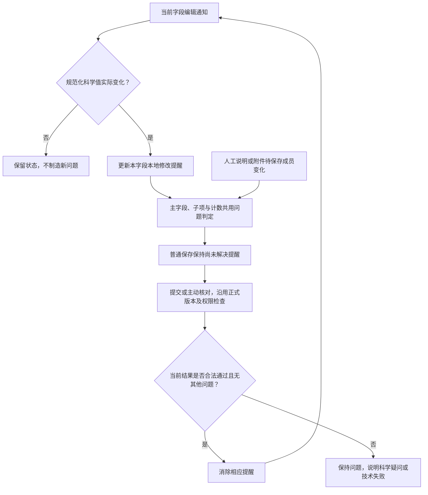

# 实施计划

Issue：[#220](https://github.com/JLU-ICCMS-MaYuan/SC-Wiki/issues/220)。规格见 spec.md。

## 技术上下文与所有权

React 19／TypeScript 5.6、MUI 7、Vitest 2；Python／MySQL 后端版本化核对保持。科学值归原宿主草稿，审核资格归后端，新增浏览器标记仅为展示。无数据库、科学字段契约或公共 API 变化。

## 设计

1. 编辑通知已有实际差异检测；仅为受影响项记录 local_modified，独立于旧 required/human_modified。原免审项实际输入可提醒，未变空项仍免审；恢复有效原值清本地标记，不改后端资格。
2. evidenceStatus 共用问题判定：本地变化／未保存人工输入优先提醒；处理进度与有无未解决问题独立，开始核对不消除旧红。
3. 人工资料的保存、提交定位及界面状态设计只引用 [#221](../221-scientific-field-sidebar/spec.md)，颜色模块读取其真实待处理事实。
5. 迁移工具以 Markdown 块为单位提取规则及原话，保留完整围栏／表格，写入本目录迁移档并生成摘要；旧处只留链接。托管 Issue 使用完整正文的哈希对比保护，并保留本次移走块；不改其他任务或状态。

## 质量门与映射

| FR/SC | 组件及任务 | 验证 |
|---|---|---|
| FR-001/003/004/005、SC-001 | EvidenceWorkflow / evidenceStatus；T002/T003 | 四宿主交互与局部 Hook |
| FR-002/006/007/008、SC-002 | manualEvidenceDrafts / EvidenceFieldMarkers；T003 | 多原因、处理中、身份与迟到结果 |
| FR-009、SC-003/004 | 现有局部缓存与字段读取；T004 | 性能计数、契约、变异与构建 |
| FR-010、SC-005 | docs 与旧 Issue；T005/T006 | 逐块摘要、回读及引用检查 |

AGENTS 的 mayuan、先读后改、标准键锁定、局部输入、自动提交和无推送均适用。禁止只调整免审 if 顺序导致空项批量变红；禁止输入调用模型。数据模型见 data-model.md，UI 契约见 contracts/ui.md。

## 阶段与依赖

文档和调查→旧代码故障证明→局部实现→四宿主及相邻验证→旧规则迁移及 Overview 引用→总验证→范围提交。标准产物为本目录 Spec/Plan/Research/Data-model/Tasks/Quickstart/契约/检查表；没有额外治理状态文件。

## 提醒更新流程

## 2026-11-05 增量计划

FR-011—014 / SC-006—008：#220 拥有当前合法结果与消红判定，#221 拥有保存按钮、侧栏内进度及最终反馈。先建立已保存当前通过／未通过／技术失败／在途变更矩阵，复用字段版本，不将任务状态当科学结论。实现前以四宿主反例证明现有缺口；新交互验证未完成，不改写上轮验证结论。
