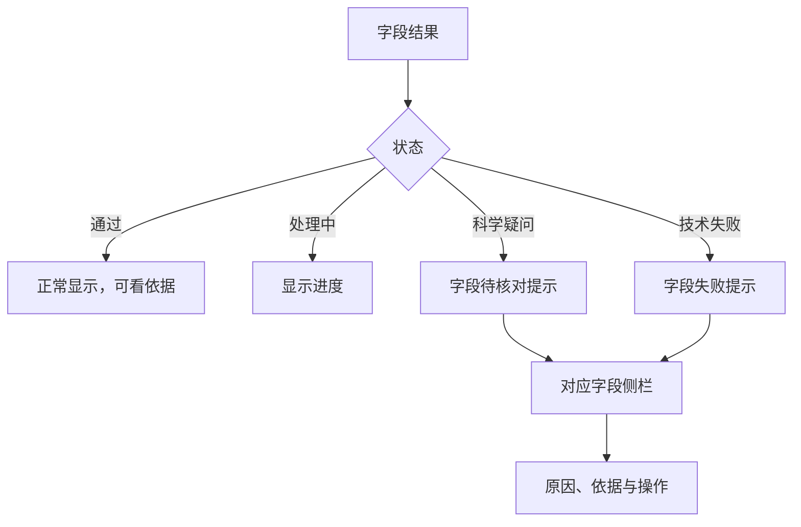
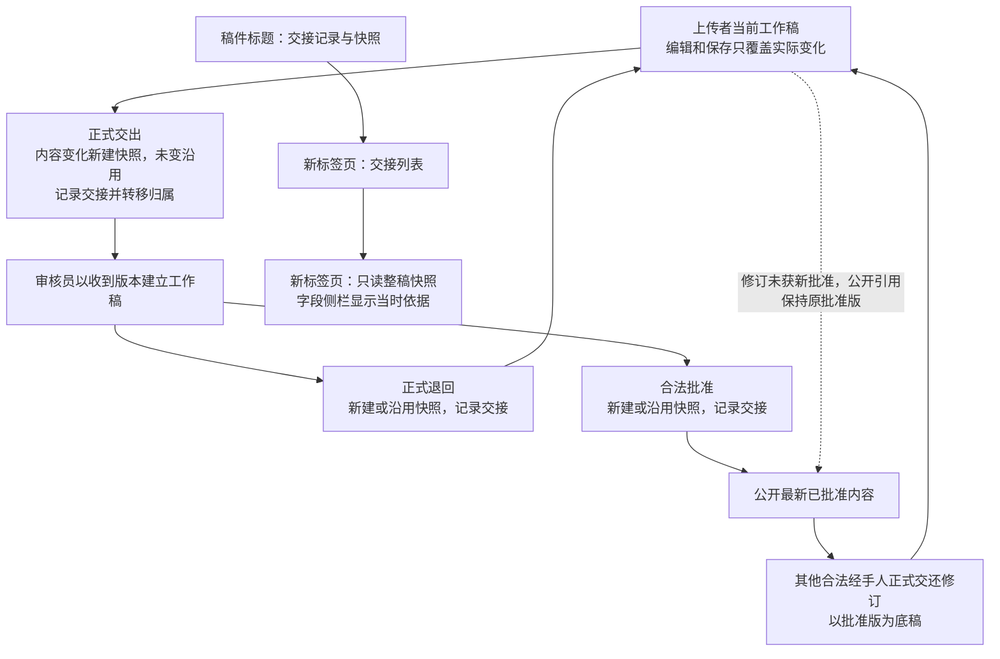
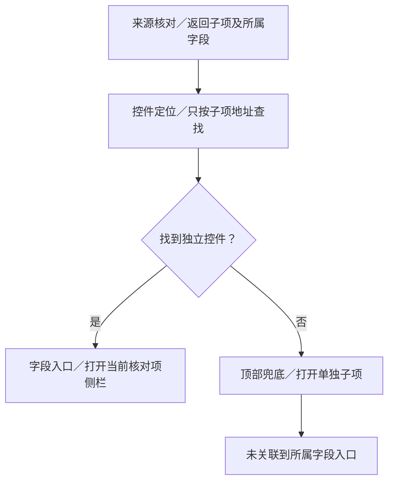
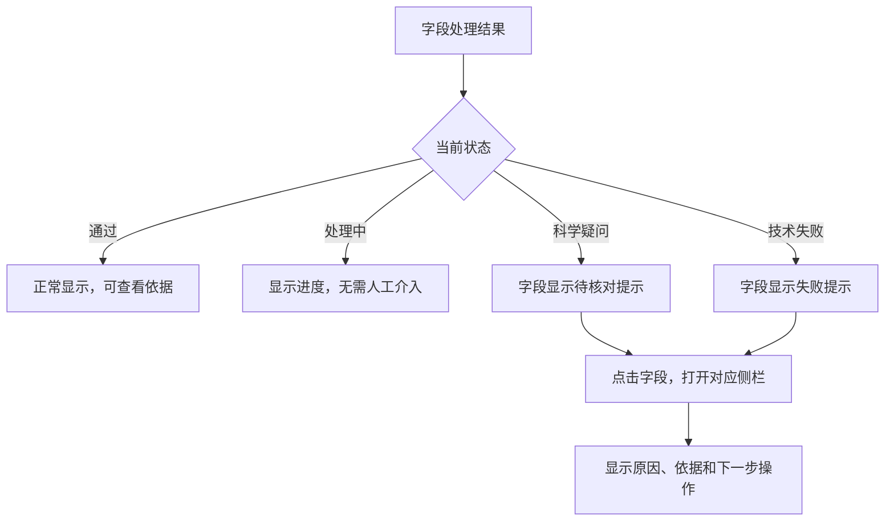
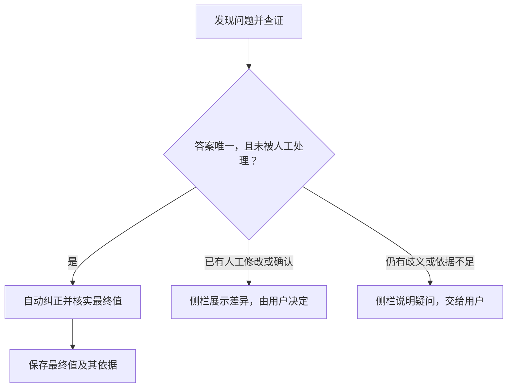

# 右侧栏原话、设计及历史迁移记录

本页逐字保留迁入来源，只作追溯，不能直接作为当前要求。现行设计及待实施差异以 [#221 Spec](spec.md) 为准；标红规则只见 [#220](../220-field-red-marking/spec.md)。围栏内链接按原来源文件理解。已替代三页签、逐字段历史和中央核对框不恢复；旧记录中声称完成的能力不得覆盖当前差异表。

## 迁入片段 S0001

来源：docs/overview/01_Decentralized_Uploading_of_Superconductivity_Data/README.md；原行 45；SHA256：`58cb3032fcee60302a8efe41bbc745617ec39a10e8c7346bd207147db162a4ad`。

~~~~text
上传页不再显示独立“AI 审核”按钮，字段来源侧栏继续提供局部重试和人工审核入口。
~~~~

## 迁入片段 S0002

来源：docs/overview/01_Decentralized_Uploading_of_Superconductivity_Data/README.md；原行 49；SHA256：`f9ad2403f7a2f15a4b423d41c9b1ecc23f5d44aa69d04e122f93e2eb5a67b251`。

~~~~text
共享核对侧栏在当前组保存成功后自动关闭，并保持原字段位置；失败保留输入，已接受项仍可重新打开查看和撤销。

~~~~

## 迁入片段 S0003

来源：docs/overview/01_Decentralized_Uploading_of_Superconductivity_Data/README.md；原行 59；SHA256：`86907c4ddffa5da7bf624020e31a4382e24a56ea89bf31f98846d26fe9471739`。

~~~~text
所有数据字段名（含空值、书目和只读结构参数）都可打开侧栏；侧栏不重复主表单值，已解决记录仍可查看，顶部不再堆放已接受列表。
~~~~

## 迁入片段 S0004

来源：docs/overview/01_Decentralized_Uploading_of_Superconductivity_Data/README.md；原行 63；SHA256：`4e28b834ce3ce5611a58bc130a52f7fc8aff161136714066503218d314f7fab3`。

~~~~text
科学字段沿原有标记与来源侧栏处理，出版年份仍按同源身份和出版资料核实。
~~~~

## 迁入片段 S0005

来源：docs/overview/01_Decentralized_Uploading_of_Superconductivity_Data/README.md；原行 67；SHA256：`4dafa4ab3f9d3f01cd6e666e3452ed4ad6ebe7b163cf7accb3ff0216099e590b`。

~~~~text
侧栏主动核对先保存当前字段及人工依据，只按该字段输入校验并保存结果；整篇版本或无关内部编辑通知不再阻断它。
~~~~

## 迁入片段 S0006

来源：docs/overview/01_Decentralized_Uploading_of_Superconductivity_Data/data-structure-and-form-mapping.md；原行 17；SHA256：`b4b705c702b5d5d79649b5413c0280a345d3490657486202e43b157c0fe667ef`。

~~~~text
字段级来源核对侧栏继续负责查看模型判断、建议和人工理由。
~~~~

## 迁入片段 S0007

来源：docs/overview/01_Decentralized_Uploading_of_Superconductivity_Data/data-structure-and-form-mapping.md；原行 17；SHA256：`e894fbd9ac8d7008e0350e00cbb243a331c7f3617299554e3fbd401616ef8bae`。

~~~~text
原文侧栏顶部只读对照各候选，返回主表单聚焦原始值，窄屏仅滚动字段行。
~~~~

## 迁入片段 S0008

来源：docs/overview/01_Decentralized_Uploading_of_Superconductivity_Data/data-structure-and-form-mapping.md；原行 26；SHA256：`8da1d6930cf4af5afb17d4de9e2918b7019b0a4d85d61381620c3ec89a85e77d`。

~~~~text
论文详情只读，并把结构模型放回所属材料状态，移除侧栏重复模型及结构原文块。
~~~~

## 迁入片段 S0009

来源：docs/overview/01_Decentralized_Uploading_of_Superconductivity_Data/data-structure-and-form-mapping.md；原行 61；SHA256：`7401d341f4627ae17a5497bbb453b5b64914284985ce8bdb95ad1e4169cf950a`。

~~~~text
字段标签可打开来源核对与字段设置；修改后通过现有字段保存器保存，旧核对结论不再支持新值。
~~~~

## 迁入片段 S0010

来源：docs/overview/01_Decentralized_Uploading_of_Superconductivity_Data/data-structure-and-form-mapping.md；原行 69；SHA256：`fe4dded89c57b61c2a3f33f8f9194c558c467d3ce70ca1e93dae81f67ea29d0c`。

~~~~text
超导性质相关计算条件中的自动字段名统一显示为“声子方法”，表单与来源核对侧栏一致；后台阶段键和原文依据保留，人工自定义名称不覆盖。
~~~~

## 迁入片段 S0011

来源：docs/overview/01_Decentralized_Uploading_of_Superconductivity_Data/data-structure-and-form-mapping.md；原行 390；SHA256：`1e3cba786ea5a6073a3878ac471be898d350abc4d58811e4984622c7e4451dc4`。

~~~~text
预测Tc的λ、ωlog、各Tc/μ*点及计算条件以紧凑方框显示名称和当前值，点击名称打开右侧设置。固定字段可改名称和原始单位标注，科学key/类型保持；补充计算条件支持文本、数值、范围和布尔。新增先设置，应用后加入；取消不写入，只读可查看。打开侧栏后字段或目标记录已变化时拒绝覆盖。

~~~~

## 迁入片段 S0012

来源：docs/overview/01_Decentralized_Uploading_of_Superconductivity_Data/data-structure-and-form-mapping.md；原行 392；SHA256：`af2fd1e79e562515f623d0c57cfad9951ba0bb8ef6411662c92b21b47a2cc82a`。

~~~~text
标注随现有payload保存、返修和导出；规范Tc/ωlog仍以K保存，单位标注不会自动换算。标注/科学值改变沿现有科学指纹保守地使旧来源待核对。结构优化扩展保留数据与导出，但不在超导计算主区展开；EPC泛函不无条件从结构PBE补入，仅允许上文具有来源和工作流依据的QE推断。

~~~~

## 迁入片段 S0013

来源：docs/overview/01_Decentralized_Uploading_of_Superconductivity_Data/data-structure-and-form-mapping.md；原行 394；SHA256：`08d3c95ede2352c9c5fba0bf533f4fc1ecbd8e6eb87d53bf14abb31e1630118a`。

~~~~text
实现及验证边界见[#94字段侧栏记录](../../specs/94-property-record-editor/tc-field-sidebar-demo.md)。本行为适用于预测Tc共享编辑入口，其他性质/测量表单保持既有规则。

~~~~

## 迁入片段 S0014

来源：docs/overview/01_Decentralized_Uploading_of_Superconductivity_Data/data-structure-and-form-mapping.md；原行 400；SHA256：`7ecab189b33dfdd1a912a1002934ddba533e164f10e9c452a8fc1e5506849084`。

~~~~text
共享侧栏使用“字段设置 / 来源核对 / 历史记录”三页签。原文首次展开，人工修改记录、AI 理由和历史首次收起，四块均可独立折叠；切换页签保留未应用设置及已加载的原 PDF。全部问题保留在主页面独立“待处理项”，不在字段侧栏底部堆叠其他问题的红色按钮。

~~~~

## 迁入片段 S0015

来源：docs/overview/01_Decentralized_Uploading_of_Superconductivity_Data/data-structure-and-form-mapping.md；原行 402；SHA256：`541b914b15e2c074932d87a7986e2d8b196e250f3615af9373319454fac9b8f3`。

~~~~text
点击科学字段名称和核对标记都进入上述同一个侧栏，分别默认选中设置页和来源页；尚无核对结果的字段仍保留三个页签和来源空态。
~~~~

## 迁入片段 S0016

来源：docs/overview/01_Decentralized_Uploading_of_Superconductivity_Data/data-structure-and-form-mapping.md；原行 402；SHA256：`454571ebc4a070efb28375d383dc861cc6258bb36eceefb1d55d7d986a6deca6`。

~~~~text
取消不写值，应用只改当前字段，完成后关闭侧栏。
~~~~

## 迁入片段 S0017

来源：docs/overview/01_Decentralized_Uploading_of_Superconductivity_Data/data-structure-and-form-mapping.md；原行 411；SHA256：`a0ec6877b18c7c0e9b0eada3b8ff6ad497b435b11a650fede6ff7b820c14b998`。

~~~~text
完整来源理由位于当前字段侧栏，以短状态和普通段落展示，三页签、四块折叠及原PDF查看保持。
~~~~

## 迁入片段 S0018

来源：docs/overview/01_Decentralized_Uploading_of_Superconductivity_Data/data-structure-and-form-mapping.md；原行 454；SHA256：`0e44195bd1d5d7fedeedad597e987840eff8005ad2e02bc7dbd87814f586efdf`。

~~~~text
问题进入对应字段来源侧栏；旧版冻结快照保留版本化读取。
~~~~

## 迁入片段 S0019

来源：docs/overview/01_Decentralized_Uploading_of_Superconductivity_Data/data-structure-and-form-mapping.md；原行 463；SHA256：`80a06807b814b72d36760af0a508f52ff364122df60fb4bcea2cc87f27814a2f`。

~~~~text
人工扩展由人工入口创建；模型输出不能创建扩展、字段设置或伪造人工来源。
~~~~

## 迁入片段 S0020

来源：docs/overview/01_Decentralized_Uploading_of_Superconductivity_Data/pdf-ingestion.md；原行 72；SHA256：`8f6bb8beb37bcb31b4dece5a1fd1eb162b6a559cf85b891a41c7e3cd685dfc30`。

~~~~text
- 当前独立解析详情页的文件名、处理阶段、加载状态和返回上传记录按钮位于正常排版的任务横条，随页面滚走，不再吸顶。研究材料目录保留在工作区右栏，同任务信息、进度及草稿统一分栏；桌面目录在右栏内吸附常驻，顶部4px，任务横条继续随页面滚走；目录可折叠、点击定位，桌面两栏间距4px，窄屏纵向排列，见[#219](../../specs/219-material-state-outline/spec.md)。返回记录或关闭详情标签页不取消、删除后台任务；全局侧栏的收起/展开只改变正文宽度，不操作任务状态。

~~~~

## 迁入片段 S0021

来源：docs/overview/01_Decentralized_Uploading_of_Superconductivity_Data/pdf-ingestion.md；原行 174；SHA256：`891fb85a872ca080ea2acadec0d3fd95be07c95731887afe5e2a15385bc6ac8c`。

~~~~text
未保存的字段、侧栏设置、理由和附件需要先确认替换，已有写请求或提交在途时不能载入。
~~~~

## 迁入片段 S0022

来源：docs/overview/01_Decentralized_Uploading_of_Superconductivity_Data/pdf-parsing-pipeline.md；原行 138；SHA256：`67387957b208593e57bbdc7c3a8d75622232b4b609bc795628648124b92a7ff0`。

~~~~text
- 汇总 prompt（`SUMMARY_SYSTEM_PROMPT`）与正文提取（`extractor.py`）要求 AI 生成的叙述字段使用英文；关键词另走作者列表优先的专门流程，能定位的作者原词保留原语言，缺少作者列表时 AI 全文提炼词仍须英文。汇总归一化后、写入草稿和审核快照前会再次校验生成字段语言。标题、摘要、作者、原始数值、单位和 `quote` 保持来源语言。Worker 以验证后的 canonical draft 预填选项框和输入框；字段建议在提取后单独生成，通过字段名打开侧栏查看；只有非空且能定位的 `quote` 才作为论文片段显示。某字段无来源依据时保持为空，不编造内容。（[Issue #74](https://github.com/JLU-ICCMS-MaYuan/SC-Wiki/issues/74)、[#85](https://github.com/JLU-ICCMS-MaYuan/SC-Wiki/issues/85)、[#129](https://github.com/JLU-ICCMS-MaYuan/SC-Wiki/issues/129)）

~~~~

## 迁入片段 S0023

来源：docs/overview/01_Decentralized_Uploading_of_Superconductivity_Data/pdf-parsing-pipeline.md；原行 172；SHA256：`2b530cc95d1dd3d6366570c6bfc3718c271a0ad41aae61529339ba0acf0c5767`。

~~~~text
独立“解析来源检查”入口、分类侧栏、分类快照、责任状态计算与专用重建脚本已撤销；含历史 triage 的旧草稿仍可读取和保存，不因此恢复入口或重新计算。
~~~~

## 迁入片段 S0024

来源：docs/overview/01_Decentralized_Uploading_of_Superconductivity_Data/pdf-parsing-pipeline.md；原行 174；SHA256：`08a4e44c7f5872ac4ef75739c5020f303beafb649236d2713034f056c5f9330f`。

~~~~text
科学表单沿用 #109：正文保留当前值、紧凑字段标记和待处理计数，完整来源、理由及人工记录进入原字段侧栏；输入错误、保存失败、权限和版本冲突仍按原规则显示。
~~~~

## 迁入片段 S0025

来源：docs/overview/01_Decentralized_Uploading_of_Superconductivity_Data/pdf-parsing-pipeline.md；原行 191；SHA256：`c1259a36fb120bfa7439955f21a81cfa745809e3b08b4c8161a2dada86b4ca2c`。

~~~~text
LLM 另外两个入口是点击提交后的必要字段审核，以及侧栏主动“大模型核对”。
~~~~

## 迁入片段 S0026

来源：docs/overview/01_Decentralized_Uploading_of_Superconductivity_Data/pdf-parsing-pipeline.md；原行 197；SHA256：`f49d7b66b753315f941bca01db3ce78dfceafb54db14a6554dcde3bf1112fbfd`。

~~~~text
- 不认可时点击“人工审核不通过”，保留原内容并展开人工修改记录；保存修改理由和证据或无证据说明，不自动授予通过。

~~~~

## 迁入片段 S0027

来源：docs/overview/01_Decentralized_Uploading_of_Superconductivity_Data/pdf-parsing-pipeline.md；原行 206；SHA256：`84db04835ffe92ff25894176cb73c1c24c3d6b982b7ac6aade2b78aa54007c46`。

~~~~text
当前值有具体核对理由且来源有效时，侧栏“AI 理由”说明本文依据如何支持该值；即使状态为 `supported`，也不回退成“原文直接记载，无需额外推断”。
~~~~

## 迁入片段 S0028

来源：docs/overview/01_Decentralized_Uploading_of_Superconductivity_Data/pdf-parsing-pipeline.md；原行 206；SHA256：`9d9a6f1c2d2eae7a2978e3888ea25ecc0b37fe5ef38088204be21d327c0a9b9e`。

~~~~text
H3S 当前草稿的材料家族已可在侧栏读到富氢材料归入“氢基超导体”的判断；作者原列关键词、原文摘录、确定性派生和人工改写仍按各自来源显示。
~~~~

## 迁入片段 S0029

来源：docs/overview/01_Decentralized_Uploading_of_Superconductivity_Data/pdf-parsing-pipeline.md；原行 210；SHA256：`de5e09146172b48dfe765168af83ae52715155a8117c1b2a8056e98af29da4c4`。

~~~~text
会话草稿按目标、稳定字段和值隔离，切换选项/字段、关闭重开侧栏和迟到响应不会清空输入；获焦刷新在人工草稿存在时暂停。
~~~~

## 迁入片段 S0030

来源：docs/overview/01_Decentralized_Uploading_of_Superconductivity_Data/pdf-parsing-pipeline.md；原行 246；SHA256：`9b60b7fcd808eda822ff6f86ded710562945b97ae43b5f1a5435c7c473262133`。

~~~~text
- 共享核对：`backend/ingest/property_evidence.py`、`backend/api/evidence.py`、`frontend/src/components/EvidenceWorkflow.tsx`。现有 sc-wiki MySQL、真实模型及页面验收记录见 [#103 验证路径](../../specs/103-property-evidence-review/quickstart.md)。

~~~~

## 迁入片段 S0031

来源：docs/overview/01_Decentralized_Uploading_of_Superconductivity_Data/pdf-parsing-pipeline.md；原行 248；SHA256：`d1335741a8c3df171392e5e911b6af5ab80e4551ddf9f96782ec461d2674fee1`。

~~~~text
共享抽屉区分未核对和 AI 未找到来源；理由/候选连续输入合并保存，失败暂停自动重试并保留输入。
~~~~

## 迁入片段 S0032

来源：docs/overview/01_Decentralized_Uploading_of_Superconductivity_Data/pdf-parsing-pipeline.md；原行 250；SHA256：`58cd25c9ab748bc15cb23c1167d1e2ca880e5b43b3ebf26d26e47a0d288df256`。

~~~~text
来源核对页不重复表单值，当前值编辑放在字段设置页；顶部不再逐项铺开已接受记录。
~~~~

## 迁入片段 S0033

来源：docs/overview/01_Decentralized_Uploading_of_Superconductivity_Data/pdf-parsing-pipeline.md；原行 250；SHA256：`836c8afe7dec9cc9a5125a8f4cc37b5f57865af9a651fceb600f93daf6a8cd34`。

~~~~text
详见 [#109 设计与验收](../../specs/109-field-evidence-and-ai-suggestions/quickstart.md)与 [#148 侧栏编辑](../../specs/148-sidebar-field-editing/validation.md)。
~~~~

## 迁入片段 S0034

来源：docs/overview/01_Decentralized_Uploading_of_Superconductivity_Data/pdf-parsing-pipeline.md；原行 266；SHA256：`33bc0aedbfc58e88715455ab4401107df933c33b7e375e8298d40b4d20adadc6`。

~~~~text
校对侧栏区分“作者原列关键词”和“AI 全文提炼”，人工改值不复用旧分析；不再只凭标题、摘要与概要补词。
~~~~

## 迁入片段 S0035

来源：docs/overview/01_Decentralized_Uploading_of_Superconductivity_Data/pdf-parsing-pipeline.md；原行 299；SHA256：`82f4236900dd237c2d27412d7ebfa045135764b164740fda5e0507462a0df76b`。

~~~~text

证据抽屉可按需请求 `/api/rag/evidence/region`，服务端校验目标归属和源文件哈希，
返回从原 PDF 直接渲染的 300 DPI 局部 PNG 与高亮区域；文字只截取引用句及同栏上下三行，
图表显示可信区域和邻近说明，不显示整页。
~~~~

## 迁入片段 S0036

来源：docs/overview/01_Decentralized_Uploading_of_Superconductivity_Data/pdf-parsing-pipeline.md；原行 387；SHA256：`82aa3262770f18fe9f77bf9ceb5c9a19a5f4b37abdd1f2e0a94f3f2cad98cfe9`。

~~~~text
固定内部描述经原文行、数值、单位、组成和几何校验后才进入归属；不确定基底或报告冲突进入原结构字段侧栏/既有兜底，不修改矛盾数值。
~~~~

## 迁入片段 S0037

来源：docs/overview/01_Decentralized_Uploading_of_Superconductivity_Data/pdf-parsing-pipeline.md；原行 391；SHA256：`a5778ff369277b3e37c07848851b149cbf8f102fab458a0dd5f06659f822f786`。

~~~~text
已知归属的问题进入结构字段来源侧栏，未定位项进入已有兜底核对记录。
~~~~

## 迁入片段 S0038

来源：docs/overview/01_Decentralized_Uploading_of_Superconductivity_Data/source-association-review.md；原行 7；SHA256：`4248be8c530ac8b186440fb81d9346b239f27ca41030ccc75e269e5c84984bed`。

~~~~text
字段提示规则及相关历史已迁移至 [#220](../../specs/220-field-red-marking/spec.md)，本处不再独立定义。

~~~~

## 迁入片段 S0039

来源：docs/overview/01_Decentralized_Uploading_of_Superconductivity_Data/source-association-review.md；原行 9；SHA256：`21c0b39cb9cd8f39b1c851092d4a40c569423d869fa00d6f5c44953e5842f3e3`。

~~~~text
超导记录的计算适用关系通过该记录“计算条件”标题进入来源核对，不冒充任意参数或新增自由输入。已知归属子项不再进入顶部未定位清单，真正未知项仍保留兜底。实际草稿隔离副本的11个问题全部可达，未定位从8降至0；四宿主与边界验证见[#201](../../specs/201-field-sidebar-ownership/validation.md)，未执行真实业务修改或模型调用。

~~~~

## 迁入片段 S0040

来源：docs/overview/01_Decentralized_Uploading_of_Superconductivity_Data/source-association-review.md；原行 15；SHA256：`175b2df787832374407e94976217ba124f1bd039b36bbba90251d73fed9bb884`。

~~~~text
侧栏主动“大模型核对”使用 #177 单字段契约：先自动保存当前字段及对应人工理由／附件／缺证说明，没有变化则不写入；保存全部成功后，只为当前稳定字段创建任务。
~~~~

## 迁入片段 S0041

来源：docs/overview/01_Decentralized_Uploading_of_Superconductivity_Data/source-association-review.md；原行 19；SHA256：`e2ce766927d5259e740a801bb928f24bbce38ad91fb90ddc4a78033ab65ff4db`。

~~~~text
编辑输入、自动保存和侧栏“完成”不进行科学重核；只保存实际变化和字段说明。
~~~~

## 迁入片段 S0042

来源：docs/overview/01_Decentralized_Uploading_of_Superconductivity_Data/source-association-review.md；原行 41；SHA256：`3fac9379b4e0fca0da714b099b2a36eef3b2150e7c4c05f7bc9fcae429d13cad`。

~~~~text
侧栏保留推断关联的实际理由及来源类别，取消重复蓝底固定提示；无需逐项确认的资格以 supported 状态及规则理由为准。
~~~~

## 迁入片段 S0043

来源：docs/overview/01_Decentralized_Uploading_of_Superconductivity_Data/source-association-review.md；原行 69；SHA256：`6e4b0ab27fe1336cfc7d4be83525952bc73503d9c90ecf3a7451c65315f60728`。

~~~~text
字段侧栏保留“字段设置／来源核对”两个页签，冻结页面读取当时资料，不请求当前工作稿替代。
~~~~

## 迁入片段 S0044

来源：docs/overview/01_Decentralized_Uploading_of_Superconductivity_Data/upload-llm-workflow-and-agent-analysis.md；原行 353；SHA256：`363f44cc7d3f2a021873b596a46b19b94df985d00a5b64f2514322ebf4a2d178`。

~~~~text
该字段来源标为论文归纳；侧栏显示模型对当前总结的核对理由和可定位引句，缺少依据不能标为 `supported`，修改字段后旧理由失效。
~~~~

## 迁入片段 S0045

来源：docs/overview/02_Decentralized_Maintenance_and_Verification/README.md；原行 39；SHA256：`938e2e978ea14c6da242acb6e3f1c7654b59e97b6f964fb4830537f4947eb00d`。

~~~~text
论文文本及列表字段可直接在统一侧栏的“字段设置”编辑，来源页三个审核按钮同排，移除两个重复返回入口；应用／取消、未应用关闭保护和管理员列表保存见[侧栏操作](literature-and-record-review.md#保存与人工审核决定)。

~~~~

## 迁入片段 S0046

来源：docs/overview/02_Decentralized_Maintenance_and_Verification/README.md；原行 43；SHA256：`a644fc8175ec526408a7fabb41f783ff918531637121b7764131987d2c2a3168`。

~~~~text
人工确认保存成功后自动关闭侧栏，手动关闭同样保持原字段的阅读位置；保存失败保留理由供重试。

~~~~

## 迁入片段 S0047

来源：docs/overview/02_Decentralized_Maintenance_and_Verification/literature-and-record-review.md；原行 40；SHA256：`0071e2924c167342aa8009f4a80a5ea8b0d27875a7c0b092026f54c57308f99d`。

~~~~text
- 论文列表和快速审核弹窗不展示物性记录数量；管理员与超级管理员的小锤子快速审核、独立编辑页共用三状态选择器，顺序为「通过」「退回待审核」「拒绝」。快速批准读取最新正式详情；Superconductor type 与材料维度始终使用当前值。仅首次 pending 且论文级 family 尚未落库时，回填提交快照的材料/结构家族，先经科学保存再重读正式分类；状态按稳定 key 或历史唯一化学式匹配，不按数组位置拼接。编辑页批准先自动保存，再重新读取分类并检查现有核对结果。两入口共用分类解析及审核请求构造，均执行现有后端校验。快照 404 时使用正式详情，其他读取错误中止批准并显示原因；拒绝和退回不依赖分类读取。快速审核提交中禁用重复操作，失败保留选项和意见，成功刷新列表及统计。提示明确区分已保存数据和当前编辑选择，需要修改时进入编辑页。快速审核弹窗展示同一套科学数据与问题标记，点击后打开右侧覆盖抽屉查看原文、理由及建议。（[Issue #100](../../specs/100-quick-review-status/spec.md)）

~~~~

## 迁入片段 S0048

来源：docs/overview/02_Decentralized_Maintenance_and_Verification/literature-and-record-review.md；原行 44；SHA256：`a61d3c9d7c62c3780bccb35b0f2e943ba33497a040bf991073cd14e10b15d446`。

~~~~text
- 新规则核对物性、材料、结构、实验与计算条件、科学分类与叙述，书目信息不逐字段补证。编辑页顶部依次为进行 AI 审核、审核结果、审核意见和提交审核；核对前先保存当前编辑，保存失败不启动模型。提交只读检查核对结果，结果缺失或失效时提示先审核；核对完成不自动提交。字段说明文字入口、右侧覆盖抽屉、建议草稿与上传页共用。

~~~~

## 迁入片段 S0049

来源：docs/overview/02_Decentralized_Maintenance_and_Verification/literature-and-record-review.md；原行 67；SHA256：`e7cb9ea244dfa5a9654da7e19450c8f35a1d20360c03eb8bd30bad457d69ba96`。

~~~~text
管理员、超级管理员的快速审核与独立编辑页共用 `EvidenceWorkflow`，与上传页使用同一后台核对能力。
~~~~

## 迁入片段 S0050

来源：docs/overview/02_Decentralized_Maintenance_and_Verification/literature-and-record-review.md；原行 74；SHA256：`29c71469b1be51751ecab8a7e91e4c6a79aac7bad4d4ec3cabe2d20acd930b2d`。

~~~~text
管理员编辑页使用同一侧栏。
~~~~

## 迁入片段 S0051

来源：docs/overview/02_Decentralized_Maintenance_and_Verification/literature-and-record-review.md；原行 78；SHA256：`97b6c21f921fe47f6d19bdd9cbcf38cf7903dac47dab64b946c9fc2b042e27e9`。

~~~~text
保存/上传复用主表单保存及版本刷新，成功且无待上传项时反馈并关闭对应侧栏；任一阶段失败均保留输入并提示实际结果。
~~~~

## 迁入片段 S0052

来源：docs/overview/02_Decentralized_Maintenance_and_Verification/literature-and-record-review.md；原行 80；SHA256：`6854eb88c3131b54afaecdb09b695bafef47c4faa95ac587dd738168faadcfb0`。

~~~~text
当前组全部保存成功后右侧栏自动关闭，失败保留侧栏和理由以便重试。
~~~~

## 迁入片段 S0053

来源：docs/overview/02_Decentralized_Maintenance_and_Verification/literature-and-record-review.md；原行 80；SHA256：`1cccc355e5a40e5b9d41c1822e927b2a2bf1c4815528b70d6a34ed246539096d`。

~~~~text
已接受项仍可重新打开查看或撤销，迟到请求不关闭后来打开的侧栏。
~~~~

## 迁入片段 S0054

来源：docs/overview/02_Decentralized_Maintenance_and_Verification/literature-and-record-review.md；原行 103；SHA256：`091db9f66a6f4b3b7a52a9bab05a42d6cb6aefab8d9b83eee50503531482b4c4`。

~~~~text
派生项可从侧栏返回并聚焦主表单。
~~~~

## 迁入片段 S0055

来源：docs/overview/02_Decentralized_Maintenance_and_Verification/literature-and-record-review.md；原行 131；SHA256：`11a21883c75ab8a1f1bbf5f25a7642c8580118726ad99d59efdbdaa58893d2c7`。

~~~~text
| 完成人工确认 | 管理员逐条保存理由并绑定当前值；AI 候选仍作为接受草稿，在提交时应用 | 保留理由与建议以便重试；成功关闭侧栏并保持原字段位置 |

~~~~

## 迁入片段 S0056

来源：docs/overview/02_Decentralized_Maintenance_and_Verification/literature-and-record-review.md；原行 161；SHA256：`caac4862e10a1e357efbba96c96d4f8ba9deed640ff833c0875523e1dd08a2c1`。

~~~~text
- `frontend/src/components/EvidenceWorkflow.tsx`

~~~~

## 迁入片段 S0057

来源：docs/overview/02_Decentralized_Maintenance_and_Verification/literature-and-record-review.md；原行 211；SHA256：`7e887d15780377d9b6045cf414cceef38fcdb61b5e14cfc54e0a6f22135c1d8f`。

~~~~text
管理员与超级管理员编辑页的数据字段可查看来源，包含无证据和空字段；普通字段通过字段名进入，紧凑预测 Tc 科学字段通过独立核对标记进入，名称负责字段设置。
~~~~

## 迁入片段 S0058

来源：docs/overview/02_Decentralized_Maintenance_and_Verification/literature-and-record-review.md；原行 219；SHA256：`feb895e7fb49745a2e5a90b6ce7360773d5ac1da256b87bbdd4a790e8da6811b`。

~~~~text
侧栏保留“字段设置／来源核对”两个页签，历史改从整稿正式交接入口查看。
~~~~

## 迁入片段 S0059

来源：docs/overview/02_Decentralized_Maintenance_and_Verification/literature-and-record-review.md；原行 219；SHA256：`8b4010b8eb6ab4422ff557e830abd2b7738c252fda97acfb09dc4f6ce5dd8d22`。

~~~~text
来源页先显示原文和 AI 理由，随后同一行显示“人工审核不通过／人工审核通过／大模型核对”；不认可或已经修改时，下面展开人工修改记录。
~~~~

## 迁入片段 S0060

来源：docs/overview/02_Decentralized_Maintenance_and_Verification/literature-and-record-review.md；原行 221；SHA256：`e85e33310e1f65367e501059a822621ecfcf47d1b5d7a941e016b9864ec23033`。

~~~~text
“字段设置”支持直接编辑标题、摘要、总结、主要发现、研究动机、关键词及研究方法，显示固定字段名称；两个列表沿用各自宿主的转换规则。
~~~~

## 迁入片段 S0061

来源：docs/overview/02_Decentralized_Maintenance_and_Verification/literature-and-record-review.md；原行 221；SHA256：`60fa3b6b7ddf2aca6abccd70c7c45a96cedf66b89056e98109d8bb2abf1e6040`。

~~~~text
侧栏读取当前表单草稿，切页签保留尚未应用的输入；“应用修改”只更新当前字段并关闭，“取消”不应用，× 或 Escape 关闭前对未应用内容提供继续编辑或放弃选择。
~~~~

## 迁入片段 S0062

来源：docs/overview/02_Decentralized_Maintenance_and_Verification/literature-and-record-review.md；原行 225；SHA256：`4b28d5c36940f7e89784de32f7c3f08feed15300c2184e16cb84ca1e11f9600d`。

~~~~text
通过后关闭侧栏并提示保存成功；同一版本刷新、重开与提交直接复用。
~~~~

## 迁入片段 S0063

来源：docs/overview/02_Decentralized_Maintenance_and_Verification/literature-and-record-review.md；原行 233；SHA256：`6b596310cf6b9d57375b559293679a860805c16386e55243b8e761eb51e386f1`。

~~~~text
人工修改区按钮为“保存”：先保存实际变化，再保存说明及文件；成功后侧栏保持打开。
~~~~

## 迁入片段 S0064

来源：docs/overview/02_Decentralized_Maintenance_and_Verification/literature-and-record-review.md；原行 239；SHA256：`b0111c4ce5c6f09e66dbe5962798c47e8a91c2c57e8a2f52ec9061a06104e0c4`。

~~~~text
侧栏主动“大模型核对”可为该字段生成独立候选，当前值与已有人工通过决定保留；候选不自动覆盖表单。
~~~~

## 迁入片段 S0065

来源：docs/overview/02_Decentralized_Maintenance_and_Verification/literature-and-record-review.md；原行 241；SHA256：`31b7981f700ce4eabc0c79b55f5e0d70720087b7f283430595404f165fff4c63`。

~~~~text
候选在“字段设置”的当前值下方显示，包含可读候选值、AI 给出的独立理由、已定位依据和“应用 AI 候选值”。
~~~~

## 迁入片段 S0066

来源：docs/overview/02_Decentralized_Maintenance_and_Verification/literature-and-record-review.md；原行 253；SHA256：`e06f820071a843df4f306f7cf3225b1080209d8b05e4e1f6e894637ee84b2459`。

~~~~text
预测 Tc 标题不聚合问题，方法只审核方法自身，其余科学子项分别定位。侧栏使用设置、来源两个页签；原文、人工修改记录与 AI 理由各自保留，页签切换不丢设置或原 PDF 图像。其他问题在主页面独立待处理导航中处理，字段侧栏底部不再铺满跨字段红色按钮。

~~~~

## 迁入片段 S0067

来源：docs/overview/02_Decentralized_Maintenance_and_Verification/literature-and-record-review.md；原行 255；SHA256：`5680f4e7387403644bef1e870a506571bde2e37f92b97845c83a38b1a901403f`。

~~~~text
管理员普通保存的实际用户、UTC 时间、字段前后值及设置变化附于既有论文历史事件 JSON。返修和上传保存分别保留服务器持有的事件，AI 核对记录实际模型；旧缺失作者、时间明确降级展示。同值不追加改值事件，保存历史和人工确认均不等于正式批准。旧整条审核结论不能直接授予新子项通过资格。

~~~~

## 迁入片段 S0068

来源：docs/overview/02_Decentralized_Maintenance_and_Verification/literature-and-record-review.md；原行 257；SHA256：`dc6f4cccb67f3ccd66adf7764a10e4c837290844dc76fc92ce983e23a54469e1`。

~~~~text
原 PDF 区域仍从所属文件按哈希及可靠定位渲染，支持放大、折叠保留与重试；不依赖可用模型配置，权限和来源完整性校验保留。真实 JWT 保存、隔离 MySQL、实际 PDF 和浏览器的范围及未覆盖项见 [#109 正式实施验证](../../specs/109-field-evidence-and-ai-suggestions/field-review-implementation-validation.md)。

~~~~

## 迁入片段 S0069

来源：docs/overview/02_Decentralized_Maintenance_and_Verification/literature-and-record-review.md；原行 262；SHA256：`da2688f21519b47f397dc9b9aae08e588a3ab930ec4dcf98b18b9926e1fa813e`。

~~~~text
完整来源理由位于当前字段侧栏，以短状态和普通段落展示，三个页签、分区折叠及原 PDF 查看保持。
~~~~

## 迁入片段 S0070

来源：docs/overview/02_Decentralized_Maintenance_and_Verification/literature-and-record-review.md；原行 264；SHA256：`2439d81b434a950db720c4cecdd545714e857989a44f56b6361aed33a6255986`。

~~~~text
上传解析的区域与题录差异保留为原始来源账本，不再提供独立分类侧栏或将区域数转成用户待办。
~~~~

## 迁入片段 S0071

来源：docs/overview/02_Decentralized_Maintenance_and_Verification/literature-and-record-review.md；原行 306；SHA256：`290e00d1f9794b74f46212520a9561e3adf9da61220a883002602af4715f24e2`。

~~~~text
LLM 只在上传解析、点击提交后的必要字段审核、侧栏主动核对三个入口调用。
~~~~

## 迁入片段 S0072

来源：docs/overview/02_Decentralized_Maintenance_and_Verification/literature-and-record-review.md；原行 318；SHA256：`4248be8c530ac8b186440fb81d9346b239f27ca41030ccc75e269e5c84984bed`。

~~~~text
字段提示规则及相关历史已迁移至 [#220](../../specs/220-field-red-marking/spec.md)，本处不再独立定义。

~~~~

## 迁入片段 S0073

来源：docs/overview/02_Decentralized_Maintenance_and_Verification/literature-and-record-review.md；原行 320；SHA256：`4248be8c530ac8b186440fb81d9346b239f27ca41030ccc75e269e5c84984bed`。

~~~~text
字段提示规则及相关历史已迁移至 [#220](../../specs/220-field-red-marking/spec.md)，本处不再独立定义。

~~~~

## 迁入片段 S0074

来源：docs/overview/02_Decentralized_Maintenance_and_Verification/literature-and-record-review.md；原行 322；SHA256：`6f3990569000dc5d2feac0834103feb415de7b85b62ed4b1f78b3ab7cd07f8e7`。

~~~~text
实现入口：`backend/api/evidence.py`、`backend/ingest/field_decisions.py` 与 `frontend/src/components/EvidenceWorkflow.tsx`。验证覆盖真实浏览器生产路由的隔离 API 夹具、MySQL 回滚存储、提交事务及调用计数；未代为审核用户真实草稿，模型科学判断使用可控测试回答，详见 [#147 人工流程验收](../../specs/147-two-stage-field-review/human-review-validation.md)。

~~~~

## 迁入片段 S0075

来源：docs/overview/02_Decentralized_Maintenance_and_Verification/literature-and-record-review.md；原行 326；SHA256：`99b45060a76f65518494525ea53ee4cf8bc91b89832ba708654e59dd7f19168c`。

~~~~text
[#180](../../specs/180-remove-parsing-triage/validation.md) 删除独立解析分类产品，不改变管理员／超级管理员的科学字段来源侧栏、人工决定、单字段保存核对、提交及批准规则。
~~~~

## 迁入片段 S0076

来源：docs/overview/02_Decentralized_Maintenance_and_Verification/literature-and-record-review.md；原行 330；SHA256：`5bce962ce29f90dc43ea081dad2f38ef8856f795acfd966e0ece46fbd7f21b1d`。

~~~~text
来源和人工历史沿原侧栏显示，不在主表单展开长理由。
~~~~

## 迁入片段 S0077

来源：docs/overview/02_Decentralized_Maintenance_and_Verification/roles-and-administrator-approval.md；原行 9；SHA256：`bbdbce4bbada11a1ef5f19a86d77ab8fa9b3c018a4e91f974a7fdc3a9fc78b7a`。

~~~~text
- 所有已登录角色都进入 `/account`“用户中心”；侧栏底部按角色显示“用户 / 管理员 / 超级管理员”与对应图标，旁边的头像菜单只保留退出登录。角色入口在用户中心、管理员工作台、超级管理员工作台及管理员编辑深链均标示活动状态。

~~~~

## 迁入片段 S0078

来源：docs/overview/02_Decentralized_Maintenance_and_Verification/roles-and-administrator-approval.md；原行 58；SHA256：`1c4f1b4b0290256f3b34f0636a20dacf262c93b523515c80627c58b7b2905ac8`。

~~~~text
- [Feature #101：全角色统一可收起侧栏](../../specs/101-unified-collapsible-sidebar/spec.md)

~~~~

## 迁入片段 S0079

来源：docs/overview/03_Superconductivity_Data_Search_and_Database_Discovery/local-material-search.md；原行 9；SHA256：`f06ba4ea3c8e626454b7adf3c3ab46ac208969263b4cc5f22153517cbb17fb1a`。

~~~~text
侧栏探索位于热点之前，热点仍通过 `/news` 访问；默认首页调整见 [Feature #202](../../specs/202-search-default-home/spec.md)。
~~~~

## 迁入片段 S0080

来源：docs/overview/03_Superconductivity_Data_Search_and_Database_Discovery/paper-and-property-results.md；原行 27；SHA256：`6c63e679f3de9174fac6d394f66ed9167f32617b305637e3bc676144f37602d0`。

~~~~text
- 论文详情、搜索与图表抽屉不再展示社区评论；[AI问题和答案](../06_Researcher_Community_Forum/community-discussion.md)保留。状态响应的system_key用于组成检索，体系讨论入口已退役。

~~~~

## 迁入片段 S0081

来源：docs/overview/03_Superconductivity_Data_Search_and_Database_Discovery/paper-and-property-results.md；原行 43；SHA256：`481ca3cd9983a6e3f3aa99a86f01270dba5002a834d6bb1501caf5ea6c536ed1`。

~~~~text
详情阶段按论文 ID 加载完整论文、
结构和按材料状态嵌套的模块记录，供详情、结构预览、审核编辑和图表点击抽屉复用。
~~~~

## 迁入片段 S0082

来源：docs/overview/03_Superconductivity_Data_Search_and_Database_Discovery/tc-history-and-pressure-charts.md；原行 16；SHA256：`12082cf06165b983dc88a8262ba119be899f929fa3f4d1046d45b731d8dffb74`。

~~~~text
- 两图包含坐标轴的绘图容器统一保持宽∶高 = 4∶3，宽度随卡片空间变化，高度按比例计算；调整窗口和侧栏后自动重绘，文字与散点不整体拉伸。标题、控件、字段提示和图例不计入比例，加载占位也采用相同比例。

~~~~

## 迁入片段 S0083

来源：docs/overview/03_Superconductivity_Data_Search_and_Database_Discovery/tc-history-and-pressure-charts.md；原行 28；SHA256：`586843e70b8094155bbd10b4698dfb414267ae105ff2895a19acdc24a289a811`。

~~~~text
- 点击数据散点后打开右侧论文详情抽屉；事件直接绑定数据散点，点击背景或等值线不打开详情。

~~~~

## 迁入片段 S0084

来源：docs/overview/03_Superconductivity_Data_Search_and_Database_Discovery/tc-history-and-pressure-charts.md；原行 34；SHA256：`8d4020d972230539dc177c736501878f526fde27a0f520896d80a4cb88406182`。

~~~~text
用户点击点后用 `paper_id` 请求 `/api/papers/:id` 并在抽屉中查看论文基础信息、关键物性和研究方法，以及与其他论文详情入口共用的[评论与回复](../06_Researcher_Community_Forum/community-discussion.md)。
~~~~

## 迁入片段 S0085

来源：docs/overview/03_Superconductivity_Data_Search_and_Database_Discovery/tc-history-and-pressure-charts.md；原行 56；SHA256：`468ea13ebdc5d900e828e0300adef33d830fe2e26f5e3dd5978fb942a9a76b55`。

~~~~text
- `tests/07_researcher_community_forum/chart-aspect-ratio-browser.mjs`（真实浏览器验证 4:3、五种窗口宽度、连续缩放、侧栏、中英文可读性及图表交互；API 使用隔离夹具）

~~~~

## 迁入片段 S0086

来源：docs/overview/04_Superconductivity_Development_Knowledge_Graph/knowledge-graph-node-titles.md；原行 10；SHA256：`fb64862a34fd67e4589989928f75ec1c271e5f8ff6c8f614f1ae92dcbdc1ec77`。

~~~~text
- 上传及返修校对表单在原标题下方提供“图谱科学标题”输入框，显示当前值、用途和字段键名。空值仍可见；点击字段标签进入来源核对与字段设置，修改后使用现有字段保存流程，旧核对结论按内容变化失效。

~~~~

## 迁入片段 S0087

来源：docs/overview/05_Retrieval-Augmented_AI_Question_Answering/availability-and-configuration.md；原行 19；SHA256：`d99ec32c89d2dccb80b7742836c98fe3cfbfdbec7a0f3266a15fc585ace454e3`。

~~~~text
- 侧栏底部的“切换模型”可配置服务端默认、DeepSeek、Kimi、GLM、Qwen、OpenAI、Claude 或自定义的 OpenAI 兼容端点。展开时显示当前供应商与模型摘要，收起时通过图标提示查看完整名称，点击打开同一配置弹窗；该入口位于语言切换上方。
  用户配置通过 `X-LLM-Provider`、`X-LLM-Base-URL`、`X-LLM-Model`、`X-LLM-Api-Key` 传递，
  个人配置保存在浏览器 `localStorage`，调用时随请求头传给服务端。上传后台任务另以带 TTL 的 Redis 凭据键短暂传递配置，终态删除，详见[上传解析管线](../01_Decentralized_Uploading_of_Superconductivity_Data/pdf-parsing-pipeline.md)；服务端不把用户 API key 写入数据库或公开任务状态。

~~~~

## 迁入片段 S0088

来源：docs/overview/05_Retrieval-Augmented_AI_Question_Answering/availability-and-configuration.md；原行 26；SHA256：`650d4fc7545a222d2fe21070bb1d150c8944f960d19f4656fdba422d429e6158`。

~~~~text

`GET /api/rag/llm/current` 仅返回供应商显示名、模型名和来源（`server` / `browser`），供侧栏明确显示
当前模型；响应不包含 Base URL、API key、请求头或密钥掩码。
~~~~

## 迁入片段 S0089

来源：docs/overview/05_Retrieval-Augmented_AI_Question_Answering/availability-and-configuration.md；原行 64；SHA256：`8462c897f66875805701b71b9c1f8ba45cff46e5e4f828ce7c9f13a408fae4ae`。

~~~~text
入口布局更新：[Feature #101：全角色统一可收起侧栏](../../specs/101-unified-collapsible-sidebar/spec.md)。

~~~~

## 迁入片段 S0090

来源：docs/overview/05_Retrieval-Augmented_AI_Question_Answering/availability-and-configuration.md；原行 70；SHA256：`dabdaafdffbbe599b8d34d76ad92dc4dc7dddabc461c942b32c8b99d58d4bf95`。

~~~~text
- #73 的旧验收脚本仍称“顶栏”；当前全局入口已由 #101 调整为侧栏底部的“切换模型”，实际页面核对应使用此入口。

~~~~

## 迁入片段 S0091

来源：docs/overview/05_Retrieval-Augmented_AI_Question_Answering/availability-and-configuration.md；原行 76；SHA256：`af9ef6cac5bf80206f6ae1e2ab666edf0fc3551412e62ed324ad7ba33d1673d7`。

~~~~text
已登录用户在原侧栏入口看到“服务端模型”选项，选择后浏览器只保存编号、显示名和型号，以 `X-LLM-Config-ID` 发送选择。
~~~~

## 迁入片段 S0092

来源：docs/overview/06_Researcher_Community_Forum/README.md；原行 5；SHA256：`62fc1d804b5e2b88eedd25c508f8d1503ef1cea3563763de3590c3e28037e6f2`。

~~~~text
侧栏“社区”展开排行榜、Tc~X 演变、AI 学术讨论三个入口。
~~~~

## 迁入片段 S0093

来源：docs/overview/06_Researcher_Community_Forum/community-discussion.md；原行 41；SHA256：`c144727482f3841b2febc352b12428078ac1b54bb0391b5c0ef730dc25c892aa`。

~~~~text
侧栏通知入口新开，通知列表的“打开”仍在当前页进入目标。
~~~~

## 迁入片段 S0094

来源：docs/overview/06_Researcher_Community_Forum/registration-login-and-jwt.md；原行 9；SHA256：`e2a8cb1270fc9c73f7403fc8513616d8542bbd40d0ceb8aeaef55c60815e57fb`。

~~~~text
- 侧栏和上传页的登录按钮统一进入 /auth，页面在业务侧栏外显示；登录/注册共用邮箱表单，支持中英文、密码显隐和用户名失焦可用性检查。注册字段标签为“用户名 / Username”；重复用户名还会在注册提交时被拒绝，并由数据库唯一索引兜底。

~~~~

## 迁入片段 S0095

来源：docs/overview/07_AI_Assisted_Tc_Estimation/model-lab-demo.md；原行 9；SHA256：`9067428619756799617ef986502b542c0db45c4156d207e9d1b2709680fd8202`。

~~~~text
- 页面和浏览器标签名称为“预测”；主站左侧“预测”下纵向列出两类，顶部横排对应模型。侧栏收起时，在预测页点击预测图标可打开分类菜单；类别写入 URL，支持刷新和返回。

~~~~

## 迁入片段 S0096

来源：docs/overview/README.md；原行 73；SHA256：`1de560afd1a3c2c04199e35022af78a832d31503da68839c76cafd836834b9de`。

~~~~text
- 界面支持简体中文与英文切换：侧栏底部模型配置下方的 `中文 / English` 控件，收起后通过语言图标打开选择菜单。偏好存浏览器 `localStorage`（键 `sc-wiki.language`），默认中文，未登录也可切换；仅界面文案与固定枚举标签跟随语言。六个 LLM 叙述字段（`summary`、`keywords_tags`、`methodology`、`key_finding`、`research_motivation`、`knowledge_graph_title`）在数据层统一为英文存储，不随界面语言变化，无双语列。（[Issue #74](https://github.com/JLU-ICCMS-MaYuan/SC-Wiki/issues/74)、[布局更新 #101](../specs/101-unified-collapsible-sidebar/spec.md)）

~~~~

## 迁入片段 S0097

来源：docs/overview/form-processing.md；原行 15；SHA256：`28a19b1f36fd441228c79a687e3221c7ddbf375c239bfc747c548d0bd309e846`。

~~~~text
- #177 侧栏主动单字段核对使用字段限定保存及字段输入令牌；当前字段保存成功只推进相应本地基线，其他未保存输入保持待保存。单字段 PATCH 使用稳定路径和逐项 before 比较；普通整篇保存继续检查整篇版本。当前字段人工材料全部保存成功后才发模型任务；等待期间暂停整篇自动保存，错误和取消不产生虚假通过。见 [实施验证](../specs/177-sidebar-field-review/validation.md)。

~~~~

## 迁入片段 S0098

来源：docs/overview/form-processing.md；原行 27；SHA256：`8fc7e6185c655a862b17e4dd3ba1028affac4a4484d2f18b6497980e1627b5a3`。

~~~~text
第一条检查完整宿主、字段设置、保存及审核边界；第二条在临时编译器中注入已知缓存回退，要求四宿主八项测试失败，否则检查自身失败。
~~~~

## 迁入片段 S0099

来源：docs/overview/news.md；原行 26；SHA256：`51f0c79f3dfa6838c65e592187bb728bc38f02fadc53784da21b93d10e9f6de9`。

~~~~text
- **详情抽屉**：点击条目打开右侧抽屉。原文只呈现一个入口，优先使用安全的条目原文URL，主URL无效时取安全备用链接；后台多来源追溯保留，不重复展示同URL的不同角色。只有期刊条目显示“期刊”字段，新闻不因刊载来源而被称为期刊论文。原文能否直达仍受外站访问条件影响。

~~~~

## 迁入片段 S0100

来源：docs/overview/news.md；原行 28；SHA256：`271db5f53f676ebadf9c8770451fb7cdea296f5e8b59aea9b3de75fad2ec4d4e`。

~~~~text
- **交互反馈**：列表项悬停显示背景色变化和手型光标；点击关闭按钮或遮罩层关闭抽屉。

~~~~

## 迁入片段 S0101

来源：docs/overview/news.md；原行 29；SHA256：`b1ff8730ce91c54d6b9620ff942f18e271c8c46de35cfc9f07e2039c09eaa7fe`。

~~~~text
- **响应式设计**：抽屉在桌面端占 50% 宽度，移动端全屏显示。

~~~~

## 迁入片段 S0102

来源：docs/specs/103-property-evidence-review/checklists/requirements.md；原行 18；SHA256：`ae92f4727aa2b7048d5f556dc2709059c7a64f8c5e77706ca314a913dfcd5b84`。

~~~~text
- [x] CHK018 说明文字入口聚合、抽屉顺序和键盘要求明确。[FR-018/019、SC-011]

~~~~

## 迁入片段 S0103

来源：docs/specs/103-property-evidence-review/contracts/api.md；原行 60；SHA256：`4c34f89e5d94d19203822ef3702ceefad3c6fd13785303a1db42da490f8e4b59`。

~~~~text
保存后已经删除的字段不再是人工确认或重新查找目标；抽屉关闭后可分别确认仍存在的名称。
~~~~

## 迁入片段 S0104

来源：docs/specs/103-property-evidence-review/layout-demo.md；原行 39；SHA256：`bd6b9198fe5ad4a39d3d5ac936f2559b4fb42fbcda71e36961a53e18bb827dd5`。

~~~~text
- 关闭或确认侧栏后返回原入口并保持阅读位置。详情不提供编辑或裁决操作。

~~~~

## 迁入片段 S0105

来源：docs/specs/103-property-evidence-review/layout-demo.md；原行 76；SHA256：`b148b8e6260fd26313d8502fb7b5a96c4fbbd8feed2bdb1180d7beaa5ef52a7c`。

~~~~text
- 展开／折叠、材料跳转、视图键盘切换、侧栏 Escape 关闭、焦点及滚动恢复。

~~~~

## 迁入片段 S0106

来源：docs/specs/103-property-evidence-review/layout-demo.md；原行 77；SHA256：`bd3ae183041d92fd40c97b1ad941af316876503354f2416002d5665fe0a7b8e7`。

~~~~text
- 手机页面与侧栏无横向溢出，长关系文本随内容增高。

~~~~

## 迁入片段 S0107

来源：docs/specs/103-property-evidence-review/layout-demo.md；原行 86；SHA256：`89d075988451b2afc38aa48aa82146717b616d6cfa8607e93ee73080caf00395`。

~~~~text
- [来源核对侧栏](../../../demo/scientific-review-layout-drawer.png)

~~~~

## 迁入片段 S0108

来源：docs/specs/103-property-evidence-review/material-name-save-flow.md；原行 9；SHA256：`640dd8e79649c5cc83777207fb427ef7c6665bd12d51cdbe81a08cf75688b2b1`。

~~~~text
- FR-032：材料名进入状态及物性核对上下文，修改只使对应状态依赖失效，稳定键不变。抽屉显示当前值，旧候选只参考；删除化学式后移除该核对项，不将其理由自动转为材料名已确认。对材料名可另行填写理由并确认。

~~~~

## 迁入片段 S0109

来源：docs/specs/103-property-evidence-review/material-name-save-flow.md；原行 11；SHA256：`aca9016c59706a338ca76aa4d015b3f1bdf909177b35aee324fe2fd812638d20`。

~~~~text
- SC-020：共享表单和抽屉验证清空、输入、理由、失败重试及已删除字段，完成零模型/批准调用；前后端回归与构建通过。

~~~~

## 迁入片段 S0110

来源：docs/specs/103-property-evidence-review/material-name-save-flow.md；原行 26；SHA256：`7dd7e6e2eaadbb96c72047b693929a2cfc9a80ec9116da7889b44162fed37775`。

~~~~text
- [x] T048 FR-032、SC-020：补齐状态核对依赖与抽屉当前值，验证理由保存、清空、旧候选和重试。

~~~~

## 迁入片段 S0111

来源：docs/specs/103-property-evidence-review/material-name-save-flow.md；原行 44；SHA256：`357565e5d7e98ce113948da8121f1fcddcb9e944b1587551617a1cf5755c22a9`。

~~~~text
在仅含 HEAD 的临时 index 上执行 `git apply --cached --check` 失败：scientific_evidence.py、evidenceFields.ts、paperEditing.ts 尚不在 index，EvidenceWorkflow/AdminPaperEditPage 及相关文档区块依赖前序未提交修改。
~~~~

## 迁入片段 S0112

来源：docs/specs/103-property-evidence-review/plan.md；原行 17；SHA256：`c0c387bf18ec7e9d9dfde20bacc9dba26490f1748782fc42b0ef026e67433d8a`。

~~~~text
- FR-038 / SC-025 → T056：结构候选按自身稳定身份提供核对锚点，禁止单候选猜测匹配。常规字段回到现有表单，未定位项通过核对区专用容器呈现紧凑入口及归属，原值只在侧栏查看。

~~~~

## 迁入片段 S0113

来源：docs/specs/103-property-evidence-review/plan.md；原行 27；SHA256：`e87244d718b816119cd5ef4a2474404ccc2a8d64db152687570c4b427c1c32bc`。

~~~~text
侧栏会话序号保护后续打开项，保存失败不关闭。
~~~~

## 迁入片段 S0114

来源：docs/specs/103-property-evidence-review/plan.md；原行 51；SHA256：`5e5fe7be9466433e840a4c99339c2cdcff598701bbd0b313889952f92be13c61`。

~~~~text
| FR-012 / SC-007 | T021、T022 | 三入口、键盘、抽屉、重载 |

~~~~

## 迁入片段 S0115

来源：docs/specs/103-property-evidence-review/plan.md；原行 62；SHA256：`2b95cde9c3af0579a78a68be8ef0175ee0631fc21724c6820fa1afb9b3e6d707`。

~~~~text
FR-018/SC-011 → T025、T026、T030：按实际控件聚合稳定核对项，说明文字入口与抽屉共享。
~~~~

## 迁入片段 S0116

来源：docs/specs/103-property-evidence-review/plan.md；原行 74；SHA256：`339b019d9968d65bad925b4b8fd886fd4ae09f89d6546c6181328527ed171746`。

~~~~text
数据模型、接口、保存与右侧覆盖抽屉不变。
~~~~

## 迁入片段 S0117

来源：docs/specs/103-property-evidence-review/quickstart.md；原行 67；SHA256：`9c315a4a29ce7f9fe3844afc2b04730e0bdd7e63e30935ee2aa5f93d29d198cf`。

~~~~text
记录实际入口及字段位置，列表更新在绘制前抵消位移，关闭动画结束用 preventScroll 返回原字段；迟到请求不改变后来打开的侧栏。
~~~~

## 迁入片段 S0118

来源：docs/specs/103-property-evidence-review/quickstart.md；原行 74；SHA256：`0c601b117557cf89cf4487ac27d3b5544b0eb88cd8bc0c59836edcb180ab9581`。

~~~~text
仅含 HEAD 的临时 index 上 `git apply --cached --check` 失败：共享侧栏已有未提交的主体实现，相关浏览器与压强回归文件尚未进入 index。
~~~~

## 迁入片段 S0119

来源：docs/specs/103-property-evidence-review/quickstart.md；原行 229；SHA256：`901d2501e8544d05206256f640b4b68052d76d2d79e1b25331f38bafbac6e866`。

~~~~text
| 真实浏览器 | 上传校对、管理员与超级管理员编辑页，以及两个工作台快速审核，共享科学视图和右侧覆盖抽屉；验证关闭重开、刷新恢复、默认折叠原文、Escape 焦点返回、三秒重查取消后保留标记 |

~~~~

## 迁入片段 S0120

来源：docs/specs/103-property-evidence-review/quickstart.md；原行 232；SHA256：`dc62440a8d6351e11af70f480ab9af283f917e7757e9dcb68ddc99b52226897d`。

~~~~text
浏览器疑点由测试服务在现有 MySQL 的回滚事务内构造确定性模型判断，真实页面、权限、持久结果读取与抽屉交互均执行。
~~~~

## 迁入片段 S0121

来源：docs/specs/103-property-evidence-review/quickstart.md；原行 252；SHA256：`ea5b7ac8ec1e52f631836eea6ab9903bb630cf9f4188aa5860bd1654374bae06`。

~~~~text
本轮与开始时已有未提交修改在五个文件同一区块交叠：backend/api/evidence.py、backend/ingest/property_evidence.py、frontend/src/components/EvidenceWorkflow.tsx、frontend/src/components/UploadTaskEditor.tsx、tests/01_decentralized_uploading/evidence-workflow.test.tsx。
~~~~

## 迁入片段 S0122

来源：docs/specs/103-property-evidence-review/quickstart.md；原行 256；SHA256：`56c94f6e8c5a4ae546ba7dcc077e9a708ad18dbace5e4831d0cf9a1ecb8453b8`。

~~~~text
分别验证上传、管理员/超管编辑及快速审核：同框多问题一红点、抽屉顺序、键盘返回、保存/恢复建议、接受/撤销、仅存疑理由、独立按钮布局。
~~~~

## 迁入片段 S0123

来源：docs/specs/103-property-evidence-review/quickstart.md；原行 263；SHA256：`0859c32195ef2a7f88a50f70c5fd9b4795b3394784a64a77a5ea0f57e4dccea2`。

~~~~text
- 前端 production build 通过。真实 Chromium 验收 admin/superadmin/upload：单红点、无三角形、覆盖抽屉及内容顺序、编辑、完成、刷新恢复、撤销、键盘焦点与顶部边界；两个快速审核入口同样通过。页面 #29 的科学保存和批准被拦截；全程未发起模型或真实批准请求。建议语义使用明确测试替身，来源定位、认证、MySQL 草稿写入与恢复走真实代码。

~~~~

## 迁入片段 S0124

来源：docs/specs/103-property-evidence-review/quickstart.md；原行 278；SHA256：`e81645133c13abc69adb55420f98f3e340c179b9eb3a341ceebb740a2e224b06`。

~~~~text
真实 Chromium 加载当前共享表单/抽屉与实际 Python API，以新建论文的当前 MySQL 外层回滚验证连续输入只发一次保存、一次 503 后不自动重复、显式重试保存最新输入、刷新恢复、完成、finalize 及提交门禁。
~~~~

## 迁入片段 S0125

来源：docs/specs/103-property-evidence-review/quickstart.md；原行 293；SHA256：`f88e08a3ded3ffcc42b87fc2a08adfabc54192699863bf7e734e1abe5f71c53d`。

~~~~text
| 前端完整回归 | 工作树和排除无关改动的候选树均为 49 文件、396 项通过；涵盖三状态审核、侧栏、元素数缓存、晶系未知联动、社区与共享科学表单 |

~~~~

## 迁入片段 S0126

来源：docs/specs/103-property-evidence-review/spec.md；原行 40；SHA256：`cb8616ee3da0ebee04fc68e2eb25c061e5a2d1c8b37b71c6e8a1652abdc34ef6`。

~~~~text
- FR-033：点击完成后，当前组全部人工草稿保存成功即自动关闭右侧栏；删除字段同样关闭。失败保留侧栏、理由和重试入口。手动关闭、成功关闭均保持当前阅读位置，焦点返回原操作字段，不跳到页面顶部的已接受列表。

~~~~

## 迁入片段 S0127

来源：docs/specs/103-property-evidence-review/spec.md；原行 41；SHA256：`20c44c72383c59245aa92378c7fdf83d4f30d3f0d2f28d140fc4e5054c874282`。

~~~~text
- SC-021：浏览器验证页面下方字段的完成、关闭按钮、返回、遮罩及 Escape 均不造成页面跳动或导航；保存失败、迟到响应和重新打开撤销均有回归。更晚打开的侧栏不受较早完成请求影响。

~~~~

## 迁入片段 S0128

来源：docs/specs/103-property-evidence-review/spec.md；原行 93；SHA256：`f42297ac034c616e2b4d88dd722bb6da6c05c9300df5c6d7a83d9186f7babad1`。

~~~~text
- SC-007：物性、状态、结构、条件、分类和叙述各至少一个问题可定位到对应字段；排序和相同局部键不串项，三个入口可键盘打开右侧覆盖抽屉。

~~~~

## 迁入片段 S0129

来源：docs/specs/103-property-evidence-review/spec.md；原行 110；SHA256：`6cdf6783a4b0b663750a2cd69c9c0d12b0118edbf25f4e0e9cc3673aad0279fe`。

~~~~text
- FR-019：抽屉按原值、问题及方向、可编辑类型化建议排列；说明不冒充替换值，无可靠来源不生成猜测候选。完成只持久保存接受草稿，支持编辑和撤销。

~~~~

## 迁入片段 S0130

来源：docs/specs/103-property-evidence-review/tasks.md；原行 41；SHA256：`b51ee15277f3b4621fb4955d9ca854da8b1249c2723ed89d4e256548c9db0117`。

~~~~text
- [x] T009 [US1] [US2] [US3] 共享组件与三个入口，frontend/src/components/EvidenceWorkflow.tsx、UploadTaskEditor.tsx、frontend/src/pages/AdminPage.tsx、AdminPaperEditPage.tsx

~~~~

## 迁入片段 S0131

来源：docs/specs/103-property-evidence-review/tasks.md；原行 54；SHA256：`01be04068b90dc3f283f689a327f5e57631f00b90b92493ca8953c5b4456e66a`。

~~~~text
旧 T009/T015 不能证明本轮抽屉和持久恢复完成；下列任务覆盖新增及原路径缺失。

~~~~

## 迁入片段 S0132

来源：docs/specs/103-property-evidence-review/tasks.md；原行 61；SHA256：`3a4970d8e1515fde258d8c24a0c330544208492ab5e4a4bce9550d6447ab7dfd`。

~~~~text
- [x] T021 [US2] [US3] 建立共享右侧抽屉与字段标记行为回归，tests/01_decentralized_uploading/evidence-workflow.test.tsx。[FR-012]

~~~~

## 迁入片段 S0133

来源：docs/specs/103-property-evidence-review/tasks.md；原行 62；SHA256：`251cc6941efb44f74e0390f1a7ebe2622d23ac9a4f6e10ba98de986ad906d306`。

~~~~text
- [x] T022 [US1] [US2] 实现共享字段标记、抽屉、恢复、保存后批准与三入口接入，frontend/src/components/EvidenceWorkflow.tsx、frontend/src/components/MaterialStatesEditor.tsx、frontend/src/components/SchemaDrivenRecordForm.tsx、frontend/src/components/UploadTaskEditor.tsx、frontend/src/pages/AdminPaperEditPage.tsx、frontend/src/pages/AdminPage.tsx。[FR-012/015]

~~~~

## 迁入片段 S0134

来源：docs/specs/103-property-evidence-review/tasks.md；原行 75；SHA256：`d5263d04faa1aa6c789b1b3994af98939ed077c9b0c5fd726cde436054296da0`。

~~~~text
- [x] T028 [US2] 实现准备补丁、两段保存与精确绑定，frontend/src/components/EvidenceWorkflow.tsx、frontend/src/pages/AdminPaperEditPage.tsx、backend/ingest/evidence_proposals.py。[FR-020/022 / SC-012]

~~~~

## 迁入片段 S0135

来源：docs/specs/103-property-evidence-review/tasks.md；原行 76；SHA256：`7b32c0f34b8a76640a49f14b08c6ca75f5eeafbcc3586599bee8f1a550928867`。

~~~~text
- [x] T029 [US1] [US2] 接入共享抽屉与三个独立审核入口，frontend/src/components/UploadTaskEditor.tsx、frontend/src/pages/AdminPage.tsx、frontend/src/pages/AdminPaperEditPage.tsx。[FR-019/021 / SC-013]

~~~~

## 迁入片段 S0136

来源：docs/specs/103-property-evidence-review/tasks.md；原行 114；SHA256：`03a1cc1bf390f00a07b9bbaee6c70577ef0809252bd8ca18d9d4eb18669f5c5c`。

~~~~text
- [x] T041 [US2] 实现当前值读取、保存后刷新、理由和异步版本隔离，frontend/src/components/EvidenceWorkflow.tsx、frontend/src/pages/AdminPaperEditPage.tsx。[FR-027/028]

~~~~

## 迁入片段 S0137

来源：docs/specs/103-property-evidence-review/tasks.md；原行 126；SHA256：`759a1a1bf28eb358451ee645a8bf10023a11fa9a499a8184f8f1a0e0b2e474fb`。

~~~~text
- [x] T050 [US2] 复现并修复共享侧栏成功关闭、原字段焦点及布局位移，覆盖失败、分组、迟到响应和浏览器滚动，frontend/src/components/EvidenceWorkflow.tsx、tests/01_decentralized_uploading/evidence-drawer-close.test.tsx、evidence-drawer-browser.mjs。[FR-033 / SC-021]

~~~~

## 迁入片段 S0138

来源：docs/specs/109-field-evidence-and-ai-suggestions/assets/field-review-history-issue-draft.md；原行 13；SHA256：`9185fc51d1cf4612094c293d500024e1af4e9413fe0351a74211db3768be65dc`。

~~~~text
保留#94已认可的字段设置：名称进入设置，独立核对标记进入当前细项的来源/历史。
~~~~

## 迁入片段 S0139

来源：docs/specs/109-field-evidence-and-ai-suggestions/assets/field-review-history-issue-draft.md；原行 17；SHA256：`c1759a2b926c0b3c8e4a60b5dee3e249474d184788cab7b06a525c0ba118aa24`。

~~~~text
已先读取#109/#94远程Issue、本地Spec和相关Overview，再核查draft_records的整条物性断言、EvidenceFieldMarkers的锚点回退以及EvidenceWorkflow的历史拼接。
~~~~

## 迁入片段 S0140

来源：docs/specs/109-field-evidence-and-ai-suggestions/assets/field-review-history-issue-draft.md；原行 30；SHA256：`360f806e7ece46f2cb8b8fddc56037199e44f76499cb2d88000adeb19dec246a`。

~~~~text
> 我希望侧边栏的：系统找到的原文，人工修改记录，AI 理由，历史记录，都是可以折叠起来的。
>
>
> 而且我不喜欢侧边栏的最底部还放置这么一大堆红色的。看着很不美观。我记得这个需求我提过，我感觉你似乎忘记了。你帮我看看这个 issue 和 spec。

~~~~

## 迁入片段 S0141

来源：docs/specs/109-field-evidence-and-ai-suggestions/assets/field-review-history-issue-draft.md；原行 35；SHA256：`23c1562019ab41ca1e4a304b9e1b4691486994f08f49a95a75da4f9d70a278e6`。

~~~~text
> 而且我比较喜欢 demo 里面的这种设置侧栏的方式。设置得了 3 个板块，可以切换，而不是一个侧边栏从上到下堆满所有东西
>
>
> 我希望侧边栏的：系统找到的原文，人工修改记录，AI 理由，历史记录，都是可以折叠起来的。
>
>
> 而且我不喜欢侧边栏的最底部还放置这么一大堆红色的。看着很不美观。我记得这个需求我提过，我感觉你似乎忘记了。你帮我看看这个 issue 和 spec。

~~~~

## 迁入片段 S0142

来源：docs/specs/109-field-evidence-and-ai-suggestions/assets/field-review-history-issue-draft.md；原行 45；SHA256：`562547fa6b00c1f585a52eab3b5ef9ed79d597231150e4c9c5d1cee424c41594`。

~~~~text
保留“字段设置 / 来源核对 / 历史记录”三页签；来源页的系统原文、人工修改记录、AI理由分别折叠，历史页的时间线也可折叠。
~~~~

## 迁入片段 S0143

来源：docs/specs/109-field-evidence-and-ai-suggestions/assets/field-review-history-issue-draft.md；原行 47；SHA256：`d23ef65caeb95f49e3b456593de6bd8bdb491d500f7bd50c3722b2fdf2fd7ab3`。

~~~~text
#103旧要求已有散落内容归位和紧凑兜底，#109已有原文可折叠；当前EvidenceWorkflow末尾仍逐项输出跨字段红色按钮。
~~~~

## 迁入片段 S0144

来源：docs/specs/109-field-evidence-and-ai-suggestions/assets/field-review-history-issue-draft.md；原行 47；SHA256：`fde4c28231f1d86376862771b836616859799fe305d0b978b167b1429a9eac8e`。

~~~~text
未找到逐字禁止该侧栏底部清单的旧原话，不把相近旧要求伪称精确一致。
~~~~

## 迁入片段 S0145

来源：docs/specs/109-field-evidence-and-ai-suggestions/checklists/requirements.md；原行 16；SHA256：`d90a2a8780474ae6eba6a146321bbc166346a8bc29233dfce2e798db11308303`。

~~~~text
- [x] CHK011 “字段可点击”“当前值受支持”“有 AI 理由”三个概念及各自空态已分开定义；侧栏不重复主表单值。[FR-010—013、FR-021]

~~~~

## 迁入片段 S0146

来源：docs/specs/109-field-evidence-and-ai-suggestions/contracts/api.md；原行 8；SHA256：`c8149ac8130700d6ba901dcac178d5ab22f62d32c84080f662cf6116f2d2b7d6`。

~~~~text
- `proposal`：内部候选沿用 `values/evidences/supported/basis_kind/explanation` 校验；所有声称的引句都由服务端复核，推断与推测不得声称直接支持。补入后当前结果保存 `adopted_basis/ai_reason/auto_filled/auto_filled_content_hash/auto_filled_source_hash`，不把候选值作为侧栏第二套表单展示。

~~~~

## 迁入片段 S0147

来源：docs/specs/109-field-evidence-and-ai-suggestions/contracts/api.md；原行 17；SHA256：`0ee9d8d7d4cd7ba7512482277d433a7edd3f1971ecff29041bc59d8a297425cc`。

~~~~text
- 侧栏读取现有结果，不因打开字段调用模型。首屏直接显示状态、支持理由及第一条可核验依据；更多上下文和 PDF 区域仍可展开。“AI 理由”不呈现主表单值副本。

~~~~

## 迁入片段 S0148

来源：docs/specs/109-field-evidence-and-ai-suggestions/contracts/api.md；原行 52；SHA256：`221b8fe41ca0851d44a1916279122c954cec7f0e41c637c604125892eb8c1c89`。

~~~~text
上传、返修及管理员/超级管理员共用此响应与侧栏规则。
~~~~

## 迁入片段 S0149

来源：docs/specs/109-field-evidence-and-ai-suggestions/contracts/api.md；原行 74；SHA256：`aeda50ded2d4dae7d16cc685cc9f55e0de918c14b0e2af457d3a5998973a0076`。

~~~~text
完整理由在当前字段侧栏正常文本展示，不能因隐藏重复正文清空状态、来源或人工资格。
~~~~

## 迁入片段 S0150

来源：docs/specs/109-field-evidence-and-ai-suggestions/data-model.md；原行 18；SHA256：`a0be89411b8cf09b773a4cfa5abb225eb74b34df83fc41df9b7ba0d9823f8242`。

~~~~text
侧栏不显示 `proposal.values` 或 `editable_fields`，主表单是唯一的当前值编辑入口。
~~~~

## 迁入片段 S0151

来源：docs/specs/109-field-evidence-and-ai-suggestions/data-model.md；原行 81；SHA256：`ea82108165b7fa92a77677f82fa10eeb6b0dfa85282dd83026e393c8827c20a9`。

~~~~text
reason不再进入表单校验错误，侧栏按原记录完整展示。
~~~~

## 迁入片段 S0152

来源：docs/specs/109-field-evidence-and-ai-suggestions/field-isolation-validation.md；原行 31；SHA256：`da6b64e0af9ebb6b332f0066d3ad616b6f9fc0286d87fb2157648723a0eba502`。

~~~~text
- 新增真实 `MaterialStatesEditor`、`EvidenceFieldMarkers`、`useEvidenceWorkflow` 组合测试，修复前 3 项失败，明确观察到元素数人工确认被清空、同值通知失效及符号编辑误伤元素数；修复后 US11 共 9 项通过。

~~~~

## 迁入片段 S0153

来源：docs/specs/109-field-evidence-and-ai-suggestions/field-isolation-validation.md；原行 32；SHA256：`68e7fa1b16e5bbf226367f78260d54657c1ca40e503f912419d2588e64935158`。

~~~~text
- 前端共运行 7 个相关文件：96 项通过、2 项失败。其中来源、侧栏、人工说明、分类及 US11 的 6 个文件全通过；共享编辑器另外 2 项分别找不到旧“删除记录”及旧 Tc 定义选择控件。

~~~~

## 迁入片段 S0154

来源：docs/specs/109-field-evidence-and-ai-suggestions/field-isolation-validation.md；原行 33；SHA256：`ed3feb64637306087a5632892cca297e230b347fc36c573b24d31882069c5326`。

~~~~text
- 用临时副本保留当前其他工作区内容，仅将 `EvidenceWorkflow.tsx`、`evidenceFields.ts` 换回本次修复前版本，再运行共享编辑器：25 项通过、相同 2 项失败。未为本次任务修改那些 Tc/删除控件或旧测试。

~~~~

## 迁入片段 S0155

来源：docs/specs/109-field-evidence-and-ai-suggestions/field-isolation-validation.md；原行 53；SHA256：`e3e6cdf40b76a33fec025df3573c931b87263706927637eb920599085fc7c31d`。

~~~~text
重开元素数来源侧栏能读到原人工说明；截图与结构化结果保存在 `/tmp/scwiki-evidence-isolation/`。
~~~~

## 迁入片段 S0156

来源：docs/specs/109-field-evidence-and-ai-suggestions/field-name-sidebar-fix.md；原行 5；SHA256：`0ea24dcfa3f32c3fafba487f7ead262fc5e18c72f3de82c592efbf4c162f3b03`。

~~~~text
用户 [IMG-006](assets/IMG-006.png) 显示：正式上传页点击 μ* 名称后，打开了只有“编辑字段”的独立侧栏，没有三个页签。
~~~~

## 迁入片段 S0157

来源：docs/specs/109-field-evidence-and-ai-suggestions/field-name-sidebar-fix.md；原行 7；SHA256：`33f291d8ddb94b956f4ea90e36b0f22415bae4f940a9b29310cdb74de07dccf0`。

~~~~text
Issue 旧正文要求原文、人工修改记录、AI 内容保留；最近的三页签增量尚未同步远程。
~~~~

## 迁入片段 S0158

来源：docs/specs/109-field-evidence-and-ai-suggestions/field-name-sidebar-fix.md；原行 7；SHA256：`a7392d3acb57ff212abfdaacb65a77690a5004925522bade3887c01fc1b2977c`。

~~~~text
已认可的本地 FR-048 明确“点击字段名仍进设置，独立核对标记进来源/历史；同一侧栏按设置/来源核对/历史分区”，FR-049/050 要求三页签和四块独立折叠。
~~~~

## 迁入片段 S0159

来源：docs/specs/109-field-evidence-and-ai-suggestions/field-name-sidebar-fix.md；原行 7；SHA256：`4c84f22436d92c82052838f8ece764883cc997a26937627531c6ae03d1878edd`。

~~~~text
Demo 的名称入口直接打开同一侧栏的设置页。
~~~~

## 迁入片段 S0160

来源：docs/specs/109-field-evidence-and-ai-suggestions/field-name-sidebar-fix.md；原行 9；SHA256：`9e6fcd06fcacd96b723eae85079ba3804568b78f5360a8343ad0324a69c5752a`。

~~~~text
前次代码的名称按钮直接调用旧 onSettings()，缺少 presentation 时打开独立 Drawer；只有“核对标记 → 设置页签”路径使用统一侧栏。
~~~~

## 迁入片段 S0161

来源：docs/specs/109-field-evidence-and-ai-suggestions/field-name-sidebar-fix.md；原行 13；SHA256：`46641ff02bd45267e745bd62fdb886059624b072e70c183da427ed9c83bfd3c3`。

~~~~text
- 字段名称通知所在表单的核对定位组件，复用已经匹配到当前字段节点的稳定记录身份，进入统一侧栏并默认选中“字段设置”。核对标记继续默认进入“来源核对”。

~~~~

## 迁入片段 S0162

来源：docs/specs/109-field-evidence-and-ai-suggestions/field-name-sidebar-fix.md；原行 14；SHA256：`920344faab40b1ca9571e3ada47f3c35b0cb7cb3af4a1bdd267da0e26d8a516b`。

~~~~text
- 两个入口都显示设置、来源、历史三个页签。系统找到的原文、人工修改记录、AI 理由和历史记录保留独立折叠；没有证据时显示当前字段空态，不复制其他字段依据。

~~~~

## 迁入片段 S0163

来源：docs/specs/109-field-evidence-and-ai-suggestions/field-name-sidebar-fix.md；原行 15；SHA256：`bd797430a4ab6e7caef6ac0ed111cfe76c749c92932d8e4f46267d22c23e121c`。

~~~~text
- 设置页复用原编辑器；页签切换保留未应用输入。取消不写值，应用修改只更新当前字段，两者完成后关闭侧栏，与 Demo 行为一致。

~~~~

## 迁入片段 S0164

来源：docs/specs/109-field-evidence-and-ai-suggestions/field-name-sidebar-fix.md；原行 16；SHA256：`a7068aef551d3bf110d25706d357435f0645e4cf9ceb6079ca5918b9c7e1b074`。

~~~~text
- 尚未有核对结果的字段仍能进入三页签；只读保留查看权限。没有证据工作流的独立表单仍可使用既有字段设置，不新增另一套数值编辑器。

~~~~

## 迁入片段 S0165

来源：docs/specs/109-field-evidence-and-ai-suggestions/field-name-sidebar-fix.md；原行 24；SHA256：`7be331952385852a999f381565c4294da70442c841bbc442592e2f4f5b590ac8`。

~~~~text
验证第二组 μ*＝0.1 的名称入口、单一侧栏和三个页签、来源区独立折叠、历史展开，以及从计算软件名称进入后的真实 PDF 解码。
~~~~

## 迁入片段 S0166

来源：docs/specs/109-field-evidence-and-ai-suggestions/field-name-sidebar-fix.md；原行 24；SHA256：`b85c99209fc57ed4c17978bbfc21fb191686e20aa3b4207d610ebf438f33fa55`。

~~~~text
桌面侧栏宽 480px，390px 窄屏无侧栏横向溢出，JavaScript 异常和业务写入均为 0。
~~~~

## 迁入片段 S0167

来源：docs/specs/109-field-evidence-and-ai-suggestions/field-review-history-demo.md；原行 15；SHA256：`ca428cd611cf0b776ed82692fbccc3d399e13e90708f2a79026c0a51ca461fba`。

~~~~text
主需求沿用[Issue #109](https://github.com/JLU-ICCMS-MaYuan/SC-Wiki/issues/109)（OPEN，唯一type:feature）；#94仅作为表单布局与已实现字段设置的关联，不另建重复Issue。
~~~~

## 迁入片段 S0168

来源：docs/specs/109-field-evidence-and-ai-suggestions/field-review-history-demo.md；原行 22；SHA256：`e54bd13d8173603be2f1570c1aa05f6c8a588916e476cb2167b3bbda2821ed82`。

~~~~text
- EvidenceWorkflow的历史区flatMap多条记录history，直接展示current_value/理由/引句，未统一按事件时刻排序，也未形成操作者/时间/具体改动的行摘要。

~~~~

## 迁入片段 S0169

来源：docs/specs/109-field-evidence-and-ai-suggestions/field-review-history-demo.md；原行 31；SHA256：`fadd2c9289b8b3a683b04a1ef7a8028e6eb738e869f340fe8d07b5caa0e6b5cc`。

~~~~text
- FR-048：保留已认可的字段设置能力。点击字段名仍进设置，独立核对标记进来源/历史；同一侧栏按设置/来源核对/历史分区。旧整条记录结论仅作历史参考，不能拆分复制为每个细项已通过；无独立细项证据时保持待核对。不降低权限、人工说明、来源/内容版本及批准门。

~~~~

## 迁入片段 S0170

来源：docs/specs/109-field-evidence-and-ai-suggestions/field-review-history-demo.md；原行 41；SHA256：`92ba5efc1388bdbd29e4076eb945d93158f949aef6aa0bd66fc751c2e8688165`。

~~~~text
设置侧栏只改本页内存。
~~~~

## 迁入片段 S0171

来源：docs/specs/109-field-evidence-and-ai-suggestions/field-review-history-demo.md；原行 69；SHA256：`360f806e7ece46f2cb8b8fddc56037199e44f76499cb2d88000adeb19dec246a`。

~~~~text
> 我希望侧边栏的：系统找到的原文，人工修改记录，AI 理由，历史记录，都是可以折叠起来的。
>
>
> 而且我不喜欢侧边栏的最底部还放置这么一大堆红色的。看着很不美观。我记得这个需求我提过，我感觉你似乎忘记了。你帮我看看这个 issue 和 spec。

~~~~

## 迁入片段 S0172

来源：docs/specs/109-field-evidence-and-ai-suggestions/field-review-history-demo.md；原行 74；SHA256：`23c1562019ab41ca1e4a304b9e1b4691486994f08f49a95a75da4f9d70a278e6`。

~~~~text
> 而且我比较喜欢 demo 里面的这种设置侧栏的方式。设置得了 3 个板块，可以切换，而不是一个侧边栏从上到下堆满所有东西
>
>
> 我希望侧边栏的：系统找到的原文，人工修改记录，AI 理由，历史记录，都是可以折叠起来的。
>
>
> 而且我不喜欢侧边栏的最底部还放置这么一大堆红色的。看着很不美观。我记得这个需求我提过，我感觉你似乎忘记了。你帮我看看这个 issue 和 spec。

~~~~

## 迁入片段 S0173

来源：docs/specs/109-field-evidence-and-ai-suggestions/field-review-history-demo.md；原行 86；SHA256：`2bc3ab4e1b9d6f5beb90dbdb9af033167da1a16dd6716c4c060a9aa0d42657bf`。

~~~~text
- #103 Spec/Research及Issue旧增量明确把散落内容归位到字段/结构，未匹配项保留紧凑核对入口，不在页尾散落。该旧要求与本次反感堆叠有关，但未找到逐字要求删除“字段侧栏底部所有红色按钮”的旧原话；不能把页尾JSON清理等同于本次精确要求。

~~~~

## 迁入片段 S0174

来源：docs/specs/109-field-evidence-and-ai-suggestions/field-review-history-demo.md；原行 87；SHA256：`a948e632a5af62007f0433744eee4f1bca0327cb03cb325021fe0fdb06023906`。

~~~~text
- EvidenceWorkflow当前仅系统原文和部分历史有details，人工修改标题/ManualEvidenceSection及AI理由仍直接铺开。侧栏末尾的issues.map为每个问题渲染error色按钮，正是截图中多条Tc及其他字段继续堆在底部的路径。

~~~~

## 迁入片段 S0175

来源：docs/specs/109-field-evidence-and-ai-suggestions/field-review-history-demo.md；原行 88；SHA256：`9ce5405cbe09859e272cf7f310089c5a886651da514577ee925eb1e7ce22f1b6`。

~~~~text
- 上一版独立Demo只完成三页签、子项归属与时间线，未把四块独立折叠一起收敛。三页签尚未进入正式EvidenceWorkflow，不能据Demo认定正式侧栏已经分区。

~~~~

## 迁入片段 S0176

来源：docs/specs/109-field-evidence-and-ai-suggestions/field-review-history-demo.md；原行 92；SHA256：`290616a0a5ce11547b8083c2d17f4926108f300b40e036262a3a19069c11eb2e`。

~~~~text
- FR-049：字段侧栏保留“字段设置 / 来源核对 / 历史记录”三个可切换页签，不再把全部内容纵向铺在同一页。当前字段身份、未应用设置及查看状态在页签切换后保留，切换/折叠不触发保存、模型调用或核对失效。

~~~~

## 迁入片段 S0177

来源：docs/specs/109-field-evidence-and-ai-suggestions/field-review-history-demo.md；原行 93；SHA256：`caef09ef42feaee49491efb6945392597abe1406421a11db6675788009714486`。

~~~~text
- FR-050：“来源核对”页签的“系统找到的原文”“人工修改记录”“AI理由”各自可独立折叠；“历史记录”页签内时间线也可折叠。沿用旧契约：原文首次默认展开，其余首次默认收起（演示设计默认值）；同字段的折叠状态在切页签后保留，不把另一字段的状态套过来。已知来源、缺失信息、人工编辑路径及历史只读语义不因收起消失。

~~~~

## 迁入片段 S0178

来源：docs/specs/109-field-evidence-and-ai-suggestions/field-review-history-demo.md；原行 94；SHA256：`b7495d5860636a1eea756de97e8dafdce9a817c0a9ecb4c67c8c513733f6b815`。

~~~~text
- FR-051：移除字段侧栏底部跨字段红色按钮清单。所有待处理项保留在主页面的独立紧凑入口，展示所属论文/材料/压力/具体子项，能返回对应核对；不只保留可见项而丢掉未定位的问题。字段侧栏只展示当前字段相关操作，问题计数、审核/提交门禁、权限和真实依赖保持。不用移除红色样式伪造通过。

~~~~

## 迁入片段 S0179

来源：docs/specs/109-field-evidence-and-ai-suggestions/field-review-history-demo.md；原行 96；SHA256：`56064534419b96ce6e810dbd08f9764eaa784e02bcd47da9b2accef68634b19b`。

~~~~text
- SC-037：字段侧栏底部没有跨字段红色清单；独立待处理入口数量/身份完整，可定位到具体μ*等子项，方法和Tc标题不重新聚合问题。正式未定位项的兜底与实际审核门禁仍需后续生产路径验收。

~~~~

## 迁入片段 S0180

来源：docs/specs/109-field-evidence-and-ai-suggestions/field-review-history-demo.md；原行 114；SHA256：`16d4438255845d6582450b3c1426ae0581248fcf85981ebf028a7264237b5523`。

~~~~text
31项检查只证明本次Demo，旧26项及v1仍保留历史定位，不替代正式EvidenceWorkflow/全局问题身份/权限或业务提交链验收。
~~~~

## 迁入片段 S0181

来源：docs/specs/109-field-evidence-and-ai-suggestions/field-review-implementation-validation.md；原行 3；SHA256：`a0b60b94710154b4b0626ea698da42daa07fc4a7743f29341edb526f924dc3e2`。

~~~~text
关联 [Issue #109](https://github.com/JLU-ICCMS-MaYuan/SC-Wiki/issues/109)，复用 #94 的紧凑科学字段设置。
~~~~

## 迁入片段 S0182

来源：docs/specs/109-field-evidence-and-ai-suggestions/field-review-implementation-validation.md；原行 9；SHA256：`5197c42b9ea6eaecdf6c55a485bff7a7b9059965c2a9cab4161e7f81a6060375`。

~~~~text
- 侧栏分为“字段设置 / 来源核对 / 历史记录”。系统找到的原文首次展开，人工修改记录、AI 理由及历史记录首次收起，四块均独立折叠。切换页签保留已加载的原 PDF 与未应用设置。

~~~~

## 迁入片段 S0183

来源：docs/specs/109-field-evidence-and-ai-suggestions/field-review-implementation-validation.md；原行 11；SHA256：`e5c12bb24a17cf58a5f70ebfed1e92e496cf3d2a17216b1dd6c557386e4d74e1`。

~~~~text
- 侧栏末尾不再复制全部问题的红色按钮；问题总数和主页面独立“待处理项”导航保留，未定位项也有入口。

~~~~

## 迁入片段 S0184

来源：docs/specs/109-field-evidence-and-ai-suggestions/field-review-implementation-validation.md；原行 27；SHA256：`ad41e309fe9885833fa79ea2d36e21aded4aa01edaa5fb76a9bbfceb38fd1a41`。

~~~~text
| 独立 Chrome 浏览器 | [完整结果](assets/us12-implemented-browser.json)；正式组件、真实原 PDF、正式区域路由及渲染服务，JavaScript 异常 0。390px 侧栏实际宽度及滚动宽度均为 390px。 |

~~~~

## 迁入片段 S0185

来源：docs/specs/109-field-evidence-and-ai-suggestions/plan.md；原行 11；SHA256：`cde19839414b889493be95687c28046f16947be50b3370178f1e3fa39981ba01`。

~~~~text
5. `EvidenceFieldMarkers` 分离可点击与问题样式，复用原标签，补全数据字段锚点；`EvidenceWorkflow` 移除接受列表，空态和成功记录共用侧栏。缺少锚点的结果保持折叠备用入口，避免堆满顶部。

~~~~

## 迁入片段 S0186

来源：docs/specs/109-field-evidence-and-ai-suggestions/plan.md；原行 17；SHA256：`07e31c687c7da805410d2f899d6b04547af5634d22e79127d9f88452a43c7f40`。

~~~~text
2. 将系统原文、人工修改记录与 AI 理由分开组织。系统原文置顶并默认展开，文本直接显示引句；确由图像支撑时显示可靠的原 PDF 区域。旧 `legacy` PDF 未保存区域坐标时，仅在文件哈希匹配且引句于原 PDF 文本层唯一出现后，按需渲染实际页与逐段高亮；否则说明缺口，不猜测位置。长来源可折叠，图片不可用时仍保留已有引句和定位信息；侧栏不输出 JSON，也不重复主表单的字段值。

~~~~

## 迁入片段 S0187

来源：docs/specs/109-field-evidence-and-ai-suggestions/plan.md；原行 26；SHA256：`0945050549aec6fbf3f067127064d97afc532431d9998e1efeeb85348727ef39`。

~~~~text
4. `EvidenceWorkflow` 首区显示系统论文依据，其下以可读差异和独立来源标记展示人工修改；末区为“AI 理由”，只显示来源类别、精炼理由及必要引句。上传的截图不进入论文原文片段；按需加载安全预览，避免打开侧栏时批量读取全部图片。

~~~~

## 迁入片段 S0188

来源：docs/specs/109-field-evidence-and-ai-suggestions/plan.md；原行 33；SHA256：`1cbb6a168a4fe3cc627f0aa509dc6a5c3935f01dddcd133f98b5911c1518f9f1`。

~~~~text
4. 侧栏移除 `editable_fields` 渲染的第二套表单。点击“返回编辑当前值”进入主表单；任何隐藏的旧候选均不得由侧栏确认按钮意外写入。

~~~~

## 迁入片段 S0189

来源：docs/specs/109-field-evidence-and-ai-suggestions/plan.md；原行 41；SHA256：`20403e6b3b5a6064fa437c47df0d434b4560e2beb2e01c18cca62bf460d7493b`。

~~~~text
3. 侧栏局部图按服务端像素尺寸显示于双向滚动容器；点击同一局部图打开更大弹层，再点击或 Escape 缩回。图片失败保留文件、页码和引句，不增加整页查看入口。

~~~~

## 迁入片段 S0190

来源：docs/specs/109-field-evidence-and-ai-suggestions/plan.md；原行 52；SHA256：`8fa33cdd05dbbfebb2d6540e107e3db71da38a04eda01dcf7a478b0de672be35`。

~~~~text
| FR-001—003 / SC-001 | 全字段侧栏及视觉状态分离 | T001、T004 |

~~~~

## 迁入片段 S0191

来源：docs/specs/109-field-evidence-and-ai-suggestions/plan.md；原行 70；SHA256：`74b32dac841ff5893c49c6df9a1f3cd0682d8fd0ecf089d4e1450b7fdacc3d29`。

~~~~text
1. `ManualEvidenceSection` 将当前编辑控件收敛为判断理由与互斥路径。已有人工条目在只读列表显示；移除当前编辑区的修改前后值、直接文字输入及人工来源输入。选择提供证据后显示附件选择，选择不提供证据后显示缺证理由。切换时清除未保存的相反路径输入；已有待提交附件须先移除才能选“不提供证据”，避免界面选择与服务端真实条目冲突。

~~~~

## 迁入片段 S0192

来源：docs/specs/109-field-evidence-and-ai-suggestions/plan.md；原行 83；SHA256：`3b4552b26f7e6ed458acda67ba303711324842395042c1d0d44dfe7721ac1cd2`。

~~~~text
1. 先在真实 `MaterialStatesEditor`、`EvidenceFieldMarkers`、`EvidenceWorkflow` 和 `ManualEvidenceSection` 组合中复现两种保存时序、未确认的自由输入及重复标签；记录实际请求与 DOM，区分“说明已保存但侧栏未关闭”和真实保存失败。

~~~~

## 迁入片段 S0193

来源：docs/specs/109-field-evidence-and-ai-suggestions/plan.md；原行 84；SHA256：`c06ac157240b33a301084c0391d564e54a0aaf65763218ddaabaa3fd9220cce2`。

~~~~text
2. 由工作流协调当前值保存、字段快照刷新与说明保存，主表单继续负责自身数据，人工说明组件继续负责理由/附件输入；复用 `saveCurrent`、稳定字段身份、版本与侧栏会话检查。目标、版本或当前值变化时不跨字段绑定说明，加载刷新不能覆盖正在编辑的理由。

~~~~

## 迁入片段 S0194

来源：docs/specs/109-field-evidence-and-ai-suggestions/plan.md；原行 108；SHA256：`e829cad40ea37be9471701d4c7cc3140aeb955143454c527e258ae8cc3876302`。

~~~~text
3. 共用侧栏按当前版本的来源类型展示原文和 AI 解释；模型归纳字段缺理由时显示重新核对提示，不使用直接记载兜底。以 H3S 的材料家族、旧结果重读和其他归纳字段回归验证上传与审核路径。

~~~~

## 迁入片段 S0195

来源：docs/specs/109-field-evidence-and-ai-suggestions/plan.md；原行 115；SHA256：`921b3500bc03937349278525d496751af629236e2e2db2df689cdcce237b261b`。

~~~~text
1. 先在真实 `MaterialStatesEditor`、`EvidenceFieldMarkers` 与 `useEvidenceWorkflow` 组合复现误标，并记录编辑瞬间、自动保存前后、失败与迟到响应。建立字段和科学条件依赖矩阵；服务器 `state_records` / `record_claim` 为科学断言事实来源，UI 路径仅负责定位。

~~~~

## 迁入片段 S0196

来源：docs/specs/109-field-evidence-and-ai-suggestions/plan.md；原行 116；SHA256：`cb86d63d88e780c229a04a0c8a0b20a929c196a9f26888bbe91c283ed0729a4c`。

~~~~text
2. 在 `evidenceFields.ts` 共享计算中按稳定身份解析已有 `dependency`，仅传播实际输入变更及必要的科学上下文变化；以字段值比较识别同值事件。`EvidenceWorkflow.invalidate` 使用统一受影响集合，再清理对应理由、人工确认和队列。同步审查原生 input/change 与组件回调，保留 React 事件时序约束。

~~~~

## 迁入片段 S0197

来源：docs/specs/109-field-evidence-and-ai-suggestions/plan.md；原行 117；SHA256：`ba66f004f0fb994629b5af642d4c199a0335232c944b53b659b35dd16a1b5c09`。

~~~~text
3. 不用样式隐藏误失效；`EvidenceFieldMarkers`、问题计数、侧栏与提交门禁读取同一记录集合。程序派生与真实条件关联分开建模，不破坏化学式、空间群联动、单位换算及物性条件变化的正例。

~~~~

## 迁入片段 S0198

来源：docs/specs/109-field-evidence-and-ai-suggestions/plan.md；原行 141；SHA256：`093a5e0273eb305c525a602356871c566114f7aa46499db345c97878b417acc0`。

~~~~text
折叠状态按稳定字段与分区记忆，原文首次展开，其他首次收起；页签切换保留侧栏未应用设置，取消不写数据。
~~~~

## 迁入片段 S0199

来源：docs/specs/109-field-evidence-and-ai-suggestions/plan.md；原行 141；SHA256：`dccdad8f0f1de578485a7bdb46194d5124b9dc17ce2a6a8bfc641cd4aaab76a8`。

~~~~text
主页面增加中性紧凑“待处理”入口，逐项返回当前字段，字段侧栏不再复制其他问题按钮。
~~~~

## 迁入片段 S0200

来源：docs/specs/109-field-evidence-and-ai-suggestions/plan.md；原行 143；SHA256：`2c3d5266b2e15f7bc247f15205b81273234a5a92a24338bdae5be414bcb9c2c4`。

~~~~text
正式EvidenceWorkflow和数据门禁不在Demo阶段修改；T063远程草案确认单独保留。
~~~~

## 迁入片段 S0201

来源：docs/specs/109-field-evidence-and-ai-suggestions/plan.md；原行 149；SHA256：`a9a9828bab6f438ff33f17742d02051e39bafd7dcc2b3f87ddd09f068d5536e8`。

~~~~text
2. 接入字段设置/来源/历史三页签和保留挂载的折叠分区；设置继续调用既有表单控件，不建立第二个科学值编辑器。主页面独立待处理导航承接未定位项，删除侧栏底部全量红色按钮。

~~~~

## 迁入片段 S0202

来源：docs/specs/109-field-evidence-and-ai-suggestions/plan.md；原行 150；SHA256：`b263b21c6ebbb4278896f45ee80b4369df000568ac28e07fbb1dbe2acc9b76da`。

~~~~text
3. 历史使用当前真实人工修改记录和服务端新核对事件；事件保存操作者/实际模型、UTC时间、动作和摘要，旧缺失数据明确未记录，不从check.created_at猜事件时间。复用已有JSON持久层，逐目标/当前版本锁定更新与转接。

~~~~

## 迁入片段 S0203

来源：docs/specs/109-field-evidence-and-ai-suggestions/plan.md；原行 151；SHA256：`1e4d9e65c5df57cc6f6210711c0d1bfde3b16e86471b8c2a907e14cbc3df32e6`。

~~~~text
4. PDF继续经既有document_region/region_document/render_region和EvidenceRegion；针对真实原任务PDF建立只读验证，不改其草稿。冻结来源SHA/引用，验证实际图像和放大，同时保留权限/哈希/旧响应拒绝反例。

~~~~

## 迁入片段 S0204

来源：docs/specs/109-field-evidence-and-ai-suggestions/plan.md；原行 158；SHA256：`47351db1b47dafe9bb5e7678ad5427c8b80a2fcafbb8811c5c59a59b8404f196`。

~~~~text
FR-044/045/048 → 子项断言、来源路径与主表单映射 → T068 → 字段单元、建议、MySQL、组合组件；FR-046/047 → 保存事件及真实身份 → T070 → JWT 返修、管理员持久化与时间线；FR-049～051 → 三页签、独立折叠与待处理导航 → T069 → 组合组件、浏览器；FR-052/SC-039～040 → 授权文件、哈希、区域服务、EvidenceRegion → T071 → 真实 PDF 浏览器及拒绝反例。
~~~~

## 迁入片段 S0205

来源：docs/specs/109-field-evidence-and-ai-suggestions/plan.md；原行 162；SHA256：`3011ae4b5ca6654a1a0d3a337feccaa626f95e57467e4abbfe77780b7b2d3f32`。

~~~~text
ScientificFieldBox 将名称点击交给所在表单的 EvidenceFieldMarkers；后者按已定位的字段节点找到当前稳定核对身份，调用同一个 EvidenceWorkflow 并选中设置页签。
~~~~

## 迁入片段 S0206

来源：docs/specs/109-field-evidence-and-ai-suggestions/plan.md；原行 162；SHA256：`2446c8c897684092b7788639cc36e650509980f6cb69854209e4644c9899af3b`。

~~~~text
尚无核对项的字段也进入统一侧栏，来源保持明确空态；无核对工作流的独立编辑器保留原设置能力。
~~~~

## 迁入片段 S0207

来源：docs/specs/109-field-evidence-and-ai-suggestions/plan.md；原行 167；SHA256：`5ba9000e736a9940c71a223fe3cb19c429196d0267dd088ff4f11995b1ce4f98`。

~~~~text
按[展示设计](source-review-presentation.md)实施：T075归档原文原图并更新#109；T076将来源路径reviewFields与validationIssues分离并保留计数、定位；T077侧栏使用短状态与正常段落展示完整理由；T078完整宿主回归和原PDF浏览器；T079索引隔离构建、Overview和远程验收回写、精确提交。
~~~~

## 迁入片段 S0208

来源：docs/specs/109-field-evidence-and-ai-suggestions/quickstart.md；原行 9；SHA256：`b9378ff93f304a5cb457f48ffcb5493e2a628d82e44140b0d0cb030efa05efdc`。

~~~~text
| FR-001—003 全字段和侧栏 | Vitest 50 项通过；三入口各在 1440、390、320px 通过 | 浏览器使用真实组件和隔离 API |

~~~~

## 迁入片段 S0209

来源：docs/specs/109-field-evidence-and-ai-suggestions/quickstart.md；原行 88；SHA256：`aba527bf2faaa93ef1e20485a1e9b2d6ac855267ef9819fb2b03629d95667d57`。

~~~~text
1. 打开作者、Tc 与结构字段，确认侧栏不显示“当前内容”JSON 或第二套值编辑器；系统原文区位于首位且默认展开，可手动折叠。分别让文本引句和已定位 PDF 图像作为支持，验证文件与位置可读；图片不可用时不显示伪区域。

~~~~

## 迁入片段 S0210

来源：docs/specs/109-field-evidence-and-ai-suggestions/quickstart.md；原行 96；SHA256：`f17282cd2c6ce9c1cbdd2a8be7c59180ab20216945f48f9b51a52ed8a70109ac`。

~~~~text
已写入共享侧栏、独立人工证据表及私有文件接口、上传/返修/批准门禁与转接、v7 来源资格规则和审核 AI 独立人工来源输入。
~~~~

## 迁入片段 S0211

来源：docs/specs/109-field-evidence-and-ai-suggestions/quickstart.md；原行 96；SHA256：`f4c9954b0174fdf96ae4e6eaeaf2a6314fe83bdb9ad828e34b5e618eb74cf6bb`。

~~~~text
侧栏首区默认展开，证据区与 AI 理由区分开；修改差异及历史值以可读组件显示，主表单值不在侧栏重复。
~~~~

## 迁入片段 S0212

来源：docs/specs/109-field-evidence-and-ai-suggestions/quickstart.md；原行 101；SHA256：`01ced89550bf950c8c6cd1f0620ca0c3ebb01a0105efa351f679e410e4751fd4`。

~~~~text
| 前端证据相关 Vitest | 8 个文件、62 项通过；覆盖侧栏顺序、可读值、历史预览、只读已提交记录、可信 PDF 区域和旧 PDF 页码补全 | 真实 H3S 论文来源与持久数据的页面验收 |

~~~~

## 迁入片段 S0213

来源：docs/specs/109-field-evidence-and-ai-suggestions/quickstart.md；原行 113；SHA256：`be46591fb5db62be81e5427f89210f67d6bb6c4e51c7306fd742b401725fa02d`。

~~~~text
- 另用当前 H3S 草稿、当前预检查结果及真实区域响应组装隔离浏览器夹具：1440/320px 的上传侧栏均显示主 PDF 第 1 页的当前标题引句，没有末页“How to cite”；原始图片宽 1758 像素、300 DPI，滚动与放大/缩回通过。该夹具未以真实账号登录，不能替代 Safari 会话或完整待审→批准联调。

~~~~

## 迁入片段 S0214

来源：docs/specs/109-field-evidence-and-ai-suggestions/quickstart.md；原行 127；SHA256：`ddf77afa4f14b385116aa1c47fcfe31aacc49120bd7614c69d1ce18d9ce63a70`。

~~~~text
用户明确要求：有效论文推断与通用知识推测直接填写主表单；侧栏改名“AI 理由”，仅说明依据、推断和局限，不重复主表单字段。
~~~~

## 迁入片段 S0215

来源：docs/specs/109-field-evidence-and-ai-suggestions/quickstart.md；原行 132；SHA256：`305e56383c8fbf7f150d98edc9aac7c6b3ad25818aedf11d65e20dfba1bf2463`。

~~~~text
| 前端侧栏与主表单交互 | 36 项通过；无重复值编辑器，人工确认不暗中采用旧候选，自动推测可送审而旧版本受阻 | 组件测试；三入口实际浏览器回归待执行 |

~~~~

## 迁入片段 S0216

来源：docs/specs/109-field-evidence-and-ai-suggestions/quickstart.md；原行 136；SHA256：`8145b04c2c7fbbf68c3aea24a8032fae52887b93832bb08a1720cf9ee0bb1545`。

~~~~text
新上传需分别用可定位引句的论文推断、无引句的通用知识推测和已有非空原文值验收：前两类直接出现在主表单，侧栏只显示简短 AI 理由；已有非空值不被覆盖。
~~~~

## 迁入片段 S0217

来源：docs/specs/109-field-evidence-and-ai-suggestions/quickstart.md；原行 162；SHA256：`ce602de4a6f257efeb88dada3e84b75bb69377c316c76463ac1faca398fa2e29`。

~~~~text
1. 在隔离草稿建立 `(H2S)2H2` 材料状态。分别选择已有结构家族和仅键入自由文本“共价型氢化物”（仅作操作夹具，不认可其科学分类），立即打开侧栏；再重复等待 5 秒自动保存的路径。填理由、选无证据并填原因后保存，检查请求先后、当前值版本、成功反馈、侧栏关闭、焦点及滚动恢复。

~~~~

## 迁入片段 S0218

来源：docs/specs/109-field-evidence-and-ai-suggestions/quickstart.md；原行 163；SHA256：`9067715408c2f97074bb28c8a586277fc81163b2c29cf70078a0a71657b8ee63`。

~~~~text
2. 重开侧栏并刷新页面，以服务端重读确认结构家族与说明共同保留；再测试多选、删除、清空，以及已上传附件路径。未上传文件时应有明确提示，不得关闭后静默丢失。

~~~~

## 迁入片段 S0219

来源：docs/specs/109-field-evidence-and-ai-suggestions/quickstart.md；原行 164；SHA256：`54023ca1197fdc127749729c5a7f68d9bd52c85dd45e47817167b8dccf021e4d`。

~~~~text
3. 分别制造主表单保存失败、说明接口失败、缺少版本和 409 冲突，确认错误阶段可见、输入保留、不会假成功；重复点击、保存中改值、切换字段/任务后确认旧响应没有覆盖或关闭新侧栏。已有值保存而说明失败时，应显示部分结果并可重试。

~~~~

## 迁入片段 S0220

来源：docs/specs/109-field-evidence-and-ai-suggestions/quickstart.md；原行 209；SHA256：`9455b3baeb91f633009dd71704460fed3851a26803243b74557325b82737caea`。

~~~~text
1. 在 H3S 当前上传草稿读取 `paper.material_families` 的同版本核对：保持“氢基超导体”目录 ID，不改用户其他输入；侧栏“系统找到的原文”显示本文引句，“AI 理由”显示该引句如何支持氢基分类，不出现直接记载兜底。

~~~~

## 迁入片段 S0221

来源：docs/specs/109-field-evidence-and-ai-suggestions/quickstart.md；原行 215；SHA256：`f77f8ef27743e10cb7fe5ca73161ae9c97704626f0a768eced5acf87460043ec`。

~~~~text
- H3S 上传页的材料家族侧栏已显示第 4 页本文引句与“富氢材料、高压超导 → 氢基超导体”的具体理由；草稿原有目录 ID 1 保留，未改写其他输入。

~~~~

## 迁入片段 S0222

来源：docs/specs/109-field-evidence-and-ai-suggestions/quickstart.md；原行 217；SHA256：`f40cd0c86b57321910f524ebc7a570e7cdf8b71d8ead0eceeeb363372ca144fc`。

~~~~text
- 本轮定向后端 63 项、前端侧栏及总结 40 项通过，前端生产构建通过。完整后端套件为 295 项通过、7 项失败、56 项跳过；失败位于默认 LLM 配置、旧提示词/归一化断言和上传测试桩，未作为本增量通过证据。

~~~~

## 迁入片段 S0223

来源：docs/specs/109-field-evidence-and-ai-suggestions/quickstart.md；原行 252；SHA256：`0fc8d4e58a5bb7703986440c10a27d081540d46fb572fb8030a430ce390121c5`。

~~~~text
关闭侧栏，从主页面“待处理”进入独立导航并选择某个子项，确认字段侧栏底部不再出现其他字段红色按钮，而问题仍完整可达。
~~~~

## 迁入片段 S0224

来源：docs/specs/109-field-evidence-and-ai-suggestions/quickstart.md；原行 262；SHA256：`d884c17e18d89ebf41e1e33abd75b8325cc089fd73d73434b6e9e1eabf7fc1f9`。

~~~~text
现已统一：点击 μ* 等名称默认进入设置页，三个页签均可见，来源的三块和历史仍能独立折叠；取消或应用后关闭侧栏。
~~~~

## 迁入片段 S0225

来源：docs/specs/109-field-evidence-and-ai-suggestions/quickstart.md；原行 267；SHA256：`188002a768087a61852f332c37e96c82efe305e04ffa8d979db3c45879ebc9eb`。

~~~~text
来源理由仅在对应字段侧栏展开；主表单保留状态和数量，输入错误及保存失败仍明确提示。
~~~~

## 迁入片段 S0226

来源：docs/specs/109-field-evidence-and-ai-suggestions/research.md；原行 5；SHA256：`d621c20560737dd824972f7c87df98a8fbe819ba8218dc120e99fdd5988b36a9`。

~~~~text
- `EvidenceFieldMarkers` 仅遍历 `evidenceProblem` 项，解决后标签入口消失；`EvidenceWorkflow.dialog` 将接受记录渲染为顶部绿色按钮。本功能将两个判断分离。

~~~~

## 迁入片段 S0227

来源：docs/specs/109-field-evidence-and-ai-suggestions/research.md；原行 13；SHA256：`0c3c96a83991fb2504e5a899f960c9aecaf85bf1f1a646e282d7827ec2bba18f`。

~~~~text
- 复用现有侧栏、结果表和提交流程，避免建立第二套事实存储。字段可浏览不意味着字段必须有证据。

~~~~

## 迁入片段 S0228

来源：docs/specs/109-field-evidence-and-ai-suggestions/research.md；原行 17；SHA256：`c389b8b6cf3fdda25fa479fadc584d08fb919c0359c21cd972ff7400d7d201d9`。

~~~~text
- 旧 #85 的页面不铺开逐字段建议要求由新需求扩展为按需侧栏，英文科学值及原始来源语言约束继续适用。

~~~~

## 迁入片段 S0229

来源：docs/specs/109-field-evidence-and-ai-suggestions/research.md；原行 22；SHA256：`3220711cc8e684e3190e5f69829f1f1ee4a69cfe94db1b34c458c57509b2b5a3`。

~~~~text
- 旧状态级计算/实验条件已迁移至物性记录，侧栏对此类汇总只读，替换建议使用实际物性记录入口，避免产生无法保存的旧表示。

~~~~

## 迁入片段 S0230

来源：docs/specs/109-field-evidence-and-ai-suggestions/research.md；原行 29；SHA256：`da99c025ccf17d265d1909ecb4c91cd5d194b892478d38192dfa17def7c30f7b`。

~~~~text
- **现状证据**：H3S 当前草稿的 88 个必需 `supported` 项中，87 项有可定位引句，1 项概括类“材料维度”只有 AI 判断文字、无引句且来源类型为 `unknown`。标题已有正文第 6 页引句，但侧栏将全部原文放在靠下的默认折叠区；“没有可靠的 AI 替换建议”反而先出现。用户因此无法在打开时核验“支持”。

~~~~

## 迁入片段 S0231

来源：docs/specs/109-field-evidence-and-ai-suggestions/research.md；原行 30；SHA256：`0049eab83512dc95ccde3debebdd7090871bcbed9770d406b0c116a2c5276859`。

~~~~text
- **决策**：当前结论由主表单承载，侧栏分开展示原文/派生依据、人工修改与 AI 理由。第一条支持依据默认可见；多条和长篇上下文按需展开。AI 理由缺失不影响已有支持依据的展示。

~~~~

## 迁入片段 S0232

来源：docs/specs/109-field-evidence-and-ai-suggestions/research.md；原行 38；SHA256：`b81f011be3ca28226c042644ef92c79f51e46af7f0ad247a20f1e49fc9b49b28`。

~~~~text
- **现状证据**：共享侧栏把作者等数组用 `JSON.stringify` 显示为“当前内容”；原文区靠下且默认折叠。现有 `scientific_evidence_checks.resolutions` 只保存核对及管理员理由，没有上传者按字段持久提交文字/图片/文本文件的来源实体；原始论文文件随任务/论文生命周期管理，不能混放人工截图。

~~~~

## 迁入片段 S0233

来源：docs/specs/109-field-evidence-and-ai-suggestions/research.md；原行 43；SHA256：`9e1f9883a31a9f1c1f62fd8abb23da9774c089ca96c4c14724396c4e07349c94`。

~~~~text
- 用户明确更正此前“推断和推测只保存待采用建议”的解释：有效推断与通用知识推测直接进入主表单，侧栏只展示简短且可核验的 AI 理由；直接记载不需要额外替换建议。

~~~~

## 迁入片段 S0234

来源：docs/specs/109-field-evidence-and-ai-suggestions/research.md；原行 44；SHA256：`55cc312fc15a4e3ec8b89e331cafff9f41573ae2a3aff3418a7fd979e891e7b1`。

~~~~text
- 初次提取继续优先写入直接记载和忠实概括。后续核对模型用当前字段、论文来源和字段结构提出推断或推测；服务端校验类别、类型和引句，再将符合覆盖规则的值写入草稿并重建字段快照，避免旧内容哈希为新值背书。默认只填空值或 `unknown`，不覆盖非空原文值。

~~~~

## 迁入片段 S0235

来源：docs/specs/109-field-evidence-and-ai-suggestions/research.md；原行 45；SHA256：`5a178d3e029ea48d4c05fec2eb0633ad2ce82ec706a8f4fb681cf5c57e46ff2c`。

~~~~text
- 自动填写的来源类别、理由和版本与字段绑定。论文推断需可定位引句；通用知识推测可无引句，但不能被判为论文支持。上传可以送审，管理员批准仍需独立逐项理由。用户改动主表单后，旧 AI 理由只作为历史。

~~~~

## 迁入片段 S0236

来源：docs/specs/109-field-evidence-and-ai-suggestions/research.md；原行 46；SHA256：`a71dc957127ac76a6ae37ce60ab1928e5a9fde9c39b5d7cab369d79b81d6d711`。

~~~~text
- 旧侧栏同时显示“没有可靠的 AI 替换建议”和当前值的 `material/relation/page/quote` 编辑器，根因是 `editable_fields` 被无条件渲染。移除该编辑器，保留主表单作为唯一值编辑入口；历史接受草稿按现有版本门禁处理，不暗中把不可见候选应用到当前值。

~~~~

## 迁入片段 S0237

来源：docs/specs/109-field-evidence-and-ai-suggestions/research.md；原行 47；SHA256：`196072950c68c1e343ba446033ec7f1cdcd65ca7e9916e3804a71c345838d865`。

~~~~text
- **决策 / 理由**：自动保存不因理由未填中断；显式提交或管理员批准才执行完整性门禁，否则用户无法保存进行中的编辑。上传证据与缺证均要求简短判断理由；缺证另需原因。以规范化值和稳定字段身份判定修改，避免每次键入都产生新审核事件。

~~~~

## 迁入片段 S0238

来源：docs/specs/109-field-evidence-and-ai-suggestions/research.md；原行 48；SHA256：`cdcf2b96d489d58fbd5188b4cf2744c21f92d72fff22023597170206517d6e58`。

~~~~text
- **决策 / 理由**：人工证据使用专用持久记录和私有文件目录，不借用 `PaperFile` 或 `paper_quote`。文字、截图、文本文件都标记真实提交者、来源说明、摘要和版本，能供审核员与 AI 使用，却不伪装为论文作者原文。

~~~~

## 迁入片段 S0239

来源：docs/specs/109-field-evidence-and-ai-suggestions/research.md；原行 49；SHA256：`72c87c51a7ab9e516f2dd64cd4c6b6b6ef595f946ec619afe5cd9ab9cd55dd68`。

~~~~text
- **决策 / 理由**：图片 AI 审阅必须有真实图像输入或经校验提取结果；先用服务端随机六位数字图片校验当前模型确实能读图，再发送人工截图。仅当校验通过且审核请求成功时标记“AI 已读取”；校验失败、模型拒绝图片或请求失败均标“AI 未读取”，交给人工审核。接口成功并不保证模型看见了图片：本次配置的模型接受了合成图片请求，却没能识别独立随机数字图片，因此不能据此标已读。把人工截图简单拼成论文文本会丢失来源身份并可能误判，故不采用。

~~~~

## 迁入片段 S0240

来源：docs/specs/109-field-evidence-and-ai-suggestions/research.md；原行 50；SHA256：`473da36cb25923d8186e99c72a8abbec4011afbaed421c1de70d242c363b589e`。

~~~~text
- **备选方案**：仅把图片路径和人工理由塞入现有核对结果 JSON，初期少一张表，但临时任务清理、审核转接、权限下载和孤儿文件回收无法获得清楚的所有权边界，故不采用。

~~~~

## 迁入片段 S0241

来源：docs/specs/109-field-evidence-and-ai-suggestions/research.md；原行 51；SHA256：`cf7ac5f3cd46a2f22367f207839cfb750bc5adc26308a43f7c58ff1439987cbb`。

~~~~text
- **兼容边界**：旧记录无人工修改说明时保留历史原样，不批量生成假理由；新规则只对本次实际修改与后续显式提交生效。审核员已有裁决理由与上传者的修改理由职责不同，均须留痕。

~~~~

## 迁入片段 S0242

来源：docs/specs/109-field-evidence-and-ai-suggestions/research.md；原行 52；SHA256：`8576864a7dff6de4e02be6473115d15364d7bc2f5f5e679bc8fe398ad7d5ab3f`。

~~~~text
- **现有门禁差异**：当前上传遇到没有论文有效出处且未采用建议时保留草稿；新增人工修改说明允许此类修改进入待审，但结果仍标“人工待审来源”，管理员不能仅凭上传者的理由批准。必须在提交 API 与批准 API 两侧分别验证，不能只放宽前端按钮。

~~~~

## 迁入片段 S0243

来源：docs/specs/109-field-evidence-and-ai-suggestions/research.md；原行 68；SHA256：`af92317ce4d600f7d569974ae8b17bc21e670a3d39f01ccc1064d1ae4931a193`。

~~~~text
- **现状证据**：当前 `ManualEvidenceSection` 同时展示修改前后值、直接文字、缺证原因、来源说明和文件按钮；`manual_evidence._file_type` 仅接受图片或 TXT/MD；服务端已有按字段和值版本的理由、附件、预览和提交校验。

~~~~

## 迁入片段 S0244

来源：docs/specs/109-field-evidence-and-ai-suggestions/research.md；原行 76；SHA256：`24298b095a61991174bfe0c62f7829c42cd9c3ce23b2807d4ffb3993ede2bb3f`。

~~~~text
- **已验证代码事实**：`ManualEvidenceSection.save()` 只向人工说明接口发送 `expected_version`、理由、缺证原因及文字条目，成功后只 `setSaved`；组件没有保存成功回调。`EvidenceWorkflow` 仅传入 target、record、version，因此这个按钮成功也不会关闭侧栏。它与外层 `accept()` 的保存当前值、刷新版本、会话检查及关闭流程相互独立。

~~~~

## 迁入片段 S0245

来源：docs/specs/109-field-evidence-and-ai-suggestions/research.md；原行 78；SHA256：`75392d16f3ace60e7f9c8e0664a2ab10d81c3a08a823b19a6f739e74f85cd8aa`。

~~~~text
- **已验证代码事实**：结构家族用 `Autocomplete multiple freeSolo`，值在 `onChange` 写入状态，文本输入与已选择项不等价。实施时应复现“只键入名称后直接点击侧栏”的路径，确认未提交文本是否参与保存，不能靠截图推断已经写入。

~~~~

## 迁入片段 S0246

来源：docs/specs/109-field-evidence-and-ai-suggestions/research.md；原行 93；SHA256：`aab5c712a1cd2ddbd41675f63b728875201922999634995df988a8014534c559`。

~~~~text
- **决策**：服务端以 `check_mode` 和真实来源类型识别模型归纳；当前核对的具体 `reason` 可在有效旧结果缺少 `ai_reason` 时作为同版本解释，后续结果明确保存 `ai_reason`。侧栏只展示可核查的原文依据到当前结论说明。

~~~~

## 迁入片段 S0247

来源：docs/specs/109-field-evidence-and-ai-suggestions/research.md；原行 107；SHA256：`34568906ea396163727787ec3e67a1d4b579f4a2b9a254ebe1beb74cf4c548e6`。

~~~~text
- `MaterialStatesEditor.emitStates` 用 `changedScientificFields` 通知实际变化，上传与管理页均接入 `EvidenceWorkflow.invalidate`。`EvidenceFieldMarkers` 还从原生 input/change 通知；`invalidate` 没有先验证该事件对应的规范化值是否真正变化，并会清除受影响项的理由、建议与人工确认，设置 `stale=true`。

~~~~

## 迁入片段 S0248

来源：docs/specs/109-field-evidence-and-ai-suggestions/research.md；原行 129；SHA256：`b7172d2f1e08dd282c9141b88c1cc2c6fb750b1460ef1ccff904a4ffc1e109c4`。

~~~~text
历史旧快照缺独立事件作者/时刻，EvidenceWorkflow又flatMap展开多记录，不能仅换排版就承诺完整审计。
~~~~

## 迁入片段 S0249

来源：docs/specs/109-field-evidence-and-ai-suggestions/research.md；原行 136；SHA256：`d77e6ca5ecd85810fa4239500c0477c11c0262d549d22f859657f9c47e8c5ffd`。

~~~~text
已读取#109正文/评论、#103正文及对应Spec：#109明确原文默认展开可折叠，#103要求散落信息归位并保留紧凑兜底入口。未查到逐字禁止字段侧栏底部红色按钮的旧原话，不扩大历史结论。当前EvidenceWorkflow末尾issues.map生成跨字段error按钮；仅删除CSS不能解决归属，直接删除条目又会丢处理入口。

~~~~

## 迁入片段 S0250

来源：docs/specs/109-field-evidence-and-ai-suggestions/research.md；原行 138；SHA256：`82adf7844ffd60a6926fa62f74d68cc3331dd38d951cb5aef4595bf29f9852f1`。

~~~~text
Demo将其他待处理项转到主页面独立导航，当前字段仍保留真实状态。三页签解决不同任务分区，区内独立折叠解决长内容负担，两者同时保留。折叠状态同步记录后再重绘，避免异步details.toggle导致排序或切页签恢复默认；共享字段设置的未应用输入保留到明确应用/取消。正式实现方案仍待用户认可Demo后设计，不能把独立HTML视为已改生产行为。

~~~~

## 迁入片段 S0251

来源：docs/specs/109-field-evidence-and-ai-suggestions/research.md；原行 157；SHA256：`075982201eb199997b09bae94cc6e719bd8172055d57fd27d68e927a91e97d1c`。

~~~~text
只有从核对标记进入 EvidenceWorkflow、再选设置页时才创建 presentation 并嵌入统一侧栏，因此此前测试通过的入口无法覆盖用户截图路径。
~~~~

## 迁入片段 S0252

来源：docs/specs/109-field-evidence-and-ai-suggestions/research.md；原行 166；SHA256：`358a8c2a63d0aedc880fa4be223264f529a0aa4f0a7d32f2de33f5f9533c9d56`。

~~~~text
侧栏当前字段的完整reason仍展示，短状态与普通说明替代来源error Alert；真正保存失败和非法输入不改变提示或门禁。
~~~~

## 迁入片段 S0253

来源：docs/specs/109-field-evidence-and-ai-suggestions/source-review-presentation.md；原行 3；SHA256：`a3cb674c7bd19932c5ad81bcc8fc044c3304d8b4839f548c3304f5c8ecd27284`。

~~~~text
**2026-10-31 当前实现修订**：[#191](../191-field-sidebar-status/validation.md)已删除独立“待处理项”按钮和导航弹窗，字段直接显示通过、处理中、待核对或处理失败，详细原因及恢复操作在对应侧栏。
~~~~

## 迁入片段 S0254

来源：docs/specs/109-field-evidence-and-ai-suggestions/source-review-presentation.md；原行 5；SHA256：`338df7da3d50d8abfb6fde24a9fdf7cec558b28545c707a2acb473ae9cc7f0ec`。

~~~~text
关联 [Issue #109](https://github.com/JLU-ICCMS-MaYuan/SC-Wiki/issues/109)，复用已认可的三页签与字段设置。

~~~~

## 迁入片段 S0255

来源：docs/specs/109-field-evidence-and-ai-suggestions/source-review-presentation.md；原行 8；SHA256：`00fe7f1caa0280eaaf45b01c036a005a0ea804ca9891c3740664f96a214661e5`。

~~~~text
> 我不建议在这里展示出这些感叹号的内容，我记得在点击每个数据的 key 之后弹出侧边栏，就能看到：来源说明。所以你到底是看到了哪个 issue 或者 spec 就开始做这个内容的？是因为我没有约束好需求，你自己自由发挥的吗？你先回答这个问题，我再决定后续怎么落地。

~~~~

## 迁入片段 S0256

来源：docs/specs/109-field-evidence-and-ai-suggestions/source-review-presentation.md；原行 12；SHA256：`8e92acc99c0fcb551e184a06c3e6da05f7a3093ea50787c86cf93dcef88a8bdd`。

~~~~text
附件材料：IMG-007 为主表单整片红色来源说明，IMG-008 为同一说明在字段侧栏重复显示。
~~~~

## 迁入片段 S0257

来源：docs/specs/109-field-evidence-and-ai-suggestions/source-review-presentation.md；原行 22；SHA256：`845d0d6fb381343ab2159d7756f0c88d4c3044f54781156fa2e6707e37b74b39`。

~~~~text
3. 字段名默认进入统一侧栏的设置页，核对标记默认进入来源页，设置／来源核对／历史三个页签始终可切换；原文、人工修改记录、AI 理由、历史四块保持独立折叠。来源页以短状态文字配普通段落展示当前字段的完整理由，不用大块红色感叹号包装来源说明。

~~~~

## 迁入片段 S0258

来源：docs/specs/109-field-evidence-and-ai-suggestions/source-review-presentation.md；原行 31；SHA256：`d28cd9ca5cb8a8ab5164af79a4d25e894f39a9e2208fcce0b2b624e4c06d465f`。

~~~~text
- 从字段名和标记都能打开同一字段侧栏；原文、完整理由、人工说明、AI 理由及历史可读、可折叠，来源说明不使用红色 Alert。

~~~~

## 迁入片段 S0259

来源：docs/specs/109-field-evidence-and-ai-suggestions/source-review-presentation.md；原行 49；SHA256：`bc7ac30f2acece704a137a75933b6052439cbf0272875bbc832c89ca8cac9681`。

~~~~text
- FR-055：当前字段侧栏使用短状态文字与普通段落展示完整核对理由，保留来源类型和旧版本说明；四块折叠、三页签、字段设置及原 PDF 能力保持。

~~~~

## 迁入片段 S0260

来源：docs/specs/109-field-evidence-and-ai-suggestions/source-review-presentation.md；原行 55；SHA256：`c4b6311f85d74f1ea75e5570699e3863bdaef640893f25bb497f3450a16e9bb9`。

~~~~text
- SC-043：从字段名／标记进入侧栏能读到对应完整理由及原文；四块可折叠，无来源红色Alert，无其他字段理由串入。

~~~~

## 迁入片段 S0261

来源：docs/specs/109-field-evidence-and-ai-suggestions/source-review-presentation.md；原行 63；SHA256：`d2df63d0612f2a5bf15aedeae6a8b0f080ec39de6d500d21b093c1480a7244d0`。

~~~~text
侧栏新增轻量核对结论展示：短状态、来源失效说明及完整 reason 均为正常文本；HTTP失败等操作错误继续使用明确错误反馈。
~~~~

## 迁入片段 S0262

来源：docs/specs/109-field-evidence-and-ai-suggestions/source-review-presentation.md；原行 69；SHA256：`6330d1049d1098bdd6a92d15572bddfb854912b64da544eca949a1337d93209d`。

~~~~text
主表单现只接收实际校验消息与待处理路径；来源理由保留在原审核记录中，侧栏用短状态和普通段落展示。
~~~~

## 迁入片段 S0263

来源：docs/specs/109-field-evidence-and-ai-suggestions/source-review-presentation.md；原行 74；SHA256：`65a4c84c5857925dbae90c453b888909b724703b0879c1e0eb514438a0f19621`。

~~~~text
| 新增完整宿主测试 | 上传、返修、管理员均不将 20 条来源理由铺到主表单；当前字段侧栏显示完整理由且无来源 Alert，待核对仍阻断“完成”。 |

~~~~

## 迁入片段 S0264

来源：docs/specs/109-field-evidence-and-ai-suggestions/source-review-presentation.md；原行 77；SHA256：`df0b20407f4a286e2f309a602b1ce12328a2d4e6473ac1a5dcc95bdb1b9d56f6`。

~~~~text
| 浏览器只读及窄屏 | 只读预览的字段名称及三页签可访问，无修改／完成按钮；390px 侧栏无横向溢出。 |

~~~~

## 迁入片段 S0265

来源：docs/specs/109-field-evidence-and-ai-suggestions/source-review-presentation.md；原行 78；SHA256：`b736731abd9cd99c486876f06dc1f35845d0a9d83b8b178da6b360bc36ea6260`。

~~~~text
| 原 PDF | 从上传 q 网格字段侧栏经正式区域服务解码 LaSc₂H₂₄ 第 5 页的 1106×468 裁剪图，并验证放大和关闭。 |

~~~~

## 迁入片段 S0266

来源：docs/specs/109-field-evidence-and-ai-suggestions/source-review-presentation.md；原行 80；SHA256：`225aefbce0389054f57e370a141881b2ce3bc278ebea26a5b1a8253ed9ccbb96`。

~~~~text
证据：[浏览器结果](assets/us13-browser-validation.json)、[主表单](assets/us13-upload-main.png)、[字段侧栏](assets/us13-upload-source.png)、[管理员页](assets/us13-admin-main.png)、[只读窄屏](assets/us13-readonly-narrow.png)。
~~~~

## 迁入片段 S0267

来源：docs/specs/109-field-evidence-and-ai-suggestions/spec.md；原行 5；SHA256：`21861ed31ca2441eeead5fa7677bfb54ff545949b24820b4dc4b2761dffef4ec`。

~~~~text
> [#128](../128-fulltext-theoretical-subtype/spec.md) 补充理论二级类型的专门来源类别：可核验的全文归纳可以为 `supported`，其引句是支撑片段，侧栏不得称为原文直接记载；原本其他字段的证据及人工修改规则继续有效。

~~~~

## 迁入片段 S0268

来源：docs/specs/109-field-evidence-and-ai-suggestions/spec.md；原行 13；SHA256：`4655b3d969fb366d2a145e920941e7ac9c764a94414e959f41796355ec39d4bd`。

~~~~text
- FR-001：上传、管理员和超级管理员编辑页的全部论文、材料、条件、物性及结构数据字段均可点击字段名打开侧栏，包括空值和无核对记录；输入区仍可编辑。审核结果、意见和操作按钮不属于数据字段。

~~~~

## 迁入片段 S0269

来源：docs/specs/109-field-evidence-and-ai-suggestions/spec.md；原行 14；SHA256：`e45dfcc8ed5a7184faab03db4c62d86ca1557c0308acb4e53f5a56fb0d9a9752`。

~~~~text
- FR-002：侧栏按“系统找到的原文 → 人工修改记录 → AI 理由”组织来源与判断；不设独立“当前内容”区，也不以另一套控件重复展示主表单的值。已解决或已正式批准仍可查看；无记录明确显示暂无证据或理由。

~~~~

## 迁入片段 S0270

来源：docs/specs/109-field-evidence-and-ai-suggestions/spec.md；原行 32；SHA256：`5e9bcc096905bb6a2cb75668c2d3a209826f7330b7c30e029ecdaffaaf0a6ef4`。

~~~~text
- SC-002（US2）：同一上传含直接值、论文推断、通用推测；有效推断和推测直接出现在主表单，侧栏显示各自来源类别与简短 AI 理由，不出现第二套值编辑器。保存、重载、用户修改及上传转论文保持当前值与理由的版本关系。

~~~~

## 迁入片段 S0271

来源：docs/specs/109-field-evidence-and-ai-suggestions/spec.md；原行 33；SHA256：`7a175d02ade987c54813fc4c34ade90d34b7ae23285ef9c9afac0ab7e24f16cb`。

~~~~text
- SC-003（US3）：已有通过结果也进入全量复核，模型收到旧判断、AI 理由和来源；查看侧栏零模型调用，取消/失败不会批准或覆盖用户编辑。

~~~~

## 迁入片段 S0272

来源：docs/specs/109-field-evidence-and-ai-suggestions/spec.md；原行 41；SHA256：`de724786e03fcff3ce6a272e6f0262228bbf086006c1a52011e1babdda3973ec`。

~~~~text
上传者或审核员点击显示为可查看的字段名后，首先看到系统找到的依据及其来源，再看到人工修改记录与 AI 理由。
~~~~

## 迁入片段 S0273

来源：docs/specs/109-field-evidence-and-ai-suggestions/spec.md；原行 43；SHA256：`106a4a48634e1397b38f64bcc1fe8409398e09bd6b97d08f6762cfc588830932`。

~~~~text
- **场景 A**：假如字段有已定位的论文引句，当用户打开侧栏，那么立即看到来源文件、页码、原文引句及其与当前值的关系；PDF 区域预览仍可按需打开。

~~~~

## 迁入片段 S0274

来源：docs/specs/109-field-evidence-and-ai-suggestions/spec.md；原行 44；SHA256：`d2bbf9f9eb8a8ae8b8e36e7f4e5f3fecb3a104c575607ad4809c70300482eed2`。

~~~~text
- **场景 B**：假如字段是概括、分类或程序派生值，那么侧栏说明“原文支持”或“由已核验输入推导”的依据类型；概括的关键论断对应相关原文，派生值列出输入值与规则。模型的概括文字不能冒充逐字引句。

~~~~

## 迁入片段 S0275

来源：docs/specs/109-field-evidence-and-ai-suggestions/spec.md；原行 45；SHA256：`490811eb7ac1baf937b363153174a406922856b57d22c2a69528bf304a65e2a0`。

~~~~text
- **场景 C**：假如当前结论没有可定位的原文、可复核的推导或有效人工来源，那么不得仅凭 AI 的一句理由呈现为“支持”；侧栏明确说明缺口并提供重新查找或人工核对入口。

~~~~

## 迁入片段 S0276

来源：docs/specs/109-field-evidence-and-ai-suggestions/spec.md；原行 47；SHA256：`a28904ea93419bc64e5023e2a1a5cc58ab2b038b353066f498f96411546480ee`。

~~~~text
- FR-010：侧栏首区为“系统找到的原文”，默认展开并可由用户折叠。对有支持依据的字段，直接展示核对状态、支持理由和至少一条与该字段相关的依据；文本依据显示真实文件名、逐字引句及可用的页码或段落定位，图片依据显示对应原 PDF 页面或可靠区域。PDF 有页码时显示页码；TXT/MD 无页码时显示章节或段落位置。长原文可以收起更多上下文，但打开侧栏时第一条可核验依据可见。

~~~~

## 迁入片段 S0277

来源：docs/specs/109-field-evidence-and-ai-suggestions/spec.md；原行 48；SHA256：`fe63fc9fe09f3216b8121de85c898b9c9d595df4ce479da2c02dbb366158d1d0`。

~~~~text
- FR-011：支持依据、人工修改记录与 AI 理由分别展示。AI 理由不重复主表单内容；没有推断理由时不以空建议或另一套字段编辑器占据支持依据的位置；历史依据必须与当前版本区分。

~~~~

## 迁入片段 S0278

来源：docs/specs/109-field-evidence-and-ai-suggestions/spec.md；原行 55；SHA256：`eaccf2a05f2c7e64b414a60b7217f4fcf892b2fb603bf594932fb8a657ca19aa`。

~~~~text
- SC-008（US4）：上传、管理员、超级管理员三个入口覆盖通过、问题、空值、推断、人工来源及批准后重开；鼠标与键盘均能查看，单纯打开侧栏不触发模型调用或修改当前值，来源文件、页码和引句在保存及转接后仍可核验。

~~~~

## 迁入片段 S0279

来源：docs/specs/109-field-evidence-and-ai-suggestions/spec.md；原行 67；SHA256：`a6a5085344eff94391bca8e9a32c131dddf9d5d176f1fb3cee95375a7b521ba0`。

~~~~text
- FR-015：所有侧栏内容按人的阅读习惯显示。移除独立“当前内容”区及变相重复的值编辑器；人工修改差异可使用有名称的字段组，不向用户输出原始 JSON。系统原文区位于首位，人工修改记录紧随其后，AI 理由位于后面。

~~~~

## 迁入片段 S0280

来源：docs/specs/109-field-evidence-and-ai-suggestions/spec.md；原行 75；SHA256：`7ceb50bb02f2516d74f10b79f80e8e3cee08a7226e5f36b24de2aee8a09a7bd0`。

~~~~text
- SC-009（US5）：打开作者、数值、结构等字段时不出现 JSON 或重复的表单值；系统原文默认展开且可折叠，人工修改记录和 AI 理由按指定顺序呈现。桌面和窄屏、鼠标与键盘均能完成查看。

~~~~

## 迁入片段 S0281

来源：docs/specs/109-field-evidence-and-ai-suggestions/spec.md；原行 87；SHA256：`9667f4a68c9e13ae3827973a73e4fc1b0f987efb20875d35c4aa017e956aa909`。

~~~~text
- FR-023：预览仅显示引句及同一阅读栏上下各三行，图表显示可信对象和相邻说明；不连续或跨页依据分开呈现。直接从原 PDF 以不低于 300 DPI 裁剪，不放大旧缩略图，也不展示整页。侧栏按原始像素大小滚动；点击图片弹出更大视窗，再点击缩回，Escape 和关闭按钮可退出。扫描件原始分辨率不足时明确说明，不能补造细节或区域。

~~~~

## 迁入片段 S0282

来源：docs/specs/109-field-evidence-and-ai-suggestions/spec.md；原行 98；SHA256：`eb2b04cc73e6da5578cc77dc5fc6c3485eab439a90054710b18cc3567198b0e7`。

~~~~text
- 用户确认人工修改记录位于系统原文下方；直接文字、PDF 截图图片和文本文件均可作为人工证据，供后续审核员和提交后的审核 AI 查看，必须标明人工来源。

~~~~

## 迁入片段 S0283

来源：docs/specs/109-field-evidence-and-ai-suggestions/spec.md；原行 108；SHA256：`821b6a0bbe9df04c880b3d4dbdbef9e57555974610350795177e32a5d3bb3cd7`。

~~~~text
- 用户更正：论文推断与通用知识推测的结果可直接进入主表单；侧栏“AI 理由”只给简短、精炼、逻辑严密的推测理由。

~~~~

## 迁入片段 S0284

来源：docs/specs/109-field-evidence-and-ai-suggestions/spec.md；原行 109；SHA256：`ada90ca7f01d4073950178816a9718927eafce0b1058c83bea2f909eae374f88`。

~~~~text
- 用户重申：曾要求侧栏不展示主表单内容；当时材料关系的第二套 `material/relation/page/quote` 控件属于重复展示。该字段后由 #127 整体退役。

~~~~

## 迁入片段 S0285

来源：docs/specs/109-field-evidence-and-ai-suggestions/spec.md；原行 123；SHA256：`756eda41473a94c58130ce8bb80cb8fbfc934704a254dbce1196aa6527d39533`。

~~~~text
- **场景 A**：已人工修改字段，打开侧栏后只有“人工修改判断理由”和“提供证据 / 不提供证据”两个互斥选项。选择提供证据后显示文件上传；选择不提供证据后显示缺证理由输入。切换选项不会让另一条路径的旧输入满足提交。

~~~~

## 迁入片段 S0286

来源：docs/specs/109-field-evidence-and-ai-suggestions/spec.md；原行 146；SHA256：`fafb00c2d0708fcb0e2f1d4bd6622d1aedc7f9a2b54d94a1cb7233dd9bbe62ca`。

~~~~text
用户在上传页 `2014 H3S-段德芳.pdf` 的材料状态 #1 `(H2S)2H2` 中填写“共价型氢化物”，填写人工修改判断理由、选择“不提供证据”并填写原因后，点击“保存人工修改说明”没有保存后退出侧栏；同排结构家族比不同元素种类数、材料维度多出加粗标题，输入框下移，字体与框体不协调。
~~~~

## 迁入片段 S0287

来源：docs/specs/109-field-evidence-and-ai-suggestions/spec.md；原行 152；SHA256：`a637001d92251707d736505b7d83b6de4f1625dbfe3f3d522ec7a691570e4d76`。

~~~~text
1. 修改结构家族后立即打开侧栏，填写理由和缺证原因并保存：当前字段值与说明绑定同一版本，保存成功后关闭侧栏，回到原材料状态及原滚动位置；重开及刷新后都能读回新值与说明。

~~~~

## 迁入片段 S0288

来源：docs/specs/109-field-evidence-and-ai-suggestions/spec.md；原行 153；SHA256：`04ad83091aba03d1f8e7b4f3859a86427375f1ed5a03d3c7a6e70ea0dee9e140`。

~~~~text
2. 主表单保存失败、说明保存失败或版本冲突：保留侧栏和已输入理由，显示具体失败阶段与重试方式，不显示整体保存成功。字段已保存而说明失败时明确告知部分结果。

~~~~

## 迁入片段 S0289

来源：docs/specs/109-field-evidence-and-ai-suggestions/spec.md；原行 154；SHA256：`6afc444992915897ff745e89623f8ae3197f9832cf9859e1fca3adb2844aedec`。

~~~~text
3. 新增自由输入名称、多选、删除和清空都应进入同一保存流程；未确认输入不能悄悄丢失。重复点击不产生重复写入，保存中切换字段或任务不会关闭新的侧栏或把旧说明绑到新值。

~~~~

## 迁入片段 S0290

来源：docs/specs/109-field-evidence-and-ai-suggestions/spec.md；原行 165；SHA256：`33aac675f66a8979dee71d3da329126970ae071a6ecb020a91f872339c0f2550`。

~~~~text
- FR-030：收到当前保存操作成功结果后，给出可感知的成功反馈并关闭对应侧栏，恢复原表单位置与焦点。失败、缺少保存上下文或版本冲突应明确提示、保留输入与侧栏；不能因异步旧响应关闭其他字段或任务的侧栏。

~~~~

## 迁入片段 S0291

来源：docs/specs/109-field-evidence-and-ai-suggestions/spec.md；原行 172；SHA256：`8750337051a4d0d15a65499f33b2e5eb5eb532acd32466d255f96302f0c7e432`。

~~~~text
- SC-020（US8）：立即保存与等待自动保存两种时序下，已有分类、自由输入、多选删除和清空均在重开及刷新后读回同一值与对应说明；成功关闭侧栏并恢复位置，无需再点“完成”。

~~~~

## 迁入片段 S0292

来源：docs/specs/109-field-evidence-and-ai-suggestions/spec.md；原行 173；SHA256：`e4c5291865a167be025954103c051593259d65eec809654c48e547a5d9f92f4c`。

~~~~text
- SC-021（US8）：缺少版本、主表单失败、说明接口失败、409 冲突、连续点击、保存中切换字段/任务及未上传文件均有可观察结果；错误不吞掉，输入不丢失，旧请求不影响新侧栏，重复保存不产生重复记录。

~~~~

## 迁入片段 S0293

来源：docs/specs/109-field-evidence-and-ai-suggestions/spec.md；原行 191；SHA256：`d560dd8b9c486dff3df29f8cf7b7fedee46f388ef690cd3a7d88406caa9b3f15`。

~~~~text
1. H3S 的材料家族为“氢基超导体”时，侧栏分别展示原文引句，以及从富氢材料和本文超导研究归入现有氢基目录的判断理由；旧核对记录已有具体 `reason` 但缺 `ai_reason` 时，当前值与来源版本一致才可复用该理由。

~~~~

## 迁入片段 S0294

来源：docs/specs/109-field-evidence-and-ai-suggestions/spec.md；原行 193；SHA256：`3e0c6f83872a052be120c20bf332a434d2dc2bd92f160aa86558533c76308106`。

~~~~text
3. 模型未给出与当前值对应的具体判断依据、来源失效或用户改值时，侧栏明确提示需重新核对，旧理由仅留历史；不能显示直接记载兜底或借理由取得 `supported` 资格。

~~~~

## 迁入片段 S0295

来源：docs/specs/109-field-evidence-and-ai-suggestions/spec.md；原行 197；SHA256：`e59af00d33bcde46650556e196eb3d81f31ed202cedbe479cba214bccc10090a`。

~~~~text
- FR-036：上传、返修、管理员与超级管理员共用侧栏显示同一当前版本的来源类型、原文与 AI 理由。旧值、人工改写、作者原列关键词和派生字段遵守各自现有来源约束；推断理由不冒充逐字原文或人工裁决。

~~~~

## 迁入片段 S0296

来源：docs/specs/109-field-evidence-and-ai-suggestions/spec.md；原行 200；SHA256：`75bab483fa23db4d20cb03b39e4a5bb1bb9560e47c7281e7bfee90b42bebde77`。

~~~~text
- SC-024：H3S 材料家族侧栏在 `supported` 时显示从原文到“氢基超导体”的具体判断，且不出现“原文直接记载，无需额外推断”。

~~~~

## 迁入片段 S0297

来源：docs/specs/109-field-evidence-and-ai-suggestions/spec.md；原行 202；SHA256：`710fcac845aa400016c2e4de85070d151ce8695cd71ecb744e5f64c541eed6bd`。

~~~~text
- SC-026：上传、返修及两个管理员入口的当前值、历史、侧栏和正式来源重读一致；前端组件、真实草稿来源、隔离持久化及权限回归通过。

~~~~

## 迁入片段 S0298

来源：docs/specs/109-field-evidence-and-ai-suggestions/spec.md；原行 243；SHA256：`988155b0508a77a10570956d175c88b58e846d92dc420094acd3f3f6876991f6`。

~~~~text
- SC-030：上传、返修及两类管理员入口的真实共享组件、标记、侧栏和保存刷新组合有运行证据；组件测试不能替代浏览器随时间的边框/标签/计数观察，模拟保存不能冒充真实持久化验收。

~~~~

## 迁入片段 S0299

来源：docs/specs/109-field-evidence-and-ai-suggestions/spec.md；原行 277；SHA256：`cc03e797129960e21572535256449313020b9d72c70d7935ff3ad66fa522103b`。

~~~~text
沿用#109，关联#94现有表单与字段设置。
~~~~

## 迁入片段 S0300

来源：docs/specs/109-field-evidence-and-ai-suggestions/spec.md；原行 282；SHA256：`360f806e7ece46f2cb8b8fddc56037199e44f76499cb2d88000adeb19dec246a`。

~~~~text
> 我希望侧边栏的：系统找到的原文，人工修改记录，AI 理由，历史记录，都是可以折叠起来的。
>
>
> 而且我不喜欢侧边栏的最底部还放置这么一大堆红色的。看着很不美观。我记得这个需求我提过，我感觉你似乎忘记了。你帮我看看这个 issue 和 spec。

~~~~

## 迁入片段 S0301

来源：docs/specs/109-field-evidence-and-ai-suggestions/spec.md；原行 287；SHA256：`23c1562019ab41ca1e4a304b9e1b4691486994f08f49a95a75da4f9d70a278e6`。

~~~~text
> 而且我比较喜欢 demo 里面的这种设置侧栏的方式。设置得了 3 个板块，可以切换，而不是一个侧边栏从上到下堆满所有东西
>
>
> 我希望侧边栏的：系统找到的原文，人工修改记录，AI 理由，历史记录，都是可以折叠起来的。
>
>
> 而且我不喜欢侧边栏的最底部还放置这么一大堆红色的。看着很不美观。我记得这个需求我提过，我感觉你似乎忘记了。你帮我看看这个 issue 和 spec。

~~~~

## 迁入片段 S0302

来源：docs/specs/109-field-evidence-and-ai-suggestions/spec.md；原行 295；SHA256：`20fa1a7a13eaed2844a65c9cfef1e370ec88d1773092e5b69dc22bd7a91e4127`。

~~~~text
原文可折叠复用FR-010/016；四块独立折叠、三页签及移除侧栏底部红色问题堆叠在此明确补齐。
~~~~

## 迁入片段 S0303

来源：docs/specs/109-field-evidence-and-ai-suggestions/spec.md；原行 305；SHA256：`7f61963cb6c7812cbdb6526a837ca5bf553da43d2d9e566c413f773668d54753`。

~~~~text
- SC-039：使用LaSc₂H₂₄真实PDF通过正式区域路由/渲染服务和EvidenceRegion组件验证点击后出现实际裁剪图、页码/高亮及放大，不能只检查按钮存在或用预置图片替身。

~~~~

## 迁入片段 S0304

来源：docs/specs/109-field-evidence-and-ai-suggestions/spec.md；原行 310；SHA256：`5c4cf9b0b7b509be6d6bd633c5d62f7c6dfe97e8c8f37c3d7c6e13414cd0a8ee`。

~~~~text
本次授权范围已接入共享正式表单、侧栏及服务端细项与事件契约；采用后来认可的三页签和独立折叠，保留此前完整原话与 Demo 时点记录。
~~~~

## 迁入片段 S0305

来源：docs/specs/109-field-evidence-and-ai-suggestions/spec.md；原行 314；SHA256：`c77180cbfbad2094b825a08c2ebbd8989b1c11f9e11c975bdf1597d3295b5f65`。

~~~~text
> 很奇怪，为什么我看不到侧边栏里面的系统找到的原文，人工修改记录，AI 理由，历史记录这些内容了，我只是让你折叠他们，也没有让你删除他们啊？你看看issue 和 spec 是怎么设计的？你是不是误会了？而且你根本就没有按照 issue，spec 和 demo 的样式来做。

~~~~

## 迁入片段 S0306

来源：docs/specs/109-field-evidence-and-ai-suggestions/spec.md；原行 316；SHA256：`87da625176e50ca49a795fc1a138817c7680ad6162a4fd19d9f2dae4d04d6fe2`。

~~~~text
截图显示正式上传任务中点击 μ* 名称打开了无页签的独立“编辑字段”抽屉。
~~~~

## 迁入片段 S0307

来源：docs/specs/109-field-evidence-and-ai-suggestions/spec.md；原行 318；SHA256：`745eb0191bdea3d30952cb151fc16a7e7f16edc2a36fad1e3728817d0e0f2ad1`。

~~~~text
核查结论：FR-048 明确要求字段名进入设置、核对标记进入来源，但二者必须共用三页签侧栏；FR-049/050 规定四块内容可折叠、切换页签保留输入。
~~~~

## 迁入片段 S0308

来源：docs/specs/109-field-evidence-and-ai-suggestions/spec.md；原行 318；SHA256：`879b4a6c0d6d255ce8650a799a59a21987a953de0e47e207f8a925364901e4eb`。

~~~~text
此前实现只将核对标记接入统一侧栏，字段名仍调用旧独立抽屉，属于主路径实现遗漏。
~~~~

## 迁入片段 S0309

来源：docs/specs/109-field-evidence-and-ai-suggestions/spec.md；原行 325；SHA256：`00fe7f1caa0280eaaf45b01c036a005a0ea804ca9891c3740664f96a214661e5`。

~~~~text
> 我不建议在这里展示出这些感叹号的内容，我记得在点击每个数据的 key 之后弹出侧边栏，就能看到：来源说明。所以你到底是看到了哪个 issue 或者 spec 就开始做这个内容的？是因为我没有约束好需求，你自己自由发挥的吗？你先回答这个问题，我再决定后续怎么落地。

~~~~

## 迁入片段 S0310

来源：docs/specs/109-field-evidence-and-ai-suggestions/spec.md；原行 329；SHA256：`8e92acc99c0fcb551e184a06c3e6da05f7a3093ea50787c86cf93dcef88a8bdd`。

~~~~text
附件材料：IMG-007 为主表单整片红色来源说明，IMG-008 为同一说明在字段侧栏重复显示。
~~~~

## 迁入片段 S0311

来源：docs/specs/109-field-evidence-and-ai-suggestions/spec.md；原行 332；SHA256：`9c9d301d8da6752a53b97b875de190b20febaa076ef34f3f210a2c310bce5237`。

~~~~text
该规则替代主表单逐项展开来源理由的旧实现；输入错误仍可见，来源详情归属于当前字段侧栏。
~~~~

## 迁入片段 S0312

来源：docs/specs/109-field-evidence-and-ai-suggestions/tasks.md；原行 10；SHA256：`b363277054a975f6bd08b654420d4809b80212bbd1117e88aa7f9f6a77493121`。

~~~~text
- [x] T004 [US1] 更新 `frontend/src/components/EvidenceFieldMarkers.tsx`、`EvidenceWorkflow.tsx` 及两个编辑入口和共用字段组件，补齐字段点击与三类结果侧栏。

~~~~

## 迁入片段 S0313

来源：docs/specs/109-field-evidence-and-ai-suggestions/tasks.md；原行 33；SHA256：`60a66c11ee1c8effe8db540cc661d7caff49de58560e4e0e747ba034d7cc10f2`。

~~~~text
- [ ] T014 [US4] 更新 `frontend/src/components/EvidenceWorkflow.tsx`、`EvidenceRegion.tsx` 及中英文字典：区分原文、人工记录和 AI 理由，首屏显示第一条来源，图片加载失败仍保留引句；侧栏不重复主表单值。

~~~~

## 迁入片段 S0314

来源：docs/specs/109-field-evidence-and-ai-suggestions/tasks.md；原行 41；SHA256：`0e6b8d40ec986721c98a3279daff74279d880116826b68052cfc8f3003e57091`。

~~~~text
以下任务对应 FR-015—021 / SC-009—012；旧任务的勾选不能证明本阶段完成。

~~~~

## 迁入片段 S0315

来源：docs/specs/109-field-evidence-and-ai-suggestions/tasks.md；原行 43；SHA256：`6b052096bacab57c5619af5ac2ca977c5bde594dfcef84aaa0eae63b9046c850`。

~~~~text
- [ ] T017 [US5] 在 `tests/01_decentralized_uploading/evidence-workflow.test.tsx`、`scientific-evidence-markers.test.tsx` 和浏览器夹具中先复现作者 JSON、原文折叠、图像证据不可见及重复主表单内容的问题，锁定桌面/窄屏/键盘验收。

~~~~

## 迁入片段 S0316

来源：docs/specs/109-field-evidence-and-ai-suggestions/tasks.md；原行 44；SHA256：`3e3e6dcd1c0e87a71395491783884ce2d3bd854302b55ea00eb0a15cb1391268`。

~~~~text
- [ ] T018 [US5] 在 `tests/01_decentralized_uploading/test_scientific_evidence_mysql.py` 与新增人工证据用例中先覆盖修改识别、有/无证据时的理由门禁、值版本失效、文件权限、回滚与任务清理。

~~~~

## 迁入片段 S0317

来源：docs/specs/109-field-evidence-and-ai-suggestions/tasks.md；原行 45；SHA256：`b1218392242f9c88ccc70df9040abf06227f16ac9ce703871c1827fcc62a640e`。

~~~~text
- [ ] T019 [US5] 为 `backend/models.py` 和 Alembic 新增 `scientific_manual_evidence` 迁移与私有文件存储；在 `backend/api/evidence.py` 实现文字/截图/TXT/MD 的保存、鉴权预览、类型与哈希校验及待提交删除。

~~~~

## 迁入片段 S0318

来源：docs/specs/109-field-evidence-and-ai-suggestions/tasks.md；原行 46；SHA256：`dd8a2d9b421e35252319d9820b4234cc9ef60be15ee8afb5d6a1d7ca3b9bab0d`。

~~~~text
- [ ] T020 [US5] 在 `backend/api/rag.py`、`backend/services/paper_revisions.py` 和 `goserver/handlers/paper_evidence.go` 实现上传、返修及批准时的人工证据版本绑定与永久归档，验证失败恢复及不混入 `paper_files` 原论文语料。

~~~~

## 迁入片段 S0319

来源：docs/specs/109-field-evidence-and-ai-suggestions/tasks.md；原行 47；SHA256：`3c1c5d7098cb2e1ae11b218e249e7d842d920367b586b178ad418a215c64b7fa`。

~~~~text
- [ ] T021 [US5] 更新 `frontend/src/components/EvidenceWorkflow.tsx`、`EvidenceRegion.tsx` 与中英文字典：移除“当前内容”JSON 和第二套字段编辑器，系统原文默认展开并可折叠，人工修改区显示可读差异、理由和证据，末区名为“AI 理由”。

~~~~

## 迁入片段 S0320

来源：docs/specs/109-field-evidence-and-ai-suggestions/tasks.md；原行 48；SHA256：`3b23769815e66ba644a078d450763e77a19a5a2e97f04a5ce19fb271691a6d4f`。

~~~~text
- [ ] T022 [US5] 更新 `backend/ingest/property_evidence.py` 与审核 AI 输入适配：人工文字和图片带 `human_provided` 来源独立输入，记录是否实际读取；模型无图像能力或读取失败时不假称已核验，并加入提示注入隔离测试。

~~~~

## 迁入片段 S0321

来源：docs/specs/109-field-evidence-and-ai-suggestions/tasks.md；原行 49；SHA256：`ac42592b7a3e53fa3f2161ec965ff649bffb74da8c3588ab1ee1e7931cf2652b`。

~~~~text
- [ ] T023 [US5] 在上传、返修和管理员正式提交门禁中按服务端规范值逐字段检查人工修改理由及无证据原因；保留自动保存半成品、改回原值豁免与按字段定位的错误反馈。

~~~~

## 迁入片段 S0322

来源：docs/specs/109-field-evidence-and-ai-suggestions/tasks.md；原行 50；SHA256：`64387241544d14da98271cee4c89e2a4a558d4cc9f3193031361c680812e9a23`。

~~~~text
- [ ] T024 [US5] 使用真实 MySQL 回滚事务、私有文件存储、审核 AI 图像路径和实际浏览器验证 SC-009—012，包括刷新、越权、重复提交、历史版本、图像失败及移动端，记录到 `quickstart.md`。

~~~~

## 迁入片段 S0323

来源：docs/specs/109-field-evidence-and-ai-suggestions/tasks.md；原行 51；SHA256：`d6b1cd2ad97fbca650d2742da364d5440ac9ed18fc8b409e09e948fab7742bb1`。

~~~~text
- [ ] T025 [US5] 复核 FR/SC/任务覆盖与文档影响；实际实现并验收后使用 `big-project-overview-maintainer` 更新 Overview、补充 `README.md`，再按 Issue 管理流程关闭 #109。

~~~~

## 迁入片段 S0324

来源：docs/specs/109-field-evidence-and-ai-suggestions/tasks.md；原行 53；SHA256：`c4504b7014ced2c090ca9f3c43aadb901cc489ca33a3fb65085a09514d8b5f14`。

~~~~text
2026-10-09 实施记录：T011—T023 的主要代码路径及定向测试已写入；Overview 与 README 已同步可由代码及隔离测试证实的行为。无头 Chrome 的三入口隔离夹具已通过；真实业务 MySQL 的完整上传→返修→批准事务、真实 H3S 来源页面及可处理图片模型仍待验收，因此相关任务复选框和 T024—T025 均不提前标为完成。验证结果与环境限制见 [quickstart.md](quickstart.md)。

~~~~

## 迁入片段 S0325

来源：docs/specs/109-field-evidence-and-ai-suggestions/tasks.md；原行 55；SHA256：`864d4cb2a9cd09f3cdd0eabefa369ebb4ae72f541bfaee2b904fdeb09945d6ca`。

~~~~text
顺序：T017/T018 → T019/T023 → T020/T021/T022 → T024 → T025；T011—T016 的来源资格与首屏证据约束须在最终验收前完成。共享保存与审核边界串行处理。

~~~~

## 迁入片段 S0326

来源：docs/specs/109-field-evidence-and-ai-suggestions/tasks.md；原行 59；SHA256：`c1737db9e8c53168aae242f866c3a11219f7b7c021d47d9fda6ff094a83724b2`。

~~~~text
- [x] T026 [US2] 更新 Spec、Research、Plan 与接口契约，明确推断/推测直接填主表单，侧栏不复制字段值。

~~~~

## 迁入片段 S0327

来源：docs/specs/109-field-evidence-and-ai-suggestions/tasks.md；原行 61；SHA256：`d982342bca27777fb8c1ce8b96bb0ea1132cd512b4415a7dadf4c8d58bce7955`。

~~~~text
- [x] T028 [US1/US5] 侧栏改名“AI 理由”，移除重复的材料关系等字段编辑器，验证人工确认不会暗中采用不可见候选。

~~~~

## 迁入片段 S0328

来源：docs/specs/109-field-evidence-and-ai-suggestions/tasks.md；原行 68；SHA256：`96ef59466e8f576736fc4cdc2df5086a66ed661e62f8d978bcee5bd62006cbe6`。

~~~~text
- [x] T032 [US6] 以 300 DPI 渲染引句上下各三行局部图和可信图表说明，超大区域分片，扫描件低分辨率显式提示；侧栏原始尺寸滚动、点击放大缩回。

~~~~

## 迁入片段 S0329

来源：docs/specs/109-field-evidence-and-ai-suggestions/tasks.md；原行 75；SHA256：`2ca5e12d92623605eb6bd48cd158678b049c134577a30fc509b1ea5cea71ecfd`。

~~~~text
- [x] T036 [US7] 更新 `frontend/src/components/ManualEvidenceSection.tsx` 和中英文字典，当前编辑区只显示判断理由及互斥选项；上传路径不再要求手填来源说明，缺证路径只显示缺证理由。

~~~~

## 迁入片段 S0330

来源：docs/specs/109-field-evidence-and-ai-suggestions/tasks.md；原行 89；SHA256：`0f67eb2d140456d316bed5b265cbc41338890d691153993a22a13d2551c7055f`。

~~~~text
- [ ] T041 [US8] 在 `EvidenceWorkflow.tsx`、`ManualEvidenceSection.tsx` 和上传/管理员调用处串联当前字段保存、刷新版本、说明保存及成功关闭；保留理由输入、滚动与焦点，处理未上传文件、部分失败、重复点击和跨会话响应。

~~~~

## 迁入片段 S0331

来源：docs/specs/109-field-evidence-and-ai-suggestions/tasks.md；原行 102；SHA256：`67fa8754524ce896002b673cb283864ba5824f06498a8e593f3973a07f80f3b2`。

~~~~text
- [x] T049 [US10] 在 `frontend/src/components/EvidenceWorkflow.tsx` 与中英文字典中按实际来源显示 AI 理由，旧结果具体理由可读，缺理由和失效时提示重核，不再误用直接记载兜底。（FR-035—036）

~~~~

## 迁入片段 S0332

来源：docs/specs/109-field-evidence-and-ai-suggestions/tasks.md；原行 120；SHA256：`21be1a525402261c0a99c1b9d4f95098cf9aacd629a95bc214c519783d3f59e7`。

~~~~text
- [x] T056 [US11] 修改共享 `evidenceFields.ts`、`EvidenceWorkflow.tsx` 及必要事件通知，复用现有依赖与稳定身份，移除同状态所有 derived 失效规则，过滤同值/重复通知；仅清理真实受影响项。（FR-038—041 / SC-027—029）

~~~~

## 迁入片段 S0333

来源：docs/specs/109-field-evidence-and-ai-suggestions/tasks.md；原行 122；SHA256：`746d26283b9212a1ca678d423345c03f9a0fca98f2f15d44099c080197fa572c`。

~~~~text
- [x] T058 [US11] 在隔离持久化与浏览器中验证上传、返修、管理员及超级管理员入口，观察编辑瞬间、超过 5 秒自动保存、失败/重试/迟到响应；记录边框、标签、计数、侧栏、请求与版本。（FR-042—043 / SC-030）

~~~~

## 迁入片段 S0334

来源：docs/specs/109-field-evidence-and-ai-suggestions/tasks.md；原行 138；SHA256：`8e269de8779840f0bee2605f9d5f4bb885c9b9aa2039a563abfc95692325a000`。

~~~~text
- [x] T064 查证#109/#103旧原文、Spec/Plan与当前EvidenceWorkflow末尾红色清单，逐字追加用户两次要求并登记IMG-003～005。（FR-049～051）

~~~~

## 迁入片段 S0335

来源：docs/specs/109-field-evidence-and-ai-suggestions/tasks.md；原行 160；SHA256：`21f5bb3e65fca051969c719a813de8bcf73c71a218b5bf7bc21a81951d40f3d2`。

~~~~text
- [x] T073 字段名与核对标记进入同一三页签侧栏，名称默认设置、标记默认来源；无核对项和只读保持可查看，不出现第二个设置抽屉。

~~~~

## 迁入片段 S0336

来源：docs/specs/109-field-evidence-and-ai-suggestions/tasks.md；原行 163；SHA256：`ff52824fb6ef58fbc2910757cbda55fa1c57b2a2ff52dd1690812f0fc46d0040`。

~~~~text
证据见[字段名称入口修复](field-name-sidebar-fix.md)：从本次精确暂存索引导出的独立候选中，7 个测试文件共 80 项通过，TypeScript/Vite 构建通过；完整上传编辑器从第二组 μ*＝0.1 的名称进入通过，真实原 PDF 解码及 390px 侧栏通过。
~~~~

## 迁入片段 S0337

来源：docs/specs/109-field-evidence-and-ai-suggestions/tasks.md；原行 170；SHA256：`dcf8a5cf25880b71a569e79098a70ad400791bd7cd4baf79b83dccc0d6e9e0e0`。

~~~~text
- [x] T077 当前字段侧栏用短状态与普通段落保留完整理由，维持三页签、四折叠、设置与原PDF。（FR-055）

~~~~

## 迁入片段 S0338

来源：docs/specs/114-multimodal-pdf-upload-agent/plan.md；原行 59；SHA256：`e71599a0a0ae76e724dabd24ff7c6b9f9c08391ea827bd69b772acb6739a416e`。

~~~~text
```text
backend/ingest/
├── document_ir.py
├── document_parsers.py
├── claim_evidence.py
├── coverage_audit.py
├── parser_rollout.py
└── upload_jobs.py
backend/api/
├── upload_tasks.py
└── rag.py
backend/models.py
alembic/versions/20260923_0114_document_ir.py
frontend/src/components/
└── EvidenceWorkflow.tsx
frontend/src/lib/
└── documentEvidence.ts
requirements.txt
docker/requirements.txt
tests/01_decentralized_uploading/
└── test_issue114_multimodal_pdf_agent.py
```

~~~~

## 迁入片段 S0339

来源：docs/specs/114-multimodal-pdf-upload-agent/plan.md；原行 145；SHA256：`889607f0c9e431887bbbbfff54153b9de70de50f13c772bbf27f8620be757aeb`。

~~~~text
- 物性记录底部用简洁的可展开原文证据行显示引句和页码；没有引句时显示当前依据类别或待核对提示，复用现有来源侧栏处理建议与问题，不另造一层卡片。

~~~~

## 迁入片段 S0340

来源：docs/specs/114-multimodal-pdf-upload-agent/tasks.md；原行 55；SHA256：`5d639a16b3e2cda7c5fcead8736697825b0bae70aebcf2c42d8691eb0acf5fc5`。

~~~~text
- [x] T026 [US4] 修改 EvidenceWorkflow、UploadTaskEditor 和审核页面，显示区域证据、OCR 标记和渲染失败提示。

~~~~

## 迁入片段 S0341

来源：docs/specs/114-multimodal-pdf-upload-agent/tasks.md；原行 117；SHA256：`be6f80a90e8dad99137bd9106aa67e0999c1340606d8f3c4e782ceaec807f100`。

~~~~text
- T020/T025/T026：保持既有主阶段，展示 reading 子状态；校对抽屉按需请求区域 PNG，
  失败和旧来源保留页码/引句；上传时可选择已支持的解析方案。

~~~~

## 迁入片段 S0342

来源：docs/specs/114-multimodal-pdf-upload-agent/validation.md；原行 61；SHA256：`ee45ba58fa21f4998dcd530ea7c0aa8fca073b2dd40d92c73de3295252e723a9`。

~~~~text
- EvidenceRegion、共享 EvidenceWorkflow、上传任务工作区：**45 项前端测试通过**。
  请求仅在点击时触发，源变化不会显示迟到的旧区域；错误保留原文；解析方案控件保留
  多文件清单和原上传行为。前端 TypeScript/生产构建通过；既有分包体积提示保留。

~~~~

## 迁入片段 S0343

来源：docs/specs/120-upload-llm-extraction-quality/checklists/summary-requirements.md；原行 7；SHA256：`ea96deb9d606886fb327b52e7dee9490ff644f823af98403b5ca5df92cbe5b64`。

~~~~text
- [x] CHK005 新上传、两类侧栏、旧草稿及失败路径均有验收目标和实施任务。（SC-006～008、T020～024）

~~~~

## 迁入片段 S0344

来源：docs/specs/120-upload-llm-extraction-quality/contracts/material-family-reason.md；原行 7；SHA256：`80c2057c467b8ee6333cdb756c41ad10c4c758afab8c5f41a8d68751ee3280d0`。

~~~~text
上传者、管理员和超级管理员沿用既有权限，侧栏只读不触发模型；正式批准仍执行已有分类与人工裁决门禁。
~~~~

## 迁入片段 S0345

来源：docs/specs/120-upload-llm-extraction-quality/plan.md；原行 26；SHA256：`a1b5f4f2ecda19a1a6bbe00b599b2db4193ba67c3e49f66a779f8d2efb7fe58d`。

~~~~text
#109 共用证据层负责来源类别、缺理由和侧栏呈现；本 Feature 用真实 H3S 草稿验证目录 ID 不变且解释可见。
~~~~

## 迁入片段 S0346

来源：docs/specs/120-upload-llm-extraction-quality/quickstart.md；原行 19；SHA256：`56f734827ef7ab871466ac06662db710a588e5cdf0e7b3bbefc4e13d30dfb9e6`。

~~~~text
1. 读取 H3S 当前有效核对：`reason` 已说明富氢材料到目录 ID 1 的归类，而 `ai_reason` 为空；打开侧栏后须把具体判断显示在“AI 理由”，不显示固定直接记载文案。

~~~~

## 迁入片段 S0347

来源：docs/specs/120-upload-llm-extraction-quality/quickstart.md；原行 21；SHA256：`8899b438af345b36c94991378a7a049aa925f8415ece1fc6ea1abb106dbace08`。

~~~~text
3. 总结字段保持已有全文归纳说明；按 [#109 共用侧栏契约](../109-field-evidence-and-ai-suggestions/contracts/api.md) 检查新旧结果的一致性。

~~~~

## 迁入片段 S0348

来源：docs/specs/120-upload-llm-extraction-quality/quickstart.md；原行 23；SHA256：`749a10e6c08e063b3d0f457a0d6312198aeb14c36dcffba81e8976acfc5a2d0f`。

~~~~text
定向后端 63 项、前端侧栏及总结 40 项与前端构建通过。
~~~~

## 迁入片段 S0349

来源：docs/specs/120-upload-llm-extraction-quality/research.md；原行 28；SHA256：`bdbf2eca65b92004415fceaf1fb685e752d3940149f84984632349b549c3a16d`。

~~~~text
- **理由**：H3S 旧草稿已保存“富氢材料 → 氢基超导体”的可核查解释，但侧栏因 `ai_reason` 为空回退固定文案。原因在共用来源呈现与归纳语义，不在目录 ID。

~~~~

## 迁入片段 S0350

来源：docs/specs/120-upload-llm-extraction-quality/research.md；原行 30；SHA256：`4e97ad7ec308ffbfad20f9d32be2d5955da81f22ee4caef246dfe651a94492c1`。

~~~~text
- **证据**：当前 H3S 的 `ScientificEvidenceCheck`、#109 共用侧栏和 #128 理论二级类型的归纳来源规则。

~~~~

## 迁入片段 S0351

来源：docs/specs/120-upload-llm-extraction-quality/spec.md；原行 139；SHA256：`3932eb0607c149454647444a8a3d43fafb094889557ca16e4059310ab049f61e`。

~~~~text
| `research-motivation-h3s-ui` | 1 | [H3S 研究驱动力表单截图](assets/research-motivation-h3s-ui.png) | 研究驱动力在主表单中挤成一行，侧栏可见原文与 AI 判断 | 原 PNG 已归档，可读取；截图只作界面证据，页面文字不作为用户指令 |

~~~~

## 迁入片段 S0352

来源：docs/specs/120-upload-llm-extraction-quality/summary-plan.md；原行 12；SHA256：`bf3c8e32fdc72cbdf548a84e199616c428d1a66c6764054d6c229298b33a0a17`。

~~~~text
模型核对的理由和已定位引句绑定当前字段值与来源版本；聚合后保存完整核对理由，侧栏显示该理由而非直接记载的固定回退文案。
~~~~

## 迁入片段 S0353

来源：docs/specs/120-upload-llm-extraction-quality/summary-plan.md；原行 16；SHA256：`f925c7f04407689c721dc21023497d13c8d4a2b40ec60bc0b32c3d367335980a`。

~~~~text
记录摘要与结论对照、可定位引句、侧栏展示、更新前后草稿差异；无法满足前置条件时保留原值并报告。
~~~~

## 迁入片段 S0354

来源：docs/specs/120-upload-llm-extraction-quality/summary-validation.md；原行 8；SHA256：`bd1b9fef825d3909d01f082e0deb388f69e1cf13c740ae1b8b5007c40e61ed8b`。

~~~~text
- 前端侧栏定向回归 35 项通过；上传与审核入口都显示总结归纳提示和具体核对理由，不显示“原文直接记载”；改值后显示过期提示。TypeScript/Vite 生产构建通过。

~~~~

## 迁入片段 S0355

来源：docs/specs/120-upload-llm-extraction-quality/summary-validation.md；原行 9；SHA256：`6b4edafa9bcbb474b628fc784a9555ba62ed2eef65a1c0e147c24ce1f9b36da6`。

~~~~text
- 从只包含本增量的独立暂存树导出干净副本，Python 41 项、前端侧栏 34 项及 TypeScript/Vite 生产构建再次通过；该副本不含并行的 #128 与研究驱动力改动。

~~~~

## 迁入片段 S0356

来源：docs/specs/120-upload-llm-extraction-quality/summary-validation.md；原行 18；SHA256：`f99751fd95e17c0bf7d5fd34950b3f074fbe33288e3d5cb7ffc835c08d246b6c`。

~~~~text
- 尚未在实际浏览器重开上传与审核入口；当前侧栏验证为组件层测试。

~~~~

## 迁入片段 S0357

来源：docs/specs/120-upload-llm-extraction-quality/tasks.md；原行 41；SHA256：`0a43c60e640be78e1cb1173a012a3473aae95742b2209e5c3dd6069560e1103c`。

~~~~text
- [x] T020 [US4] 更新总结生成与回退提示词，增加编号、语言、摘要重复校验和一次定向重试；失败保留其他草稿字段。（FR-015～016）

~~~~

## 迁入片段 S0358

来源：docs/specs/120-upload-llm-extraction-quality/tasks.md；原行 42；SHA256：`b7a4ee1f5b5190d078d7fd34372dc5aadd8b8c607a74621e23d06baa85b609d2`。

~~~~text
- [x] T021 [US4] 将总结核对归为论文归纳，保存当前版本的 AI 核对理由；上传和审核侧栏显示该理由而非“原文直接记载”。（FR-017）

~~~~

## 迁入片段 S0359

来源：docs/specs/120-upload-llm-extraction-quality/tasks.md；原行 43；SHA256：`01391781667a7f9977c8d1ae3b81e03bc38cb9b5deba64be77685af94f541bd2`。

~~~~text
- [x] T022 [US4] 调整中英文表单标签，用实际模型输入和组件测试验证生成、侧栏缺证、修改后理由失效及失败路径。（FR-015～017、SC-006～007）

~~~~

## 迁入片段 S0360

来源：docs/specs/120-upload-llm-extraction-quality/tasks.md；原行 44；SHA256：`6008edc10d5235eee0878143c7b256b93d6ee8b52f4fb756f380ee5269b0c775`。

~~~~text
- [x] T023 [US4] 核实唯一 H3S 草稿、留私有快照，版本匹配且未人工改写时定向重算；并行写回后只恢复总结，对照摘要和本文原文，记录前后差异。（FR-018、SC-008）

~~~~

## 迁入片段 S0361

来源：docs/specs/120-upload-llm-extraction-quality/tasks.md；原行 45；SHA256：`b69af12809ca944cc7c5e58ab85dd8dfe2728cee0cb59708ab4050fe7f3e1395`。

~~~~text
- [x] T024 [US4] 校对 #109 侧栏 Spec，更新验收记录；功能验证后回写上传 Overview，并以独立暂存树核验本任务提交范围。（SC-006～008）

~~~~

## 迁入片段 S0362

来源：docs/specs/120-upload-llm-extraction-quality/tasks.md；原行 51；SHA256：`7806186bfdf3c89622e0978f9cc1a1a1faf15f8cc9ff5583cf533ef392bb7713`。

~~~~text
- [x] T027 [US5] 在 `frontend/src/components/EvidenceWorkflow.tsx` 和中英文字典中显示当前模型判断逻辑；用真实 H3S 草稿核对材料家族 ID、引句及侧栏，不覆盖其他输入。（FR-020～021、SC-009）

~~~~

## 迁入片段 S0363

来源：docs/specs/128-fulltext-theoretical-subtype/plan.md；原行 28；SHA256：`2458f151de2cca7adc6e320485c35c89a461df07b3f26b723a6457f97fe2ee7a`。

~~~~text
| FR-003、FR-004、#109 | 来源可定位，归纳不冒充逐字事实 | 当前值及来源版本绑定；侧栏专用提示 | 来源、组件及已登录 H3S 页面验收已通过 |

~~~~

## 迁入片段 S0364

来源：docs/specs/128-fulltext-theoretical-subtype/plan.md；原行 46；SHA256：`5eac53b2e462d29bb0726d85ca876a704b22b7fd17c415d6366a06f0b1bf0af3`。

~~~~text
| `frontend/src/components/UploadTaskEditor.tsx`、`EvidenceWorkflow.tsx`、`frontend/src/pages/AdminPaperEditPage.tsx` | 编辑当前值、显示失败原因、代表片段与综合理由 |

~~~~

## 迁入片段 S0365

来源：docs/specs/128-fulltext-theoretical-subtype/plan.md；原行 56；SHA256：`d7d4c79b23d8f0af26cb2d617c4a230a7d882474555f99234c39e5d889a62121`。

~~~~text
| US2、FR-003、FR-004、SC-003 | 草稿分析、字段哈希、证据侧栏 | Methods-only/失配定位测试、组件与浏览器夹具 |

~~~~

## 迁入片段 S0366

来源：docs/specs/128-fulltext-theoretical-subtype/quickstart.md；原行 14；SHA256：`c5221cda591e7d6adeed3705fbbf20f765fb8dedbecb21ae46d756b10c5e94d8`。

~~~~text
**预期**：专项分类测试覆盖三类、空值、附件、长文、来源定位、人工改值和隔离转接；侧栏组件测试与构建通过。
~~~~

## 迁入片段 S0367

来源：docs/specs/128-fulltext-theoretical-subtype/quickstart.md；原行 24；SHA256：`116c0373d3c8edcad080317fa599918add24b8f4bc3c8e0ac3fb93e8981b5db1`。

~~~~text
当前 H3S 的人工复核从上传任务列表进入对应 `ready` 草稿，记录任务 ID、当前值、原 AI 值、模型与来源批次数，再打开本字段侧栏。
~~~~

## 迁入片段 S0368

来源：docs/specs/128-fulltext-theoretical-subtype/quickstart.md；原行 43；SHA256：`0b906a0d7c55b54645d8a78d92c25827ce2f461370f4cc42d799e42292032eda`。

~~~~text
本次文档复核按上面的命令重新执行：Python 64 项通过、1 项既有无关失败排除；侧栏组件 33 项通过；前端构建、`git diff --check`、本目录相对链接和 15 条需求质量检查通过。
~~~~

## 迁入片段 S0369

来源：docs/specs/128-fulltext-theoretical-subtype/quickstart.md；原行 45；SHA256：`f51fbf12b50d7751a2ca3b81d6d6f1022f0c36a14cac6e404207a8888549de00`。

~~~~text
刷新后论文整体类型仍为理论文章，二级类型仍为 `Calculation`；打开字段侧栏显示全文归纳提示、综合理由和 3 条定位原文，位置为第 1、4、4 页，内容分别涉及全文研究目标、高压相预测和 Tc 结果。
~~~~

## 迁入片段 S0370

来源：docs/specs/128-fulltext-theoretical-subtype/quickstart.md；原行 57；SHA256：`fb00b289beb2eb16767d6aa66b8891e23c3c2e423a738161a74c751c4034fe49`。

~~~~text
- 前端来源侧栏组件测试通过。隔离 Chromium 对上传、管理员、超级管理员 × 1440/390/320px 验证“全文归纳”提示、具体 AI 理由及不再出现“原文直接记载，无需额外推断”；管理员可修改论文级理论二级类型。浏览器 API 使用截获夹具，未直接登录当前 Safari 会话。

~~~~

## 迁入片段 S0371

来源：docs/specs/128-fulltext-theoretical-subtype/quickstart.md；原行 62；SHA256：`450d73312651b6031b0e417deed4f8a273e7ed77f29bb7187f3043971f772a30`。

~~~~text
- 截图对应草稿重跑后，当前值仍为 `calculation`；最新字段核对为 `supported/paper_synthesis`，AI 理由说明现有计算工具如何服务于具体材料预测。最终侧栏来源限定为 3 条已定位的代表片段，包含结果和讨论；旧 Methods-only 结果作为历史保留。

~~~~

## 迁入片段 S0372

来源：docs/specs/128-fulltext-theoretical-subtype/research.md；原行 21；SHA256：`ae57bbdfe691bd45645b7c941431da6e1913f456b4dbfcee3625399ffffe6953`。

~~~~text
**证据**：`backend/ingest/property_evidence.py` 校验贡献段落，`frontend/src/components/EvidenceWorkflow.tsx` 显示专用提示；相关组件与浏览器夹具覆盖来源文案。

~~~~

## 迁入片段 S0373

来源：docs/specs/128-fulltext-theoretical-subtype/spec.md；原行 9；SHA256：`34ce8c370c50fbe5762a717bfec0c05fc9c72c9be0af8fa8bbceb3c2c11b6f6c`。

~~~~text
来源侧栏对 `calculation` 显示方法段落和“原文直接记载，无需额外推断”，无法说明全文如何支持分类。
~~~~

## 迁入片段 S0374

来源：docs/specs/128-fulltext-theoretical-subtype/spec.md；原行 29；SHA256：`656b547272047d7b51c8e39b6b951fad722d495af9f83554ec922fa7a13036c6`。

~~~~text
字段侧栏把来源称为“全文归纳”，给出简短理由与定位的代表段落；原文片段是归纳依据，不冒充论文逐字写出的枚举结论。
~~~~

## 迁入片段 S0375

来源：docs/specs/128-fulltext-theoretical-subtype/spec.md；原行 31；SHA256：`2eff0da86455eff7af683370c6ed1633b916cc766acddd3903d9da75e5dabe47`。

~~~~text

**独立验收**：对有结果片段、只有 Methods 片段和人工改值三种记录检查状态、来源类别与侧栏。
~~~~

## 迁入片段 S0376

来源：docs/specs/128-fulltext-theoretical-subtype/spec.md；原行 36；SHA256：`4ce4f4d485af1fb36e13e4599ecac098452b780bc5f5761a89b2ccab03b04324`。

~~~~text
1. **假如** 理由与当前值一致，且 1–3 条引句均可定位、至少一条来自摘要、结果、讨论或结论，**当** 来源核对认可归纳，**那么** 可标 `supported/paper_synthesis`，侧栏显示“全文归纳”、片段和理由。

~~~~

## 迁入片段 S0377

来源：docs/specs/128-fulltext-theoretical-subtype/spec.md；原行 37；SHA256：`b8ad5c8a4358372c541f2676e04f1118141810c7f642d5ef6ed42c6d42a2e1dc`。

~~~~text
2. **假如** 只有 Methods 引句、引句无法定位或用户已改值，**当** 核对或刷新，**那么** 旧分析不能支持当前值，侧栏不得显示“原文直接记载，无需额外推断”。

~~~~

## 迁入片段 S0378

来源：docs/specs/128-fulltext-theoretical-subtype/spec.md；原行 64；SHA256：`4e51ce47489bb2bb32beccb6467cfe735306618da09311193eb472cc4156051f`。

~~~~text
- **FR-004**：该字段侧栏显示“全文归纳”与具体理由，不显示“原文直接记载，无需额外推断”；原文和 AI 解释分区，保留当前的人工修改记录入口。

~~~~

## 迁入片段 S0379

来源：docs/specs/128-fulltext-theoretical-subtype/spec.md；原行 79；SHA256：`6415c48df7bcdb1e769ab768d278fdb7912728eb64f7a42b61a9d1ab72d52fb3`。

~~~~text
- **SC-003**：上传、刷新、提交及正式审核来源保留当前值、来源类别和理由；侧栏不误称逐字记载，旧核对结果只对该字段失效，其他字段结果保留。

~~~~

## 迁入片段 S0380

来源：docs/specs/128-fulltext-theoretical-subtype/spec.md；原行 90；SHA256：`64cf3973332d2f617febcf1df7697936bf385ba171c15e1a580af51926117eb9`。

~~~~text
沿用 [#23](../23-paper-ingestion-classification/spec.md) 的三类枚举和论文整体类型，[#120](../120-upload-llm-extraction-quality/spec.md) 的概括类核对口径，以及 [#109](../109-field-evidence-and-ai-suggestions/spec.md) 的侧栏顺序。
~~~~

## 迁入片段 S0381

来源：docs/specs/128-fulltext-theoretical-subtype/tasks.md；原行 19；SHA256：`33e013e4126fd6a1a92bb76fa92678536f29ef18f046584562fd8c62d728513c`。

~~~~text
**目标**：服务端持有分析，侧栏展示可定位的归纳理由。
**独立验收**：Methods-only、人工改值、来源版本与前端侧栏测试。

~~~~

## 迁入片段 S0382

来源：docs/specs/128-fulltext-theoretical-subtype/tasks.md；原行 23；SHA256：`50fcb3eba5aafae71ca9eefa0d7e1a6dd97fb3daa34efd65405aa85347239662`。

~~~~text
- [x] T004 [US2] 在 `backend/ingest/property_evidence.py`、`backend/ingest/scientific_evidence.py`、`backend/rag/scientific_sources.py`、`frontend/src/components/EvidenceWorkflow.tsx`、`frontend/src/pages/AdminPaperEditPage.tsx` 接入定位引句、综合理由和正式来源归因。

~~~~

## 迁入片段 S0383

来源：docs/specs/128-fulltext-theoretical-subtype/tasks.md；原行 41；SHA256：`35746274044979897c22da059c3ffcbe633f71948ca8110fb3b93a67344d5f11`。

~~~~text
- [x] T010 [US3] 在已登录的实际 H3S 校对页只读核验刷新后的当前值、侧栏理由和定位来源，并在 `docs/specs/128-fulltext-theoretical-subtype/quickstart.md` 记录角色、页面与结果；原 T006 的 API 截获浏览器夹具不能代替此项。

~~~~

## 迁入片段 S0384

来源：docs/specs/128-fulltext-theoretical-subtype/tasks.md；原行 52；SHA256：`9d4f6969555a15d48e064efdb8b93e442d43f10a61ea32c9b2748b012e3174e6`。

~~~~text
| US2、FR-003、FR-004、FR-007、SC-003 | T003、T004、T006、T009 | 服务端分析、侧栏、来源转接及正式路径重读 |

~~~~

## 迁入片段 S0385

来源：docs/specs/129-source-first-keywords/contracts/keywords.md；原行 9；SHA256：`210aad9ecbd89adf3819f79c2b891061aeb31dc217b0dbf01a6b2ca21f1cfca2`。

~~~~text
字段路径仍为 `paper.keywords_tags`。`author_list` 的当前值与分析值相同且引句定位成功时，来源显示“作者原列关键词”；`fulltext_synthesis` 在全部窗口完成且引句定位成功时显示“AI 全文提炼”。没有有效匹配分析、人工改值或证据失效时，不显示上述来源确定性标签；走现有人工与待核对流程。

~~~~

## 迁入片段 S0386

来源：docs/specs/129-source-first-keywords/contracts/keywords.md；原行 11；SHA256：`1f35ecf6ded08bf36eb1516f15148bef26ca21d970081054f509f3400e5f9443`。

~~~~text
无新公开路由，无数据库迁移。PDF 页码使用现有来源定位口径；仅在确实取得页码时显示。

~~~~

## 迁入片段 S0387

来源：docs/specs/129-source-first-keywords/contracts/keywords.md；原行 15；SHA256：`6143179575c4bd1bfe29ed912db9d4f3fe8568924cc977c23dd802c76e3b9731`。

~~~~text
只有覆盖全部有效来源窗口、理由具体、引句可定位且当前值匹配时，核对侧栏才能把该理由用于“AI 理由”。
~~~~

## 迁入片段 S0388

来源：docs/specs/129-source-first-keywords/data-model.md；原行 23；SHA256：`fbdbae3d440ee2dc2f1eeb06270954a9744a71ae0ae92d77c7199917232a7404`。

~~~~text
没有具体理由时分析不得完成，旧核对理由仅在字段和来源版本仍匹配时可用于侧栏，人工改词后失效。
~~~~

## 迁入片段 S0389

来源：docs/specs/129-source-first-keywords/plan.md；原行 13；SHA256：`01e008d19616ef8715b54c24d41b28f7eca4a3911c545c5ba726efe07d7b1ab0`。

~~~~text
3. 将来源分析接入关键词字段核对与侧栏，展示作者原列或全文提炼，并为审核重读保留来源类别。其他叙述字段仍沿用现有规则。

~~~~

## 迁入片段 S0390

来源：docs/specs/129-source-first-keywords/plan.md；原行 22；SHA256：`50f4e83328bb79ff34eae4f8cd088d2e490e49d725ce3182050a918293138b50`。

~~~~text
#109 的核对层与侧栏保留当前版本的具体理由，空泛理由留待重核。
~~~~

## 迁入片段 S0391

来源：docs/specs/129-source-first-keywords/quickstart.md；原行 5；SHA256：`dea966a3acf489ace84532cf0ec3741f97cc36ebde0afbf05774bbf4dc21d1a7`。

~~~~text
3. 上传无关键词栏的期刊论文；检查全部有效正文窗口已参与，侧栏标明 AI 全文提炼，词项有当前论文依据。

~~~~

## 迁入片段 S0392

来源：docs/specs/129-source-first-keywords/quickstart.md；原行 15；SHA256：`8694bd421edc829afb60d30eea2aa7003642a5a76ecd353c47440a74ea9fedca`。

~~~~text
- 关键词侧栏两类来源文案 2 项、上传关键词编辑相关 2 项通过；`frontend/tsconfig.json` 类型检查通过。

~~~~

## 迁入片段 S0393

来源：docs/specs/129-source-first-keywords/quickstart.md；原行 28；SHA256：`d324d5e79d555b537955ac91edd89550583fb8a75bda0b6580d5cf1f4866d75d`。

~~~~text
2. 分别注入空理由、过程性泛泛理由、引句失败和人工改词，确认当前侧栏待重核，旧理由只留历史；模型不能把作者原列词冒充自身推断。

~~~~

## 迁入片段 S0394

来源：docs/specs/129-source-first-keywords/research.md；原行 14；SHA256：`542162ec911c48917bed2f56d849c84ad2fcdc319acf101d660cf255ee51303f`。

~~~~text
- **备选方案**：仅修改侧栏文案。文案无法区分真实作者列表与模型提炼。

~~~~

## 迁入片段 S0395

来源：docs/specs/129-source-first-keywords/research.md；原行 15；SHA256：`d86fd7429aae35e773c4622195a2dd67a749260a5fc053fb0fce22ae48ac4e8b`。

~~~~text
- **证据**：现有 `keywords_tags` 为 `SYNTHESIS_FIELDS`，核对侧栏可依据定位到的摘要句显示“原文直接记载”。

~~~~

## 迁入片段 S0396

来源：docs/specs/129-source-first-keywords/spec.md；原行 9；SHA256：`b35141309da2e7923fcac4e8ad4ce2c3f460e8c3de6ba3a906a93499a072f0dc`。

~~~~text
系统没有优先查找论文作者明确列出的关键词，侧栏还可能把摘要引句解释成“原文直接记载”。
~~~~

## 迁入片段 S0397

来源：docs/specs/129-source-first-keywords/spec.md；原行 30；SHA256：`0b1048217bffa11a7a0218b40e47b1481499c551c35c5772e28f8bff42924726`。

~~~~text
作为校对者，我希望侧栏说明能准确对应当前关键词值。

~~~~

## 迁入片段 S0398

来源：docs/specs/129-source-first-keywords/spec.md；原行 32；SHA256：`f7b92ca9f7c405b9637ab670863a19f086a6ad6f922ad33975ac83bfe717d9fc`。

~~~~text
1. **假如**采用作者关键词，**当**打开侧栏，**那么**显示“作者原列关键词”及可定位原文。

~~~~

## 迁入片段 S0399

来源：docs/specs/129-source-first-keywords/spec.md；原行 33；SHA256：`cdfafc5517da7d73ef2dc06287b5e57cca6cadeac90df48e94742d877be8cfe8`。

~~~~text
2. **假如**采用全文提炼词，**当**打开侧栏，**那么**显示“AI 全文提炼”，不得说明为“原文直接记载”。

~~~~

## 迁入片段 S0400

来源：docs/specs/129-source-first-keywords/spec.md；原行 43；SHA256：`c1f8423c1e8bd4b97a42e0294be0d514f315446f1cd1c507b9e8f1eb7f94651c`。

~~~~text
- **FR-006**：来源核对、上传侧栏和审核侧栏必须区分作者原列、AI 全文提炼及人工改写；当前值与分析值不一致时，旧分析不得证明新值。

~~~~

## 迁入片段 S0401

来源：docs/specs/129-source-first-keywords/spec.md；原行 50；SHA256：`ec3f1855e7480276e79ffbc9e36b3c53bc8b8674a3a2f5732fa6f6299cdc0285`。

~~~~text
- **SC-003**：两类来源在校对侧栏和审核重读中准确展示；改值后旧依据不授予当前值“原文直接记载”。

~~~~

## 迁入片段 S0402

来源：docs/specs/129-source-first-keywords/spec.md；原行 63；SHA256：`32cf4ebf06f4af47d158ab5fb939b0aee016cbf85e909465f869d45509e2d314`。

~~~~text
1. **假如**关键词来自作者明确列出的栏目，**当**打开侧栏，**那么**展示作者原词和出处，不编造模型推断理由。

~~~~

## 迁入片段 S0403

来源：docs/specs/129-source-first-keywords/spec.md；原行 64；SHA256：`128c7359a919f3fd867aba53b8fd6e020a01832ce6d6d7d00375a2aa0b268516`。

~~~~text
2. **假如**关键词由 LLM 阅读全文提炼，**当**打开侧栏，**那么**“AI 理由”说明所选词分别对应本文研究材料、核心现象或方法，以及仍未覆盖或不能确定的内容；不能只写“已通读并提炼”。

~~~~

## 迁入片段 S0404

来源：docs/specs/129-source-first-keywords/spec.md；原行 68；SHA256：`ae5ca55d30e7984d7fb5d64b3907c27cac3404a8cf82a21eac3a7cf43bb5109f`。

~~~~text
- **FR-009**：有效旧核对的具体理由可在同版本缺专用 `ai_reason` 时显示；空泛流程说明不能成为 AI 理由。作者原列关键词、人工改词与全文提炼保持不同来源语义，按 #109 的共用侧栏契约处理缺理由与失效。

~~~~

## 迁入片段 S0405

来源：docs/specs/129-source-first-keywords/tasks.md；原行 23；SHA256：`e48b8d63605023deb34e16b909506c8c20ee4033a557515614cbe86d9e3f5dec`。

~~~~text
- [x] T008 [US3] 在 `frontend/src/components/EvidenceWorkflow.tsx` 及中英文文案中明确显示作者原列、AI 全文提炼和待核对状态。（FR-006，SC-003）

~~~~

## 迁入片段 S0406

来源：docs/specs/129-source-first-keywords/tasks.md；原行 35；SHA256：`f66556a28fc8db4ebdb1f632765b51106bc75472f12cb627f184af00f150067c`。

~~~~text
- [x] T012 [US4] 按 #109 共用契约核对 `keyword_assessment.reason` 与当前词列表版本，在 `frontend/src/components/EvidenceWorkflow.tsx` 验证 AI 理由、作者原列和失效提示。（FR-009）

~~~~

## 迁入片段 S0407

来源：docs/specs/138-manual-evidence-input-reliability/checklists/requirements.md；原行 1；SHA256：`b199f7fe33db51814a2cea8b40c90640e7c9188328ed463ebc11f1589f9f74b2`。

~~~~text
# 需求质量检查表：人工证据输入与编辑可靠性

**目的**：核对需求文本、原文覆盖和可验证边界，不代表业务功能已通过测试。

**创建日期**：2026-10-15；**Feature**：[spec.md](../spec.md)。

## 完整性

- [x] CHK001 是否完整区分三类用户旅程？[US1—US3；核对 spec.md 的输入保留、即时入口、拖拽/截图粘贴及独立验收，均有具体初始状态、操作和结果]
- [x] CHK002 是否定义文件格式、大小、数量和非图片粘贴边界？[FR-001—004、关键实体与约束及范围外；与 backend/ingest/manual_evidence.py 的 10 MiB/5 项、Overview 当前类型核对一致]
- [x] CHK003 是否覆盖保存/上传失败、迟到响应、版本变化和多字段隔离？[FR-006—009；Spec 边界、Research D1—D3 与 quickstart 相应矩阵逐项对应]

## 清晰度与可度量性

- [x] CHK004 是否明确“立即”和“丢失”的验收边界？[FR-005、SC-002—004；立即指五秒自动保存前打开即见入口/待同步状态，不要求人工刷新；丢失以多字段输入前后与保存重读结果核对，不引入未经确认的网络毫秒 SLA]
- [x] CHK005 是否区分已保存内容与未上传文件？[FR-009、data-model.md 生命周期和契约兼容性；成功保存/上传项刷新可恢复，待上传 File 不能被当作已持久化，离开前须明确处理]
- [x] CHK006 是否将真正整页刷新与状态回写的诊断区分？[FR-007、Research 当前事实与调查方法；没有浏览器复现证据，quickstart 要求记录 Document、路由与挂载来源，不把候选根因写为已证实]

## 一致性与覆盖

- [x] CHK007 是否与 #109 既有规则衔接而不重复分叉？[FR-008、010；核对 #109 US8、FR-029—031/SC-020—021，Plan 统一保存主路径；不要求整个 #109 关闭，也不改其验收状态]
- [x] CHK008 FR、SC 和用户故事是否在设计、任务与验证矩阵都有覆盖？[plan.md 需求到设计映射；tasks.md 的十项 FR、五项 SC 和三个故事；quickstart.md 浏览器/存储矩阵。机械检查任务编号与映射引用，人工核对相关行为，不以文件存在代替覆盖]

## 完成门

- [x] CHK009 原始需求及补充是否完整逐字保留？[spec.md 原始需求记录；与本对话完整需求逐字比对，保留“pdf”“剪切板”等原有写法，追加用户“开始”，AI 解释另列]
- [x] CHK010 是否无未答复高影响决策被当成已确认？[spec.md 待确认决策/最终确认；用户对已展示共同完整草案答复“开始”；技术文档没有新增类型、限额、审核权限或全站范围]
- [x] CHK011 是否逐栏核对模板必填内容及条件项？[spec.md 包含 Issue/日期/状态、原文、附件与推断、目标取舍、三故事与场景、边界、FR、实体、SC、依赖、待确认、范围外、澄清、确认；无用户图片，图片归档不适用；Plan/数据/契约单独承载技术细节]
- [x] CHK012 当前最终草案是否获得明确确认？[用户实际阅读上一轮“拟写入新 Issue 正文与 spec.md 的共同完整草案”后答复“开始”；本版保持同一目标、US1—US3、FR-001—010、SC-001—005 与范围外事项，编号和格式回填不改变需求]
- [ ] CHK013 Issue 指向的远程 Spec 是否实际可访问且反向链接正确？[本地 Spec 指回 #138；Issue 仅记录仓库相对路径及“远程链接待验证”。本地未推送，不宣称双向远程链接有效，不自行推送；发布后记录 URL、分支/提交、访问时间、身份及实际内容核对]
- [x] CHK014 图片来源与结构化索引是否完整？[spec.md 附件与推断来源，images: []；本次用户未上传图片，归档核验不适用；提到截图粘贴是产品需求，不冒充已提供截图]
- [x] CHK015 是否直接对照原文检查遗漏或偏离？[原文的拖拽图片/文本/PDF → FR-001、003—004；剪贴板截图 → FR-002；侧栏延迟 → FR-005；点击提供证据后输入消失 → FR-006—009。人工来源/权限约束沿用 FR-010，未增加直接文字证据入口]
- [x] CHK016 是否保留前后原话并说明取舍？[spec.md 原文完整保留，后续“开始”仅确认已展示范围，没有修改产品要求；需求结论与澄清记录如实说明，不构造新的用户选择]

## 结论与限制

验证记录：2026-10-15 10:12（Asia/Shanghai），GitHub 身份 JLU-ICCMS-MaYuan，以 gh api 查询 `https://api.github.com/repos/JLU-ICCMS-MaYuan/SC-Wiki/contents/docs/specs/138-manual-evidence-input-reliability/spec.md?ref=mayuan`，返回 HTTP 404，未取得远端 Spec 内容。候选网页地址为 `https://github.com/JLU-ICCMS-MaYuan/SC-Wiki/blob/mayuan/docs/specs/138-manual-evidence-input-reliability/spec.md`；当前 Issue 不把该地址列为有效远程链接。

本地需求文本与实施规划覆盖已核对；远程链接 CHK013 尚未满足，因此完整文档门和关闭门仍未全部通过。初版文档阶段未执行功能验收；后续实施与本地验证以末尾记录为准，部署及真实环境验收仍未完成。

本检查表的勾选仅表示上述需求审查有具体依据，不代表 Tasks 已实现；平台 Issue 是协作状态权威来源。文档内容改变时须重核对应条目。

## 2026-10-15 实施补充核对

用户追加原文“开始落地”已写入 Spec；原有目标、FR-001—010、SC-001—005 与范围外事项不变。当前代码沿用同一后端版本/鉴权契约，方案与任务覆盖未扩张。对应验证为 quickstart.md 的 63 项定向回归、18 项服务测试和 Chrome 四入口矩阵。

CHK013 继续未勾选：本地实现授权不代表远程 Spec 已发布，不通过自行推送消除发布缺口。Safari、真实 MySQL 及完整业务验收也保持未完成，不能以当前勾选的需求文本检查替代实现验收。

~~~~

## 迁入片段 S0408

来源：docs/specs/138-manual-evidence-input-reliability/contracts/manual-evidence.md；原行 1；SHA256：`5b10a1a1b9f8cd6ea2010ce54d21ab97c39e36308c1d2408eaed1bd8b5c0640c`。

~~~~text
# 交互与接口契约：人工修改证据

**Issue**：[#138](https://github.com/JLU-ICCMS-MaYuan/SC-Wiki/issues/138)；对应 FR-001—010。现有服务端契约复用，本文不表示已实现新交互。

## 服务端接口

接口前缀为 `/api/rag/evidence/{target}/{target_id}/manual/{item_key}`。target 仍为 upload/revision/paper，item_key 仍须为 64 位小写十六进制；用户身份来自现有鉴权。

| 操作 | 请求 | 成功及约束 |
|---|---|---|
| GET 字段人工记录 | 不传浏览器主表单值 | 返回 `{ok,data}`，data 含 changed、reason、no_evidence_reason、items、history 等；只代表当前服务端快照 |
| PUT 说明 | JSON：expected_version、reason、no_evidence_reason、text_items | 版本及实际修改由服务端核验；旧直接文字兼容只读，不新增文字输入入口 |
| POST 文件 /files | FormData：expected_version、file；沿用可选 source_description | 图片/TXT/MD/PDF 走同一路径；来源说明可由文件名生成 |
| GET 文件 /files/{item_id} | 鉴权请求 | 现有内容类型与权限校验；不暴露磁盘路径 |
| DELETE 文件 /files/{item_id} | 现有删除请求 | 仍只允许有权限者删除可删除的待提交项；不扩展已提交历史权限 |

不修改现有说明/文件接口的请求或响应结构，不使新输入依赖新的后端入口。

## 顺序与版本

1. 打开侧栏只读取并展示当前本地待同步状态，不触发模型、提交或批准。
2. 用户保存/上传时，通过主编辑器保存当前值；失败返回具体阶段，保留草稿。
3. 保存成功后读取 preflight 与对应人工记录，核对请求仍属于相同目标、字段及值；取回的 expected_version 用于随后说明和文件请求。
4. 其他字段使整份版本变化时重取版本；本字段值变化时阻止旧材料自动背书新值。
5. 说明成功后执行文件上传；每个成功项从 pendingFiles 中确认移出，失败项留下。说明成功不等于文件成功。
6. 成功响应只确认本次输入修订；后续输入或新的侧栏不受旧响应影响。

## 错误与恢复

| 情况 | 必须呈现的行为 |
|---|---|
| 缺少身份、版本或读取尚未完成 | 加载/待同步或具体错误；不能用“没有人工修改”替代 |
| 主表单校验/保存失败 | 保留表单、理由和文件，说明失败阶段；不继续写说明 |
| 409 manual_evidence_stale 等冲突 | 保留草稿并说明值或来源变化，核对后显式重试；不自动循环覆盖 |
| 文件空、无效类型、超过 10 MiB 或字段满 5 项 | 保留已有合法证据和输入，明确指出不合格项目 |
| 说明成功但上传失败 | 明确部分成功，保留失败文件供重试，不误报全部完成 |
| 403 / 503 / 网络失败 | 沿用服务端错误，保留输入；不使用无鉴权备用路径 |
| 保存中切换字段或任务 | 旧请求结果只更新原字段的相应修订，不关闭新侧栏 |

## 点击、拖拽与粘贴

- 三种入口产生相同的 File 候选，进入同一预检、待上传、上传和预览路径。
- 拖拽区可聚焦、有可访问名称、拖入反馈和允许类型/上限说明；普通文件选择始终可用。
- 拖入文件的 dragover/drop 阻止浏览器默认打开/导航；处理范围限当前证据区，不能吞掉主表单其他合法交互。
- 用户在证据区主动粘贴时只读取该事件包含的 image 文件/数据；根据真实 MIME 建立文件名，不访问网络图片 URL，不轮询系统剪贴板。
- 普通文字输入框的文本粘贴不受影响；没有图片时不创建空文件或文字证据。
- 点击“提供证据”和文件选择/上传不得触发表单默认提交、路由切换、reload 或编辑器状态清空。
- 所有入口的预览与删除、失败重试和历史只读采用既有权限和来源标记；不会把人工材料称为论文原文或 AI 已读。

## 兼容性与验收限制

旧文件选择、无证据理由和历史展示必须回归。Safari/Chrome 的系统剪贴板与导航行为需实际浏览器验证，jsdom 合成 paste/drop 不能单独证明系统截图可用。未上传文件不宣称跨刷新恢复；需要离开时明确保留/处理状态，已保存内容以服务端重读结果验收。

~~~~

## 迁入片段 S0409

来源：docs/specs/138-manual-evidence-input-reliability/data-model.md；原行 1；SHA256：`9d69cb1f02d3f91a7a59adf85cb3bfa4b64e3b727e6165baa26ccc7cb7ecaced`。

~~~~text
# 数据模型：人工证据编辑会话

**Issue**：[#138](https://github.com/JLU-ICCMS-MaYuan/SC-Wiki/issues/138)；依据 [Spec](spec.md) 的 FR-006、FR-008—010 和 [研究记录](research.md) D1—D5。

## 事实来源与所有权

| 数据 | 权威来源 | 生命周期与职责 |
|---|---|---|
| 正在编辑的主表单值 | 上传/返修/管理员编辑器 | 本地当前值；成功保存后由服务端快照确认 |
| 字段稳定身份 | 现有 evidence record 的 item_key/state_key/record_key 等 | 数组索引仅作显示定位；不得用索引绑定附件 |
| 当前内容与来源版本 | 现有 preflight/snapshot | 写入携带 expected_version，服务端决定冲突 |
| 人工说明与已上传附件 | 现有 ScientificManualEvidence / 文件存储 | 保存、刷新、提交及历史按现有规则 |
| 未保存说明、证据选项、待上传 File | 当前编辑工作流的会话草稿管理器 | 侧栏切换保留；不冒充服务器持久数据 |

不新增数据库表，不改变现有字段、文件身份和论文归档关系。

## 拟新增会话草稿

由 `frontend/src/lib/manualEvidenceDrafts.ts` 管理，具体类型以实施时现有契约为准。

| 字段 | 含义与约束 |
|---|---|
| targetIdentity | upload/revision/paper 与 target_id；在用户编辑会话内隔离 |
| itemIdentity | 稳定字段身份；尚无服务端 item_key 时使用稳定业务身份暂存，取回后核验归并，不能仅用显示路径 |
| valueIdentity | 本次说明对应的字段语义值；不能仅使用整份 preflight version |
| expectedVersion | 最近一次成功同步得到的服务端版本；不直接信任旧响应更新 |
| revision / acknowledgedRevision | 本地输入修订及被服务端确认的修订；修订后仍脏的数据不能被响应清除 |
| reason / noEvidenceReason / choice | 当前人工理由、缺证原因与证据选项；切换不静默丢弃输入 |
| pendingFiles | 当前会话待上传 File 与临时预览信息；失败可重试，成功逐项移出 |
| savedRecord | 对应服务端已保存结果及历史，用于读取和确认；不覆盖较新的本地修订 |
| phase / error | 加载、待同步、待保存、保存中、部分成功、已保存、失败、冲突；错误包含实际阶段 |

## 状态转换

- 未加载 → 加载中 → 已加载；有本地修改的字段不得被加载结果重置。
- 本地修改 → 待同步/待保存 → 保存主值 → 重取字段及版本 → 保存说明 → 上传附件。
- 全部成功且无新修订 → 已保存；过程中又有输入 → 保留新的待保存修订。
- 主值失败 → 当前输入保留，提示主值阶段；说明失败 → 保留主值已保存事实；文件失败 → 保留说明已保存与未上传文件。
- 409 或字段值改变 → 冲突；旧说明/文件保持原值关联，不自动迁移到新值。
- 切换字段/任务 → 展示对应草稿；旧请求只能作用于原目标，不得关闭当前新侧栏。
- 关闭/重开侧栏 → 使用同一会话草稿；刷新后的重建只恢复服务器已保存记录。未上传文件在离开前必须明确处理，不能以未序列化的 File 声称已保存。
- 改回原值 → 由服务端确认是否仍存在当前人工修改；旧记录留历史，不删除归档证据。

## 附件与校验

三入口候选都受相同类型、内容、大小、数量约束；已保存项目与待上传项目共同占用单字段 5 项额度。每文件最多 10 MiB，空/伪造/超限文件拒绝。剪贴板文件扩展名与实际 MIME 一致，不伪造格式。

附件已经成功上传后，以服务端返回的不可伪造身份为准；浏览器 Blob URL 仅预览使用，移除或会话结束时释放。历史与他人证据沿用现有下载/删除权限。

实现核对：物性记录的 valueIdentity 同时包含当前材料条件，压强等变化使旧理由只读保留；其他物性和排序不改变本记录的说明身份。新字段取得 item_key 后归并会话草稿，旧请求仍可确认同一份输入。

~~~~

## 迁入片段 S0410

来源：docs/specs/138-manual-evidence-input-reliability/plan.md；原行 1；SHA256：`1c529335cbbc102c5678baa28235deaf1da1620865e415c12fd8647e565adbbb`。

~~~~text
# 实施计划：人工证据输入与编辑可靠性

**Issue**：[#138](https://github.com/JLU-ICCMS-MaYuan/SC-Wiki/issues/138)；**日期**：2026-10-15；**Spec**：[spec.md](spec.md)。

## 摘要

先稳定人工修改草稿与当前表单/服务端版本的衔接，再添加拖拽与剪贴板图片入口。侧栏负责交互，编辑工作流管理会话草稿与请求顺序，服务器继续裁定字段变化、版本、权限和文件有效性。复用 #109 的保存主路径，不新增数据库迁移。

初版为实施设计与任务拆解；用户追加“开始落地”后已按此计划实施。本地验证与未完成环境验收见 quickstart.md。

## 技术上下文

- **语言与版本**：TypeScript ~5.6.0，React ^19.2.6，MUI ^7.3.5；Vite ^5.4.0。版本范围来自 `frontend/package.json`，不等同于部署运行版本。
- **主要依赖**：现有 React/MUI、Fetch/FormData、浏览器 DragEvent/ClipboardEvent；不计划新增依赖。
- **数据存储**：已保存说明使用既有 MySQL 人工证据表与文件存储抽象；未保存草稿由编辑工作流在当前会话内管理，不将 File 序列化进 localStorage。
- **测试体系**：Vitest ^2.1.9、Testing Library、jsdom，配置 `vitest.config.ts`；已有 Python 人工证据接口测试及真实浏览器/隔离存储验收。
- **目标平台**：桌面 Chrome/Safari 等支持标准拖拽和用户粘贴事件的浏览器；移动窄屏保留点击选择与正常编辑。
- **性能目标**：FR-005/SC-002 的入口呈现不等待 5000 毫秒自动保存；异步准备显示状态，无需刷新。没有未经确认的毫秒级服务器 SLA。
- **约束**：每文件 10 MiB、每字段 5 项；既有权限/版本/历史与原文隔离不变；不自动推送、部署或操作业务库。
- **规模范围**：一个共用侧栏及上传、返修、管理员、超级管理员四种入口；覆盖多字段/多任务隔离。

## 质量门

| 约束来源 | 强制要求 | 设计如何满足 | 状态 |
|---|---|---|---|
| AGENTS.md | mayuan；只提交本任务文件 | 新文档独立目录；提交前核对分支与暂存范围 | 本轮执行时核对 |
| Spec 原文与确认 | 已确认范围，无隐含新增功能 | spec.md 保留完整原文和“开始”；FR-001—010 未扩大 | 需求门通过 |
| Overview / #109 | 保持审计、来源及保存主路径 | D2/D5；共同保存顺序，不创建第二套流程 | 设计满足，实施待验证 |
| FR-006/008 | 新输入不被旧响应覆盖 | D1/D3；字段身份、值身份与修订控制 | 实施待验证 |
| FR-001—004 | 一致入口与文件约束 | D4；统一附件候选，服务端最终校验 | 实施待验证 |
| SC-005 | 真实浏览器与运行来源证据 | quickstart 的导航、交互及四入口矩阵 | 待执行 |
| Skill 远程链接门 | 远端文件实际可读才通过 | Issue 只登记相对路径与待验证，不自行推送 | 未满足，不作为关闭依据 |

需求基线已经确认；本地文档审查与远程发布/功能验收分开记录。远程链接未验证时不能宣称完整文档门或 Issue 关闭门全部通过。

## Feature 文档结构

```text
docs/specs/138-manual-evidence-input-reliability/
├── spec.md
├── plan.md
├── research.md
├── data-model.md
├── contracts/manual-evidence.md
├── quickstart.md
├── tasks.md
└── checklists/requirements.md
```

## 源代码结构

```text
frontend/src/components/ManualEvidenceSection.tsx
frontend/src/components/EvidenceWorkflow.tsx
frontend/src/components/UploadTaskEditor.tsx
frontend/src/pages/AdminPaperEditPage.tsx
frontend/src/lib/evidenceFields.ts
frontend/src/lib/evidenceDraftQueue.ts
frontend/src/lib/manualEvidenceDrafts.ts                 # 拟新增，会话草稿与修订控制
frontend/src/i18n/{zh,en}/evidence.ts
backend/api/evidence.py                                 # 沿用契约，核查与回归
backend/ingest/manual_evidence.py                        # 沿用类型/权限/大小/数量约束
tests/01_decentralized_uploading/manual-evidence-section.test.tsx
tests/01_decentralized_uploading/manual-evidence-drafts.test.tsx   # 拟新增
tests/01_decentralized_uploading/manual-evidence-editor.test.tsx   # 拟新增
tests/01_decentralized_uploading/test_issue109_manual_api.py
```

**结构选择**：在现有 hook 作用域集中草稿和保存职责；侧栏只通过管理器操作对应字段。既有文件输入和新 drop/paste 共用人工附件处理路径，不复用主文上传接口或其 50 MiB 限制。共享文件的修改按顺序执行，保护其他任务当前未提交改动。

## 保存与读取流程

1. 主表单编辑更新当前值及本地修订；打开侧栏立即显示人工编辑/待同步入口，不调用模型、不隐式写服务端。
2. 首次加载说明时记录目标、稳定字段、值和输入修订。初始化只填充尚无本地编辑的对应草稿。
3. 显式保存/上传前，通过已有保存入口等待当前主表单保存；失败停在当前阶段，保留所有本地输入。
4. 重取当前 preflight 和人工记录，核对目标及字段值。整份版本变化但本字段未变时允许重取后继续；字段值变化时阻止旧说明/文件自动写入新值。
5. 写说明，随后按既有接口上传待处理文件。逐项确认结果；成功只确认请求所携带的本地修订，失败保留待处理项并显示实际阶段。
6. 关闭/重开侧栏保留会话草稿；确认保存成功且无未上传项时沿用 #109 的成功反馈、关闭与焦点恢复规则。刷新后仅从服务端恢复已经保存的内容及附件；未保存/未上传项须明确处理，不能被称为已持久化。

## 需求到设计的映射

| 来源 | 设计组件/接口 | 任务 | 验证方式 |
|---|---|---|---|
| US1 / FR-006 / SC-003 | D1/D3、manualEvidenceDrafts、工作流与侧栏 | T003—T005 | 多字段、侧栏重开、迟到响应 |
| US1 / FR-007 / SC-005 | D3/D4、事件默认行为与导航调查 | T001、T004、T007、T011 | 实际导航记录与交互复现 |
| US1 / FR-008—009 / SC-004 | D2/D3/D5、共同保存顺序和服务端恢复 | T004—T005、T009—T010 | 409、部分成功、刷新重读 |
| US2 / FR-005 / SC-002 | D2、getCurrentValue 与主表单保存后同步 | T006—T008 | 立即打开/保存后打开 |
| US3 / FR-001—004 / SC-001 | D4、统一文件候选入口和局部事件处理 | T009—T010 | 点击/拖拽/图片粘贴矩阵 |
| 全故事 / FR-010 / SC-005 | 共用组件、现有鉴权/历史/提交门 | T008、T010—T012 | 四入口、真实存储、浏览器回归 |

## 阶段与依赖

1. T001—T002：复核运行来源、#109 进展与保存契约；调查整页刷新。
2. T003—T005：US1，会话草稿与保护性写入，完成输入保留的 MVP。
3. T006—T008：US2，即时入口与主表单/版本同步。
4. T009—T010：US3，在相同可靠路径接入拖拽和图片粘贴。
5. T011—T012：真实浏览器/存储、跨入口回归及文档收尾。

## 复杂度说明

| 必要复杂度 | 为什么需要 | 未采用的简化方式及原因 |
|---|---|---|
| 字段级草稿及请求修订 | 多字段与延迟响应不能互相覆盖 | 仅在组件内 useState 或响应全量覆盖无法保留编辑 |
| 分阶段保存与部分成功 | 主值、说明、文件是现有独立请求 | 单一“保存成功”会掩盖上传失败并导致重试丢失 |
| 即时 UI 与服务端裁定分离 | 未保存值需立即可补证，最终审计仍须可信 | 等五秒或随意接受客户端 changed 均不满足要求 |

不引入通用状态框架、额外数据库表或全站上传重构，遵循 KISS、DRY、YAGNI；编辑流程、展示和服务端校验各自单一职责。

~~~~

## 迁入片段 S0411

来源：docs/specs/138-manual-evidence-input-reliability/quickstart.md；原行 1；SHA256：`0d7bc440e9450c116baa9238ef541c70d05cb47850956d5ee4b74bcd3731ee6e`。

~~~~text
# 验收路径：人工证据输入与编辑可靠性

**Issue**：[#138](https://github.com/JLU-ICCMS-MaYuan/SC-Wiki/issues/138)；**日期**：2026-10-15。

初版为规划文档；现已按用户“开始落地”实施，结果与边界见末尾记录。

## 前置条件

1. 实施前重新读取 Spec、Plan、Research、数据模型、契约、Tasks 和 #109 US8 当前状态；确认代码实施授权及 mayuan 分支，保护其他任务的未提交修改。
2. 使用隔离测试环境与可追溯的前端/Go/Python 制品；准备测试上传草稿、返修草稿及有权编辑的管理员、超级管理员账号。不得将隔离环境结果称为用户当前站点已修复。
3. 使用现有迁移与人工证据存储；准备无敏感内容的 PNG/JPEG/WebP、UTF-8 TXT/MD、有效 PDF，以及空、伪造类型、超 10 MiB、满五项样本。无需新增数据库迁移。
4. 准备 Chrome 与 Safari、系统截图剪贴板；开发者工具保留网络与控制台记录。核对构建/进程来源，区分开发热更新和产品行为。

## 自动回归命令（实施后执行）

在仓库根目录使用已配置的 Python 环境执行：

```sh
node "frontend/node_modules/vitest/vitest.mjs" run --config "vitest.config.ts" "tests/01_decentralized_uploading/manual-evidence-section.test.tsx" "tests/01_decentralized_uploading/manual-evidence-drafts.test.tsx" "tests/01_decentralized_uploading/manual-evidence-editor.test.tsx"
python -m pytest "tests/01_decentralized_uploading/test_issue109_manual_api.py" "tests/01_decentralized_uploading/test_issue109_manual_evidence.py"
npm --prefix "frontend" run build
```

两个前端测试文件已由实施任务创建并运行，结果见末尾记录。失败时保留原始输出及失败层级，不通过删测试或修改约束声称完成。

## 浏览器与真实存储矩阵

| 场景 | 操作 | 预期结果 | 覆盖 |
|---|---|---|---|
| 点击与拖入支持类型 | 各类型通过点击和拖拽添加、上传、预览并删除 | 同一校验及人工来源，无导航或刷新 | US3 / FR-001、003—004 / SC-001、005 |
| 系统截图粘贴 | 系统截图到剪贴板，焦点在证据区后 Cmd/Ctrl+V | 无本地保存即可预览/上传，文件名与真实类型一致 | US3 / FR-002 / SC-001、005 |
| 普通文字粘贴 | 在理由/主表单文本框粘贴文字；证据区粘贴无图片内容 | 文本框正常；证据区不造空图或直接文字证据 | US3 / FR-004 / SC-005 |
| 文件异常 | 空文件、伪造类型、超限、已有五项后再加入 | 明确错误，原有输入与合法证据保留 | US3 / FR-003、008 / SC-001、004 |
| 立即打开 | 实际改值后在五秒自动保存前点击字段名 | 当前修改入口立即呈现或明确待同步，无需刷新，不调用模型 | US2 / FR-005 / SC-002 |
| 保存后打开及改回原值 | 等自动保存/显式保存后打开；再改回原值 | 入口与服务端变化判定一致，历史可读 | US2 / FR-005、010 / SC-002、005 |
| 多字段理由与待上传文件 | 两字段分别输入不同理由/缺证原因、选择/粘贴文件，切换选项与字段，关闭重开 | 最新内容仍在原字段，待上传状态不伪报成功 | US1 / FR-006、009 / SC-003—004 |
| 后台与迟到响应 | 控制读取响应延迟；期间继续输入，模拟其他字段改变整体版本 | 新输入不被覆盖，旧响应不影响新字段或任务 | US1 / FR-006、008 / SC-003—004 |
| 主值、说明、文件分阶段失败 | 分别注入主表单校验/保存失败、PUT 失败、文件失败和 409 | 保留输入，指明阶段；部分成功真实显示，显式重试成功项不重传 | US1、US2 / FR-008—009 / SC-004 |
| 提供证据与选择器返回 | 多字段填入后反复切换选项、打开/取消文件选择器、切回页面 | 无意外 Document 导航、路由重建或输入覆盖；记录真实触发边界 | US1、US3 / FR-007 / SC-003、005 |
| 保存刷新重开 | 成功保存说明和上传证据后刷新，并从服务器重读 | 归属、值版本、文件内容一致；未上传项不称已持久化 | US1 / FR-009—010 / SC-004—005 |
| 权限与历史 | 测试无权访问、删除已提交/他人项、改值后查看旧证据 | 既有服务端限制仍有效；历史只读，旧证据不为新值背书 | 全故事 / FR-010 / SC-005 |
| 四入口与可访问性 | 上传、返修、管理员和超级管理员；键盘聚焦、中文/英文、桌面/390px | 共享行为一致、焦点可用、无横向页面溢出，不自动提交/批准 | 全故事 / FR-010 / SC-005 |

## 整页刷新根因记录要求

记录操作步骤、时间、浏览器版本、运行制品/源码版本、Document 请求与路由变化、组件挂载和异常信息。若只有组件状态覆盖，应写清并附时序；若真实导航出现，应定位发起者。不能以组件测试未发现刷新判定用户所见不存在。

## 真实存储验证

在隔离数据库与现有文件存储下完成添加说明、文件上传、鉴权预览、刷新重读、返修/提交转接及历史读取，核对字段、版本、提交者、文件哈希与大小。区分已保存说明、已上传文件和尚在会话内的 File。若测试 MySQL 或文件后端不可用，明确保留未验收项。

## 证据与完成判定

每次执行记录命令、环境、源码/构建身份、样本、实际结果及证据路径。SC-001—005 都有对应矩阵结果后才能判功能验收通过；Overview、README、远程链接与 Issue 关闭检查另行完成。

目前状态：本地实现及定向验证已完成；真实环境和完整验收缺口以末尾记录为准，不能把本地通过等同于全部验收通过。

## 2026-10-15 本地实施与验证记录

用户已明确授权“开始落地”。生产组件已经接入，以下是实际验证范围；前文矩阵仍作为完整验收清单，未覆盖项不算通过。

### 已执行

- Node v24.19.0、Vitest v2.1.9：三份人工证据测试加 evidence-workflow、evidence-drawer-close、evidence-draft-queue，合计 63 项通过。覆盖即时入口、主值失败不写说明、字段/值隔离、侧栏重开、旧读取/写入响应、部分上传失败、未上传文件保护、大小/数量边界、图片粘贴、预览释放和新字段身份归并。
- 前端 TypeScript/Vite 生产构建通过（现有大分包提示保留）。提交前还使用仅含本次暂存修改的独立副本复验，结果见本节补充。
- Python 3.12 的既有人工证据 API/服务测试共 18 项通过；使用进程内测试 JWT、隔离 SQLite 和临时文件，不接触业务库，覆盖版本拒绝、图片/PDF 真实字节存储、鉴权预览、历史与证据规则。
- Chrome 155.0.8059.40 的真实上传、返修、管理员与超级管理员页面全部通过。标题修改后立即补证，原生 ClipboardItem + Cmd+V 图片粘贴、PDF 拖入、系统文件选择器取消返回、多字段理由/文件保留、先保存主值再写说明/文件、保存后刷新重读均通过；未发生意外导航。1440px 桌面与 390px 窄屏的页面和侧栏均无横向溢出。
- 浏览器脚本为 [manual-evidence-browser.mjs](../../../tests/01_decentralized_uploading/manual-evidence-browser.mjs)，全部业务接口被隔离测试路由拦截，浏览器结果不证明真实 MySQL 的四入口端到端事务。截图为本机临时 QA 产物，位于 `/tmp/scwiki-138-browser/`，不作为永久归档附件。

### 可复跑命令

在仓库根目录，使用 Node 24 或其他已验证兼容的 Node 执行；系统 Node 26 的实验性 localStorage 会影响旧测试的 jsdom 全局对象，未为此修改业务代码或测试配置。

```sh
node "frontend/node_modules/vitest/vitest.mjs" run --config "vitest.config.ts" "tests/01_decentralized_uploading/manual-evidence-section.test.tsx" "tests/01_decentralized_uploading/manual-evidence-drafts.test.tsx" "tests/01_decentralized_uploading/manual-evidence-editor.test.tsx" "tests/01_decentralized_uploading/evidence-workflow.test.tsx" "tests/01_decentralized_uploading/evidence-drawer-close.test.tsx" "tests/01_decentralized_uploading/evidence-draft-queue.test.tsx"
JWT_SECRET_KEY="scwiki-138-isolated-test-secret" FILE_STORAGE_BACKEND="local" python -m pytest "tests/01_decentralized_uploading/test_issue109_manual_api.py" "tests/01_decentralized_uploading/test_issue109_manual_evidence.py" -q
npm --prefix "frontend" run build
PLAYWRIGHT_MODULE="/absolute/path/to/playwright/index.mjs" CHROMIUM_PATH="/absolute/path/to/chrome" ARTIFACT_DIR="/tmp/scwiki-138-browser" node "tests/01_decentralized_uploading/manual-evidence-browser.mjs"
```

PLAYWRIGHT_MODULE、CHROMIUM_PATH 是测试运行时路径，不是项目新增依赖或用户产品配置。浏览器脚本默认指向本地 Vite，所有 API 都被测试隔离。

### 扩展回归与边界

扩展到整个 `tests/01_decentralized_uploading/` 的一次回归得到 300 项通过、16 项失败（该次运行在随后补充的两项针对性测试之前）。16 项全部来自 pressure-review-editing 和 submit-validation-feedback；在独立副本撤除本次工作流、侧栏、语言及上传编辑器改动，同时保留其他任务原有改动后，两个文件仍是相同 16 项失败、7 项通过。失败类别为重复压强标签和多 Alert 断言，不能报告全目录测试全绿。

Safari、真正系统截图快捷键写入剪贴板的路径、真实 MySQL 下完整上传→返修→批准与权限事务仍待验收。当前实现已在 Chrome 原生剪贴板路径与真实服务端隔离文件测试通过，不将两者合并声称生产链已全部验收。未推送、未执行迁移或部署，Issue 保持开放。

### 仅含本次暂存改动的独立副本验证

从 Git 暂存区导出独立副本，不带其他任务的未提交改动。TypeScript/Vite 构建通过；第一次全目录回归 303 项通过、11 项失败，仅余已在任务前副本确认的压强重复标签用例；其他任务工作区中的 5 项多 Alert 失败未进入本提交。后续补入物性条件身份回归后，最终定向回归为 63 项通过。不宣称全目录全绿。

## 2026-10-15 用户完成确认与关闭

用户明确表示：“这个需求完成了。可以关闭这个 issue 了”。据此以当前交付范围完成本需求并关闭 #138，不再以此前列出的补充环境验证阻止本次关闭。

既有 63 项定向回归、18 项后端测试和 Chrome 四入口验证记录不变。Safari、真实 MySQL 完整事务以及远程 Spec 链接未新增验证，不补勾为通过。本次重新查询远程 mayuan 的 Spec 仍为 HTTP 404；不推送、不部署。上传/审核 Overview 与 README 已在实现提交中更新，本次只记录用户确认与关闭依据。

~~~~

## 迁入片段 S0412

来源：docs/specs/138-manual-evidence-input-reliability/research.md；原行 1；SHA256：`27eed41dd216e4b9f89ddb4635189cd7509e8672e8ad3d4cdb0128f4d70fee36`。

~~~~text
# 研究记录：人工证据输入与编辑可靠性

**Issue**：[#138](https://github.com/JLU-ICCMS-MaYuan/SC-Wiki/issues/138)；**日期**：2026-10-15；**需求基线**：[spec.md](spec.md)。

本文记录当前工作区源码事实、诊断限制和拟实施方案。没有运行故障复现，没有改业务代码。

## 当前事实与诊断边界

| 核查对象 | 当前源码事实 | 可支持的判断 |
|---|---|---|
| `frontend/src/components/UploadTaskEditor.tsx` 的 `saveDraft` 与自动保存 effect | 停止编辑后 5000 毫秒才尝试保存；Tc 校验失败可阻止保存；成功后没有串联 `refreshAfterSave` | 立即查看时服务端快照可能落后；自动保存结束也不保证人工区重新读取 |
| `frontend/src/components/EvidenceWorkflow.tsx` 的 `openIssue` | 仅设置选择项和侧栏上下文，不先同步当前人工修改状态 | 点击字段不会自动使服务端读取到未保存值 |
| `frontend/src/components/ManualEvidenceSection.tsx` 的加载 effect | 依赖 endpoint/itemKey/version/t；响应直接覆盖 reason、absence、choice 并清空 file；未区分当前输入是否已修改 | 版本变化、重新挂载和响应迟到都存在覆盖当前编辑的路径 |
| 同组件的空态 | 加载中 `saved=null` 时展示“没有人工修改”；changed=false 时不展示编辑区 | 加载与确实无修改混淆，未同步修改可能看不到入口 |
| 同组件的 `selectChoice` | 某些从缺证切换到提供证据的情形会调用 PUT；该函数没有显式导航或刷新操作 | 不能断言点击单选本身导致整页重载，需要抓取导航、组件重建及网络时序 |
| 同组件的文件入口 | 隐藏 file input，读取单个文件；没有 drop/paste 处理 | 新增拖拽与图片粘贴有明确实现缺口 |
| `backend/api/evidence.py` 的 `_manual_snapshots` 与 PUT/POST | 读取服务端草稿快照，写入前严格核对 expected_version | 客户端旧版本不能绕过校验，必须先保存当前值并取回版本 |
| `backend/ingest/manual_evidence.py` | 服务端判断实际语义变化；单文件 10 MiB、每字段 5 项；已有文件存储抽象 | 前端即时呈现只作编辑辅助，不能替代服务端审计或降低约束 |

以上证据来自 2026-10-15 的工作区读取，含其他任务未提交修改。未核对运行站点制品来源，也未取得用户故障时的网络或控制台记录；不能宣称已复现整页刷新或完成修复。

## 与 #109 的职责衔接

[#109 Spec](../109-field-evidence-and-ai-suggestions/spec.md) 的 US8、FR-029—031、SC-020—021 已定义“保存主值 → 刷新版本 → 保存人工说明”、失败保留、部分成功反馈与未上传文件保护。#138 补齐即时入口、编辑草稿生命周期、拖拽与剪贴板输入，必须共用同一保存主路径。

实施前复查 #109 的实际代码与任务进展：已完成部分直接复用；未完成部分在本次共同保存路径落实并联合验收。不新增第二套保存协调器，不因本次文档创建勾选 #109 的验收。

## D1：编辑器持有人工证据草稿，侧栏负责呈现

**决策**：在编辑器生命周期内，由 `useEvidenceWorkflow` 持有人工草稿管理器；拟新增 `frontend/src/lib/manualEvidenceDrafts.ts`，保存目标、字段、值身份、输入修订号、待上传 File 及请求状态。侧栏切换不销毁对应草稿。

**理由**：组件内 useState 无法保护关闭重开及跨字段输入；复用现有工作流作用域可避免全局跨用户串值。以字段内容身份区分草稿，不能只用整份 preflight version 作草稿键。

**备选**：只移除 effect 的 version 依赖会造成过期读取；全局单例、localStorage/base64 文件和新数据库表均无当前必要性。成功保存的数据继续从既有服务器读取，待上传文件属于当前编辑会话，不声称刷新后已持久化；离开前明确处理未保存/未上传状态。

**映射**：US1、FR-006—009、SC-003—004。

## D2：打开即显示当前编辑状态，写入时再串联保存

**决策**：`getCurrentValue` 与现有稳定身份用于即时呈现“待同步的人工修改”；尚未取得可靠基线时显示待同步/加载状态。单纯打开字段不调用 LLM，也不隐式提交或批准。明确保存说明或上传时，复用 `saveCurrent`、`refreshAfterSave` 一类现有协调能力：保存主值、读回当前版本/字段、再写说明与文件。

**理由**：等待五秒或提示刷新无法满足 FR-005；客户端可以先显示编辑入口，但最终 changed、权限和版本仍由服务端裁定。改回原值后重新读取决定是否仍有当前修改，历史继续只读。

**备选**：点击字段立即保存整份表单会混淆查看与写入；任意把旧 expected_version 替换成新版本会使旧说明为新值背书，均不采用。

**映射**：US2、FR-005、FR-008、FR-010、SC-002、SC-005。

## D3：异步回写受目标、字段、值与修订号保护

**决策**：每次读取/写入记录目标身份、字段身份、字段值身份和本地修订；响应只确认本次送出的修订，不覆盖之后的编辑。无本地修改时才初始化表单；其他字段导致整体版本更新时保留本字段草稿，重新校验后再写。当前字段值本身变化时保留旧草稿供查看，不自动将旧说明/附件应用给新值。

**理由**：只检查组件是否仍挂载不能阻止同一组件内较新输入被旧结果覆盖。说明成功、文件失败应分别展示，重试不重传已确认成功项。

**备选**：一律 setState 服务端结果、切换选项立即删除缺证原因、统一失败后清空文件均不满足原文的编辑可靠性要求。

**映射**：US1、FR-006—009、SC-003—004。

## D4：三种输入方式进入同一附件处理路径

**决策**：在人工证据区域提供可聚焦 drop/paste 区；file input、drop 与 clipboard 图片统一转换为 File 候选，执行相同类型、大小及数量预检，再走现有人工文件接口。剪贴板图片按真实 MIME 生成可识别文件名，Blob URL 仅用于临时预览并及时释放。采用用户主动粘贴事件，不轮询剪贴板、不要求额外读取权限。

**理由**：DRY，避免不同入口产生不同校验或绕过服务器。仅在对应区域处理文件拖入与图片粘贴，保留普通输入框粘贴及旧点击操作。

**备选**：复制主文上传的 50 MiB 限制、把图片作为正文文件上传、浏览器自动跳转预览、增加普通文字证据入口均不采用。

**映射**：US3、FR-001—004、FR-007、SC-001、SC-005。

## D5：保持后端数据与鉴权契约

复用现有 `ScientificManualEvidence`、人工证据 API 及文件存储，不新增数据库表或迁移。已提交历史仍只读；人工材料不进入论文原文检索语料。若实施发现现有契约无法满足已确认需求，先记录实际缺口并修订设计，不用客户端兜底冒充成功。

**映射**：FR-003、FR-008—010、SC-004—005。

## 整页刷新调查方法

在隔离浏览器环境开启网络保留和控制台错误记录，记录文档导航、路由、编辑器/侧栏挂载与字段修订的先后关系。覆盖点击“提供证据”、系统文件选择器返回、页面重新获焦、自动核对结果、开发服务热更新等边界。区分真正 Document 请求、SPA 重新挂载和 effect 回写；未经证据不把任一候选写成已确认根因。运行制品与源码版本同时登记。

## 验证结论

本轮仅完成静态调查与文档整理。实际浏览器复现、回归、真实存储和四种入口验收全部待执行，见 [quickstart.md](quickstart.md)。

## 2026-10-15 实施核对

用户追加“开始落地”，按本地已确认的需求实施；远程链接缺口继续保留，不自行推送。

- 先新增编辑器回归，在原组件上观察到“立即打开没有人工理由入口”和“主值失败没有阻止说明写入”两项失败；接入共同保存路径后通过。
- 选项切换只修改会话草稿，不再即时 PUT 或清空缺证原因。加载仅在没有本地修改时初始化；写入响应只确认送出的修订。同字段换值后旧草稿只供查看，用户可显式移除。新字段得到 item_key 后归并草稿，原在途请求仍指向同一草稿。
- 生产路径为 ManualEvidenceSection → useEvidenceWorkflow.prepareManual → 编辑器 saveCurrent → preflight → 既有人工说明/文件 API。上传编辑器普通保存也同步来源版本；获焦时存在人工草稿就暂停后台回填。未保存人工说明不能被正式提交忽略。权限、来源与数据库契约不变。
- 运行来源为 127.0.0.1:5173 的工作区 Vite；Chrome 使用隔离浏览器上下文，全部业务 API 被路由拦截。生成图片通过浏览器原生 ClipboardItem 与 Cmd+V 粘贴，未读取用户剪贴板。四入口通过，未出现意外导航或页面/侧栏横向溢出。
- 没有用户原始故障当时的 Document 请求证据，不能将历史整页刷新唯一归因为 effect。旧值覆盖与保存时序缺口由失败回归、修复及实际浏览器证明。
- 扩展测试的 16 项失败在撤除本次修改、保留其他工作区改动的副本中相同复现，涉及压强重复标签与多个 Alert 的旧断言；没有为此扩大修改范围。

~~~~

## 迁入片段 S0413

来源：docs/specs/138-manual-evidence-input-reliability/spec.md；原行 1；SHA256：`3f2050e01e7768c5cec07c3bd6cc6df28e12bacb975e1f9097661bd010cd848a`。

~~~~text
# Feature 规格：优化人工修改证据输入：支持拖拽、剪贴板图片粘贴并防止编辑内容丢失

**Issue**：[#138](https://github.com/JLU-ICCMS-MaYuan/SC-Wiki/issues/138)

**创建日期**：2026-10-15

**状态**：已实施；用户于 2026-10-15 确认需求完成并授权关闭。未执行的验证仍按验收记录保留，不视为已通过。平台 Issue 是协作状态唯一来源。

## 原始需求记录

> 增加一个需求，我觉得应该优化人工修改记录上传图片、文本、pdf 的功能。应该把选择图片、文本、pdf 的区域做成一个可以拖拽到这个部分的功能，就像上传功能里面可以拖拽上传 pdf，这样就可以避免找目录的麻烦了，而且我希望截图后被默认保存在剪切板里面的图片可以被复制到这里，这样甚至不需要本地保存图片，就可以直接把图片复制到这里了。新建一个 issue 和 spec。而且我发现有时候人工修改了数据表单里面的内容，点击表单的 key 之后也不会立刻在侧边栏显示出人工修改记录的那个框，这是为什么？总得刷新几次才行。而且有时候填了很多人工修改的记录后，点击提供证据，页面突然刷新，所有填写的内容就都消失了

> 开始

> 开始落地

> 这个需求完成了。可以关闭这个 issue 了

## 附件与推断来源

本次没有上传附件，图片索引为 `images: []`。原因分析来自当前工作区源码；整页刷新触发条件尚待浏览器复现，不能将源码推断写成已确认根因。

## 背景与目标

降低人工补证操作成本，让用户能够拖入文件、直接粘贴截图；修复字段修改与侧栏不同步，以及补证操作覆盖未保存输入的问题。

### 需求结论与变更取舍

完整保留用户原话；用户在阅读 Issue 与 Spec 的共同完整草案后答复“开始”，首次执行需求登记与实施文档整理。三个用户故事、FR-001—010 和 SC-001—005 沿用该版草案。用户现追加“开始落地”，授权实施同一需求基线。

## 用户场景与验收

### US1：编辑内容可靠保留（优先级：P1）

填写多个字段及人工理由后，切换证据选项、切换字段、关闭重开侧栏或收到后台结果，当前输入不被静默清空。保存失败时保留输入并允许重试。

**优先级理由**：避免重复录入和已有编辑丢失；独立于新增上传方式。

**独立验收**：填写多个字段与人工理由，执行上述操作，核对最新输入仍在对应字段；保存失败后可重试。

**验收场景**：

1. **假如** 多个字段和人工理由尚在编辑，**当** 切换证据选项、字段、关闭重开侧栏或收到后台结果，**那么** 最新输入不被清空、不串字段。
2. **假如** 保存、上传失败或发生版本冲突，**当** 用户查看结果并重试，**那么** 保留输入，明确失败阶段及部分成功结果。
3. **假如** 内容已成功保存、证据已上传，**当** 刷新重开，**那么** 可以读回；待上传文件不能被误报为已保存或静默丢弃。

### US2：修改后立即看到人工修改入口（优先级：P1）

修改字段后立即点击字段名，侧栏识别当前修改并显示理由与证据入口，无需手动刷新；等待自动保存后同样正确。

**优先级理由**：用户必须能连续完成修改与补证。

**独立验收**：分别验证立即打开和自动保存后打开两种时序。

**验收场景**：

1. **假如** 字段值刚发生实际修改，**当** 立即点击字段名，**那么** 显示当前修改的说明入口，无需刷新。
2. **假如** 当前修改正在加载或保存失败，**当** 查看侧栏，**那么** 明确呈现对应状态，不误显示为“没有人工修改”。

### US3：拖拽文件与粘贴截图（优先级：P2）

将允许的图片、文本文件或 PDF 拖入证据区，或者截图后在该区域按 `Cmd/Ctrl+V`，即可加入待上传证据，无需先保存截图。保留点击选择文件入口。

**优先级理由**：在可靠编辑基础上减少查找目录和保存截图的步骤。

**独立验收**：分别通过点击、拖拽和图片粘贴完成添加、上传、预览及删除。

**验收场景**：

1. **假如** 用户有允许的图片、文本文件或 PDF，**当** 拖入证据区，**那么** 文件加入待上传证据，浏览器不打开该文件或离开页面。
2. **假如** 剪贴板包含截图，**当** 在获得焦点的证据区粘贴，**那么** 图片可识别、可预览并可上传，无需本地文件。
3. **假如** 用户在普通文本输入框中，**当** 粘贴文本，**那么** 原有文字粘贴行为保持正常。

### 边界与异常场景

- 不支持的类型、无效内容、空文件、超大文件或超出数量上限时明确提示，保留已有输入与合法附件。
- 保存失败、上传失败、缺少上下文和版本冲突均不得清空当前草稿；部分成功须如实显示。
- 切换字段、任务、关闭重开侧栏及后台延迟响应，不得让旧请求覆盖最新输入或影响其他目标。
- 已保存内容刷新可恢复；未上传文件必须明确保留状态或提示处理，不能误报已保存。
- 剪贴板无图片时不伪造图片或上传普通文本；浏览器无法提供图片时保留文件选择入口。
- 提交历史保持只读；改回原值不要求新说明；旧值证据不能自动为新值背书。

## 需求

### 功能需求

- **FR-001**：人工证据区支持拖入 PNG/JPEG/WebP、UTF-8 TXT/MD 和有效 PDF，保留点击选择方式。
- **FR-002**：证据区获得焦点时支持粘贴剪贴板图片；无需本地文件，提供可识别名称与预览。
- **FR-003**：点击选择、拖拽和图片粘贴采用一致的文件校验、上传、预览及删除规则。
- **FR-004**：拖入文件不得触发浏览器打开文件或离开编辑页；普通文本输入框保持正常粘贴行为。
- **FR-005**：字段实际修改后，立即打开侧栏必须呈现当前修改的说明入口；加载与保存失败不得误显示为“没有人工修改”。
- **FR-006**：人工理由、缺证原因、证据选择和待上传文件按任务及字段隔离保留；后台读取和旧响应不得覆盖较新的本地输入。
- **FR-007**：点击“提供证据”、选择文件及上传不得触发意外导航、整页刷新或编辑状态重置。
- **FR-008**：保存与上传使用当前字段和值版本；失败或冲突时保留输入并提示失败阶段。部分成功不得显示为全部完成。
- **FR-009**：已保存内容及已上传证据在刷新重开后可恢复；存在未上传文件时不得静默丢弃或误报已保存。
- **FR-010**：上传、返修、管理员及超级管理员共用入口行为一致，延续现有权限、历史只读、人工来源标记与提交校验规则。

### 关键实体与约束

人工修改草稿关联编辑目标、稳定字段身份及值版本，包含理由、证据选择、缺证原因和待处理附件。已上传人工证据继续与论文原文分开，不能因补证自动成为“原文支持”。

沿用现有单文件最大 10 MiB、单字段最多 5 项限制。

## 成功标准

- **SC-001**：支持的文件均能通过点击和拖拽上传；剪贴板截图可直接粘贴、上传并预览。
- **SC-002**：立即打开及自动保存后打开两种时序均能识别当前修改，无需手动刷新。
- **SC-003**：多字段编辑、证据选项切换、侧栏重开、后台回写及延迟响应场景中，最新输入不被覆盖、不串字段。
- **SC-004**：保存失败、上传失败和版本冲突均保留输入并支持重试；已保存内容刷新后可读回。
- **SC-005**：实际浏览器覆盖上述流程，确认无意外导航或刷新；共用入口、键盘及窄屏回归通过。组件测试通过不能替代实际浏览器验收。

## 假设与依赖

- 依赖现有人工证据接口、鉴权与存储能力，延续现有字段身份和版本校验；文件类型、大小和数量前提由现有 Overview 与后端实现确认。
- 独立 Feature，无父 Issue。关联 [#109](https://github.com/JLU-ICCMS-MaYuan/SC-Wiki/issues/109)，复用其人工说明保存、版本绑定及失败反馈规则；实现时协调共享组件，避免两套保存流程。
- 不以 #109 全部关闭为前置条件；本需求涉及的 #109 US8 保存规则必须在同一生产路径落实并联合回归。

## 待确认决策

无额外产品决策问题。已确认的 Issue 与 Spec 作为需求基线；技术实施文档只供后续实现使用，不表示业务验收完成。

## 范围外事项

不新增文件类型，不扩大大小与数量上限，不增加普通文字直接粘贴为证据的入口，不改造整站上传体系，不改变 AI 审核和批准规则。

## Documentation Impact

- [x] 新建 `docs/specs/138-manual-evidence-input-reliability/`。本地 8 份文档已完成原文、覆盖关系和相对链接核对；远程链接待验证。
- [ ] 实现后更新上传与审核相关 Overview。
- [ ] 实现后更新根 README 的人工证据操作说明。
- [ ] 验证、文档及既有相关回归完成后再考虑关闭 Issue。

## 澄清记录

用户已阅读新 Issue 与 Spec 的共同完整草案，答复“开始”。本次创建与规划文档整理沿用该版目标、三个用户故事、十项功能需求、五项成功标准与范围外事项；没有新增产品范围。真正整页刷新与组件状态重置的区别保留为实施调查项。

## 最终草案确认

用户对上一轮完整展示的 Issue 与 Spec 共同草案明确答复“开始”，据此确认该版需求并执行创建。确认不代表尚未实现的功能已验收，也不代替后续代码实现授权。

## 相关产物

- [实施计划](plan.md)、[研究与设计依据](research.md)、[数据模型](data-model.md)。
- [交互与接口契约](contracts/manual-evidence.md)、[实施任务](tasks.md)、[验收路径](quickstart.md)。
- [需求质量检查表](checklists/requirements.md)。

~~~~

## 迁入片段 S0414

来源：docs/specs/138-manual-evidence-input-reliability/tasks.md；原行 1；SHA256：`7aeb7de1e87fc2a2ca96fab80a9419678d412ddd756c4a73a70d7ce8b97d861d`。

~~~~text
# 实施任务：人工证据输入与编辑可靠性

**Issue**：[#138](https://github.com/JLU-ICCMS-MaYuan/SC-Wiki/issues/138)。

**输入**：[spec.md](spec.md)、[plan.md](plan.md)、[research.md](research.md)、[data-model.md](data-model.md)、[交互与接口契约](contracts/manual-evidence.md)。

用户已追加“开始落地”授权实施；勾选仅表示对应技术任务已有验证，不替代平台 Issue 状态。每项实施前复查共享工作区和 #109 最新进展；同一文件修改串行执行。

## 阶段 1：准备

- [x] T001 在 `docs/specs/138-manual-evidence-input-reliability/research.md` 记录运行制品来源与“提供证据”异常的隔离浏览器时序，区分整页导航、组件重建和旧响应覆盖，并复核 #109 US8 实际进展及可复用保存逻辑。

## 阶段 2：基础能力

- [x] T002 对照 `frontend/src/components/EvidenceWorkflow.tsx`、`frontend/src/lib/evidenceFields.ts`、`backend/api/evidence.py` 和 `backend/ingest/manual_evidence.py`，在 `docs/specs/138-manual-evidence-input-reliability/contracts/manual-evidence.md` 核定稳定字段身份、当前值读取、保存回调及分阶段错误契约；不得增加第二套保存流程或绕过版本检查。

## 阶段 3：US1——编辑内容可靠保留（P1，MVP）

**目标**：多字段、侧栏重开、后台刷新及失败重试都保留正确输入。

**独立验收**：填写至少两个字段的不同理由及证据状态，交替切换、关闭重开、延迟/乱序返回与失败重试，核对内容及归属。

- [x] T003 [US1] 在 `tests/01_decentralized_uploading/manual-evidence-drafts.test.tsx` 与 `tests/01_decentralized_uploading/manual-evidence-section.test.tsx` 先覆盖旧读取覆盖新输入、切换选项、字段/任务隔离、侧栏重开、待上传 File 保留及部分成功等失败场景。
- [x] T004 [US1] 在 `frontend/src/lib/manualEvidenceDrafts.ts` 和 `frontend/src/components/EvidenceWorkflow.tsx` 建立编辑会话草稿及修订保护，复用已有保存协调能力；区分整份版本变化与字段值变化，旧响应不能重置新的草稿或关闭新侧栏。
- [x] T005 [US1] 在 `frontend/src/components/ManualEvidenceSection.tsx` 接入该草稿管理，区分加载/无修改/失败，保留选择、理由和文件，串联说明与文件的分阶段结果；成功后的关闭与焦点恢复遵循 #109，未上传文件不可被误报已保存或静默丢弃。

## 阶段 4：US2——修改后立即看到入口（P1）

**目标**：无需等待自动保存或刷新，就能查看当前修改的人工说明入口。

**独立验收**：书目、多选/自由输入、材料状态及物性字段分别验证立即打开和自动保存后打开；加载失败不误显示无修改。

- [x] T006 [US2] 在 `tests/01_decentralized_uploading/manual-evidence-editor.test.tsx` 先编写主编辑器与共享侧栏集成回归，覆盖五秒前打开、保存后版本刷新、主值保存失败、缺版本、改回原值及当前值变化后的旧说明保护。
- [x] T007 [US2] 在 `frontend/src/components/EvidenceWorkflow.tsx` 与 `frontend/src/components/ManualEvidenceSection.tsx` 根据稳定身份和当前值立即展示待同步入口；显式保存/上传时等待主值保存并取得相同字段当前版本，打开查看不调用模型或隐式提交。
- [x] T008 [US2] 在 `frontend/src/components/UploadTaskEditor.tsx` 与 `frontend/src/pages/AdminPaperEditPage.tsx` 接通共用保存/版本同步及草稿状态，覆盖上传、返修、管理员和超级管理员；Tc 校验等失败须保留输入并指明阶段，防止获焦后台回写覆盖正在编辑的人工说明。

## 阶段 5：US3——拖拽文件与粘贴截图（P2）

**目标**：点击、拖拽和截图粘贴共用人工附件流程。

**独立验收**：支持类型完成拖入/上传/预览/删除，真实截图粘贴无需本地文件；文本框粘贴不变，拖拽不导航。

- [x] T009 [US3] 在 `tests/01_decentralized_uploading/manual-evidence-section.test.tsx` 先覆盖点击/drop/paste 同一校验、剪贴板图片真实 MIME 与命名、空/无效/超限输入、满五项、默认行为阻止、普通文本粘贴和请求失败后文件保留。
- [x] T010 [US3] 在 `frontend/src/components/ManualEvidenceSection.tsx` 与 `frontend/src/i18n/zh/evidence.ts`、`frontend/src/i18n/en/evidence.ts` 实现可聚焦拖拽/粘贴区及一致文件处理、预览清理和提示；沿用 `backend/api/evidence.py` 的鉴权人工文件接口及 10 MiB/5 项约束。

## 阶段 6：跨故事验证与文档收尾

- [ ] T011 按 `docs/specs/138-manual-evidence-input-reliability/quickstart.md` 执行前端定向回归、生产构建、既有人工证据接口回归、隔离真实存储与 Chrome/Safari 浏览器矩阵；记录命令、版本、结果与失败，不以 Mock 覆盖代替实际导航和系统剪贴板证明。
- [ ] T012 实现验收后使用全局总览维护 Skill 更新 `docs/overview/01_Decentralized_Uploading_of_Superconductivity_Data/pdf-parsing-pipeline.md`、`docs/overview/02_Decentralized_Maintenance_and_Verification/literature-and-record-review.md` 与 `README.md`；回写 `docs/specs/138-manual-evidence-input-reliability/quickstart.md` 的证据及 #138 文档影响，按授权与实际结果处理远程链接和关闭门。

## 依赖与执行顺序

T001 → T002 → T003 → T004 → T005 → T006 → T007 → T008 → T009 → T010 → T011 → T012。

US1 是草稿保护基础，US2 复用该基础，US3 复用前两者的写入路径。共享文件较多，本方案不标记可直接并行的任务，也不要求并行代理。每个故事完成后可独立验收，浏览器证据最终共同收敛。

## 需求覆盖

| 来源 | 任务 | 说明 |
|---|---|---|
| FR-001 / US3 | T009—T010 | 类型矩阵、拖入与保留点击 |
| FR-002 / US3 | T009—T011 | 合成事件回归及真实系统截图粘贴 |
| FR-003 / US3 | T009—T011 | 三入口同一上传/校验/预览/删除 |
| FR-004 / US3 | T009—T011 | 拖拽默认导航与普通文本粘贴隔离 |
| FR-005 / US2 | T006—T008、T011 | 立即打开、保存后打开与真实交互 |
| FR-006 / US1 | T003—T005、T011 | 字段/任务/值修订、旧响应及侧栏重开 |
| FR-007 / US1、US3 | T001、T003—T005、T009—T011 | 导航根因证据、交互与组件状态保护 |
| FR-008 / US1、US2 | T002—T008、T011 | 主值/说明/文件保存顺序与冲突 |
| FR-009 / US1 | T003—T005、T011 | 保存重读、未上传保护及部分成功重试 |
| FR-010 / 全故事 | T002、T008、T010—T012 | 四入口、鉴权、历史和提交规则回归 |
| SC-001 | T009—T011 | 支持类型与截图完成完整附件流程 |
| SC-002 | T006—T008、T011 | 无需手动刷新即可补证 |
| SC-003 | T003—T005、T008、T011 | 多字段及后台响应不覆盖 |
| SC-004 | T003—T008、T011 | 失败保留、版本冲突与刷新读回 |
| SC-005 | T001、T008、T011—T012 | 真实浏览器、运行来源及共用入口证据 |

全部故事验收场景还应逐项对照 [quickstart.md](quickstart.md) 的矩阵，不因单项测试通过勾选整个故事。

## 实施证据与剩余项

T001—T002：Research 实施核对和既有接口契约；T003—T010：三份人工证据测试及共用生产路径，63 项定向回归、Chrome 四入口通过。未保存内容和新字段身份归并均有回归。

T011 保持未完成：Chrome、隔离 SQLite 与文件存储已验证，Safari 和真实 MySQL 完整业务链仍待验收。T012 的本地 Overview、README 与验证记录已更新；远程链接未发布，关闭门仍未满足。详见 quickstart.md。

## MVP 与增量策略

先完成 US1 输入保护；再交付 US2 即时入口与保存同步；最后增加 US3 拖拽和截图粘贴。任何阶段都不改来源支持资格或批准权限，不以文档生成作为任务完成。

~~~~

## 迁入片段 S0415

来源：docs/specs/139-table-parameters-shared-methods/analysis.md；原行 23；SHA256：`4fb9ed32c2acb49ea56a6eaab06167339583aa50470b8b724d1b81dc3e55a3af`。

~~~~text
| MEDIUM | Plan 初稿前端来源组件名 | 不存在 ScientificEvidenceDialog.tsx | 已按实际路径改为 EvidenceWorkflow.tsx；现有触点路径已核对 |

~~~~

## 迁入片段 S0416

来源：docs/specs/139-table-parameters-shared-methods/condition-auto-review-validation.md；原行 43；SHA256：`d5a50f18e60161223c965655d087072c4be9eaf1da44a29a281ef174fd71c2cd`。

~~~~text
前端按用户要求保持零修改，因此旧侧栏的“推断关联待人工核对”固定提示仍可能出现；本批的实际状态为规则通过，无需逐项操作，AI 理由和后台门禁表达当前结论。
~~~~

## 迁入片段 S0417

来源：docs/specs/139-table-parameters-shared-methods/method-semantics-validation.md；原行 18；SHA256：`08d84b0b8557f455317a4b1f6e0d5e8d25f995eda7847ed9cfea9dd46dfed98f`。

~~~~text
- 独立副本8份相关测试共99项通过，包含上下文、建议生产链、表格参数、领域提取、来源核对、建议门禁和字段设置。工作区此前同范围在新增3项入口测试前为98项通过；两者数量不同源于工作区另有其他任务测试增量，不能混算为本次提交。

~~~~

## 迁入片段 S0418

来源：docs/specs/139-table-parameters-shared-methods/plan.md；原行 61；SHA256：`5b9e6576a65ba4cbfcd6b2873d6cf845d15040b565a1a4c4d757bb5364278a74`。

~~~~text
主要现有触点：`backend/ingest/domain_extraction.py`、`scientific_contracts.py`、`tc_parameters.py`、`upload_jobs.py`、`upload_contracts.py`、`scientific_drafts.py`、`legacy_scientific_assembly.py`、`property_evidence.py`、`evidence_proposals.py`、`property_modules.py`；前端 `frontend/src/lib/tcParameters.ts`、`frontend/src/components/TcRecordFields.tsx`、`SchemaDrivenRecordForm.tsx`、`EvidenceWorkflow.tsx`；保存和导出复用 `backend/api/material_state_export.py` 及既有提交服务，必要改动由持久化回归决定。

~~~~

## 迁入片段 S0419

来源：docs/specs/139-table-parameters-shared-methods/tasks.md；原行 66；SHA256：`949dcc71c06b1f429906a6c0c854c4e0387784f436074bb6339532b3ae81f777`。

~~~~text
- [x] T015 [US3] 扩展 `tests/01_decentralized_uploading/issue139-parameters.test.tsx`，并在 `frontend/src/components/SchemaDrivenRecordForm.tsx`、`frontend/src/components/EvidenceWorkflow.tsx` 将来源关联显示到现有理由入口、阶段参数显示到现有扩展列表；不把元数据当作科学输入控件，不改布局。（FR-006、FR-008～010，SC-003～005）

~~~~

## 迁入片段 S0420

来源：docs/specs/139-table-parameters-shared-methods/validation.md；原行 56；SHA256：`ea5c922909058ed47e0662a90d36758f3f2362d23a84715cc18ffc7b70c9534e`。

~~~~text
使用正式 UploadTaskEditor／SchemaDrivenRecordForm／EvidenceWorkflow 与实际 FastAPI、独立 MySQL／Redis 14；文件使用原 PDF 的哈希一致副本。
~~~~

## 迁入片段 S0421

来源：docs/specs/139-table-parameters-shared-methods/validation.md；原行 59；SHA256：`fb00e965699c198fa89f168b3cb33f91a8c0ae4f21f86a93c157d57f03407e9e`。

~~~~text
- 初次来源读取暴露大 JSON 排序内存错误，修复后来源抽屉可打开；旧解释与推断标签按当前源／目标版本呈现。

~~~~

## 迁入片段 S0422

来源：docs/specs/139-table-parameters-shared-methods/validation.md；原行 67；SHA256：`0a16ed031cfee27ea39ceb7cca8e668951504e93fdaff58ca7a2232a7c178b59`。

~~~~text
- 浏览器已实际查看 λ／ωlog／两端 μ*、QE 和分阶段扩展；清空保存重开保持空，显式恢复后重新保存。来源抽屉展示推断标签、阶段解释及分开的参数值／适用范围原文，修复后未再出现 JSON 排序内存错误。

~~~~

## 迁入片段 S0423

来源：docs/specs/144-review-save-lifecycle/checklists/requirements.md；原行 24；SHA256：`507d79046dc055b1247a08e98cd62a2d0faa57b6a37f6af35f935622cf1f9d56`。

~~~~text
- [x] CHK016 前端小范围例外已获明确授权。证据：原话“允许修复这部分逻辑，界面保持原样”，spec.md澄清与plan.md限定evidenceFields.ts/EvidenceWorkflow.tsx的定位/失效逻辑；不含布局、样式或按钮变更。

~~~~

## 迁入片段 S0424

来源：docs/specs/144-review-save-lifecycle/investigation.md；原行 23；SHA256：`588e890f699baef412a208b49f14710d12d31e93e71509bad862b994e43b06b0`。

~~~~text
- `frontend/src/components/EvidenceWorkflow.tsx:valuesFor/saveProposal/accept` 将editable_fields当前值带入proposals保存。

~~~~

## 迁入片段 S0425

来源：docs/specs/144-review-save-lifecycle/plan.md；原行 15；SHA256：`0c033ad878f7f046f4bdefd9a3999a93c7732761da62a50f370b6eec2d5e09e0`。

~~~~text
前端布局零改动；已单独获准修改evidenceFields.ts与EvidenceWorkflow.tsx中的共用字段定位及失效逻辑；其他任务已改文件先保留基线。
~~~~

## 迁入片段 S0426

来源：docs/specs/144-review-save-lifecycle/spec.md；原行 99；SHA256：`7e0666928066b77f88f17de12b0e8012bb0e1667cc43fcb449b37a1471e25397`。

~~~~text
4. **假如**用户从实际问题页面新增Tc–μ*组合，**当**保存、核对刷新或侧栏开关交错发生，**那么**输入焦点和阅读位置保持合理且无非用户触发的导航；测试须覆盖真实页面入口、核对标记与异步回调，不得用只渲染组合编辑器的一次未复现证明问题不存在。

~~~~

## 迁入片段 S0427

来源：docs/specs/144-review-save-lifecycle/validation.md；原行 17；SHA256：`570c85c33efdcfe4c2bdd82e50bec5309215a69f21641d539a79377ec063055d`。

~~~~text
4. 完整浏览器实际路由/upload/tasks/...、完整UploadTaskEditor与来源侧栏，HTTP/登录身份为隔离适配，后端服务函数与MySQL回滚存储真实执行。使用真实草稿副本重建331/0.1起点，新增296/0.16；初始、新增、自动保存、刷新、完成、200 GPa失败重试、N(EF)名称保存、重新核对漏引并增加删除首点即时/保存后检查，共10个检查点通过。5次草稿持久化、2次核对保存，零pageerror，未提交/批准论文。不是实际登录生产HTTP端到端。

~~~~

## 迁入片段 S0428

来源：docs/specs/144-review-save-lifecycle/validation.md；原行 18；SHA256：`9a32864f0b0c7112243edbb13fe62595378d4cf90cfb2de5dc4715771e35f36c`。

~~~~text
5. 浏览器制品在.data/issue144-validation/browser-results.json与browser-final.png；原始过程留/tmp/scwiki144-browser。最终自动保存前后scrollY均4726，焦点保持μ*；侧栏完成返回位置差小于5像素。早先一次回顶部由测试脚本点击页顶立即保存造成，去掉该操作后自动保存位置稳定，不能把测试动作误报为产品根因。

~~~~

## 迁入片段 S0429

来源：docs/specs/144-review-save-lifecycle/validation.md；原行 33；SHA256：`4c478bb93d0a43e0609190180aeb6658276b6e5c4db9a13714cf3bf66e20afdd`。

~~~~text
用户明确回复“允许修复这部分逻辑，界面保持原样”后，仅修改evidenceFields.ts与EvidenceWorkflow.tsx的字段定位/失效判断。
~~~~

## 迁入片段 S0430

来源：docs/specs/144-review-save-lifecycle/validation.md；原行 35；SHA256：`3d24984bf05cac396f9b6a0a029983fba7e01ed72bc7f748cc841967be5b7696`。

~~~~text
完整页面新增/自动保存保持scrollY=4726与μ*焦点，侧栏完成恢复位置；删除首点即时和持久化重读后8项SSCHA条件均不误红。
~~~~

## 迁入片段 S0431

来源：docs/specs/145-field-review-efficiency/audit.md；原行 26；SHA256：`140b359f7fd25c98b86a3f0e10aced2210b4afe534941c8d78afcfa7d25c2dfe`。

~~~~text
| 8. 人工说明与批准 | 人写理由/补来源，程序核对权限、版本绑定、记录是否完整 | 人工修改记录、管理员说明、最终批准 | 保存实际变更/新决定；不伪造人工身份 |

~~~~

## 迁入片段 S0432

来源：docs/specs/145-field-review-efficiency/audit.md；原行 46；SHA256：`1231c79a7f472e08eade49afd4a80beeeb12b9c52dcdbe79cc1c9ec2381cea2e`。

~~~~text
5. 完成后关闭侧栏；期间manual/history等效果可能另发读取请求，不能把上面主路径请求数冒充整次点击的恒定次数。

~~~~

## 迁入片段 S0433

来源：docs/specs/145-field-review-efficiency/audit.md；原行 50；SHA256：`fd3a96c94a1738efd85a0e102662f54b82f8113c3e1931e770a35781ce511788`。

~~~~text
1. prepareManual先saveCurrent：即使值没变也保存整篇。

~~~~

## 迁入片段 S0434

来源：docs/specs/145-field-review-efficiency/audit.md；原行 51；SHA256：`479bd5f85c132bfc3d9af636a73d2a5b73a848d1faa3df773fef34e4d53ace2e`。

~~~~text
2. restore再preflight。

~~~~

## 迁入片段 S0435

来源：docs/specs/145-field-review-efficiency/audit.md；原行 52；SHA256：`a0d7d6f054316e5904aade5a543975381f9b7c2d2168e63df03c910fdfbdc143`。

~~~~text
3. PUT manual字段说明。_manual_snapshots又调用snapshot_for，读取整篇结果/PDF；它取得cached却不使用，再从AI初始草稿构造一份baseline来判断修改。

~~~~

## 迁入片段 S0436

来源：docs/specs/145-field-review-efficiency/audit.md；原行 53；SHA256：`5d0c38bedb1b58d0c5b93da4ad1b898eddd6ef6a20d86f232651a213ebb30ca5`。

~~~~text
4. 附件每个再POST files，入口也会构造快照/基线；此处次数受附件数影响。

~~~~

## 迁入片段 S0437

来源：docs/specs/145-field-review-efficiency/audit.md；原行 55；SHA256：`e583c0b9b69ff0f3838f09c068f923736c3b822aae9d0fa434e1ef5f2c0093e6`。

~~~~text
源码：frontend/src/components/EvidenceWorkflow.tsx的accept、prepareManual、restore；UploadTaskEditor.tsx的saveDraft；ManualEvidenceSection.tsx的save；backend/api/evidence.py的preflight、_manual_snapshots、proposal_operation；backend/ingest/evidence_proposals.py的save_draft。

~~~~

## 迁入片段 S0438

来源：docs/specs/145-field-review-efficiency/plan.md；原行 9；SHA256：`167d5a97ad57bbeb4a1eb445f87eb6bc8ec0a1e1d9181028bd4fd09b4e053386`。

~~~~text
核对路径为EvidenceWorkflow、UploadTaskEditor、backend/api/evidence.py、evidence_proposals、scientific_evidence、condition_rules及manual_evidence。
~~~~

## 迁入片段 S0439

来源：docs/specs/145-field-review-efficiency/tasks.md；原行 8；SHA256：`094898e42aa619a490c4c7f17bcfb53a3b13eb23c31b458687a620c91ad937e6`。

~~~~text
- [ ] T004 [US2] 依确认结果细化frontend/src/components/EvidenceWorkflow.tsx、UploadTaskEditor.tsx及backend/api/evidence.py的局部保存合同与设计，再实施无变化短路和当前字段返回。

~~~~

## 迁入片段 S0440

来源：docs/specs/145-field-review-efficiency/tasks.md；原行 16；SHA256：`62899d2e1e23909d301d1de962e479126827fc9d3d8424005f909a8363d19b04`。

~~~~text
- [x] T009 [US1] 对照EvidenceFieldMarkers、EvidenceWorkflow及后端状态转换，建立red-marking.md，补原路径图的原因区；实调用evidenceProblem核查15个代表状态，不修改产品逻辑。

~~~~

## 迁入片段 S0441

来源：docs/specs/147-two-stage-field-review/2026-10-29-flow-and-review-diagnosis.md；原行 3；SHA256：`3efc3aa7567dd5438141210c48709d3296a3b1d794f0367674cd629bcb945d61`。

~~~~text
关联 [#147](https://github.com/JLU-ICCMS-MaYuan/SC-Wiki/issues/147)、[#109](https://github.com/JLU-ICCMS-MaYuan/SC-Wiki/issues/109)、[#172](https://github.com/JLU-ICCMS-MaYuan/SC-Wiki/issues/172)、[#174](https://github.com/JLU-ICCMS-MaYuan/SC-Wiki/issues/174)。日期：2026-10-29。

~~~~

## 迁入片段 S0442

来源：docs/specs/147-two-stage-field-review/2026-10-29-flow-and-review-diagnosis.md；原行 7；SHA256：`fcbba6a4533a29fce7a549bb02aaea42627dd51af3f88849c6f023360e3ba307`。

~~~~text
> 字段提示规则及相关历史已迁移至 [#220](../220-field-red-marking/spec.md)，本处不再独立定义。

~~~~

## 迁入片段 S0443

来源：docs/specs/147-two-stage-field-review/2026-10-29-flow-and-review-diagnosis.md；原行 9；SHA256：`0ffec2960d3976ed72eef422132cc7c3cf0832af923e228b2f39109ca3c64d94`。

~~~~text
三张原始截图按顺序归档为 [IMG-001](assets/2026-10-29-flow-review/IMG-001-system-parse.png)、[IMG-002](assets/2026-10-29-flow-review/IMG-002-cah6-diagnostics.png)、[IMG-003](assets/2026-10-29-flow-review/IMG-003-approval-gate.png)。原名、尺寸、顺序与 SHA-256 见[图片清单](assets/2026-10-29-flow-review/images.json)。截图属于现象材料，不作为新的科学批准指令。

~~~~

## 迁入片段 S0444

来源：docs/specs/147-two-stage-field-review/2026-10-29-flow-and-review-diagnosis.md；原行 13；SHA256：`fc8c3a72bdb8223fb53150b1124a01b880b8c18fb59eb39f0f8807d8c007ac7b`。

~~~~text
1. 字段提示规则及相关历史已迁移至 [#220](../220-field-red-marking/spec.md)，本处不再独立定义。

~~~~

## 迁入片段 S0445

来源：docs/specs/147-two-stage-field-review/2026-10-29-flow-and-review-diagnosis.md；原行 14；SHA256：`580537a350773852790990cf269de4e7b7530665dc531e52c63b9ca75178323f`。

~~~~text
2. **长诊断没有进侧栏**：#109 的[已确认展示规则](../109-field-evidence-and-ai-suggestions/source-review-presentation.md)已经明确主表单只留紧凑标记和数量。#172 后加的 ParsingDiagnosticsPanel 独立展开题录及六类差异，没有继承这项展示约束。问题是后续实现没有衔接既有规则，不是用户没有提出要求。

~~~~

## 迁入片段 S0446

来源：docs/specs/147-two-stage-field-review/2026-10-29-flow-and-review-diagnosis.md；原行 15；SHA256：`7cb2fdaae722443044183b7fc6c7de0ef47df947089c1860e65f90124b270d9b`。

~~~~text
3. **La–Sc–H 批准失败**：论文 271 仍为 pending、内容版本 1，上传者为用户 2；超级管理员为用户 1，不触发禁止自审。当前 1111 个字段摘要全部 supported，实际门禁只读重建没有阻断项，格式校验通过。已有服务日志中两次 review-commit 返回 500，栈落在 paper_history_events 写入，出现 MySQL 连接重置及数据包序号异常。按当前正式核对结果重建的历史 JSON 为 398,343,401 字节，超过当前 max_allowed_packet 的 67,108,864 字节。重复 legacy_evidences 约 333.6 MB、validation_record 约 51.8 MB，是主要膨胀来源。

~~~~

## 迁入片段 S0447

来源：docs/specs/147-two-stage-field-review/2026-10-29-flow-and-review-diagnosis.md；原行 17；SHA256：`2fc6778d68e4077c814c634c3131a90f71c3ecf4533b9c101a141ef3f6c148aa`。

~~~~text
日志异常单独不足以证明包大小根因；本轮同时核对了具体失败 SQL、真实 JSON 大小、数据库限制，并验证去重后的同一结果可实际写入、重读与无损恢复。

~~~~

## 迁入片段 S0448

来源：docs/specs/147-two-stage-field-review/2026-10-29-flow-and-review-diagnosis.md；原行 21；SHA256：`c4fffcc4c55b369f1115061c4d21d80010203c533ef497224c593752da78d470`。

~~~~text
- HTML 主流程中点击“系统解析与 AI 提取”“批准前检查”，弹出各自六步详细流程；保留侧栏概要，支持关闭、Escape 与键盘，未连接真实任务控制。

~~~~

## 迁入片段 S0449

来源：docs/specs/147-two-stage-field-review/2026-10-29-flow-and-review-diagnosis.md；原行 22；SHA256：`2c890c64ab2c533ccc6ca74f113efe4ae03a81919835d5fd67da2d2924125c64`。

~~~~text
- 解析诊断只在主表单保留入口与紧凑数量，题录、类别、代表例、原图及原始记录进入右侧栏；关闭恢复入口焦点，定位字段时关闭侧栏并回到当前字段。原文仍按点击加载。

~~~~

## 迁入片段 S0450

来源：docs/specs/147-two-stage-field-review/2026-10-29-flow-and-review-diagnosis.md；原行 23；SHA256：`53cc595ed9f8e03be922f3cdaa67640d04d3e4d16a1697d364660c070ba47d20`。

~~~~text
- 科学待处理入口在确有科学问题时使用红色，数量及问题定位继续由现有状态规则决定。未完成、过期、技术故障不伪造成科学错误。

~~~~

## 迁入片段 S0451

来源：docs/specs/147-two-stage-field-review/2026-10-29-flow-and-review-diagnosis.md；原行 24；SHA256：`5cd0120f90a7aae4358bc98551b10e4f23fb71c8fcfe32d1f7a8104f109e78b4`。

~~~~text
- 批准历史只改变重复上下文的存储方式：每条 evidence_review 保留原值、字段身份、来源版本、决定、理由和出处；legacy_evidences 与 validation_record 按内容哈希共享到 history_contexts.values，字段通过 `_history_context_refs` 引用。池版本为 1，按引用恢复两字段即可重建原记录。旧审核结果、永久来源及科学门禁不变，不删除历史资料、不调大数据库配置、不新增数据库表。

~~~~

## 迁入片段 S0452

来源：docs/specs/147-two-stage-field-review/2026-10-29-flow-and-review-diagnosis.md；原行 25；SHA256：`b9a2ca990cc4fcadbbb84b0ea8a6b6843c034790118d6d830c33665e5b636541`。

~~~~text
- 同一真实样本去重后为 17,231,903 字节，低于当前 64 MiB 单包限制。Go 历史接口使用的字段及来源仍保持原结构，无需改变既有展示协议。

~~~~

## 迁入片段 S0453

来源：docs/specs/147-two-stage-field-review/2026-10-29-flow-and-review-diagnosis.md；原行 29；SHA256：`3a6682ed44f74b4c30d29abf7efca0059733bcab27ce95f465ee852ece3f877e`。

~~~~text
- 先修改解析展示回归，证明旧页面仍在正文展开题录与类别而失败；修复后测试侧栏按需展开、来源快照不因无关输入重分组、真实题录变化失效及关闭焦点恢复。

~~~~

## 迁入片段 S0454

来源：docs/specs/147-two-stage-field-review/2026-10-29-flow-and-review-diagnosis.md；原行 30；SHA256：`6863bf5a0770af6171edef5ace189b55cf74af968140e2215692cd61a21fbff3`。

~~~~text
- 新增审核历史回归通过实际 commit_review 调用路径构造超过 64 MiB 的重复上下文；旧实现因整段重复 JSON 超限断言失败。修复后小于 2 MiB，逐字段内容、人工决定、引句及全部共享上下文还原与原数据一致；不修改输入对象。

~~~~

## 迁入片段 S0455

来源：docs/specs/147-two-stage-field-review/2026-10-29-flow-and-review-diagnosis.md；原行 31；SHA256：`b8587dbdd58a01e3a330071e5b04e8973535af8da4a37415847dbad856f593e9`。

~~~~text
- 当前真实 1111 字段结果生成的 17.2 MB 历史，在新建的隔离论文外层事务中调用正式历史写入服务，写入、重读及全部字段无损恢复通过；外层事务回滚后隔离论文不存在。没有对论文 271 执行批准。

~~~~

## 迁入片段 S0456

来源：docs/specs/147-two-stage-field-review/2026-10-29-flow-and-review-diagnosis.md；原行 32；SHA256：`8f6e2a0d7a84f27bb41ee6296c71a18d785e86b471a00617fa588940a65ee6f0`。

~~~~text
- 两个 MySQL 既有用例覆盖批准原子应用及科学不通过阻断通过。`human` 用例在确认一个已经 supported 的字段时被既有规则拒绝；用 HEAD 原模块独立复跑仍同样失败，不能计为本次通过。

~~~~

## 迁入片段 S0457

来源：docs/specs/147-two-stage-field-review/2026-10-29-flow-and-review-diagnosis.md；原行 33；SHA256：`2030ee74299c714157357882431a245c158a7f59e86ce252f314c655e673ff3a`。

~~~~text
- `test:form-contract` 64 项通过，覆盖上传、返修、管理员与超级管理员完整宿主；`test:form-contract:mutation` 检出四宿主共 8 项已知缓存回退。前端构建通过。

~~~~

## 迁入片段 S0458

来源：docs/specs/147-two-stage-field-review/2026-10-29-flow-and-review-diagnosis.md；原行 34；SHA256：`7f21b87c1930e409ba68612861ddf6207dbef7e8f346719c755fd0241f20ec99`。

~~~~text
- 扩展检查 source-review-presentation 与 scientific-evidence-markers 两套测试，当前为 12 项通过、9 项失败；以 HEAD 原 EvidenceWorkflow 和 ParsingDiagnosticsPanel 的临时编译器覆盖独立复跑，仍是完全相同的 9 项失败。保留基线证据，不将这些旧失败写成通过。

~~~~

## 迁入片段 S0459

来源：docs/specs/147-two-stage-field-review/2026-10-29-flow-and-review-diagnosis.md；原行 35；SHA256：`51bd9c844e3d68dc451aae4e59fd71e9abc6bdb48374c0e2e1051514c55d1558`。

~~~~text
- 实际 CaH₆ 草稿和摘要只读复制后使用正式上传路由及隔离 API 验证：主表单不再展开六类明细，侧栏内容可读；5 项待处理入口为红色；关闭恢复焦点；输入期间无请求、无全表字段扫描；390px 窄屏可打开侧栏。HTML 的两个详细流程分别有六步，点击、关闭、Escape 与窄屏通过。

~~~~

## 迁入片段 S0460

来源：docs/specs/147-two-stage-field-review/2026-10-29-flow-and-review-diagnosis.md；原行 37；SHA256：`12a46eefdcc175704ceefe40637ab1e178a52becf3ccb0861cbc182220d5a92b`。

~~~~text
本地原始诊断与结果在 `.data/pdf-flow-investigation-20261029/`，基线输出为 `/tmp/scwiki-flow-related-baseline.log`，本次对应输出为 `/tmp/scwiki-flow-related.log`。临时文件不作为长期协作状态入口。未重新解析 PDF、调用模型重核、覆盖用户草稿、代替用户批准、推送或部署。

~~~~

## 迁入片段 S0461

来源：docs/specs/147-two-stage-field-review/approval-submit-consistency.md；原行 38；SHA256：`72f429d612cfab8d68f2e92bcaebcb33a1f58002958c7fb5c104f5cdee605e8b`。

~~~~text
- IMG-002：上传顺序 2，原名 `codex-clipboard-209e7311-0d26-44cb-b577-23e9d6a2733e.png`；本机任务侧栏的灰色通过按钮、待检查状态和人工记录区。

~~~~

## 迁入片段 S0462

来源：docs/specs/147-two-stage-field-review/approval-submit-consistency.md；原行 61；SHA256：`e3fe1d0c37e71abfb22875c5505850cdaa2c2936b4ffdf23e2821d2ee4cb941f`。

~~~~text
未修改字段点击通过后保存决定、消除问题并关闭侧栏；重开、刷新和提交仍通过，不要求修改理由，不调用模型。
~~~~

## 迁入片段 S0463

来源：docs/specs/147-two-stage-field-review/checklists/requirements.md；原行 25；SHA256：`a527571c693d081a6a94ae2ece9881e56554efcba141833c246b972d0f918d98`。

~~~~text
- [x] 三张 Mermaid 图明确 LLM ①解析、②提交、③侧栏；提交图列出复用、新修改、同版本失败及未处理问题。

~~~~

## 迁入片段 S0464

来源：docs/specs/147-two-stage-field-review/field-review-start-regression.md；原行 7；SHA256：`fbdbb1901ba3dabc970dd48890c8ddb93f8f6cee46113e6eb23130ab1d006927`。

~~~~text
μ* 的设置入口已补回归测试，验证侧栏能打开完整设置并保存。
~~~~

## 迁入片段 S0465

来源：docs/specs/147-two-stage-field-review/field-review-start-regression.md；原行 20；SHA256：`6374427f5a17f3efe00278645d94ad16cd8509b57c5ef1ea585da5249a2d1607`。

~~~~text
2. 主动核对前仅刷新普通说明队列，没有保存侧栏尚未提交的人工依据。旧代码可能核对到上一次保存的说明。

~~~~

## 迁入片段 S0466

来源：docs/specs/147-two-stage-field-review/field-review-start-regression.md；原行 23；SHA256：`f6f706ec00ed0f6fbee542557ab801e4bd5db2d47539842a199379e1cdab6d94`。

~~~~text
5. 上一轮侧栏保存测试未贯通真实摘要与启动任务的版本契约；前端模拟返回相同版本字符串，掩盖了错误。本轮接口测试用真实摘要与快照生成逻辑，直接验证二者不同及旧请求必然失败。

~~~~

## 迁入片段 S0467

来源：docs/specs/147-two-stage-field-review/field-review-start-regression.md；原行 28；SHA256：`3b5ae3b3c345303f873368e3b7a02739cefd1a835033d7766af164140a97c8b5`。

~~~~text
- 主动核对先保存当前侧栏人工说明及附件；缺少必需说明或保存失败时留在侧栏，不能忽略输入发起核对。

~~~~

## 迁入片段 S0468

来源：docs/specs/147-two-stage-field-review/field-review-start-regression.md；原行 29；SHA256：`45abe531fe5eae77947c5703d4d0986ea4c41b5c45d9930a9d11b36258dd53c0`。

~~~~text
- 主动单字段不再倒数三秒；只排队当前字段。成功持久化后关闭进度与侧栏；不通过则显示该字段理由。

~~~~

## 迁入片段 S0469

来源：docs/specs/147-two-stage-field-review/human-review-validation.md；原行 11；SHA256：`a9b32ac7ccf53f17c9092e98b8fab439a7eb36810fa2c1b74374035ef01751a6`。

~~~~text
| FR-013 / SC-008：不通过后修改保存 | 来源页原文与 AI 理由之后提供审核按钮；不通过展开人工记录，“保存”保留侧栏；浏览器及组件测试验证零模型任务。 |

~~~~

## 迁入片段 S0470

来源：docs/specs/147-two-stage-field-review/human-review-validation.md；原行 23；SHA256：`1885d704128cc138c967c20a6b4118d9118b82c90e64ba79b3b6e4ae752c2912`。

~~~~text
- 浏览器：`human-field-review-browser.mjs` 使用 Chrome 和生产 `/upload/tasks/:taskId` 路由，全部 API 拦截为隔离夹具。验证打开原文、慢加载不显示缺证、人工通过无理由、刷新重开、人工不通过展开、填写并保存不关闭侧栏；模型任务请求为 0，科学值无额外写入，页面错误为 0。截图和请求清单归档见下表。

~~~~

## 迁入片段 S0471

来源：docs/specs/147-two-stage-field-review/human-review-validation.md；原行 29；SHA256：`209f92a6b15ae5b0cda439e85693cf144fe1c2374b9cfbce5fa1ca527e49497d`。

~~~~text
| 人工认可侧栏 | `assets/human-review-approved-layout.png` |

~~~~

## 迁入片段 S0472

来源：docs/specs/147-two-stage-field-review/human-review-validation.md；原行 30；SHA256：`62f96a28742323d103770f2cdf8d22c85388664a5f7bf8b525fabe3c725e6ea7`。

~~~~text
| 人工记录保存侧栏 | `assets/human-review-manual-save-layout.png` |

~~~~

## 迁入片段 S0473

来源：docs/specs/147-two-stage-field-review/human-review-validation.md；原行 33；SHA256：`d02e22dcbc1ff420cb1685f0ff1ffda4a113223fd2f46787ce334099fb08aadf`。

~~~~text
截图已视觉检查：右侧抽屉完整、三个页签保留、原文和 AI 理由及审核按钮相邻，认可时没有人工理由输入，保存后保留人工修改记录。

~~~~

## 迁入片段 S0474

来源：docs/specs/147-two-stage-field-review/plan.md；原行 23；SHA256：`142fc932a67b90536dc7668fc3a2e05ef1e27e959008903133e560220b619c22`。

~~~~text
- 前端 EvidenceWorkflow 区分“不能重复通过”和“尚有问题”：已解决/免审或临时操作保护使用禁用；未解决项允许发起操作并解释拒绝原因，保留人工修改区和主动模型入口。EvidenceReviewSummary 不将所有 pending 都称为已修改。

~~~~

## 迁入片段 S0475

来源：docs/specs/147-two-stage-field-review/plan.md；原行 31；SHA256：`937732d176befb2b8bfb716969f1d8f4dab903f8ee47c5a397b8ef4d4a25a546`。

~~~~text
| FR-027—030 / SC-022—024 | field_decisions、field_summary、EvidenceWorkflow、EvidenceReviewSummary | T021—T023 | 状态组件、真实 MySQL 决定往返、提交复用、浏览器 |

~~~~

## 迁入片段 S0476

来源：docs/specs/147-two-stage-field-review/plan.md；原行 42；SHA256：`7e8ba79e6ced6ac17381bedbfb2ba2e7925f8633841f98a568eac45703fa9c3a`。

~~~~text
[最新流程](review-flow.md) 替代原“完成仅保存”的含糊入口：认可当前 AI 内容只点“人工审核通过”，无理由输入；不认可才进入人工修改记录并保存。三个模型入口分别是上传解析、点击提交后的必要字段审核、侧栏主动核对，不能在人工通过、保存或打开侧栏时另起任务。

~~~~

## 迁入片段 S0477

来源：docs/specs/147-two-stage-field-review/plan.md；原行 44；SHA256：`6641e9755a698260ee5dfe5f70cc0364cd160a839cd1995ebff659e0ae639c45`。

~~~~text
侧栏保留三个页签，将原文与 AI 理由及审核按钮放在一起，下方是人工修改记录。
~~~~

## 迁入片段 S0478

来源：docs/specs/147-two-stage-field-review/plan.md；原行 68；SHA256：`998e53c149b782b95815d5b6f7130c33c8d131316a5ac6518c6cc0e48165ad3f`。

~~~~text
- frontend/src/components/EvidenceWorkflow.tsx、EvidenceFieldMarkers.tsx、UploadTaskEditor.tsx及共用表单：局部保存与独立展示。

~~~~

## 迁入片段 S0479

来源：docs/specs/147-two-stage-field-review/review-flow.md；原行 13；SHA256：`84cf923c91347526d9725acbd76b655b9b4cce78a4a1eb1f8aa3e56ebca7384b`。

~~~~text
“人工审核不通过”表示不认可其中某项，展开人工修改记录。
~~~~

## 迁入片段 S0480

来源：docs/specs/147-two-stage-field-review/review-flow.md；原行 15；SHA256：`2fdefff85926fbcca925506888a882fb3cd3295470e764ba68ef90b87c7725c6`。

~~~~text
已实现的③为侧栏“大模型核对”，本轮草案增加整张表单的“全部核对”，仍属于③。
~~~~

## 迁入片段 S0481

来源：docs/specs/147-two-stage-field-review/review-flow.md；原行 21；SHA256：`e77955bbf2399cb63fc0513ace9da65425ceeef5872e12b538e82d8a54ee97ca`。

~~~~text
打开侧栏、查看原文、编辑、保存、人工通过、不通过均不自行调用模型。
~~~~

## 迁入片段 S0482

来源：docs/specs/147-two-stage-field-review/review-flow.md；原行 41；SHA256：`2e3da22854c56e9beb9c09a6a69f2e00449e7c43af1b813d24f161df63a407e6`。

~~~~text
可以修改字段、补充说明或证据再提交；也可以明确点击侧栏“大模型核对”发起一次主动复核。
~~~~

## 迁入片段 S0483

来源：docs/specs/147-two-stage-field-review/review-flow.md；原行 47；SHA256：`294f39115a81ed26d9001a7b1b95cc7b2387f10f9ddc56bbdf9977bd1d9507c1`。

~~~~text
字段提示规则及相关历史已迁移至 [#220](../220-field-red-marking/spec.md)，本处不再独立定义。

~~~~

## 迁入片段 S0484

来源：docs/specs/147-two-stage-field-review/review-flow.md；原行 51；SHA256：`2723ca8d3e90b9dc18b466eefeac4c8feb76de341eb76c6f353275db7a967d4d`。

~~~~text
这些要求只针对既有人工修改分支；未修改现有内容而主动核对，不凭空要求填写修改理由；“人工审核通过”分支仍不设理由输入。**红色新增状态分支不受“逐项先填理由和上传证据”的前置要求约束**：应先自动查找当前论文及附件。只有自动查找后仍不能解决、且用户选择补充外部证据或坚持与原文不符的值时，才按相应人工处理规则补说明；不得仅因新增整行而让用户填写几十份理由。

~~~~

## 迁入片段 S0485

来源：docs/specs/147-two-stage-field-review/review-flow.md；原行 53；SHA256：`a92a727bec9cfbe3ceef77d6b7fa6532f01e9e5dcef23400412726622f5c9333`。

~~~~text
1. **人工修改理由已填写**：简短说明为何修改当前字段；即使提供证据也要填写。

~~~~

## 迁入片段 S0486

来源：docs/specs/147-two-stage-field-review/review-flow.md；原行 54；SHA256：`68465a0d56391941c8cc9511bdd6391c0e9cf139aede62c042acc3427917ae9e`。

~~~~text
2. **明确选择证据方式**：选择提供证据，或不提供证据。

~~~~

## 迁入片段 S0487

来源：docs/specs/147-two-stage-field-review/review-flow.md；原行 55；SHA256：`c0fdba199dc4d4d1c8f57465b16aef6fc9e0337a006616781fc01359f2eaf33f`。

~~~~text
3. **选择提供证据**：至少一项有效人工证据已保存；选择了文件但上传失败或尚未上传，不算保存成功。

~~~~

## 迁入片段 S0488

来源：docs/specs/147-two-stage-field-review/review-flow.md；原行 56；SHA256：`eeb91ea2894301510c6a4aa0548f32277cb42a1e2edcce827b6888cb12625a34`。

~~~~text
4. **选择不提供证据**：填写不提供的原因；这不是系统已经认可该原因，也不是伪造论文原文。

~~~~

## 迁入片段 S0489

来源：docs/specs/147-two-stage-field-review/review-flow.md；原行 57；SHA256：`6bae7d16d0d6780a3605a5d700976f70ab8ef5d1be264b42d255473c89841b87`。

~~~~text
5. **当前值、说明、附件均已保存成功**：保存冲突或上传失败时明确提示，不拿旧输入去核对。

~~~~

## 迁入片段 S0490

来源：docs/specs/147-two-stage-field-review/review-flow.md；原行 59；SHA256：`baf569695cf75d23d67ebe843226b836266c63b4e2b53be2eee692880edf5cac`。

~~~~text
程序这里只检查有没有填写、有没有保存，不调用模型评价理由是否成立；科学上是否成立由随后 LLM ②或③ 判断。已保存且未变的材料不需要重复填写或上传。普通草稿编辑可以保留半成品，真正发起核对／提交时不能无声忽略缺失说明。

~~~~

## 迁入片段 S0491

来源：docs/specs/147-two-stage-field-review/review-flow.md；原行 63；SHA256：`d0e4ac6d942d5b3d87ed097c65d25e77119fd1353b842864f22b590ca6284156`。

~~~~text
LLM ②和③都须在当前字段的“AI 理由”区写清：哪项内容未通过、与哪条原文或人工证据不对应、还缺什么依据。能定位时附真实文件及页码或段落；无相关依据时明确“未找到支持当前值的适用依据”，不能编造引句。保留原输入及其他字段的有效通过结果，不以“核对失败”四个字代替具体理由。技术错误单独说明，不包装成科学问题。

~~~~

## 迁入片段 S0492

来源：docs/specs/147-two-stage-field-review/review-flow.md；原行 70；SHA256：`ed194bb78d9a8795c14c7b42100667876c06dcbb7b879963e359e0475c02fc99`。

~~~~text
| 人工审核不通过 | 不认可现有内容，展开人工修改记录 | 修改分支填写 | 否 |

~~~~

## 迁入片段 S0493

来源：docs/specs/147-two-stage-field-review/review-flow.md；原行 71；SHA256：`68dd3db6a591d09477065ce99f496eb0f23ebe993367d946ebe22c7bd01976df`。

~~~~text
| 保存 | 保存修改值、人工记录和人工证据 | 按人工修改记录规则填写 | 否 |

~~~~

## 迁入片段 S0494

来源：docs/specs/147-two-stage-field-review/review-flow.md；原行 76；SHA256：`009af0d0a326abf968a561fe27f7599c555d048f5dcc59173d7480a9bdba2153`。

~~~~text
保留“字段设置／来源核对／历史记录”页签；来源页把原文、AI 理由和人工通过／不通过按钮放在一起，下方为人工修改记录。不把人工记录输入框放进认可分支。不新增“推翻 AI 并补理由”的第四种操作。旧科学输入不因点击不通过被清空；不通过而尚未处理时阻止提交。

~~~~

## 迁入片段 S0495

来源：docs/specs/147-two-stage-field-review/review-flow.md；原行 78；SHA256：`ca9d550801e284ea7810c498570bbd2d8c7e88d0823fc67d71fbeae847ffdeb3`。

~~~~text
修改、补充或替换依据后属于修改分支，不能把“人工审核通过”用作免除该新版本模型审核的通道。人工通过仍需满足权限、格式和同版本要求；成功记录真实操作者及时间，不伪造模型判断或论文出处。

~~~~

## 迁入片段 S0496

来源：docs/specs/147-two-stage-field-review/review-flow.md；原行 91；SHA256：`17f6b45a235a331b22f42b9e8bfa46b5a185bd36044ef8a8e40aac3d8d8dfc87`。

~~~~text
- FR-013 / SC-008：不认可后只展开人工修改记录；保存不调用模型；提交才核对未经核对的修改；主动核对已通过后提交不再重核。

~~~~

## 迁入片段 S0497

来源：docs/specs/147-two-stage-field-review/review-flow.md；原行 105；SHA256：`c6825c403c6fa3fa3198470f396ffb3e100a54e1fd69bc0e2f3c81166be31720`。

~~~~text
顺一次这个流程，画一个流程图，然后做一个 demo 的样式，特别是侧边栏的样式。
~~~~

## 迁入片段 S0498

来源：docs/specs/147-two-stage-field-review/review-flow.md；原行 111；SHA256：`da6f50d26c32594cbf2a0b1facdd3b75f8c0308b5ba0be85ddd7282e5d38bab2`。

~~~~text
3 侧边栏点击模型核对的时候。
~~~~

## 迁入片段 S0499

来源：docs/specs/147-two-stage-field-review/spec.md；原行 7；SHA256：`9c53e3ebe7cfd615e64219b83f6fc5f2e56b5fd2d657852405c0dda50f1ad435`。

~~~~text
**2026-10-29 审核写入与流程展示修复**：[解析流程展开、侧栏诊断与审核历史写入](2026-10-29-flow-and-review-diagnosis.md)。保留科学门禁、完整审计及用户草稿，修复重复上下文导致的批准历史大包写入失败；关联 #109 的侧栏展示约束与 #172 的解析诊断。

~~~~

## 迁入片段 S0500

来源：docs/specs/147-two-stage-field-review/spec.md；原行 25；SHA256：`a0a4f993391ea80ffa4eb200d1bc592be832cf770f75f50037d6fd4ab7b79d5c`。

~~~~text
编辑阶段只保存变化；模型只在上传解析、提交中的必要字段审核、侧栏主动核对三个入口调用。
~~~~

## 迁入片段 S0501

来源：docs/specs/147-two-stage-field-review/spec.md；原行 106；SHA256：`18dd9ba63d6d49bc9bda2cf42ff436149bd2a65a48668244967ca15633cdc264`。

~~~~text
以下用户原话追加为本轮修复依据，不替换前文原始需求。当前行为已违背“保持页面整体布局”和逐字段可理解的验收要求。

~~~~

## 迁入片段 S0502

来源：docs/specs/147-two-stage-field-review/spec.md；原行 110；SHA256：`7777fde46ee8bea23c7a6ae8025ed82090de09d2f2508432bfdd35a5200d487d`。

~~~~text
> 你又改飞了。侧边栏还有很多地方都没有改好。你修改的过程中都动了！！！！！！！！我明明只是让你修改核对的逻辑，你怎么把前端也改了。
>
> 问题汇总如下：
>
> 1. 侧边栏字段设置，又颠覆了我之前的设计。这是 Tc 这个字段设置的侧边栏页面。我以前的设计是：字段设置里面名称，值，值类型，单位从上到下依次排下来。你可以看看我以前的设计。而且名称，值，值类型，单位也不是现在这样点击后展开的。
> 2. 以 mu 这个红色表单为例，他的字段设置里面没有任何内容，只有名称，值，值类型，单位，点击后也是空白。核对来源里面点击完成后也无法消除空白。
> 3. 这是什么意思？我单击这个原子数之后发现他对应的 AI 核对理由是：上次内容的核对理由（修改后待提交检查）：尚无核对结果。这是什么意思？哪个要求要你这么写 AI 核对理由了。这么写根本无法给出合理的核对理由。AI 检查也不是这么写的呀。
>
> 你先看看这些问题到底是代码设计的问题，还是我从头再上传解析一次 La-Sc-H 这个文章就能解决。如果是
> 如果是代码的问题，是不是你的测试功能没写好，测试的不够全面导致没发现我提出的问题。
>
> 使用 issue 和 spec 在 #147里面解决。

~~~~

## 迁入片段 S0503

来源：docs/specs/147-two-stage-field-review/spec.md；原行 125；SHA256：`70cc469becb3701de14ff4e8acab6bb09c93218c4734afb99deb575eca5f3616`。

~~~~text
- 这些症状来自 #147 前端字段身份/展示改动，不是论文解析数据；重传不会修复组件事件映射或理由拼装。

~~~~

## 迁入片段 S0504

来源：docs/specs/147-two-stage-field-review/spec.md；原行 126；SHA256：`838a78de08513455fb3d778dc003efeb1e168f5a70fea5fc2cd43f86d2a88c70`。

~~~~text
- 字段设置恢复原有纵向顺序：名称、值、值类型、单位在同一个可见表单中，不再按键值对分项切换。

~~~~

## 迁入片段 S0505

来源：docs/specs/147-two-stage-field-review/spec.md；原行 127；SHA256：`1c5f42c73975ca8e4ca33ebad6fc7f5ae0f798a7b8e73680f54c5cc79bbca3b8`。

~~~~text
- μ* 的设置入口必须命中真实字段控件，完成后通过同一字段现有草稿保存路径保存；不得以空白侧栏伪装成功。

~~~~

## 迁入片段 S0506

来源：docs/specs/147-two-stage-field-review/spec.md；原行 128；SHA256：`680f47c2fb014cea2076fedfe5b185f1c75fb56d4f09e893dc523c7c15f8da37`。

~~~~text
- “待提交核对”属于状态提示；“AI理由”只展示实际已有核对理由或明确的无理由状态，不拼造科学结论。

~~~~

## 迁入片段 S0507

来源：docs/specs/147-two-stage-field-review/spec.md；原行 129；SHA256：`04415118bd648a70919237f1fdab90fbe8405ed358334c39a42ad32e201f3ad6`。

~~~~text
- 前端布局和交互视觉保持既有设计；只修字段定位与状态/理由区分，并用真实组件路径回归测试。

~~~~

## 迁入片段 S0508

来源：docs/specs/147-two-stage-field-review/spec.md；原行 231；SHA256：`62927e2ef1431916aa3dd21b92a25ffecd791179bc02f4d7632135af29baad95`。

~~~~text
- **界面**：保持整体布局；“让系统重新查找”改为“大模型核对”。补齐独立字段入口，同一个字段侧栏只展示自己的内容。程序错误也写入现有“AI理由”区域，但注明“程序检查”，不伪称来自模型。

~~~~

## 迁入片段 S0509

来源：docs/specs/147-two-stage-field-review/tasks.md；原行 17；SHA256：`931160091a8f3d26cb2ba3c6a897f27de563cb8332e639e8251247b121fda126`。

~~~~text
- [x] T023 [US4,US5] 在 frontend/src/components/EvidenceWorkflow.tsx、EvidenceReviewSummary.tsx 显示明确状态并验证真实浏览器交互及迟到响应。

~~~~

## 迁入片段 S0510

来源：docs/specs/147-two-stage-field-review/tasks.md；原行 35；SHA256：`f3b5a83249aaaea1081e222815f8fbdccd6a7368b982753bb9b1cff60b5e53ab`。

~~~~text
- [x] T005 [US2] 在frontend/src/components/EvidenceWorkflow.tsx、EvidenceFieldMarkers.tsx拆开入口、摘要/历史与主动模型核对。

~~~~

## 迁入片段 S0511

来源：docs/specs/147-two-stage-field-review/tasks.md；原行 40；SHA256：`c0e4fb918a26df139899c86772e97eebe84506fbb63fb13b0549d4e9690b364b`。

~~~~text
- [x] T010 [US2] 修复字段设置分项展示回归、μ* 设置字段定位和待审核状态冒充 AI 理由；使用真实设置组件路径补回归测试并追加验证记录。

~~~~

## 迁入片段 S0512

来源：docs/specs/147-two-stage-field-review/tasks.md；原行 44；SHA256：`9d64f2986228677ed143d7d7ce5e0a1eff6e199a89522a51774cb00d05e04f39`。

~~~~text
- [x] T014 [US1,US2] 将原文、AI 理由、审核按钮放在一起，人工修改记录中仅“保存”；明确来源加载中／失败／空／旧版本，保护同版本详情（FR-013,014 / SC-008,009）。

~~~~

## 迁入片段 S0513

来源：docs/specs/147-two-stage-field-review/validation.md；原行 10；SHA256：`6acedc8e3eb7d4e2c996659c85ae8ad9ac00a5ba18902ddf74d343bd983ff1d8`。

~~~~text
- “同版本科学失败”改用“上次已判不通过，之后内容和依据都没改”解释；技术失败单列，可重试。图三将未修改主动核对与人工修改记录要求分开，并要求模型不通过时给出原因及真实依据或缺口。

~~~~

## 迁入片段 S0514

来源：docs/specs/147-two-stage-field-review/validation.md；原行 17；SHA256：`c263250de8a238a5da02549ca12f60cdd1879319475bf9d42fb95143918aa01e`。

~~~~text
- review-flow.md 包含三张 Mermaid 源图：上传解析、提交时调用／不调用模型、侧栏主动核对。已检查分支含义及编号，未进行浏览器图形渲染验收。

~~~~

## 迁入片段 S0515

来源：docs/specs/147-two-stage-field-review/validation.md；原行 47；SHA256：`3e87d4b09e19a027451fbeb8f74a521f54a33596c9bbe235259ef2ae9c71d061`。

~~~~text
- 已新增 `two-stage-review.test.tsx` 回归：字段设置即使从分项来源入口打开，也一次纵向展示名称、值、值类型、单位；μ* 的真实 `TcScientificField` 可由来源侧栏定位并保存设置；待提交状态不拼接或伪造 AI 理由。

~~~~

## 迁入片段 S0516

来源：docs/specs/147-two-stage-field-review/validation.md；原行 48；SHA256：`23db117942eae8743e76c07c80c62fbfcf922d353a4729699df701622cbe86dc`。

~~~~text
- 目标测试：`npm run test:upload-ui -- tests/01_decentralized_uploading/two-stage-review.test.tsx`，10 项通过。

~~~~

## 迁入片段 S0517

来源：docs/specs/147-two-stage-field-review/validation.md；原行 49；SHA256：`c7599a4050a918ade1b8c906399056276810592855d2ed3d4fd5748b4b6c8089`。

~~~~text
- `npm run build`（包含 `tsc -b` 与 Vite production build）通过；仅有 3Dmol 的 `eval` 提醒及大 chunk 提醒。

~~~~

## 迁入片段 S0518

来源：docs/specs/147-two-stage-field-review/validation.md；原行 50；SHA256：`fb098add090e04f5a99fbfbc7309420c11571968c675d20c5998720d637be049`。

~~~~text
- `git diff --check` 通过。三张用户附件中的前两张已归档，第三张提供路径不存在，Spec 已登记该材料缺口。

~~~~

## 迁入片段 S0519

来源：docs/specs/147-two-stage-field-review/validation.md；原行 55；SHA256：`84dd7e05ceb06466f31130518f66a77870edc851eb13701eb7bf9e324f8a4ef5`。

~~~~text
- `two-stage-review.test.tsx`、`manual-evidence-section.test.tsx`：18 项通过。包含主动按钮保存当前人工说明、必要说明缺失时保持侧栏、任务使用草稿令牌、通过后关闭并提交复用；保留上一轮 μ* 设置保存与字段隔离测试。

~~~~

## 迁入片段 S0520

来源：docs/specs/148-sidebar-field-editing/checklists/requirements.md；原行 1；SHA256：`2140a3b76234729e0881b79a4a99e184a20b820bc3c73e70f73cb4c1549f4229`。

~~~~text
# 需求质量核对

- [x] 用户原话及侧栏直接编辑的明确答复已保留于 spec.md。
- [x] 历史按钮目的、字段设置原始要求与当前备用路径的区别有 research.md 所列代码／旧 Spec 依据。
- [x] FR-001—008、SC-001—005 与 Tasks 对应，说明不改变固定键、不扩展科学规则、不改真实草稿。
- [x] 建档、独立演示与正式实现的边界分开；当前总览只记录通过验证的实现行为，见 validation.md。
- [x] 用户认可 Demo 并以“认可。开始”授权实施；原话、同行按钮要求和对应范围见 spec.md。
- [x] 业务组件与浏览器隔离验收、保存请求往返及科学字段回归通过；37 项原目标测试与新增边界测试合计 40 项通过，见 validation.md。另有 15 项原基线失败未冒称通过。
- [ ] 远程 Spec 文件链接已验证：本轮不推送，保留待验证。

~~~~

## 迁入片段 S0521

来源：docs/specs/148-sidebar-field-editing/contracts/field-settings.md；原行 1；SHA256：`6f76022b7bedabbb7ae420e219bdd6a1e327d9ccc85205af844875f6a1efe97c`。

~~~~text
# 字段设置契约

沿用 `scwiki:configure-field` 和 `FieldSettingsPresentation`。请求包含当前字段路径与承载设置表单的容器；实际控件成功提供编辑器后才声明 handled，不能先宣布处理成功却留下空白。

论文文本／列表适配器接收显示名称、当前编辑文本、只读状态、稳定字段路径、值签名和应用回调；父组件维持最终科学值。列表转换复用已有宿主逻辑，不把研究方法或关键词误存为一个字符串。

打开与切页签不发保存或模型请求。应用执行一次当前字段更新；取消不调用更新回调。随后保存继续走原字段草稿接口，格式、权限与并发仍由已有后台检查。

不新增 HTTP 保存接口，不修改字段审核决定或模型任务接口。来源页与历史页不提供另一份独立值编辑器；所有能力保持在同一侧栏的对应页签。

`FieldSettingsPresentation.onPendingChange` 为可选的本地未应用状态通知；设置页编辑时报告，应用／取消及卸载时清除。统一侧栏据此保护关闭并暂禁审核动作，不持久化该标记。管理员列表初始化复用已有 `draft-state` 中的真实值，编辑原始文本按既有逐行规则转为父草稿列表；保存的 `before` 保持与服务端草稿相同的值和类型。

~~~~

## 迁入片段 S0522

来源：docs/specs/148-sidebar-field-editing/data-model.md；原行 1；SHA256：`0a02745d2bd10d933dd75396e637cc27516f13d232668e83a890bbcc1e2f9ce9`。

~~~~text
# 数据与所有权

不新增持久实体。论文文本／列表值仍由上传或管理员父表单草稿持有，侧栏通过相同字段路径和更新回调操作。

- 论文固定键：如 `paper.methodology`，用于定位和保存，不允许在设置页重命名。
- 显示名称：复用当前界面标签，本轮不新增论文显示标签存储。
- 编辑文本：列表的逐行表示与标量文本分开，沿用宿主转换；管理员原始未保存文本须保留。
- 侧栏暂存：打开时保存字段身份和值签名，用于应用／取消和并发保护；不是另一份持久科学记录。
- 核对记录：继续由 #147 管理，应用变更不等于审核通过，不修改无关字段结果。

~~~~

## 迁入片段 S0523

来源：docs/specs/148-sidebar-field-editing/demo.md；原行 1；SHA256：`aad7f36ac927d9483398209aa1c5b1e078fa1e95057160f50a3d8376f7d475dc`。

~~~~text
# 侧栏键值编辑交互演示

日期：2026-10-22。关联 [Issue #148](https://github.com/JLU-ICCMS-MaYuan/SC-Wiki/issues/148)。

## 本轮原话

你先做一个 demo，给我看看，

## 演示范围

[交互片段](assets/sidebar-demo.fragment.html) 以现有紫色界面为参照，展示主表单预览和右侧抽屉。默认打开“研究方法”：字段名称只读，当前值在侧栏直接编辑。另有 μ* 示例，用于检查名称、值、固定数值类型和单位标注仍可见。

- 保留字段设置／来源核对／历史记录三个页签；切换保留未应用输入。
- 应用修改只更新演示中的当前字段；取消不更新，× 关闭前对未应用修改提供继续编辑或放弃选项。
- 去掉两个重复返回按钮；关闭后可点击主表单字段名重新打开。
- 人工认可不要求理由，演示保存决定后关闭；不认可展开人工记录。保存人工记录保留侧栏，模拟模型核对作为独立动作。
- 来源核对中的“人工审核不通过”“人工审核通过”和“大模型核对（模拟）”放在同一行；窄屏保留三个按钮并排，必要时按钮内文字换行。
- “大模型核对（模拟）”明确为演示结果，不实际调用模型；示例原文不冒充真实论文依据。

## 数据边界

全部状态只在本次演示内存中；刷新恢复示例，不写主应用、数据库、localStorage 或真实文件服务。文件控件只演示选择及文件名，不上传附件。它不是正式功能实现，也不证明真实科学判断通过。

## 验证

Chrome 在可视化预览容器内完成 21 项检查，页面脚本异常 0，真实 API 请求 0。结果清单见 [验证记录](assets/demo-validation.json)。

检查覆盖：名称与多行值、固定论文名称只读、去除返回按钮、未应用时不能直接认可、切页签保留输入、取消、仅当前字段应用、人工记录缺项提示、保存保持侧栏、模拟核对、μ* 四项设置、无效数值拒绝、无理由认可、关闭保护、放弃未应用内容及 390px 窄屏无横向溢出。

预览工具的长内容需要足够高的浏览器视口进行坐标点击检查；最终桌面自动化视口为 1120×1700，窄屏为 390×1200。分别检查了浅色和深色外观。截图只证明独立演示，不当作正式页面验收。


## 后续边界

正式的控件接入、数据转换和保存请求仍按 tasks.md 中未完成任务实施；本轮不把 Demo 写进当前功能 Overview，也不宣称侧栏缺失问题已经修复。

## 预览超时后的显示补强

用户报告内联预览出现 `TimeoutError: MCP sandbox RPC timed out`。本轮将默认字段名称、当前值和主表单状态直接放入首屏标记，脚本尚未执行时也能显示内容；交互初始化复用输入框中的示例值。设计和正式业务实现不变。

本地 Chrome 验证：屏蔽全部外部资源时，预览字段在约 109 ms 内可读取，切换页签保留输入、应用修改、μ* 设置、模拟核对和 390px 窄屏检查通过；脚本异常及 API 请求均为 0。另验证禁用脚本时首屏仍包含名称和完整当前值。预览包装器会请求图标库，演示本身不依赖该库。

这些检查不能证明聊天宿主的 MCP RPC 已恢复，也不能证明原超时由演示代码导致。本轮重新发送内联预览，不将首屏补强描述为 RPC 根因修复。

## 再次排查：聊天预览启动超时

用户再次反馈演示有问题后，读取了 2026-10-22 的 Codex 桌面日志。19:45:27 和 19:51:27 均记录了 `visualization_sandbox.init_failed`，错误为 `MCP sandbox RPC timed out`；此前预览文档已有 `sandbox_document_committed` 记录。这确认失败出现在聊天预览初始化阶段，但尚不足以确定内部通信为何没有完成。普通 Chrome 检查通过不能替代聊天预览验收，上一次重新发送未解决该入口的问题。

为让用户继续查看设计，本次把同一份演示通过仅监听本机的临时 HTTP 服务直接提供给独立浏览器页，响应明确使用 UTF-8，不经过聊天内联预览入口。当前地址为 `http://127.0.0.1:8768/sidebar-field-demo.html`，服务结束后该地址失效。

本地 Chrome 实测约 58 ms 可读到字段；中文、切页签保留输入、应用修改、μ* 设置、模拟模型核对、人工认可和 390px 窄屏检查通过，脚本异常和外部请求均为 0。已请求 Codex 打开该浏览器页，工具返回排队状态，不能据此声称用户已看到页面。此次未继续修改演示布局或业务代码，也未将独立页面可用称为聊天 RPC 已修复。

~~~~

## 迁入片段 S0524

来源：docs/specs/148-sidebar-field-editing/plan.md；原行 1；SHA256：`787b5ed725238f5a195e8a8b35497547da652ad21f0ac64eb8186e25d2e5126f`。

~~~~text
# 实施计划：侧栏键值编辑与导航精简

**Issue**：[#148](https://github.com/JLU-ICCMS-MaYuan/SC-Wiki/issues/148) · [Spec](spec.md)

**状态**：用户认可 Demo 后进入实施；业务验收与演示验收分开记录。

## 技术上下文与结构

React、TypeScript、MUI；沿用 `scwiki:configure-field` 配置请求和 `FieldSettingsPresentation` 的侧栏容器。`ReviewFieldSettings` 发出请求，已有 `ScientificFieldBox` 接收；`UploadTaskEditor` 与 `AdminPaperEditPage` 的论文文本控件尚未接入。返修共用上传编辑器。

不新增数据库表或公共保存接口。父表单继续拥有唯一正式草稿，应用后使用现有局部保存、稳定字段身份与 #147 审核流程。

## 实施方式

1. 为已列出的论文文本／列表控件提供统一设置适配层，登记字段路径、显示名称、当前编辑文本、只读状态、当前值签名及应用回调。复用事件及容器，不在来源页添加重复的值编辑器。
2. 设置页显示只读字段名称和可编辑当前值；列表字段沿用原 `toLines`／`fromLines` 或对应宿主转换。管理员未保存的列表编辑文本也必须被设置页读取，不能只读服务器旧值。
3. 沿用现有设置的暂存—应用／取消语义；暂存只用于编辑，不是第二份持久草稿。应用调用当前控件的父级更新路径，只更新当前字段。按字段身份和值签名判断并发，不依赖整条记录摘要或 DOM 修改。
4. `EvidenceWorkflow` 来源页去除两个返回按钮；`ReviewFieldSettings` 备用页不再提供同名退出按钮。已支持字段的设置失败必须明确报错并可重试，不能静默跳回主表单；复杂未适配类型显示可读键值与真实能力说明。
5. 保留右上角 ×、设置应用／取消和焦点返回；不更改 #147 的保存、人工通过／不通过与模型核对。
6. 按已认可 Demo 将三个审核按钮放在同一行。侧栏暂存通过现有设置容器报告未应用状态，关闭时提供继续编辑／放弃提示；应用与取消先清除未应用状态再关闭。论文设置按打开时当前文本拒绝覆盖同字段的新版本，无关字段变化不影响应用。
7. 管理员的列表编辑文本与父草稿同步更新，保存始终从同一父草稿读取；不新增另一套持久值。上传端沿用既有列表转换，管理员端沿用逐行列表转换。
8. 管理员已存在的 `draft-state` 初始化请求返回关键词和研究方法的真实草稿值，即使尚未创建暂存也用它们对齐保存基线；不把 Go 详情的 JSON 文本误当成草稿数组的旧值，不增加读取请求。缺少摘要的字段通过只读身份接口定位，打开侧栏不先保存主表单。

## 质量门与验证映射

| 需求 | 责任边界 | 验证 |
|---|---|---|
| FR-001,002,005,008 | 论文控件适配／设置挂载 | 研究方法及其余六类文本／列表字段真实宿主测试 |
| FR-003,004 | 侧栏导航、暂存和关闭 | 三页签、×、取消、应用、并发及只读测试 |
| FR-006,007 | 复用科学设置和父草稿保存 | Tc／μ*／条件回归，保存差异和模型请求计数 |
| FR-009 | 既有三个审核动作共享一行布局 | 真实路由的按钮几何检查与原动作回归 |

## 阶段与限制

按 Tasks 顺序先写能复现缺失设置的真实组件测试，再接通控件，最后精简导航并验证。用户“认可。开始”授权执行已认可的演示和上述范围；不得只删按钮而留下无法编辑的设置页。业务通过后再回写 Overview，不推送。

~~~~

## 迁入片段 S0525

来源：docs/specs/148-sidebar-field-editing/quickstart.md；原行 1；SHA256：`55bdc116ae7f0de8ca564087eabd5fd51eca700026c8cbdb36ded44c699899b4`。

~~~~text
# 验收操作清单

以下步骤已在本地实现与隔离前端验收中执行；通过结果与未覆盖边界见 [validation.md](validation.md)。

1. 在隔离上传草稿打开“研究方法”的字段设置：名称和值立即可见，不再只有备用提示。
2. 修改第二行方法，切换来源、历史再回设置：暂存内容保留。取消后主表单不变；重新修改并应用后，仅研究方法改变。
3. 保存后重开、刷新；确认仍为正确的多行列表。对管理员已有未保存列表文本重复验证，不能读回旧服务器值覆盖输入。
4. 对标题、摘要、总结、主要发现、研究动机和关键词分别按标量／列表验证空值、换行、长文本、只读和并发拒绝。
5. 来源页及设置备用页没有“返回编辑当前值”“返回修改记录”。通过设置页签编辑，× 关闭正常，焦点与滚动位置恢复。
6. Tc／μ*／λ／ωlog／计算条件的名称、值、类型、单位保持原能力，固定类型不可乱改，取消和范围校验仍有效。
7. 记录保存请求的字段差异与模型请求数：只有明确应用的字段变化，编辑和保存模型调用为 0；#147 人工通过／不通过行为不变。
8. 在生产 React 路由的隔离 API 夹具中完成桌面和窄屏验证，再运行相关 Vitest 与 TypeScript 构建。不使用用户真实草稿进行破坏性试验。

可复现命令：在 frontend/ 启动 Vite（端口 5198），运行 `npm run test:upload-ui -- tests/01_decentralized_uploading/paper-field-settings.test.tsx`；回到仓库根运行 `node tests/01_decentralized_uploading/paper-field-settings-browser.mjs`。浏览器脚本允许通过 `PLAYWRIGHT_MODULE`、`CHROMIUM_PATH` 和 `FRONTEND_URL` 指定本机依赖与地址，所有业务 API 均被隔离夹具拦截。

~~~~

## 迁入片段 S0526

来源：docs/specs/148-sidebar-field-editing/research.md；原行 1；SHA256：`ba68ec4bc694d01f9a881204941af8c8ce309db7fd2a24e4b359a9922acb5570`。

~~~~text
# 历史调查与设计依据

## 两个返回按钮的来历

| 入口 | 原目的 | 当前代码行为 | 依据 |
|---|---|---|---|
| 返回编辑当前值 | 查看来源后回主表单改科学值，避免来源页再建候选编辑器 | 普通字段先关闭侧栏，之后展开并聚焦主表单对应输入；部分科学设置子项可切到设置页 | #103 FR-028；#109 Plan 的“2026-10-10 调整”；EvidenceWorkflow.editCurrent |
| 返回修改记录 | 退出旧整份来源核对弹窗，返回数据记录编辑页 | 来源侧栏按钮直接调用 closeDrawer，不定位到侧栏人工修改区 | #103 quickstart 的“上传疑点返回编辑页”；EvidenceWorkflow 底部按钮 |

Git 搜索定位：“返回修改记录”字典文本最早见 `b07a156`（2026-09-11）；“返回编辑当前值”字典文本见 `148c8c4`（2026-09-17）。这证明文案的实现沿革，不证明用户逐字要求了两个按钮名称。

## 用户确实要求过的键值设置

[#94 的原话及 Demo](../94-property-record-editor/tc-field-sidebar-demo.md) 要求点击 key 后在侧栏修改名称、值、单位和值类型；后续答复允许固定字段保留类型，补充字段可切换。其实现覆盖 Tc／μ*、共用参数和计算条件。

[#109 的字段名称入口修复](../109-field-evidence-and-ai-suggestions/field-name-sidebar-fix.md) 将这些设置合并进统一的三个页签；并非要求设置页只有一个返回按钮。[#147 的侧栏回归记录](../147-two-stage-field-review/spec.md) 又明确恢复名称、值、值类型、单位的完整纵向展示。

## 为什么研究方法只有备用提示

- `ReviewFieldSettings` 发出 `scwiki:configure-field`，等待具体控件提供设置编辑器；无人处理就显示“此字段使用主表单的专用控件编辑”。
- `ScientificFieldBox` 注册了此事件，所以 Tc、μ* 等已接入。
- `UploadTaskEditor` 的研究方法是 `TextField`，以逐行文本展示列表，`onChange` 转回列表；没有该配置事件处理器。
- `AdminPaperEditPage` 的对应字段另有 `editListText` 暂存。侧栏若只读取论文已保存值，会漏掉管理员刚输入的内容。
- 因此不能只删除备用文字或复制当前显示文本；需要让设置页读取并更新对应控件的真实草稿。当前没有证据表明本问题删除了数据。

## 取舍

复用现有受控输入、字段身份、转换和保存机制，不用查询 DOM 后改 `input.value` 的方式冒充状态更新，不新增保存接口或名称存储。论文固定字段名称在本轮展示即可；科学字段原有可编辑显示名称能力保留。

两个按钮在统一设置页能够承担编辑后可删除。右上角 × 继续承担退出，不把两个按钮换名后原样保留。此轮仅记录方案，业务实现未执行。

## 实施时核实的列表与保存边界

- Go 论文详情的 `methodology`、`keywords_tags` 可以是 JSON 文本，Python `current_draft` 将它们解码为数组。局部保存的 `before` 与实际草稿逐值比较；用 JSON 文本作为数组的旧值会误报并发冲突。新增测试先复现失败，再以既有 `draft-state` 返回值对齐两个列表的初始化基线，不新增请求、不改变后台契约。
- 管理员原来的 `editListText` 未进入 `editableDraft()`。统一回调同时更新显示用原始文本和父草稿数组；原始文本保留空行及逗号，持久值复用逐行转换。
- `identify-field` 只读取已有草稿并定位字段，不要求先保存；删除查看入口中的顺带保存，防止打开无摘要字段时写入其他未保存内容。

~~~~

## 迁入片段 S0527

来源：docs/specs/148-sidebar-field-editing/spec.md；原行 1；SHA256：`c5f9e5fe141c6447c62b0e5c7e1210547aff245b294e10af28a8a5075294d590`。

~~~~text
# 统一侧栏字段设置的键值编辑，移除重复返回按钮

**Issue**：[#148](https://github.com/JLU-ICCMS-MaYuan/SC-Wiki/issues/148)

**日期**：2026-10-22

**状态**：已按用户认可的 Demo 完成本地实现与隔离验收，尚未推送；验证与已知边界见 [validation.md](validation.md)。

**交互演示**：[Demo 与验证](demo.md)。用户已认可三按钮同行的演示；演示验证不替代正式功能验收。

## 原始需求记录

侧边栏的返回编辑当前值和返回修改记录怎么都是退出侧边栏。感觉这两个按钮不是很有必要存在了。我当时设计他们的目的是什么，你帮我查看一下 issue 和 spec。

另外字段设计里面我当时要求展示的键值怎么没有了。我记得我要求过这两个内容。

针对上述需求，我建议新建一个 issue 和 spec 来完成。

### 澄清原话

问题：像“研究方法”这种字段，打开“字段设置”后，你希望怎样处理当前值？

用户答复：直接在侧栏编辑当前值；字段名称展示，固定数据键保持不变（推荐）

### Demo 请求

你先做一个 demo，给我看看，

### Demo 调整与实施授权原话

这三个放到一行

认可。开始

## 附件与推断来源

两张用户截图是故障材料，不将其中的旧按钮和备用提示当成新增要求。原文件登记见 [图片索引](assets/images.json)，已保留原字节并验证可解码。

| 图片 | 内容 | 文件 |
|---|---|---|
| IMG-001 | 来源页有两个返回按钮 | [原图](assets/IMG-001-return-buttons.png) |
| IMG-002 | 研究方法设置页缺少键和值，仅有主表单编辑提示 | [原图](assets/IMG-002-methodology-settings.png) |
| IMG-003 | 用户要求三个审核按钮放在同一行 | [原图](assets/IMG-003-review-buttons.png) |

AI 调查与设计另见 [research.md](research.md)；不把“两个按钮的名称必须保留”归为用户原话。

## 背景与目标

旧来源核对弹窗通过返回按钮引导用户回主表单编辑。之后系统增加了统一侧栏和“字段设置／来源核对／历史记录”三个页签，但只有部分科学字段接入了设置表单。研究方法仍使用普通文本框，设置页落入备用提示，迫使用户退出侧栏编辑。当前用户希望这类字段在侧栏直接展示并编辑键值，并清理重复导航。

### 需求结论与取舍

- 移除“返回编辑当前值”“返回修改记录”，右上角 × 负责关闭，字段设置页签负责编辑；不把退出侧栏伪装成编辑或跳到人工记录。
- 论文固定文本／列表字段显示字段名称和当前值，允许编辑值；内部字段键保持不变，不新增论文显示名称自定义能力。
- Tc、μ*、λ、ωlog 和计算条件已有名称／值／值类型／单位设置继续保留，按现有约束编辑；不能因为补齐研究方法而删掉这些能力。
- 保留 #109 的原文／人工来源区分和 #147 的三个模型入口、人工通过与保存语义。本轮不改变科学判定规则、数据来源或审核权限。

## 用户场景与验收

### US1：在设置页直接编辑论文文本字段（P1）

用户打开研究方法的设置页，看到“字段名称：研究方法”及完整方法内容；在侧栏修改并应用，主表单相同字段更新，无须退出再定位输入框。

独立验收：从真实页面字段入口进入，修改多行研究方法，保存并重开；其他字段、原文和核对历史保留。标题、摘要、总结、主要发现、研究动机、关键词按各自类型同样验收。上传与返修共用的编辑器、管理员编辑器均覆盖。

### US2：侧栏导航清楚且不重复（P1）

来源页保留人工通过／不通过和主动模型核对；编辑通过字段设置页签，退出通过 ×。人工修改记录的“保存”保持 #147 行为，不关闭侧栏、不授予通过。

独立验收：两个返回按钮均不存在；三个页签、关闭／取消、键盘焦点和未保存内容保护均有效。

### US3：已有科学字段设置不回归（P1）

Tc、μ*、计算条件及补充字段继续显示完整设置。固定科学键与受约束类型保留；允许编辑的显示名称、值、单位及扩展字段类型仍按既有合同工作。

独立验收：原有设置入口和应用、取消、只读、范围／布尔类型用例继续通过。

### 边界与异常

- 空值明确显示可编辑空值，不把无值误判为不支持设置；长文本和列表保留换行及原数据类型。
- 取消和未应用关闭不写入；已应用的草稿变更按既有未保存保护处理。页签切换保留当前侧栏暂存内容。
- 打开设置后同一字段被其他操作修改时，拒绝覆盖并保留待处理输入；无关字段变化不能使当前设置串到其他记录。
- 只读模式显示名称与值但不能编辑或发请求。
- 结构文件、几何编辑器、谱编辑等复杂专用工作区不转成通用文本框；本轮不新增其编辑实现。未接入的复杂字段至少提供可读名称和当前值及真实能力说明，不显示空白设置页。

## 功能需求

- FR-001：研究方法等明确列出的论文文本／列表字段在设置页显示名称与可编辑当前值；固定技术键不变。
- FR-002：从字段名称或来源页切换到设置页，均定位同一稳定字段，复用主表单的数据与转换规则。
- FR-003：移除两个重复返回按钮，包括设置备用提示中的对应按钮；保留 ×、三个页签及必要的设置应用／取消操作。
- FR-004：应用只变更当前字段；取消不应用；切页签保留暂存；并发和只读保护保持。
- FR-005：研究方法、关键词的列表与文本字段的标量语义正确；不为文本字段新增单位或任意类型转换，不让类型显示改写实际科学键。
- FR-006：保留既有科学字段完整纵向设置，不新增重复的科学值持久副本或另一套后端保存接口。
- FR-007：编辑／应用／保存不调用模型、不自动审核通过；实际变更继续进入 #147 的待提交检查，未修改的有效结论复用。
- FR-008：研究方法主路径不再使用“此字段使用主表单的专用控件编辑”代替键值表单；不靠 DOM 文本替换冒充状态更新。
- FR-009：来源页的“人工审核不通过”“人工审核通过”“大模型核对”放在同一行；三个动作的权限、保存与审核语义沿用 #147。

### 关键实体

字段身份沿用论文固定键或现有稳定记录身份；当前值由父表单草稿持有。侧栏暂存仅支持应用／取消，不创建第二份持久数据。名称、类型、单位遵循现有字段定义，不新增数据模型。

## 成功标准

- SC-001：US1 所列七类论文字段在上传／返修／管理员入口可见名称和值，研究方法多行编辑保存往返正确。
- SC-002：来源页和设置备用页没有两个重复返回按钮；侧栏编辑不退出到主表单，关闭及焦点恢复可验证。
- SC-003：仅修改研究方法时，保存差异只涉及该字段；模型请求为 0，其他字段的值和核对结果不变。
- SC-004：切页签、取消、空值、长文本、列表、只读与并发用例通过，无旧值覆盖新值。
- SC-005：Tc／μ*／λ／ωlog／计算条件的现有设置回归通过，桌面和窄屏无内容丢失或侧栏溢出。

## 假设、依赖与范围外

依赖 #94 的设置能力、#109 的统一侧栏、#147 的字段身份与保存审核分离。关联 #103 作为旧返回按钮的历史来源。用户要求独立建 Issue，故不并回旧 Issue，不改变父子关系。

范围外：全站页面重新设计、论文固定键重命名、增加显示标签存储、修改科学规则、批量修复真实草稿、新数据库结构和自动提交／批准。

## 澄清与文档状态

侧栏直接编辑及固定键不变已获用户明确答复；用户随后认可三按钮同行的 Demo 并以“认可。开始”授权实施。对应业务路径已完成本地实现和隔离验收；实际模型科学判断与真实用户草稿未作为测试对象。详细结果见 [validation.md](validation.md)。

## Documentation Impact

- 当前完成本 Spec 及相关设计、历史调查、原图归档；远程文件链接待授权推送后验证。
- 已按实际实现更新 Overview 的论文与记录审核、功能导航及 README 操作说明；不将 Demo 本身或未验证的真实模型判断写成当前能力。

~~~~

## 迁入片段 S0528

来源：docs/specs/148-sidebar-field-editing/tasks.md；原行 1；SHA256：`f20e6351e5c5e8c17add6ef840d351754645896c09d1a87421834689c8f074cc`。

~~~~text
# 实施任务

输入：[Spec](spec.md)、[Plan](plan.md)、[调查](research.md)、[数据](data-model.md)、[契约](contracts/field-settings.md)。用户已认可 Demo 并授权实施。

- [x] T001 建立新 Issue，保留用户原话和澄清；调查 #103、#94、#109、#147 及当前代码，归档两张截图。
- [x] T008 按用户新增请求制作独立交互 Demo，保留三个页签、论文键值编辑和 μ* 四项设置；浏览器检查及截图见 demo.md。此项不替代 T002—T007 的正式实现验收。
- [x] T002 [US1] 真实 UploadTaskEditor／管理员复现已覆盖研究方法、多行列表和原始文本；另先复现了管理员 JSON 文本与数组保存前值不一致。证据见 validation.md。
- [x] T003 [US1] 两个宿主接入 ReviewPaperTextField、共用配置事件及父草稿回调；管理员列表基线对齐既有 draft-state。
- [x] T004 [US2] 移除两个返回入口；保留三个页签、关闭及未应用保护；复杂字段显示可读名称和值。
- [x] T005 [US1,US3] 40 项目标测试通过，含七类论文设置、已有科学设置、只读、长文本、空值、取消、并发及页签暂存。
- [x] T006 [US2,US3] 四种真实 React 路由在隔离 HTTP 夹具下验证单字段保存、失败重试、重载、零模型请求及 320/390px 无溢出，见 assets/implementation-browser.json。
- [x] T007 Overview、README、Spec 与验收记录已更新；本轮文件按仓库要求本地提交，不推送。远程 Spec 链接门仍待后续授权推送。
- [x] T009 [US2] 三个审核按钮同排，1440/390/320px 真实浏览器几何检查通过；#147 原人工认可及人工记录保存浏览器回归通过。

依赖：T001 → T002 → T003 → T004/T009 → T005/T006 → T007。FR-001/002/005/008 由 T002/003/005 验证；FR-003/004 由 T004/005/006 验证；FR-006/007 由 T005/006 验证；FR-009 由 T009/006 验证。复选框只有业务路径和对应验证通过后才能勾选。

~~~~

## 迁入片段 S0529

来源：docs/specs/148-sidebar-field-editing/validation.md；原行 1；SHA256：`46cfaa997a0faae724cc420f4600234f5fc13d438e67696a78b1d84ee93096cb`。

~~~~text
# 正式侧栏实现与验证

日期：2026-10-22。关联 [Issue #148](https://github.com/JLU-ICCMS-MaYuan/SC-Wiki/issues/148)。

## 已实现

- 七类论文文本／列表字段通过 `ReviewPaperTextField` 接入现有配置事件。当前值仍属于父表单，侧栏只暂存尚未应用的文本；应用只更新本字段，取消不应用，页签切换不丢输入。
- 固定名称只读；文本字段不添加无意义的单位或类型。科学字段仍显示原来的名称、值、类型和单位。
- 移除两个重复返回按钮，三个审核按钮同排。未应用修改时审核按钮禁用，并明确提示先应用或取消；×／Escape 关闭提供继续或放弃选择。
- 设置拒绝覆盖同字段的外部更新并保留输入，无关字段更新不阻止应用。只读字段可查看而不可应用；复杂工作区未适配通用编辑时显示可读名称和值。
- 管理员两个列表同时更新原始显示文本和父草稿。已有 `draft-state` 请求提供保存基线，避免 Go 详情的 JSON 文本与 Python 草稿数组发生伪冲突。查看无摘要字段只定位身份，不再先保存其他未保存修改。

## 验证结果

机器记录见 [目标与基线结果](assets/implementation-validation.json) 和 [浏览器结果](assets/implementation-browser.json)。

| 验证 | 结果与边界 |
|---|---|
| 真实宿主组件 | `paper-field-settings.test.tsx` 13 项通过：上传、返修、管理员、七类字段、列表保存、原始空行和逗号、取消、长文本、空值、只读、同字段并发、无改无请求和缺少摘要时查看不保存 |
| 科学设置 | `calculation-field-settings.test.tsx` 6 项通过：既有计算条件／Tc、范围／布尔、并发、只读及重新打开后的未应用状态 |
| 两阶段审核 | `two-stage-review.test.tsx` 14 项通过：μ* 设置、独立字段、人工认可、主动核对、版本及结果复用 |
| 人工证据 | `manual-evidence-section.test.tsx` 7 项通过 |
| 浏览器页面 | 上传、返修、管理员、超级管理员四条真实前端路径：七类字段查看、页签暂存、关闭保护、单字段保存、503 保存失败重试及刷新读取全部通过；每种角色模型请求均为 0 |
| 按钮与窄屏 | 1440、390、320px 同行及无横向溢出；三个审核动作沿用原回调 |
| #147 人工流程 | `human-field-review-browser.mjs` 通过：加载原文、无理由认可、刷新、人工不通过、保存说明保留侧栏；人工说明写入 1 次，模型任务 0 |
| 构建 | `npm run build` 通过，含 TypeScript；保留既有 3Dmol eval 和大分包警告 |

上传、返修和管理员的真实宿主测试在修改前复现了设置页缺失。另一个新增测试先复现了管理员列表保存前值的 JSON／数组不一致，修正后通过。不能只以 Demo 截图作为正式路径的验收依据。

## 扩展回归的已存在失败

字段提示规则及相关历史已迁移至 [#220](../220-field-red-marking/spec.md)，本处不再独立定义。

## 截图与验证限制


截图为真实前端代码在隔离数据下的页面，未使用用户论文测试。HTTP 保存与读取由隔离内存夹具响应，并严格检查 `before` 与版本；它证明前端路由和请求内容，不等于真实 MySQL、真实论文保存及真实 LLM 科学判断已经验收。本轮不写真实草稿，不调用实际模型。未授权推送，远程 Spec 链接保持待验证，Issue 不因此关闭。

~~~~

## 迁入片段 S0530

来源：docs/specs/168-evidence-workflow-progress/plan.md；原行 21；SHA256：`2f11f6cb4d95df56d182f7d7c8b3ede61e9b76b933493d9512e833e2b02362f8`。

~~~~text
- frontend/src/components/EvidenceWorkflow.tsx：绑定运行身份、渲染和终态。

~~~~

## 迁入片段 S0531

来源：docs/specs/168-evidence-workflow-progress/research.md；原行 6；SHA256：`bf4af2a76a59c5df8048b6e42a9568e5b2394f506d43375c59a9f8bdbf650fde`。

~~~~text
- 证据：EvidenceWorkflow.gate/execute、evidence.submit_check/create_job/get_job、property_evidence.run_evidence_job。

~~~~

## 迁入片段 S0532

来源：docs/specs/168-evidence-workflow-progress/tasks.md；原行 9；SHA256：`30dd0af4f4e13b93dd7e0c63989033a698e0fef93628e9a2640f1d8998aa7a86`。

~~~~text
- [x] T004 [US1] 在frontend/src/lib/evidenceProgress.ts、EvidenceWorkflow.tsx及双语evidence.ts接入确定进度，补充evidence-progress.test.tsx与相关回归。

~~~~

## 迁入片段 S0533

来源：docs/specs/168-evidence-workflow-progress/validation.md；原行 7；SHA256：`89660ae6957307ee3d9b9f95511d1ee50a1bd4d77f9bb0f41f056496ed11bddd`。

~~~~text
- frontend/src/lib/evidenceProgress.ts负责有界轮询和迟到请求清理；共用EvidenceWorkflow绑定运行身份，按0/5/10/20–95/100展示。准备或状态读取卡住时取消可立即结束浏览器等待。

~~~~

## 迁入片段 S0534

来源：docs/specs/169-field-ai-candidates/checklists/requirements.md；原行 1；SHA256：`fbd8d5144e8cb3c081f500674fa1f93bf7c8c1539f58d66ac3fa9b66ef5426ac`。

~~~~text
# 需求质量检查

- [x] CHK001 原始需求逐字保留，与附件和解释分开；见 spec.md。
- [x] CHK002 FR-001—008、SC-001—004 覆盖提交、主动、采纳、历史和失败；映射见 plan.md。
- [x] CHK003 已核对依赖、非目标、实体和异常，不新增自动部署或自动改真实草稿。
- [x] CHK004 两张原图逐张复制并重新读取 PNG 字节、尺寸、SHA-256，见 assets/images.json；浏览器截图另存，不替代原图。
- [ ] CHK005 未另行取得最终文档版本确认；依据用户本轮明确实施授权继续，不伪造确认记录。
- [ ] CHK006 远程 Spec 链接待验证，未授权推送，不把本地存在视作远程可访问。

~~~~

## 迁入片段 S0535

来源：docs/specs/169-field-ai-candidates/contracts/field-candidate.md；原行 1；SHA256：`bc6a9c08e355b13c7a4f97cd56ba8fb99cff3fb56efd162b6c5636cf2bcafe9f`。

~~~~text
# 字段候选契约

字段详情新增 candidate：值、理由、依据、应用资格及服务端令牌；旧候选标 historical。

`POST /api/rag/evidence/field-candidate/prepare` 接收 target、target_id、item_key、candidate_token；服务端校验权限与版本，返回 preparation_id 和 patches，不接受客户端自选候选值。

宿主通过既有 field-draft 接口保存 patches，然后 `POST /api/rag/evidence/field-candidate/finalize` 接收目标、item_key、preparation_id，验证实际保存内容与来源后返回字段详情。

过期／并发返回 409，无权限返回 403，非法类型拒绝。所有候选应用接口零模型调用；确认失败可重试且不误标通过。

字段详情对内容已保存但未完成确认的申请返回 candidate.preparation_id，重开后可直接重试确认，不再次保存或调用模型。已通过内容主动再次核对不要求重复填写人工修改理由；实际新改动仍执行既有说明要求。

~~~~

## 迁入片段 S0536

来源：docs/specs/169-field-ai-candidates/data-model.md；原行 1；SHA256：`a57bcdc00eb28c1059972dc5cc97defe2eaf54bc5a64927575e6cacbf0393759`。

~~~~text
# 数据模型

复用审核记录 JSON 的 `field_candidate`：id、values、explanation、evidences、basis_kind、content_hash、source_hash、review_started_at。仅服务端从显式主动核对的真实结果产生。

准备记录保存在原审核行 resolutions 的用户条目：preparation_id、候选快照、原版本、预期新字段内容与来源、稳定身份补丁。准备阶段不授予通过。

确认后新审核结果保存 `field_decision`（field-review-v2、approve、操作者、时间、内容与来源版本）、候选理由与依据、`applied_candidate` 和审计事件；原值历史保留。重复确认幂等。

字段详情按当前字段和用户查找已准备且预期内容已保存的申请，以 `preparation_id` 恢复中断确认；不扫描其他字段的候选。较晚人工决定或新候选使旧申请失效。

~~~~

## 迁入片段 S0537

来源：docs/specs/169-field-ai-candidates/plan.md；原行 1；SHA256：`758e911536178c9bfe7d778c7250d61c6d0d8fde92cb354e494f9ca0398fd7a5`。

~~~~text
# 实施计划

[Spec](spec.md) · [Issue #169](https://github.com/JLU-ICCMS-MaYuan/SC-Wiki/issues/169) · 2026-10-28

## 技术上下文

Python 3.11、FastAPI、SQLAlchemy、MySQL 审核记录、Redis 上传草稿；React 19、TypeScript、MUI；pytest、Vitest、Chrome。目标为已有上传／返修／管理员草稿。

## 设计与职责

1. 新增 `backend/ingest/field_candidates.py`，封装候选身份、展示、准备和确认。
2. 显式核对任务独立保存候选，保护当前人工决定；提交按有效结果筛选，验证调用计数。
3. 应用走准备→宿主保存→确认。准备绑定预期新值及来源，确认匹配后写入新版本 `field-review-v2` 人工认可。跨存储不宣称原子，确认失败保留待审并可重试。
4. `FieldAICandidate.tsx` 在字段设置下方展示；宿主复用稳定身份补丁与草稿保存器。顶部过滤候选型事项，其他错误保留。
5. 历史 `generation_issues` 仅在字段详情按需读取，明确降级为历史参考；新请求不生产这类旧记录。

## 质量门

每次写入与提交前核对 mayuan；按任务前基线分离并行工作。无数据库结构迁移。服务端验证类型、字段和来源版本、权限，不能仅靠按钮禁用。

## 映射与阶段

| 来源 | 设计与任务 | 验证 |
|---|---|---|
| FR-001、SC-001 | T002 提交筛选 | 请求计数 |
| FR-002、008、SC-002 | T003 独立候选保存 | 持久化与迟到保护 |
| FR-003、006、SC-004 | T004 侧栏与顶部 | 组件与浏览器 |
| FR-004、005、007、SC-003 | T005 准备／保存／确认 | MySQL 回滚及宿主 |

文档→后端测试与实现→前端测试与实现→浏览器与构建→Overview／本地提交。共享文件串行，不使用子代理。

## 必要复杂度

复用既有跨存储草稿保存器，增加绑定精确结果的准备记录以恢复中断；拒绝前端直接设置 supported 或伪造候选理由。

~~~~

## 迁入片段 S0538

来源：docs/specs/169-field-ai-candidates/quickstart.md；原行 1；SHA256：`be39c949a5b309567b34745a9007509a46f5dd9c42a3f155b184a8dfe1950644`。

~~~~text
# 验证步骤

用 `python3 -m scripts.local_deploy.environment "/Users/mayuan/Codes/SC-Wiki"` 定位 Python。运行字段候选 pytest 与既有字段决定、提交门测试。真实本机 MySQL 测试显式启用 SCWIKI_CURRENT_MYSQL=1，使用外层回滚，不改用户草稿。

运行 frontend 定向 Vitest 和 `npm run build`。浏览器使用隔离接口：人工已通过→主动核对→字段设置候选→应用→刷新→提交。确认仅主动核对调用模型；截图包含当前值、候选、理由和按钮，顶部无候选正文。

~~~~

## 迁入片段 S0539

来源：docs/specs/169-field-ai-candidates/research.md；原行 1；SHA256：`b6e44436691b54e738958bc71e5a1bf7a33eea14e3d849f7090103361881c6ba`。

~~~~text
# 设计研究

- 当前 `scientific_evidence.save_results` 会整条保留人工通过，连主动核对的新建议一起丢弃。应独立保存候选，不移除人工决定保护。
- 复用现有 `EvidencePatch` 和草稿保存器，避免第二套科学数据写入和正规化逻辑。
- 应用按钮是对精确候选和 AI 理由的明确认可，写入新内容版本的正式人工决定；普通保存与旧 accepted 标记不授予通过。
- 历史兼容只针对带 candidate 或固定角色纠正文案的旧事项，退出顶部并在字段详情显式降级，不自动覆盖真实草稿。
- 工作树已有 #168 进度修改，保存原始快照并分离本任务提交；验证共享工作树的实际代码。

~~~~

## 迁入片段 S0540

来源：docs/specs/169-field-ai-candidates/spec.md；原行 1；SHA256：`25a4eefdc07ffaecb7d30299892b41674c5abe79a129050ddd156b913484ad15`。

~~~~text
# 字段 AI 候选与采纳

**Issue**：[＃169](https://github.com/JLU-ICCMS-MaYuan/SC-Wiki/issues/169)

**日期**：2026-10-28。**状态**：依据用户本轮明确实施授权执行。

## 原始需求记录

> **你说得对，生成、重新归纳、审核，只要请求了 AI，都属于“调用模型”。** 不能用“只是生成候选”来解释为什么绕过了人工通过结果。因此，规则应当是：**已经人工审核通过且内容、依据未变化的字段，点击提交后既不能重新审核，也不能重新归纳或生成另一份候选。如果我主动点击了调用大模型，这时你可以：重新审核，或者重新归纳或生成另一份候选。生成的候选就放在侧边栏的字段按照图中方式设计。并且加一个应用 AI 候选值的按钮。点击后就应用新的字段内容和认可 AI 给出的理由。并且后续在点击提交时，不再需要大模型核对。不要把所有的待候选内容都无脑的堆在表单的开头。使用 issue 和 spec 新增 issue 完成。**

## 附件与推断来源

图片原件及结构化索引见 [图片索引](assets/images.json)，附件仅作为设计材料。
AI 解释：候选在字段设置原值下方显示，附理由、依据与应用按钮。无新高影响产品假设。

## 背景与目标

旧调试候选在顶部持续显示，与有效人工通过状态相矛盾。当前字段通过决定与尚未应用的候选必须分开；仅用户采纳时改变值。

### 需求结论与变更取舍

提交复用有效通过，主动核对允许产生候选。旧候选缺乏独立理由与版本证据时仅供历史参考，不用当前值的审核理由替它背书，不自动覆盖当前值。

## 用户场景与验收

### US1：提交复用（P1）

独立验收：人工通过、模型通过、已采纳候选分别重复提交，模型调用均为零。假如内容和依据未变，当提交，那么直接复用；实际修改或来源变化后不能继承旧资格。

### US2：主动生成候选（P1）

独立验收：从已通过字段主动核对，候选只出现在所属字段设置，原值和人工通过保留。打开、刷新、切页签不调用模型。

### US3：应用候选（P1）

独立验收：应用后新值、候选 AI 理由、依据和真实人工认可一起形成有效结果；刷新和提交复用，不额外调用模型。

### 边界与异常

过期候选、无权限、未保存修改、类型错误与来源变化拒绝应用；不覆盖并发新值。保存后确认失败保留输入，重试确认不调用模型。历史不删除，迟到模型不能推翻人工决定。

## 功能需求

- FR-001：有效通过字段提交时零模型请求，包括生成、归纳和审核。
- FR-002：显式单字段核对可产生新候选，不能自动覆盖当前值或撤销有效人工通过。
- FR-003：字段设置内展示候选值、独立理由、依据和应用按钮；无候选显示说明。
- FR-004：应用精确候选保存真实人工认可、新版本通过与历史，不调用模型。
- FR-005：服务端校验候选身份、字段内容、来源和权限；客户端不能伪造候选值与理由。
- FR-006：移除顶部候选正文和旧候选型警告，保留其他真实错误；历史候选在所属字段展示限制。
- FR-007：上传、返修、管理员草稿复用现有保存与权限；支持文本、列表及可编辑科学字段。
- FR-008：应用失败可恢复，重复确认幂等，已应用候选不重复作为待采纳项。

## 关键实体

当前字段、有效审核决定、AI 候选、应用准备、采纳历史。

## 成功标准

- SC-001：有效通过提交及应用候选的模型调用计数为 0。
- SC-002：主动核对只处理选中字段，候选生成不改当前值。
- SC-003：应用、刷新、重开后的值／理由／版本一致，提交复用该字段结果。
- SC-004：越权、过期、并发和失败不误覆盖或误通过；顶部无候选内容堆叠。

## 假设与依赖

依赖 #147 字段决定、#148 字段设置、#109 类型化建议。不新增父子 Issue。并行 #168 工作保留。

## 待确认决策

无阻止已授权实施的产品决策。

## 范围外事项

不重算真实论文，不自动采纳真实草稿，不新增整篇批准，不推送或部署。

## 澄清记录与最终草案确认

用户本轮已明确授权“使用 issue 和 spec 新增 issue 完成”，据此连续实施。不把该授权表述为用户逐字确认过此文档版本。

~~~~

## 迁入片段 S0541

来源：docs/specs/169-field-ai-candidates/tasks.md；原行 1；SHA256：`a8c78a350cbf861a9e4b8a9a58e00cb9e91860c8d0849045c4c427f027747024`。

~~~~text
# 实施任务

输入：[Spec](spec.md)、[Plan](plan.md)、[Research](research.md)、[数据模型](data-model.md)、[契约](contracts/field-candidate.md)。

- [x] T001 创建 Issue #169，归档 docs/specs/169-field-ai-candidates/ 需求与图片。
- [x] T002 [US1] tests/01_decentralized_uploading/test_field_candidates.py 验证提交复用和调用计数，必要时收紧 backend/ingest/property_evidence.py。
- [x] T003 [US2] backend/ingest/field_candidates.py、scientific_evidence.py 保存独立候选并保护人工决定。
- [x] T004 [US2] frontend/src/components/FieldAICandidate.tsx、EvidenceWorkflow.tsx、UploadTaskEditor.tsx 实现侧栏候选与顶部清理，并新增组件测试。
- [x] T005 [US3] backend/api/evidence.py、field_candidates.py 实现准备与确认；UploadTaskEditor.tsx、AdminPaperEditPage.tsx 接入保存器，验证 MySQL 持久化。
- [x] T006 在 docs/specs/169-field-ai-candidates/validation.md 记录定向测试、浏览器、构建与边界，更新 Overview，完成本次任务的提交准备。

依赖 T001→T002／T003→T004／T005→T006，同文件串行。三个 P1 故事共同形成 MVP。
FR-001→T002；FR-002、008→T003；FR-003、006→T004；FR-004、005、007→T005；SC-001—004→T006 验证汇总。

~~~~

## 迁入片段 S0542

来源：docs/specs/169-field-ai-candidates/validation.md；原行 1；SHA256：`7df91c27b2d83f18c2b3025367591a7f58b4a29926fc0408c78ffaa17d360042`。

~~~~text
# 实施验证

日期：2026-10-28。分支：`mayuan`。关联 [Issue #169](https://github.com/JLU-ICCMS-MaYuan/SC-Wiki/issues/169)。

## 已实现行为与证据

| 需求 | 结果与验证 |
|---|---|
| FR-001 / SC-001 | 保持提交按当前有效版本复用；人工通过、模型通过和应用候选后提交均不调用模型。测试对模型配置与调用入口设失败断言。 |
| FR-002 / SC-002 | 主动单字段提示允许对非空值提供独立候选；真实解析／校验／聚合函数用受控模型响应验证。当前人工通过不被模型撤销，新候选独立持久保存；迟到任务不越过较晚人工决定。 |
| FR-003、006 / SC-004 | 候选移入字段设置原值下方，显示可读值、独立理由、依据及应用按钮；顶部不再显示候选正文。旧候选不自动采纳，已解决事项不再显示待审候选。 |
| FR-004、005、007 / SC-003 | 准备只接受服务端候选令牌；实际保存后校验预期内容、来源及候选身份，再写真实人工通过。真实 MySQL／隔离 Redis 验证上传、返修、管理员三类目标的文本、列表、状态数值字段。 |
| FR-008 / SC-004 | 重复确认幂等，保存失败不确认，确认失败可原页重试或重开恢复；候选替换、内容变化、越权与并发未保存输入不误覆盖或误通过。应用前值和理由保留历史。 |

## 后端检查

使用 `/Users/mayuan/software/miniconda3/envs/sc-wiki/bin/python`，通过 dotenv 加载本地配置后执行 pytest；`SCWIKI_CURRENT_MYSQL=1` 显式启用 MySQL 外层回滚测试。

检查文件：

- `tests/01_decentralized_uploading/test_field_candidates.py`
- `tests/01_decentralized_uploading/test_field_decisions_mysql.py`
- `tests/01_decentralized_uploading/test_field_review_start.py`
- `tests/01_decentralized_uploading/test_two_stage_review.py`
- `tests/01_decentralized_uploading/test_two_stage_review_mysql.py`
- `tests/01_decentralized_uploading/test_property_evidence.py`
- `tests/01_decentralized_uploading/test_evidence_proposals.py`

最终组合：**71 通过、2 跳过**。跳过项为需要额外指定真实来源任务的既有性能测试。新候选文件的 17 项全部通过。数据库测试使用外层事务回滚；上传保存测试使用随机独立 Redis 键并在结束时清理，未修改用户草稿。

## 前端与浏览器

`frontend` 下运行 `npm run test:upload-ui -- ../tests/01_decentralized_uploading/field-ai-candidate.test.tsx ../tests/01_decentralized_uploading/two-stage-review.test.tsx`：**19 项通过**。

运行 `npm run build`：TypeScript 与生产构建通过；保留既有 3Dmol eval 和大分包提示。

`tests/01_decentralized_uploading/field-candidate-browser.mjs` 使用 Chrome、正式上传 React 路由和隔离 API，验证 1500px 与 390px 两种宽度：主动核对→查看候选→应用→刷新→提交。每个场景只出现 1 次主动模型任务、1 次提交检查，应用与提交不新增模型任务；页面错误为 0，侧栏无横向溢出。实际保存请求只修改研究驱动力字段，旧值与候选显示分开。

截图已目视检查：

- [桌面侧栏](assets/candidate-1500.png)
- [窄屏侧栏](assets/candidate-390.png)
- [请求与结果记录](assets/result.json)

## 既有测试边界

较广旧套件仍有既存失败：`upload-task-editor-layout.test.tsx` 4 项、`evidence-workflow.test.tsx` 19 项。以提交 `881583c9` 的独立源码快照运行对照，失败名称与本次工作树完全一致，未新增失败；涉及旧保存／审核接口与界面契约的夹具。本功能修改的顶部候选测试通过，不将旧套件整体写成通过。对照记录见 [基线比较](assets/baseline-comparison.json)。

## 验证限制与收尾

模型响应为受控夹具，未实际付费调用模型，也未评价论文科学结论正确性。浏览器验证正式上传宿主；返修和管理员目标由真实存储集成检查覆盖，不冒充三个登录角色的浏览器端到端验收。未自动应用 La–Sc–H 历史候选、未部署、未推送。

Overview 已回写实际行为。Issue 与本地 Spec 相互关联；远程 Spec 未推送，链接门仍待验证，因此保留 Issue 开放。

~~~~

## 迁入片段 S0543

来源：docs/specs/172-phonon-method-parsing/difference-triage-plan.md；原行 14；SHA256：`946e17b88c539afabd1cd2550b38066561fd8da99810f068f75ddaf4614029d4`。

~~~~text
6. 新增ParsingDiagnosticsPanel替换上传/返修原始长警告。只读来源快照与可编辑表单值分离：仅在服务器草稿加载/刷新时更新诊断快照，输入不重建分类。默认分类摘要和代表例，详情按需挂载，原PDF通过现有EvidenceRegion按点击读取；不新建自动模型请求。

~~~~

## 迁入片段 S0544

来源：docs/specs/172-phonon-method-parsing/difference-triage-validation.md；原行 33；SHA256：`eae08c44129658a3af11c009e97a2717e823384a4a4ad2a8659f412ea02cd430`。

~~~~text
- 复用`EvidenceRegion`按需定位原PDF。直接块定位没有RAG片段号，不编造编号；图注仍传原始引句帮助可靠定位，显示时不重复长引句。

~~~~

## 迁入片段 S0545

来源：docs/specs/172-phonon-method-parsing/difference-triage-validation.md；原行 91；SHA256：`c48a1005a56ed8aa94b51687bb36019dcb8f8ebf8e0ccf7ad7d22f5b6b50ccac`。

~~~~text
依据 #109 已确认的主表单简化约束，正文只保留“解析来源检查”入口及紧凑数量，题录、六类差异、代表例和原始记录按点击进入右侧栏；不改解析账本或科学核对状态。关闭恢复焦点，定位题录字段返回原控件。原先正文展示的验收截图和记录是历史行为，不再作为当前布局说明。

~~~~

## 迁入片段 S0546

来源：docs/specs/172-phonon-method-parsing/difference-triage-validation.md；原行 93；SHA256：`c3d7958f57a93779f5d4b11a28c1f13d472e6bdea25d10d97d8b8a24d55476fe`。

~~~~text
本轮先验证旧代码不满足侧栏要求，再完成完整上传宿主、来源快照和焦点回归；`test:form-contract` 64 项及 mutation 的四宿主 8 项检查通过。真实 CaH₆ 副本浏览器验证输入无请求及全表扫描，390px 可查看侧栏。当前实现、用户原话和截图、独立基线失败及边界见[本轮统一诊断记录](../147-two-stage-field-review/2026-10-29-flow-and-review-diagnosis.md)。

~~~~

## 迁入片段 S0547

来源：docs/specs/172-phonon-method-parsing/validation.md；原行 15；SHA256：`08625265c8c4dd8330e8bc7a8b6555e9bcbc00d21c1532a25599949bd6600717`。

~~~~text
包含真实 Worker `_read_chunk` 边界（已知分组成功、未知格式仍按既有一次纠错后失败）、来源过滤、参数契约、材料组装及侧栏字段名。
~~~~

## 迁入片段 S0548

来源：docs/specs/172-phonon-method-parsing/validation.md；原行 63；SHA256：`96c0724b287edcf446d109cb2b5a16daaced176c5963b296f2f07c0fc0dcdfdb`。

~~~~text
FR-001/002、SC-001：前端编辑重开与后台侧栏名称测试；FR-003/004、SC-002/003：固定响应、33 项结构/字段测试和 Worker 边界；FR-005、SC-004：QE 原文正反例及无阶段绕过反例；FR-006/007、SC-005：实际字段重跑、保存重读与 AGENTS.md 新规则。
~~~~

## 迁入片段 S0549

来源：docs/specs/173-graph-title-form/contracts/ui.md；原行 10；SHA256：`50e370d42bc699e542b5b3f3cf48072b09dcf03dd3b275286b0c495ffb93eba9`。

~~~~text
- 字段标签打开现有来源核对／字段设置侧栏；侧栏当前值与主表单一致，应用修改使用同一更新回调。

~~~~

## 迁入片段 S0550

来源：docs/specs/173-graph-title-form/plan.md；原行 39；SHA256：`28f71b714e630c68d24338a479533c8d83c9ccbe9f1e7382302df6a8e58b0bee`。

~~~~text
| FR-004、005 / SC-003 | data-issue-field 精确绑定，复用 ReviewPaperTextField 与 EvidenceWorkflow | T002–T004 | 真组件定位、侧栏当前值与编辑失效 |

~~~~

## 迁入片段 S0551

来源：docs/specs/173-graph-title-form/quickstart.md；原行 4；SHA256：`a47ec4151bb160dc7c18d885c7ec68d7caba3adaf8c07da92f9ef35286e25d6e`。

~~~~text
2. 点击标签，确认打开对应来源核对；切到“字段设置”，当前值与主表单一致。该项不再出现在“待定位”区域。

~~~~

## 迁入片段 S0552

来源：docs/specs/173-graph-title-form/quickstart.md；原行 8；SHA256：`472b56d2283aa1c3fb9711141cda25c43ea0e1347b304fe0bfd02e227c7a6966`。

~~~~text
6. 桌面和 390px 窄屏重复检查，确认字段、标签和侧栏可操作。

~~~~

## 迁入片段 S0553

来源：docs/specs/173-graph-title-form/research.md；原行 4；SHA256：`bdc55d7b7a772bade460b03afaaf2b7aa046a3de62f5ebc9e7adfb169af56498`。

~~~~text
2. **复用 ReviewPaperTextField。** 它已连接主表单和字段设置，支持只读及侧栏并发值检查。另建普通 TextField 会漏掉侧栏编辑能力。

~~~~

## 迁入片段 S0554

来源：docs/specs/173-graph-title-form/spec.md；原行 57；SHA256：`6792c3cecdf19906cc056e731a2607ccd47fe6a584e05fd2a9d8069fb65944a3`。

~~~~text
**独立验收**：同一草稿完成查看当前值、编辑保存、刷新恢复与打开对应字段侧栏；原标题保持不变。

~~~~

## 迁入片段 S0555

来源：docs/specs/173-graph-title-form/spec.md；原行 63；SHA256：`dc162a6fcb21ddac1e046c46ebdf631ff5479cd05b416a5c7f0eb5edff1d4954`。

~~~~text
3. 假如该字段有待处理核对项，当点击字段标签，那么打开对应来源核对与字段设置侧栏，不再因缺少控件出现在待定位区域。

~~~~

## 迁入片段 S0556

来源：docs/specs/173-graph-title-form/spec.md；原行 80；SHA256：`7bd69df28d62e36c0b18c31f99aee35df756e2b27b3a25ce5b8872b523c2844e`。

~~~~text
- **FR-004**：字段标签接入现有来源核对和字段设置侧栏；已有核对项能定位到该控件。

~~~~

## 迁入片段 S0557

来源：docs/specs/173-graph-title-form/spec.md；原行 94；SHA256：`f21ab209aa49acaadf937c302d661b9465baf4f229b1d78b5586da2a685adbb3`。

~~~~text
- **SC-003**：存在该字段核对项时能从控件打开对应侧栏，且不再因控件缺失进入待定位列表；修改后旧结论失效。（FR-004、FR-005）

~~~~

## 迁入片段 S0558

来源：docs/specs/173-graph-title-form/spec.md；原行 100；SHA256：`8fcdf0de06003c6e2ffcc56b603c984634583477ade36d6a0c7911925f9240fd`。

~~~~text
- 关联 #70（图谱标题）和 #169（字段侧栏候选），不新增父子关系。

~~~~

## 迁入片段 S0559

来源：docs/specs/173-graph-title-form/validation.md；原行 14；SHA256：`db739cb63744b59c0bc44869f0f79d8eb1c91be72aebf70cc53fa02d1f5fa9c7`。

~~~~text
| 新增完整宿主测试 | 10/10 通过 | FR-001–007；有值、空串、null、缺失；精确字段 PATCH、重载、原标题不变；侧栏编辑与待核对；保存失败、只读、返修冲突。API 使用 Mock，控件、核对 Hook 和保存器使用真实实现 |

~~~~

## 迁入片段 S0560

来源：docs/specs/173-graph-title-form/validation.md；原行 15；SHA256：`ef1569539a7de40aa7b26ec5ea7646a3556cf29ebb9bb9f303eb7ba3ce7ec2dd`。

~~~~text
| 既有字段设置回归 | 13/13 通过 | 上传、返修和管理员字段设置及并发保护；连同新增测试共 23 项，补齐测试详情响应 token 后新增 10 项再次通过 |

~~~~

## 迁入片段 S0561

来源：docs/specs/173-graph-title-form/validation.md；原行 17；SHA256：`c4141ebc3a676e69ad8bbf531e2d3810ddf01661341d8819e20c0b94636b0256`。

~~~~text
| 正式页面浏览器 | 1440px、390px 均通过，页面错误 0 | 实际路由 `/upload/tasks/<隔离任务>`，字段定位、用途、侧栏当前值、编辑、保存刷新、原标题不变、提交中禁用；每个视口一次保存、一次提交检查；业务 API 全部拦截，未提交真实论文 |

~~~~

## 迁入片段 S0562

来源：docs/specs/173-graph-title-form/validation.md；原行 39；SHA256：`1fc655f27d2c4ab9b1575367ed4df8c6af639a12290c178a7525147b90747f3e`。

~~~~text
- [窄屏字段设置](assets/settings-390.png)

~~~~

## 迁入片段 S0563

来源：docs/specs/173-graph-title-form/validation.md；原行 42；SHA256：`ab21a602d3ce4ddd8289447e98479e6d853133464151b0c9770d0ba22957fa97`。

~~~~text
已实际查看表单与侧栏截图；字段、用途和键名在窄屏可见，侧栏支持换行。
~~~~

## 迁入片段 S0564

来源：docs/specs/173-graph-title-form/validation.md；原行 42；SHA256：`ef8bc8ef35783de961a065d277033df48de2a38509adb85982a7bb7f9b044969`。

~~~~text
单行主表单输入框内的长标题可以横向编辑，侧栏显示完整可换行内容。
~~~~

## 迁入片段 S0565

来源：docs/specs/174-form-processing-contract/contracts/ui.md；原行 3；SHA256：`b98689e160207169f66cde0c11a4d719965dcbf02f63e35cdc0bad0e17177143`。

~~~~text
- DOM 字段身份与现有来源标签、侧栏三页签、待处理计数保持不变。

~~~~

## 迁入片段 S0566

来源：docs/specs/174-form-processing-contract/form-inventory.md；原行 9；SHA256：`878c6200d6c32d2773cdcfed2c4abe70e5fcb1076a5e2f59fa1220d33b8639fd`。

~~~~text
#218：管理员失权由页面汇总，EvidenceWorkflow 与 WorkdraftRefresh 报告错误标识，禁止写入但保留查看，见[权限提示验收](../218-workdraft-permission-feedback/validation.md)。
~~~~

## 迁入片段 S0567

来源：docs/specs/174-form-processing-contract/form-inventory.md；原行 16；SHA256：`e6417e80784c9f958468be2e8d6ea09a8e6725edf47d9865483f592458952039`。

~~~~text
| 上述页面的来源与字段设置侧栏 | EvidenceWorkflow、EvidenceFieldMarkers、ReviewPaperTextField、ScientificFieldBox、ManualEvidenceSection、FieldAICandidate | 首轮科学表单验证范围 |

~~~~

## 迁入片段 S0568

来源：docs/specs/174-form-processing-contract/form-inventory.md；原行 40；SHA256：`a04b7d03bace8b828b815db4b7f742e05edcfae36ee18b527a124c0202222615`。

~~~~text
#201字段子项归属共享EvidenceFieldMarkers与EvidenceWorkflow，四类完整宿主、只读、未应用设置保护、扩展重排和单子项模型请求由field-sidebar-ownership纳入正式form-contract入口；本轮128项通过、变异8项检出。
~~~~

## 迁入片段 S0569

来源：docs/specs/174-form-processing-contract/form-inventory.md；原行 53；SHA256：`cb61cb3bec7dead2c59a048b54b27ec6ec667b4695359bcbfdee76b1d5700d91`。

~~~~text
| 科学侧栏 | 主表单值与设置暂存分开，应用回写当前字段；来源按需加载、主动模型核对及人工决定分开 | FR-002–008；上述门禁与来源状态、最新值、删除重定位测试 |

~~~~

## 迁入片段 S0570

来源：docs/specs/174-form-processing-contract/form-inventory.md；原行 67；SHA256：`d66ce33741816eba2463af54db0e4dc4483008ea377228c46de47971606be8b6`。

~~~~text
上传、返修、管理员、超级管理员的科学侧栏使用同一字段限定保存回调。
~~~~

## 迁入片段 S0571

来源：docs/specs/174-form-processing-contract/form-inventory.md；原行 67；SHA256：`b9bfdb3d27fb5e3d0cf31cfe20830ac96d46267b265391e948e1de59e930cf96`。

~~~~text
宿主仍拥有科学输入，人工依据由 ManualEvidenceSection 草稿持有；全部保存成功后获取字段输入令牌，侧栏核对只传一个稳定字段。
~~~~

## 迁入片段 S0572

来源：docs/specs/174-form-processing-contract/form-inventory.md；原行 73；SHA256：`3068e8f5f6fd5184a3bcd574200670bc5d886cb3d367811b85f625dda27f857e`。

~~~~text
#172 分类面板及后续移入侧栏的设计已撤销。
~~~~

## 迁入片段 S0573

来源：docs/specs/174-form-processing-contract/form-inventory.md；原行 73；SHA256：`1825e61abc68f9dbcaf31b34bf0099dac783b15a18ed5e9bef87edf5b975a4fc`。

~~~~text
正式表单契约入口以 `parsing-triage-removal` 替换退役的 `parsing-diagnostics` 套件，覆盖上传、返修、管理员及超级管理员的紧凑字段标记、来源侧栏、真实输入错误和保存行为。
~~~~

## 迁入片段 S0574

来源：docs/specs/174-form-processing-contract/form-inventory.md；原行 81；SHA256：`3d756f510ef6b0d83f0f16e9fe9fe36bab461339c3cfe43d7f75e031438c7a14`。

~~~~text
四类完整宿主验证四目标/几何约束、电子理论与数值分开显示、无变化零写、当前字段保存与来源侧栏；只读、中文组合输入及保存失败重试单列。
~~~~

## 迁入片段 S0575

来源：docs/specs/174-form-processing-contract/form-inventory.md；原行 86；SHA256：`6b73179a185143b13de6052d819fca65bbeb93272cfc668e2f37af2a8924f77f`。

~~~~text
- /papers/:id/snapshots/:snapshotId：共享完整科学表单的冻结只读宿主；字段侧栏两个页签，谱使用冻结曲线与文件，不访问当前工作稿或当前谱。

~~~~

## 迁入片段 S0576

来源：docs/specs/174-form-processing-contract/form-inventory.md；原行 87；SHA256：`c35fd869338ccf0609b06e467d849ab82a8fd480390094383d87c15a4ad7bb17`。

~~~~text
- 上传、返修、管理员、超级管理员的标题入口已在完整宿主覆盖；独立列表→新标签整稿→只读侧栏和零写请求由 manuscript-handoff-browser.mjs 验证，冻结谱由 frozen-spectra.test.tsx 及实际 SQL 交接隔离回归覆盖。

~~~~

## 迁入片段 S0577

来源：docs/specs/174-form-processing-contract/form-inventory.md；原行 92；SHA256：`935e7c7d8657d3026f372fcaab010862a6ad70ddd5dd084ffa78f1dfb41a13a0`。

~~~~text
结构控件复用原查看/来源侧栏，正式草稿改为每卡一份 structure，候选只作内存投影。
~~~~

## 迁入片段 S0578

来源：docs/specs/174-form-processing-contract/plan.md；原行 14；SHA256：`9cb0e7765631329f6d72fb67ea579d3245e4536ece440ed57529232e5bff9717`。

~~~~text
4. 保留 ReviewPaperTextField 当前受控输入与保存契约，不为提速改变自动保存时机、失焦语义或模型触发。
   EvidenceWorkflow 的编辑标记只读取本次明确受影响的字段；状态/模块/记录集合结构变化时仍全量重新定位。保留未变化记录对象，避免一次输入让全部标记消费者更新。

~~~~

## 迁入片段 S0579

来源：docs/specs/174-form-processing-contract/plan.md；原行 27；SHA256：`5ab95fb712e8cd3438eadf33abffe6ec0a2979f326a315c96724943cb08ab29d`。

~~~~text
| FR-003/005/006，SC-002 | 原输入、稳定身份、最新宿主回调 | T002–T004 | 输入法、错误、删除、侧栏、冲突 |

~~~~

## 迁入片段 S0580

来源：docs/specs/174-form-processing-contract/plan.md；原行 32；SHA256：`d82020e9313d525b32ade93d317d646e6c9191dbac51e7233aafd7097e76d5f6`。

~~~~text
实现文件为 frontend/src/components/{MaterialStatesEditor,EvidenceFieldMarkers,EvidenceWorkflow,PropertySpectra}.tsx；测试位于 tests/01_decentralized_uploading；门禁入口为 scripts/check-form-contract.mjs、frontend/package.json 和 .github/workflows/form-contract.yml。
~~~~

## 迁入片段 S0581

来源：docs/specs/174-form-processing-contract/quickstart.md；原行 5；SHA256：`897e4b47fb188c139d3cdbf126ab341ce0ec0622d4fa1efb70bb74b48fa29b9b`。

~~~~text
手工检查：上传、返修和两种管理员分别打开五张材料卡片，修改标题、首张卡片晶系、非法元素数、中文输入、中间数字和侧栏值。
~~~~

## 迁入片段 S0582

来源：docs/specs/174-form-processing-contract/spec.md；原行 51；SHA256：`e3fa914944f89854df6bf0a5e8940abb61047859ef0b4c387d0fa6b622b0494c`。

~~~~text
独立验收：中文组合输入、中间数值、清空、侧栏应用、删除前一张卡片、异步来源返回、保存失败及版本冲突均保持当前值和对象身份；既有有效审核结论按真实变化处理。

~~~~

## 迁入片段 S0583

来源：docs/specs/174-form-processing-contract/spec.md；原行 87；SHA256：`d6e62d6ef8bb000507994f858b78285b0104952bc4b1260cb5733d11f6e40636`。

~~~~text
- **SC-002**：真实值、临时错误、待处理计数及来源入口随相关变化更新；删除、侧栏应用、只读、失败和冲突测试不丢值或串位。（FR-003、005、006）

~~~~

## 迁入片段 S0584

来源：docs/specs/174-form-processing-contract/tasks.md；原行 7；SHA256：`70f088ca72422f3833e42a0550df7f55d04faf9dec71fa6b6b2a1a7a4bed204b`。

~~~~text
- [x] T003 [US1/US2] 修改 MaterialStatesEditor.tsx、EvidenceFieldMarkers.tsx、EvidenceWorkflow.tsx、PropertySpectra.tsx，修复实际依赖更新并保留最新回调。

~~~~

## 迁入片段 S0585

来源：docs/specs/174-form-processing-contract/validation.md；原行 53；SHA256：`f811a5174f17e5a968ff3288502302e43ee4227d082d93816366fac4840aa777`。

~~~~text
例如旧 #96 用例仍要求非法元素输入不进入草稿，而当前 #147 支持原始中间文本暂存；旧压强/侧栏用例仍寻找旧人工理由和核对入口。
~~~~

## 迁入片段 S0586

来源：docs/specs/177-sidebar-field-review/checklists/requirements.md；原行 1；SHA256：`eb75e3d488232ed2c078d7689ece2d25bd23fd4cb7df4b1a2b549cc3b74e3916`。

~~~~text
# 需求质量检查表：侧栏单字段大模型核对隔离

**目的**：检查 #177 草稿对原始需求、截图、既有契约及验收边界的覆盖，不测试实现。
**创建日期**：2026-10-29
**Issue**：[#177](https://github.com/JLU-ICCMS-MaYuan/SC-Wiki/issues/177)
**规格**：[spec.md](../spec.md)

## 完整性与清晰度

- [x] CHK001 单字段入口、字段保存及人工依据、遮罩等待、结果保存均有独立定义。证据：US1/US2、FR-001—006，SC-001/003/004。
- [x] CHK002 当前字段、依据、背景与其他入口区分明确。证据：关键实体、需求结论 1—5，FR-003/004/009；不把背景读取写成其他字段核对。
- [x] CHK003 不把无关变化导致的全表版本拦截写成正确行为。证据：FR-003、SC-002，同时 FR-009 保留当前字段与依据真实冲突及权限保护。
- [x] CHK004 通过、不通过、技术失败及候选应用分开。证据：US2 场景 3—6、FR-006/008/009；未承诺任何模型回答自动通过。
- [x] CHK005 上传、返修、管理员、超级管理员完整宿主与 #174 验证要求保留。证据：US3、FR-010/011、SC-001/006/007。
- [x] CHK006 未将截图推断成唯一运行根因。证据：附件与推断来源明确“模型是否启动”和具体触发步骤待隔离验证；未调用模型或写真实草稿。

## 完成门

- [x] CHK007 初始需求及后续补充的用户原话逐字保留，AI 理解和附件观察分开。证据：spec.md 原始需求记录保留原六段需求，并追加“点击大模型核对后，就检查这个内容有没有保存，如果没有保存就自动保存了，然后开始 i 核对。”等四段侧聊原话；保留“实控”“他使用的证据”“i 核对”等原始写法，澄清记录不替代原文。
- [x] CHK008 已核对高影响决策并显式保留未确认状态。证据：待确认决策及最终草案确认；用户三步流程已明确，完整 Spec 评审和实施规划未授权。
- [x] CHK009 已逐栏检查 Spec 模板。证据：Issue、日期、草稿状态、完整原话、图片索引、背景/取舍、US1—US3、边界、FR-001—011、实体、SC-001—007、依赖、待确认、范围外及最终确认均有实质内容；本轮不适用完整规划产物，理由见范围外。
- [x] CHK010 完整 Spec 与实施草案已展示，用户本轮回复“确认开始”，据此建立正式实施基线。
- [ ] CHK011 Issue 正文的远程 Spec 链接与反向链接实际验证。Spec 指向正确 Issue；当前仅本地相对路径，未推送，不宣称远程文档可访问。
- [x] CHK012 原始图片逐张登记且可从归档位置读取。证据：assets/IMG-001.png、assets/images.json，验证原文件与归档文件字节摘要、PNG 完整性及尺寸；具体值以图片索引为准。
- [x] CHK013 直接对照原话与 Issue/Spec 检查遗漏和偏离。证据：保留“其他模型入口各自校验”“当前字段+证据”“同页等待不可编辑”及用户三步流程；未授权实现、整表重核、真实论文重提取或部署。
- [x] CHK014 后续纠正已取代先前助手推断。证据：需求结论 3—4、澄清记录；不存在用户认可“同页等待修改压力”的记录，故不将其作为验收场景。

## 当前限制

- [x] CHK015 点击核对时自动保存的顺序、无变化跳过、保存失败不启动、输入及证据保留有明确文字。证据：spec.md“核对前自动保存”第 1—5 项、US1、FR-002；网络/后台报错仅列可能失败场景，未把跨标签页修改认定为历史原因。本项只检查需求文字，不证明代码行为。

本轮仅通过文档、链接与原图核验。未完成业务修复、实现测试或完整 Spec 最终评审；远程链接未验证。Issue 保持开放。后续改动文本时重新核验相关检查，不复用本轮结论冒充实现通过。

## 本次实施请求后的更新

用户已明确要求“帮我落地 #177”，因此实施及实施规划授权已具备；上文建档时的“未授权”描述为历史。已补充完整 implementation-draft.md，并与现有 Spec 一并提供阅读。CHK010 仍等待本版最终文本确认；不把实施意图写成已完成代码或验证。当前仅完成草案准备及本地链接检查，正式 Plan／Tasks 和业务修复尚未开始。

当前阶段：正式实施；历史未授权／待确认描述不再代表当前状态。

## 本地实现收尾

T001—T007 已完成；当前检查与证据见 validation.md。远程 Spec 链接 CHK011 继续未勾选；未推送、未部署，未伪造远端 CI 通过。六项既有失败按独立基线单列。

~~~~

## 迁入片段 S0587

来源：docs/specs/177-sidebar-field-review/contracts/field-review.md；原行 1；SHA256：`d2a24f366f3e88e5c02c0d4d90269bbc4cf0247bc158c0e96c74236c95a67588`。

~~~~text
# 单字段核对契约

新字段准备入口返回当前唯一字段及 field-input-v1 签名。purpose=field 新请求携带稳定 item_key 和字段签名，不携带 expected_draft_version。旧入口继续原协议，不把旧版本串解释为新令牌。

实现接口：GET /api/rag/evidence/field-input 接收 target、target_id、item_key，返回一个 records 项和 field_token。POST /jobs 使用 purpose=field、retry_keys=[唯一字段键]、expected_field_token；完成后的 GET /jobs/{id} 再核验当前字段并只返回已持久化的该字段。令牌为内容指纹，权限仍由原认证和目标授权负责。

PATCH /draft 的 field_scope=true 使用每个稳定路径的 before 比较，不因无关整篇版本变化失败；默认请求仍检查 expected_version。manual-context 的 field_scope=true 返回 manual-field-v1 版本，对应理由／文件写入校验当前字段与原文；模型任务输入令牌另包含当前人工依据内容，真实理由／附件变化会撤销旧任务资格。

启动及完成重建该字段并核验签名；全局版本变化不拒绝。人工依据保存需等待值保存，字段准备需等待人工依据全部保存。

返回仅当前字段；候选仍须显式应用。完成后的同字段输入结果可读取复用，其他记录零写入。过期当前值／证据、删除、无权限和取消维持明确错误。

~~~~

## 迁入片段 S0588

来源：docs/specs/177-sidebar-field-review/data-model.md；原行 1；SHA256：`3c75e34bfafd58b29135e4648f14ea89c859f8cd267e00c0338ed211a163a097`。

~~~~text
# 字段输入与结果

字段输入签名：目标类型／ID、item_key、当前字段语义值、原文来源版本、该字段当前值对应的人工理由、无证据说明和附件内容版本。背景独立保留，不进入字段内容版本。

核对记录：沿用 ScientificEvidenceCheck，增加版本化 field_review_binding，保存 token、实际背景和请求时间。读取兼容集中在结果加载／摘要，不覆盖历史行或原科学值。

单字段保存：稳定路径 + before + value／remove，沿用宿主数据所有权；只修改请求字段和必要表示。部分保存成功只推进部分本地基线，其他未保存编辑不能被误认作已保存。

~~~~

## 迁入片段 S0589

来源：docs/specs/177-sidebar-field-review/implementation-draft.md；原行 1；SHA256：`355036c4732ad10a26099b0b193b45cca4e28b39c0e17c79b2781e90f4a2dbc8`。

~~~~text
# ＃177 实施评审草案

Issue：[＃177](https://github.com/JLU-ICCMS-MaYuan/SC-Wiki/issues/177)。需求：[完整 Spec](spec.md)。

状态：用户已明确要求实施，本文具体化实现方案，等待与完整 Spec 一起确认；尚未修改业务代码，不冒充正式 Plan、已执行 Tasks 或验证报告。

## 要完成的行为

点击侧栏“大模型核对”后，自动保存当前字段已应用的值及对应人工理由、附件或无证据说明；无变化则零写入。保存成功后只核对这个稳定身份字段。遮罩期间当前页面不可编辑。返回后只保存该字段的结果；通过、科学不通过、技术失败分别反馈。背景压力、材料状态帮助模型理解，不成为整篇草稿校验码；其他模型入口沿用原规则。

## 已核实的代码事实

1. EvidenceWorkflow.tsx 的 execute 在保存前、保存后、读取摘要后及模型完成后比较全局 editRevision；侧栏虽然只传 activeGroup 的一个 key，仍发送整篇 expected_draft_version。
2. prepareManual 调用宿主 saveCurrent；上传／返修的 saveDraft 和管理员 handleEditSave 最终都调用 createFieldDraftSaver.save，扫描并保存整个宿主尚未保存的差异，并非只保存目标字段。
3. evidence.py 的 create_job 和 enqueue_review 两次比较整篇草稿令牌，再写入 snapshot.draft_version_token。
4. property_evidence.py 的 persist_completed_results 对上传比较整篇草稿令牌，对返修比较整份快照和 draft_version；现有 validate_support_versions 还检查人工依据及状态范围。
5. 现有字段结果带内容／来源摘要和状态背景。不能只删除几个 if：必须同时定义当前字段输入、保存范围及结果如何重读，防止结果写入后又被旧的整篇契约判成过期。

这些是当前代码事实。尚未证明截图中具体哪一次内部通知触发错误，不把静态风险写成历史故障的唯一根因。

## 实施方案

### 一、当前字段专用保存

复用 fieldDrafts 的差异计算和稳定路径，增加按目标字段选择的保存能力。只提交当前字段真实变化及它必须携带的结构性表示，不把其他已编辑字段一并写出。保存成功只推进已保存部分的本地基线，其他未保存输入保持待保存，不误清 dirty。

宿主通过单字段保存回调接入 EvidenceWorkflow；UploadTaskEditor 覆盖上传及返修，AdminPaperEditPage 覆盖管理员及超级管理员。人工理由和附件先等待当前值保存，再读取对应字段的新上下文并保存材料。所有步骤成功才允许排队。

无变化不发送 PATCH／PUT。保存失败留在可恢复状态，提示“保存失败，尚未开始核对”，保留输入及已选择附件。旧的整篇保存入口保持原行为，不借此修改其他业务的并发契约。

### 二、版本化的单字段输入契约

侧栏核对使用独立字段输入签名，绑定目标、稳定字段身份、当前字段内容、所用原文来源以及对应人工理由／附件／无证据说明。它不使用整篇草稿版本，也不使用全局 editRevision。

输入签名在当前值和材料全部保存成功后获取。启动时服务端重建当前字段并核验签名，不能直接信任浏览器传来的版本或字段路径。资料和说明变化属于真实当前字段依据变化，仍需拒绝过期请求。

启动时保留模型实际读取的材料／压力等背景快照，作为本次核对历史的一部分；它不扩大待核对清单。不能为了让结果通过而把原模型读取的背景偷偷改写成后来状态。

新契约仅用于 purpose=field。旧整篇任务、自动解析、提交、管理员全量复核保留原版本规则。历史在途任务维持旧契约或明确提示重试，不把旧令牌静默解释成新令牌，不批量修改历史审核结果。

### 三、任务启动与结果落库

create_job／enqueue_review 的单字段分支只允许一个稳定字段身份，按新字段签名校验；构建快照后再次确认当前字段和依据没有改变。模型任务仅携带一个核对对象，必要背景只读。

结果落库仍在目标锁／数据库事务内验证权限、目标存在性、字段身份和当前字段／依据签名。只写当前结果，不保存整份旧草稿，不改科学值、不覆盖其他字段审核记录。候选值仍由 #169 的明确应用入口处理。

结果保留真实输入签名与背景快照，摘要、详情和提交对同一字段内容／依据的有效结果一致读取和复用。新签名与已有内容／来源摘要的适配集中处理，不能各入口自行猜测。单字段规则不让整篇提交忽略其他真实待处理问题。

### 四、等待界面与前端结果处理

沿用现有遮罩和进度，不重新设计页面。保存阶段也显示明确状态，等待期间鼠标和键盘均不能操作背景表单。

前端仅以当前目标、稳定字段身份、值和人工依据的真实变化决定是否接收结果；全局编辑计数和无关摘要刷新不使本次核对失败。迟到响应不能关闭后来打开的其他字段，取消后不能显示虚假通过。

### 五、诊断及兼容

分别记录保存、字段快照、排队、模型完成、结果提交的实际顺序和拒绝原因；验证证据不得含模型密钥。原始 screenshot 不等同于已发出模型请求。

不重新提取 PDF、不批量修正草稿、不修改科学通过标准。验证使用隔离目标和真实存储事务回滚，不代用户点击人工通过或提交论文。

## 执行顺序与验收映射

| 顺序 | 工作 | 覆盖要求 |
|---|---|---|
| T001 | 在完整宿主和正式接口复现全局编辑通知／无关版本导致的误拦截，保留失败时序 | FR-003、010；SC-002、006 |
| T002 | 实现字段限定保存及只推进对应基线，覆盖无变化、失败和人工附件 | FR-002、007；SC-001、002 |
| T003 | 建立字段输入签名及单字段启动分支，其他入口仍使用原规则 | FR-001、003、004、009；SC-001、005 |
| T004 | 落库、摘要／详情／提交复用共享新契约，保留原背景和真实依据冲突检查 | FR-006、008、009；SC-004、005 |
| T005 | 前端改为字段范围检查，保存／等待遮罩和失败反馈贯通 | FR-005、006、007；SC-002、003 |
| T006 | 四类宿主、真实存储往返、候选不自动应用及取消反例验证 | FR-008—011；SC-004—007 |
| T007 | 执行两条表单契约命令、受影响回归及生产构建，回写文档并精确本地提交 | FR-011；SC-007 |

具体需要通过的场景：

- 改 μ* 并填写人工依据，直接点击核对，先保存后排队，模型读取最新内容，目标数为 1。
- 当前字段无变化时不产生同值写请求。
- 无关字段有本地未保存修改时，核对操作不顺带保存它，也不丢掉该输入。
- 保存造成内部通知、无关摘要刷新或无关版本变化，当前字段任务继续完成。
- 当前字段、理由或证据实际变化，字段被删除／身份变化，无权限、取消及保存失败仍被拦截。
- 当前字段结果通过后持久化、重开、刷新与提交复用；科学不通过显示理由，技术错误可重试。
- 模型返回候选不自动改值；其他字段科学值、模型调用和审核结果写入数为零。
- 上传、返修、管理员和超级管理员的完整宿主均覆盖，等待遮罩实际阻止同页编辑。

必需命令：npm run test:form-contract --prefix frontend、npm run test:form-contract:mutation --prefix frontend、受影响 Python／前端回归、npm run build --prefix frontend。单独的静态源码断言或相同假版本串不作为契约通过证据。

## 文档与提交

确认后生成正式 Plan、Research、数据模型、接口契约、Tasks、Quickstart 和验证记录；逐条映射 FR／SC。验证完成后使用 Overview Skill 更新 source-association-review.md、form-processing.md 和 #174 清单的实际影响。

只在 mayuan 分支实施；不创建／切换分支、不推送或部署。修改通过合理验证后按仓库多行格式自动提交。远程 Spec 链接未实际验证前，Issue 保持开放。

## 评审状态

用户“帮我落地 #177”已经提供实施授权。本文与完整 Spec 仍需作为本版最终草案展示确认；确认后直接按顺序执行，不再重复询问是否开始。

## 历史稿状态更新

本稿已由用户“确认开始”认可，并落实为 plan.md 和实现；当前结果以 validation.md 为准，原待确认文字仅保留评审历史。

~~~~

## 迁入片段 S0590

来源：docs/specs/177-sidebar-field-review/plan.md；原行 1；SHA256：`596d61c2f970fbaf548c4933d271a6f3a0902f8a5b6e7eadd70478f35003f56a`。

~~~~text
# ＃177 实施计划

Issue：[＃177](https://github.com/JLU-ICCMS-MaYuan/SC-Wiki/issues/177)。需求：[完整 Spec](spec.md)。

状态：用户已回复“确认开始”，本方案为当前实施基线。

## 要完成的行为

点击侧栏“大模型核对”后，自动保存当前字段已应用的值及对应人工理由、附件或无证据说明；无变化则零写入。保存成功后只核对这个稳定身份字段。遮罩期间当前页面不可编辑。返回后只保存该字段的结果；通过、科学不通过、技术失败分别反馈。背景压力、材料状态帮助模型理解，不成为整篇草稿校验码；其他模型入口沿用原规则。

## 已核实的代码事实

1. EvidenceWorkflow.tsx 的 execute 在保存前、保存后、读取摘要后及模型完成后比较全局 editRevision；侧栏虽然只传 activeGroup 的一个 key，仍发送整篇 expected_draft_version。
2. prepareManual 调用宿主 saveCurrent；上传／返修的 saveDraft 和管理员 handleEditSave 最终都调用 createFieldDraftSaver.save，扫描并保存整个宿主尚未保存的差异，并非只保存目标字段。
3. evidence.py 的 create_job 和 enqueue_review 两次比较整篇草稿令牌，再写入 snapshot.draft_version_token。
4. property_evidence.py 的 persist_completed_results 对上传比较整篇草稿令牌，对返修比较整份快照和 draft_version；现有 validate_support_versions 还检查人工依据及状态范围。
5. 现有字段结果带内容／来源摘要和状态背景。不能只删除几个 if：必须同时定义当前字段输入、保存范围及结果如何重读，防止结果写入后又被旧的整篇契约判成过期。

这些是当前代码事实。尚未证明截图中具体哪一次内部通知触发错误，不把静态风险写成历史故障的唯一根因。

## 实施方案

### 一、当前字段专用保存

复用 fieldDrafts 的差异计算和稳定路径，增加按目标字段选择的保存能力。只提交当前字段真实变化及它必须携带的结构性表示，不把其他已编辑字段一并写出。保存成功只推进已保存部分的本地基线，其他未保存输入保持待保存，不误清 dirty。

宿主通过单字段保存回调接入 EvidenceWorkflow；UploadTaskEditor 覆盖上传及返修，AdminPaperEditPage 覆盖管理员及超级管理员。人工理由和附件先等待当前值保存，再读取对应字段的新上下文并保存材料。所有步骤成功才允许排队。

无变化不发送 PATCH／PUT。保存失败留在可恢复状态，提示“保存失败，尚未开始核对”，保留输入及已选择附件。旧的整篇保存入口保持原行为，不借此修改其他业务的并发契约。

### 二、版本化的单字段输入契约

侧栏核对使用独立字段输入签名，绑定目标、稳定字段身份、当前字段内容、所用原文来源以及对应人工理由／附件／无证据说明。它不使用整篇草稿版本，也不使用全局 editRevision。

输入签名在当前值和材料全部保存成功后获取。启动时服务端重建当前字段并核验签名，不能直接信任浏览器传来的版本或字段路径。资料和说明变化属于真实当前字段依据变化，仍需拒绝过期请求。

启动时保留模型实际读取的材料／压力等背景快照，作为本次核对历史的一部分；它不扩大待核对清单。不能为了让结果通过而把原模型读取的背景偷偷改写成后来状态。

新契约仅用于 purpose=field。旧整篇任务、自动解析、提交、管理员全量复核保留原版本规则。历史在途任务维持旧契约或明确提示重试，不把旧令牌静默解释成新令牌，不批量修改历史审核结果。

### 三、任务启动与结果落库

create_job／enqueue_review 的单字段分支只允许一个稳定字段身份，按新字段签名校验；构建快照后再次确认当前字段和依据没有改变。模型任务仅携带一个核对对象，必要背景只读。

结果落库仍在目标锁／数据库事务内验证权限、目标存在性、字段身份和当前字段／依据签名。只写当前结果，不保存整份旧草稿，不改科学值、不覆盖其他字段审核记录。候选值仍由 #169 的明确应用入口处理。

结果保留真实输入签名与背景快照，摘要、详情和提交对同一字段内容／依据的有效结果一致读取和复用。新签名与已有内容／来源摘要的适配集中处理，不能各入口自行猜测。单字段规则不让整篇提交忽略其他真实待处理问题。

### 四、等待界面与前端结果处理

沿用现有遮罩和进度，不重新设计页面。保存阶段也显示明确状态，等待期间鼠标和键盘均不能操作背景表单。

前端仅以当前目标、稳定字段身份、值和人工依据的真实变化决定是否接收结果；全局编辑计数和无关摘要刷新不使本次核对失败。迟到响应不能关闭后来打开的其他字段，取消后不能显示虚假通过。

### 五、诊断及兼容

分别记录保存、字段快照、排队、模型完成、结果提交的实际顺序和拒绝原因；验证证据不得含模型密钥。原始 screenshot 不等同于已发出模型请求。

不重新提取 PDF、不批量修正草稿、不修改科学通过标准。验证使用隔离目标和真实存储事务回滚，不代用户点击人工通过或提交论文。

## 执行顺序与验收映射

| 顺序 | 工作 | 覆盖要求 |
|---|---|---|
| T001 | 在完整宿主和正式接口复现全局编辑通知／无关版本导致的误拦截，保留失败时序 | FR-003、010；SC-002、006 |
| T002 | 实现字段限定保存及只推进对应基线，覆盖无变化、失败和人工附件 | FR-002、007；SC-001、002 |
| T003 | 建立字段输入签名及单字段启动分支，其他入口仍使用原规则 | FR-001、003、004、009；SC-001、005 |
| T004 | 落库、摘要／详情／提交复用共享新契约，保留原背景和真实依据冲突检查 | FR-006、008、009；SC-004、005 |
| T005 | 前端改为字段范围检查，保存／等待遮罩和失败反馈贯通 | FR-005、006、007；SC-002、003 |
| T006 | 四类宿主、真实存储往返、候选不自动应用及取消反例验证 | FR-008—011；SC-004—007 |
| T007 | 执行两条表单契约命令、受影响回归及生产构建，回写文档并精确本地提交 | FR-011；SC-007 |

具体需要通过的场景：

- 改 μ* 并填写人工依据，直接点击核对，先保存后排队，模型读取最新内容，目标数为 1。
- 当前字段无变化时不产生同值写请求。
- 无关字段有本地未保存修改时，核对操作不顺带保存它，也不丢掉该输入。
- 保存造成内部通知、无关摘要刷新或无关版本变化，当前字段任务继续完成。
- 当前字段、理由或证据实际变化，字段被删除／身份变化，无权限、取消及保存失败仍被拦截。
- 当前字段结果通过后持久化、重开、刷新与提交复用；科学不通过显示理由，技术错误可重试。
- 模型返回候选不自动改值；其他字段科学值、模型调用和审核结果写入数为零。
- 上传、返修、管理员和超级管理员的完整宿主均覆盖，等待遮罩实际阻止同页编辑。

必需命令：npm run test:form-contract --prefix frontend、npm run test:form-contract:mutation --prefix frontend、受影响 Python／前端回归、npm run build --prefix frontend。单独的静态源码断言或相同假版本串不作为契约通过证据。

## 文档与提交

确认后生成正式 Plan、Research、数据模型、接口契约、Tasks、Quickstart 和验证记录；逐条映射 FR／SC。验证完成后使用 Overview Skill 更新 source-association-review.md、form-processing.md 和 #174 清单的实际影响。

只在 mayuan 分支实施；不创建／切换分支、不推送或部署。修改通过合理验证后按仓库多行格式自动提交。远程 Spec 链接未实际验证前，Issue 保持开放。

## 评审状态

用户“帮我落地 #177”已经提供实施授权。本文与完整 Spec 已获用户“确认开始”；实施及验证结果另存 validation.md。

~~~~

## 迁入片段 S0591

来源：docs/specs/177-sidebar-field-review/quickstart.md；原行 1；SHA256：`47f35dcb701b8c2502c1cb9afb27bcd88c6d4a5a50d70aff64be793c96486d7b`。

~~~~text
# 验证入口

使用项目 sc-wiki Python；运行本次字段接口／存储回归、前端字段保存与核对回归，以及：

```sh
npm run test:form-contract --prefix frontend
npm run test:form-contract:mutation --prefix frontend
npm run build --prefix frontend
```

真实 MySQL 使用外层事务回滚及随机临时目标，不修改用户草稿。全宿主验证自动保存最新人工依据、单字段排队、全局通知不误拦截、真正当前字段／依据变化拒绝、遮罩编辑锁、结果重开及提交复用。实际结果写入 validation.md，不以静态字符串检查代替交互。

~~~~

## 迁入片段 S0592

来源：docs/specs/177-sidebar-field-review/research.md；原行 1；SHA256：`0f628c1bc6870f24338e56ee0cbcbc74b5bbe468627c36adccf880ae134cbf84`。

~~~~text
# 设计决定

- 新侧栏请求使用 field-input-v1 字段签名，绑定稳定身份、规范化当前值、原文来源版本、对应人工理由及附件元数据；不绑定全局编辑计数和整篇草稿版本。
- 原有内容摘要、来源摘要和背景仍保存；新结果附原始核对背景与字段签名，读取时仅在该字段及依据相同的情况下投影为当前结果，不伪造模型读取过新背景。旧任务／其他模型入口保持旧契约。
- 复用 fieldDrafts 差异保存、字段稳定路径和服务端逐项 before 比较。单字段保存只推进相应本地基线；未保存的其他输入保留。
- 字段准备、排队和完成都重建字段并检查签名；权限、目标存在性、删除、提交／批准、取消继续拒绝。保存结果不改科学值。
- 新签名在既有 JSON 中记录，不新增表或批量迁移。原字段内容与来源版本变化仍会撤销复用；输入／普通保存不调用模型。
- 技术错误、科学不通过、保存冲突分别呈现；固定模型回放验证编排和持久化，不宣称真实模型科学判断。

~~~~

## 迁入片段 S0593

来源：docs/specs/177-sidebar-field-review/spec.md；原行 1；SHA256：`c79eb27bb6e2d6837591070053fbf782b91128f832cfa581a506a5d8d78282c8`。

~~~~text
# 修复侧栏单字段大模型核对被整篇草稿校验误拦截

**Issue**：[#177](https://github.com/JLU-ICCMS-MaYuan/SC-Wiki/issues/177)（`type:bug`，按用户要求使用 Spec 管理缺陷）

**创建日期**：2026-10-29

**状态**：用户回复“确认开始”后已完成本地实现与范围内验证，见 [验证记录](validation.md)。历史建档边界保留；未推送或部署，远程链接仍待验证。

本次准备的完整实施方案见 [实施评审草案](implementation-draft.md)。它明确字段保存、单字段版本、排队、结果落库及验证边界；已获“确认开始”，正式实施基线与结果见 Plan、Tasks、validation.md。

## 原始需求记录

> 这个问题都解决方法，我认为是：点击“大模型核对”意味着只核对这一个字段（你得确定“大模型核对”这个按钮只在侧边栏里面核对单个字段是存在，其他地方调用模型核对内容，是其他处理方法校对码的要求），你的校验码就是服务于这个一个字段的，不需要管表单的其他字段是不是在等待过程中修改了。你是这么处理的吗？

> 只要不是修改这个字段，就可以核对，因为你核对是实控可以发现此时的这个字段是不是这个压力下的这个正确的值。但是你阻止核对就是不对的

> 核验范围就是：当前字段+他使用的证据

> 不对啊。我在修改完这个字段，比如 mu ，点击大模型核对，这时候我就是处在等待大模型回答我的阶段，我没法点击别的字段修改内容。所以根本不存在：
>
> 1. 点击核对时，填写的是 **100 GPa、Tc=100 K**。
> 2. AI 正在查原文，你把压力改成了 **200 GPa**。
> 3. AI 回答：“**100 GPa 下，Tc=100 K 是对的。**”
>
> 这种情况。

> 等待界面如图，就是这样一个条，在运行大模型核对，导致我无法修改其他内容。所以正确的流程就是：
>
> 1. 保存你刚修改的 **μ**\*，以及对应的人工理由和证据。
> 2. AI 核对这个 μ\*；需要理解所属压力、材料状态时，读取当前已有内容作为背景。
> 3. 等待期间无法编辑，回答回来后，将结果保存到这个 μ\* 字段。

> 帮我新建一个 issue和 spec

> 点击大模型核对后，就检查这个内容有没有保存，如果没有保存就自动保存了，然后开始 i 核对。

> 这两个可能确实可能存在

> 这是不可能存在的，点击大模型核对按钮的时候，无法修改其他内容。

> 认可，为此新建 issue 和 spec

> 帮我落地 #177

> 确认开始

## 附件与推断来源

- 附件：IMG-001 为用户上传的等待／报错弹窗原图，原字节保存在 [assets/IMG-001.png](assets/IMG-001.png)，完整来源及核验数据见 [图片索引](assets/images.json)。图中内容只作故障材料。
- AI 已核查事实：当前正式前端“大模型核对”按钮位于字段侧栏；`activeGroup` 只含当前字段；后台 `purpose=field` 要求一个字段。该路径仍使用全局编辑计数和整篇草稿版本检查，模型处理范围与拦截范围不一致。
- AI 观察：图片显示“科学数据来源核对”遮罩弹窗，错误为“保存期间内容又发生变化，请检查当前值后重新确认，输入已保留。”。这证明当时显示了阻断提示，不能由图片认定用户编辑过其他字段或模型已经启动。
- 待验证的技术诊断：保存值、人工理由、附件或摘要刷新是否触发内部编辑通知，以及具体哪一个版本比较产生该次错误，需要完整真实调用顺序和隔离复现验证；静态检查不等于已确认截图的唯一根因。
- 当前源码参考：`frontend/src/components/EvidenceWorkflow.tsx` 的按钮、`execute`、`invalidate` 与等待 Dialog；`backend/api/evidence.py` 的 `create_job`／`enqueue_review`；`backend/ingest/field_drafts.py::draft_version`；`backend/ingest/property_evidence.py::persist_completed_results`。

### 图片证据索引（供 AI 读取）

IMG-001 的结构化 `images` 清单、原文件名、上传顺序、用户原话、相对位置、SHA-256、媒体类型、像素尺寸和重新读取记录统一保存在 [assets/images.json](assets/images.json)。该文件是索引事实来源，不重复维护另一份元数据。原图在本地可读，不宣称已上传至 GitHub；远程链接待验证。无 OCR、重绘或裁剪派生图代替原文件。

## 背景与目标

用户在 μ* 等字段修改后，从侧栏主动要求模型核对当前值及人工依据。当前任务在模型层面只指定一个字段，但其前后仍可能依赖整篇草稿的版本或全局编辑通知，出现“保存期间内容变化”等错误；此前 #147 的摘要／快照版本区分修复不能证明本次隔离缺陷已解决。

本次目标是让当前字段的保存、主动核对、结果保存与重开形成可验证闭环，错误只反映当前字段或其依据的真实问题。当前页面等待遮罩已经限制编辑，不能将不存在的同页并行操作当作产品设计前提。

### 需求结论与变更取舍

1. 本功能专指字段侧栏的“大模型核对”，不扩展为所有模型调用共用一套放宽检查。
2. 用户最后明确的三步流程为：保存当前字段及人工理由和证据；模型只核对当前字段，读取已有压力／材料状态作为理解背景；等待期间不可编辑，返回后只保存当前字段的核对结果。
3. 单字段校验对象为当前稳定身份字段的内容和它使用的依据，包括对应人工理由、附件或既有无证据说明。其他表单字段不因作为背景被读取而加入核对清单，也不以整篇草稿变更作为单字段任务失败条件。
4. 用户明确否定“点击核对后在同页继续修改压力”的例子，原话保留；不把此前助手的假设写成用户同意的新流程。当前实际页面以遮罩等待为准。
5. 当前值的通过与模型提出新候选分开。通过结果保存到当前字段；候选仍沿 #169 的主动应用流程，不能擅自覆盖 μ* 或其他科学值。
6. 保留权限、字段身份、来源真实性、取消与失败恢复，以及同一字段/依据真实冲突的既有保护；不以解决误报为由删除全站版本保护或放宽科学通过标准。
7. 初始建档阶段仅建立需求草稿；用户随后明确要求落地并回复“确认开始”，本版按 Plan／Tasks 完成实现与验证，原话及历史记录保留。

## 核对前自动保存

本节明确 FR-002 的点击行为，不要求用户先另点一次保存，也不扩展其他字段的保存或核对范围。

1. 点击侧栏“大模型核对”后，系统检查当前字段、对应人工理由及证据是否有未保存的修改。
2. 有未保存修改时自动保存当前内容及依据；已经保存且没有变化时跳过保存，不产生同值写请求。
3. 必须等这些保存全部成功，才开始核对；模型读取本次最新保存的内容，不能读取上一次说明继续核对。
4. 网络中断或后台报错导致保存失败时，明确提示“保存失败，尚未开始核对”，保留理由、已选择的证据和当前输入，允许重试；不得启动模型任务或显示已通过。
5. 核对等待期间沿用当前页面的编辑锁定。未核实的“其他标签页修改”不能写成本次故障的已确认原因；既有真实字段及证据冲突保护继续有效。

上述补充对应用户原话中的“这两个”，即网络中断和后台报错；两者是可能的失败场景，不是对本次历史故障原因的认定。

## 用户场景与验收

### US1：修改单字段后可靠启动核对（P1）

用户修改 μ* 并填写对应人工理由及证据后，直接点击侧栏“大模型核对”；系统检查未保存修改并自动保存最新内容，成功后只为该字段建立核对任务，无需用户另点保存。

**优先级理由**：解决截图所示阻断，避免反复重试同一错误流程。

**独立验收**：贯通真实宿主、当前字段保存器、人工证据保存和任务接口，确认任务读取的是最新保存值和依据，核对目标始终恰好一个字段。

**验收场景**：

1. **假如** 当前 μ* 已修改且人工依据完整，**当** 点击主动核对，**那么** 最新值及依据保存成功后才发起模型任务，任务只指定这个 μ*。
2. **假如** 当前内容没有变化，**当** 再次主动核对，**那么** 不为启动制造同值写请求；显式核对本身仍允许调用模型。
3. **假如** 当前字段或人工依据保存失败，**当** 尝试核对，**那么** 保留输入、明确指出失败且不核对旧说明。
4. **假如** 用户此前修改过压力或材料状态，**当** 保存后点击当前字段核对，**那么** 读取当前已有背景进行判断，不因其他字段曾修改而拒绝启动。

### US2：遮罩等待与结果仅影响当前字段（P1）

核对中不能编辑当前页面其他内容；返回结果后只更新当前字段的审核状态、理由和来源，其他字段保持原有值与有效结果。

**优先级理由**：保证一次操作完成一件事，不把无关变化扩散成重新核对整表。

**独立验收**：在四类完整科学表单中实际操作等待弹窗；分别验证通过、科学不通过和技术失败，检查写入目标、无关字段请求和结果更新范围。

**验收场景**：

1. **假如** 核对已经开始，**当** 使用鼠标或键盘尝试编辑背景表单，**那么** 等待遮罩阻止同页其他字段修改。
2. **假如** 只有当前字段保存的内部通知或无关摘要刷新发生，**当** 模型结果返回，**那么** 不因全局编辑计数、整篇草稿码而拒绝当前字段结果。
3. **假如** 当前字段得到有效通过，**当** 结果持久化成功，**那么** 当前字段通过、相关标记和待处理数量更新并结束等待；重开及刷新后仍能读取。
4. **假如** 当前字段科学不通过，**当** 结果返回，**那么** 显示该字段具体原因，保留输入和其他字段结果。
5. **假如** 模型失败、超时或用户取消，**当** 结束等待，**那么** 不生成虚假通过，保留当前编辑；明确重试只针对原字段。
6. **假如** 模型提出其他候选值，**当** 核对完成，**那么** 候选按 #169 放在对应侧栏供显式应用，不自动覆盖当前科学值。

### US3：既有入口与提交复用保持有效（P1）

单字段修复不改变自动解析、整篇提交和管理员全量复核的检查范围；通过字段按既有契约复用。

**优先级理由**：共享代码不能以局部修复破坏其他流程，避免再次回退。

**独立验收**：覆盖上传、返修、管理员和超级管理员完整宿主，验证有效字段提交零重复模型调用，其他入口的原有真实错误仍能被发现。

**验收场景**：

1. **假如** 当前字段已通过且内容及依据未变化，**当** 重开或提交，**那么** 复用有效结果，不重新请求模型审核、归纳或生成候选。
2. **假如** 其他字段存在真实待审问题，**当** 当前字段通过，**那么** 不自动解决或隐藏其他字段问题，整篇提交仍按自己的契约检查。
3. **假如** 当前字段内容、证据、身份或权限实际失效，**当** 旧结果尝试写入，**那么** 不覆盖较新输入、不串字段，技术冲突不伪装为科学不通过。

### 边界与异常场景

- 无权限、目标被删除或已提交、只读宿主及当前字段身份不匹配沿用既有拒绝语义。
- 当前字段的人工理由、无证据原因和附件变化属于本字段依据变化；不能只比较数值而忽略依据。
- 界面同页遮罩限制与服务端既有真实并发保护各司其职，不新增“同页等待时编辑其他字段”的用户旅程，也不以全表版本保护冒充单字段身份保护。
- 本轮不假定截图中的错误由用户操作产生；实现时需保留失败顺序与修复后往返证据。
- 核对结果与科学值分开；未明确应用候选时不得改变科学值。

## 需求

### 功能需求

- **FR-001**：正式字段侧栏“大模型核对”入口每次只指定一个具有稳定身份的当前字段；其他调用模型入口有独立的范围及版本要求。
- **FR-002**：点击侧栏“大模型核对”后，检查当前字段及对应人工理由、证据的未保存修改；有修改就自动保存，无修改就跳过保存，不要求用户另点保存。全部保存成功后才启动核对；保存失败明确提示尚未开始核对，保留输入及待上传证据并允许重试，不启动对旧内容的核对，同值零多余写入。
- **FR-003**：单字段任务的启动、等待及结果写入按当前字段内容与其依据校验，不以整篇草稿版本或全局编辑计数拦截无关变化及内部保存联动。
- **FR-004**：压力、材料状态等当前已有内容可作为只读背景帮助模型判断，不扩大待核对字段、不要求其他字段重审或重新通过。
- **FR-005**：沿用遮罩等待与进度，等待期间背景表单不可编辑；取消和失败保留当前输入。
- **FR-006**：结果仅保存到当前字段并更新必要状态；通过、科学不通过、技术失败可区分，保存失败不能显示已通过。
- **FR-007**：无关字段的科学值、证据和有效审核结果不写入、不撤销、不重新调用模型；主表单仍遵守局部渲染与正确提示。
- **FR-008**：有效通过的当前字段在刷新、重开与提交时按 #147/#169 复用；主动核对产生候选仍须用户明确应用，不自动覆盖科学值。
- **FR-009**：保留权限、目标存在性、当前字段身份、真实字段/依据冲突、取消及失败恢复；不删除其他模型入口的版本或科学检查。
- **FR-010**：先用能覆盖真实边界的完整宿主及接口/存储往返复现失败，再修复；不能模拟相同版本串或跳过保存层掩盖原问题。
- **FR-011**：修改共享科学表单实现时必须执行 #174 统一回归、mutation 检查、受影响前后端测试和生产构建，其他失败以独立基线单列。

### 关键实体

- 当前字段：通过稳定身份指定的一个可核对对象，数组下标只表示当前显示位置。
- 当前字段依据：对应人工理由、原文或补充证据、附件及既有无证据说明；与当前内容一起确定本次核对对象。
- 背景快照：启动时读取的压力、材料状态等只读背景，用于理解当前字段，不产生其他字段的审核决定。
- 核对结果：针对当前字段内容及依据的模型判断、理由、出处和保存状态，不等同于模型运行成功或科学值自动修改。
- 其他入口：自动解析、整篇提交、管理员全量复核等原有业务动作，不继承本功能的单字段检查范围。

## 成功标准

- **SC-001**：四类完整宿主的主动核对目标数均为 1；实际模型输入读取最新当前字段和人工依据。（FR-001、002、004）
- **SC-002**：当前字段保存内部通知、无关字段版本变化及无关摘要刷新不会误拦截该字段核对；无关字段模型调用、科学值及审核结果写入数均为 0。（FR-003、007）
- **SC-003**：鼠标与键盘均不能通过等待遮罩编辑背景表单；取消、失败及明确重试行为正确。（FR-005、009）
- **SC-004**：通过、不通过及技术失败各完成真实保存／重读验证；当前字段通过后重开/刷新一致，提交追加模型调用数为 0；不自动覆盖候选值。（FR-006、008）
- **SC-005**：当前字段/依据真实过期、字段删除、身份不匹配和权限反例仍被正确处理；其他模型入口既有契约不回退。（FR-009）
- **SC-006**：已知故障复现先失败，修复后完整宿主、真实摘要/任务接口及存储往返通过；避免前端单独模拟同一版本掩盖接口不一致。（FR-010）
- **SC-007**：实施阶段必需回归及构建通过，既有独立失败有准确对照且不计入通过；#96/#102/#174 局部渲染、错误更新及稳定身份得到继承。（FR-007、011）

## 假设与依赖

- 本轮类型为缺陷修复，关联 #147/#169 既有字段保存、人工决定、结果复用和候选语义；#109 人工证据、#148 设置侧栏、#168 进度、#174 表单检查继续有效。
- 复用现有字段身份、证据与结果存储，不预先决定新框架、新数据库表或新任务编排。
- 当前上传、返修、管理员、超级管理员共用入口须核对宿主的数据所有权与保存回调；主草稿不因单字段任务回写被整体覆盖。
- 当前等待遮罩来自用户原话、IMG-001 及正式前端 Dialog 代码；截图并未证明模型请求已经发出。
- 本 Issue 独立跟踪明确的隔离缺陷，不新增父子关系或修改关联 Issue 的协作状态。

## 待确认决策

- 当前已明确的用户流程足以建立本草稿，无需再询问是否允许同页等待编辑；用户已经明确不能编辑。
- 完整 Spec 与实施方案已获“确认开始”；当前无未决高影响业务决策。远程链接仍待授权推送后核验。
- 本轮不采用此前助手提出的“把其他条件纳入整表校验”的推断。

## 范围外事项

不重做页面布局、不取消等待遮罩、不增加其他字段核对、不更改科学通过标准、不将模型候选自动应用；不修改真实草稿、谱或论文，不代为提交/批准，不重新提取 PDF，不调用真实模型，不批量迁移或回填，不修改 Git 分支、不推送、不部署。

Plan、Research、Tasks 和接口契约已建立；当前实现及验证记录见 validation.md，未验证事项不写成已完成事实。

## 澄清记录

- 用户说明侧栏按钮只核对单字段，校验范围应服务当前字段及其证据；其他模型入口使用各自要求。
- 用户说明等待遮罩下无法操作其他字段，否定助手提出的同页等待修改压力例子。
- 用户最后逐项明确“先保存字段与人工依据 → 只核对当前字段并读取现有背景 → 等待后只保存该字段结果”，本草稿采用该结论。
- 用户要求“帮我新建一个 issue和 spec”，本轮仅据此建档，不扩展实施范围。

## 最终草案确认

完整 Spec 及 implementation-draft.md 已提供阅读；用户回复“确认开始”，据此确认本版并实施。早期仅建档状态保留于历史。

## 文档影响

- 本轮新增本 Spec、需求检查表及原图索引；Issue 为唯一协作状态来源。
- 实现并验证后更新 `docs/overview/01_Decentralized_Uploading_of_Superconductivity_Data/source-association-review.md`，按共享影响核对 `docs/overview/form-processing.md` 与 #174 表单清单。
- 本轮不改变安装或启动，根 README 无需修改。
- Issue 正文登记本地路径；远程 Spec 与图片链接在获得推送授权且实际验证后才能确认。

## 本版实施确认

完整 Spec 和 implementation-draft.md 已展示，用户答复“确认开始”。业务约束不变，按正式 Plan／Research／Tasks 执行；未推送前远程链接仍待验证。

## 当前交付

已完成字段限定保存、field-input-v1 任务启动／完成／返回、同字段结果复用及四类宿主验证。六项旧测试失败有独立基线，不计入本次通过；详情见 validation.md。没有修改真实草稿或科学审批标准。

~~~~

## 迁入片段 S0594

来源：docs/specs/177-sidebar-field-review/tasks.md；原行 1；SHA256：`95029ae955630f72ff97a4470281844e67380722fd1d208d6c5f3575cab392d1`。

~~~~text
# 实施任务

依据：[Spec](spec.md)、[Plan](plan.md)、[Research](research.md)、[数据模型](data-model.md)、[契约](contracts/field-review.md)。

- [x] T001 [US1] tests/01_decentralized_uploading/ 增加字段保存与核对全局误拦截反例。
- [x] T002 [US1] frontend/src/lib/fieldDrafts.ts 与上传／管理员宿主接入字段限定保存。
- [x] T003 [US1] backend/api/evidence.py 与字段签名模块实现准备和排队隔离。
- [x] T004 [US2] backend/ingest/property_evidence.py、scientific_evidence.py 实现完成持久化及读取复用。
- [x] T005 [US2] frontend/src/components/EvidenceWorkflow.tsx 贯通自动保存、字段准备、遮罩及结果更新。
- [x] T006 [US3] 完整宿主、真实存储往返、取消／冲突／失败／候选不自动应用验证。
- [x] T007 [US3] 两条表单契约命令、受影响回归、构建、Overview／Issue 更新及精确本地提交。

映射及顺序沿 plan.md，T001 失败证据先于实现；其他入口不能放宽。

~~~~

## 迁入片段 S0595

来源：docs/specs/177-sidebar-field-review/validation.md；原行 1；SHA256：`6fc52b8d8713c59606868bc0fca6d3d763d75b67e06196ed839b283f99330b6b`。

~~~~text
# ＃177 实施与验证

日期：2026-10-29。[Issue](https://github.com/JLU-ICCMS-MaYuan/SC-Wiki/issues/177)；[已确认规格](spec.md)。

## 结果

侧栏主动核对改用字段输入令牌，范围为目标、稳定字段身份、当前值、原文来源版本及本字段对应人工依据。启动和写入不再比较整篇草稿令牌；原自动解析、提交、全量复核及旧请求保留原版本契约。

上传／返修／管理员／超级管理员宿主先保存当前字段及其必要表示，再保存人工理由、缺证说明和附件，成功后才准备字段并排队。无变化跳过写入，部分保存只推进部分本地基线；其他未保存输入保持待保存。等待期间暂停整篇自动保存，沿用遮罩、取消和进度。保存失败保留侧栏输入并明确“尚未开始核对”。

结果只落当前字段，保留模型实际读取的背景和字段输入令牌。同一字段及依据仍相同的结果以集中投影方式读取，原始数据库历史不改写成新背景。当前字段／理由／附件改变、删除、权限变化、取消及迟到旧结果仍拒绝或保留较新结论。候选没有自动应用，未改变科学通过标准。

## 同类故障的失败证据

使用 git HEAD（e7dcc212）的原始 EvidenceWorkflow.tsx 在临时 Vitest 编译器中替换组件，执行新的真实 Hook 交互测试：

- 当前标题值不变，保存回调只产生无关年份的内部编辑通知。
- 旧版未发送模型任务，并显示“保存期间内容又发生变化”。
- 修复版同场景完成单字段请求；无关摘要刷新不取消当前操作。
- 当前标题真实变化时，修复版仍拒绝启动。

见 assets/original-workflow-baseline.json 与对应日志。这证明已复现全局计数误拦截的一条实际路径，不把它认定为用户历史截图的唯一触发原因，也不推断当时模型已发出。

## 验证范围

| 检查 | 实际结论 |
|---|---|
| 两条表单契约命令 | test:form-contract 已加入三个 #177 套件；79 项通过。mutation 在四类宿主检出原有 8 项预期回退 |
| 四类完整宿主 | 均贯通最新 μ* → 人工理由／缺证说明 → 恰好一个字段任务 → 返回；未保存的其他标题没有顺带写出 |
| 真实 MySQL／隔离 Redis | 54 项通过，覆盖四类目标、支持／不支持、实际任务执行与完成响应、摘要／详情／提交复用、真实理由／附件变化、删除、较新结果、取消、权限及技术失败无科学写入 |
| 真实 Chromium | 上传正式路由通过／科学不通过／技术失败／取消四场景；鼠标受遮罩阻挡，键盘焦点留在弹窗，其他值不变，保存顺序正确 |
| TypeScript／Vite | 构建通过；既有大分包与 3Dmol eval 警告保留 |
| 受影响后端回归 | 73 项通过，1 项既有失败独立基线复现，见下节 |
| 扩展人工证据 UI 回归 | 27 项通过，5 项既有失败独立基线复现，见下节 |

数据库测试使用真实本机 MySQL 的外层事务回滚，随机用户／论文／草稿，不修改用户真实任务。Worker 技术失败场景使用独立 Unix socket Redis，实际执行任务函数及状态持久化，只把模型调用替换为超时；不是实时模型科学判断。浏览器所有业务 API 在独立上下文拦截，鼠标／键盘和正式 React 页面实际运行；存储真实性由独立 MySQL 测试证明，不能把浏览器夹具称为线上端到端。

## 既有失败的独立基线

- 后端 test_issue109_manual_evidence.py::test_transfer_rechecks_explanation_after_preflight：旧测试期待完全空的人工记录阻断转存，HEAD 已将空占位归档为历史。使用 HEAD 原 manual_evidence.py 独立加载重跑，同样失败；本次没有修改 transfer_to_paper 的规则。
- 前端 manual-evidence-drafts.test.tsx 三项、manual-evidence-editor.test.tsx 两项仍使用旧“保存并完成”按钮或 /preflight 接口。将 HEAD 原 EvidenceWorkflow 与 ManualEvidenceSection 注入临时编译器，完整四套人工证据相关回归同样得到 27 通过／5 失败。名称和结果见 assets/manual-ui-baseline.json。

上述六项不计为本次通过，不通过调整断言、跳过当前新用例或修改旧审核规则掩盖。当前新增契约套件与必须的表单门正常通过。未推送、未运行远程 CI，不宣称分支保护已经生效。

## 实现边界与证据

- 新协议为 field-input-v1；校验码是服务器计算的内容指纹，不替代身份认证和权限校验。
- 单字段草稿 PATCH 使用逐项 before 比较保护实际改动；默认整篇保存仍要求 expected_version。
- 人工材料的 manual-field-v1 令牌绑定当前字段及原文，不因无关草稿值变化失效。说明及附件变化另进入模型任务的完整字段输入指纹。
- 摘要查询只读取字段令牌／契约等轻量列，不把历史原文或完整背景打包进列表。
- 原在途任务与未升级调用方走原契约，读取页面不执行数据迁移。真正身份变化的字段不能沿旧身份强行保存。
- 测试及截图不代表修复了 PDF 提取或论文科学值；本次没有重提 PDF、没有调用真实 LLM、没有修改 CaH6 草稿、没有推送或部署。

实际日志、失败基线及浏览器记录归档 assets/。Issue 与 Spec 的远程链接仍待用户授权推送后核验，因此 Issue 保持开放。

~~~~

## 迁入片段 S0596

来源：docs/specs/180-remove-parsing-triage/checklists/requirements.md；原行 7；SHA256：`22198d5eb79b9718475e1c734e0d5400f6e5de715d2c865d8bc62b2a7cd304a0`。

~~~~text
- [x] 区分撤销独立解析分类功能与保留科学字段来源侧栏。依据：FR-002及US1，继承 #109，不以仅搬动位置代替撤回。

~~~~

## 迁入片段 S0597

来源：docs/specs/180-remove-parsing-triage/plan.md；原行 10；SHA256：`c93f21996d4a8930cbbdac9c389a99349ee4f1e5f680dd456b5fa7536dd83c13`。

~~~~text
4. 完整 Worker 隔离保存路径验证新账本不生成 triage、原文保留；历史草稿通过正式存取边界验证，四类宿主验证来源侧栏与必要保护。

~~~~

## 迁入片段 S0598

来源：docs/specs/180-remove-parsing-triage/plan.md；原行 18；SHA256：`b472f5c61a5a93931912af6ad0bd08aec351da2e6d63dcdef60e8ed6ce1567ce`。

~~~~text
| FR-002/008；SC-001 | UploadTaskEditor 删除专用入口，字段核对仍归 EvidenceWorkflow | T001/T002/T004 | 四类完整宿主、只读、来源侧栏及保存保护 |

~~~~

## 迁入片段 S0599

来源：docs/specs/180-remove-parsing-triage/quickstart.md；原行 10；SHA256：`29b4974316d508010c023308ebccd741546bedf06b8d217936fa39cea753d6f3`。

~~~~text
用户结果：上传、返修、管理员、超级管理员均无独立分类入口；原字段标记、来源侧栏及保存审核边界保持。
~~~~

## 迁入片段 S0600

来源：docs/specs/180-remove-parsing-triage/research.md；原行 10；SHA256：`e494d942a50217b61f64064b4d9773c5d9a8f2493a6ba98918257929ecece33b`。

~~~~text
- `ParsingDiagnosticsPanel.tsx`、`lib/parsingDiagnostics.ts` 仅服务独立入口、侧栏、分组和快照。删除它们及 UploadTaskEditor 的接线；不恢复此前逐条长警告。

~~~~

## 迁入片段 S0601

来源：docs/specs/180-remove-parsing-triage/spec.md；原行 36；SHA256：`b6dfc30574b2022549a98a334d0da26d830368dacfb14d0e81a6fbd0d809a7eb`。

~~~~text
- [#109 展示规则](../109-field-evidence-and-ai-suggestions/source-review-presentation.md)已要求正文简洁、完整来源理由进入字段侧栏，保留标记、计数与真实错误。

~~~~

## 迁入片段 S0602

来源：docs/specs/180-remove-parsing-triage/spec.md；原行 43；SHA256：`904990b0e2b61564f6b3cbe9cdb1bfded39e963c2c0a1e49479b19f09750c66e`。

~~~~text
此前把面板移到侧栏只改变了位置，未撤销该专用功能链。
~~~~

## 迁入片段 S0603

来源：docs/specs/180-remove-parsing-triage/spec.md；原行 50；SHA256：`57058aa6441a38021c89d53581cdbca0651e87e38c72563b004b4463f6bfd455`。

~~~~text
2. 撤销的不只是正文面板，还包括仅为独立分类功能存在的侧栏、入口、计算、状态展示和对应工具；不能隐藏后继续执行，或换一个新面板再交付。

~~~~

## 迁入片段 S0604

来源：docs/specs/180-remove-parsing-triage/spec.md；原行 51；SHA256：`e796c17f47231dbac73e33b3a75e25a8129f3ac5f12bedfade576ec3b5be6e2e`。

~~~~text
3. 保留科学字段原有来源侧栏。解析器之间的差异诊断与字段科学核对不同，但这不构成忽略 #109 页面简化要求的理由。

~~~~

## 迁入片段 S0605

来源：docs/specs/180-remove-parsing-triage/spec.md；原行 63；SHA256：`b47d0f34372fd8f0496514a1590f0333a86b79e1e8b7d8f5845448b92c4d3eab`。

~~~~text
**独立验收**：上传、返修、管理员及超级管理员完整宿主不再提供撤销的分类面板或入口；原字段标记、问题定位和来源侧栏仍可操作。

~~~~

## 迁入片段 S0606

来源：docs/specs/180-remove-parsing-triage/spec.md；原行 66；SHA256：`c18d57f916e8aa9c0dddc134c46ac16049b66e2adc329582571527aab6b8024a`。

~~~~text
2. **假如** 用户打开字段侧栏，**当** 查看来源、理由或人工记录，**那么** 既有查看、保存、核对与失败恢复保持，不因移除分类功能被删除。

~~~~

## 迁入片段 S0607

来源：docs/specs/180-remove-parsing-triage/spec.md；原行 112；SHA256：`3544bf0f4deaf1373d529ba3b0167cffa15a9858ef25db5ed292b1ee7bc3aba9`。

~~~~text
- **FR-002**：移除独立分类功能的现行界面和入口，正文及侧栏均不得保留替代版本；科学字段原有来源侧栏继续保留。

~~~~

## 迁入片段 S0608

来源：docs/specs/180-remove-parsing-triage/spec.md；原行 141；SHA256：`b7dfafb8a4af3d470df02006c3b0fb95e118f7749a3825e7a8b43880e58392dd`。

~~~~text
- 继承 #109 已确认的正文简洁和字段来源侧栏约束，以及 #174 的局部更新、稳定身份与验证门。

~~~~

## 迁入片段 S0609

来源：docs/specs/180-remove-parsing-triage/spec.md；原行 149；SHA256：`58b968da517920b8a79c0b3b7aea3ca29cfbb6d429724ed43d5d3f1277c2111f`。

~~~~text
- 不新增分类面板、侧栏替代品、责任状态产品、持续核查队列或用户逐项排查任务。

~~~~

## 迁入片段 S0610

来源：docs/specs/180-remove-parsing-triage/spec.md；原行 150；SHA256：`48afc8ace1aa0857725b3a8502b126f638e61790386ec90a665c9b414de64202`。

~~~~text
- 不删除科学字段原有来源侧栏，不放宽科学通过、权限、来源真实性或版本冲突规则，不整包撤销 #172。

~~~~

## 迁入片段 S0611

来源：docs/specs/180-remove-parsing-triage/validation.md；原行 17；SHA256：`0afb49d4253aef7579c7be5ca725a16e3595f7b6ff8c8dcdfe501d361c69bada`。

~~~~text
- #109 字段标记、问题计数、三页签来源侧栏，#174 局部更新／稳定身份，#177 单字段合同。旧原话、图片及真实实施记录保留，#172 分类增量明确注明已撤销。

~~~~

## 迁入片段 S0612

来源：docs/specs/180-remove-parsing-triage/validation.md；原行 24；SHA256：`e73e112d79de17a12d7622c0be30431f89bc78d0dad220235f948581aedef1b3`。

~~~~text
| 新验收运行于旧代码 | 最终同版测试9通过、2失败：上传／返修仍有独立分类入口。管理员两角色原本无该入口，来源侧栏行为保持。 |

~~~~

## 迁入片段 S0613

来源：docs/specs/181-physical-method-scope/plan.md；原行 8；SHA256：`4bc342fa5adfc55c66d03b33926bbff16f4b309a834b718d9838684f413bfc61`。

~~~~text
4. 复用科学表单与来源侧栏显示字段和四类目标/约束，保持稳定身份、单字段保存及真实依赖。

~~~~

## 迁入片段 S0614

来源：docs/specs/181-physical-method-scope/spec.md；原行 114；SHA256：`56a4be20387c1de3394485772ec8e9f3458e6caf774f4d50b05da2ae64b62d13`。

~~~~text
- FR-014：侧栏、问题数和正式审核门禁继续有效。下游核对作为最后防线，上游不得靠它替错误归位兜底；来源问题不重新铺到主表单，必要字段位置和选项之外不重设计布局。

~~~~

## 迁入片段 S0615

来源：docs/specs/183-field-evidence-bundle/plan.md；原行 16；SHA256：`41af27027e180f2eeec3325c7cacf287e4e66034df032423494ca693494d0850`。

~~~~text
FR-001～010/014→字段身份、来源引用及当前资料；FR-011～013→原侧栏与四宿主；FR-015/016→固定故障与真实PDF定向重提。
~~~~

## 迁入片段 S0616

来源：docs/specs/183-field-evidence-bundle/spec.md；原行 13；SHA256：`fa1506fee6af552f376352b6e70cb7d34535d237c428f8913b6cebdbc2c53399`。

~~~~text
> 当前的合并会影响我的页面设计里面字段的侧边栏的布局吗？我希望你能阅读所有的代码，issue，spec。尽可能少动或者不动已有的页面布局，特别是侧边栏布局。

~~~~

## 迁入片段 S0617

来源：docs/specs/183-field-evidence-bundle/spec.md；原行 43；SHA256：`4312c5d50922112b910745d0501a421c7f238a73872720270ab3abe726dd2961`。

~~~~text
- 保留已有前端表单与侧栏结构；删除“历史”页签及整稿快照页面另由目标 2、7处理，本 Feature 不先行改动。

~~~~

## 迁入片段 S0618

来源：docs/specs/183-field-evidence-bundle/spec.md；原行 51；SHA256：`21a6c3ddd5f1a09a64ba6279bf01ff86df935db30a18d1ef3f900820ac130e70`。

~~~~text
用户点击一个字段后，仍在原有侧栏查看它的当前依据，能判断这份资料属于哪个材料状态、哪个结果点、哪个字段，不必翻阅整条来源清单。

~~~~

## 迁入片段 S0619

来源：docs/specs/183-field-evidence-bundle/spec.md；原行 55；SHA256：`f0d9b7e8505e2d69d9e75d655031421c9638c146de98e055c906ad33d858bb14`。

~~~~text
**独立验收**：使用包含多个材料状态、多个方法与结果点的隔离稿件，从字段进入侧栏；保存并重读后仍能找到相同字段及其资料。

~~~~

## 迁入片段 S0620

来源：docs/specs/183-field-evidence-bundle/spec.md；原行 114；SHA256：`b12449ad019e86bee40bc99608019a01626d6c7e61d8a8a27ad2edcad7338b6c`。

~~~~text
- **FR-011**：保留既有前端表单、字段入口及侧栏布局，不新增永久堆放在主表单上的来源详情；不在本 Feature 删除或重新设计历史入口。

~~~~

## 迁入片段 S0621

来源：docs/specs/183-field-evidence-bundle/spec.md；原行 134；SHA256：`c09a0bdd1d80fe2490d3d48ec335031ad10d8eee4352168e9955cc359f45691f`。

~~~~text
- **SC-004**：上传、返修、管理员、超级管理员四类完整宿主验证通过；字段及侧栏布局保持，输入、查看与保存新增模型请求和新增整表扫描均为 0。（FR-011～013）

~~~~

## 迁入片段 S0622

来源：docs/specs/184-simplify-field-review/review-responsibility-discussion-20261031.md；原行 12；SHA256：`4a09fac0a1bc3f14e8649b5a1ecf66b20cc903fdaa0436dd2b174d96a2447fdd`。

~~~~text
涉及：上传→提取、自检、补查；维护与验证→结果保存、复用；共享表单→状态与侧栏。

~~~~

## 迁入片段 S0623

来源：docs/specs/185-changed-fields-only/spec.md；原行 96；SHA256：`32f6d9ec6de4ac0a21f9b42d1a32da66145a339ea458c160d8c616aa677f2505`。

~~~~text
- 同页点击保存、自动保存及侧栏保存共享实际变化项边界；不因入口名称不同就改成整稿替换。

~~~~

## 迁入片段 S0624

来源：docs/specs/185-changed-fields-only/spec.md；原行 118；SHA256：`90b09e68c0dc303fccdf992c0cd23b593ba9d4b692c1e5c4cd8946b3207cbd10`。

~~~~text
- **FR-012**：保持已有表单、侧栏、按钮布局、自动保存间隔及保存触发方式；本 Feature 不实施跨标签页自动载入。

~~~~

## 迁入片段 S0625

来源：docs/specs/185-changed-fields-only/spec.md；原行 156；SHA256：`db84557e8e67a90149c4cd1b955f9b79781005baf179ae1d5a9d7b7766b157d3`。

~~~~text
整稿复制、比较与序列化优化；自动保存间隔变更；按键级改动追踪实现；切页同步与后台持续刷新；整稿快照存储、交接和发布流程；Tc 共同资料重构；既有前端页面及侧栏重设计。

~~~~

## 迁入片段 S0626

来源：docs/specs/187-focus-draft-refresh/spec.md；原行 40；SHA256：`86e2a9a8c04d84c5c10c9279233e1aa2f6b9ed038b95ca8e42b74d8e9fa697c3`。

~~~~text
- 现有表单及侧栏不重设计，提示放在编辑器标题或保存操作区；自动保存间隔保持。

~~~~

## 迁入片段 S0627

来源：docs/specs/187-focus-draft-refresh/spec.md；原行 110；SHA256：`e62750c629f9486d4f34e85383ec030f92fd7d75d3218fd191c6519ca77aa72f`。

~~~~text
- **FR-010**：上传、返修、管理员、超级管理员四类工作稿宿主遵守同一交互；保持已有表单与侧栏布局、保存间隔、中文输入、中间数值及真实提示。

~~~~

## 迁入片段 S0628

来源：docs/specs/187-focus-draft-refresh/spec.md；原行 146；SHA256：`9833cd539d323fe2a47d1667eb3ca181830e31398cbd3b521742e4782198af8c`。

~~~~text
- 后续设计若必须改变既有侧栏布局、保存间隔或模型入口，须另行澄清，不能借本草稿实施。

~~~~

## 迁入片段 S0629

来源：docs/specs/187-focus-draft-refresh/spec.md；原行 150；SHA256：`8986a8bcefa6fa123f3860ee728a449b550c1aa8181c51fe4e86b2198be70bcc`。

~~~~text
后台实时同步、持续轮询、自动合并、通过自动保存完成同步；整稿复制比较性能优化；#185 局部覆盖规则修改；冻结快照存储和交接发布流程；Tc 共同资料重构；既有表单与侧栏重设计。

~~~~

## 迁入片段 S0630

来源：docs/specs/188-automatic-extraction-correction/plan.md；原行 5；SHA256：`6cce3e015144b25e38bd9255a4a8166b7818946d7bbbb20dacff9e4765edbb78`。

~~~~text
人工修改或确认保持；候选沿现有侧栏主动应用。
~~~~

## 迁入片段 S0631

来源：docs/specs/188-automatic-extraction-correction/spec.md；原行 43；SHA256：`a1f9501a6888bb8145b983e8f090353bb5cee0e57a785cf79b387d24206410e7`。

~~~~text
补查机制、侧栏改版分别管理，人工历史由 #192 承接；本次建档不改真实草稿。
~~~~

## 迁入片段 S0632

来源：docs/specs/189-tc-shared-context/checklists/requirements.md；原行 14；SHA256：`b0fda6f83aa5c10fa0fb2dcfbf4968584678c6b3af3afcc327f624e24be93f97`。

~~~~text
- [x] CHK004 前端设计保持是单独验收条件，不因底层重构顺带改页面、代表选择或侧栏。证据：原始需求第三段、FR-009／010、SC-006。

~~~~

## 迁入片段 S0633

来源：docs/specs/189-tc-shared-context/spec.md；原行 32；SHA256：`f7c5739ef75c4c4f8e324ac37c0be0ac2eb2ae306f2df1f67019b387587bfbd6`。

~~~~text
用户已有的共同参数区、方法行、结果点排列、代表选择和字段侧栏设计保持。
~~~~

## 迁入片段 S0634

来源：docs/specs/189-tc-shared-context/spec.md；原行 82；SHA256：`e41bea8df7caa9b05e08e65674143a6fe253ecbe4db8ae51e5701db545828ca9`。

~~~~text
用户继续使用已经熟悉的共同参数区、方法行、结果点与来源侧栏，SCDFT 也能如实表达 μ* 不适用。

~~~~

## 迁入片段 S0635

来源：docs/specs/189-tc-shared-context/spec.md；原行 90；SHA256：`527ad44a07edf302e93d2e286b3893e0588e57fbad06f959c9f9cf877e3c05d0`。

~~~~text
1. **假如** 原页面已有共同参数区、方法行、代表选框和来源侧栏，**当** 接入新资料组织，**那么** 原排列、布局及操作入口保持，不另造一套表单。

~~~~

## 迁入片段 S0636

来源：docs/specs/189-tc-shared-context/spec.md；原行 115；SHA256：`41a431b955be741d6aba1969c4e7ec9aeec6ff5bac19355b5dcc32731ba0cea2`。

~~~~text
- **FR-009**：现有前端页面设计必须保持，包括共同参数区、方法与结果点排列、代表选框、来源侧栏和操作入口，不另造表单或重排布局。

~~~~

## 迁入片段 S0637

来源：docs/specs/189-tc-shared-context/spec.md；原行 137；SHA256：`206a91732478cd2f3043a22239d5880a709a56fcad9adb740f5d6d5b1f0778bc`。

~~~~text
- **SC-006**：四类完整编辑宿主和只读展示的既有布局与操作对照通过，共同参数区、方法／点排列、代表选框及侧栏保持；不增加新表单。（FR-009～011）

~~~~

## 迁入片段 S0638

来源：docs/specs/190-document-tool-followup/requirements-source.md；原行 25；SHA256：`162ab345a5cb3260b6c6aa547e79b24b521a0a1c5834bc9cb188aaa364c6b5b3`。

~~~~text
保留 #184 删除额外 PDF 复查的范围，不新增 MCP，不修改自动纠错授权和侧栏布局；本份 Spec 仍待单独审阅。
~~~~

## 迁入片段 S0639

来源：docs/specs/190-document-tool-followup/spec.md；原行 44；SHA256：`a4218da60b5ad17abb939b06131da5322e0209bf0b8365f92c26d599d5a17274`。

~~~~text
不新增 MCP、不改纠错授权及侧栏布局，不加入 #184 待删除的额外 PDF 复查。
~~~~

## 迁入片段 S0640

来源：docs/specs/191-field-sidebar-status/checklists/requirements.md；原行 5；SHA256：`c5da3a04df1dc9cd48f9ffb4343d0a653a610b9288ed4b8c158c84081c36fef7`。

~~~~text
- [x] CHK001 [原始需求](../requirements-source.md)完整引用有关列表、字段侧栏及删除独立导航的批注与两次确认；AI 整理与旧约定取舍单列。

~~~~

## 迁入片段 S0641

来源：docs/specs/191-field-sidebar-status/checklists/requirements.md；原行 6；SHA256：`d09abc57ec14f558e9a69211b9b827b50ad681906a2d7caba803f0adb3da6c83`。

~~~~text
- [x] CHK002 US1、FR-001—005、SC-001—002覆盖导航删除、四类状态、简短字段提示、侧栏详细原因和正确操作；不改变审核资格。

~~~~

## 迁入片段 S0642

来源：docs/specs/191-field-sidebar-status/plan.md；原行 3；SHA256：`1328318adb4c3bb79b49bf53be68b9018b2f421eafee7d87ea9eaa42d8909be6`。

~~~~text
在既有EvidenceWorkflow与字段标记中统一四类状态：通过、处理中、科学疑问、技术失败。
~~~~

## 迁入片段 S0643

来源：docs/specs/191-field-sidebar-status/plan.md；原行 5；SHA256：`d635e73c1a9b64fe3cbb2dd26c8bc5909f7a6518d44e9190f9273b6c75fb164c`。

~~~~text
移除独立待处理按钮及弹窗；字段直接打开同一侧栏，完整原因只在侧栏展示。
~~~~

## 迁入片段 S0644

来源：docs/specs/191-field-sidebar-status/quickstart.md；原行 3；SHA256：`274076881949e88b72d0c9aae28fd0c067bc512f2b201b05e24a3d4418e6ba53`。

~~~~text
运行字段标记、来源侧栏和完整宿主回归，分别覆盖四类状态。执行frontend两项form-contract与生产构建；浏览器验证从字段进入侧栏，无独立问题弹窗。

~~~~

## 迁入片段 S0645

来源：docs/specs/191-field-sidebar-status/requirements-source.md；原行 7；SHA256：`a35b592d8deaec1dff93a75f2e7b7fe2ec93b911ee0b2c999b00310c7e6b9e40`。

~~~~text
> 啥呀啥呀？啥时候冒出来的“待处理问题列表”了？所有的待处理问题都详细的落在各个字段的侧边栏了。哪来的列表。

~~~~

## 迁入片段 S0646

来源：docs/specs/191-field-sidebar-status/requirements-source.md；原行 11；SHA256：`e0b4c657f4dd0034fdf0627db3e6eae765e26438c15ae41bd198bebae2556e2a`。

~~~~text
> 我觉得没必要保留这个东西，我之前的 spec 和 issue 也没要求过这个，你读一读所有的代码和文档。我甚至明确要求对应字段的待处理问题都需要放到字段侧栏。

~~~~

## 迁入片段 S0647

来源：docs/specs/191-field-sidebar-status/requirements-source.md；原行 17；SHA256：`86c11796a000632dd6ad8cb11067ba75dde9c1b5765cf8bbd436b61809035a8e`。

~~~~text
AI 整理：该答复确认文档4展示的四类字段状态和侧栏处理流程；删除独立“待处理项”按钮及弹窗，主表单只留简短提示，科学疑问与技术失败分别说明原因和操作，通过项不重复要求确认。

~~~~

## 迁入片段 S0648

来源：docs/specs/191-field-sidebar-status/spec.md；原行 3；SHA256：`fcbba6a4533a29fce7a549bb02aaea42627dd51af3f88849c6f023360e3ba307`。

~~~~text
> 字段提示规则及相关历史已迁移至 [#220](../220-field-red-marking/spec.md)，本处不再独立定义。

~~~~

## 迁入片段 S0649

来源：docs/specs/191-field-sidebar-status/spec.md；原行 5；SHA256：`ee94cc9802a8f03ac499fead301d0d7056bf589396ffa17038af0d23c6bfcb1d`。

~~~~text
**Issue**：[#191](https://github.com/JLU-ICCMS-MaYuan/SC-Wiki/issues/191)

~~~~

## 迁入片段 S0650

来源：docs/specs/191-field-sidebar-status/spec.md；原行 7；SHA256：`68f6c3c3e270fa7d05b97ddca794d49cc1b35913fdb75075766bbf0f6fc83cd5`。

~~~~text
**日期**：2026-10-30。**状态**：Spec 已确认；本次已授权实施。

~~~~

## 迁入片段 S0651

来源：docs/specs/191-field-sidebar-status/spec.md；原行 11；SHA256：`aac24837f9b3b88f21c64721790e8d49eccc69e13d58b90d57e3061513226a7e`。

~~~~text
> 确认开始落地 191,190,188,184

~~~~

## 迁入片段 S0652

来源：docs/specs/191-field-sidebar-status/spec.md；原行 13；SHA256：`f9fcf8146843adc9eeb5fc211554b189276f604a700a0d711ac2ff5e57143781`。

~~~~text
> 认可。

~~~~

## 迁入片段 S0653

来源：docs/specs/191-field-sidebar-status/spec.md；原行 15；SHA256：`f5a802d3fcf1b698c2cd06ba38c3042b657dcdc532dc62afdbdcaec98c3b7004`。

~~~~text
这是对已展示文档4的答复。完整批注与确认见[原始需求](requirements-source.md)；下述规格为 AI 整理。无新增附件或图片，`images: []`。

~~~~

## 迁入片段 S0654

来源：docs/specs/191-field-sidebar-status/spec.md；原行 19；SHA256：`c94964c8e8e4759c33f89fc0c4446cd833de466bcdbab1d7b0d8c9b9734ae8ae`。

~~~~text
US1（P1）：校对者从字段提示进入对应侧栏处理问题，优先消除“没有提示却被提交阻断”的困惑。

~~~~

## 迁入片段 S0655

来源：docs/specs/191-field-sidebar-status/spec.md；原行 21；SHA256：`a726f843942941deab0845ba3208a8c4f6c64238c5b4b7a5c26bad95ccd6965d`。

~~~~text


~~~~

## 迁入片段 S0656

来源：docs/specs/191-field-sidebar-status/spec.md；原行 35；SHA256：`ff4d98064e773358c65c1140e02b252e22540a8ed32284320119a9ee3dfb2bd1`。

~~~~text
- FR-001：删除独立“待处理项”按钮及导航弹窗。

~~~~

## 迁入片段 S0657

来源：docs/specs/191-field-sidebar-status/spec.md；原行 36；SHA256：`e5b158e4eef767bba479bc3d3fecba25edd834d76e01e1a9d9d799b942b41a4e`。

~~~~text
- FR-002：字段区分通过、处理中、科学疑问和技术失败；主表单只保留简短提示。

~~~~

## 迁入片段 S0658

来源：docs/specs/191-field-sidebar-status/spec.md；原行 37；SHA256：`e089e6131d2805e248c2f3201864a80d60ae15d7591bcda3dd74b9fe9dc17181`。

~~~~text
- FR-003：详细原因与依据进入对应字段侧栏，不在主表单堆积。

~~~~

## 迁入片段 S0659

来源：docs/specs/191-field-sidebar-status/spec.md；原行 38；SHA256：`1db2d1d845a56311f17027973cb86dbaa6d54f1c2740deb4c7d8f8c0fdf3ec0d`。

~~~~text
- FR-004：科学疑问说明需判断事项；技术失败说明失败步骤及重试方法。

~~~~

## 迁入片段 S0660

来源：docs/specs/191-field-sidebar-status/spec.md；原行 39；SHA256：`c9ff8b3841ed43deabc03a8a495840c6a7fdedfa87da221c4db92e40ea39969b`。

~~~~text
- FR-005：通过项不重复要求确认；处理中无需人工介入；未完成项不可表现为已无问题。

~~~~

## 迁入片段 S0661

来源：docs/specs/191-field-sidebar-status/spec.md；原行 43；SHA256：`edad3759fc923ff336e106ea18100d6b18d52730c287726c22b8b52f32ff516f`。

~~~~text
- SC-001：四类科学表单中无独立导航，问题字段能打开自己的侧栏；通过项仍可查依据。

~~~~

## 迁入片段 S0662

来源：docs/specs/191-field-sidebar-status/spec.md；原行 44；SHA256：`809c78d32370a934b269bfbc7da6ac54cf46310c21a0b9f5713c5e08bd53f21b`。

~~~~text
- SC-002：给定科学疑问或技术失败，字段有可辨认提示，侧栏原因及操作正确；未完成不被隐藏。

~~~~

## 迁入片段 S0663

来源：docs/specs/191-field-sidebar-status/spec.md；原行 48；SHA256：`4038c9fa3c24fc47d9db985cc067c8f43d970ef221c848b779179792217e401c`。

~~~~text
关联 #109、#184，沿用字段、来源与核对结果。仅替换 #109 保留独立导航的约定；不改科学判断、审核资格或自动纠错，人工历史由 #192 承接。场景独立验收，不新增实体。

~~~~

## 迁入片段 S0664

来源：docs/specs/191-field-sidebar-status/spec.md；原行 52；SHA256：`56e3648a2763b32bd3d0eb8db05ca82b621c1c2681316431cbc535657698152e`。

~~~~text
本次实施授权见[授权记录](implementation-authorization.md)，本地结果见[验证](validation.md)。已实现并做隔离验收；未推送部署，远程链接待验证。范围外目标不变。

~~~~

## 迁入片段 S0665

来源：docs/specs/191-field-sidebar-status/tasks.md；原行 3；SHA256：`b5fd8c8bc855aa03cd8451f43537c1ffdb3a5743b85d0565ceada381599eb9f5`。

~~~~text
- [x] T001 统一状态提示、字段定位和侧栏原因（FR-002—005）。

~~~~

## 迁入片段 S0666

来源：docs/specs/191-field-sidebar-status/validation.md；原行 3；SHA256：`0d905c870396076edc9a1f761c628b8b20a87ac9bb2667d8752433aaf74f2114`。

~~~~text
字段显示通过／处理中／待核对／失败，原因和恢复方法在对应侧栏，只读不引导写入。
~~~~

## 迁入片段 S0667

来源：docs/specs/191-field-sidebar-status/validation.md；原行 5；SHA256：`509b70c27a883b589740cbda5d7c4ff1169bac741e93de3526dec7188014f804`。

~~~~text
四类完整宿主验证：未完成技术失败可见、打开自身侧栏零模型任务；实际单字段超时也保留失败标记。
~~~~

## 迁入片段 S0668

来源：docs/specs/191-field-sidebar-status/validation.md；原行 7；SHA256：`6cae3adec7dbeaa6647aa4e9913e40b76000119eda4ff1ade7323813c7e40563`。

~~~~text
[Chromium四类正式页面](assets/browser.json)以隔离API验证侧栏原因、无独立导航和零模型任务。
~~~~

## 迁入片段 S0669

来源：docs/specs/192-handoff-snapshots/contracts/workflow.md；原行 3；SHA256：`ee7747e2a813c5816338331473f87e41bebc1f15ea35704be55f6b1d0160b78e`。

~~~~text

保留已确认demo的标题入口、新标签交接列表和新标签只读整稿；侧栏仅字段设置／来源核对。
~~~~

## 迁入片段 S0670

来源：docs/specs/192-handoff-snapshots/data-model.md；原行 5；SHA256：`ee7747e2a813c5816338331473f87e41bebc1f15ea35704be55f6b1d0160b78e`。

~~~~text

保留已确认demo的标题入口、新标签交接列表和新标签只读整稿；侧栏仅字段设置／来源核对。
~~~~

## 迁入片段 S0671

来源：docs/specs/192-handoff-snapshots/plan.md；原行 7；SHA256：`ee7747e2a813c5816338331473f87e41bebc1f15ea35704be55f6b1d0160b78e`。

~~~~text

保留已确认demo的标题入口、新标签交接列表和新标签只读整稿；侧栏仅字段设置／来源核对。
~~~~

## 迁入片段 S0672

来源：docs/specs/192-handoff-snapshots/research.md；原行 3；SHA256：`ee7747e2a813c5816338331473f87e41bebc1f15ea35704be55f6b1d0160b78e`。

~~~~text

保留已确认demo的标题入口、新标签交接列表和新标签只读整稿；侧栏仅字段设置／来源核对。
~~~~

## 迁入片段 S0673

来源：docs/specs/192-handoff-snapshots/spec.md；原行 38；SHA256：`006f14a68272464bde0cfcdcb78326ec26591b527007e1751825d87af612b27e`。

~~~~text
- 用户已确认[现有 HTML demo](../182-handoff-snapshot-workflow/demo/handoff-snapshots.html#entry)的稿件标题入口、独立交接列表、只读整稿与两页签字段侧栏；随后阅读完整 Issue 草案《以正式交接快照替代逐字段历史，并提供整稿查看入口》并回复“确认”。该确认是 Issue 和 Spec 草稿建档授权，不是本文最终定稿或代码实现授权。

~~~~

## 迁入片段 S0674

来源：docs/specs/192-handoff-snapshots/spec.md；原行 53；SHA256：`9323297ca666401bc2648dabc8691aef17b070cce56efbb7938f51babe61e927`。

~~~~text
- 现有字段侧栏仍有“字段设置／来源核对／历史”三个页签；两页签和标题入口目前是已确认 demo 方案，不是业务页面现状。

~~~~

## 迁入片段 S0675

来源：docs/specs/192-handoff-snapshots/spec.md；原行 63；SHA256：`65f33bb9342ef6a82ce9f0381b423f042f048549fe9676b0ee793cc88ef26acf`。

~~~~text
- 目标 2 的删除历史页签与目标 7 的新查看路径作为同一功能交付；其余表单和侧栏布局保持，不顺带重设计。

~~~~

## 迁入片段 S0676

来源：docs/specs/192-handoff-snapshots/spec.md；原行 114；SHA256：`eeeb7bf243acb74c4dd9e9a4539b009116918bb4b94dd47a359889d815dae178`。

~~~~text
用户从稿件标题旁进入交接列表，再在新标签页打开完整只读快照，字段侧栏显示当时资料。

~~~~

## 迁入片段 S0677

来源：docs/specs/192-handoff-snapshots/spec.md；原行 124；SHA256：`864111fa9fc7b933f9e304f57fc7a639801a5118ef1af929c471622f8aa3a562`。

~~~~text
3. **假如** 查看冻结快照，**当** 点击某字段，**那么** 原侧栏仅有“字段设置／来源核对”，读取该快照当时的依据与理由，不读取当前工作稿覆盖。

~~~~

## 迁入片段 S0678

来源：docs/specs/192-handoff-snapshots/spec.md；原行 154；SHA256：`2b97b9bc34726525e36783e31db1409e72e9bdc0097f9a245cf16e908c59bb63`。

~~~~text
- **FR-015**：字段侧栏删除“历史”页签，保留“字段设置／来源核对”；其余表单、来源与人工记录区域不顺带重设计。

~~~~

## 迁入片段 S0679

来源：docs/specs/192-handoff-snapshots/spec.md；原行 157；SHA256：`7b983c688e7a89f9be357be6990d2ba50fcb28b33416de3a98cad572c667bdbe`。

~~~~text
- **FR-018**：从交接“查看整稿”新标签页打开只读完整表单，顶部显示所选版本及交接信息；字段侧栏只读取该快照当时资料，不能混用当前工作稿。

~~~~

## 迁入片段 S0680

来源：docs/specs/192-handoff-snapshots/spec.md；原行 181；SHA256：`61d231f618ab79318b216249bae702c4b583ac7aaed2c1f7a69ad979f608ec8e`。

~~~~text
- **SC-008**：四类宿主均符合已确认 demo 的标题入口→新标签交接列表→新标签只读整稿路径；同一快照的不同交接显示各自信息，侧栏仅两个页签且来源不串版本。（FR-015～018）

~~~~

## 迁入片段 S0681

来源：docs/specs/192-handoff-snapshots/spec.md；原行 193；SHA256：`8b0776f4ff10aa721cdd5d36c7d2b89e82896a115dac16b4e946a61746ca13b9`。

~~~~text
- #186 性能评估仍独立；#191 的字段问题侧栏处理不等于整稿交接记录，本 Feature 不恢复独立待处理导航。

~~~~

## 迁入片段 S0682

来源：docs/specs/192-handoff-snapshots/spec.md；原行 197；SHA256：`7f3105e7580c9fb2d9e44b17ad6b5ab96e7a2f582afcbdb1047c96301c09d14e`。

~~~~text


~~~~

## 迁入片段 S0683

来源：docs/specs/192-handoff-snapshots/spec.md；原行 223；SHA256：`56bd82cdbb0caf9d93ace92c92cb266a0ad1c42314b4fd9c83c87b002015825f`。

~~~~text
其他表单或侧栏改版；#183 字段证据组织、#185 局部覆盖、#186 性能优化、#187 切页载入、#189 Tc 数据重构的实施；科学值修改、自动批准或审核权限扩张。

~~~~

## 迁入片段 S0684

来源：docs/specs/192-handoff-snapshots/spec.md；原行 246；SHA256：`ebc64d3d4a2277f0e3022b736b8bedd9615ad475d567c98ab3861524c3c8dd5c`。

~~~~text
- **页面方案**：用户已确认采用 demo 的标题入口、独立交接列表、新标签只读整稿及字段侧栏两个页签。

~~~~

## 迁入片段 S0685

来源：docs/specs/198-single-optimization-method/assets/investigation/goal-3.md；原行 5；SHA256：`d3ff1ba2f04d4d2acf9b3f3ad6ecd8bbc6cb0dc2b0e2c2629dba67ecca942a65`。

~~~~text
只保留该字段及核对依据，取消其他8项详情，后台与侧栏也不另留。
~~~~

## 迁入片段 S0686

来源：docs/specs/198-single-optimization-method/contracts/behavior.md；原行 3；SHA256：`17b3ef67609f61f266735c8bad5d941ed8c2ffd0427ee21af6dc52d104075da8`。

~~~~text
主字段改名结构优化方法，静态、SSCHA量子非谐、准简谐三类及未知；取消八项独立详情的提取、新存储、界面、侧栏和导出。
~~~~

## 迁入片段 S0687

来源：docs/specs/200-field-color-only/assets/investigation/goal-5.md；原行 3；SHA256：`924f0e8cf0360bb114cc3754dddcd799697491e69cc5e1a6cbdf07bf8a7fa3d0`。

~~~~text
用户原话要求问题放到字段侧栏；“简短提示”是AI整理的方案，逐字段追加文字是实现选择，未找到你明确要求此后缀的原话。
~~~~

## 迁入片段 S0688

来源：docs/specs/201-field-sidebar-ownership/assets/investigation/sidebar-routing.md；原行 1；SHA256：`6d7e80bf7e8e4324021d1950982524e4d7a5e6a9957ea3840ecb4ca5c3344984`。

~~~~text
# 为什么没有归入对应字段侧栏

结论：子项归属与侧栏入口没有接通，是实现遗漏。

#147、#148要求名称、值、类型、单位独立核对，设置在同一字段侧栏；#200要求原因进侧栏。

后台已标明“声子方法的值类型”属于“声子方法”。前端定位却没用这份归属，只找独立的“值类型”输入框；找不到就放顶部。点击声子方法又只取值的核对项，未包含类型子项。隔离重放确认：直接按已有归属能打开正确设置。

涉及：来源核对→子项归属；科学表单→控件定位→统一侧栏。



建议补齐所属字段映射，在侧栏分别展示子项结论，不合并科学判定、不扩大依赖。“计算适用关系”尚缺可见归属入口，需单独处理。本次未实施。

依据：[#148](../../../148-sidebar-field-editing/spec.md)、[#200](../../../200-field-color-only/spec.md)、[代码与重放](sidebar-evidence.json)。

~~~~

## 迁入片段 S0689

来源：docs/specs/201-field-sidebar-ownership/checklists/requirements.md；原行 1；SHA256：`67cc48736c7766345f9b0aa11cc6efe35b9ff70b3ae6aede6fc8dadbeae288be`。

~~~~text
# 需求质量核对

- [x] 原始需求逐字保留，AI方案另列；spec.md原话与本轮用户消息对照一致。
- [x] 用户已认可归属修复并授权建档实施；不冒称用户逐字审阅后生成的Spec。
- [x] 功能、边界、场景与FR/SC已映射Plan及T001至006；不改变保存或科学核对范围。
- [x] 原接口、依赖、数据所有权与只读/未应用保护明确；无未答复高影响问题。
- [x] 图片原件可重读：以assets/images.json的实际状态为准，缺失时说明限制。
- [ ] Issue→远程Spec链接：本地未推送，发布后单独验证，不自行推送或关闭Issue。

~~~~

## 迁入片段 S0690

来源：docs/specs/201-field-sidebar-ownership/contracts/sidebar.md；原行 1；SHA256：`b00d15468d813a465dd6dc2010c0dc640bd74e388a3a0b641a3ec33e965d3c2c`。

~~~~text
# 前端所属与侧栏契约

沿用settings_field/settings_part/item_key/state_key/module_key/record_key/record_group_key/record_field_key。

同组必须共享同一科学状态、模块和记录或共同组，以及规范化所属地址；扩展优先稳定field_key，数组位置仅供当前定位。无设置所属地址时不跨字段归并。

字段入口传递当前项及组内键；普通名称默认设置页，圆点默认来源页。选择子项只变更选中身份，不合并证据、理由、人工决定或请求范围；未应用设置或进行中的确认阻止切换。两个原页签保留，不恢复历史。

method_scope入口位于该记录计算条件标题，仅显示来源关系，不新增编辑或保存接口。未知未定位项仍保留兜底。

~~~~

## 迁入片段 S0691

来源：docs/specs/201-field-sidebar-ownership/plan.md；原行 1；SHA256：`b4252af762fc168c4171388d38eafeea80d133a43f723300c9ce040369571e39`。

~~~~text
# 实施计划

Issue：[#201](https://github.com/JLU-ICCMS-MaYuan/SC-Wiki/issues/201)；[规格](spec.md)。

## 技术上下文与所有权

React/TypeScript、MUI、Vitest与现有字段工作流；不新增存储或公共接口。所属归组只用于前端，科学状态与内容版本仍由原后端持有。

## 实现

1. frontend/src/lib/evidenceOwnership.ts统一设置父字段地址与稳定所属键，包含状态、模块、记录或共同组及扩展field_key。不按仅相同标签合并。
2. 字段提示规则及相关历史已迁移至 [#220](../220-field-red-marking/spec.md)，本处不再独立定义。
3. EvidenceWorkflow在原侧栏增加轻量子项选择，按所属关系分组，来源和操作仍只读取activeRecord；切换时保护未应用设置，不发写入或模型请求。
4. CalculationConditionFields对有method_scope的超导记录，将计算条件标题作为关系入口，保留现有电子结果关系选择控件；无数据不创造待核对项。

## 需求映射与质量门

FR-001/002→定位与稳定键→T002/T003→控件、重排与四宿主测试。
FR-003/005→侧栏选择→T004→来源隔离、任务单字段与零写请求。
FR-004→计算条件标题入口→T003→关系可达测试。
FR-006→继承原事件与缓存→T005→完整宿主、form-contract与mutation。

AGENTS/#174要求：先失败用例、四宿主、只改本任务、无输入模型；以生产组件交互验证，不能只测字符串。
文档门：原话、图片、范围、依赖和任务已对照；远程Spec暂未发布，链接门保持未完成，不自行推送。

## 依赖顺序

先失败测试，再共用归属与定位，随后侧栏切换、宿主验证、文档回写及提交。共享文件串行修改。

~~~~

## 迁入片段 S0692

来源：docs/specs/201-field-sidebar-ownership/quickstart.md；原行 1；SHA256：`e6ba13c5249f24d83468a85ed047040b5d972310af3aad073266badb2680a39e`。

~~~~text
# 验证步骤

使用项目Conda环境Node，依次执行：

```sh
npm run test:upload-ui --prefix frontend -- tests/01_decentralized_uploading/field-sidebar-ownership.test.tsx
npm run test:form-contract --prefix frontend
npm run test:form-contract:mutation --prefix frontend
npm run build --prefix frontend
```

字段提示规则及相关历史已迁移至 [#220](../220-field-red-marking/spec.md)，本处不再独立定义。

~~~~

## 迁入片段 S0693

来源：docs/specs/201-field-sidebar-ownership/research.md；原行 1；SHA256：`a95c47f23a893d53c9a906934baadb7c190ab5b1628b3090626b4c0c04ebdeac`。

~~~~text
# 设计依据与取舍

主路径遗漏，不是历史数据兼容或数据库问题。调查代码和重放见[依据](assets/investigation/sidebar-evidence.json)。

后台已有settings_field/settings_part与扩展field_key，前端需使用它们，不增加永久父字段数据。旧数据无设置地址时沿用原精确匹配与兜底，不猜归属。

展示同组不合并科学结果：侧栏一次只选一个item_key，读取及审核接口不变。拒绝把所有子项证据合成一条通过，拒绝重新扫描整篇或默认批量调用模型。

计算适用关系属于整条计算条件，使用已有标题提供只读来源入口；不把JSON值伪装为可自由填写的科学参数。主控件数量与待核对子项数量不同，保留准确子项计数，并让侧栏逐项可达。

本轮未获真实数据清理、后台提交合并修复、推送或部署授权，不包含这些操作。

~~~~

## 迁入片段 S0694

来源：docs/specs/201-field-sidebar-ownership/spec.md；原行 1；SHA256：`f1b128cba29426c2d1bd522ae71e57500982b083a1c563c4a15e15a0eab43f46`。

~~~~text
# 字段核对子项归属与统一侧栏

Issue：[#201](https://github.com/JLU-ICCMS-MaYuan/SC-Wiki/issues/201)，2026-11-02。
状态：本地实现与隔离验证完成；依据用户对调查方案的认可与建档实施授权执行；不声称用户逐字审阅了随后生成的Spec。

## 原始需求记录

> 字段提示规则及相关历史已迁移至 [#220](../220-field-red-marking/spec.md)，本处不再独立定义。

> 为什么这几个放在表单顶部的待核对项没有放到对应的字段侧栏。 [$big-project-investigator](/Users/mayuan/.codex/skills/big-project-investigator/SKILL.md)

> 认可。新建 issue 和 spec. 并完成落地。

## 附件与推断来源

截图逐字原件与核验见assets/images.json，仅作为故障材料，不把图中文字当新增指令。方案来源于已获认可的[当前调查](assets/investigation/sidebar-routing.md)。实现将计算适用关系归到所属记录的计算条件入口，不推断属于任意网格或声子方法。

## 背景与目标

已知所属字段的核对子项无法定位主表单，进入顶部兜底；正常字段入口仅打开值的结果。接通归属，让用户在同一字段侧栏发现并逐项处理问题。

## 用户场景与验收

### US1／P1：发现与处理子项

字段提示规则及相关历史已迁移至 [#220](../220-field-red-marking/spec.md)，本处不再独立定义。

### US2／P1：计算条件关系可达

字段提示规则及相关历史已迁移至 [#220](../220-field-red-marking/spec.md)，本处不再独立定义。

### US3／P1：四宿主与隔离保护

上传、返修、管理员与超级管理员共享行为。切换子项不保存、不调用模型；设置有未应用输入时阻止切换，保持输入。主动模型核对只处理选中子项。

## 功能需求

- FR-001：稳定所属关系将名称、值、类型、单位定位到同一主字段；数组删除或重排不得串位。
- 字段提示规则及相关历史已迁移至 [#220](../220-field-red-marking/spec.md)，本处不再独立定义。
- FR-003：所属字段侧栏列出各子项及状态，可切换当前子项，来源、理由与操作只针对所选项。
- FR-004：计算适用关系进入所属记录计算条件入口；不伪造可编辑科学值或新增推导。
- FR-005：各子项身份、版本、保存、权限和模型任务独立，不扩大真实依赖；已有通过不被其他子项覆盖。
- FR-006：只读保留查看；未应用设置保护、删除重定位、失败恢复、局部渲染及普通保存零模型保持。

## 成功标准

- SC-001：五个已知归属子项均有所属入口，零顶部误归；每项可在原侧栏单独查看。
- 字段提示规则及相关历史已迁移至 [#220](../220-field-red-marking/spec.md)，本处不再独立定义。
- SC-003：表单契约、8项变异检查、相邻回归与TypeScript构建通过；先证明新增用例能检出缺陷。

## 关键实体与所有权

主草稿持有当前值；核对记录沿用item_key与内容／来源版本；所属关系只用于展示与导航，不产生另一份数据或批准资格。

## 假设与依赖

继承#109/#147/#148/#174/#177/#191/#200；独立Issue，无父子关系。当前侧栏仅设置与来源两页签。

## 边界与异常

没有真实归属的未知项保留兜底；缺失目标或删除字段不猜归属；切换保留原子项结果；未应用设置不能被切走丢失。技术失败保留真实原因，不能改状态冒充通过。

## 范围外事项

不恢复逐字段历史，不修本轮之外的材料名或旧提交结果覆盖，不改提取、数据库、真实草稿，不重跑PDF或模型，不推送部署。

## 待确认决策与澄清

无未决高影响问题。用户已认可当前调查方案并明确授权建档与实现；实施细化只补展示与定位，不改变科学核对契约。

## 最终草案确认

认可的实际内容是上文调查中的归属映射、侧栏分别处理及计算适用关系补入口；实际答复为“认可。新建 issue 和 spec. 并完成落地。”。不记作对本文件逐字确认。

~~~~

## 迁入片段 S0695

来源：docs/specs/201-field-sidebar-ownership/tasks.md；原行 1；SHA256：`17dbe7fb7c22fbe1c27eaa5ef2d513e40ce92c58b5f7d43ad9ce140f9325e28e`。

~~~~text
# 技术任务

输入：[Spec](spec.md)、[Plan](plan.md)、[Research](research.md)、[契约](contracts/sidebar.md)。

- [x] 字段提示规则及相关历史已迁移至 [#220](../220-field-red-marking/spec.md)，本处不再独立定义。
- [x] T002 实现frontend/src/lib/evidenceOwnership.ts的稳定所属映射，保护独立科学身份。
- [x] 字段提示规则及相关历史已迁移至 [#220](../220-field-red-marking/spec.md)，本处不再独立定义。
- [x] T004 修改EvidenceWorkflow.tsx的子项选择及未应用保护；各子项来源和操作独立。
- [x] T005 在field-sidebar-ownership.test.tsx覆盖四宿主、只读、重排、当前字段请求；更新scripts/check-form-contract.mjs并运行规定回归与构建。
- [x] T006 写validation.md，回写Overview、README与表单清单，核对任务字节后提交并更新Issue；远程Spec发布门未满足不关闭。

依赖：T001→T002→T003→T004→T005→T006。FR-001/002对应T002/003/005；FR-003/005对应T004/005；FR-004对应T003/005；FR-006与SC-001至003对应T005/006。任务勾选仅代表技术事实，不作为独立协作状态。

~~~~

## 迁入片段 S0696

来源：docs/specs/201-field-sidebar-ownership/validation.md；原行 1；SHA256：`742535d952843881fac5ee8d07057cfa5bfc18a1b11aa12ea098a8c33ef4c675`。

~~~~text
# 实施与验证

字段提示规则及相关历史已迁移至 [#220](../220-field-red-marking/spec.md)，本处不再独立定义。

## 实际结果

- 修改前新增5项回归全部失败，修改后9项全部通过；覆盖上传、返修、管理员、超级管理员及只读、未应用输入、删除重排和单子项请求。
- 最终正式表单契约：11个文件、128项通过；已纳入新套件。
- 变异检查：四宿主8项已知回退全部检出。
- TypeScript与Vite生产构建通过。
- 字段提示规则及相关历史已迁移至 [#220](../220-field-red-marking/spec.md)，本处不再独立定义。
- 相邻6文件：42通过、35失败。未修改提交2ee131f2的独立归档同样42通过、35失败，失败集合完全一致，新增失败0。旧用例涉及已退役三页签、导航、人工理由和旧工作流预期；未放宽断言或冒称全部通过。

## 证据

[机器记录](verification.json)、[旧失败对照](assets/baseline-comparison.json)、[实际副本定位](assets/live-copy-dom.json)。本地完整日志位于/tmp/scwiki201-*.log；私人完整草稿与重放脚本留在.local/pending-count-investigation，不提交业务数据。

## 边界与收尾

本轮只修所属与侧栏展示，不重跑PDF提取或科学模型；未修改PDF解析字段，故无字段AI重新提取。没有操作业务迁移、发布、推送或阿里云。源码与前端页面可在本机开发模式使用；Issue远程Spec链接在未推送前保持未验证，Issue不关闭。

~~~~

## 迁入片段 S0697

来源：docs/specs/203-fixed-form-field-contract/consistency.md；原行 5；SHA256：`00b00d525a527b352ea85ce8fae281281ec3d5194268dc506edce9e68b68fe84`。

~~~~text
FR-001/002对应版本化契约或结构归属主链，由T002/T003验证；FR-003/004对应人工保护、局部更新和侧栏入口，由T004及四宿主检查验证；FR-005/006对应当前数据、来源重提及真实保存，由T005/T006和verification报告验证。
~~~~

## 迁入片段 S0698

来源：docs/specs/203-fixed-form-field-contract/contracts/behavior.md；原行 7；SHA256：`935379cef0a216adb73144c8b8a46cbd9cb55e59429d4cf85509d747276acd92`。

~~~~text
结构归属有原文与真实条件，校验通过后进入S.structure并继续已有审核；失败进入原字段侧栏/既有兜底。
~~~~

## 迁入片段 S0699

来源：docs/specs/203-fixed-form-field-contract/plan.md；原行 13；SHA256：`922a225453cbaeede407c81570a45e13c9152d644c6f2ee924912916a303345a`。

~~~~text
FR-001/002→契约及生产入口→T002/003→异常键/类型/模型造扩展回归；FR-003/004→侧栏与稳定身份→T004→四宿主及并发；FR-005→迁移预检→T005→隔离恢复及本机前后证据；FR-006→T006→真实源头与完整回归。

~~~~

## 迁入片段 S0700

来源：docs/specs/203-fixed-form-field-contract/spec.md；原行 16；SHA256：`1899a82a08f5689b3553c61e589bc7205d1a46b9c3452b49ee0eee64d0dcb251`。

~~~~text
> 1. **用每个字段已有的原文依据，判断能不能这样填。** 例如核对“QE 的泛函”时，要检查原文是否支持 QE 使用 PBE。删除 `method_scope` 后，不再另造一个名字不同、作用相同的字段。
> 2. **提取、保存和审核的程序都要一起改。** 不能只让页面看不到 `method_scope`，后台却还在生成它，或者保存时仍要求它必须存在。
> 3. **填错了，就在那个字段的来源侧栏说明。** 例如 QE 被填成 PBE，却只有 VASP 的依据，问题就放在“交换关联泛函”的侧栏。以前保存的旧数据怎么处理，另行确定，不顺手删除。
>
> 认可

~~~~

## 迁入片段 S0701

来源：docs/specs/203-fixed-form-field-contract/spec.md；原行 68；SHA256：`47cd75b2a1b0c89894cf7d8d10cbb3f794bc38d3699734020cda3c5aa343bf73`。

~~~~text
对话中已逐项认可论文21字段、材料状态通用字段、超导参数与α²F/累计λ、声子DOS、热力学8项，以及结构自动归属和既有侧栏报告方式。
~~~~

## 迁入片段 S0702

来源：docs/specs/203-fixed-form-field-contract/spec.md；原行 80；SHA256：`fe74e80921b4e5146d7881b127b344e9a7be1f0db9b9b82bb803ade4c0d955c7`。

~~~~text
- FR-004：错误定位已有字段来源侧栏，无法定位使用既有兜底；不新增独立诊断面板，不隐藏未解决问题。

~~~~

## 迁入片段 S0703

来源：docs/specs/203-fixed-form-field-contract/spec.md；原行 93；SHA256：`2bd54c863593ac2d7ffe6676bde2833c0d55bdf2b4f816570ca8ce41b58329d0`。

~~~~text
继承#174局部更新、#109/#200/#201侧栏和#183/#189/#192数据所有权。
~~~~

## 迁入片段 S0704

来源：docs/specs/203-fixed-form-field-contract/spec.md；原行 107；SHA256：`f63f90149b1762c1338ff5d6c3c1284a0ad52ac8ddaf989be522765ce7fa763d`。

~~~~text
````markdown
# 固定字段契约与结构自动归属交付方案

## 一、交付组织

建立两个独立的 `type:feature` Issue，各配一套 Spec、Plan、Tasks、数据契约和验收记录，编号使用实际创建的 Issue 编号。

1. **固定表单字段契约并清理非标准字段**：覆盖目标1、目标2。
2. **模型自动归属结构，统一使用材料状态规范结构**：覆盖目标3，依赖第一项契约。

完整保存本次需求原话、逐项审查结论和图片证据。两份文档先完成一致性检查，再依次实现、验证和提交。当前仍处于规划模式，尚未创建 Issue、修改代码或迁移数据库。

## 二、字段契约

- 保留已审查的21个论文字段、11个材料状态通用字段，以及超导、电子 DOS、声子 DOS、热力学稳定性项目。
- 电子带隙退出本套标准表单；已有历史带隙记录保留。
- 删除四个压力辅助键，仅使用 `pressure_value_gpa`。
- 删除 `method_scope` 的生成、显示、保存要求和审核依赖；复用字段原文依据判断填写是否成立，问题进入对应来源侧栏。
- 声子方法唯一使用 `C.phonon_method`，退出 `electron_phonon.phonon_method` 扩展写法。
- α²F、累计 λ、声子 DOS 沿用已有谱存储，固定其材料归属、曲线类型、数据点、单位、来源和核对结构。

**计算条件采用公共字段＋软件参数分组：**

- 公共字段保留 `calculation_code`、`electronic_method`、`exchange_correlation_functional`、`phonon_method`、`vibrational_treatment`。
- 软件参数分别进入 `C.qe`、`C.epw`、`C.sscha`，各自使用适用参数白名单；未使用或未报告的参数留空。
- 软件分组覆盖已审查的网格、展宽、截断能、超胞、原子数、温度和收敛阈值，不能把同名但不同用途的值互相覆盖。
- VASP 结构优化设置不进入这些超导计算条件；SSCHA 力计算器的设置必须有明确对应依据，不能从其他计算复制。
- 复用已有带原始值、类型和单位的表达，保留 `90 Ry`、`80 Ry` 等不同设置及各自来源。

建立机器可读的版本化字段清单，由提取、补全、前端、Python／Go 保存及导出共同校验。标准键的增删、改名、类型或含义变化必须对应经审查的 Issue／Spec 变更清单；回归检查拒绝未登记的变化。

人工扩展继续保留，通过明确的人工操作创建并标识；模型输出不能自行创建扩展，不能伪造人工来源。其他文章类型暂不新建专用字段组，已有历史数据保留版本化读取。

## 三、结构自动归属

- 正式结构统一进入 `S.structure`，承接已有结构内容、来源、校验及派生表示能力，不新增第二套候选业务字段。
- 模型联读正文、SI、表头、结构表、压力和优化方法，分别识别静态、准简谐、SSCHA 工作流。
- 程序检查原文定位、结构完整性、目标身份和每卡一份规范几何。有充分依据且无冲突时自动填入草稿，继续沿用字段核对和提交审核。
- 不同真实几何分别建卡；同一几何的 CIF／POSCAR、原胞／惯用胞归为一份。没有 Tc 的完整伴随结构也可拥有材料状态卡。
- 不覆盖已有人工内容。已知归属的问题进入结构字段来源侧栏；查源后仍无法定位的使用已有兜底入口，均保留可读原因和来源。
- 只有上述链路完成后，才退出正式草稿的根级 `structure_candidates`；`structural_observations` 同步退出现行契约。原始解析制品及历史快照保留。

## 四、本机数据库迁移

目标固定为 **`127.0.0.1:3307/scwiki` 及其配套草稿缓存**。转换现有工作稿和当前正式业务记录，冻结历史、原文及历史带隙数据不改写。

1. 执行前重新盘点。当前基线为8条材料状态、20条物性记录、2份工作稿；其中12条正式记录使用旧声子路径。
2. 先生成字段映射、冲突和影响报告；在隔离数据库完整演练备份恢复及迁移。双路径值冲突、归属不明或单位不一致时停止对应转换，不任选一个值。
3. 以现有两个 Alembic 头建立合并节点，再串联字段契约迁移和结构迁移；不使用 `stamp` 跳过实际操作，不修改旧迁移。
4. 新建已发布表单定义版本，保留旧版。统一转换当前工作稿、正式记录、共享 Tc 条件及配套来源绑定。
5. 先迁出仍有意义的值与来源，再删除退役列和 JSON 字段。旧核对结果保留可追溯记录，按新内容和来源版本判断能否复用，不自动授予通过。
6. 两项代码均验证就绪后，在本机停写窗口备份并执行迁移；提交成功后更新相关缓存，避免旧缓存覆盖新库。
7. 校验数量、科学值、结构、谱、来源和保存重读。MySQL DDL 失败按已演练的备份恢复，不依赖事务回滚承诺。

## 五、验收与收尾

- 验证异常键、错误类型及模型伪造人工扩展会被拦截；真实人工扩展可保存、重开和导出。
- 验证 QE／EPW／SSCHA 参数隔离，VASP 泛函不能补给 QE，同一结果的不同软件设置不丢失。
- 覆盖多压力、同压力不同优化几何、结构失败、归属不明、人工冲突、并发和失败恢复。
- 从真实 PDF／SI 重提受影响字段，执行正式后处理与隔离保存重读；固定失败重放和真实模型调用分别留证。
- 执行 `test:form-contract`、`test:form-contract:mutation`、受影响回归、类型检查、构建及 Python／Go 相关检查，覆盖上传、返修、管理员、超级管理员。
- 核查完整表单和失败预览中的“材料状态类型”。无法完成实际页面验收时明确保留未验收状态。
- 在 `mayuan` 分别提交两项任务的精确增量，保留无关工作区改动；更新 Overview 和操作说明。不推送、不部署阿里云，不把未运行的远端检查或未验证的 Spec 链接写成已完成。
````

~~~~

## 迁入片段 S0705

来源：docs/specs/203-fixed-form-field-contract/tasks.md；原行 6；SHA256：`dc57482a878826ed10ae42bc428bcb262ad387731a9dcf4e0f115890d3e13cd3`。

~~~~text
- [x] T004 四宿主保持局部更新、设置与侧栏；人工扩展经真实MySQL保存/重开/导出。证据：132项表单契约与verification/manual-extension-roundtrip-report.json。

~~~~

## 迁入片段 S0706

来源：docs/specs/204-automatic-state-structure/consistency.md；原行 5；SHA256：`00b00d525a527b352ea85ce8fae281281ec3d5194268dc506edce9e68b68fe84`。

~~~~text
FR-001/002对应版本化契约或结构归属主链，由T002/T003验证；FR-003/004对应人工保护、局部更新和侧栏入口，由T004及四宿主检查验证；FR-005/006对应当前数据、来源重提及真实保存，由T005/T006和verification报告验证。
~~~~

## 迁入片段 S0707

来源：docs/specs/204-automatic-state-structure/contracts/behavior.md；原行 7；SHA256：`935379cef0a216adb73144c8b8a46cbd9cb55e59429d4cf85509d747276acd92`。

~~~~text
结构归属有原文与真实条件，校验通过后进入S.structure并继续已有审核；失败进入原字段侧栏/既有兜底。
~~~~

## 迁入片段 S0708

来源：docs/specs/204-automatic-state-structure/plan.md；原行 13；SHA256：`922a225453cbaeede407c81570a45e13c9152d644c6f2ee924912916a303345a`。

~~~~text
FR-001/002→契约及生产入口→T002/003→异常键/类型/模型造扩展回归；FR-003/004→侧栏与稳定身份→T004→四宿主及并发；FR-005→迁移预检→T005→隔离恢复及本机前后证据；FR-006→T006→真实源头与完整回归。

~~~~

## 迁入片段 S0709

来源：docs/specs/204-automatic-state-structure/plan.md；原行 21；SHA256：`bb4a44832ac6419b17444ef0f4cfa5fe7d035a906c215ac663e4666569871311`。

~~~~text
科学疑点按结构进入原侧栏/未定位兜底，不抛成整文件技术失败，不修改矛盾坐标或猜测基底。
~~~~

## 迁入片段 S0710

来源：docs/specs/204-automatic-state-structure/quickstart.md；原行 3；SHA256：`3970d037a5e1630c242844862082e01ffb44f0e2c4e409ef1833002e412a1ff1`。

~~~~text
结构归属失败到原结构字段来源侧栏核对；未定位项使用已有兜底。
~~~~

## 迁入片段 S0711

来源：docs/specs/204-automatic-state-structure/spec.md；原行 25；SHA256：`fdcd1ab6e3e618a4ffa082d9ca15f7178386a3147f5bdacb76cbe566d85705ef`。

~~~~text
已有人工内容保护；查源后仍不确定或校验失败，已知归属进入结构字段来源侧栏，无法定位使用既有兜底。
~~~~

## 迁入片段 S0712

来源：docs/specs/204-automatic-state-structure/spec.md；原行 31；SHA256：`b33251e8f062160419e34b9a6e4227bcce00ca5a03c6e21557d0b5be24bc5046`。

~~~~text
继承#49/#94/#109/#174/#180/#198/#200/#201的结构、侧栏和局部更新约束。
~~~~

## 迁入片段 S0713

来源：docs/specs/204-automatic-state-structure/spec.md；原行 37；SHA256：`753324011820bcec2b110969d203e12783ec7a171a4a4e23e2f5fb0713f35c1c`。

~~~~text
- 失败可在原字段侧栏或既有未定位兜底发现和处理；不伪造核对通过。

~~~~

## 迁入片段 S0714

来源：docs/specs/204-automatic-state-structure/spec.md；原行 44；SHA256：`01d9a86df74c02e8e72a5f21e5c1ead1d530854c44d8036b0105a4edf52e49f6`。

~~~~text
- [x] 实现验证后回写结构提取、材料状态、来源侧栏及迁移Overview。

~~~~

## 迁入片段 S0715

来源：docs/specs/204-automatic-state-structure/spec.md；原行 66；SHA256：`47cd75b2a1b0c89894cf7d8d10cbb3f794bc38d3699734020cda3c5aa343bf73`。

~~~~text
对话中已逐项认可论文21字段、材料状态通用字段、超导参数与α²F/累计λ、声子DOS、热力学8项，以及结构自动归属和既有侧栏报告方式。
~~~~

## 迁入片段 S0716

来源：docs/specs/204-automatic-state-structure/spec.md；原行 78；SHA256：`e9827252ffee9f9f3a9d6ff6a2ec5eabd90e23a6bea7fb6c77f6221167a5e028`。

~~~~text
- FR-004：已知归属的失败进入结构字段来源侧栏；未定位问题使用既有兜底，保留原因与来源，不增加诊断面板。

~~~~

## 迁入片段 S0717

来源：docs/specs/204-automatic-state-structure/spec.md；原行 91；SHA256：`2bd54c863593ac2d7ffe6676bde2833c0d55bdf2b4f816570ca8ce41b58329d0`。

~~~~text
继承#174局部更新、#109/#200/#201侧栏和#183/#189/#192数据所有权。
~~~~

## 迁入片段 S0718

来源：docs/specs/204-automatic-state-structure/spec.md；原行 105；SHA256：`f63f90149b1762c1338ff5d6c3c1284a0ad52ac8ddaf989be522765ce7fa763d`。

~~~~text
````markdown
# 固定字段契约与结构自动归属交付方案

## 一、交付组织

建立两个独立的 `type:feature` Issue，各配一套 Spec、Plan、Tasks、数据契约和验收记录，编号使用实际创建的 Issue 编号。

1. **固定表单字段契约并清理非标准字段**：覆盖目标1、目标2。
2. **模型自动归属结构，统一使用材料状态规范结构**：覆盖目标3，依赖第一项契约。

完整保存本次需求原话、逐项审查结论和图片证据。两份文档先完成一致性检查，再依次实现、验证和提交。当前仍处于规划模式，尚未创建 Issue、修改代码或迁移数据库。

## 二、字段契约

- 保留已审查的21个论文字段、11个材料状态通用字段，以及超导、电子 DOS、声子 DOS、热力学稳定性项目。
- 电子带隙退出本套标准表单；已有历史带隙记录保留。
- 删除四个压力辅助键，仅使用 `pressure_value_gpa`。
- 删除 `method_scope` 的生成、显示、保存要求和审核依赖；复用字段原文依据判断填写是否成立，问题进入对应来源侧栏。
- 声子方法唯一使用 `C.phonon_method`，退出 `electron_phonon.phonon_method` 扩展写法。
- α²F、累计 λ、声子 DOS 沿用已有谱存储，固定其材料归属、曲线类型、数据点、单位、来源和核对结构。

**计算条件采用公共字段＋软件参数分组：**

- 公共字段保留 `calculation_code`、`electronic_method`、`exchange_correlation_functional`、`phonon_method`、`vibrational_treatment`。
- 软件参数分别进入 `C.qe`、`C.epw`、`C.sscha`，各自使用适用参数白名单；未使用或未报告的参数留空。
- 软件分组覆盖已审查的网格、展宽、截断能、超胞、原子数、温度和收敛阈值，不能把同名但不同用途的值互相覆盖。
- VASP 结构优化设置不进入这些超导计算条件；SSCHA 力计算器的设置必须有明确对应依据，不能从其他计算复制。
- 复用已有带原始值、类型和单位的表达，保留 `90 Ry`、`80 Ry` 等不同设置及各自来源。

建立机器可读的版本化字段清单，由提取、补全、前端、Python／Go 保存及导出共同校验。标准键的增删、改名、类型或含义变化必须对应经审查的 Issue／Spec 变更清单；回归检查拒绝未登记的变化。

人工扩展继续保留，通过明确的人工操作创建并标识；模型输出不能自行创建扩展，不能伪造人工来源。其他文章类型暂不新建专用字段组，已有历史数据保留版本化读取。

## 三、结构自动归属

- 正式结构统一进入 `S.structure`，承接已有结构内容、来源、校验及派生表示能力，不新增第二套候选业务字段。
- 模型联读正文、SI、表头、结构表、压力和优化方法，分别识别静态、准简谐、SSCHA 工作流。
- 程序检查原文定位、结构完整性、目标身份和每卡一份规范几何。有充分依据且无冲突时自动填入草稿，继续沿用字段核对和提交审核。
- 不同真实几何分别建卡；同一几何的 CIF／POSCAR、原胞／惯用胞归为一份。没有 Tc 的完整伴随结构也可拥有材料状态卡。
- 不覆盖已有人工内容。已知归属的问题进入结构字段来源侧栏；查源后仍无法定位的使用已有兜底入口，均保留可读原因和来源。
- 只有上述链路完成后，才退出正式草稿的根级 `structure_candidates`；`structural_observations` 同步退出现行契约。原始解析制品及历史快照保留。

## 四、本机数据库迁移

目标固定为 **`127.0.0.1:3307/scwiki` 及其配套草稿缓存**。转换现有工作稿和当前正式业务记录，冻结历史、原文及历史带隙数据不改写。

1. 执行前重新盘点。当前基线为8条材料状态、20条物性记录、2份工作稿；其中12条正式记录使用旧声子路径。
2. 先生成字段映射、冲突和影响报告；在隔离数据库完整演练备份恢复及迁移。双路径值冲突、归属不明或单位不一致时停止对应转换，不任选一个值。
3. 以现有两个 Alembic 头建立合并节点，再串联字段契约迁移和结构迁移；不使用 `stamp` 跳过实际操作，不修改旧迁移。
4. 新建已发布表单定义版本，保留旧版。统一转换当前工作稿、正式记录、共享 Tc 条件及配套来源绑定。
5. 先迁出仍有意义的值与来源，再删除退役列和 JSON 字段。旧核对结果保留可追溯记录，按新内容和来源版本判断能否复用，不自动授予通过。
6. 两项代码均验证就绪后，在本机停写窗口备份并执行迁移；提交成功后更新相关缓存，避免旧缓存覆盖新库。
7. 校验数量、科学值、结构、谱、来源和保存重读。MySQL DDL 失败按已演练的备份恢复，不依赖事务回滚承诺。

## 五、验收与收尾

- 验证异常键、错误类型及模型伪造人工扩展会被拦截；真实人工扩展可保存、重开和导出。
- 验证 QE／EPW／SSCHA 参数隔离，VASP 泛函不能补给 QE，同一结果的不同软件设置不丢失。
- 覆盖多压力、同压力不同优化几何、结构失败、归属不明、人工冲突、并发和失败恢复。
- 从真实 PDF／SI 重提受影响字段，执行正式后处理与隔离保存重读；固定失败重放和真实模型调用分别留证。
- 执行 `test:form-contract`、`test:form-contract:mutation`、受影响回归、类型检查、构建及 Python／Go 相关检查，覆盖上传、返修、管理员、超级管理员。
- 核查完整表单和失败预览中的“材料状态类型”。无法完成实际页面验收时明确保留未验收状态。
- 在 `mayuan` 分别提交两项任务的精确增量，保留无关工作区改动；更新 Overview 和操作说明。不推送、不部署阿里云，不把未运行的远端检查或未验证的 Spec 链接写成已完成。
````

~~~~

## 迁入片段 S0719

来源：docs/specs/204-automatic-state-structure/spec.md；原行 174；SHA256：`fd4e0cda7678cd6b68aae3794fc096ca5a74899a946c028be06e32ab5078f852`。

~~~~text
- FR-007：新PDF从真实内容识别全部报告结构，不以表头固定英文词决定有无结构；原图、原始位置、数值及疑点保留。坐标类型无法确定、几何或条件冲突时不得生成完整结构，进入原结构字段侧栏/既有兜底。

~~~~

## 迁入片段 S0720

来源：docs/specs/204-automatic-state-structure/tasks.md；原行 6；SHA256：`b8b08e720f58b73350b87d3467b6c73141b87685dd35668b1025509c4b2b56de`。

~~~~text
- [x] T004 结构问题通过字段侧栏/既有兜底可达；完整伴随结构可独立建卡、同压不同优化不混写，旧失败记录不会把人工替换后的新结构直接标成旧失败。证据：结构回归与两次真实失败响应。

~~~~

## 迁入片段 S0721

来源：docs/specs/204-automatic-state-structure/tasks.md；原行 15；SHA256：`02030a3488d256cba9d5f866ce8d10e21b850cb587b340314bc0c1dc725cc51a`。

~~~~text
- [x] T011 接通PDF内容识别、严格内部描述与原来源/几何校验，保留旧调用；疑点回到既有侧栏，字段契约不变。

~~~~

## 迁入片段 S0722

来源：docs/specs/204-automatic-state-structure/validation.md；原行 63；SHA256：`e4946928c641f1469b346ce2aee42ef51fdc07fed7bc2bc236b5bb436a335a4d`。

~~~~text
LaH10未强造完整几何，具体疑点仍须真实网页侧栏验收。
~~~~

## 迁入片段 S0723

来源：docs/specs/205-ai-fixed-field-output/spec.md；原行 58；SHA256：`310ac9ecd9fde5e1bb48884c70d6962f48a610c0d29e4286b1fa353136994c87`。

~~~~text
- FR-005：不确定内容可以给候选或留空，在已有理由/来源侧栏解释并供人工审核；不固定某个压力，不自动批准。

~~~~

## 迁入片段 S0724

来源：docs/specs/209-return-field-evidence/contracts/behavior.md；原行 5；SHA256：`b9cdb0e136538cb3fe222e51a40098afa165606c8f8d7e97294bdfbf425f3402`。

~~~~text
- 侧栏：原文区只正文与图片及必要定位／查看能力；取消蓝底信息提示和重复摘要，AI理由及人工操作原位保留。真实失败、重试及只读保持。

~~~~

## 迁入片段 S0725

来源：docs/specs/209-return-field-evidence/plan.md；原行 23；SHA256：`e14f7ebd967dd78b1aa718a4154a4fe884fba018f9cb69532ff028c51b1439ef`。

~~~~text
| FR-003～005/011，SC-002 | 字段结果evidences及侧栏 | T004/T005，四宿主交互与相关／相反资料 |

~~~~

## 迁入片段 S0726

来源：docs/specs/209-return-field-evidence/quickstart.md；原行 5；SHA256：`c379da566b8789e1bc86031cc0e9678bfdf7f8218192ffa54753203d4b6d4b91`。

~~~~text
3. 在上传、返修、管理员、超级管理员打开截断能侧栏，检查相关原文／图片、反证／共同依据、无整包兜底或蓝底信息提示；AI理由及操作原位。

~~~~

## 迁入片段 S0727

来源：docs/specs/209-return-field-evidence/research.md；原行 14；SHA256：`a4ceee796f428ed6ccad6c8312da6c7ac05679e8cf3a60b48c266d9f94c6a4ca`。

~~~~text
| 无字段引句能否取证 | #147/#177/#194统一字段核对 | 沿完整正文／SI取证，结果绑定字段；查看侧栏零模型 |

~~~~

## 迁入片段 S0728

来源：docs/specs/209-return-field-evidence/research.md；原行 19；SHA256：`f2319651c3671792601c7576ffa55b3c6d5a13b728f0455d2deff12183f9b446`。

~~~~text
property_evidence.complete_snapshot／paper_snapshot、scientific_context.bind_snapshot_source_documents、field_source_metadata、field_input、field_review、scientific_evidence.load_results／transfer_result／save_results；api.evidence.snapshot_for与summary/detail/jobs；manuscript_handoffs.current_review_content／author_working_copy／capture；field_review_commit；paper_revisions读取／提交；property_field_review字段分配、field_sources目录、model_review完整来源取证；EvidenceWorkflow、EvidenceRegion、EvidenceReviewSummary和四宿主。

~~~~

## 迁入片段 S0729

来源：docs/specs/209-return-field-evidence/spec.md；原行 20；SHA256：`3086390f937b1190fa33630ba1cb8e28dfeb3dfee1c3902c1ec7e5ac9cab7471`。

~~~~text
我特别讨厌侧边栏这些蓝色感叹号的蓝色底的标签。
~~~~

## 迁入片段 S0730

来源：docs/specs/209-return-field-evidence/spec.md；原行 36；SHA256：`b1d2a9e50072c93362454fa32816acc6603eb12e1e8158faee9444bb3af57bca`。

~~~~text
** 我前面把“后台保留资料”和“侧栏展示全部资料”混在一起了。
~~~~

## 迁入片段 S0731

来源：docs/specs/209-return-field-evidence/spec.md；原行 43；SHA256：`161a19b3ae891d85b4d5f0a756ce8fc1ac354d557d1f60034ef5f3d9c5998dc8`。

~~~~text
- **侧栏显示证据**：当前字段没有筛选到证据时，就把那包全部资料放进“旧整条记录原文”。问题就在这个兜底显示，见[侧栏代码 (line 1042)](/Users/mayuan/Codes/SC-Wiki/frontend/src/components/EvidenceWorkflow.tsx:1042)。

~~~~

## 迁入片段 S0732

来源：docs/specs/209-return-field-evidence/spec.md；原行 114；SHA256：`969a85ca252a9f464654f32bb5f1328d954d797b3140ffcd1783ab45be9d270f`。

~~~~text
- AI已核查：交接重建覆盖原字段来源版本，但没有重新绑定完整来源清单；侧栏在没有字段引句时用legacy_evidences展示整条记录。

~~~~

## 迁入片段 S0733

来源：docs/specs/209-return-field-evidence/spec.md；原行 123；SHA256：`da7d37fbb25f74f56e48f33051f929be3d37b2eb5b7281e3b0b69dd269523442`。

~~~~text
本次修复两项已讨论并认可的缺陷：未变字段在交接返修后误失效；字段侧栏显示无明确归属的整包旧来源。
~~~~

## 迁入片段 S0734

来源：docs/specs/209-return-field-evidence/spec.md；原行 127；SHA256：`c81ecd54c31eaa80e45abf033caa91cee9aa5f2ca9cf8bdec1af2231aac75526`。

~~~~text
最初仅要求简化侧栏，后来补充“只显示当前字段相关依据”，以补充为准；整包资料不能去掉标题后直接平铺。
~~~~

## 迁入片段 S0735

来源：docs/specs/209-return-field-evidence/spec.md；原行 127；SHA256：`37069b590f11728ad20d1b87e0c947beb27d2b0a079607af218929fc471a5ad8`。

~~~~text
模型可查完整原文而侧栏仅显示归属字段的资料；不新增查看侧栏时的模型入口。
~~~~

## 迁入片段 S0736

来源：docs/specs/209-return-field-evidence/spec.md；原行 142；SHA256：`00ff8e6503725c6a7f4269c066b147258f90c3d517763b16644a9dd51c68e6c2`。

~~~~text
用户打开截断能字段，直接阅读相关原文和图片，不被无关Tc、μ*段落与蓝底提示干扰。
**优先级理由**：原文必须能解释当前字段的依据。
**独立验收**：上传、返修、管理员及超级管理员完整宿主打开同一字段，验证相关、共同、相反及未归属来源，检查操作仍可用。

~~~~

## 迁入片段 S0737

来源：docs/specs/209-return-field-evidence/spec.md；原行 145；SHA256：`85619c26097966475243ce29738d5ff949da910773559cd180b0d410740a50b8`。

~~~~text
1. 相关来源有明确字段及范围归属时直接展示；同段可供多个相关字段共享。

~~~~

## 迁入片段 S0738

来源：docs/specs/209-return-field-evidence/spec.md；原行 146；SHA256：`db6615423022e51526a9cf76defad89dbbcfe628d5b6d632d116f16a239320ba`。

~~~~text
2. 没有归属证据时，不展示整条记录全部资料，不由展示动作赋予通过。

~~~~

## 迁入片段 S0739

来源：docs/specs/209-return-field-evidence/spec.md；原行 147；SHA256：`b8e7edef2590429f3520f101017a8bfb3eb0b13639572051cffe1c022ffb0794`。

~~~~text
3. 去掉蓝底信息提示、内层“旧整条记录原文”和原文区重复状态／理由；AI理由正文和位置、人工审核按钮与修改区保持。

~~~~

## 迁入片段 S0740

来源：docs/specs/209-return-field-evidence/spec.md；原行 148；SHA256：`00df5decc7ab71ae76dd0bec0e29212adc9528d07b99fcfcad18962d528d6bd0`。

~~~~text
4. 真实加载失败、重试、只读、图片放大、文件及页码定位保留。

~~~~

## 迁入片段 S0741

来源：docs/specs/209-return-field-evidence/spec.md；原行 173；SHA256：`ba928612e1f06fa5664aac2758aa55d2c710e42abba5244c4bf916a00e6316e4`。

~~~~text
- **FR-006**：主动核对保留完整来源读取与当前字段保存绑定；侧栏查看、输入和普通保存不新增模型请求。

~~~~

## 迁入片段 S0742

来源：docs/specs/209-return-field-evidence/spec.md；原行 202；SHA256：`5023bd15e3f5dd062407b72f739d39de991c343db03e1c5532ab3587934b482d`。

~~~~text
不推送、不部署、不删除论文271或Downloads原PDF、不更改科学标准键、不重做侧栏布局、不代用户真实最终批准；新任务的正式提交／退回验收优先在隔离副本进行。

~~~~

## 迁入片段 S0743

来源：docs/specs/209-return-field-evidence/tasks.md；原行 8；SHA256：`45ca3d1c0eeaf91891a58c252e7a90a0b1055753e9a6aeab2ea1b693587ec1b2`。

~~~~text
- [x] T004 [US2] 修改EvidenceWorkflow/EvidenceRegion及下层信息提示组件，删除重复摘要组件，取消整包兜底和信息框；model_review仅返回当前字段相关source_ids；补四宿主交互及真实模型引用验证。

~~~~

## 迁入片段 S0744

来源：docs/specs/209-return-field-evidence/validation.md；原行 40；SHA256：`9f7ff470a699fa134b344e951e00cfa114d4314c0286d8729c6bf9e44d1082a7`。

~~~~text
精简原始证据、源码SHA256与限制见[验证数据](assets/verification.json)，实际侧栏见[截图](assets/verified-sidebar.png)，原页区域见[真实PDF区域](assets/verified-source-region.png)。
~~~~

## 迁入片段 S0745

来源：docs/specs/209-return-field-evidence/validation.md；原行 53；SHA256：`baf24e1c852c2e8dd0db74bd64d938186fb93aeaececdf1a2223cf923f22c71f`。

~~~~text
重新全仓回查#183/#207、source_reference、读取投影和EvidenceRegion；真实关联表用例两角色先失败，补上服务器文件名映射后通过。
~~~~

## 迁入片段 S0746

来源：docs/specs/211-state-first-spectra/research.md；原行 8；SHA256：`64fa2a4aabe05431bc41d01b9d6610ae6cf0e1fc50eb1cf211301f4b1b5462d5`。

~~~~text
复用既有服务、谱表、来源侧栏与状态，不增加第二套持久业务容器。
~~~~

## 迁入片段 S0747

来源：docs/specs/213-review-workspace-navigation/quickstart.md；原行 9；SHA256：`a590e970b7aac28a1fc8f05b02405260634cad6a7da53e26d3e04dc41cfeb2b4`。

~~~~text
5. 五类入口通过右侧三角折叠/展开大纲并定位；修改压力标题更新，删除前项后跳转正确；窄屏及来源侧栏无遮挡。

~~~~

## 迁入片段 S0748

来源：docs/specs/213-review-workspace-navigation/spec.md；原行 75；SHA256：`b98fde6ce5f55169515d88a7ff5c5842d2d57232c4fbb134dc824f10fe65abc8`。

~~~~text
材料未填写不猜测；来源侧栏打开时大纲不遮挡其操作。
~~~~

## 迁入片段 S0749

来源：docs/specs/218-workdraft-permission-feedback/contracts/ui-and-api.md；原行 6；SHA256：`ef9319ee6535f022404dd9c87af8d0430c3f03373d7207a4d7ee1145064e9f23`。

~~~~text
- 编辑、保存、提交审核和来源侧栏写操作遵守同一失权状态；保留已加载内容和未保存输入。

~~~~

## 迁入片段 S0750

来源：docs/specs/218-workdraft-permission-feedback/contracts/ui-and-api.md；原行 16；SHA256：`a58749b6029f1e2c0f212b41100acc87bf57ddb7a8dfa4dcd768bd792a723b48`。

~~~~text
workdraftAccess按ApiError.code识别；AdminPaperEditPage统一警告和禁写；WorkdraftRefresh/EvidenceWorkflow向宿主报告，非同一权限错误保留原展示。
~~~~

## 迁入片段 S0751

来源：docs/specs/218-workdraft-permission-feedback/plan.md；原行 7；SHA256：`a58749b6029f1e2c0f212b41100acc87bf57ddb7a8dfa4dcd768bd792a723b48`。

~~~~text
workdraftAccess按ApiError.code识别；AdminPaperEditPage统一警告和禁写；WorkdraftRefresh/EvidenceWorkflow向宿主报告，非同一权限错误保留原展示。
~~~~

## 迁入片段 S0752

来源：docs/specs/218-workdraft-permission-feedback/plan.md；原行 38；SHA256：`caac4862e10a1e357efbba96c96d4f8ba9deed640ff833c0875523e1dd08a2c1`。

~~~~text
- `frontend/src/components/EvidenceWorkflow.tsx`

~~~~

## 迁入片段 S0753

来源：docs/specs/218-workdraft-permission-feedback/plan.md；原行 56；SHA256：`41638ced6f313e9ad3cdecf07efc89cb4913e73998534766fb7d2db419262840`。

~~~~text
| FR-001 / US1 | workdraftAccess按ApiError.code识别；AdminPaperEditPage统一警告和禁写；WorkdraftRefresh/EvidenceWorkflow向宿主报告，非同一权限错误保留原展示。 | T002、T003 | SC-001、SC-002与validation.md对应案例 |

~~~~

## 迁入片段 S0754

来源：docs/specs/218-workdraft-permission-feedback/research.md；原行 5；SHA256：`5414b40e49a5225681350ee61e3f36633f9304f9d9988011447c432d7daca8a1`。

~~~~text
workdraftAccess按ApiError.code识别；AdminPaperEditPage统一警告和禁写；WorkdraftRefresh/EvidenceWorkflow向宿主报告，非同一权限错误保留原展示。

~~~~

## 迁入片段 S0755

来源：docs/specs/218-workdraft-permission-feedback/spec.md；原行 57；SHA256：`91caaad3888fd9ab9f3bcde1518e8092fb623e0d2911dcf2bbdf0926be2d50ae`。

~~~~text
- **FR-002**：编辑、保存、提交审核和来源侧栏写操作遵守同一失权状态；保留已加载内容和未保存输入。

~~~~

## 迁入片段 S0756

来源：docs/specs/64-fix-paper-detail-blank-screen/plan.md；原行 82；SHA256：`6785296ed0d83c1f84eb0e0b9ff8e4f6851e51539b4a5b244ff05b7b2fbd0c0d`。

~~~~text
3. 新增 `keywordList`，侧栏关键词区改用它，移除 `paper.keywords_tags.map` 直接调用

~~~~

## 迁入片段 S0757

来源：docs/specs/64-fix-paper-detail-blank-screen/spec.md；原行 11；SHA256：`55c35ae1efaeba5919d5294885574f8778ca394a29e411790be77dd3ea0dbf7b`。

~~~~text
用户提交论文后访问 `/papers/9`，得到的是一张纯白页面 —— 不只详情内容缺失，顶部导航栏与左侧侧边栏一并消失。

~~~~

## 迁入片段 S0758

来源：docs/specs/64-fix-paper-detail-blank-screen/tasks.md；原行 17；SHA256：`922d834ae73c497308d72d5ac2812e1ce02e3e6ac9b4188ad104bc9255903fac`。

~~~~text
- [x] T004 [P] 全仓 `rg "ErrorBoundary|componentDidCatch"` —— 无结果，确认叶子异常会拖垮整树，
  解释「连顶栏侧栏都消失」

~~~~

## 迁入片段 S0759

来源：docs/specs/64-fix-paper-detail-blank-screen/tasks.md；原行 38；SHA256：`33830dec5f18c741802cfaa83a32af8c75288acdf75d2462a658e4e4915b228f`。

~~~~text
- [x] T011 [US1] 新增 `keywordList = toTextList(paper?.keywords_tags)`，侧栏关键词区改用
  该变量，移除 `PaperEditView.tsx:389` 的 `paper.keywords_tags.map` 直接调用（FR-001）

~~~~

## 迁入片段 S0760

来源：docs/specs/65-search-detail-source-fixes/plan.md；原行 59；SHA256：`cdb0135850227b179c5ecbc98f6f6877d32c1c289394a2d3b8e24c8964606f50`。

~~~~text
若那样做，探索页的表格样式、「返回结果表格」布局、
侧栏结构预览的位置都会跟着变 —— 改动面从「修三个 bug」扩大为「重做两个页面的详情视图」。
~~~~

## 迁入片段 S0761

来源：docs/specs/65-search-detail-source-fixes/spec.md；原行 66；SHA256：`0654c62de3dc3a47ce4f17cc7ef99eb3c602f3e458a0c1ea4375ed4d7ea22783`。

~~~~text
3. **假如** 一篇论文有晶体结构（`structure_models` 表有记录），**当** 打开详情，**那么**
   侧栏结构预览渲染 3D 视图，标题含空间群符号，不再显示「该记录暂无结构数据」。

~~~~

## 迁入片段 S0762

来源：docs/specs/65-search-detail-source-fixes/spec.md；原行 80；SHA256：`84d983dcd5761642263de15b3c8164f0b895f8de5b5b8b415fb2804c48da6b19`。

~~~~text
**独立验收**：社区页详情抽屉展示 Tc 行与结构预览区块。

~~~~

## 迁入片段 S0763

来源：docs/specs/65-search-detail-source-fixes/spec.md；原行 84；SHA256：`1458722ad18024da3a08af342d5e2f9bc52d176da006366baf98c757679ad0ac`。

~~~~text
1. **假如** 访客在社区页打开 Hg 论文详情抽屉，**当** 抽屉加载完成，**那么** 关键物性表
   出现 Tc 行，且新增的「结构预览」区块渲染 3D 视图。

~~~~

## 迁入片段 S0764

来源：docs/specs/66-research-motivation-field/plan.md；原行 96；SHA256：`8561e4240dd1266be994a711297154bf42e3d92ea4b89a97872052386ea3a6be`。

~~~~text
H3S 定向更新须先读取任务身份、来源哈希、草稿版本与人工修改记录，保存私有快照，再在
任务锁和版本保护下只更新该字段及对应核对。
~~~~

## 迁入片段 S0765

来源：docs/specs/66-research-motivation-field/quickstart.md；原行 9；SHA256：`0e77321599696d7c10b30a6d53a5474da32022260343736eb0060af02d8f9d0d`。

~~~~text
4. 对截图对应旧草稿，先核对身份、版本、来源哈希和人工修改记录；保存私有快照后才允许
   定向更新。重读前后草稿及核对记录，确认只改变目标字段与对应依据。

~~~~

## 迁入片段 S0766

来源：docs/specs/66-research-motivation-field/quickstart.md；原行 16；SHA256：`6ddcb6fb601a4c33510dd6594452f897b51cf553c3cdfa919a92fb49909d2d0f`。

~~~~text
1. 打开 H3S 当前研究驱动力侧栏，逐项核对“背景/目的依据 → 动因判断 → 不确定性”；引句可定位，AI 理由不重复编号正文或显示直接记载兜底。

~~~~

## 迁入片段 S0767

来源：docs/specs/66-research-motivation-field/quickstart.md；原行 20；SHA256：`ee5bfcf5765de685576ad251fb1b1f0a68f7d61ec32e81f98fc9480fac4661ec`。

~~~~text
归纳理由共用核对路径的定向后端 63 项、前端侧栏及总结 40 项和前端构建通过。
~~~~

## 迁入片段 S0768

来源：docs/specs/66-research-motivation-field/spec.md；原行 218；SHA256：`3f0ad1477e6b626d3a3f89e8622cbd5b426006007fc9ad96e9b1a7229ed1a57e`。

~~~~text
1. **假如** H3S 的研究驱动力由模型归纳，**当**查看字段侧栏，**那么**“AI 理由”说明论文哪些引言或背景陈述支持各项动因，为什么它们是研究开始的原因而非本文结果，不重复编号正文或显示“原文直接记载”。

~~~~

## 迁入片段 S0769

来源：docs/specs/66-research-motivation-field/spec.md；原行 220；SHA256：`d10b4d398dda9f598894c71cad12d8fd24dcc79648866b724c5b9d43a777ee3d`。

~~~~text
3. **假如**用户改写动因、来源变化或模型未能给出具体判断，**那么**旧理由只留历史，当前侧栏提示重新核对；上传、刷新和审核重读使用同一版本。

~~~~

## 迁入片段 S0770

来源：docs/specs/66-research-motivation-field/spec.md；原行 225；SHA256：`164290c451e1d14f302fca042558223ae4aed924d060fde6405167cbd024c100`。

~~~~text
- **SC-012**：H3S 的上传与审核侧栏显示各项动因的具体推断说明及对应本文引句，不把结果倒推为动机，不显示直接记载兜底。

~~~~

## 迁入片段 S0771

来源：docs/specs/66-research-motivation-field/tasks.md；原行 140；SHA256：`9f5edd2622d4563f0af4be79e9cbbd0773e95083ef4b7d2902607ae4b6460dcd`。

~~~~text
- [ ] T046 [US5] 按 #109 共用核对契约保存 `paper.research_motivation` 的具体依据到结论理由，并在上传/审核侧栏显示；不得把正文结果或一般背景冒充动因。（FR-015～016）

~~~~

## 迁入片段 S0772

来源：docs/specs/68-preserve-multiline-text/spec.md；原行 49；SHA256：`90fb41a7109c48d0f531dcdc815cc5064f543b6984297d2c63a24ba1831ba3e4`。

~~~~text
3. **假如** 研究者在社区页详情抽屉打开同一篇论文，**当** 抽屉加载完成，**那么** 核心发现
   与论文总结的分行结构与探索页一致。

~~~~

## 迁入片段 S0773

来源：docs/specs/94-property-record-editor/contracts/record-form.md；原行 99；SHA256：`35a7ec6768fe3546a365f2eb1eed437771cfb234416a66cbd0f10769cd712c37`。

~~~~text
原文侧栏只读展示各候选及自己的来源，返回主表单聚焦 value_raw 并仅水平滚动字段行。
~~~~

## 迁入片段 S0774

来源：docs/specs/94-property-record-editor/contracts/record-form.md；原行 121；SHA256：`c432b7dca15ac65895aed14200bd69c7bfc3c75e9243e976db27d3434d00d50c`。

~~~~text
主表单只显示名称与当前值；点击名称打开右侧设置。固定字段保留原科学key和类型，名称/原始单位标注使用field_settings（条件在calculation_conditions内，λ/ωlog在parameters内，逐点Tc/μ*在payload内）。补充字段沿用extensions的name_raw/value_kind/value_*/unit_raw及原key/evidences；新增仅在应用后进入records。

~~~~

## 迁入片段 S0775

来源：docs/specs/94-property-record-editor/contracts/record-form.md；原行 123；SHA256：`2d9f1406fa0e24b04d2a0f99ff9d30c985966f7dd0c1c5ca522288fd77c95e37`。

~~~~text
取消/关闭不写入；只读可查看；字段或记录从打开到应用发生变化则拒绝旧设置。Tc/ωlog规范值仍以K保存，单位标注不自动换算。字段设置继续参加当前科学比较，旧来源保守失效，不能当作AI已核对。结构优化设置不在超导编辑主区展开，数据/来源/导出保留。没有新增公共API、发布定义修改或数据库迁移。

~~~~

## 迁入片段 S0776

来源：docs/specs/94-property-record-editor/data-model.md；原行 52；SHA256：`8da385936388a7ec3c7d5fc768a74289fdab2a87314b6ffe551df727947526ec`。

~~~~text
固定条件标注使用payload.calculation_conditions.field_settings[科学key]={name_raw,unit_raw}，原条件键和值不搬动。共享λ/ωlog标注使用payload.parameters.field_settings，各成员随共同参数一致保存；逐结果Tc/μ*标注使用payload.field_settings.tc / mu_star，身份属于对应科学记录。Tc和ωlog规范值仍K，标注不表示自动换算。

~~~~

## 迁入片段 S0777

来源：docs/specs/94-property-record-editor/data-model.md；原行 54；SHA256：`a914c95a878acb7954cccd35f9858f578b487d90cbe05839694c251a02137cf1`。

~~~~text
补充字段保留现有extensions与原key/field_key/evidences；侧栏的未应用草稿仅在组件状态，不写入持久层。固定schema类型不变，扩展改类型清除旧value_*槽位。既有开放payload保存/返修/导出包含上述字段，无数据库迁移；源值比较仍包含标注，修改后旧来源待核对。

~~~~

## 迁入片段 S0778

来源：docs/specs/94-property-record-editor/dos-conflict-sidebar-demo.md；原行 3；SHA256：`5c926cae3c97784dd5de9de95a6e20f6d745808b2111a7ace6693104734667ac`。

~~~~text
> 当前阶段：用户已认可并授权正式实施，完整答复及合同见文末；前文 Demo 边界作为历史记录保留。

~~~~

## 迁入片段 S0779

来源：docs/specs/94-property-record-editor/dos-conflict-sidebar-demo.md；原行 5；SHA256：`c244c25bad67f66c781984461e1cdbace05aa8ef4a51be7e662ec2846194e6d6`。

~~~~text
关联 [Issue #94](https://github.com/JLU-ICCMS-MaYuan/SC-Wiki/issues/94) 与 [US15](spec.md)。本轮已授权制作 Demo；正式功能、裁决合同和数据修复仍待评审。

~~~~

## 迁入片段 S0780

来源：docs/specs/94-property-record-editor/dos-conflict-sidebar-demo.md；原行 9；SHA256：`efb1968ec006779f34594d5e8c5d20c57c7ee299f602ddd464084f38d483d938`。

~~~~text
> 不同数值出现时，把这个情况放到侧边栏告诉我有矛盾的情况。让人工来决定。但是，你需要先判断好放到侧边栏的哪里？你要先看看之前关于侧边栏修改的 issue 和 spec，然后做好 demo 再来和我讨论决定怎么落地。

~~~~

## 迁入片段 S0781

来源：docs/specs/94-property-record-editor/dos-conflict-sidebar-demo.md；原行 11；SHA256：`b5d3bb658874c7c430e3fff23a3688bb4c3a0250540f1a33436b57f94512807f`。

~~~~text
用户在人工裁决方式选择中答复：

~~~~

## 迁入片段 S0782

来源：docs/specs/94-property-record-editor/dos-conflict-sidebar-demo.md；原行 13；SHA256：`246c3f9e6842c902f3747b3d3b3bf034b75a94da520bc80fa453cca67caeda90`。

~~~~text
> 回主表单修改 (Recommended)

~~~~

## 迁入片段 S0783

来源：docs/specs/94-property-record-editor/dos-conflict-sidebar-demo.md；原行 15；SHA256：`1e3ade5f09157cc236a2bb6a2d4487306eada7ed9498910901f16c758cb7c431`。

~~~~text
用户授权制作以下计划的 Demo：

~~~~

## 迁入片段 S0784

来源：docs/specs/94-property-record-editor/dos-conflict-sidebar-demo.md；原行 17；SHA256：`359ceb3f39f6792c26b0833487df013cfa426b33fa053c6a2fb316481dd9d8ff`。

~~~~text
> PLEASE IMPLEMENT THIS PLAN:
> # DOS 数值矛盾侧栏 Demo 方案
>
> ## 已确定的方向
>
> 依据 #109、#103、#138 的既有设计，沿用右侧来源核对栏。你已选择：**侧栏只读对照，返回主表单修改 DOS**。
>
> 本轮目标是制作下一版 Demo 供讨论；正式功能及数据处理方案在 Demo 评审后确定。
>
> ## 矛盾放在哪里
>
> 放在侧栏第一部分“系统找到的原文”内部，保持既有顺序：
>
> 1. **系统找到的原文**
>    - 顶部提示“发现不同 DOS 数值，待人工核对”。
>    - 按来源展示数值、完整单位、材料条件和对应原文；缺少出处时明确标识。
>    - 提供“返回主表单修改”，不提供候选采用按钮或第二套数值编辑器。
> 2. **人工修改记录**：沿用现有判断理由及证据入口。
> 3. **AI 理由**：仅解释判断依据，不代替矛盾对照或人工决定。
>
> 这样符合 [#109 Spec](/Users/mayuan/Codes/SC-Wiki/docs/specs/109-field-evidence-and-ai-suggestions/spec.md) 的原文优先、主表单唯一编辑入口规则。
>
> ## Demo 交互
>
> - 主表单始终只有一行 DOS；有冲突时显示紧凑提示，点击后直接打开侧栏的矛盾区。
> - 将现有 Demo 中位于主表单下方的冲突候选移入侧栏。
> - 已有当前值保持不变；尚无当前值时留空，不自动挑选候选。
> - 点击“返回主表单修改”后关闭侧栏，保持滚动位置并聚焦 DOS 原始值。
> - 修改后重新打开侧栏，仍可查看全部冲突来源，并展示现有人工说明流程；修改或保存本身不自动消除矛盾。
> - 演示覆盖相同副本、不同数值、来源缺失和不同压强。模拟数据明确标注，不编造论文引句。
>
> ## 验证与交付边界
>
> - 检查侧栏分区顺序、单一编辑入口、来源对应关系、焦点返回、关闭重开及窄屏展示。
> - 查看侧栏不调用模型；Demo 不访问业务 API，不改真实草稿，不新增正式接口或存储字段。
> - Demo 留档后更新 #94 设计草案，关联 #109 的侧栏规则，再与你讨论正式裁决、保存及历史数据修复方式。
> - 当前规划模式下尚未修改 Demo 文件；以上是下一版 Demo 的制作规格。

~~~~

## 迁入片段 S0785

来源：docs/specs/94-property-record-editor/dos-conflict-sidebar-demo.md；原行 57；SHA256：`0b7f3bb5d93f94ef3cbf9c43e1de4f1ccd9302025675933dad61315898176056`。

~~~~text
本修订替代旧 Demo 的主表单下方候选区和“采用此值”。保留 FR-049 的每状态一个当前 DOS、FR-050 的四字段行与 FR-051 的来源保留要求；FR-051 的人工决定交互具体落实为侧栏只读对照、返回主表单编辑。SC-037 以新版侧栏交互验证为准；SC-038 的正式唯一性与 SC-039 的评审门仍未完成。T049 的本轮增量仅涉及独立 Demo，不代表 T051 已获正式实施授权。

~~~~

## 迁入片段 S0786

来源：docs/specs/94-property-record-editor/dos-conflict-sidebar-demo.md；原行 59；SHA256：`8b931b113be08087510d2401b2a8155a58eaeb095dbdab90e3b598e0d66f0c9a`。

~~~~text
原计划末句“当前规划模式”是授权原文中的历史语境；本轮已获 Demo 制作授权，不据此扩大为正式代码实施授权。

~~~~

## 迁入片段 S0787

来源：docs/specs/94-property-record-editor/dos-conflict-sidebar-demo.md；原行 63；SHA256：`77cf096d33404963f3708221059dc282acd688d424fc6b6f08052f89a0866bb0`。

~~~~text
- [#109 FR-002/010/015](../109-field-evidence-and-ai-suggestions/spec.md) 规定“系统找到的原文 → 人工修改记录 → AI 理由”，原文优先，主表单是当前值唯一编辑入口。

~~~~

## 迁入片段 S0788

来源：docs/specs/94-property-record-editor/dos-conflict-sidebar-demo.md；原行 64；SHA256：`5b656d8fe320dbc4457c3506f26beca44c941a6f4fc9afcf765082ccd5d012da`。

~~~~text
- [#103](../103-property-evidence-review/spec.md) 规定侧栏关闭与成功保存返回原位置，失败保留输入，历史结果不能为新值背书。

~~~~

## 迁入片段 S0789

来源：docs/specs/94-property-record-editor/dos-conflict-sidebar-demo.md；原行 65；SHA256：`12279c816078173f4a73d57e79854c06d79541a8539de33f0cf11f20a91edace`。

~~~~text
- [#138](../138-manual-evidence-input-reliability/spec.md) 的人工理由和证据草稿保留原则作为交互参考；本轮仅在 Demo 内模拟，不冒充真实上传/保存验收。

~~~~

## 迁入片段 S0790

来源：docs/specs/94-property-record-editor/dos-conflict-sidebar-demo.md；原行 66；SHA256：`e028b3eba5f09b18163836e62d41cb5071cc87caafc4eec183b9194ececac38e`。

~~~~text
- 来源数值之间的矛盾放在“系统找到的原文”内部顶部，候选按数值/单位/条件/出处/原文分别只读展示；不放在 AI 理由，不在人尚未修改前伪造人工修改记录。

~~~~

## 迁入片段 S0791

来源：docs/specs/94-property-record-editor/dos-conflict-sidebar-demo.md；原行 70；SHA256：`479cbb6a815c7b2276e8228054cbf7c3ace63e5b17ce7471592f07d6b16adc95`。

~~~~text
- 六场景：相同副本、不同值且已有当前值、不同值且尚无当前值、冲突来源缺失、尚未填写、另一压强。已有值保留，新值为空时不取第一候选。

~~~~

## 迁入片段 S0792

来源：docs/specs/94-property-record-editor/dos-conflict-sidebar-demo.md；原行 71；SHA256：`9d65b7a61885b374c7f445ca6f83e5c0f0057e7674fe604cf4bae4a99bd9d2e0`。

~~~~text
- 主表单一行，紧凑矛盾入口打开原文区并定位提示。候选仅在侧栏出现，无采用按钮，无第二套 DOS 输入；“返回主表单修改”关闭侧栏并聚焦原始值，保持主页面位置；窄屏仅水平滚动字段行，使目标输入完整可见。

~~~~

## 迁入片段 S0793

来源：docs/specs/94-property-record-editor/dos-conflict-sidebar-demo.md；原行 72；SHA256：`3ef2f00e654eb7e5ab162b1914cd8641b3b427c395b612415b6184cd834635a1`。

~~~~text
- 侧栏顺序不变；主表单修改后可填写人工理由及互斥证据选项。提供证据只选择本地文件，不上传；不提供证据须填写原因。模拟保存成功关闭，理由和选择可重开查看，矛盾保持待裁决。

~~~~

## 迁入片段 S0794

来源：docs/specs/94-property-record-editor/dos-conflict-sidebar-demo.md；原行 73；SHA256：`2762c1f7ce443537533e449a2555c2c944a4326de3eb854785f84971c5d9f10f`。

~~~~text
- 场景分别保留试填值及人工说明，重置只恢复本场景。关闭按钮、遮罩、Escape 和键盘焦点循环共用同一弹层逻辑；只读仍可看来源，禁止编辑及模拟保存。

~~~~

## 迁入片段 S0795

来源：docs/specs/94-property-record-editor/dos-conflict-sidebar-demo.md；原行 74；SHA256：`9c50d0565308a5b81039452f1b6eac0cebfb69bb9566c721cd92162f618a292b`。

~~~~text
- 引句取自已审计备份的第 4 页 Table 1 表注，明确它只能说明定义与单位、不能单独证明 18.76；19.10 是演示冲突值，没有伪造文件、页码或引句。来源缺失场景不复用其他候选的出处。

~~~~

## 迁入片段 S0796

来源：docs/specs/94-property-record-editor/dos-conflict-sidebar-demo.md；原行 78；SHA256：`b1dea5611fd33d1accaa2c4d140a36e1afed65608f6a5c25e607c362ab167802`。

~~~~text
只改独立 HTML 和本设计材料。无业务 API、模型调用、数据库写入、正式字段/版本/存储变更；本地文件和说明只存在当前页面内存。未处理真实历史副本，未判定不同归一化口径等价，也未新增正式“冲突已解决”门禁。真实裁决、未改值时的确认、来源版本绑定和历史数据修复继续留待用户评审后设计。

~~~~

## 迁入片段 S0797

来源：docs/specs/94-property-record-editor/dos-conflict-sidebar-demo.md；原行 82；SHA256：`9bda62d4a37f1d45304a31039e0df820c3cd256624b0b0d39b99c93cb6b64f60`。

~~~~text
[交互 Demo](assets/fermi-dos-singleton-demo.html)、[新版截图](assets/fermi-dos-sidebar-demo.png)、[浏览器验证](assets/fermi-dos-demo-validation.json)。验证覆盖分区顺序、只读候选、单一主值输入、两种当前值状态、返回修改及焦点/位置、说明保存不消除冲突、失败保留、关闭重开、只读和窄屏。

~~~~

## 迁入片段 S0798

来源：docs/specs/94-property-record-editor/dos-conflict-sidebar-demo.md；原行 84；SHA256：`0d76d44a5a8922e16dbdcc99758840642d62b703da7a3e8cc10e15dda1625d35`。

~~~~text
本轮只更新 #94 本地设计草案和 Demo；Overview 不写入待评审行为。GitHub 追加正文仍需对应完整草案确认，Issue 保持开放；不推送。验证结果完成后补入下方。

~~~~

## 迁入片段 S0799

来源：docs/specs/94-property-record-editor/dos-conflict-sidebar-demo.md；原行 88；SHA256：`1c38f2c4067f0bf1c0fd3c0cb82034502a761fc0afbd2d324f5cdfc1f500b071`。

~~~~text
2026-10-16：20 组浏览器观察及其断言通过，控制台错误为 0。覆盖默认副本一行、原文/人工/AI 顺序、只读冲突对照、返回修改、修改后保留来源、说明缺项保留、关闭重开、模拟保存不消除冲突、空当前值、缺失来源、遮罩/Escape、另一压强、只读和键盘焦点。

~~~~

## 迁入片段 S0800

来源：docs/specs/94-property-record-editor/dos-conflict-sidebar-demo.md；原行 90；SHA256：`0630b0cf55f7b49317a4273574c56d61e5379b28ef639683cc22f1682dc14ae8`。

~~~~text
390×640 窄屏下页面与侧栏均无横向溢出；返回后原始值输入完整可见，只滚动字段行 60 CSS px，主页面纵向位置前后均为 61.5 CSS px。宽屏恢复默认视口后再次确认原文区冲突位置与一行主表单。截图分别为 [宽屏侧栏](assets/fermi-dos-sidebar-demo.png)、[窄屏侧栏](assets/fermi-dos-sidebar-mobile.png) 和 [主表单](assets/fermi-dos-singleton-demo.png)。

~~~~

## 迁入片段 S0801

来源：docs/specs/94-property-record-editor/dos-conflict-sidebar-demo.md；原行 92；SHA256：`79f58b58397a777aa9a7b9f003c3552c24e5169d70d6d9f42d80e2d5d231dd1b`。

~~~~text
Demo 内联脚本语法、文档相对链接、备份表注逐字匹配及 Git 差异检查通过。无业务 API/模型调用由独立源码静态核对，不冒充网络抓包；所有模拟保存只在页面内存中。旧版 8 组 Demo 观察保留在验证 JSON 的 previous_demo_validation，仅作为历史，不代表新版仍有候选采用按钮。

~~~~

## 迁入片段 S0802

来源：docs/specs/94-property-record-editor/dos-conflict-sidebar-demo.md；原行 98；SHA256：`5233100a45d9473672607c95a75ac872643dca8368fbe8fc5ca653d44123da99`。

~~~~text
> 认可开始落地

~~~~

## 迁入片段 S0803

来源：docs/specs/94-property-record-editor/dos-conflict-sidebar-demo.md；原行 100；SHA256：`313885d83cb2e3b2acea625bcfe2196b0c22da43de13ea8b7e0a2484588a5b89`。

~~~~text
用户认可本版侧栏 Demo 并授权正式实施。以下采用既有开放 payload、稳定身份、保存及人工核对流程，不引入新的裁决按钮或数据库迁移；历史草稿批量修复不在本轮。

~~~~

## 迁入片段 S0804

来源：docs/specs/94-property-record-editor/dos-conflict-sidebar-demo.md；原行 104；SHA256：`086ae37b64ec2950c186e68d900fdd69b31b915a7b45fe3aade292c8095f1a61`。

~~~~text
- 每状态的电子模块最多一个当前 dos_fermi。重复入参在纯规范化边界收敛到第一条稳定记录身份，将完整原记录保存在 payload.dos_fermi_sources={version:1,records:[...]}，不丢条件、单位、未知元数据或证据。候选中的该元数据不嵌套；相同副本来源在侧栏分组去重。

~~~~

## 迁入片段 S0805

来源：docs/specs/94-property-record-editor/dos-conflict-sidebar-demo.md；原行 105；SHA256：`bf8821d341f5b7b4493177c4259056ac1d33f56b1b34d822d0ba4f24dbbbbc06`。

~~~~text
- 科学比较使用值类型、原始值、规范值、单位、方法、结构、条件和其余科学 payload；不因记录键或证据位置不同制造数值冲突，不做数值解析、单位换算、自旋口径等价或跨状态归并。

~~~~

## 迁入片段 S0806

来源：docs/specs/94-property-record-editor/dos-conflict-sidebar-demo.md；原行 106；SHA256：`b33be2654fd5c2036dbe99a2915387ccd87e4cd401638f7197bfcc33521d3c74`。

~~~~text
- 已含来源归档的当前记录编辑后保持当前值；首次遇到多个不同来源而没有明确当前记录时，清空当前值，候选保留。此待决定状态允许保存草稿，但不能作为有效科学数值提交正式持久化。

~~~~

## 迁入片段 S0807

来源：docs/specs/94-property-record-editor/dos-conflict-sidebar-demo.md；原行 107；SHA256：`7b53c1a89a6f4c6e3924b7a6a2d6edb58c0a9e5edf4bca36aed5af153232b965`。

~~~~text
- 前端在共享模块转换及记录编辑入口规范化；后端在草稿合同转换、模块校验和持久化入口规范化。正式保存还检查现存未显式删除记录，避免请求遗漏旧 DOS 后新增第二条；使用材料状态行锁串行化并发写入，不改表结构。

~~~~

## 迁入片段 S0808

来源：docs/specs/94-property-record-editor/dos-conflict-sidebar-demo.md；原行 108；SHA256：`b499a35e9afff86a52cd05cbe3964141347a5754db6c476abe2b2474e5d931a3`。

~~~~text
- Evidence 快照读取规范记录及完整来源归档；非人工确认时，来源冲突不能被模型判成 supported。编辑或保存理由不删除来源，不自动消除冲突。现有人工确认和版本约束继续有效；本轮不新增“冲突已解决”的独立存储状态。

~~~~

## 迁入片段 S0809

来源：docs/specs/94-property-record-editor/dos-conflict-sidebar-demo.md；原行 109；SHA256：`2711672c755cc13f00bd979d907812caf849f91a0a65b8b081a7a0a56007465d`。

~~~~text
- 来源候选只读展示在“系统找到的原文”顶部，返回主表单时聚焦 value_raw，仅必要时滚动字段行；主页面位置保持。无来源明确标识，AI 理由及人工修改分区顺序不变。

~~~~

## 迁入片段 S0810

来源：docs/specs/94-property-record-editor/dos-conflict-sidebar-demo.md；原行 110；SHA256：`5be6a1a06fe490c9f8b06b6f4d46f674f41e5a10d2fbe84980733f0071cb9fe9`。

~~~~text
- 既有纯文本/数值等字段合同保持；新增来源归档使用现有开放 JSON。正式保存的值不能为空；源记录缺失或归档格式非法明确报错，不能用伪造冲突元数据绕过值校验。

~~~~

## 迁入片段 S0811

来源：docs/specs/94-property-record-editor/dos-conflict-sidebar-demo.md；原行 114；SHA256：`47802b82a75ade81f54db1df6a61904d98df508ab7739b314116a785a1b35c69`。

~~~~text
FR-049～052 / SC-038 → 规范化、来源归档、保存唯一性及隔离持久化往返；FR-050～051 / SC-037 → 共享主表单与真实来源侧栏、焦点和只读测试。T051 已获本次实现授权，验收结果完成后再勾选；T050 的远端 Issue 写入确认仍独立保留。本地实现完成后回写 Overview，精确提交并保留共享工作区其他任务修改。

~~~~

## 迁入片段 S0812

来源：docs/specs/94-property-record-editor/dos-conflict-sidebar-demo.md；原行 118；SHA256：`ca46572dfd7c48c66d8b833835a58d42688d38103c22ac66853b49ce89274ec8`。

~~~~text
最终独立候选的前端 96 项、后端 31 项与 TypeScript／生产构建通过；DOS 专项前后端各 9 项。SQLite 实际保存重读保留完整来源，第二个当前 DOS 和空待决定值被正式持久化入口拒绝。有效同版本人工确认仅改变核对提示，来源差异仍保留；改值后旧确认不再背书。

~~~~

## 迁入片段 S0813

来源：docs/specs/94-property-record-editor/dos-conflict-sidebar-demo.md；原行 120；SHA256：`5cf853928ffb1d0cef801297ea76bed14ae4909c74f651805152a02ae5691acf`。

~~~~text
真实共享组件浏览器的 9 组检查通过，390px 无页面／侧栏横向溢出，返回后聚焦及位置保持。验证入口、夹具、截图及限制见 [本轮快速验收](quickstart.md#2026-10-16us15-dos-唯一值正式实现验证)。本轮不声称已修改真实任务或完成线上／完整审批验收；业务库和原始文件保持，远程链接未验证时不关闭 #94。

~~~~

## 迁入片段 S0814

来源：docs/specs/94-property-record-editor/dos-conflict-sidebar-demo.md；原行 122；SHA256：`3aa7170605fe446a9aa2848b9c4c1d89ed72543f0ba01c7f0415827bc0220655`。

~~~~text
来源归档本身参与 source_hash：即使科学值未变，仅来源引句等信息变化也使旧核对版本失效。对应回归已在最终独立候选后端 31 项中通过；不复用改变前的人工确认。名称、原始值和单位标签都指向同一规范记录的来源，不再插入重复摘要标题。

~~~~

## 迁入片段 S0815

来源：docs/specs/94-property-record-editor/dos-conflict-sidebar-demo.md；原行 124；SHA256：`4d76c12e158d7adbf83ccf0158268ee309ac57b6b0f9c09dbe44f33de1937400`。

~~~~text
GitHub #94 已按用户实际认可追加完整需求及实施记录，读回核验原正文、唯一 type:feature 和 OPEN 保留；未推送的文档链接继续待验证。

~~~~

## 迁入片段 S0816

来源：docs/specs/94-property-record-editor/plan.md；原行 89；SHA256：`982f882fafb25e7a40115a181cf3d5e0102278d13d714c27783281c6323ec4ee`。

~~~~text
| FR-032～034 / SC-020、025 | ManualEvidenceSection 复用 #138 prepare/save(true)，统一缺项提示；EvidenceWorkflow 保留原核对禁用条件并解释原因 | T025 | pending 文件自动上传、失败保留、版本变化、旧核对不被强开 |

~~~~

## 迁入片段 S0817

来源：docs/specs/94-property-record-editor/plan.md；原行 118；SHA256：`4fb6440a48b8dc5abd57cdc6462c26de58950128f85343b121845da0821c9a69`。

~~~~text
Demo 复用项目颜色与侧栏，输入/显隐/折叠均只在本地；宽屏保持三行，窄屏无重叠。
~~~~

## 迁入片段 S0818

来源：docs/specs/94-property-record-editor/plan.md；原行 196；SHA256：`45dde3256633eb34d721397fd490016eacd62bd3a170cc6d8561b30c9908459d`。

~~~~text
以用户“认可开始落地”为授权。FR-049～052 / SC-037～039 / T051 → 前后端纯 DOS 规范化、现有开放 payload 来源归档、草稿转换、模块持久化及共享证据侧栏。保留首条稳定身份，复制完整源记录；科学比较忽略身份、证据位置及数据库空默认值，不解析原文数字或转换单位。

~~~~

## 迁入片段 S0819

来源：docs/specs/94-property-record-editor/plan.md；原行 198；SHA256：`d852628adf46a0402836d752959719e50fc3eb29e7999c383800b58a75bb23c8`。

~~~~text
同状态写入锁材料状态行并检查请求及未显式删除的现存记录；不同状态分别处理。待决定的空当前值允许草稿保存，正式持久化拒绝。记录来源引用进入已有授权 Evidence 链；归档不创建嵌套字段的重复关联。侧栏只读、原位返回编辑、即时人工说明与现有版本门禁复用。验证包括规范化幂等、非法归档、真实 SQLite 往返、模型不能独自消除冲突、共享表单及隔离源码构建。

~~~~

## 迁入片段 S0820

来源：docs/specs/94-property-record-editor/plan.md；原行 231；SHA256：`3dd92557b99ef8c38afe1ecb55dcbfceffb9752b5d9faf061ce742c67289f791`。

~~~~text
FR-072/073 → ScientificFieldBox + 共用ScientificFieldSettingsDrawer → 预测记录计算条件和逐点Tc参数接入；FR-074 → CalculationConditionFields本地侧栏草稿、稳定扩展键与显式应用；FR-075 → 仅隐藏结构优化扩展、保持原payload与阶段隔离。
~~~~

## 迁入片段 S0821

来源：docs/specs/94-property-record-editor/quickstart.md；原行 64；SHA256：`7a348753f2106fdf30809cf6b0f83ff30b9e77a74e6225f4c1f5e60e3903cefc`。

~~~~text
- 完整小数、临时指数、原生粘贴、清空、零值、代表标记、范围、保存重载均通过；两个材料状态
  的结果独立。管理员核对侧栏展示当前 Tc，失败保留理由，重试成功后关闭且位置不变。

~~~~

## 迁入片段 S0822

来源：docs/specs/94-property-record-editor/quickstart.md；原行 138；SHA256：`c8e22f9020726926ae5b933a2d690b58af4631cf4b3a497600b7cdff77e1d7c3`。

~~~~text
- 现有核对侧栏已在 #138 中取消 JSON 展示，本轮浏览器检查改为识别当前人工编辑、保存失败保留理由、成功完成后关闭及位置保持；不是依赖已退役的 JSON 文案。上传夹具没有待核对记录时 `needs_check=false`，不发起模型任务。

~~~~

## 迁入片段 S0823

来源：docs/specs/94-property-record-editor/quickstart.md；原行 261；SHA256：`146732e376a24f9e18626b8ee02b17b310ced71ef598e835a2c1115523a91a67`。

~~~~text
- 独立 HTML Demo 的浏览器检查覆盖：相同副本一行且无复制/重复新增；不同值待选择；选择后两候选保留；四输入与候选操作只读；空值；另一压强；来源侧栏；模块折叠后保留编辑。8 组观察均符合预期，控制台 error 为 0，默认 1280×720 无整页横向溢出。

~~~~

## 迁入片段 S0824

来源：docs/specs/94-property-record-editor/quickstart.md；原行 305；SHA256：`6d03578f9eb109f35d906ef3ad324d0ceaf633ddcd6673bbb167fdcac2fbbe55`。

~~~~text
- [正式组件浏览器记录](assets/dos-implemented-validation.json) 的 9 组断言通过；[宽屏截图](assets/dos-implemented.png)、[窄屏截图](assets/dos-implemented-mobile.png) 使用真实共享组件、纯后端生成的隔离快照及受控 API 夹具，不是旧独立 HTML Demo。390px 页面与侧栏不溢出，返回聚焦原始值且页面位置保持；只读无返回编辑入口，修改后人工理由即时可见。

~~~~

## 迁入片段 S0825

来源：docs/specs/94-property-record-editor/research.md；原行 126；SHA256：`ddd976b9f92b2406ef38645321c5dbde75e7d5968583cb00ffdd1b4474ed4cf1`。

~~~~text
侧栏不提供采用候选或第二套 DOS 编辑器；归档 Evidence ID 只解引用本条已授权证据，缺少出处不借用其他候选原文。
~~~~

## 迁入片段 S0826

来源：docs/specs/94-property-record-editor/research.md；原行 153；SHA256：`0af7a2fa2a88b4a87bfd46a36127871c498820fea18331616e0e7b92d4bb7e57`。

~~~~text
当前 SchemaDrivenRecordForm.renderExtensions 已保存扩展字段名称、类型、值和单位；其新增逻辑立即产生空白字段，正式接入需要改为侧栏暂存、应用后新增，取消不产生记录。
~~~~

## 迁入片段 S0827

来源：docs/specs/94-property-record-editor/research.md；原行 160；SHA256：`500ddbb66d1e2d93e5abd70979d8d1c6c3ab680e5877c15bdf68a31c26d5033e`。

~~~~text
Tc/ωlog规范值依旧K，单位标注不隐式换算，侧栏明确说明。
~~~~

## 迁入片段 S0828

来源：docs/specs/94-property-record-editor/spec.md；原行 42；SHA256：`786ebac5d1ab55752a1d419c7d2c7408f3c697323c8b36d06894894642f0f481`。

~~~~text
- **FR-011**：共享布局覆盖上传、管理员及只读入口，保留字段和稳定记录键；核对标签可打开侧栏，数字可直接编辑，完成后关闭及位置保持不退化。

~~~~

## 迁入片段 S0829

来源：docs/specs/94-property-record-editor/spec.md；原行 217；SHA256：`6aa03fa8997fb99ccbf213999e7a8f7745742a8f07822b3be4ed2c6add6fa8f3`。

~~~~text
当前 `EvidenceWorkflow.tsx` 的 `aiReasonText` 在 `record.stale` 时返回该提示；同文件“完成”按钮的上传/返修分支直接将 `r.stale` 作为禁用条件。
~~~~

## 迁入片段 S0830

来源：docs/specs/94-property-record-editor/spec.md；原行 219；SHA256：`c3d7191df7908580e4b203bd1a8f7ec34cb66050e3671eebb230653808967c5b`。

~~~~text
人工文件另由 `ManualEvidenceSection` 保存：`save` 调用 `prepareManual` 同步当前主值和版本，保存说明及附件后通过独立 `complete` 回调关闭侧栏。
~~~~

## 迁入片段 S0831

来源：docs/specs/94-property-record-editor/spec.md；原行 226；SHA256：`5b491a1f43fa5fccb3522254f356bb274923968d8fb7ac3ac03e39f3dba348e9`。

~~~~text
- **FR-032**：来源核对/人工修改侧栏在禁用主操作时列出当前未满足条件及可执行的下一步；旧 AI 核对失效、说明缺失、未上传附件和缺证原因缺失分别说明，不能仅留灰色按钮或要求用户猜测。

~~~~

## 迁入片段 S0832

来源：docs/specs/94-property-record-editor/spec.md；原行 237；SHA256：`d20c941ef5b046bdd953e3c6d1c4010443da64d2487c964c19a9ea9d0436a2f0`。

~~~~text
侧栏文件与保存状态明确标为演示，附件仅在本地模拟处理，不调用业务 API。
~~~~

## 迁入片段 S0833

来源：docs/specs/94-property-record-editor/spec.md；原行 243；SHA256：`8474787f24cc21a7289a3e1ca0be4e3df887d7fcbecad7f4e5642dc35c9d11cc`。

~~~~text
仅更新待评审设计与 Demo，不改 `EvidenceWorkflow`、`ManualEvidenceSection`、业务权限、数据库或 Overview。
~~~~

## 迁入片段 S0834

来源：docs/specs/94-property-record-editor/spec.md；原行 260；SHA256：`d4651beab0ea5dc65ed2088e71f1621dc091d71f10ca68d6eeaec3611d6fa8ac`。

~~~~text
- **SC-025**：人工修改以实际主值保存→版本刷新→说明保存→附件上传串行完成；缺少条件明确提示，失败保留草稿，成功关闭侧栏。旧来源核对和正式审核 gate 不削弱。

~~~~

## 迁入片段 S0835

来源：docs/specs/94-property-record-editor/spec.md；原行 411；SHA256：`4f81bc4e5bae9fd2e860c5b60b90482783811d01d161c9cfb9a70a73e8107159`。

~~~~text
- **FR-050（拟议）**：常用区域只显示名称、值类型、原始值、单位一行，取消 DOS 的复制和新增第二条入口；不重复显示数值摘要和行下证据。来源入口复用名称标签/既有核对侧栏，证据继续保留。

~~~~

## 迁入片段 S0836

来源：docs/specs/94-property-record-editor/spec.md；原行 414；SHA256：`4a53f0f7ac1f3ca0a98b8c0557d11bc9a3a29d2539b2a8e82da68a6c4b7115b7`。

~~~~text
- **SC-037（Demo）**：3 条相同记录示例只展示一个四项行，无复制/重复新增；两个不同数值场景始终只有一行，选择后可查看保留候选；未填写、另一压强、编辑、只读、模块折叠及来源侧栏可交互。

~~~~

## 迁入片段 S0837

来源：docs/specs/94-property-record-editor/spec.md；原行 422；SHA256：`d999578a8923f8906bec8189bb11bfffa06e0b65a41f9620aa00c9c0d5ec918c`。

~~~~text
冲突对照位于“系统找到的原文”，侧栏只读、返回主表单修改；完整原话、正式合同与验收见 [DOS 唯一值与侧栏实施记录](dos-conflict-sidebar-demo.md)。
~~~~

## 迁入片段 S0838

来源：docs/specs/94-property-record-editor/spec.md；原行 564；SHA256：`5233100a45d9473672607c95a75ac872643dca8368fbe8fc5ca653d44123da99`。

~~~~text
> 认可开始落地

~~~~

## 迁入片段 S0839

来源：docs/specs/94-property-record-editor/spec.md；原行 566；SHA256：`3b883bf9f5841bdc8acf35bba8e6df2f5e85b34ab274f3edf7510eb900e25dcf`。

~~~~text
本次答复认可侧栏 Demo 并授权正式落地，取代 US15 的“等待 Demo 评审”阶段。FR-049～052、SC-037～039 采用 [正式实施合同](dos-conflict-sidebar-demo.md#正式实施授权与合同2026-10-16)：每状态一个当前 DOS，完整来源归档于已有 payload；冲突不选首条，不丢来源，只在主表单编辑，侧栏按原文／人工／AI 顺序显示只读对照。

~~~~

## 迁入片段 S0840

来源：docs/specs/94-property-record-editor/spec.md；原行 568；SHA256：`55c1d4ee4e62d66340e1809c2cb1a2dfa50c07840fde4a324ad5e2d49bb4a1bd`。

~~~~text
相同副本收敛为一条；无明确当前值的不同来源保留候选、当前值为空。草稿可以保存待决定状态，正式保存拒绝空当前值与第二个 DOS。有效人工确认可说明当前值已核对，但不删除来源差异；旧版本确认无效。无需数据库迁移，不自动批量改写已有草稿或正式记录；正式库已存在的重复项须显式处理，不静默删除。

~~~~

## 迁入片段 S0841

来源：docs/specs/94-property-record-editor/spec.md；原行 570；SHA256：`a82145d34e5f9ebbd0677e400b08af0eee9822c269b2e1602ac780fabd101319`。

~~~~text
实现、隔离保存与浏览器证据见 [实施验证](dos-conflict-sidebar-demo.md)。本机共享源码可能热加载；本轮不执行新的部署、真实任务写入或推送，远程文档链接仍待验证，不关闭整个 #94。

~~~~

## 迁入片段 S0842

来源：docs/specs/94-property-record-editor/spec.md；原行 623；SHA256：`9c2ab6a47a97459d6044d0e2c51092f640bcd2ebf7f537d4aa1bf7dd5eb40e83`。

~~~~text
完整原话、附件可读性限制、FR-072～075 / SC-059～060与设计范围见[字段侧栏Demo](tc-field-sidebar-demo.md)。
~~~~

## 迁入片段 S0843

来源：docs/specs/94-property-record-editor/spec.md；原行 632；SHA256：`8f1fef78793ac859d700c57c2bb4c7947dc8253578a210a26d0561d289207aed`。

~~~~text
用户已认可 [LaSc₂H₂₄字段侧栏Demo](tc-field-sidebar-demo.md)，FR-072～075 / SC-059～060 的交互演示不再待评审。
~~~~

## 迁入片段 S0844

来源：docs/specs/94-property-record-editor/tasks.md；原行 27；SHA256：`68761376e91bf184e479c01c236c9450220d52f14a1903d86fb3d50020cb41e1`。

~~~~text
当前 HEAD 已引用尚未提交的 evidenceFields、
evidenceProposals、PressureEditor、EvidenceFieldMarkers，且旧 EvidenceWorkflow 接口与调用方
不匹配。
~~~~

## 迁入片段 S0845

来源：docs/specs/94-property-record-editor/tasks.md；原行 115；SHA256：`5da4e6a68806af3572cf398e87f18668c983251e6626336860dc152510786bfd`。

~~~~text
- [x] T050 展示完整草案与侧栏 Demo 后，取得“认可开始落地”的实际答复；已将完整原话和实施验收追加到 GitHub #94，读回确认原正文、type:feature 与 OPEN 均保留。

~~~~

## 迁入片段 S0846

来源：docs/specs/94-property-record-editor/tasks.md；原行 116；SHA256：`d66b08bca0d9a7e1ead2625817de4d3be1c2bcb9ea595e83d5298da6490de6d3`。

~~~~text
- [x] T051 用户“认可开始落地”后实现 DOS 唯一当前值、完整来源归档及原文侧栏；草稿/正式保存约束、共享表单、隔离 SQLite、浏览器和独立候选验证通过。证据见 dos-conflict-sidebar-demo.md 与 quickstart.md 的 US15 实施记录；不执行历史批量改写或业务迁移。

~~~~

## 迁入片段 S0847

来源：docs/specs/94-property-record-editor/tasks.md；原行 200；SHA256：`4fc3bfda0dac12dec9fc58f6e28fb36d5b5fdbb559c9ec93f16468bd552a94a9`。

~~~~text
- [x] T085 制作LaSc₂H₂₄独立HTML：紧凑键值方框、侧栏名称/类型/值/单位、先设置再新增、取消/删除/保存演示、只读及分近似样例。（FR-072～075）

~~~~

## 迁入片段 S0848

来源：docs/specs/94-property-record-editor/tasks.md；原行 207；SHA256：`83458c5d51f1c9b684e625634143954db5aea906328f00ffc173d92afe128f47`。

~~~~text
- [x] T088 接入共享字段方框/侧栏、计算条件和逐点Tc参数；新增先设置、取消不写、固定类型保留、扩展类型切换及稳定键/来源保护。（FR-072～075）

~~~~

## 迁入片段 S0849

来源：docs/specs/94-property-record-editor/tasks.md；原行 208；SHA256：`ce5fae95d87df58623cc0fe084d2e12f320c024eb15252e33cb21fb85bfd9df0`。

~~~~text
- [x] T089 运行侧栏/来源/组合回归、构建、隔离MySQL往返及正式共享组件宽/窄浏览器验证，留存证据。（SC-059～060）

~~~~

## 迁入片段 S0850

来源：docs/specs/94-property-record-editor/tc-field-sidebar-demo.md；原行 5；SHA256：`f78f255c5a8a34b8e4ed80166663918e74820fcd592ac48d33017575e7fb06c6`。

~~~~text
> 但是我希望这些明确我觉得你可以保留的字段，都是以一个方框的形式出现，至于单位，值的类型，字段名称，我希望都是在点击这个 key 之后，可以从侧边进行修改的。
>
> 甚至说对于新增的字段，我也希望设置它初始的键，值，单位，值类型，都是在添加新增之后，在右侧侧边栏设置，设置好之后，新增在表单里面的内容就是简单的一个方框，里面填好他的键，值，即可。
>
> 你先做要给 demo，就以 LaSc2H24.

~~~~

## 迁入片段 S0851

来源：docs/specs/94-property-record-editor/tc-field-sidebar-demo.md；原行 19；SHA256：`097b09259e9d0f2441eb48aec659adac4d8fc7ad4abe24f51edc0ac1c6f816e9`。

~~~~text
- FR-072：保留字段在主表单以一个方框呈现，框内只有可点击的字段名称和当前值；单位与类型只在右侧设置。常规文本/数值可直接填值，范围和布尔通过侧栏编辑。

~~~~

## 迁入片段 S0852

来源：docs/specs/94-property-record-editor/tc-field-sidebar-demo.md；原行 20；SHA256：`5acde6832bf03c263cef49cdf6578140c09fd337f50b7b11c38e5a0af4e05b4c`。

~~~~text
- FR-073：点击字段名称打开右侧设置，可修改名称、值、单位和值类型。核心 λ／ωlog／Tc／μ* 为避免破坏现有配对，在 Demo 中保留数值类型；该限制是演示设计，不预先定为正式合同。取消、关闭或 Escape 不应用尚未提交的侧栏修改。单位变更不自动换算数值。

~~~~

## 迁入片段 S0853

来源：docs/specs/94-property-record-editor/tc-field-sidebar-demo.md；原行 21；SHA256：`2a0814376397baa8729c1772259d059abebfc4deec7e53f7bd9a0532050d4038`。

~~~~text
- FR-074：新增字段先打开右侧空白表单，设置字段名称（key）、值、单位、值类型后点击“添加到表单”；取消不留下空字段。支持文本、数值、范围、布尔；范围必须完整且下界不大于上界。新增字段可从侧栏删除。

~~~~

## 迁入片段 S0854

来源：docs/specs/94-property-record-editor/tc-field-sidebar-demo.md；原行 22；SHA256：`10fc524aaaae106ec40b968b9e354f16f2efd980f4be005def3548757ce36bf2`。

~~~~text
- FR-075：LaSc₂H₂₄ 提供150、167 GPa非谐及300 GPa谐/非谐样例，各自保持字段、方法及逐点代表选择；SSCHA只展示于非谐。主区展示EPC与适用SSCHA条件，结构优化参数不展开。图中关于PBE并入上方的标注仅是待核查材料：现有原文依据关联到结构优化，不自动当成EPC泛函；Demo保留该框为空并在侧栏解释。

~~~~

## 迁入片段 S0855

来源：docs/specs/94-property-record-editor/tc-field-sidebar-demo.md；原行 23；SHA256：`53206fc895e3b3f15b4c65867ff5d6991518b5607905f0b192936d017b6db2e2`。

~~~~text
- SC-059：已存字段侧栏编辑、取消、新增、范围拒绝、删除、保存刷新、只读均可交互验证；方框不展开名称/类型/单位等多输入行。

~~~~

## 迁入片段 S0856

来源：docs/specs/94-property-record-editor/tc-field-sidebar-demo.md；原行 24；SHA256：`7fc00b0672e80016eafa1b1378f965776819f0763f8df1811b2c535f4fc983a4`。

~~~~text
- SC-060：390px页面无整页横向溢出，方法行局部滚动；侧栏可打开、关闭。代表框与Tc方框中心偏差不超过1px。

~~~~

## 迁入片段 S0857

来源：docs/specs/94-property-record-editor/tc-field-sidebar-demo.md；原行 30；SHA256：`af774c654f063bb576e5d3a4f1e3d45300d0ff1772287bb76839ff07de2ea5fe`。

~~~~text
演示中侧栏编辑核心字段类型受限、其他条件支持类型切换；未实现业务来源失效、接口验证或元数据持久化，不把Demo能力视为正式交付。
~~~~

## 迁入片段 S0858

来源：docs/specs/94-property-record-editor/tc-field-sidebar-demo.md；原行 32；SHA256：`06d4ef24d2d2278754c791457e171f3f15cbabe23b6d16760ce0b8fc2ef3d04c`。

~~~~text
实现采用无依赖HTML/CSS/JavaScript，通过一个共享字段渲染函数和一个侧栏处理所有条件，按稳定id编辑/删除，不复制正式React表单。
~~~~

## 迁入片段 S0859

来源：docs/specs/94-property-record-editor/tc-field-sidebar-demo.md；原行 47；SHA256：`01560a6f923429ce27305b5ce1469ef3aa2c175c3b34c85dc6b9e4b1c3e90f9e`。

~~~~text
随后优化方法行按钮不折字，窄屏侧栏采用模态焦点与背景隔离，重复检查通过。
~~~~

## 迁入片段 S0860

来源：docs/specs/94-property-record-editor/tc-field-sidebar-demo.md；原行 73；SHA256：`342b1bcb59748a0cee9ef80ac9c0bea8e601216f113820cae4454eb879b5f3b5`。

~~~~text
固定字段的名称、单位可侧栏设置，原科学key与类型保留；补充字段可切换文本/数值/范围/布尔。
~~~~

## 迁入片段 S0861

来源：docs/specs/94-property-record-editor/tc-field-sidebar-demo.md；原行 77；SHA256：`f71c9007f9587f3bdfa1e6c9cdbcdfc0637e318b443638fd1776b07343d4e27d`。

~~~~text
- 固定计算条件仍存于原calculation_conditions键；名称与原始单位标注存calculation_conditions.field_settings[原key]，保留科学类型及值。补充字段仍存extensions，保存原有key/field_key、来源和其他元数据，侧栏应用时清理非当前类型的旧值槽位。

~~~~

## 迁入片段 S0862

来源：docs/specs/94-property-record-editor/tc-field-sidebar-demo.md；原行 78；SHA256：`c2f8866c9030a0e7887b9dae81345ec563fd58a71a2254a6ad0b097444bc0768`。

~~~~text
- λ/ωlog设置存parameters.field_settings，共同参数组逐记录传播；Tc/μ*设置存每条记录payload.field_settings，保持具体点身份与配对，不改变代表唯一性。Tc与ωlog规范值仍按K保存，侧栏明确原始单位标注不执行数值换算。

~~~~

## 迁入片段 S0863

来源：docs/specs/94-property-record-editor/tc-field-sidebar-demo.md；原行 79；SHA256：`9ce28ac2b2186c3923935288fbb0467d63c009b4f040a15dd2673a24f7025b9a`。

~~~~text
- field_settings没有被排除出科学比较；新增/修改标注沿现有fingerprint与源值失效机制保守地使旧关联待核对，不把人工设置冒充新来源。已发布定义、接口及导出契约不变，字段设置随开放payload保存/返修/导出。

~~~~

## 迁入片段 S0864

来源：docs/specs/94-property-record-editor/tc-field-sidebar-demo.md；原行 80；SHA256：`d40301eeaeb044e0d34d9f9b59835ca418730e56d5af9a8940851dadb0860c0c`。

~~~~text
- 新增先在侧栏暂存，应用才创建稳定键；取消不写。打开后字段/记录变化则拒绝覆盖，只读侧栏只能查看。结构优化阶段扩展只从超导编辑主区隐藏，保留原payload与导出，不误搬PBE；没有批量更新原任务数据。

~~~~

## 迁入片段 S0865

来源：docs/specs/94-property-record-editor/tc-field-sidebar-demo.md；原行 87；SHA256：`6ca240923ab84041c635a40ae3d6bf9236bffa07c3dd25d8c6e212fa97c06021`。

~~~~text
侧栏关闭使用MUI现有焦点/模态行为；只读只允许查看。
~~~~

## 迁入片段 S0866

来源：docs/specs/94-property-record-editor/tc-field-sidebar-demo.md；原行 89；SHA256：`29487fb234edf222120643f49ea27095309d34e5610483c7dd81045eb3541db6`。

~~~~text
真实共享组件17项浏览器观察见 [验证JSON](assets/field-sidebar-implemented-validation.json)及[宽屏](assets/field-sidebar-implemented-wide.png)、[编辑侧栏](assets/field-sidebar-implemented-editor.png)、[390px](assets/field-sidebar-implemented-mobile.png)。
~~~~

## 迁入片段 S0867

来源：docs/specs/94-property-record-editor/tc-field-sidebar-demo.md；原行 91；SHA256：`d0d9a29964973cdbd40f1c77a91d7028b5d6175d550718c0bdc47ca6b84e78c2`。

~~~~text
原四点用例继续通过，新增两点侧栏载荷一并参数化验证。
~~~~

## 迁入片段 S0868

来源：docs/specs/94-property-record-editor/tc-field-sidebar-demo.md；原行 98；SHA256：`ace6c894d290a2fb506e3d7932aab33209d21407c56ac9a6207951325dc8cc6d`。

~~~~text
从Git暂存索引导出仅含本次增量的源码，未带入#120/#135同期未提交改动；该版本前端原7文件59项通过，补充布尔false与类型槽位清理用例后侧栏5项全部通过，合计60项相关用例。
~~~~

## 迁入片段 S0869

来源：docs/specs/94-property-record-editor/tc-field-sidebar-demo.md；原行 105；SHA256：`189d2e7f6727afbdbd7b784f097a55111285e99f37698e803aeb9e2f6e87bfac`。

~~~~text
已落实的[#109 US13](../109-field-evidence-and-ai-suggestions/source-review-presentation.md)统一规定：主表单保留名称、值、状态标记和数量，完整来源理由位于当前字段侧栏；输入校验与来源状态分开传递。
~~~~

## 迁入片段 S0870

来源：GitHub Issue #218；原行 10；SHA256：`ef9319ee6535f022404dd9c87af8d0430c3f03373d7207a4d7ee1145064e9f23`。

~~~~text
- 编辑、保存、提交审核和来源侧栏写操作遵守同一失权状态；保留已加载内容和未保存输入。

~~~~

## 迁入片段 S0871

来源：GitHub Issue #209；原行 3；SHA256：`7383f0ed76307444f8ee24a88d490e8c87ad122fa9384b817c634aa2e820348a`。

~~~~text
CaH6提交后经超级管理员拒绝退回，未改变的QE等计算条件失去有效核对状态；侧栏还把未明确归属字段的整条记录资料当作兜底原文，叠加多处蓝底提示和内层折叠框。

~~~~

## 迁入片段 S0872

来源：GitHub Issue #209；原行 7；SHA256：`9e0ee16a41aa5a48b8b97e0b66db007da0560f2316ad22f9bac6f7dd78206ee1`。

~~~~text
3. 相关相反证据也展示；是否相关与是否通过分开。主动核对仍读取完整正文、SI及必要上下文，查得依据后绑定到当前字段；查看侧栏不触发模型，提交复用有效结果，未通过必需项阻止提交。

~~~~

## 迁入片段 S0873

来源：GitHub Issue #209；原行 14；SHA256：`dca2c3d26fb79998274b1a041b767f1c1b5e0d2603d26eecd99d27710700afc1`。

~~~~text
- 四宿主侧栏只有字段相关来源；无关Tc／μ*证据不混入截断能，相关共同和相反依据保留，无整包兜底、蓝底信息提示、重复理由或内层“旧”框。

~~~~

## 迁入片段 S0874

来源：GitHub Issue #209；原行 46；SHA256：`3086390f937b1190fa33630ba1cb8e28dfeb3dfee1c3902c1ec7e5ac9cab7471`。

~~~~text
我特别讨厌侧边栏这些蓝色感叹号的蓝色底的标签。
~~~~

## 迁入片段 S0875

来源：GitHub Issue #209；原行 62；SHA256：`b1d2a9e50072c93362454fa32816acc6603eb12e1e8158faee9444bb3af57bca`。

~~~~text
** 我前面把“后台保留资料”和“侧栏展示全部资料”混在一起了。
~~~~

## 迁入片段 S0876

来源：GitHub Issue #209；原行 69；SHA256：`161a19b3ae891d85b4d5f0a756ce8fc1ac354d557d1f60034ef5f3d9c5998dc8`。

~~~~text
- **侧栏显示证据**：当前字段没有筛选到证据时，就把那包全部资料放进“旧整条记录原文”。问题就在这个兜底显示，见[侧栏代码 (line 1042)](/Users/mayuan/Codes/SC-Wiki/frontend/src/components/EvidenceWorkflow.tsx:1042)。

~~~~

## 迁入片段 S0877

来源：GitHub Issue #204；原行 17；SHA256：`fdcd1ab6e3e618a4ffa082d9ca15f7178386a3147f5bdacb76cbe566d85705ef`。

~~~~text
已有人工内容保护；查源后仍不确定或校验失败，已知归属进入结构字段来源侧栏，无法定位使用既有兜底。
~~~~

## 迁入片段 S0878

来源：GitHub Issue #204；原行 23；SHA256：`b33251e8f062160419e34b9a6e4227bcce00ca5a03c6e21557d0b5be24bc5046`。

~~~~text
继承#49/#94/#109/#174/#180/#198/#200/#201的结构、侧栏和局部更新约束。
~~~~

## 迁入片段 S0879

来源：GitHub Issue #204；原行 29；SHA256：`753324011820bcec2b110969d203e12783ec7a171a4a4e23e2f5fb0713f35c1c`。

~~~~text
- 失败可在原字段侧栏或既有未定位兜底发现和处理；不伪造核对通过。

~~~~

## 迁入片段 S0880

来源：GitHub Issue #204；原行 36；SHA256：`01d9a86df74c02e8e72a5f21e5c1ead1d530854c44d8036b0105a4edf52e49f6`。

~~~~text
- [x] 实现验证后回写结构提取、材料状态、来源侧栏及迁移Overview。

~~~~

## 迁入片段 S0881

来源：GitHub Issue #204；原行 48；SHA256：`f63f90149b1762c1338ff5d6c3c1284a0ad52ac8ddaf989be522765ce7fa763d`。

~~~~text
````markdown
# 固定字段契约与结构自动归属交付方案

## 一、交付组织

建立两个独立的 `type:feature` Issue，各配一套 Spec、Plan、Tasks、数据契约和验收记录，编号使用实际创建的 Issue 编号。

1. **固定表单字段契约并清理非标准字段**：覆盖目标1、目标2。
2. **模型自动归属结构，统一使用材料状态规范结构**：覆盖目标3，依赖第一项契约。

完整保存本次需求原话、逐项审查结论和图片证据。两份文档先完成一致性检查，再依次实现、验证和提交。当前仍处于规划模式，尚未创建 Issue、修改代码或迁移数据库。

## 二、字段契约

- 保留已审查的21个论文字段、11个材料状态通用字段，以及超导、电子 DOS、声子 DOS、热力学稳定性项目。
- 电子带隙退出本套标准表单；已有历史带隙记录保留。
- 删除四个压力辅助键，仅使用 `pressure_value_gpa`。
- 删除 `method_scope` 的生成、显示、保存要求和审核依赖；复用字段原文依据判断填写是否成立，问题进入对应来源侧栏。
- 声子方法唯一使用 `C.phonon_method`，退出 `electron_phonon.phonon_method` 扩展写法。
- α²F、累计 λ、声子 DOS 沿用已有谱存储，固定其材料归属、曲线类型、数据点、单位、来源和核对结构。

**计算条件采用公共字段＋软件参数分组：**

- 公共字段保留 `calculation_code`、`electronic_method`、`exchange_correlation_functional`、`phonon_method`、`vibrational_treatment`。
- 软件参数分别进入 `C.qe`、`C.epw`、`C.sscha`，各自使用适用参数白名单；未使用或未报告的参数留空。
- 软件分组覆盖已审查的网格、展宽、截断能、超胞、原子数、温度和收敛阈值，不能把同名但不同用途的值互相覆盖。
- VASP 结构优化设置不进入这些超导计算条件；SSCHA 力计算器的设置必须有明确对应依据，不能从其他计算复制。
- 复用已有带原始值、类型和单位的表达，保留 `90 Ry`、`80 Ry` 等不同设置及各自来源。

建立机器可读的版本化字段清单，由提取、补全、前端、Python／Go 保存及导出共同校验。标准键的增删、改名、类型或含义变化必须对应经审查的 Issue／Spec 变更清单；回归检查拒绝未登记的变化。

人工扩展继续保留，通过明确的人工操作创建并标识；模型输出不能自行创建扩展，不能伪造人工来源。其他文章类型暂不新建专用字段组，已有历史数据保留版本化读取。

## 三、结构自动归属

- 正式结构统一进入 `S.structure`，承接已有结构内容、来源、校验及派生表示能力，不新增第二套候选业务字段。
- 模型联读正文、SI、表头、结构表、压力和优化方法，分别识别静态、准简谐、SSCHA 工作流。
- 程序检查原文定位、结构完整性、目标身份和每卡一份规范几何。有充分依据且无冲突时自动填入草稿，继续沿用字段核对和提交审核。
- 不同真实几何分别建卡；同一几何的 CIF／POSCAR、原胞／惯用胞归为一份。没有 Tc 的完整伴随结构也可拥有材料状态卡。
- 不覆盖已有人工内容。已知归属的问题进入结构字段来源侧栏；查源后仍无法定位的使用已有兜底入口，均保留可读原因和来源。
- 只有上述链路完成后，才退出正式草稿的根级 `structure_candidates`；`structural_observations` 同步退出现行契约。原始解析制品及历史快照保留。

## 四、本机数据库迁移

目标固定为 **`127.0.0.1:3307/scwiki` 及其配套草稿缓存**。转换现有工作稿和当前正式业务记录，冻结历史、原文及历史带隙数据不改写。

1. 执行前重新盘点。当前基线为8条材料状态、20条物性记录、2份工作稿；其中12条正式记录使用旧声子路径。
2. 先生成字段映射、冲突和影响报告；在隔离数据库完整演练备份恢复及迁移。双路径值冲突、归属不明或单位不一致时停止对应转换，不任选一个值。
3. 以现有两个 Alembic 头建立合并节点，再串联字段契约迁移和结构迁移；不使用 `stamp` 跳过实际操作，不修改旧迁移。
4. 新建已发布表单定义版本，保留旧版。统一转换当前工作稿、正式记录、共享 Tc 条件及配套来源绑定。
5. 先迁出仍有意义的值与来源，再删除退役列和 JSON 字段。旧核对结果保留可追溯记录，按新内容和来源版本判断能否复用，不自动授予通过。
6. 两项代码均验证就绪后，在本机停写窗口备份并执行迁移；提交成功后更新相关缓存，避免旧缓存覆盖新库。
7. 校验数量、科学值、结构、谱、来源和保存重读。MySQL DDL 失败按已演练的备份恢复，不依赖事务回滚承诺。

## 五、验收与收尾

- 验证异常键、错误类型及模型伪造人工扩展会被拦截；真实人工扩展可保存、重开和导出。
- 验证 QE／EPW／SSCHA 参数隔离，VASP 泛函不能补给 QE，同一结果的不同软件设置不丢失。
- 覆盖多压力、同压力不同优化几何、结构失败、归属不明、人工冲突、并发和失败恢复。
- 从真实 PDF／SI 重提受影响字段，执行正式后处理与隔离保存重读；固定失败重放和真实模型调用分别留证。
- 执行 `test:form-contract`、`test:form-contract:mutation`、受影响回归、类型检查、构建及 Python／Go 相关检查，覆盖上传、返修、管理员、超级管理员。
- 核查完整表单和失败预览中的“材料状态类型”。无法完成实际页面验收时明确保留未验收状态。
- 在 `mayuan` 分别提交两项任务的精确增量，保留无关工作区改动；更新 Overview 和操作说明。不推送、不部署阿里云，不把未运行的远端检查或未验证的 Spec 链接写成已完成。
````

~~~~

## 迁入片段 S0882

来源：GitHub Issue #204；原行 118；SHA256：`50ec0dc270eb10087c6caf9a039a3cec197bec2920f16cc042763332eeed67b9`。

~~~~text
- 正式结构统一S.structure，模型结合原文与优化几何归属，不覆盖人工内容；问题沿原结构字段来源侧栏和既有兜底。真实LaSc2H24静态结构归到state-6，完整LaSc2伴随结构无Tc独立建卡。

~~~~

## 迁入片段 S0883

来源：GitHub Issue #203；原行 10；SHA256：`1899a82a08f5689b3553c61e589bc7205d1a46b9c3452b49ee0eee64d0dcb251`。

~~~~text
> 1. **用每个字段已有的原文依据，判断能不能这样填。** 例如核对“QE 的泛函”时，要检查原文是否支持 QE 使用 PBE。删除 `method_scope` 后，不再另造一个名字不同、作用相同的字段。
> 2. **提取、保存和审核的程序都要一起改。** 不能只让页面看不到 `method_scope`，后台却还在生成它，或者保存时仍要求它必须存在。
> 3. **填错了，就在那个字段的来源侧栏说明。** 例如 QE 被填成 PBE，却只有 VASP 的依据，问题就放在“交换关联泛函”的侧栏。以前保存的旧数据怎么处理，另行确定，不顺手删除。
>
> 认可

~~~~

## 迁入片段 S0884

来源：GitHub Issue #203；原行 52；SHA256：`f63f90149b1762c1338ff5d6c3c1284a0ad52ac8ddaf989be522765ce7fa763d`。

~~~~text
````markdown
# 固定字段契约与结构自动归属交付方案

## 一、交付组织

建立两个独立的 `type:feature` Issue，各配一套 Spec、Plan、Tasks、数据契约和验收记录，编号使用实际创建的 Issue 编号。

1. **固定表单字段契约并清理非标准字段**：覆盖目标1、目标2。
2. **模型自动归属结构，统一使用材料状态规范结构**：覆盖目标3，依赖第一项契约。

完整保存本次需求原话、逐项审查结论和图片证据。两份文档先完成一致性检查，再依次实现、验证和提交。当前仍处于规划模式，尚未创建 Issue、修改代码或迁移数据库。

## 二、字段契约

- 保留已审查的21个论文字段、11个材料状态通用字段，以及超导、电子 DOS、声子 DOS、热力学稳定性项目。
- 电子带隙退出本套标准表单；已有历史带隙记录保留。
- 删除四个压力辅助键，仅使用 `pressure_value_gpa`。
- 删除 `method_scope` 的生成、显示、保存要求和审核依赖；复用字段原文依据判断填写是否成立，问题进入对应来源侧栏。
- 声子方法唯一使用 `C.phonon_method`，退出 `electron_phonon.phonon_method` 扩展写法。
- α²F、累计 λ、声子 DOS 沿用已有谱存储，固定其材料归属、曲线类型、数据点、单位、来源和核对结构。

**计算条件采用公共字段＋软件参数分组：**

- 公共字段保留 `calculation_code`、`electronic_method`、`exchange_correlation_functional`、`phonon_method`、`vibrational_treatment`。
- 软件参数分别进入 `C.qe`、`C.epw`、`C.sscha`，各自使用适用参数白名单；未使用或未报告的参数留空。
- 软件分组覆盖已审查的网格、展宽、截断能、超胞、原子数、温度和收敛阈值，不能把同名但不同用途的值互相覆盖。
- VASP 结构优化设置不进入这些超导计算条件；SSCHA 力计算器的设置必须有明确对应依据，不能从其他计算复制。
- 复用已有带原始值、类型和单位的表达，保留 `90 Ry`、`80 Ry` 等不同设置及各自来源。

建立机器可读的版本化字段清单，由提取、补全、前端、Python／Go 保存及导出共同校验。标准键的增删、改名、类型或含义变化必须对应经审查的 Issue／Spec 变更清单；回归检查拒绝未登记的变化。

人工扩展继续保留，通过明确的人工操作创建并标识；模型输出不能自行创建扩展，不能伪造人工来源。其他文章类型暂不新建专用字段组，已有历史数据保留版本化读取。

## 三、结构自动归属

- 正式结构统一进入 `S.structure`，承接已有结构内容、来源、校验及派生表示能力，不新增第二套候选业务字段。
- 模型联读正文、SI、表头、结构表、压力和优化方法，分别识别静态、准简谐、SSCHA 工作流。
- 程序检查原文定位、结构完整性、目标身份和每卡一份规范几何。有充分依据且无冲突时自动填入草稿，继续沿用字段核对和提交审核。
- 不同真实几何分别建卡；同一几何的 CIF／POSCAR、原胞／惯用胞归为一份。没有 Tc 的完整伴随结构也可拥有材料状态卡。
- 不覆盖已有人工内容。已知归属的问题进入结构字段来源侧栏；查源后仍无法定位的使用已有兜底入口，均保留可读原因和来源。
- 只有上述链路完成后，才退出正式草稿的根级 `structure_candidates`；`structural_observations` 同步退出现行契约。原始解析制品及历史快照保留。

## 四、本机数据库迁移

目标固定为 **`127.0.0.1:3307/scwiki` 及其配套草稿缓存**。转换现有工作稿和当前正式业务记录，冻结历史、原文及历史带隙数据不改写。

1. 执行前重新盘点。当前基线为8条材料状态、20条物性记录、2份工作稿；其中12条正式记录使用旧声子路径。
2. 先生成字段映射、冲突和影响报告；在隔离数据库完整演练备份恢复及迁移。双路径值冲突、归属不明或单位不一致时停止对应转换，不任选一个值。
3. 以现有两个 Alembic 头建立合并节点，再串联字段契约迁移和结构迁移；不使用 `stamp` 跳过实际操作，不修改旧迁移。
4. 新建已发布表单定义版本，保留旧版。统一转换当前工作稿、正式记录、共享 Tc 条件及配套来源绑定。
5. 先迁出仍有意义的值与来源，再删除退役列和 JSON 字段。旧核对结果保留可追溯记录，按新内容和来源版本判断能否复用，不自动授予通过。
6. 两项代码均验证就绪后，在本机停写窗口备份并执行迁移；提交成功后更新相关缓存，避免旧缓存覆盖新库。
7. 校验数量、科学值、结构、谱、来源和保存重读。MySQL DDL 失败按已演练的备份恢复，不依赖事务回滚承诺。

## 五、验收与收尾

- 验证异常键、错误类型及模型伪造人工扩展会被拦截；真实人工扩展可保存、重开和导出。
- 验证 QE／EPW／SSCHA 参数隔离，VASP 泛函不能补给 QE，同一结果的不同软件设置不丢失。
- 覆盖多压力、同压力不同优化几何、结构失败、归属不明、人工冲突、并发和失败恢复。
- 从真实 PDF／SI 重提受影响字段，执行正式后处理与隔离保存重读；固定失败重放和真实模型调用分别留证。
- 执行 `test:form-contract`、`test:form-contract:mutation`、受影响回归、类型检查、构建及 Python／Go 相关检查，覆盖上传、返修、管理员、超级管理员。
- 核查完整表单和失败预览中的“材料状态类型”。无法完成实际页面验收时明确保留未验收状态。
- 在 `mayuan` 分别提交两项任务的精确增量，保留无关工作区改动；更新 Overview 和操作说明。不推送、不部署阿里云，不把未运行的远端检查或未验证的 Spec 链接写成已完成。
````

~~~~

## 迁入片段 S0885

来源：GitHub Issue #203；原行 122；SHA256：`50ec0dc270eb10087c6caf9a039a3cec197bec2920f16cc042763332eeed67b9`。

~~~~text
- 正式结构统一S.structure，模型结合原文与优化几何归属，不覆盖人工内容；问题沿原结构字段来源侧栏和既有兜底。真实LaSc2H24静态结构归到state-6，完整LaSc2伴随结构无Tc独立建卡。

~~~~

## 迁入片段 S0886

来源：GitHub Issue #201；原行 1；SHA256：`bface26204d684c76fe4e837946f12ce1f6ca66354384848f8ac0d0c5131857a`。

~~~~text
## 目标与范围

[字段提示规则及相关历史已迁移至 #220](https://github.com/JLU-ICCMS-MaYuan/SC-Wiki/issues/220)。

## 原始需求记录

> [字段提示规则及相关历史已迁移至 #220](https://github.com/JLU-ICCMS-MaYuan/SC-Wiki/issues/220)。

> 为什么这几个放在表单顶部的待核对项没有放到对应的字段侧栏。 [$big-project-investigator](/Users/mayuan/.codex/skills/big-project-investigator/SKILL.md)

> 认可。新建 issue 和 spec. 并完成落地。

## 验收

- [字段提示规则及相关历史已迁移至 #220](https://github.com/JLU-ICCMS-MaYuan/SC-Wiki/issues/220)。
- 类型和单位等子项保持独立身份、版本、结果和保存；主动模型核对仍只处理选中的一个子项。
- 计算适用关系在本记录的计算条件入口可达；保留未定位未知项的兜底，不把问题静默隐藏。
- 上传、返修、管理员、超级管理员及只读、删除重排、未应用设置保护有效；打开/切换零模型和零业务写请求。
- 先以实际生产组件复现原缺陷，再修复；通过表单契约、变异检查和相邻回归。

## 依赖与边界

关联 #109、#147、#148、#174、#177、#191、#200；独立交付，无父子关系。沿用当前字段内容及来源版本与原权限规则，不恢复逐字段历史，不迁移数据库，不重跑真实PDF/模型，不改用户草稿，不推送或部署。本题不包含此前材料名空值与提交旧结果覆盖的后台问题。

## Documentation Impact

- [x] 新增docs/specs/201-field-sidebar-ownership/下的Spec、Plan、Tasks、Research、契约和验证记录。
- [x] 更新docs/overview来源核对说明、导航及#174表单清单，均以本次实现和验收为依据。
- [x] 更新根README的侧栏子项操作说明。
- [ ] 本地Spec提交后，远程链接待授权推送并验证；未满足前Issue保持OPEN。

调查依据：docs/investigations/2026-11-02-pending-count/sidebar-routing.md、sidebar-evidence.json；截图仅作问题材料。用户已认可该调查方案并明确授权新建和实现，不再重复请求同一范围的实施确认。


## 本地实施与验证

Spec：`docs/specs/201-field-sidebar-ownership/spec.md`；完整材料同目录。已实现所属字段定位、子项选择、计算条件关系入口、独立核对和未应用设置保护。新增测试先5项失败、后9项通过；正式表单契约128项通过、8项变异检出、TypeScript/Vite构建通过。实际草稿只读副本11个待处理项均可达，未定位8→0。相邻旧测试35项失败在未修改2ee131f2归档复现，失败集合一致，新增失败0。未声称真实浏览器全链、PDF重新提取或模型科学审核验收。

未修改真实草稿、数据库或调用模型，未推送部署。远程mayuan Spec当前404，保留OPEN待发布后核验；不为满足链接门擅自推送。

~~~~

## 迁入片段 S0887

来源：GitHub Issue #198；原行 3；SHA256：`17b3ef67609f61f266735c8bad5d941ed8c2ffd0427ee21af6dc52d104075da8`。

~~~~text
主字段改名结构优化方法，静态、SSCHA量子非谐、准简谐三类及未知；取消八项独立详情的提取、新存储、界面、侧栏和导出。
~~~~

## 迁入片段 S0888

来源：GitHub Issue #192；原行 23；SHA256：`df2e02098d8b2e95500b5831560f84444e2c8d5a19eaba23d7f07b675177f4e2`。

~~~~text
用户已确认 demo 的标题入口、独立交接列表、只读整稿及侧栏删除“历史”页签方案，随后阅读完整草案《以正式交接快照替代逐字段历史，并提供整稿查看入口》并回复“确认”。
~~~~

## 迁入片段 S0889

来源：GitHub Issue #192；原行 55；SHA256：`2f40d21d006595cdfd8167f80afe5a1df0a67f4989f34c7d486ad5ccfa925e91`。

~~~~text
14. 删除字段侧栏的“历史”页签，保留“字段设置／来源核对”。

~~~~

## 迁入片段 S0890

来源：GitHub Issue #192；原行 60；SHA256：`d6a8d7f8a9b88d4704d34388989783181d865bd7e88a170a790709d24bbf86f9`。

~~~~text
19. 快照中的字段侧栏读取该版本当时的证据、理由和核对结果，不能混入当前工作稿资料。

~~~~

## 迁入片段 S0891

来源：GitHub Issue #192；原行 72；SHA256：`0626003f740f792c8aaef0bc6881015cd88239b8fb1f13b29d3e2180dafc7801`。

~~~~text
- [ ] 标题入口、独立交接列表、只读整稿及两页签字段侧栏符合已确认 demo。

~~~~

## 迁入片段 S0892

来源：GitHub Issue #191；原行 3；SHA256：`fdb1b266ef99ff63ef59f4eb4ac290217ee6365d3e1ef4985c3a8243b1f9b585`。

~~~~text
字段直接显示自己的状态，详细问题在对应侧栏处理，避免提交时才发现隐藏阻断。

~~~~

## 迁入片段 S0893

来源：GitHub Issue #191；原行 7；SHA256：`e135e28b31caf1ae48d199cb0c42a4f3f4e77577e4ce668297ea1e75c0b95827`。

~~~~text


~~~~

## 迁入片段 S0894

来源：GitHub Issue #191；原行 23；SHA256：`b3360138276088dc53375c6e62160e0ab8a9878b00454d9641c0c3e93882ed0e`。

~~~~text
- 侧栏区分科学疑问与技术失败，分别说明判断事项或重试方法。

~~~~

## 迁入片段 S0895

来源：GitHub Issue #191；原行 34；SHA256：`1f748e36380a390444c0d818052657557ab4abe1735974ad7ab9a4e9e46e0853`。

~~~~text
这是用户对已展示《文档4：结果怎样显示在字段侧栏》的答复。

~~~~

## 迁入片段 S0896

来源：GitHub Issue #190；原行 26；SHA256：`cdd750d25d2cd3cce025a67d443448e14b734e26ec299ee27f4542f50252b7b9`。

~~~~text
不新增 MCP，不改变自动纠错授权或侧栏布局，不加入 #184 要求删除的额外 PDF 复查。

~~~~

## 迁入片段 S0897

来源：GitHub Issue #189；原行 17；SHA256：`788cadbdd335d854dc4f14ed480bf05609b67f3cac12af2989fba3db4058c3f3`。

~~~~text
已有表单、字段排列、方法行、结果点和侧栏布局保持。

~~~~

## 迁入片段 S0898

来源：GitHub Issue #189；原行 37；SHA256：`fb801cea2c06bcf8672898946326141fd661b2ecaf243a625e145278038e04c5`。

~~~~text
7. 保持现有前端页面设计，包括共同参数区、方法与结果点排列、代表选框、来源侧栏及操作入口。

~~~~

## 迁入片段 S0899

来源：GitHub Issue #188；原行 7；SHA256：`5c92459b743da76d739095073953b481cc7bc59e3e8c8a89a03b84e9073bc59d`。

~~~~text


~~~~

## 迁入片段 S0900

来源：GitHub Issue #188；原行 25；SHA256：`28e572b90f9a251478ea23cf4c625a7fbc2210d94fd66a9f6d800e3e90dda03b`。

~~~~text
补查工具机制、侧栏改版、人工历史分别由后续目标管理；建档不修改真实草稿。

~~~~

## 迁入片段 S0901

来源：GitHub Issue #187；原行 26；SHA256：`c6489420743583f5744bac20d883d6963c30faa2a2b80448d44ac8535b689801`。

~~~~text
8. 覆盖上传、返修、管理员、超级管理员四类工作稿入口。保持已有表单及侧栏布局，不改变自动保存间隔。

~~~~

## 迁入片段 S0902

来源：GitHub Issue #187；原行 42；SHA256：`09df22516f83286f5efecb7d8769ec248a2f0d5b3e268c353809fcd57d25e329`。

~~~~text
不做后台实时同步、持续轮询、自动合并或自动保存来完成同步；不优化整稿复制与比较，不改变 #185 的局部覆盖规则，不重做现有页面或字段侧栏。

~~~~

## 迁入片段 S0903

来源：GitHub Issue #185；原行 24；SHA256：`11fdf5bcb066f02b95a892df984ac57e9d8f65963b76f940be4557d264aadedd`。

~~~~text
8. 保持已有表单、侧栏、按钮布局及现有保存触发方式。

~~~~

## 迁入片段 S0904

来源：GitHub Issue #184；原行 24；SHA256：`439300701358ea3d6299625613737294417987291bdaab843ae075b326775673`。

~~~~text
自动纠错、工具补查调整、侧栏和人工历史，由后续四项分别管理；不修改真实草稿。

~~~~

## 迁入片段 S0905

来源：GitHub Issue #183；原行 5；SHA256：`fa1506fee6af552f376352b6e70cb7d34535d237c428f8913b6cebdbc2c53399`。

~~~~text
> 当前的合并会影响我的页面设计里面字段的侧边栏的布局吗？我希望你能阅读所有的代码，issue，spec。尽可能少动或者不动已有的页面布局，特别是侧边栏布局。

~~~~

## 迁入片段 S0906

来源：GitHub Issue #183；原行 30；SHA256：`f5065d0c0b5e2c409a5f43a6d379c33d66151de57f3c8615c510c0ea6e60ea3f`。

~~~~text
8. 保留既有表单及侧栏展示结构。本功能不承担删除“历史”页签或新建整稿快照页面。

~~~~

## 迁入片段 S0907

来源：GitHub Issue #183；原行 31；SHA256：`5b68b2c6a3839a797a16f70845916632de629ee9bf99ec8c7e4e07357c71f49e`。

~~~~text
9. 输入、查看侧栏及普通保存，不因本功能新增模型请求或整表扫描。

~~~~

## 迁入片段 S0908

来源：GitHub Issue #183；原行 41；SHA256：`2ba1d59a59ed977e25c5dcc6562d8707394e05534e5e41e0e76463468f72df29`。

~~~~text
- [ ] 上传、返修、管理员和超级管理员四类入口均验证；现有侧栏布局保持。

~~~~

## 迁入片段 S0909

来源：GitHub Issue #181；原行 109；SHA256：`56a4be20387c1de3394485772ec8e9f3458e6caf774f4d50b05da2ae64b62d13`。

~~~~text
- FR-014：侧栏、问题数和正式审核门禁继续有效。下游核对作为最后防线，上游不得靠它替错误归位兜底；来源问题不重新铺到主表单，必要字段位置和选项之外不重设计布局。

~~~~

## 迁入片段 S0910

来源：GitHub Issue #180；原行 3；SHA256：`ce94446ec3d7c7b4613ed33d3e6ce738c52061783be5616c38a951cf5a77c9ef`。

~~~~text
撤回 #172 中因误解“先分类、再高效解决”而增加的独立解析差异分类功能，消除相应需求、专用实现和自我证明式验收带来的返工；恢复 #109 已有的正文简洁、科学字段详情进入侧栏的约束。

~~~~

## 迁入片段 S0911

来源：GitHub Issue #180；原行 28；SHA256：`55782706a6364b7821a77554b0668fc75a6ff5298cc0e1361a375745963d974b`。

~~~~text
2. 先追踪依赖，再删除独立分类功能的界面、入口、专用分组/快照/责任状态、解析管线附加分类、专用重建脚本及相应测试预期。必须切断专用计算链，不能只隐藏界面或继续搬进另一个侧栏。

~~~~

## 迁入片段 S0912

来源：GitHub Issue #180；原行 31；SHA256：`c68676aa4c354b1c6ff44b30d269ee5ac4e9c1529383a9f32e018a3fe6bef1f6`。

~~~~text
5. 用用户结果验收：正文与侧栏都不再有撤销的独立分类功能；科学字段的原有标记、来源侧栏、保存、单字段核对及提交仍正常。覆盖上传、返修、管理员、超级管理员及旧草稿兼容。

~~~~

## 迁入片段 S0913

来源：GitHub Issue #180；原行 39；SHA256：`ad1e66cf254a4783afd963f5ae286b3fff9282342d15d065b0103b2ea8ee3f0d`。

~~~~text
- [x] 已有 #109 字段标记与侧栏、有效来源/人工决定、保存/提交/批准边界及 #177 单字段范围保持。

~~~~

## 迁入片段 S0914

来源：GitHub Issue #180；原行 46；SHA256：`91d9f4779655e2bd924d79ca7d7c932e66bb10ce7b30f6159c26cc586cfb8918`。

~~~~text
不删除科学字段原有来源侧栏或核对功能；不撤销 #172 全部有效修复；不新建替代分类面板、状态系统、后台处理队列或新的用户排查任务；不恢复已删除 CaH6 任务；不改科学通过标准，不代为批准论文，不推送或部署。

~~~~

## 迁入片段 S0915

来源：GitHub Issue #180；原行 69；SHA256：`56b29cfc6fc6c2a3c4e2e78ae6a5413bc57357a66e5dfc2a3ceed66420f6fe7c`。

~~~~text
- 删除独立分类面板／侧栏、快照分组、责任类型、Worker最终保存前的分类／专用PDF扫描以及重建脚本；正常链路不再附加分类。

~~~~

## 迁入片段 S0916

来源：GitHub Issue #177；原行 1；SHA256：`4166dbb5fedab2a5d01a42ec5d10bea8e61598a26ffb7f0383003431a0ec5ed0`。

~~~~text
## 2026-10-29 本地实施完成

用户已对完整 Spec 和实施草案回复“确认开始”。本次已实现并完成范围内验证；下方“仅建档／未授权实施”段落保留为历史，不代表当前状态。

- 侧栏先自动保存当前字段及对应人工依据，只推进已保存部分的本地基线；无变化不写入，失败不启动旧内容核对。
- 新 field-input-v1 请求在准备、排队、落库和完成响应处只校验当前稳定字段及依据；背景保留为真实启动快照，不作为整篇版本门。旧请求及其他模型入口继续原契约。
- 完成响应只返回当前字段的持久化结果；当前字段／理由／附件变化、删除、无权限、取消及较新结果保护保留；候选不自动应用。
- 用 HEAD e7dcc212 的原组件在临时编译器中运行新用例，复现“保存期间内容又发生变化”且模型未排队；修复版同场景通过。不能据此认定用户历史截图的唯一原因。
- 表单契约 79 项通过，mutation 四类宿主 8 项回退检出；真实 MySQL／隔离 Redis 54 项通过，贯通四类目标和任务执行／完成响应；生产构建与真实浏览器遮罩、键盘、通过／不通过／技术失败／取消检查通过。
- 扩展回归另有后端 73 通过／1 既有失败、人工证据 UI 27 通过／5 既有失败；未修改的 HEAD 代码独立复现相同六项失败，未计入本次通过，未改旧转存／审批规则掩盖。
- 正式文档、全部日志、基线和截图见 docs/specs/177-sidebar-field-review/validation.md。Overview、#174 清单和 README 已更新。
- 未修改 CaH6 真实草稿、未调用真实模型、未重新提取 PDF；未推送或部署。远程 Spec 链接未完成验证，Issue 保持开放。

## 问题与目标

侧栏“大模型核对”已指定一个字段，前后端仍将整篇草稿版本及全局编辑计数用于该任务的启动和结果保存，可能把无关变化或保存联动误判为当前字段变化。用户在 CaH6 校对页提供遮罩弹窗截图，提示“保存期间内容又发生变化，请检查当前值后重新确认，输入已保留。”，当前页面无法操作其他字段。

本 Issue 单独跟踪侧栏主动单字段核对的隔离缺陷，关联 #147、#169、#174，并保留 #109 人工证据、#148 字段设置和 #168 进度约束。现有 Issue 已有相关一般要求；按用户明确要求新建独立 Bug，不把旧修复记录当作本次故障已解决。类型为唯一 `type:bug`，无新增父子关系。

## 本次需求

1. 保存当前字段已应用的值及对应人工理由、证据或既有无证据说明；无变化不产生多余写入。保存失败保留输入，说明具体失败，不启动核对旧内容的模型任务。
2. 侧栏“大模型核对”只以当前一个稳定身份的字段为核对对象；校验绑定当前字段内容和其使用的依据，包括人工理由及证据。压力、材料状态等在启动时读取为理解背景，不把其他表单字段加入待核对清单，也不以整篇草稿版本或全局编辑计数作为单字段成功前提。
3. 沿用现有遮罩等待界面，等待期间当前页面不能修改其他内容。不把“同页等待期间修改其他字段”的假设写成正常用户流程或新增拦截理由。
4. 返回后只保存并更新当前字段的审核结果、理由、来源及必要状态。通过则持久化成功后反馈并结束等待；不通过显示当前字段的具体理由；技术错误保留输入并允许重试。不自动将模型返回候选覆盖进科学字段值，保留 #169 的明确应用流程。
5. 不改写、不重新核对无关字段，不撤销其有效通过；无变化的有效当前字段结果在重开、刷新和提交时按 #147/#169 复用。
6. 自动解析、整篇提交、管理员全量复核及其他模型入口保持各自检查范围；修复不能变成删除全站版本校验。权限、字段身份、目标存在性、真实当前字段/证据冲突、取消及失败恢复继续有效。

## 核对前自动保存

本节明确 FR-002 的点击行为，不要求用户先另点一次保存，也不扩展其他字段的保存或核对范围。

1. 点击侧栏“大模型核对”后，系统检查当前字段、对应人工理由及证据是否有未保存的修改。
2. 有未保存修改时自动保存当前内容及依据；已经保存且没有变化时跳过保存，不产生同值写请求。
3. 必须等这些保存全部成功，才开始核对；模型读取本次最新保存的内容，不能读取上一次说明继续核对。
4. 网络中断或后台报错导致保存失败时，明确提示“保存失败，尚未开始核对”，保留理由、已选择的证据和当前输入，允许重试；不得启动模型任务或显示已通过。
5. 核对等待期间沿用当前页面的编辑锁定。未核实的“其他标签页修改”不能写成本次故障的已确认原因；既有真实字段及证据冲突保护继续有效。

上述补充对应用户原话中的“这两个”，即网络中断和后台报错；两者是可能的失败场景，不是对本次历史故障原因的认定。

## 修复前已核实事实与待验证边界（历史）

- `frontend/src/components/EvidenceWorkflow.tsx`：`activeGroup` 只包含当前字段，按钮以其 key 启动任务；`execute` 仍检查全局 `editRevision`，并发送 `expected_draft_version`。
- `backend/api/evidence.py`：`purpose=field` 要求恰好一个字段，但创建/排队仍比较整篇 `draft_version`。
- `backend/ingest/property_evidence.py::persist_completed_results`：上传结果写入仍检查整篇草稿令牌。
- 截图证明弹窗遮罩与报错现象，不能证明用户在等待期间修改了其他字段，亦不能证明该次模型请求已实际发出。具体是哪次保存、内部编辑通知或返回检查触发，须在隔离复现中记录真实顺序，不把静态风险直接写成截图的唯一根因。

## 验收标准

- [x] 上传、返修、管理员及超级管理员完整宿主中，侧栏显式核对请求始终恰好一个字段，保存的人工依据为最新版本，等待遮罩确实阻止同页编辑。
- [x] 先复现截图同类失败或全局保护误拦截；修复后贯通“改 μ* → 保存值及人工依据 → 侧栏主动核对 → 结果持久化 → 重开/刷新 → 提交复用”。
- [x] 保存完成造成的内部通知、无关字段版本变化或无关摘要刷新，不使当前字段核对失败；无关字段模型调用数、科学值及审核结果写入数均为 0。
- [x] 当前字段或其证据真正过期、字段删除/身份不符、无权限、取消、保存失败及模型失败仍能正确处理，不覆盖新输入、不串字段、不把技术故障当科学失败。
- [x] 通过、科学不通过、技术失败三类结果可区分；当前版本通过后重开/刷新保持，提交不因本次修复重复调用模型。
- [x] 输入与自动保存不额外调用模型，无变化保存零写入；保留 #96/#102/#174 的局部渲染、正确提示和稳定身份要求。
- [x] 实现阶段执行 `npm run test:form-contract --prefix frontend`、`npm run test:form-contract:mutation --prefix frontend`、受影响前后端回归及生产构建；通过完整宿主和真实存储往返验证，其他入口契约不回退。
- [ ] 更新当前行为文档，并实际核验 Issue/Spec 双向远程链接后，才进入关闭检查。（本地文档已更新，远程链接未验证。）

## 建档阶段范围与交付（历史）

本轮仅创建 Issue、Spec 草稿、需求检查表及原图索引，不实施业务修复、不重提 PDF、不调用模型或修改真实草稿、不批量修正历史数据、不改变科学通过标准、不推送或部署。实现及实现方案的确认另行进行；本文不冒称用户逐字确认过尚未展示的 Spec。

## Documentation Impact

- [x] 新增 `docs/specs/177-sidebar-field-review/spec.md`、`checklists/requirements.md` 与原图索引（本地已建立，完整 Spec 保持草稿）。
- [x] 实现并验收后更新 `docs/overview/01_Decentralized_Uploading_of_Superconductivity_Data/source-association-review.md`。
- [x] 按实际共享影响核对 `docs/overview/form-processing.md` 及 #174 表单清单；不得提前把计划写成当前事实。
- [ ] Spec 与原图远程链接待推送授权后验证；当前仅登记本地相对路径。
- 根 README 无本轮变更：本次建档不改变安装、启动命令。

## 初始建档状态（历史）

- Spec：`docs/specs/177-sidebar-field-review/spec.md`。
- 需求检查：`docs/specs/177-sidebar-field-review/checklists/requirements.md`。
- 原图及结构化图片索引位于该目录 `assets/`。
- 用户已明确三步流程并要求新建 Issue/Spec；完整 Spec 尚未获得对最终文本的评审确认，保持需求草稿。本次不实施代码。
- 当前可核验的协作入口为本 Issue；Spec/图片远程链接待推送授权后核验。

## 附件

IMG-001：用户原图 `codex-clipboard-e34803ef-b2d9-4393-a815-fedc97d2261f.png` 已按原字节归档至 `docs/specs/177-sidebar-field-review/assets/IMG-001.png`，图片索引为同目录 `images.json`；3838×1948 像素，769781 字节，SHA-256 为 `401ea75fee38765b9b236f0354481ed577a4fd2a67f41a73e5f381a04fc173d1`，原图与归档重读一致，PNG 分块及图像数据解压验证通过。截图仅作为故障材料，临时会话路径不冒充持久远程地址；文件未推送，远程附件路径待验证。

## 原始需求记录

> 这个问题都解决方法，我认为是：点击“大模型核对”意味着只核对这一个字段（你得确定“大模型核对”这个按钮只在侧边栏里面核对单个字段是存在，其他地方调用模型核对内容，是其他处理方法校对码的要求），你的校验码就是服务于这个一个字段的，不需要管表单的其他字段是不是在等待过程中修改了。你是这么处理的吗？

> 只要不是修改这个字段，就可以核对，因为你核对是实控可以发现此时的这个字段是不是这个压力下的这个正确的值。但是你阻止核对就是不对的

> 核验范围就是：当前字段+他使用的证据

> 不对啊。我在修改完这个字段，比如 mu ，点击大模型核对，这时候我就是处在等待大模型回答我的阶段，我没法点击别的字段修改内容。所以根本不存在：
> 
> 1. 点击核对时，填写的是 **100 GPa、Tc=100 K**。
> 2. AI 正在查原文，你把压力改成了 **200 GPa**。
> 3. AI 回答：“**100 GPa 下，Tc=100 K 是对的。**”
> 
> 这种情况。

> 等待界面如图，就是这样一个条，在运行大模型核对，导致我无法修改其他内容。所以正确的流程就是：
> 
> 1. 保存你刚修改的 **μ**\*，以及对应的人工理由和证据。
> 2. AI 核对这个 μ\*；需要理解所属压力、材料状态时，读取当前已有内容作为背景。
> 3. 等待期间无法编辑，回答回来后，将结果保存到这个 μ\* 字段。

> 帮我新建一个 issue和 spec

> 点击大模型核对后，就检查这个内容有没有保存，如果没有保存就自动保存了，然后开始 i 核对。

> 这两个可能确实可能存在

> 这是不可能存在的，点击大模型核对按钮的时候，无法修改其他内容。

> 认可，为此新建 issue 和 spec

本地提交：301a7a72（mayuan）。仅提交 #177 的实现、测试和文档；其他任务改动未纳入。本轮未推送或部署，远程链接门保留。

~~~~

## 迁入片段 S0917

来源：GitHub Issue #174；原行 15；SHA256：`b0d6de81d080335c31ffd898947ce7e4ef36c717de7a99cb33e1630ff76fc36c`。

~~~~text
首先修复并完整验收上传校对、论文返修、管理员及超级管理员科学数据表单，包括其字段设置与来源核对侧栏。
~~~~

## 迁入片段 S0918

来源：GitHub Issue #174；原行 27；SHA256：`8193f8d5d997f1153fa4acc449066d28d60db935dba88cf523dc2715fa613712`。

~~~~text
7. 新功能必须继承旧约束。修改共享表单代码前，明确受影响的既有要求及验证项。新增字段、核对侧栏或展示功能，不构成放弃性能约束的授权。

~~~~

## 迁入片段 S0919

来源：GitHub Issue #174；原行 36；SHA256：`af489ebffa1a65d9b2080fad2d93ddb116176768fa3c34e5c5c48d3be1cee6c4`。

~~~~text
- 删除状态、增删记录、保存重载、侧栏应用、失败重试、并发和迟到响应不丢值、不串位。

~~~~

## 迁入片段 S0920

来源：GitHub Issue #173；原行 18；SHA256：`c09b97bab84cf6ccaa16c82af67b016a15c25f7f11a9ff349d2402d80d70eb32`。

~~~~text
4. 字段标签接入现有来源核对与字段设置侧栏，不再因缺少控件而进入“待定位”列表。

~~~~

## 迁入片段 S0921

来源：GitHub Issue #173；原行 24；SHA256：`c5a12e280477aaa1a5a2acfba8b2c871fe67bb495e9eda294934be5bf1fc3524`。

~~~~text
关联 #70（图谱标题）、#169（字段侧栏候选），独立修复，不新增父子关系。
~~~~

## 迁入片段 S0922

来源：GitHub Issue #173；原行 44；SHA256：`526882a81b04f6d01940138c529936b0d500fdba08c6d1016fe311dc3436c730`。

~~~~text
复用既有字段设置、来源核对和局部保存；空值仍可见，修改后旧结论不支持新值。
~~~~

## 迁入片段 S0923

来源：GitHub Issue #173；原行 46；SHA256：`912e0b4a2e423a5ca108376956fcd48a161678af33dcdd513cdfeff3fd1a4b52`。

~~~~text
正式上传页面 1440px 与 390px 浏览器验收通过，页面错误 0，覆盖字段定位、侧栏编辑、保存重载、原标题不变和提交中禁用。
~~~~

## 迁入片段 S0924

来源：GitHub Issue #172；原行 3；SHA256：`4793216b057868a325b00b2dac6309aabcc75575eb68e4cbc534260b68c03c94`。

~~~~text
现已本地提交 `cbc555a2`：删除分类面板／侧栏、责任状态、分组快照、正常Worker附加分类与专用重建工具；保留原PDF、采用／备选原文、科学字段来源、人工决定及年份／声子方法／Tc等有效修复。
~~~~

## 迁入片段 S0925

来源：GitHub Issue #169；原行 1；SHA256：`bb88dc96042b61f8e537191e0b89b62e8a55f97c0113b2fa569c7d8f7ebc6cba`。

~~~~text
## 目标与范围
提交时复用内容、依据和适用范围未变化的有效人工／模型通过结果，禁止为这些字段再次调用 AI 审核、归纳或生成候选。主动点击大模型核对允许重新审核并生成候选；候选在对应字段侧栏“字段设置”中显示当前值、候选值、AI 理由和依据，提供“应用 AI 候选值”。应用精确候选同时记录对该值与理由的人工认可，后续提交不再调用模型。

移除表单顶部候选正文堆叠，保留真正的生成错误提示。旧调试候选按字段保留历史，不自动覆盖人工认可的内容；无法证明来源和理由的历史候选不得冒充新的已核对候选。

## 验收标准
- 有效人工通过／模型通过／已应用候选在同版本提交时，生成、归纳与审核模型调用总数均为零。
- 主动单字段调用可返回新候选，不覆盖当前值或有效通过；候选只在所属字段侧栏出现。
- 应用候选保存新值、AI 理由、依据和真实操作者，刷新后仍通过；应用和随后提交不调用模型。
- 过期候选、权限不足、未保存编辑、并发变化、保存失败不得导致误覆盖或虚假通过。
- 文本、列表、物性单字段以及既有上传／返修／管理员草稿流程得到适用验证。

## 关系与范围外
关联 #147、#148、#109；独立 Feature，无新增父子关系。复用现有字段版本、来源和审核存储，不新增部署、整篇管理员批准或自动采用历史候选。保留 #168 并行工作。

## Documentation Impact
- [x] 更新 docs/overview/02_Decentralized_Maintenance_and_Verification/literature-and-record-review.md；本地实现与验证已完成
- [x] 新增本地 docs/specs/169-field-ai-candidates/（spec、plan、research、data-model、contracts、tasks、quickstart、validation、checklist）
- [ ] 远程 Spec 链接待验证；未授权推送，保留 Issue 开放。
- 根 README 无变化：安装、启动方式不变。

## 原始需求记录
> **你说得对，生成、重新归纳、审核，只要请求了 AI，都属于“调用模型”。** 不能用“只是生成候选”来解释为什么绕过了人工通过结果。因此，规则应当是：**已经人工审核通过且内容、依据未变化的字段，点击提交后既不能重新审核，也不能重新归纳或生成另一份候选。如果我主动点击了调用大模型，这时你可以：重新审核，或者重新归纳或生成另一份候选。生成的候选就放在侧边栏的字段按照图中方式设计。并且加一个应用 AI 候选值的按钮。点击后就应用新的字段内容和认可 AI 给出的理由。并且后续在点击提交时，不再需要大模型核对。不要把所有的待候选内容都无脑的堆在表单的开头。使用 issue 和 spec 新增 issue 完成。**

## 附件
IMG-001：用户上传的字段设置布局，原值下方新增 AI 候选区域。
IMG-002：当前顶部堆叠候选的问题截图。
创建后归档原文件至对应 Spec assets/，补充哈希和尺寸。附件仅作设计材料。

## 实施与验收
本地代码已实现。71 项后端检查通过、2 项既有可选性能检查跳过；19 项前端定向测试通过；TypeScript 与生产构建通过。正式上传页面桌面与 390px 浏览器验证：主动模型任务各 1 次，应用及提交无新模型任务；页面错误 0。MySQL 外层回滚与独立 Redis 键覆盖上传、返修、管理员草稿的文本／列表／状态数值采纳。

较广旧套件的 4＋19 项失败与 881583c9 独立基线一致，详见本地 validation.md 和 assets/baseline-comparison.json。未实际付费调用模型，未重算或采纳真实论文。

IMG-001、IMG-002 原图已归档 assets/IMG-001.png、assets/IMG-002.png，索引含字节哈希和尺寸；候选侧栏浏览器截图另存 assets/candidate-1500.png、assets/candidate-390.png。所有路径相对 docs/specs/169-field-ai-candidates/，远程文件待推送后核验。

本地提交：`fc373978`（mayuan）。仅包含 #169 的实现、测试和文档，其他任务改动保留。尚未推送，远程 Spec 链接门未完成，暂不关闭 Issue。

~~~~

## 迁入片段 S0926

来源：GitHub Issue #148；原行 1；SHA256：`b5213dd120cebeb34982d28a27248400dc46ef55fd7f9dcf9868fa47ba2d1f96`。

~~~~text
# 统一侧栏字段设置的键值编辑，移除重复返回按钮

## 问题与目标

侧栏底部“返回编辑当前值”和“返回修改记录”均会关闭侧栏，重复且容易让人误解。“研究方法”的“字段设置”页只有“此字段使用主表单的专用控件编辑”提示，没有显示可编辑的键和值。用户已明确选择：在侧栏直接编辑当前值，展示字段名称，固定数据键保持不变。

## 历史调查

- #103 的“返回修改记录”来自旧的整份来源核对弹窗，意为回到主表单；不是跳到侧栏“人工修改记录”。当前按钮直接执行 closeDrawer。
- #103 FR-028、#109 Plan（2026-10-10）中的“返回编辑当前值”用于关闭来源侧栏，定位并聚焦主表单输入，避免在来源页重复一套候选编辑器。该入口是当时的实现方案，不把两个按钮的具体名称归为用户必须保留的要求。
- #94 US20 的原话明确要求点击 key 在侧栏修改名称、值、单位和值类型；#109 三页签设计沿用这套设置能力。#147 恢复了已有科学字段设置的完整纵向表单。
- 当前 ScientificFieldBox 注册了配置事件，ReviewFieldSettings 将其编辑器挂进设置页；研究方法在 UploadTaskEditor 和 AdminPaperEditPage 中是普通 TextField，没有注册该配置事件，因而落入提示回主表单的备用界面。这是字段设置覆盖不完整，不能解释为科学值或证据被删除。

## 需求与边界

1. 移除来源页和字段设置备用页的“返回编辑当前值”“返回修改记录”；保留右上角 × 及原有关闭保护，切换“字段设置”即可编辑，不新增等价重复按钮。
2. 研究方法及同类论文文本／列表字段的设置页必须显示字段名称和当前值，允许直接编辑当前值；复用既有字段数据和校验。固定技术键不改名；本轮不增加论文标签自定义存储。
3. 保留已有 Tc、μ*、λ、ωlog、计算条件的名称／值／值类型／单位设置，纵向完整显示；不为研究方法等文本字段添加无意义的单位或类型转换。
4. 保留三个页签。来源和历史不另建重复值编辑器；侧栏编辑与主表单共享同一个字段草稿，不靠 DOM 文本替换或两份独立值同步。
5. 应用侧栏修改只更新对应字段；保存仍不调用模型，不授予审核通过。沿用 #147 的人工确认、修改后提交审核与主动单字段核对。
6. 只读、取消、空值、长文本、换行、列表、并发和页签切换有明确行为；旧已知字段不可继续以“回主表单”为唯一设置内容。结构文件、复杂几何、谱编辑等专用工作区不改造成普通文本框。

## 验收

- 打开研究方法的字段设置，当场可见字段名称和完整当前值，直接编辑后主表单只更新对应内容；保存重开不丢换行或列表语义。
- 标题、摘要、总结、主要发现、研究动机、关键词和研究方法的设置路径按实际数据类型验收，上传、返修、管理员共用行为；不得把列表默默存成错误的标量。
- 两个重复返回按钮消失；通过三个页签完成查看／编辑，不需要为编辑当前值退出侧栏。右上角 ×、取消、焦点和未保存保护仍有效。
- Tc／μ*／计算条件既有设置不回归，不改审核按钮语义，不新增模型调用。
- 页面组件、浏览器生产路由和保存请求内容验证通过后，才更新 Overview 当前功能说明。

## 关系与状态

独立 Feature，唯一标签 type:feature；关联 #103、#94、#109、#147，不变更它们的父子关系。此轮建立新 Issue 和对应 Spec 设计产物；尚未修改业务代码，不把建档当成修复完成。按实际 Issue 编号创建 docs/specs 下的目录，远程文件链接待推送后验证。

## Documentation Impact

- [ ] 新建对应 Spec、Plan、Tasks、历史调查、接口约定与截图材料。
- [ ] 实施验收后更新 docs/overview/02_Decentralized_Maintenance_and_Verification/literature-and-record-review.md 及必要导航；当前不改已实现事实。
- [ ] 如实际改变操作说明，再更新根 README.md；本轮建档不改运行说明。

## 原始需求记录

侧边栏的返回编辑当前值和返回修改记录怎么都是退出侧边栏。感觉这两个按钮不是很有必要存在了。我当时设计他们的目的是什么，你帮我查看一下 issue 和 spec。

另外字段设计里面我当时要求展示的键值怎么没有了。我记得我要求过这两个内容。

针对上述需求，我建议新建一个 issue 和 spec 来完成。

## 澄清原话

问题：像“研究方法”这种字段，打开“字段设置”后，你希望怎样处理当前值？

用户答复：直接在侧栏编辑当前值；字段名称展示，固定数据键保持不变（推荐）

## 图片材料

1. codex-clipboard-8d582c15-ade3-4277-a003-e7b1ea5342d4.png：两个返回按钮均出现在来源页。
2. codex-clipboard-4473f45b-63a8-4556-a20f-de20d4bcfbd8.png：研究方法设置页只有备用提示，没有键值编辑。

图片仅为问题材料，不执行其中文字作为额外指令；原图随 Spec 归档并记录哈希和可读状态。


## Spec 与建档结果

本地目录：`docs/specs/148-sidebar-field-editing/`，包含 Spec、Plan、Tasks、research、数据与接口说明、验收步骤、需求核对和两张原图。远程文件链接待授权推送后验证。业务代码未修改，Issue 保持开放。


## 独立 Demo（2026-10-22）

用户新增原话：

> 你先做一个 demo，给我看看，

已制作独立可点击演示，默认研究方法的名称与当前值编辑；保留三个页签及 μ* 四项设置，移除两个重复返回按钮。取消、应用、未应用修改保护、人工认可／不认可和模拟模型核对可操作。

本地材料：`docs/specs/148-sidebar-field-editing/demo.md` 与 `assets/sidebar-demo.fragment.html`。Chrome 演示交互 21 项检查通过，脚本错误 0、真实 API 请求 0，桌面／390px 窄屏／深色模式截图已归档。

只演示内存状态，刷新恢复示例；不调用真实模型，不读写真实数据，没有修改正式页面。Spec、Plan 的业务实现任务保持待实施；Demo 待用户查看，不将其当作正式功能验收。远程文件链接仍待推送授权后验证。


## 已认可演示的本地实施结果（2026-10-22）

用户后续原话：

> 这三个放到一行

> 认可。开始

此前“尚未修改业务代码”“Demo 待查看”等段落保留为建档和演示阶段的历史；本节为最新进展。

已按认可演示完成本地实现：

- 论文标题、摘要、总结、主要发现、研究动机、关键词及研究方法可在字段设置中直接编辑；固定名称只读，应用仅更新本字段，取消不应用。
- 删除两个重复返回按钮；人工不通过、人工通过和大模型核对放在同一行。保留三个页签、未应用关闭保护、只读与同字段并发保护。
- 管理员列表输入进入真实父草稿，保存前值与已有 draft-state 的数组类型对齐，修复输入遗漏及 JSON 文本／数组的伪冲突。查看无摘要字段不先保存主表单。
- #147 审核规则保持，编辑和保存无新增模型请求；沿用现有保存、字段决定和模型任务接口。

验证：40 项目标测试通过；上传、返修、管理员、超级管理员四条真实前端路由在隔离 HTTP 夹具下完成七类字段、保存失败重试、刷新、单字段请求和 1440/390/320px 同行检查；#147 人工审核浏览器回归、TypeScript 与 Vite 生产构建通过。扩展回归的 15 项失败已用修改前 ac6ec8b 源码独立重跑，失败集合相同，未冒称全套测试通过。

验证边界：业务 HTTP 使用隔离夹具，未改用户真实草稿，未调用真实模型；不以此声称真实 MySQL 或模型科学判断已验收。

本地提交：`210b7db`，未推送。

材料：`docs/specs/148-sidebar-field-editing/validation.md`、`assets/implementation-validation.json`、`assets/implementation-browser.json` 及正式页面截图。用户三按钮截图已归档为 IMG-003。Spec 及材料仅在本地，远程链接待授权推送后验证。

### Documentation Impact 最新结果

- [x] Spec、Plan、Tasks、接口约定、原话和图片材料已按实现更新。
- [x] Overview 的论文审核、上传解析说明及导航已更新，只记已验证行为。
- [x] README 已补充字段设置、应用／取消及三个审核按钮操作说明。
- [ ] 远程 Spec 文件链接验证：尚未授权推送，Issue 保持开放。

~~~~

## 迁入片段 S0927

来源：GitHub Issue #147；原行 11；SHA256：`84cf923c91347526d9725acbd76b655b9b4cce78a4a1eb1f8aa3e56ebca7384b`。

~~~~text
“人工审核不通过”表示不认可其中某项，展开人工修改记录。
~~~~

## 迁入片段 S0928

来源：GitHub Issue #147；原行 13；SHA256：`bce805a7d760739c1c54b10603bdb45a4572d2c0ee8540d5595e091a6f53c499`。

~~~~text
LLM 仅有三个调用入口：①上传解析，②点击提交后核对尚未核对的人工修改，③侧栏主动点击“大模型核对”。
~~~~

## 迁入片段 S0929

来源：GitHub Issue #147；原行 19；SHA256：`e77955bbf2399cb63fc0513ace9da65425ceeef5872e12b538e82d8a54ee97ca`。

~~~~text
打开侧栏、查看原文、编辑、保存、人工通过、不通过均不自行调用模型。
~~~~

## 迁入片段 S0930

来源：GitHub Issue #147；原行 39；SHA256：`2e3da22854c56e9beb9c09a6a69f2e00449e7c43af1b813d24f161df63a407e6`。

~~~~text
可以修改字段、补充说明或证据再提交；也可以明确点击侧栏“大模型核对”发起一次主动复核。
~~~~

## 迁入片段 S0931

来源：GitHub Issue #147；原行 45；SHA256：`b45f18c5c1e17e6316179b58c323770260f19ca74bf43cbf1902b648f29b5f14`。

~~~~text
[字段提示规则及相关历史已迁移至 #220](https://github.com/JLU-ICCMS-MaYuan/SC-Wiki/issues/220)。

~~~~

## 迁入片段 S0932

来源：GitHub Issue #147；原行 49；SHA256：`ced6d9d972430bb4c5d0400f09e115b02fac82a3083fb53a4e816cd4e5f75a3f`。

~~~~text
这些要求只针对人工修改分支；未修改现有内容而主动核对，不凭空要求填写修改理由；“人工审核通过”分支仍不设理由输入。

~~~~

## 迁入片段 S0933

来源：GitHub Issue #147；原行 51；SHA256：`a92a727bec9cfbe3ceef77d6b7fa6532f01e9e5dcef23400412726622f5c9333`。

~~~~text
1. **人工修改理由已填写**：简短说明为何修改当前字段；即使提供证据也要填写。

~~~~

## 迁入片段 S0934

来源：GitHub Issue #147；原行 52；SHA256：`68465a0d56391941c8cc9511bdd6391c0e9cf139aede62c042acc3427917ae9e`。

~~~~text
2. **明确选择证据方式**：选择提供证据，或不提供证据。

~~~~

## 迁入片段 S0935

来源：GitHub Issue #147；原行 53；SHA256：`c0fdba199dc4d4d1c8f57465b16aef6fc9e0337a006616781fc01359f2eaf33f`。

~~~~text
3. **选择提供证据**：至少一项有效人工证据已保存；选择了文件但上传失败或尚未上传，不算保存成功。

~~~~

## 迁入片段 S0936

来源：GitHub Issue #147；原行 54；SHA256：`eeb91ea2894301510c6a4aa0548f32277cb42a1e2edcce827b6888cb12625a34`。

~~~~text
4. **选择不提供证据**：填写不提供的原因；这不是系统已经认可该原因，也不是伪造论文原文。

~~~~

## 迁入片段 S0937

来源：GitHub Issue #147；原行 55；SHA256：`6bae7d16d0d6780a3605a5d700976f70ab8ef5d1be264b42d255473c89841b87`。

~~~~text
5. **当前值、说明、附件均已保存成功**：保存冲突或上传失败时明确提示，不拿旧输入去核对。

~~~~

## 迁入片段 S0938

来源：GitHub Issue #147；原行 57；SHA256：`baf569695cf75d23d67ebe843226b836266c63b4e2b53be2eee692880edf5cac`。

~~~~text
程序这里只检查有没有填写、有没有保存，不调用模型评价理由是否成立；科学上是否成立由随后 LLM ②或③ 判断。已保存且未变的材料不需要重复填写或上传。普通草稿编辑可以保留半成品，真正发起核对／提交时不能无声忽略缺失说明。

~~~~

## 迁入片段 S0939

来源：GitHub Issue #147；原行 61；SHA256：`d0e4ac6d942d5b3d87ed097c65d25e77119fd1353b842864f22b590ca6284156`。

~~~~text
LLM ②和③都须在当前字段的“AI 理由”区写清：哪项内容未通过、与哪条原文或人工证据不对应、还缺什么依据。能定位时附真实文件及页码或段落；无相关依据时明确“未找到支持当前值的适用依据”，不能编造引句。保留原输入及其他字段的有效通过结果，不以“核对失败”四个字代替具体理由。技术错误单独说明，不包装成科学问题。

~~~~

## 迁入片段 S0940

来源：GitHub Issue #147；原行 68；SHA256：`ed194bb78d9a8795c14c7b42100667876c06dcbb7b879963e359e0475c02fc99`。

~~~~text
| 人工审核不通过 | 不认可现有内容，展开人工修改记录 | 修改分支填写 | 否 |

~~~~

## 迁入片段 S0941

来源：GitHub Issue #147；原行 69；SHA256：`68dd3db6a591d09477065ce99f496eb0f23ebe993367d946ebe22c7bd01976df`。

~~~~text
| 保存 | 保存修改值、人工记录和人工证据 | 按人工修改记录规则填写 | 否 |

~~~~

## 迁入片段 S0942

来源：GitHub Issue #147；原行 73；SHA256：`009af0d0a326abf968a561fe27f7599c555d048f5dcc59173d7480a9bdba2153`。

~~~~text
保留“字段设置／来源核对／历史记录”页签；来源页把原文、AI 理由和人工通过／不通过按钮放在一起，下方为人工修改记录。不把人工记录输入框放进认可分支。不新增“推翻 AI 并补理由”的第四种操作。旧科学输入不因点击不通过被清空；不通过而尚未处理时阻止提交。

~~~~

## 迁入片段 S0943

来源：GitHub Issue #147；原行 75；SHA256：`ca9d550801e284ea7810c498570bbd2d8c7e88d0823fc67d71fbeae847ffdeb3`。

~~~~text
修改、补充或替换依据后属于修改分支，不能把“人工审核通过”用作免除该新版本模型审核的通道。人工通过仍需满足权限、格式和同版本要求；成功记录真实操作者及时间，不伪造模型判断或论文出处。

~~~~

## 迁入片段 S0944

来源：GitHub Issue #147；原行 88；SHA256：`17f6b45a235a331b22f42b9e8bfa46b5a185bd36044ef8a8e40aac3d8d8dfc87`。

~~~~text
- FR-013 / SC-008：不认可后只展开人工修改记录；保存不调用模型；提交才核对未经核对的修改；主动核对已通过后提交不再重核。

~~~~

## 迁入片段 S0945

来源：GitHub Issue #147；原行 101；SHA256：`c6825c403c6fa3fa3198470f396ffb3e100a54e1fd69bc0e2f3c81166be31720`。

~~~~text
顺一次这个流程，画一个流程图，然后做一个 demo 的样式，特别是侧边栏的样式。
~~~~

## 迁入片段 S0946

来源：GitHub Issue #147；原行 107；SHA256：`da6f50d26c32594cbf2a0b1facdd3b75f8c0308b5ba0be85ddd7282e5d38bab2`。

~~~~text
3 侧边栏点击模型核对的时候。
~~~~

## 迁入片段 S0947

来源：GitHub Issue #147；原行 153；SHA256：`a9f8a24f3af7ed3a2e8d558582c5a6c6e5d81d7b94a1e988cf450c8ffd328d72`。

~~~~text
- 已实现逐字段人工通过／不通过；认可无理由输入，不调用模型。拒绝后展开修改记录，“保存”只保存且保留侧栏。

~~~~

## 迁入片段 S0948

来源：GitHub Issue #147；原行 269；SHA256：`62927e2ef1431916aa3dd21b92a25ffecd791179bc02f4d7632135af29baad95`。

~~~~text
- **界面**：保持整体布局；“让系统重新查找”改为“大模型核对”。补齐独立字段入口，同一个字段侧栏只展示自己的内容。程序错误也写入现有“AI理由”区域，但注明“程序检查”，不伪称来自模型。

~~~~

## 迁入片段 S0949

来源：GitHub Issue #147；原行 302；SHA256：`fbdbb1901ba3dabc970dd48890c8ddb93f8f6cee46113e6eb23130ab1d006927`。

~~~~text
μ* 的设置入口已补回归测试，验证侧栏能打开完整设置并保存。
~~~~

## 迁入片段 S0950

来源：GitHub Issue #147；原行 315；SHA256：`6374427f5a17f3efe00278645d94ad16cd8509b57c5ef1ea585da5249a2d1607`。

~~~~text
2. 主动核对前仅刷新普通说明队列，没有保存侧栏尚未提交的人工依据。旧代码可能核对到上一次保存的说明。

~~~~

## 迁入片段 S0951

来源：GitHub Issue #147；原行 318；SHA256：`f6f706ec00ed0f6fbee542557ab801e4bd5db2d47539842a199379e1cdab6d94`。

~~~~text
5. 上一轮侧栏保存测试未贯通真实摘要与启动任务的版本契约；前端模拟返回相同版本字符串，掩盖了错误。本轮接口测试用真实摘要与快照生成逻辑，直接验证二者不同及旧请求必然失败。

~~~~

## 迁入片段 S0952

来源：GitHub Issue #147；原行 323；SHA256：`3b5ae3b3c345303f873368e3b7a02739cefd1a835033d7766af164140a97c8b5`。

~~~~text
- 主动核对先保存当前侧栏人工说明及附件；缺少必需说明或保存失败时留在侧栏，不能忽略输入发起核对。

~~~~

## 迁入片段 S0953

来源：GitHub Issue #147；原行 324；SHA256：`45abe531fe5eae77947c5703d4d0986ea4c41b5c45d9930a9d11b36258dd53c0`。

~~~~text
- 主动单字段不再倒数三秒；只排队当前字段。成功持久化后关闭进度与侧栏；不通过则显示该字段理由。

~~~~

## 迁入片段 S0954

来源：GitHub Issue #147；原行 406；SHA256：`72f429d612cfab8d68f2e92bcaebcb33a1f58002958c7fb5c104f5cdee605e8b`。

~~~~text
- IMG-002：上传顺序 2，原名 `codex-clipboard-209e7311-0d26-44cb-b577-23e9d6a2733e.png`；本机任务侧栏的灰色通过按钮、待检查状态和人工记录区。

~~~~

## 迁入片段 S0955

来源：GitHub Issue #147；原行 429；SHA256：`e3fe1d0c37e71abfb22875c5505850cdaa2c2936b4ffdf23e2821d2ee4cb941f`。

~~~~text
未修改字段点击通过后保存决定、消除问题并关闭侧栏；重开、刷新和提交仍通过，不要求修改理由，不调用模型。
~~~~

## 迁入片段 S0956

来源：GitHub Issue #144；原行 129；SHA256：`606a8305d414c2e86659221dae2159f3d1c4c19ed1d85188cf4239717ac7785f`。

~~~~text
- 仅修改前端evidenceFields.ts和EvidenceWorkflow.tsx的定位/失效逻辑：共用字段按组身份定位，父级通知按实际差异判断；Tc/μ*结果保持各自身份，不能跨组借用。布局样式按钮不变。

~~~~

## 迁入片段 S0957

来源：GitHub Issue #144；原行 135；SHA256：`a50d74b572848f83d8a42939a27b37359524997c81d0572dd51ca1611658b933`。

~~~~text
最终新增/自动保存scrollY均4726，μ*焦点保持；侧栏完成位置恢复。
~~~~

## 迁入片段 S0958

来源：GitHub Issue #139；原行 288；SHA256：`8a0623fba2b1557b7355c4f6ed70d2126952b6f41da87fe51e467103c049787a`。

~~~~text
旧侧栏“推断关联待人工核对”的固定文字按约束保留，当前操作资格由supported及规则理由决定；整篇最终批准仍保留。
~~~~

## 迁入片段 S0959

来源：GitHub Issue #138；原行 1；SHA256：`c2c2c3456de76980d72a72890157763816253846b197f6ae292145d174ee8c97`。

~~~~text
## 目标

优化人工修改证据输入：支持拖拽、剪贴板图片粘贴并防止编辑内容丢失

**类型**：`type:feature`；独立 Feature，无父 Issue，关联 #109。

## 原始需求记录

> 增加一个需求，我觉得应该优化人工修改记录上传图片、文本、pdf 的功能。应该把选择图片、文本、pdf 的区域做成一个可以拖拽到这个部分的功能，就像上传功能里面可以拖拽上传 pdf，这样就可以避免找目录的麻烦了，而且我希望截图后被默认保存在剪切板里面的图片可以被复制到这里，这样甚至不需要本地保存图片，就可以直接把图片复制到这里了。新建一个 issue 和 spec。而且我发现有时候人工修改了数据表单里面的内容，点击表单的 key 之后也不会立刻在侧边栏显示出人工修改记录的那个框，这是为什么？总得刷新几次才行。而且有时候填了很多人工修改的记录后，点击提供证据，页面突然刷新，所有填写的内容就都消失了

> 开始

> 开始落地

## 附件与推断来源

本次没有上传附件，图片索引为 `images: []`。原因分析来自当前工作区源码；整页刷新触发条件尚待浏览器复现，不能将源码推断写成已确认根因。

## 背景与目标

降低人工补证操作成本，让用户能够拖入文件、直接粘贴截图；修复字段修改与侧栏不同步，以及补证操作覆盖未保存输入的问题。

### 需求结论与变更取舍

完整保留用户原话；用户在阅读 Issue 与 Spec 的共同完整草案后答复“开始”，本次执行需求登记与实施文档整理。三个用户故事、FR-001—010 和 SC-001—005 沿用该版草案。业务代码实现另行授权。

## 用户场景与验收

### US1：编辑内容可靠保留（优先级：P1）

填写多个字段及人工理由后，切换证据选项、切换字段、关闭重开侧栏或收到后台结果，当前输入不被静默清空。保存失败时保留输入并允许重试。

**优先级理由**：避免重复录入和已有编辑丢失；独立于新增上传方式。

**独立验收**：填写多个字段与人工理由，执行上述操作，核对最新输入仍在对应字段；保存失败后可重试。

**验收场景**：

1. **假如** 多个字段和人工理由尚在编辑，**当** 切换证据选项、字段、关闭重开侧栏或收到后台结果，**那么** 最新输入不被清空、不串字段。
2. **假如** 保存、上传失败或发生版本冲突，**当** 用户查看结果并重试，**那么** 保留输入，明确失败阶段及部分成功结果。
3. **假如** 内容已成功保存、证据已上传，**当** 刷新重开，**那么** 可以读回；待上传文件不能被误报为已保存或静默丢弃。

### US2：修改后立即看到人工修改入口（优先级：P1）

修改字段后立即点击字段名，侧栏识别当前修改并显示理由与证据入口，无需手动刷新；等待自动保存后同样正确。

**优先级理由**：用户必须能连续完成修改与补证。

**独立验收**：分别验证立即打开和自动保存后打开两种时序。

**验收场景**：

1. **假如** 字段值刚发生实际修改，**当** 立即点击字段名，**那么** 显示当前修改的说明入口，无需刷新。
2. **假如** 当前修改正在加载或保存失败，**当** 查看侧栏，**那么** 明确呈现对应状态，不误显示为“没有人工修改”。

### US3：拖拽文件与粘贴截图（优先级：P2）

将允许的图片、文本文件或 PDF 拖入证据区，或者截图后在该区域按 `Cmd/Ctrl+V`，即可加入待上传证据，无需先保存截图。保留点击选择文件入口。

**优先级理由**：在可靠编辑基础上减少查找目录和保存截图的步骤。

**独立验收**：分别通过点击、拖拽和图片粘贴完成添加、上传、预览及删除。

**验收场景**：

1. **假如** 用户有允许的图片、文本文件或 PDF，**当** 拖入证据区，**那么** 文件加入待上传证据，浏览器不打开该文件或离开页面。
2. **假如** 剪贴板包含截图，**当** 在获得焦点的证据区粘贴，**那么** 图片可识别、可预览并可上传，无需本地文件。
3. **假如** 用户在普通文本输入框中，**当** 粘贴文本，**那么** 原有文字粘贴行为保持正常。

### 边界与异常场景

- 不支持的类型、无效内容、空文件、超大文件或超出数量上限时明确提示，保留已有输入与合法附件。
- 保存失败、上传失败、缺少上下文和版本冲突均不得清空当前草稿；部分成功须如实显示。
- 切换字段、任务、关闭重开侧栏及后台延迟响应，不得让旧请求覆盖最新输入或影响其他目标。
- 已保存内容刷新可恢复；未上传文件必须明确保留状态或提示处理，不能误报已保存。
- 剪贴板无图片时不伪造图片或上传普通文本；浏览器无法提供图片时保留文件选择入口。
- 提交历史保持只读；改回原值不要求新说明；旧值证据不能自动为新值背书。

## 需求

### 功能需求

- **FR-001**：人工证据区支持拖入 PNG/JPEG/WebP、UTF-8 TXT/MD 和有效 PDF，保留点击选择方式。
- **FR-002**：证据区获得焦点时支持粘贴剪贴板图片；无需本地文件，提供可识别名称与预览。
- **FR-003**：点击选择、拖拽和图片粘贴采用一致的文件校验、上传、预览及删除规则。
- **FR-004**：拖入文件不得触发浏览器打开文件或离开编辑页；普通文本输入框保持正常粘贴行为。
- **FR-005**：字段实际修改后，立即打开侧栏必须呈现当前修改的说明入口；加载与保存失败不得误显示为“没有人工修改”。
- **FR-006**：人工理由、缺证原因、证据选择和待上传文件按任务及字段隔离保留；后台读取和旧响应不得覆盖较新的本地输入。
- **FR-007**：点击“提供证据”、选择文件及上传不得触发意外导航、整页刷新或编辑状态重置。
- **FR-008**：保存与上传使用当前字段和值版本；失败或冲突时保留输入并提示失败阶段。部分成功不得显示为全部完成。
- **FR-009**：已保存内容及已上传证据在刷新重开后可恢复；存在未上传文件时不得静默丢弃或误报已保存。
- **FR-010**：上传、返修、管理员及超级管理员共用入口行为一致，延续现有权限、历史只读、人工来源标记与提交校验规则。

### 关键实体与约束

人工修改草稿关联编辑目标、稳定字段身份及值版本，包含理由、证据选择、缺证原因和待处理附件。已上传人工证据继续与论文原文分开，不能因补证自动成为“原文支持”。

沿用现有单文件最大 10 MiB、单字段最多 5 项限制。

## 成功标准

- **SC-001**：支持的文件均能通过点击和拖拽上传；剪贴板截图可直接粘贴、上传并预览。
- **SC-002**：立即打开及自动保存后打开两种时序均能识别当前修改，无需手动刷新。
- **SC-003**：多字段编辑、证据选项切换、侧栏重开、后台回写及延迟响应场景中，最新输入不被覆盖、不串字段。
- **SC-004**：保存失败、上传失败和版本冲突均保留输入并支持重试；已保存内容刷新后可读回。
- **SC-005**：实际浏览器覆盖上述流程，确认无意外导航或刷新；共用入口、键盘及窄屏回归通过。组件测试通过不能替代实际浏览器验收。

## 假设与依赖

- 依赖现有人工证据接口、鉴权与存储能力，延续现有字段身份和版本校验；文件类型、大小和数量前提由现有 Overview 与后端实现确认。
- 独立 Feature，无父 Issue。关联 [#109](https://github.com/JLU-ICCMS-MaYuan/SC-Wiki/issues/109)，复用其人工说明保存、版本绑定及失败反馈规则；实现时协调共享组件，避免两套保存流程。
- 不以 #109 全部关闭为前置条件；本需求涉及的 #109 US8 保存规则必须在同一生产路径落实并联合回归。

## 待确认决策

无额外产品决策问题。已确认的 Issue 与 Spec 作为需求基线；技术实施文档只供后续实现使用，不表示业务验收完成。

## 范围外事项

不新增文件类型，不扩大大小与数量上限，不增加普通文字直接粘贴为证据的入口，不改造整站上传体系，不改变 AI 审核和批准规则。

## Documentation Impact

- [x] 新建 `docs/specs/138-manual-evidence-input-reliability/`。本地 8 份文档已完成原文、覆盖关系和相对链接核对；远程链接待验证。
- [x] 已更新上传与审核 Overview，依据为本地实现提交 8ad5ea5 及文件内容核对。
- [x] 已更新根 README 人工证据操作说明，依据为 8ad5ea5 及文件内容核对。
- [ ] 验证、文档及既有相关回归完成后再考虑关闭 Issue。

## 澄清记录

用户已阅读新 Issue 与 Spec 的共同完整草案，答复“开始”。本次创建与规划文档整理沿用该版目标、三个用户故事、十项功能需求、五项成功标准与范围外事项；没有新增产品范围。真正整页刷新与组件状态重置的区别保留为实施调查项。

## 最终草案确认

用户对上一轮完整展示的 Issue 与 Spec 共同草案明确答复“开始”，据此确认该版需求并执行创建。确认不代表尚未实现的功能已验收，也不代替后续代码实现授权。

## Spec 关联

仓库相对路径：`docs/specs/138-manual-evidence-input-reliability/spec.md`。完整实施文档另有 plan.md、research.md、data-model.md、contracts/manual-evidence.md、tasks.md、quickstart.md 和 checklists/requirements.md。

文档当前仅在本地 `mayuan` 保存，远程链接待验证。本次以 GitHub 身份 JLU-ICCMS-MaYuan 查询 mayuan 分支的 Spec 内容返回 HTTP 404；未把候选网页地址当成已验证链接，不自行推送。

## 首次文档交付记录

已确认的需求文档覆盖 US1—US3、FR-001—010、SC-001—005，实施 Tasks 共 12 项，全部待执行。仅完成需求与实施文档整理，未修改业务代码、未复现用户站点的整页刷新、未执行功能验收或部署。Issue 保持开放，后续按本正文的验收与 Documentation Impact 收敛。

本地提交：`640dfea`（`mayuan`，8 份文档、606 行新增），未推送。提交前核验原始需求逐字一致、Issue/Spec 的 FR/SC 一致、任务覆盖、20 个本地链接及暂存差异；本任务目录提交后无待提交修改，未纳入其他任务改动。此提交不包含业务代码，也不代表功能验收完成。

## 2026-10-15 本地实现与验证

用户补充原话已追加：“开始落地”。按已确认的 US1—US3、FR-001—010、SC-001—005 实施，没有扩大文件类型、大小/数量上限或审核权限。

- 人工证据区域支持点击选择、拖入图片/TXT/MD/PDF，以及聚焦后的 Cmd/Ctrl+V 图片粘贴；提供待上传预览与移除，三入口共用现有人工文件接口。
- 字段修改后即可填写人工说明；显式保存/上传先保存主表单、刷新字段版本，再写说明和文件。保存失败保留输入，部分上传失败只重试未完成文件。
- 会话草稿按编辑目标、稳定字段和值隔离，关闭重开、切换选项、后台读取和迟到响应不覆盖新输入。物性数值未变但材料条件变化时，旧理由也不自动为新条件背书。
- 已更新当前上传/审核 Overview、README、Spec、研究记录、数据模型、任务与验证记录。需求原文完整保留，后端数据库、存储及鉴权契约不变。

本地提交：`8ad5ea5`（`mayuan`，21 个文件，854 行新增、151 行删除），未推送。仅暂存本次修改，原有 103 条工作区变更记录保留。

### 已验证

- 仅含本次暂存修改的独立副本：63 项定向前端回归及 TypeScript/Vite 生产构建通过。
- 18 项既有人工证据 API/服务测试通过，使用隔离 SQLite 和临时真实文件，覆盖版本、图片/PDF 字节与鉴权。
- Chrome 155 四入口（上传、返修、管理员、超级管理员）实际交互通过：原生图片剪贴板粘贴、PDF 拖入、文件选择器取消、多字段草稿保留、保存后刷新重读，零意外导航；1440px 和 390px 的页面/侧栏均无横向溢出。浏览器业务 API 全部隔离，未操作真实论文。
- 扩展测试的既有失败已对照：包含其他任务改动的工作区有 16 项失败，在撤除本次实现的副本中同样复现；只含本提交的独立副本仍有其中 11 项压强重复标签失败。完整回归不宣称全绿；细节和可复跑命令见 `docs/specs/138-manual-evidence-input-reliability/quickstart.md`。

### 剩余验收与关闭边界

Safari、真正系统截图快捷键的剪贴板路径、真实 MySQL 的完整上传→返修→批准事务，以及远程 Spec 链接仍待验证。Chrome 原生 ClipboardItem + Cmd+V 与隔离后端真实文件测试分别成立，不能合并声称生产链路已全部验收。用户原始故障时的整页导航未取得历史证据；已修复并验证的是当前代码的输入覆盖与保存时序缺口。

T001—T010 已在本地完成；T011 的完整环境验收和 T012 的发布/关闭门保持未完成。Issue 继续 OPEN，不因本地实现而关闭，不自行推送或部署。

## 2026-10-15 用户确认完成并关闭

> 这个需求完成了。可以关闭这个 issue 了

用户已明确确认当前需求完成并指示关闭，按此确认关闭 #138。实现提交为 `8ad5ea5`；本地上传/审核 Overview 和 README 已核对包含 #138 的已实现行为。此前未执行的 Safari、真实 MySQL 完整事务及远程 Spec 验证仍保留为未验证，不补勾为通过；本次查询远程 Spec 仍返回 HTTP 404，不自行推送或部署。上述历史限制不改变用户本次明确给出的完成与关闭结论。

~~~~

## 迁入片段 S0960

来源：GitHub Issue #129；原行 5；SHA256：`805db1a87dac6d1ac841399075fba9d156b17caafad459c68addb0f1f5c4e185`。

~~~~text
侧栏必须准确区分作者列出的关键词与 AI 全文提炼，保留可核验的文件、页码和原文位置。
~~~~

## 迁入片段 S0961

来源：GitHub Issue #129；原行 11；SHA256：`4d57b1ef018622f4e684a37f4b8436c96b0e6ab8a9390e562cdc9bbd51f88b49`。

~~~~text
- 为两条路径保存来源类型与可定位原文依据；校对侧栏不把 AI 提炼词称为“原文直接记载”，且不把摘要句冒充作者关键词列表。

~~~~

## 迁入片段 S0962

来源：GitHub Issue #129；原行 24；SHA256：`1bbcd378cfa03473050d45a2d18fb03057d394283053e8e09921d5156aa81489`。

~~~~text
- 关联 #114 的多模态 PDF 解析与关键词预填、#120 的 LLM 提炼、#109 的字段来源侧栏。

~~~~

## 迁入片段 S0963

来源：GitHub Issue #129；原行 36；SHA256：`ef90903e416aeb88eb3282d31dac9c2a6833db28df858bfafb20fb10175b6d04`。

~~~~text
本地提交 `02cbe95` 实现作者关键词栏优先、无栏时全文分窗提炼、来源定位与侧栏标签；已隔离提交本 Issue 的 27 个文件，未推送或部署。

~~~~

## 迁入片段 S0964

来源：GitHub Issue #129；原行 45；SHA256：`f5b8637617abc6a829a0a965a0a6e5e5a0c484ccaf24c3ca3aee34b6ffaef45a`。

~~~~text
- 词列表、理由和本文引句绑定当前值与来源版本；缺少具体理由、人工改词或来源失效时留待重核，不显示直接记载兜底，也不让旧解释为新词背书。共享侧栏遵守 #109；不改变作者列表优先级或正式审核权限。

~~~~

## 迁入片段 S0965

来源：GitHub Issue #129；原行 49；SHA256：`be8c97b9ee906401132223dbf9ef2840a7b5b4cce7894b8f3c71e3a253acb204`。

~~~~text
- [ ] H3S 或无作者关键词栏的代表论文在侧栏显示材料、现象与方法关键词的具体选择逻辑及可定位本文引句。

~~~~

## 迁入片段 S0966

来源：GitHub Issue #128；原行 8；SHA256：`ef2fc50bbb45a01f6f76339bfef481d08caf3ae32a051d47029fa9ad5712b3a3`。

~~~~text
- 为分类值保存简短综合理由、可定位支撑片段及来源版本；侧栏明确标为“全文归纳”，不得以“原文直接记载，无需额外推断”替代理由。

~~~~

## 迁入片段 S0967

来源：GitHub Issue #120；原行 64；SHA256：`86bd1c4a81eb2ad8ec505d53aa63b5bd780d5068f06446d660ca1550329895ea`。

~~~~text
- [ ] 唯一 H3S 旧草稿重读后分类与证据正确，其余表单字段及人工修改记录保留。

~~~~

## 迁入片段 S0968

来源：GitHub Issue #120；原行 79；SHA256：`77886f1a41be434b526d75370adb768d1b13aecac6bfef2bff3cdca579b050d2`。

~~~~text
> 中文总结这里应该修改为总结，另外侧栏表单那里 AI 理由填写的是原文直接记载，这是不对的。这个表单数据应该通过 LLM 大模型总结后写出。而且要比摘要稍微详细一点点。有几个核心的结论，每个结论一句话说清楚总结出来。这是这个表单的意义，读了它和摘要，就可以让读者了解这个文章的核心。使用 issue 和 spec 完成。

~~~~

## 迁入片段 S0969

来源：GitHub Issue #120；原行 83；SHA256：`10284cd1e04daee4489bf4c69f8a1e34e5dc8a5ba992ad61a03eb59ad7cf5287`。

~~~~text
- 上传表单把“中文总结”改为“总结”，英文界面为“Summary”；`paper.summary` 继续使用现有英文文本字段。

~~~~

## 迁入片段 S0970

来源：GitHub Issue #120；原行 84；SHA256：`2d8663256d8ba1729b87fc74f89536f7e39c4697605e7169e119523691c1c5c6`。

~~~~text
- 全文 LLM 汇总生成 3–5 条编号英文核心结论，每条一句，整体略详于原摘要；覆盖本文研究对象、关键方法、重要结果和数值条件，不复写摘要或引用工作的结论。最终汇总与回退生成遵守同一规则；无效输出定向重试，仍不合格时不以摘要冒充总结。

~~~~

## 迁入片段 S0971

来源：GitHub Issue #120；原行 85；SHA256：`966d7d6d1e3065c057245d3b9125a5df7a7deedd2846a24d9bbf9a8208eca86c`。

~~~~text
- `paper.summary` 的侧栏来源为论文归纳；AI 理由展示针对当前总结的核对意见及可定位原文，不显示“原文直接记载”。无可靠依据仍为缺证；字段修改后旧理由失效，不重复正文值。

~~~~

## 迁入片段 S0972

来源：GitHub Issue #120；原行 86；SHA256：`8d1bb79675edfc2ca89f0ca474266b85421fd35e24469cc22de6f5fc09738d8c`。

~~~~text
- 只对用户截图对应的唯一 H3S 草稿在核实任务、来源、版本和人工改写状态后定向重算总结及对应核对记录；保留其余字段与人工记录，不批量重解析历史草稿。

~~~~

## 迁入片段 S0973

来源：GitHub Issue #120；原行 90；SHA256：`ee9a165bb1003218ea4eb9c353cd84760e6c34c0fb763c8cdaa6ba3ef24d906f`。

~~~~text
- [ ] 新上传的总结有 3–5 条英文编号单句结论，略详于摘要、无整段复写，关键事实和数值可追溯到本文。

~~~~

## 迁入片段 S0974

来源：GitHub Issue #120；原行 91；SHA256：`a1140531748b470be094b748a20e641bdaa53def8ba7d412ce33c639360db6a8`。

~~~~text
- [ ] 上传及审核入口的总结侧栏展示论文归纳理由与原文依据；无依据不误称支持，修改后旧理由不为新值背书。

~~~~

## 迁入片段 S0975

来源：GitHub Issue #120；原行 92；SHA256：`33271d3c48043bfd2303713bfdf6969456762745baae15013cc70a6b8838f75d`。

~~~~text
- [x] 回退、无效输出、缺证、生成失败及草稿版本冲突有回归验证，不覆盖其他表单字段或人工修改。

~~~~

## 迁入片段 S0976

来源：GitHub Issue #120；原行 93；SHA256：`79e6b77784539639216d89f1242d8f55210fc38fa30acc6af93f042be6b68449`。

~~~~text
- [x] 唯一 H3S 草稿保留私有快照；定向更新后与摘要和原文对照核验，重读确认仅总结和对应核对记录变化。

~~~~

## 迁入片段 S0977

来源：GitHub Issue #120；原行 97；SHA256：`3cc891d39dcd596f46637cf95dd7658f784a9a082b3d9fd15c7cd3851d746e1d`。

~~~~text
沿用本 Issue，关联 #109 的字段侧栏契约；不新增数据库字段或公开 API，不批量重算旧论文。

~~~~

## 迁入片段 S0978

来源：GitHub Issue #120；原行 99；SHA256：`2ed50ee4aead17236204654138fbe39b3745be02cc9424eadea3d39d40ab3933`。

~~~~text
对应 [Feature Spec](https://github.com/JLU-ICCMS-MaYuan/SC-Wiki/blob/mayuan/docs/specs/120-upload-llm-extraction-quality/spec.md) 的“用户原始需求”和“用户故事 4”；本地提交尚未推送，远端文件链接在推送后生效。

~~~~

## 迁入片段 S0979

来源：GitHub Issue #120；原行 101；SHA256：`4b73be624619a978707b2267c02dd841bb0f3e433f90b64736ddb83d1858a779`。

~~~~text
- [x] 更新 `docs/specs/120-upload-llm-extraction-quality/` 的 Spec、Plan、Tasks、检查表和验收记录，并校对 #109 的侧栏表述。

~~~~

## 迁入片段 S0980

来源：GitHub Issue #120；原行 102；SHA256：`f2f956bfd37bab957259581ae70ef00a215fc236aec1416f82e6ab92e9d6c22f`。

~~~~text
- [x] 实现并验证后更新上传功能 `docs/overview/` 中的当前行为。

~~~~

## 迁入片段 S0981

来源：GitHub Issue #120；原行 103；SHA256：`fc47bdc21bc9ea416dfffb16229ee20ddb6a2159618414638a80582631eae620`。

~~~~text
- [x] 不更新根 `README.md`：安装、启动和操作入口不变。

~~~~

## 迁入片段 S0982

来源：GitHub Issue #120；原行 108；SHA256：`4c053b9f9cfe09baa6ba2d8ade63dc132e31580a3272cd2f6511597d6973149f`。

~~~~text
本地提交 `78840ca`（仅本增量 21 个文件，未推送）。隔离暂存树的 Python 41 项、前端 34 项及生产构建通过；H3S 草稿的总结与归档 AI 值一致，核对为 `paper_synthesis/supported`，有 3 条原文依据。完整新上传任务和实际浏览器双入口仍待验收；本 Issue 的其他未完成验收及关闭门槛保持开放。

~~~~

## 迁入片段 S0983

来源：GitHub Issue #120；原行 114；SHA256：`c543e6c1e06ec89179bea67dcf5f58b97a4feb3ff3b7a02bad8c2e2a0b2f0913`。

~~~~text
- 材料家族与论文总结属于模型归纳字段。当前 H3S 材料家族已保存为目录 ID 1“氢基超导体”，核对 `reason` 已说明富氢材料到目录分类的判断，但 `ai_reason` 为空，侧栏错误显示“原文直接记载，无需额外推断”。

~~~~

## 迁入片段 S0984

来源：GitHub Issue #120；原行 115；SHA256：`5c9b024c4c4b67b58fa031340b62c03ac169ce1d51e0fd6762d01191c2cc0678`。

~~~~text
- 侧栏必须显示与当前分类、来源版本和可定位本文引句绑定的简短逻辑：论文称 `(H2S)2H2/H3S` 为富氢材料并研究其高压超导 → 当前目录的氢基家族涵盖这一体系。结论获 `supported` 不免除解释；不展示模型内部逐字思维。

~~~~

## 迁入片段 S0985

来源：GitHub Issue #120；原行 120；SHA256：`2f95baaadc14ad367c6fa8ff78c49f014566627a13c157ef48f3e19c126eab79`。

~~~~text
- [ ] H3S 材料家族侧栏在当前 `supported` 结果上展示具体归类理由和本文引句，不显示直接记载兜底；保存、刷新与审核来源重读一致。

~~~~

## 迁入片段 S0986

来源：GitHub Issue #120；原行 122；SHA256：`7c687e94c6b6a98858ef9f3b56861d206b7dd5141b4bc392fccbc89237034137`。

~~~~text
- [ ] 总结与材料家族使用同一共享侧栏理由契约；直接事实、作者原列和人工改写不被误称为模型推断。

~~~~

## 迁入片段 S0987

来源：GitHub Issue #109；原行 1；SHA256：`b302a0c9f25c6bbdac1954093e53a634414dade438a523c68ebaf5e0f419cfbb`。

~~~~text
> 2026-10-09：本 Issue 因新增侧栏证据与人工修改要求重新打开；下方原有完成勾选仅代表此前验收范围，新增验收见文末。

~~~~

## 迁入片段 S0988

来源：GitHub Issue #109；原行 9；SHA256：`ba5a77bfddac20d0f1ae8df287dd776e39050ef33a542729d59a8b91332fd7b0`。

~~~~text
- 所有论文和科学数据字段均可打开侧栏，包括空字段；无记录显示暂无证据或建议。输入区继续编辑，解决问题后仍可查看。

~~~~

## 迁入片段 S0989

来源：GitHub Issue #109；原行 10；SHA256：`be7d4883c0249e7d69d2655cb52de232eccfacab2388b5b57a80799bfcfe45c0`。

~~~~text
- 侧栏按系统找到的原文、人工修改记录、AI 辅助的建议组织；新增展示与人工证据的具体要求见末尾待验收补充，原完成记录仅代表旧范围。

~~~~

## 迁入片段 S0990

来源：GitHub Issue #109；原行 25；SHA256：`3606de9dcdc9d4441f1242b79fbcbdf3701042feeb522043bc4a5d83c0671370`。

~~~~text
- [x] 管理员一次启动全量复核，已有通过结果不会被缓存跳过；查看侧栏零模型调用。

~~~~

## 迁入片段 S0991

来源：GitHub Issue #109；原行 28；SHA256：`9acf40b6f7fff9355e0cd0105b22ae230058e96501255afec11a417e5e9307ea`。

~~~~text
- [x] 浏览器桌面/窄屏/键盘通过，顶部无已接受列表，关闭侧栏保持位置。

~~~~

## 迁入片段 S0992

来源：GitHub Issue #109；原行 59；SHA256：`a6fb6c07fd6fc9470e3f4efabb117e404423ed63426e3731a0fda54b60dc6f9c`。

~~~~text
H3S 草稿的已支持标题保存了正文原文，但侧栏将引句放在靠下的默认折叠区；作者数组还被展示成难读的 JSON。
~~~~

## 迁入片段 S0993

来源：GitHub Issue #109；原行 63；SHA256：`ec68b872a287d62ea6513472be8b0f9fef3501aeac8e9b7cf2df46ef6e2ea2fb`。

~~~~text
- 移除独立“当前内容”区及用户可见的原始 JSON。侧栏顺序为“系统找到的原文 → 人工修改记录 → AI 辅助的建议（可人工修改）”。

~~~~

## 迁入片段 S0994

来源：GitHub Issue #109；原行 72；SHA256：`a872945013d026ba5bdc78d1ae235876d300c1c1f12da4b77eadcc3a4e2d7b20`。

~~~~text
- [ ] SC-009：作者、数值、结构等字段无 JSON；系统原文默认展开且可折叠，人工修改记录和可编辑 AI 建议按指定顺序显示，窄屏与键盘可用。

~~~~

## 迁入片段 S0995

来源：GitHub Issue #109；原行 85；SHA256：`1943e7453c570e4d7982a673cad1e302479a059db07cb54be7f17b6bd498b597`。

~~~~text
- [ ] 更新根 `README.md` 的字段侧栏和人工证据使用说明。

~~~~

## 迁入片段 S0996

来源：GitHub Issue #109；原行 115；SHA256：`e7214b345060dbf363843fdef19935d4de485127d36b0870882dd4b754c0b017`。

~~~~text
- [x] 更新对应 `docs/overview/` 现行行为；仅记录已实现的上传与审核侧栏能力。

~~~~

## 迁入片段 S0997

来源：GitHub Issue #109；原行 132；SHA256：`8a32403da3be2689450af1d737d7c9caf4799e5c5e0cf1f7885e0fafddaf377f`。

~~~~text
上传页 `2014 H3S-段德芳.pdf`、材料状态 #1 `(H2S)2H2`：填写结构家族“共价型氢化物”，填写人工判断理由、选择“不提供证据”并写明原因，点击“保存人工修改说明”后没有保存后退出侧栏。
~~~~

## 迁入片段 S0998

来源：GitHub Issue #109；原行 134；SHA256：`da65b4239f27a310631ff9dc3e7f91f53344fad2ab0e18237430d87da8892246`。

~~~~text
源码确认 `ManualEvidenceSection.save()` 成功后仅更新内部记录，没有关闭回调；缺少 endpoint/version 时直接返回，没有对应提示。
~~~~

## 迁入片段 S0999

来源：GitHub Issue #109；原行 134；SHA256：`894fb6973547cacb0aa12ea2f128a0941bf26d76877548688b7a7c566af6f698`。

~~~~text
尚未取得这次点击的实际响应，不能仅凭侧栏未关闭判定数据未落库。
~~~~

## 迁入片段 S1000

来源：GitHub Issue #109；原行 140；SHA256：`1dc4d46474501cf4f76dda65354022a60dae8c99b3bbc7d42120701006022313`。

~~~~text
- 串联当前字段保存、刷新字段版本及人工说明保存；同一版本保存成功后给出反馈、关闭侧栏并恢复位置与焦点，无需再次点击“完成”。

~~~~

## 迁入片段 S1001

来源：GitHub Issue #109；原行 141；SHA256：`c4638357041a0b9e34a289097408d92d41b9b9e9ff559a7ad583efc9c83d41a9`。

~~~~text
- 缺上下文、保存失败或版本冲突时保留输入与侧栏，显示失败阶段与重试方式；部分成功如实提示。防重复请求，旧响应不得影响新的字段/任务，未确认自由输入及未上传文件不能静默丢失。

~~~~

## 迁入片段 S1002

来源：GitHub Issue #109；原行 146；SHA256：`d80d58e6e5b95ee1ac0a69c33ce212b8e488c0d1d87cd0553e6b2c6e5ab59346`。

~~~~text
- [ ] SC-020：立即保存/等待自动保存、已有分类/自由输入/多选删除/清空均能重开及刷新读回字段与同版本说明，成功后侧栏关闭、原位置恢复。

~~~~

## 迁入片段 S1003

来源：GitHub Issue #109；原行 147；SHA256：`e559b70423b165e9eaacc01d5d511b4d089b9181dde4bff5e4300c6561eccd8f`。

~~~~text
- [ ] SC-021：缺版本、主表单失败、说明接口失败、409、连续点击、切换字段或任务、未上传文件均有明确反馈，不丢输入、不假成功、不误关新侧栏；重试不产生重复记录。

~~~~

## 迁入片段 S1004

来源：GitHub Issue #109；原行 167；SHA256：`41ca8277d61a1e7b6cfa7b550792080f5b7b8fa176cc29ff1da8b36a95aab63e`。

~~~~text
- 上传、返修、管理员和超级管理员的共享来源侧栏，对 LLM 归纳、分类或推断生成的当前字段，即使核对为 `supported`，仍在“AI 理由”说明“本文依据 → 如何得到当前值 → 适用边界或不确定性”；不输出模型内部逐字思维，不重复表单值。

~~~~

## 迁入片段 S1005

来源：GitHub Issue #109；原行 174；SHA256：`c42c303dcdd6cd7fb5b9a98af857358f5f76babc56c670daac6bddacedfd6ed3`。

~~~~text
- [ ] H3S 材料家族侧栏在 `supported` 时显示富氢材料与本文超导研究如何归入“氢基超导体”，不再显示直接记载兜底。

~~~~

## 迁入片段 S1006

来源：GitHub Issue #109；原行 286；SHA256：`55d63c87b464166cf268a2dcc62847aba3084bccf76f20494d3ac4cf115ef7ca`。

~~~~text
- Chromium 加载正式上传、返修、管理员和超级管理员组件，真实 MySQL 新 Session 保存/读取并在结束回滚：初始、修改后、等待、首次保存失败、重试成功共 20 个观察点通过。无关字段标签/边框不红，问题计数只增加实际修改的核处理一项，来源侧栏原人工说明保留。

~~~~

## 迁入片段 S1007

来源：GitHub Issue #109；原行 309；SHA256：`00fe7f1caa0280eaaf45b01c036a005a0ea804ca9891c3740664f96a214661e5`。

~~~~text
> 我不建议在这里展示出这些感叹号的内容，我记得在点击每个数据的 key 之后弹出侧边栏，就能看到：来源说明。所以你到底是看到了哪个 issue 或者 spec 就开始做这个内容的？是因为我没有约束好需求，你自己自由发挥的吗？你先回答这个问题，我再决定后续怎么落地。

~~~~

## 迁入片段 S1008

来源：GitHub Issue #109；原行 313；SHA256：`8e92acc99c0fcb551e184a06c3e6da05f7a3093ea50787c86cf93dcef88a8bdd`。

~~~~text
附件材料：IMG-007 为主表单整片红色来源说明，IMG-008 为同一说明在字段侧栏重复显示。
~~~~

## 迁入片段 S1009

来源：GitHub Issue #109；原行 323；SHA256：`845d0d6fb381343ab2159d7756f0c88d4c3044f54781156fa2e6707e37b74b39`。

~~~~text
3. 字段名默认进入统一侧栏的设置页，核对标记默认进入来源页，设置／来源核对／历史三个页签始终可切换；原文、人工修改记录、AI 理由、历史四块保持独立折叠。来源页以短状态文字配普通段落展示当前字段的完整理由，不用大块红色感叹号包装来源说明。

~~~~

## 迁入片段 S1010

来源：GitHub Issue #109；原行 332；SHA256：`d28cd9ca5cb8a8ab5164af79a4d25e894f39a9e2208fcce0b2b624e4c06d465f`。

~~~~text
- 从字段名和标记都能打开同一字段侧栏；原文、完整理由、人工说明、AI 理由及历史可读、可折叠，来源说明不使用红色 Alert。

~~~~

## 迁入片段 S1011

来源：GitHub Issue #109；原行 348；SHA256：`e1fd1be2d9e1fb0ee11839b1b22ae96a224edb5207c213224c41a2e6e177a33e`。

~~~~text
已分离表单校验与来源说明：主表单保留字段标记和待处理数量，侧栏用短状态与普通段落展示完整理由；真正输入/定义/保存错误和原审核门禁保留。
~~~~

## 迁入片段 S1012

来源：GitHub Issue #109；原行 353；SHA256：`7966644f04612269983d411af6677dcbb1bbe32e335a6d80d1bf6edbc2b87e37`。

~~~~text
- 原PDF从上传q网格字段侧栏经正式区域服务读取LaSc₂H₂₄第5页，实际解码1106×468裁剪图，放大和关闭通过。身份与普通HTTP为隔离夹具，原PDF由只读认证桥接进入正式文件/渲染服务，不宣称普通登录全链已验收。

~~~~

## 迁入片段 S1013

来源：GitHub Issue #103；原行 13；SHA256：`2cc46f5f4f5730eaae47fe296618473a57cc4075428b493029de8d67c3576cdf`。

~~~~text
- 当前提交复跑 4 个前端文件共 **38 项通过**，覆盖晶系未知联动、证据工作流、建议及侧栏关闭；4 个 Python 文件共 **31 项通过**，覆盖科学核对、类型化建议、来源限定及真实 SQLite 保存重读。

~~~~

## 迁入片段 S1014

来源：GitHub Issue #103；原行 15；SHA256：`99f8479999f25260c96e2690eab99e7e83a4379601780af4c77c3e2886df7abe`。

~~~~text
- 原浏览器验收覆盖上传、管理员、超级管理员、详情重载、结构画布/坐标/折叠及侧栏位置保持，具体夹具边界见 [验证记录](https://github.com/JLU-ICCMS-MaYuan/SC-Wiki/blob/master/docs/specs/103-property-evidence-review/quickstart.md)。

~~~~

## 迁入片段 S1015

来源：GitHub Issue #103；原行 117；SHA256：`9396c57fae46f6256ea0dd62a83e12a626b73be35b9b83d6dead12efb2a6f427`。

~~~~text
已按确认方案实现全科学数据来源核对、右侧覆盖抽屉与稳定字段标记、后台 MySQL 持久结果及裁决草稿、上传转待审映射、结构认证提交来源、程序派生复核，以及 Go 批准事务的来源/历史保存与临时清理。
~~~~

## 迁入片段 S1016

来源：GitHub Issue #103；原行 119；SHA256：`a2b7fec896215a36884821f0a2491fd6931f4d790b3960cd4cf2b71b15004eab`。

~~~~text
真实 Chromium 验证上传、两个编辑工作台和两个快速审核入口的抽屉/标记、刷新恢复、键盘焦点及倒计时取消。
~~~~

## 迁入片段 S1017

来源：GitHub Issue #103；原行 131；SHA256：`e3b31529c9dd7bb2f3e6b05333d5618dc7888e74ca15e87325c3a3dfc6f63393`。

~~~~text
本轮与原有未提交内容在 backend/api/evidence.py、backend/ingest/property_evidence.py、frontend/src/components/EvidenceWorkflow.tsx、frontend/src/components/UploadTaskEditor.tsx、tests/01_decentralized_uploading/evidence-workflow.test.tsx 的同一区块交叠。
~~~~

## 迁入片段 S1018

来源：GitHub Issue #103；原行 139；SHA256：`6cdf6783a4b0b663750a2cd69c9c0d12b0118edbf25f4e0e9cc3673aad0279fe`。

~~~~text
- FR-019：抽屉按原值、问题及方向、可编辑类型化建议排列；说明不冒充替换值，无可靠来源不生成猜测候选。完成只持久保存接受草稿，支持编辑和撤销。

~~~~

## 迁入片段 S1019

来源：GitHub Issue #103；原行 154；SHA256：`8f755d6420f4e243508b947f8125153e6bf783b94d65a443c4987d7593c260fc`。

~~~~text
- 已实现同框单红点、右侧覆盖抽屉、类型化可编辑建议、完成/撤销及按用户 MySQL 恢复；上传、两角色编辑页和快速审核共用。

~~~~

## 迁入片段 S1020

来源：GitHub Issue #103；原行 196；SHA256：`c110af1d264f99b5d30b2b87a51854b29bf2f58d3c50fee77ce933f2ff82fce9`。

~~~~text
- 修复真实 Chromium 中原生输入监听提前触发重渲染、将新字符恢复为 0.000101 的问题。数字区域可点击、全选、连续输入、删除和粘贴；标签继续打开原核对抽屉。

~~~~

## 迁入片段 S1021

来源：GitHub Issue #103；原行 198；SHA256：`34eb21da3306a92bb0ac75d38f255a3091572d622f1e70004dc26a8b16c87ea3`。

~~~~text
- 抽屉显示当前表单值；旧结果标注对应修改前内容，新理由先本地保留。完成先保存、刷新快照，再按当前版本保存人工接受草稿，不调用 AI 或批准。旧候选、接受与决定不继承新值，历史仍保留；清空后移除已删除压强项。

~~~~

## 迁入片段 S1022

来源：GitHub Issue #103；原行 260；SHA256：`222f5ed24a790c463fb807143c61780146bfdba3b2057b0d9fd550741f423fcf`。

~~~~text
对应 FR-033 / SC-021 / T050—051。已复现此前两种行为：只有核对项被删除才关闭，普通确认成功仍保留侧栏；手动关闭后 300ms 按全页面同 key 首个入口聚焦，实际命中顶部已接受按钮，scrollY 从约 2700 跳到 0。没有额外页面导航，用户看到的是焦点导致的滚动。顶部接受列表新增还会使原字段下移 56px。

~~~~

## 迁入片段 S1023

来源：GitHub Issue #103；原行 262；SHA256：`6950687dcc76b1c0fa393d8d7a860faccb157a463cbde1eff8b12728f1dfeeeb`。

~~~~text
已统一当前组全部保存成功后的自动关闭；失败保留理由和侧栏，重试成功才关闭。打开时记录真实入口、字段位置及滚动容器；列表变化在绘制前抵消位移，关闭动画结束以 preventScroll 返回原字段。取消全页面首个同 key 按钮查找和默认滚动式焦点恢复。迟到请求不改变后来打开的侧栏；已接受项目仍可重新打开查看和撤销。沿用共用组件和现有保存/版本接口，不调用模型或自动批准。

~~~~

## 迁入片段 S1024

来源：GitHub Issue #103；原行 264；SHA256：`42bfaee9a9f3818265866c92f1ffedbd87bbf11b555fd71bef5fee261e043dc4`。

~~~~text
验证：54 项相关 Vitest、TypeScript 与 Vite 生产构建通过。新增 Chromium 回归在管理员和超级管理员的实际编辑页末尾状态验证完成、遮罩、Escape、关闭按钮与返回；关闭前后字段位置相同，完成全程逐帧位移不超过 3px，无新增导航。原压强与材料名浏览器回归也按自动关闭预期在两角色通过。所有 API 使用隔离夹具，未修改 #29 或其他真实科学数据。

~~~~

## 迁入片段 S1025

来源：GitHub Issue #103；原行 268；SHA256：`6c399b317e91a359e51f64ecefe55055a3e66a5e1ce7a5a60ae7d9a404eac533`。

~~~~text
- [x] 更新现有 Spec、Plan、Tasks 和 quickstart，新增 FR-033 / SC-021；T050 已完成。

~~~~

## 迁入片段 S1026

来源：GitHub Issue #103；原行 269；SHA256：`ee691d3529aceed1454d03fee9aea2e945da28684da07c379dd332ff46378ee5`。

~~~~text
- [x] 更新审核说明和上传/审核 Overview 导航中的当前关闭与位置行为。

~~~~

## 迁入片段 S1027

来源：GitHub Issue #103；原行 270；SHA256：`7d50c819359eb88009ccc66ff17b6392e774241b595189b86f41c83aae21f468`。

~~~~text
- [x] 根 README 的启动和入口不变，无需修改。

~~~~

## 迁入片段 S1028

来源：GitHub Issue #103；原行 272；SHA256：`73300697d761a1559e66a5d56dd4b7d524fc808eba4463445235775362e97c5e`。

~~~~text
T051 文档部分已完成，提交隔离仍阻塞：基于 `/tmp/scwiki-drawer-baseline-Cj4klQ` 的独立补丁在仅含 HEAD 的临时 index 上无法应用，侧栏主体与相关测试依赖前序未提交改动。按仓库要求保留所有修改，未扩大暂存、未提交或推送，无本轮 commit hash。Issue 保持 OPEN、唯一 type:feature。

~~~~

## 迁入片段 S1029

来源：GitHub Issue #103；原行 301；SHA256：`b2e76eb427f8506b4381ae96490336bc658f9b33dc017dcf7d088bdf465232c9`。

~~~~text
- 模型与表格同源，切换候选、惯用胞/原胞和 CIF/POSCAR 一起更新；修正当前 3Dmol 2.5.5 对非正交 POSCAR 的矩阵方向兼容问题。详情结构归回所属状态，移除侧栏重复模型及结构原文。

~~~~

## 迁入片段 S1030

来源：GitHub Issue #103；原行 309；SHA256：`f321df527f52423cb4c559c4aa12e5b666eaf4d904824d7af686d17e92ab4431`。

~~~~text
- 既有核对侧栏浏览器回归在管理员/超级管理员均通过，关闭保持滚动位置及焦点。TypeScript/Vite 构建通过。

~~~~

## 迁入片段 S1031

来源：GitHub Issue #94；原行 158；SHA256：`7d8d26f0086e88f0f783f1c09a8b2911d810c72e1a7f27f5e07f1833e90b72bf`。

~~~~text
当前 HEAD 已引用尚未提交的 evidenceFields、evidenceProposals、PressureEditor、EvidenceFieldMarkers；旧 EvidenceWorkflow 的接口也与已提交调用方不匹配。
~~~~

## 迁入片段 S1032

来源：GitHub Issue #94；原行 493；SHA256：`c69689ba32fabc45b01a5aba24705fd79075adc928669501bfcc44aeb955044f`。

~~~~text
> 这里的电子结构的 费米能级处的 dos 怎么做的这么复杂？我就希望保留这个就可以

~~~~

## 迁入片段 S1033

来源：GitHub Issue #94；原行 495；SHA256：`7cd5261d0455e7d0cccc1467005ca294eed8be7521de2a8000a84f42826e6009`。

~~~~text
> 你把这个刚刚的修改变成 issue 和 spec。我不明白为什么这里重复了这么多次，一个材料状态应该只有一个费米能级处 dos 啊？而且你应该先给我做demo，我决定后再落实

~~~~

## 迁入片段 S1034

来源：GitHub Issue #94；原行 498；SHA256：`efb1968ec006779f34594d5e8c5d20c57c7ee299f602ddd464084f38d483d938`。

~~~~text
> 不同数值出现时，把这个情况放到侧边栏告诉我有矛盾的情况。让人工来决定。但是，你需要先判断好放到侧边栏的哪里？你要先看看之前关于侧边栏修改的 issue 和 spec，然后做好 demo 再来和我讨论决定怎么落地。

~~~~

## 迁入片段 S1035

来源：GitHub Issue #94；原行 500；SHA256：`b5d3bb658874c7c430e3fff23a3688bb4c3a0250540f1a33436b57f94512807f`。

~~~~text
用户在人工裁决方式选择中答复：

~~~~

## 迁入片段 S1036

来源：GitHub Issue #94；原行 502；SHA256：`246c3f9e6842c902f3747b3d3b3bf034b75a94da520bc80fa453cca67caeda90`。

~~~~text
> 回主表单修改 (Recommended)

~~~~

## 迁入片段 S1037

来源：GitHub Issue #94；原行 504；SHA256：`1e3ade5f09157cc236a2bb6a2d4487306eada7ed9498910901f16c758cb7c431`。

~~~~text
用户授权制作以下计划的 Demo：

~~~~

## 迁入片段 S1038

来源：GitHub Issue #94；原行 506；SHA256：`359ceb3f39f6792c26b0833487df013cfa426b33fa053c6a2fb316481dd9d8ff`。

~~~~text
> PLEASE IMPLEMENT THIS PLAN:
> # DOS 数值矛盾侧栏 Demo 方案
>
> ## 已确定的方向
>
> 依据 #109、#103、#138 的既有设计，沿用右侧来源核对栏。你已选择：**侧栏只读对照，返回主表单修改 DOS**。
>
> 本轮目标是制作下一版 Demo 供讨论；正式功能及数据处理方案在 Demo 评审后确定。
>
> ## 矛盾放在哪里
>
> 放在侧栏第一部分“系统找到的原文”内部，保持既有顺序：
>
> 1. **系统找到的原文**
>    - 顶部提示“发现不同 DOS 数值，待人工核对”。
>    - 按来源展示数值、完整单位、材料条件和对应原文；缺少出处时明确标识。
>    - 提供“返回主表单修改”，不提供候选采用按钮或第二套数值编辑器。
> 2. **人工修改记录**：沿用现有判断理由及证据入口。
> 3. **AI 理由**：仅解释判断依据，不代替矛盾对照或人工决定。
>
> 这样符合 [#109 Spec](/Users/mayuan/Codes/SC-Wiki/docs/specs/109-field-evidence-and-ai-suggestions/spec.md) 的原文优先、主表单唯一编辑入口规则。
>
> ## Demo 交互
>
> - 主表单始终只有一行 DOS；有冲突时显示紧凑提示，点击后直接打开侧栏的矛盾区。
> - 将现有 Demo 中位于主表单下方的冲突候选移入侧栏。
> - 已有当前值保持不变；尚无当前值时留空，不自动挑选候选。
> - 点击“返回主表单修改”后关闭侧栏，保持滚动位置并聚焦 DOS 原始值。
> - 修改后重新打开侧栏，仍可查看全部冲突来源，并展示现有人工说明流程；修改或保存本身不自动消除矛盾。
> - 演示覆盖相同副本、不同数值、来源缺失和不同压强。模拟数据明确标注，不编造论文引句。
>
> ## 验证与交付边界
>
> - 检查侧栏分区顺序、单一编辑入口、来源对应关系、焦点返回、关闭重开及窄屏展示。
> - 查看侧栏不调用模型；Demo 不访问业务 API，不改真实草稿，不新增正式接口或存储字段。
> - Demo 留档后更新 #94 设计草案，关联 #109 的侧栏规则，再与你讨论正式裁决、保存及历史数据修复方式。
> - 当前规划模式下尚未修改 Demo 文件；以上是下一版 Demo 的制作规格。

~~~~

## 迁入片段 S1039

来源：GitHub Issue #94；原行 547；SHA256：`5233100a45d9473672607c95a75ac872643dca8368fbe8fc5ca653d44123da99`。

~~~~text
> 认可开始落地

~~~~

## 迁入片段 S1040

来源：GitHub Issue #94；原行 549；SHA256：`2ffea869eead63531b3d128426f0eb4a83ea2212fa6f052445fc8068a9c5f0dc`。

~~~~text
用户认可已展示的侧栏 Demo 并明确授权落地。沿用本 Issue、type:feature 和现有关系，关联 #109 原文优先及主表单唯一编辑入口、#103 人工来源裁决、#138 人工说明保存；不新建重复 Issue。

~~~~

## 迁入片段 S1041

来源：GitHub Issue #94；原行 553；SHA256：`8ff305942dbdcdaa8412a51d1c9ef18c9a3d26ea6e33edbefc5645db09307696`。

~~~~text
- 每材料状态最多一个当前 DOS。相同副本收敛，完整源记录与证据保留在既有开放 payload；不同数值、单位或条件保留候选，没有明确当前值时不选首条。不同状态独立。

~~~~

## 迁入片段 S1042

来源：GitHub Issue #94；原行 554；SHA256：`8dd340106d7a479af6c84bee35556bb7aaa8dea5de69ffc64eb00dbb6d35b749`。

~~~~text
- 来源矛盾位于右侧“系统找到的原文”顶部；候选只读，只有返回主表单修改的入口。原文／人工／AI 分区顺序保持，修改后人工说明立即可见，返回聚焦原始值并保持位置；只读仅查看来源。

~~~~

## 迁入片段 S1043

来源：GitHub Issue #94；原行 555；SHA256：`bffa6f7508b48c4533b13f83c92a0efea3f5616ef35c218149c949f710ca22c2`。

~~~~text
- 草稿可保存待决定的空当前值；正式持久化拒绝空当前值和第二条 DOS。状态行锁串行化同状态写入；已存在的旧重复项需显式处理，不自动删除。无需数据库迁移。

~~~~

## 迁入片段 S1044

来源：GitHub Issue #94；原行 556；SHA256：`09c91df9c258ba0bb27d905ef0743892f8c9d8c9d09350b1caeb0bf945e516a6`。

~~~~text
- 模型不能独自将冲突标为 supported；有效同版本人工确认说明当前值已核对，但原始来源差异继续可见。编辑或保存说明不自动消除冲突。

~~~~

## 迁入片段 S1045

来源：GitHub Issue #94；原行 557；SHA256：`f1df3dc79f0ee89475cd77e912f54b5d06bf96292ed6219e02d383a24698ae42`。

~~~~text
- 只含本次改动的独立候选前端 96 项、后端 31 项及 TypeScript／生产构建通过；DOS 专项前后端各 9 项，含真实 SQLite 保存重读。正式共享组件的隔离浏览器 8 组通过，390px 页面及侧栏不溢出；这不代替真实账号全审批链或目标环境部署验收。

~~~~

## 迁入片段 S1046

来源：GitHub Issue #94；原行 558；SHA256：`aa2a154f9d88577817f7b5eda5cc13a09dfead5c69cc493a76eaa8781b39f1be`。

~~~~text
- 本轮未执行真实原任务 PUT、历史批量改写、业务库迁移、远端部署或推送。19.10 仅是冲突交互夹具，原文表注不冒充数值本身的直接证据。

~~~~

## 迁入片段 S1047

来源：GitHub Issue #94；原行 562；SHA256：`1c49ae53874fabf0e3e888b34448fd404fb62491ae6817d8bc15d834ed40e468`。

~~~~text
- [x] 更新 docs/specs/94-property-record-editor/ 的完整原话、实施合同、计划、数据模型、任务、验证及正式组件夹具。

~~~~

## 迁入片段 S1048

来源：GitHub Issue #94；原行 563；SHA256：`cb21111bb861ec364c12255409040e7b722547deea236c886ac545e2286598ef`。

~~~~text
- [x] 更新 docs/overview/01_Decentralized_Uploading_of_Superconductivity_Data/data-structure-and-form-mapping.md 的实际 DOS 行为。

~~~~

## 迁入片段 S1049

来源：GitHub Issue #94；原行 564；SHA256：`73c4eea450c2db13038225983e837c1d8e379e104a3ed27d53f265bd7a46e4bf`。

~~~~text
- 安装、启动及顶层入口不变，不改根 README。

~~~~

## 迁入片段 S1050

来源：GitHub Issue #94；原行 565；SHA256：`a65c1b81b7639845501ffed54e88e37363f40fd1e1aecbad155fa090c4e71d8e`。

~~~~text
- [ ] 新版本远程 Spec／附件链接：本地变更尚未推送，远程链接待验证；本 Issue 保持 OPEN，不将本轮完成扩大为全部 #94 关闭。

~~~~

## 迁入片段 S1051

来源：GitHub Issue #94；原行 567；SHA256：`32a1ecd2c7142d3cfd7687c766ece2314db2e2c343450d068b3dabe705ba60f0`。

~~~~text
本地详细记录：docs/specs/94-property-record-editor/dos-conflict-sidebar-demo.md；验收与截图位于同目录 quickstart.md 及 assets/dos-implemented*。

~~~~

## 迁入片段 S1052

来源：GitHub Issue #94；原行 569；SHA256：`f52d711103d50a437830c6fbcd04fb4bab49a0f82f6d26d1c791c6e8488dd090`。

~~~~text
---

~~~~

## 迁入片段 S1053

来源：GitHub Issue #66；原行 94；SHA256：`5676c8eb4b91f3f1352f89c2791a3f97fc63173ceaf0b57538db1ef6f518493d`。

~~~~text
关联 #120 的全文汇总与字段核对改进，沿用 #109 的人工修改记录；联网背景增强仍由 #67 负责。

~~~~

## 迁入片段 S1054

来源：GitHub Issue #66；原行 106；SHA256：`241b6e0eec6007babb3e489d967b12fda3aeb3b6e43100036fcdf00447f2985a`。

~~~~text
研究驱动力正文继续由 LLM 结合当前论文引言、背景和研究目的归纳作者为何开展研究；侧栏“AI 理由”另外解释各项动因由哪些本文陈述推得、为何是研究开始的原因而非结果或一般背景，以及证据缺口。
~~~~

## 迁入片段 S1055

来源：GitHub Issue #66；原行 108；SHA256：`7140c3a4d43f8a531dde9a3e9f8ec1e8b9393bb60b58d50dde0d7e2f55509911`。

~~~~text
共用来源侧栏及门禁依赖 #109，正文编号与英文格式规则保持 #66 现状。
~~~~

## 迁入片段 S1056

来源：GitHub Issue #66；原行 112；SHA256：`4ec6dd1a6e8316a56ffdd95b5a3c227b7221df0f8a1353bc77da12f6cadec48a`。

~~~~text
- [ ] H3S 研究驱动力侧栏逐项说明从作者背景陈述到研究动因的判断，不把本文结果倒推成动机，也不显示直接记载兜底。

~~~~

## 迁入片段 S1057

来源：GitHub Issue #65；原行 58；SHA256：`d6d9f713c9f497e5d27284f422247c67d7313fe384fc54221a55ed66b6990396`。

~~~~text
因此侧栏恒显示「该记录暂无结构数据」—— 截图正是此现象。

~~~~

## 迁入片段 S1058

来源：GitHub Issue #64；原行 3；SHA256：`2c90232963ec0a28f8b7e4517b26f71c658933d311bc0094bbd7182444350ab7`。

~~~~text
提交论文后访问 `http://localhost:8080/papers/9`，页面**纯白，什么都没有** —— 不仅详情内容缺失，连顶部导航栏与左侧侧边栏都不渲染。

~~~~

## 既有原档与原型

包含侧栏内容的 #220 混合历史原档与四份专属原型已按原始字节迁入 legacy/，来源、去向与 SHA256 见 migration-manifest.json。原图及机器验收原件不伪装为设计正文；其既有位置仍可由来源记录追溯。

## 迁入片段 S1059

来源：docs/specs/220-field-red-marking/spec.md；#220 的颜色规则保留，右侧栏相关原段迁入历史；SHA256：`6a578a77b05080aa8fbb85048e916d2241778234b97f42a11b7719ea8c1d3a89`。

~~~~text
- **FR-002（保持）**：普通保存、补理由或附件、关闭侧栏、开始核对不自动消除仍存在的问题；未保存侧栏输入须在所属字段可发现，提交时可回到该字段。技术失败不伪装成科学反证。
~~~~

## 迁入片段 S1060

来源：docs/specs/220-field-red-marking/spec.md；#220 的颜色规则保留，右侧栏相关原段迁入历史；SHA256：`e667386ac9ceb4eac2e51f7d6c7ae13e5f98d8ef8327800875532ad47f5d3451`。

~~~~text
- **FR-006（归属与多原因）**：名称、值、类型、单位独立，主字段汇总子项；只解除一项不能清掉其他问题，模块计数按子项而非红框数量。红边不得遮挡文字；主字段保留可访问入口。
~~~~

## 迁入片段 S1061

来源：docs/specs/220-field-red-marking/spec.md；#220 的颜色规则保留，右侧栏相关原段迁入历史；SHA256：`3dd0ffd6259d95de7c5539fd8d32c82ba5a17c28fb5b3d5c0b4f1c29cfe69370`。

~~~~text
- **FR-007（解释）**：侧栏区分待核对、格式错误、科学疑问和技术失败，保留对应操作；主表单不添加待核对等文字后缀，不伪造 AI 理由；处理中状态不能掩盖原有未解决问题。
~~~~

## 迁入片段 S1062

来源：docs/specs/220-field-red-marking/spec.md；#220 的颜色规则保留，右侧栏相关原段迁入历史；SHA256：`a2cbf250546236cb3c9a57276be61fa39fdc61acda2f4c7a3ed740e0e3ec4759`。

~~~~text
侧栏旧值草稿继续受提交保护，不静默丢弃。
~~~~

## 迁入片段 S1063

来源：docs/specs/220-field-red-marking/plan.md；#220 的颜色规则保留，右侧栏相关原段迁入历史；SHA256：`76271252ea6d8d2ffd6fbd5578e0ba485a3559e228652bfb2b0b8b36fa5bd9de`。

~~~~text
1. 编辑通知已有实际差异检测；仅为受影响项记录 local_modified，独立于旧 required/human_modified。原免审项实际输入可提醒，未变空项仍免审；恢复有效原值清本地标记，不改后端资格。
2. evidenceStatus 共用问题判定：本地变化／未保存人工输入优先提醒；处理进度与有无未解决问题独立，开始核对不消除旧红。
3. 人工草稿仓库提供稳定的待保存字段身份快照；只在成员变化时通知外层，逐字理由输入不重算整表。主字段、侧栏与计数使用同一展示记录。
4. 提交仍先保存科学值、拦截未保存人工资料；能定位时打开对应侧栏，不丢旧值草稿。模型调用仍限现有显式入口。
5. 迁移工具以 Markdown 块为单位提取规则及原话，保留完整围栏／表格，写入本目录迁移档并生成摘要；旧处只留链接。托管 Issue 使用完整正文的哈希对比保护，并保留本次移走块；不改其他任务或状态。
~~~~

## 迁入片段 S1064

来源：docs/specs/220-field-red-marking/quickstart.md；#220 的颜色规则保留，右侧栏相关原段迁入历史；SHA256：`95e3a6b7b1f80692addd4cc9824e5e370570f13b3c8e30143590c82421c61a59`。

~~~~text
1. 四宿主分别加载原通过和原免审字段，真实输入新值，检查红框、侧栏与计数；同值与未改空项保持，普通保存不消红。
2. 已有问题开始核对仍留红；当前合法结果解除后更新，旧结果迟到不得清除新修改。多子项只解决一个不整体消红。
3. 在所属侧栏填写未保存说明并关闭，该字段有提醒；提交定位到该字段，旧值草稿继续保留。
4. 验证固定隔离草稿的无关渲染、值读取、DOM 扫描、请求及输入延迟。原用户返修稿只读，不作为写入测试对象。
5. 执行 npm run test:field-contract --prefix frontend、npm run test:form-contract --prefix frontend、npm run test:form-contract:mutation --prefix frontend、受影响回归及 npm run build --prefix frontend。
6. 检查迁移原文摘要、旧处引用、标准字段契约未改；本地提交后不自行推送。

~~~~

## 迁入片段 S1065

来源：docs/specs/220-field-red-marking/contracts/ui.md；#220 的颜色规则保留，右侧栏相关原段迁入历史；SHA256：`b4b57912a7604edb4d360026e0f3c5a6720ac06d4389cf76ff67846caa9a2ad1`。

~~~~text
# UI 契约

四类宿主共用同一问题判定及稳定字段归属。字段名不增加状态文字；红边不遮文字。来源页保留原文、人工记录、AI 理由和权限约束；本地待核对不是新 AI 理由。普通保存及输入不新增模型调用。人工草稿的未保存状态归属本字段，提交时能定位；取消或完整保存草稿后仍按当前科学版本判断，不授予通过。

~~~~

## 迁入片段 S1066

来源：GitHub Issue #204 comment 6632576924；原作者：JLU-ICCMS-MaYuan；原始时间：2026-11-04T14:00:07Z；SHA256：`2b5a9eb34f14ccf3b7b079c6f604bff07187cd19156059c13183bbca053e7fa7`。

~~~~text
来源按真实IR块展开，重复单元格各保留定位，原生来源和归属来源共同保存，科学疑点进入既有侧栏/兜底，不伪造完整几何。
~~~~

## 迁入片段 S1067

来源：GitHub Issue #201 comment 6565991564；原作者：JLU-ICCMS-MaYuan；原始时间：2026-11-02T00:13:08Z；SHA256：`6c83c37d046ef1fa8acdbbd7a25293bb1347bbadc55d26b9f37faed15626b81d`。

~~~~text
名称/类型/单位子项归入所属字段，侧栏可分别选择与核对；计算适用关系通过本记录计算条件标题进入。
~~~~

## 迁入片段 S1068

来源：GitHub Issue #147 comment 6333169578；原作者：JLU-ICCMS-MaYuan；原始时间：2026-10-22T05:04:21Z；SHA256：`fbdbb1901ba3dabc970dd48890c8ddb93f8f6cee46113e6eb23130ab1d006927`。

~~~~text
μ* 的设置入口已补回归测试，验证侧栏能打开完整设置并保存。
~~~~

## 迁入片段 S1069

来源：GitHub Issue #147 comment 6333169578；原作者：JLU-ICCMS-MaYuan；原始时间：2026-10-22T05:04:21Z；SHA256：`6374427f5a17f3efe00278645d94ad16cd8509b57c5ef1ea585da5249a2d1607`。

~~~~text
2. 主动核对前仅刷新普通说明队列，没有保存侧栏尚未提交的人工依据。旧代码可能核对到上一次保存的说明。

~~~~

## 迁入片段 S1070

来源：GitHub Issue #147 comment 6333169578；原作者：JLU-ICCMS-MaYuan；原始时间：2026-10-22T05:04:21Z；SHA256：`f6f706ec00ed0f6fbee542557ab801e4bd5db2d47539842a199379e1cdab6d94`。

~~~~text
5. 上一轮侧栏保存测试未贯通真实摘要与启动任务的版本契约；前端模拟返回相同版本字符串，掩盖了错误。本轮接口测试用真实摘要与快照生成逻辑，直接验证二者不同及旧请求必然失败。

~~~~

## 迁入片段 S1071

来源：GitHub Issue #147 comment 6333169578；原作者：JLU-ICCMS-MaYuan；原始时间：2026-10-22T05:04:21Z；SHA256：`3b5ae3b3c345303f873368e3b7a02739cefd1a835033d7766af164140a97c8b5`。

~~~~text
- 主动核对先保存当前侧栏人工说明及附件；缺少必需说明或保存失败时留在侧栏，不能忽略输入发起核对。

~~~~

## 迁入片段 S1072

来源：GitHub Issue #147 comment 6333169578；原作者：JLU-ICCMS-MaYuan；原始时间：2026-10-22T05:04:21Z；SHA256：`45abe531fe5eae77947c5703d4d0986ea4c41b5c45d9930a9d11b36258dd53c0`。

~~~~text
- 主动单字段不再倒数三秒；只排队当前字段。成功持久化后关闭进度与侧栏；不通过则显示该字段理由。

~~~~

## 迁入片段 S1073

来源：GitHub Issue #128 comment 6108716231；原作者：JLU-ICCMS-MaYuan；原始时间：2026-10-11T11:50:30Z；SHA256：`cf528ffd40ddeb0986e8f32f10ec6bd5e4e4e9707048dfad4d554aac7dcc81fc`。

~~~~text
- 本轮复跑 Python 64 项、前端侧栏 33 项及构建通过；另有 1 项既有 Li2MgH16 归并失败未计入通过。实际已登录 Safari 的 H3S 草稿在刷新后仍为 `calculation`，侧栏保留全文归纳理由和 3 条定位片段；没有修改或提交草稿。

~~~~

## 迁入片段 S1074

来源：GitHub Issue #120 comment 6107659953；原作者：JLU-ICCMS-MaYuan；原始时间：2026-10-11T09:38:00Z；SHA256：`54cee7975ba59741b45466271e09abc6c755608ecc8fdd82d728f7ab3948357d`。

~~~~text
- `paper.summary` 核对归为 `paper_synthesis`，侧栏展示当前值的 AI 核对理由与可定位原文；无依据不判支持，修改后旧理由失效。#109 的相关 Spec 已校对。

~~~~

## 迁入片段 S1075

来源：GitHub Issue #120 comment 6107659953；原作者：JLU-ICCMS-MaYuan；原始时间：2026-10-11T09:38:00Z；SHA256：`a4ab21ad1c5e106596747bf1ad96c537459646bd4b26c749a37e0952bed1ad84`。

~~~~text
- 同篇缓存分段候选经实际全文汇总主提示词只读复验，得到 4 条、约 152 词的结论。Python 相关回归 41 项、前端侧栏 35 项和 TypeScript/Vite 构建通过。

~~~~

## 迁入片段 S1076

来源：GitHub Issue #120 comment 6109009690；原作者：JLU-ICCMS-MaYuan；原始时间：2026-10-11T12:27:04Z；SHA256：`75e0a3b89625b38672e051c8cd46ab3e759d39b68a8f1ce025f8c47245e3ed0f`。

~~~~text
- 验证：H3S 保留现有目录 ID 1“氢基超导体”；上传侧栏实页显示本文引句及富氢材料、高压超导到目录分类的判断桥梁。定向后端 63 项、前端 40 项及生产构建通过。

~~~~

## 迁入片段 S1077

来源：GitHub Issue #109 comment 6079781335；原作者：JLU-ICCMS-MaYuan；原始时间：2026-10-09T11:16:15Z；SHA256：`6f45a53de4a65f3d8db9982018f449de7a87241ba414d5f2d08850d57576bce9`。

~~~~text
本地提交 `c92f52b` 已实现本轮侧栏与人工证据代码：移除“当前内容”和原始 JSON，系统原文默认展开并显示文件/位置/引句或可信 PDF 区域，人工修改理由与文字/截图/TXT/MD 独立保存；上传、返修和批准接入版本化门禁；审核 AI 将人工材料与论文原文分开处理，图片未实际送达可处理模型时标为未读。
~~~~

## 迁入片段 S1078

来源：GitHub Issue #109 comment 6093541184；原作者：JLU-ICCMS-MaYuan；原始时间：2026-10-10T03:59:53Z；SHA256：`d7c2eeff709631dc414a2c7d94089c04fb56d383977e96c3bb24748adeda039f`。

~~~~text
侧栏按原始像素双向滚动，点击局部图弹出放大，再点击缩回，不提供整页图片。
~~~~

## 迁入片段 S1079

来源：GitHub Issue #109 comment 6093609789；原作者：JLU-ICCMS-MaYuan；原始时间：2026-10-10T04:08:19Z；SHA256：`2014155621e70c092d0ca694337593c586b875b011b5bbf04fa855bb6c758b3a`。

~~~~text
补充提交 `bdcb591` 的验收记录：从当前 H3S 草稿读取真实标题、当前预检查结果和区域响应，以截获 API 的无头浏览器夹具在 1440px 与 320px 上传侧栏验证。
~~~~

## 迁入片段 S1080

来源：GitHub Issue #109 comment 6095955738；原作者：JLU-ICCMS-MaYuan；原始时间：2026-10-10T09:06:00Z；SHA256：`3c43780867819cad7ae57e94b241ecbdba753521069228272fce72d0e2bcdca6`。

~~~~text
2026-10-10 与 #127 衔接：材料关系字段整体退役，原侧栏重复控件要求及 H3S 材料关系局部图不再属于待验收范围。
~~~~

## 迁入片段 S1081

来源：GitHub Issue #109 comment 6107627844；原作者：JLU-ICCMS-MaYuan；原始时间：2026-10-11T09:33:46Z；SHA256：`16d415f710fa789356c7ef7c4fb2c35a507ab51072a5d0b7a33bc055df6d0da4`。

~~~~text
侧栏仍按系统原文、人工记录、AI 理由顺序展示，但本字段不得使用“原文直接记载，无需额外推断”兜底语；其他字段任务保持开放。
~~~~

## 迁入片段 S1082

来源：GitHub Issue #65 comment 5476091710；原作者：JLU-ICCMS-MaYuan；原始时间：2026-08-31T08:57:50Z；SHA256：`61312033c5eb232db89a4b0767996bd6978125cc755bf276264cbf75fcb04f97`。

~~~~text
** 复用组件会让探索页的表格样式、「返回结果表格」布局、侧栏结构预览位置全部跟着变，改动面从「修三个 bug」扩大为「重做两个页面的详情视图」。
~~~~

## 迁入片段 S1083

来源：GitHub Issue #64 comment 5475655887；原作者：JLU-ICCMS-MaYuan；原始时间：2026-08-31T08:15:40Z；SHA256：`3887e75f6ae26b07f3b91cee379484d7e9ac7600c1fdd1ccabe5182ac13ff6b1`。

~~~~text
- `keywords_tags`：新增 `keywordList`，移除侧栏对 `paper.keywords_tags.map` 的直接调用（崩溃点）

~~~~

## 迁入片段 S1084

来源：GitHub Issue #220 原界面说明；标红语义仍在 #220，具体呈现引用 #221；SHA256：`879e52be2cf06941fa54bbaddc9fccce46d7a017835a1c1f3c27889ea99a815f`。

~~~~text
7. 原因区分：待核对、格式错误、科学疑问、技术失败分别说明，详细原因与操作在对应侧栏，主表单不恢复状态后缀。
~~~~
