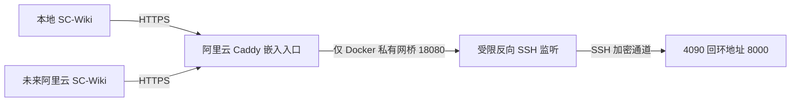

# 实施计划：独立 Qwen3-Embedding-4B 服务

**Issue**：[#222](https://github.com/JLU-ICCMS-MaYuan/SC-Wiki/issues/222)；**日期**：2026-11-05；**Spec**：[spec.md](spec.md)。

## 摘要

复用 vLLM 的标准嵌入服务，避免自行实现推理 API。将依赖、模型、服务配置分别放在目标用户的独立目录，用 systemd 用户服务管理，默认回环监听并尝试 SSH 转发。

## 技术上下文

- 目标：Ubuntu 24.04.5 x86_64、Python 3.12、NVIDIA 4090 24GB，驱动 595.99.02。
- 推理：固定 `vllm==0.11.2`，其依赖要求 PyTorch 2.9.0；完整依赖以部署后 freeze 记录为准。
- 模型：`Qwen/Qwen3-Embedding-4B`，HF revision `5cf2132abc99cad020ac570b19d031efec650f2b`，Apache 2.0。
- 存储：`/home/singeuser/qwen3-embedding`，虚拟环境、模型、配置分离；无数据库结构变化。
- 测试：标准库 HTTP 客户端运行真实接口冒烟，包含批次对应、维度、范数、鉴权、相关性和重启恢复。
- 初始容量：最大长度 8192 Token，并发序列 4，显存利用率 0.65，单 GPU、单服务；记录实测而不承诺吞吐。

## 质量门

| 来源 | 约束 | 处理 |
| --- | --- | --- |
| AGENTS.md | mayuan 分支，按任务提交、不推送 | 每次写入和提交前核对分支，仅暂存本次文件 |
| #146 与现行 Overview | 新旧模型向量不能混用 | 不切换业务配置，不接触旧索引 |
| 用户原话 | 先 Issue/Spec，再部署所选 4B | Issue #222 与本套设计先创建，再部署 |
| 根 README 提示 | AI 不直接修改 | 操作说明写入 quickstart 和 scripts/embedding/README.md |
| 凭据边界 | 不泄露密码/密钥 | 目标私有文件 0600，仓库只含模板，日志与报告不输出凭据 |

## 文档与源码结构

- 本目录：spec、plan、research、data-model、quickstart、tasks、contracts/http.md、checklists/requirements.md、validation.md。
- `scripts/embedding/`：固定模型清单、启动器、下载器、真实接口冒烟脚本、依赖及用户服务模板、使用说明。
- 复用标准 vLLM，避免编写平行服务端。脚本不导入 SC-Wiki 后端，也不加载业务 .env。

## 需求到设计的映射

| 需求/成功标准 | 职责和事实来源 | 任务 | 验证 |
| --- | --- | --- | --- |
| FR-001 / SC-001 | 固定模型清单、哈希校验、依赖 freeze、启动器 | T002–T004 | 权重哈希、服务源码哈希、GPU 与运行版本 |
| FR-002、FR-003 / SC-001、SC-003 | vLLM 标准嵌入与 Matryoshka 归一化 | T003–T005 | 真正单条/批量和 2560/1536 维请求 |
| FR-004 / SC-002 | vLLM 密钥环境配置、回环地址、SSH | T004–T006 | 无/错密钥及外部客户端 |
| FR-005 / SC-004 | systemd 用户单元与 linger | T004–T005 | 重启、enable、SSH 退出后状态 |
| FR-006 / SC-005 | 运维说明及验证报告 | T006–T007 | 受控跨机调用或明确阻塞 |

## 阶段与依赖

1. 建立文档与模型制品清单；核对需求、接口和任务一致性。
2. 编写固定版本的启动、下载与验证材料；提交部署源码。
3. 在指定服务器安装隔离依赖、验证权重，再启动服务。
4. 执行真实推理与重启、外部通道检查；同步运行事实、Issue 与任务状态。

## 外部消费澄清

用户明确先本地测试，后续由阿里云 SC-Wiki 访问同一个映射服务。外部入口要求 HTTPS、密钥和路径限制，只向推理引擎的嵌入/模型接口转发；若平台只提供裸 TCP 映射，需要在本机增加受控 HTTPS 入口。平台地址和端口尚未提供，入口配置暂不实施。当前不切换阿里云生产服务或旧索引。

| 新增需求 | 职责 | 任务与证据 |
| --- | --- | --- |
| FR-007 / SC-006 / US2 | 平台固定映射及受控 HTTPS 入口 | T008；本地外部客户端 TLS、鉴权与路径验证 |

## 回退

仅停止和禁用本次用户服务；保留模型及私有配置供恢复，不接触网站服务或业务数据。更新时保留旧版本依赖与模型身份，失败不自动调用百炼。

## 阿里云备选入口（待授权实施）

候选 Base URL：`https://www.sc-wiki.com/embedding/v1`，复用现有 HTTPS 证书。

4090 主动建立通道，图中实线为请求方向。用户暂只授权阿里云检查；专用账号、SSH Match 配置、Caddy 热加载已另请求授权。平台对 GPU 出站 SSH 的工单审核为独立前提，不能用后台服务绕过。

新增模板均带 `.proposed` 后缀，在核实授权、制品身份及平台审核前不安装或加载。入口只转发两个 v1 路由，Bearer 密钥由 vLLM 验证，不必在 Caddy 配置存储密钥。
