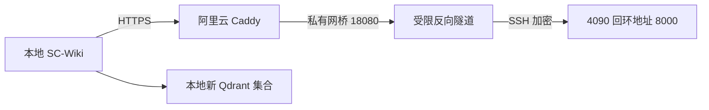

# 实施计划：Qwen3-Embedding-4B 部署与本地接入

**Issue**：[#222](https://github.com/JLU-ICCMS-MaYuan/SC-Wiki/issues/222)；日期：2026-11-05；[Spec](spec.md)。

## 当前方案

本地原生 SC-Wiki 通过阿里云 HTTPS 入口调用 4090。GPU 上模型与反向隧道均由 systemd 用户服务常驻；阿里云账号只允许远端监听 Docker 私有网桥的 18080，Caddy 复用已有 HTTPS 443，只转发 embeddings/models 两个接口。阿里云站点自身的模型和索引不切换。

GPU 主动建立隧道，图中为请求方向。实际单条标准 SSH 已成功，不将历史复核提示概括为出站 SSH 全部不可用。

## 技术与制品

- Ubuntu 24.04.5、Python 3.12、4090 24GB；vLLM 0.11.2、PyTorch 2.9.0+cu128，依赖完整冻结于 evidence/。
- 模型 Qwen/Qwen3-Embedding-4B，HF revision 5cf2132abc99cad020ac570b19d031efec650f2b；14 文件按 Git/LFS 身份核验。
- 当前源码 629af7e0，BF16、16384 Token、2 个并发序列、批 Token 上限 16384、显存利用率 0.65。
- 初始 8192 上限曾拒绝实际长片段。全量固定 tokenizer 核查最大 13010，因此调整至 16384；不截断、不跳过，仍验证新上限外输入被拒绝。
- 模型、环境及私有配置在 GPU /home/singeuser/qwen3-embedding；密钥不进入 Git 或命令行。

## 网络配置与持久化

`docker/Caddyfile` 可选导入 `/config/embedding/*.caddy`，独立片段为 `scripts/embedding/embedding-gateway.caddy`，落在阿里云 Caddy 持久配置卷中；无片段时保留原网站行为，实际有/无片段配置均验证。

曾发现容器实际单文件绑定仍是 ea300d3，而 current 指向 e2560d1f-actions。已核对 inode 并同步真实绑定与当前文件，再重载。不能仅以 current 文件写入或 reload 退出成功推断入口加载了新路由。现有应用镜像未改变，入口配置单独记录文件哈希。

## 数据所有权与切换

原 paper_chunks 为 1072 条、1536 维。scripts/embedding/rebuild_collection.py 私有导出原始 ID、payload、向量；目标必须尚不存在。逐批生成新模型向量写入独立集合，逐条比较 ID/payload、核验向量并重查源摘要；失败不修改源集合或应用配置。

实际新集合为 paper_chunks_qwen3_4b_20261105_v2。首轮 70 条的失败临时集合在完整成功后已清理，原集合始终保留。切换前确认队列为空、Worker 空闲，备份 .env，仅修改六项模型/集合配置并恢复原本运行的 Python 和上传 Worker。其他私有配置核验相同，原停用角色不启动。

QDRANT_COLLECTION_NAME 决定物理主集合；search_by_semantics 将旧逻辑 paper_chunks 解析到该设置，避免灵感模式绕回旧空间。默认值仍为 paper_chunks。EMBEDDING_QUERY_INSTRUCTION 仅用于 query，document 保留原文，空指令保持其他供应商行为。

## 需求、任务和验证映射

| 来源 | 组件/所有者 | 任务 | 验证 |
| --- | --- | --- | --- |
| FR-001 / SC-001 | 固定权重、serve.py、依赖清单 | T002–T005 | 文件哈希与真实 GPU |
| FR-002、FR-003 / SC-001、SC-003 | vLLM pooling 与输出白名单 | T003–T005 | 18 项接口回归、32/1536/2560 维 |
| FR-004、FR-007 / SC-002、SC-006 | 受限 SSH、Caddy、私有密钥 | T006、T008、T011 | HTTPS、401、路径 404、实际应用 |
| FR-005 / SC-004 | systemd、linger | T004–T006、T011 | 模型与隧道故障恢复、交互 SSH 全部退出 |
| FR-006 / SC-005 | 运维及验收文档 | T007、T011 | 独立接口与应用实际调用分开 |
| FR-008 / SC-007 | 新集合、私有备份、实际配置 | T009–T011 | 1072 条数据保真及完整应用检索 |
| FR-009 | embedder 与 query 两个调用点 | T009 | SDK 请求回归，RAG 单元目录 34 项 |

## 质量门与范围

按 AGENTS.md 仅在 mayuan 分支提交本次路径，保留其他任务修改，不自动推送；科学表单、PDF 字段、聊天模型、生产业务索引均未改变。源码、测试通过与真实运行分别记录。不为修链接自动 push，不把局部通过写成整站验收。

## 回退

原集合及 .local/embedding-backups/20261105-qwen3-4b-v2/ 私有备份保留。恢复六项模型/集合配置并恢复必要角色，不覆盖之后其他设置。若切换后有新增发布，先核对增量，不能把恢复旧设置当成所有新索引都已回退。隧道或入口失败不自动回退到付费 API。
