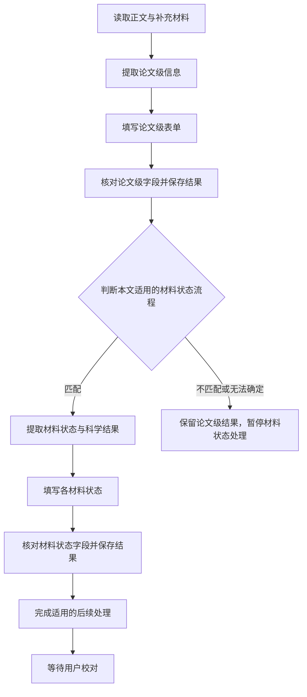

# 依据与取舍

## 指定讨论材料

以下摘录是用户指定的材料，技术内容不冒称逐字新指令或已实现。

第三项：论文级与材料状态分阶段处理

##### 目标与当前边界

用户明确要求：“我希望能先把通用解析论文的部分：解析、填写、核对完。然后在解析材料状态的部分。”两部分既要分清职责，也要按此顺序完成，不把题录、总结、科学记录和覆盖审计都塞进同一次模型请求。

论文级信息是 `paper`（`PaperDraftFields`），描述题录、摘要、总结、关键词、方法、贡献、动机和分类。材料状态数据是 `material_states`（`DraftMaterialState[]`），描述具体材料的物相、压力、结构、优化方式及物性记录，见 [数据定义](../../../frontend/src/lib/paperProcessing.ts)。

当前流程尚未这样独立：选定流程管理整套后续处理；`paper_summary` 读取科学候选生成论文信息，之后穿插状态整理和论文专门字段处理，再进入统一字段核对。现有只登记“常规超导理论计算”，不能把通用处理的拆出写成新增专用类型已经受支持。

##### 已认可方向：先完成通用部分，再进入专用部分

新方案的主顺序如下。这是拟调整的职责顺序，不是当前代码执行图；既有读取和技术性检查仍在其真实位置执行，条件步骤按实际发生显示。

论文级字段直接从相关原文获取事实和依据，不以先生成整套材料状态为前提。论文总结或核心发现可以阅读科学结果所在段落；不能只留题目和摘要，也不能删掉关键数值所需的材料、压力、方法及条件。材料状态阶段继续处理详细记录及关系。没有匹配专用流程时，已经完成的通用结果和来源保留。

“核对完成”指字段获得明确且成功保存的结论，可以包含不确定、缺少依据；不强制填满或判通过，技术失败也不能冒充完成。现有必填、提交、人工决定及最终审核要求保持，两阶段分离不授予免审或自动批准。

##### 有效结果复用与字段所有权

沿用 [统一核对机制](../../../backend/ingest/property_evidence.py)：先限定论文级实际可核对的 `paper.*` 字段，保存值、来源及结论，再处理材料状态字段。当前接口已有字段过滤能力，但不代表整个流程已完成分离。后续无变化的有效论文级结果直接复用，只有真实内容、来源或依赖变化才处理受影响字段，不能清空全表缓存或无条件重核。

当前程序会从材料状态重新生成 `paper.research_materials`。新顺序必须处理这类反向依赖：材料状态发现差异时保留证据，按实际受影响字段处理，不能悄悄覆盖前阶段已核对结果。具体冲突展示和更新操作仍待设计，不预设为用户已批准的交互。

##### 填写与核对结束后直接保存，名称和进度如实表达

两部分填写并完成必要核对后直接保存已有结果。不增加最终全表 AI 汇总，也不在核对后增加重新合并、改写内容的“程序合稿”。候选整理和正常保存继续承担已有职责，不因取消额外汇总而失去科学关系判断或防遗漏保护。LangExtract 可借鉴的是模型分段提取、程序收集结果的分工，不要求 SC-Wiki 增加另一次最终加工。

`paper.summary` 是论文总结字段，允许有依据的归纳，不是无需证据；`paper_summary` 是当前生成多个论文级字段的调用名，并非核对后的汇总。后续论文信息填写入口应表达真实职责，讨论建议名称为 `paper_info_filling`，尚未完成代码改名。

进度显示不拘泥于五步：论文级提取、填写、核对，材料状态识别、填写、核对等前后独立动作分别显示；同一次调用共同完成的工作可合并，重试、失败、暂停显示真实停点。前轮已修正部分五阶段文案，但更细的阶段划分和运行状态映射尚未实施；本次只整理讨论，不能把拟定步骤写成已经上线。

##### 待定细节与实施边界

各字段读取范围和调用拆分、现有专门字段入口的复用、两阶段交接和失败恢复、反向依赖冲突交互及详细进度状态映射仍需设计。具体 token 预算与并发参数沿第二项待定内容处理，不靠提高现有预算或截断科学依据解决问题。

三个方向目前是已讨论的修改目标，本轮只完善记录。来源展示继续以 #221 为现行设计入口，标准字段沿 [#203](../../specs/203-fixed-form-field-contract/spec.md)，科学整理沿 [#176](../../specs/176-scientific-form-filling/spec.md)及后续已生效约束；本节不替代这些契约。尚未决定引入 LangExtract 依赖、删除历史证据或批量改写草稿。后续只在用户要求时更新讨论文档；实际实现再依项目规则建立或关联 Issue/Spec，不能把讨论整理当作代码交付。

## 工程选择

复用现有依赖和契约，保存起始工作区版本，只提交本次改动。核对完成可以不确定或缺依据，技术失败不能冒充完成；不增加最终全表模型汇总或程序合稿，不新增文章类型，不改变#203/#220/#221及最终人工批准。
