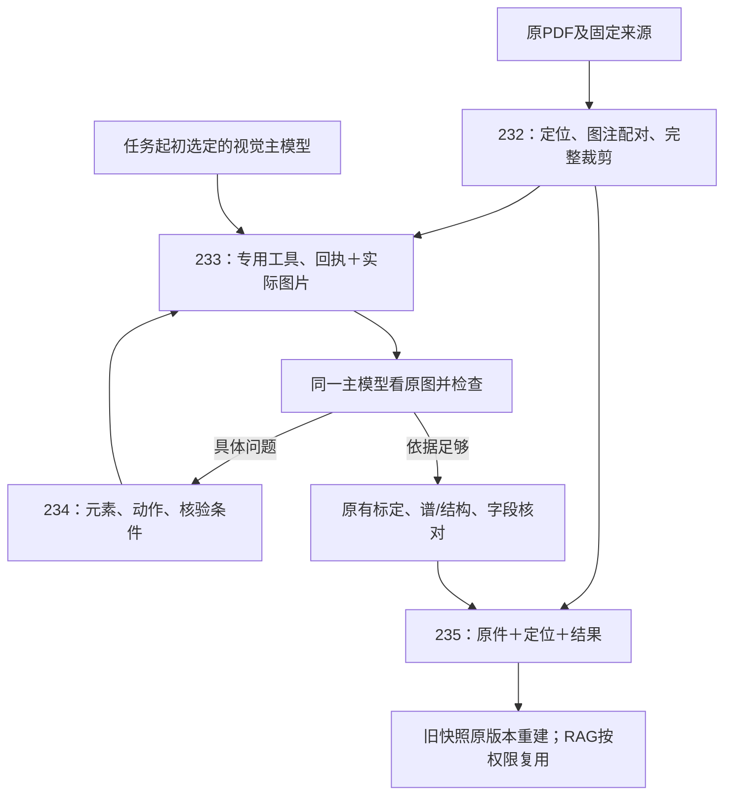
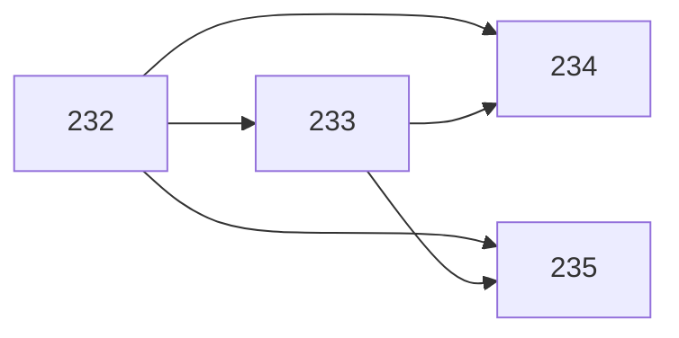

# PDF图像处理需求与交付框架

## 当前范围

用户已逐项目标确认讨论范围，最新要求**先写齐全部Issue/Spec，暂不落地代码**。本文件说明四项需求、依赖与共有契约，不维护Issue状态副本。完整原话、被替代方案和参考材料见[对话留档](conversation.md)，用户原截图见[图片清单](assets/images.json)。

## 四项需求类型

四项均为已采纳的`type:feature`，不是按开发技术勉强拆成Bug/文档/维护。内部测试、设计和文档任务不另建重复Issue；已修复轴边界Bug继续归原#227。

| 需求 | 当前范围 | Spec |
| --- | --- | --- |
| [#232 可靠定位PDF区域并生成含完整图注的高清裁剪](https://github.com/JLU-ICCMS-MaYuan/SC-Wiki/issues/232) | 按原PDF可靠定位图、表、文字、公式，首次Fig裁剪完整保留整幅图和完整图注，再提供可回溯的独立面板精读；保证实际图像清晰度及坐标可追查。 | [Spec](spec.md) |
| [#233 统一固定视觉主模型的看图工具回执与实际图片传递](https://github.com/JLU-ICCMS-MaYuan/SC-Wiki/issues/233) | 沿用SC-Wiki左侧起初选定且支持图片的同一主模型，看图工具统一返回结构化事实、依据和实际图片，接口适配正确传递；不增加第二个视觉模型，不部署Qwen3-VL。 | [Spec](../233-unified-image-tool/spec.md) |
| [#234 以可定位证据驱动同一主模型自动重读和修复](https://github.com/JLU-ICCMS-MaYuan/SC-Wiki/issues/234) | 同一视觉主模型按具体问题选择工具动作，以原图、新证据和程序检查验证修复；自动补读和重算，完整保留成功步骤、反馈历史和来源，不以人工接管作为读图疑点默认出口。 | [Spec](../234-image-feedback-repair/spec.md) |
| [#235 以PDF与版本化定位重建裁剪并供快照及RAG复用](https://github.com/JLU-ICCMS-MaYuan/SC-Wiki/issues/235) | 长期保留原PDF、版本化定位和已验证解析结果；裁剪图片按需生成并缓存，快照保存不可变来源引用；后续工具、历史查看和RAG复用同一来源，减少重复存储与渲染。 | [Spec](../235-rebuildable-visual-sources/spec.md) |

## 已确认的共同约束

1. **单一视觉主模型**：左侧起初选择固定，反馈、重试和恢复不换模型；无纯文本主模型路线、第二视觉配置或多模型投票，不部署Qwen3-VL/4090。支持图片的GPT-6.1 sol与DeepSeek Flash作为独立隔离任务分别实测；DeepSeek Pro不因同品牌被认定支持图片。
2. **结构化结果与真实像素**：主模型同时收到回执、依据和图片；路径、编号和文字描述不冒充像素。图片生成、进入请求、成功读取分别记录，API协议和第三方网关单独验证。
3. **六类真实动作**：读取上下文、取得完整对象、调整精读区域、识别文字、提取图形数据、验证结果。目录封闭且仅暴露实际可用能力，模型给出对象/问题/参数/核验条件，程序验证来源和权限。
4. **完整与清晰**：首次整图包含所有子图、轴、刻度、图例、标签和完整图注；后续局部可不带图注但可回整图。整页至少300 DPI，目标/精读至少600 DPI从原PDF生成；位图真实分辨率与模型缩放另存，不能把放大当新证据。
5. **专用流程保留**：四个入口为标量、谱线、结构、字段核对按需查图；共享取源/回执/反馈，保留各自计算和科学理解。图、表、文字、公式先处理自身结构，字段核对不全表重提。
6. **模型理解、程序计算**：材料/压力/物相/单位/系列由原主模型结合像素及上下文判断；坐标/柱/色标标定、曲线追踪/积分、几何校验/结构展开由程序执行。数字标签可转录核验，图读精度不写物理误差，回执不成为唯一科学真值。
7. **自动修复而不猜值**：原主模型提出具体元素、问题、动作和核验条件；工具实际取得新图/新依据，保留前后版本。无新依据不原样循环，真缺失明确无法确定。正式人工审核权限保持，不新增强制逐图人工接管。
8. **技术与科学问题分开**：503/连接/超时等沿#224每请求每轮5次失败暂停，不另设无限重试器；固定错误不借科学重读绕过。恢复原主模型、未完成步骤、工具历史、图像关联和成功面板。
9. **轻量来源与历史**：长期保存原PDF、不可变定位及验证结果，PNG为可重建缓存；快照只引用当时资料，不复制base64、不套最新框。缓存清理不删原件、仍引用历史或必要失败证据。CPU裁图不消耗模型token，模型再看图通常消耗，缓存不直接保证token节省。
10. **原工程边界**：#174四宿主/局部更新、#203字段、#205严格输出、#220颜色、#221侧栏、#192快照和#223共享来源保持各自权威；普通输入、同值保存、来源标记开关不新增模型和全表重核。

## 总体流程

## 依赖与未来实施顺序

当前不实施。未来先定义#232区域/坐标和来源契约，再做#233统一传图与工具动作；#234消费这些契约，#235复用定位/回执及已有采用结果。#235验证缓存不要求#234全部语义修复先完成，但最终科学采用仍经过既有核对。旧Issue提供兼容约束，不把其全部未完成行动无限纳入本轮。每项Plan映射全部FR到US、接口与后续任务，SC映射到分层验收。

## 共享触点与串行约束

| 路径 | 需求 | 约束 |
| --- | --- | --- |
| `backend/ingest/pdf_regions.py` | #232、#235 | 共用区域/坐标/渲染，缓存不能自造另一套定位 |
| `backend/ingest/chart_reading.py` | #232、#233、#234 | 完整图、回执、反馈串行；保留#227轴边界与目标/上下文区分 |
| `model_review.py`、`structure_reading.py`、`spectra/vision.py` | #233、#234 | 共享取源，保留专用核对、几何和谱职责 |
| `backend/ingest/model_runtime.py` | #233、#234 | 原模型、工具历史、用量、5次规则共用一套 |
| `document_storage.py`、`field_sources.py`、`manuscript_handoffs.py` | #235 | 冻结来源版本，不重复复制图片/背景 |
| `backend/rag/agent/tools.py`、`backend/rag/tools/chroma.py` | #235 | 已批准权限、精确片段/区域；缓存摘要不是授权凭证 |

路径是现有或拟建触点，不因表格存在宣称代码已完成；同文件串行，不能把其他任务改动纳入本次提交。

## 产物与验收框架

每项含spec.md（原话/FR/SC/场景）、plan.md（组件/依赖/映射）、research.md（取舍/证据）、data-model.md、contracts/tool-and-source.md、tasks.md、quickstart.md、checklists/requirements.md、validation.md，及初始Issue正文历史。#232另有对话、交付框架、跨Spec核验、外部材料与截图原件清单。

合计57条FR、24项SC；每项后续任务T001—T014共56项，实施/运行验收均未执行，保持未完成。固定失败重放→真实PDF几何/图片→实际模型API→故障注入/工具动作→专用后处理/保存重读→暂停恢复/历史/RAG权限→四宿主/字段/变异及相邻回归。原件/源码/图片摘要、模型/协议、动作/版本、用量/耗时和分层结论分别记录；单图、整篇和批准/五阶段不能互相替代。

## 本轮文档边界

当前只完成文档，未继续修改、提交或回滚应用/测试试改，不启动真实模型、数据库或部署，也不提前更新Overview为已实现。本版完整工程编排仍是待审设计，讨论目标的“认可”不能冒充额外逐字确认技术文件。Issue保持OPEN；本地Spec和图片未push，远程访问待验证，不能声称全部实施/关闭门通过。

首次Issue正文在各目录history/initial-issue.md保留，当前正文按最新方案重写，历史纯文本/独立视觉后端说法不再作为现行前提。核对结果见[documentation-audit.md](documentation-audit.md)。
