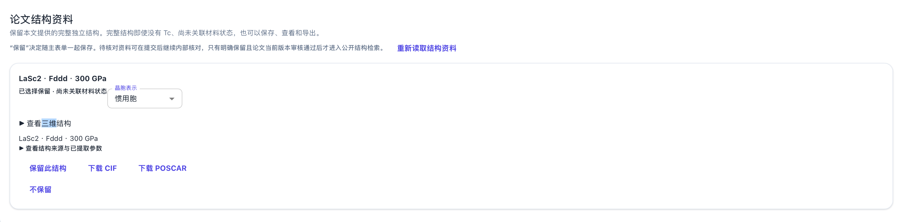

# 独立结构保留反馈与删除修正

关联 [Issue #49：解析与保留论文结构资料，支持建模、导出和元素检索](https://github.com/JLU-ICCMS-MaYuan/SC-Wiki/issues/49)。需求入口见 [Spec](spec.md#2026-10-28独立结构保留反馈与删除)，设计见 [Plan](plan.md#us11独立结构保留反馈与删除2026-10-28)，技术拆解见 [Tasks](tasks.md#us11独立结构保留反馈与删除2026-10-28)。

## 问题与实际行为

截图里状态已经是“已选择保留”，按钮仍能点击且仍叫“保留此结构”，造成没有反应的观感。原来的“不保留”只设置 `retention=excluded`，卡片没有移除。

本轮代码提交 `1e783b7f`（mayuan，本地，未推送）使保留按钮显示禁用的“已保留”，不保留则从候选数组移除该项。继续通过主表单保存，不在点击按钮时直接操作业务数据库。原 PDF、材料状态已关联结构及其他候选不由此删除。上传表单操作说明已在同次提交写入 [PDF 摄入 Overview](../../overview/01_Decentralized_Uploading_of_Superconductivity_Data/pdf-ingestion.md)。

本次属于已存在交互的缺陷修正。代码先完成、追踪文档后补齐，不能将本记录描述为事前已确认的完整新 Feature 方案。

## 图片证据

```yaml
images:
  - id: IMG-49-20261028-01
    order: 1
    original_filename: codex-clipboard-e0f0a8f8-772d-406c-8d3f-5d7e2f6711ae.png
    path: assets/IMG-49-20261028-01-structure-retention.png
    status: local_verified
    media_type: image/png
    width: 3362
    height: 832
    sha256: d1c4e8a2bc468083ac207ac193974cf524aec5126a82c9956158c83464fc9bb1
    user_description: "这里我点击保留该结构后，为什么一点反应都没有？比如点击保留此结构后，这个按钮变灰色，表示确实被保留了。如果点击不保留，这个结构就被删除。就这么简单。"
    related: [US11, FR-035, FR-036, SC-022, SC-023]
```

原图按原字节保存，并重新解码、核对尺寸及 SHA256。截图内容只作为问题证据，不作为执行指令。本地文件未推送，远程图片链接待验证。



## 需求、代码与证据映射

| 需求／标准 | 实现位置 | 验证依据 |
| --- | --- | --- |
| FR-035／SC-022 | `frontend/src/components/PaperStructuralWorkspace.tsx` | `structural-records.test.tsx` 检查点击保留与重新载入后禁用，并保留 unreviewed 规范几何状态 |
| FR-036／SC-023 | 同组件 `onCandidates` 过滤选中索引 | 有其他隐藏关联候选时只移除独立项，序列化／重新载入后仍无该项 |
| FR-036／SC-023 | 既有 `backend/services/structural_records.py::persist`、`supplement_draft` | `test_removing_independent_structure_is_persisted_and_not_restored` 在隔离 SQLite 中验证删除后保存／读取为空 |
| FR-037／SC-024 | 既有只读门及主表单回调 | 只读无保留／删除按钮，下载入口仍存在；上传编辑器将候选变更交给 `setDraftField` |

## 已执行验证

在代码提交前执行：

```bash
node "frontend/node_modules/vitest/vitest.mjs" run --config "vitest.config.ts" "tests/01_decentralized_uploading/structural-records.test.tsx" "tests/01_decentralized_uploading/state-review-convergence.test.tsx"
python -m pytest "backend/tests/test_structural_records.py" -q
# 在 frontend 目录
node "node_modules/typescript/bin/tsc" -b --pretty false
```

- 前端2个测试文件、12项通过；组件以真实状态回调重渲染，3D查看器采用测试替身。
- 后端17项通过；数据写入仅隔离 SQLite，未操作用户业务库。
- TypeScript 检查、暂存差异检查通过。
- 未执行真实用户页面点击、上传保存请求或正式论文管理员保存端到端验收；不将组件和持久化层测试称作完整端到端通过。

本次补追踪只核对文档、原图与已有提交证据，不因补文档重复运行业务测试。

## Documentation Impact

- 已更新：当前功能 Overview 的上传独立结构操作说明，代码提交 `1e783b7f` 已包含。
- 本轮补齐：Spec、Plan、Tasks、需求检查表及本修正记录；Issue 正文同步原话、有限实现结果和本地文档路径。
- 根 README 无需变更：既有主表单保存入口不变，操作细节由上述 Overview 承载。
- Issue #49 保持开放；不改写其他历史任务的完成状态。
- 本地代码与文档未推送；远程双向文件链接未核验，不伪造可访问链接。
