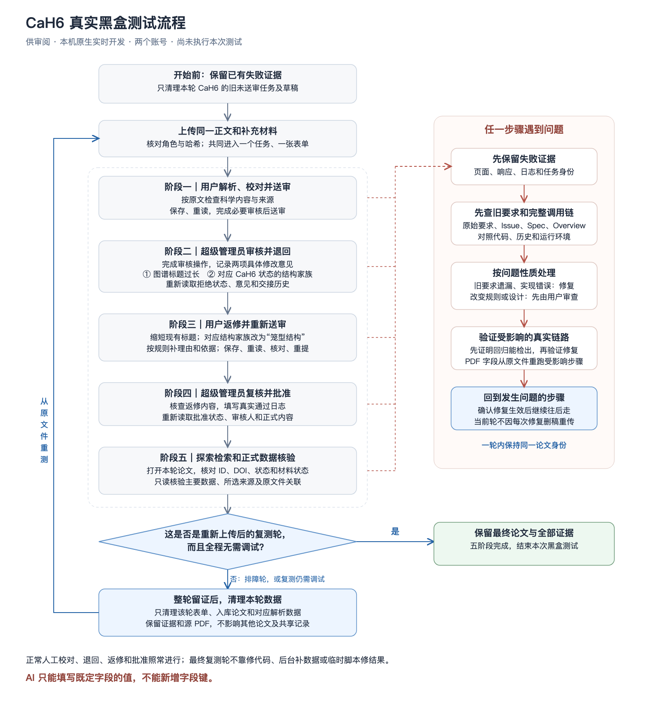

# CaH6 真实黑盒测试流程

日期：2026-11-10。本文供用户检查流程，不是测试结果；本次只整理文档和流程图，尚未执行测试或清理数据。

## 1. 要达到什么结果

先在真实操作中发现并修好问题，把整条流程跑通。然后保留证据，清理本轮数据，从相同的正文和补充材料重新开始。重复到最后一轮完整跑通，期间不需要调试、修代码或后台补数据，才算完成。

正常的人工校对、退回、返修和批准仍然要做。它们是业务操作，不算调试。

## 2. 文件、环境和分工

环境：本机原生实时开发。项目目录：`/Users/mayuan/Codes/SC-Wiki`。

| 文件角色 | 原文件路径 |
| --- | --- |
| 正文 | `/Users/mayuan/Downloads/TheoryPDF/2012 CaH6-王晖.pdf` |
| 补充材料 | `/Users/mayuan/Downloads/TheoryPDF/2012 CaH6--suppliment-王晖.pdf` |

两份文件共同进入一个解析任务、一张论文表单。表单可以包含多个有原文依据的材料状态。每轮核对文件角色、大小和 SHA-256，确保重测用的是相同文件。

| 操作者 | 账号与浏览器 | 负责什么 |
| --- | --- | --- |
| 上传者，由 AI 操作 | `myth620137018@163.com`，Safari，`http://127.0.0.1:5173/upload` | 上传、校对、保存、送审、返修、重新送审和探索检索 |
| 超级管理员，由 AI 操作 | `mayuan_mark@163.com`，Chrome，`http://localhost:5173/upload` | 完成审核操作，再执行退回或批准 |
| 用户本人 | 当前对话 | 审查发现的问题，决定是否接受改变既有设计的方案 |

本轮不使用独立普通管理员账号，因此不把普通管理员独立权限及其与超级管理员之间的交接计为已覆盖。

使用现有登录会话。每次操作前重新确认窗口、标签页、网址、实际邮箱、角色及论文身份；并行测试使用隔离窗口。中断恢复后先读实际状态，从最近成功步骤继续。

## 3. 流程图

[打开流程图原图](CaH6-blackbox-workflow.svg)。图中的故障处理适用于任意阶段；处理后回到发生问题的步骤，不跳过未完成的操作。

## 4. 每轮都要走完的五个阶段

### 阶段一：上传、解析、用户校对并送审

通过正常上传组件上传正文和补充材料，先生成草稿，不立即送审。可以把真实 PDF 字节交给正常组件，不测试原生文件选择器。

按当前表单和审核规则，对照原文检查主要科学结果、材料状态、方法、参数、结构及来源；完成必要的字段审核。未报告的值保持空并说明原因。保存后重新打开，确认内容和所选来源一致，再通过网页送审。记录任务 ID、论文 ID、DOI 和真实状态。

### 阶段二：超级管理员审核并退回

打开本轮同一论文，完成管理员侧需要的审核操作，再将下面两项写入具体退回意见：

| 层级 | 修改项 | 用户需要做什么 |
| --- | --- | --- |
| 论文级信息 | 图谱标题过长 | 在现有标题字段中写一个更简短、含义准确的标题 |
| 材料状态数据 | 对应 CaH6 状态的结构家族需要修订 | 对照原文，将现有“结构家族”字段改为“笼型结构” |

记录具体标题、材料状态及原文依据，不故意写坏内容。若标题确实无需缩短，或结构家族原本已经是“笼型结构”，不能把它记为一次实际修改，应如实交给用户审查。

通过网页拒绝退回，再重新读取拒绝状态、意见和交接历史，确认实际生效。

### 阶段三：用户返修并重新送审

原上传者打开同一论文的返修入口，完成上述两项修改。只改指定的 CaH6 状态，不把修改广播到其他状态。按现有规则填写修改理由、证据或不另提供证据的原因。

保存、重新打开，确认修改和来源保留；完成受影响字段及真实依赖需要的核对，再通过网页重新送审。论文 ID 保持不变，未修改的数据及同版本有效审核结果保留。

### 阶段四：超级管理员复核并批准

再次确认同一论文，完成管理员侧审核操作，重点复核两项返修及其依据。填写具体、真实的通过日志，通过网页批准。

重新读取批准状态、审核人、日志和正式内容，确认保存与交接一致。超时或页面报错时先查实际结果，避免重复批准。

### 阶段五：探索检索和正式数据核验

从“探索”搜索 CaH6 或对应 Ca–H 体系，打开本轮来源论文，核对论文 ID、标题、DOI、批准状态和材料状态。旧论文命中不能替代本轮验收。

只读核验正式数据中的主要科学结果、方法、参数、结构、所选来源和原文件关联。按真实数据归属读取共同参数和方法，不能只看单张表的空列就认定丢失。

## 5. 遇到问题时怎么处理

1. **先留证，再调查。** 保留页面现象、失败响应、任务身份和运行日志。先使用 `big-project-investigator` 完整梳理项目文档、代码和调用链，对照原始用户要求、Issue、Spec、Overview 及必要的 Git 历史；用 `big-project-translator` 说明问题。
2. **先判断是不是旧要求没有落实。** 检查前面是否残留旧拦截，当前值、来源、归属或审核结果是否丢失，以及是否属于运行版本、服务或环境故障。
3. **按问题性质处理。** 旧要求遗漏、普通实现错误直接修复，并更新原 Issue、Spec 和必要的 Overview；没有合适 Issue 时按仓库规范建档。新增业务规则、改变数据所有权或显著改变流程，先说明证据、与旧设计的差异、推荐方案、假设和边界，取得用户意见后再做。
4. **验证真实修复。** 为故障保留能够检出的失败回放，先证明回归会失败，再修复。PDF 字段从原文件重新提取受影响内容，走正式后处理、校验、保存和重读；未改且已核对的文字可复用，旧 AI 答案不能算新提取。共享逻辑还要覆盖相邻受影响字段。
5. **从当前步骤续跑。** 继续解析或重试受影响步骤，确认问题解决后再往后走。每修一次不立即删稿重传。已送审的问题在返修或审核环节处理，不靠删除论文重置当前轮。

修复时运行适用的静态检查、依赖漏洞扫描和既有回归；人工检查安全、并发、连接与流的释放、循环查库等问题，并检查异常路径和失败恢复。说明修复解决什么问题、有哪些假设和边界，保留必要日志及可回退的本地提交。未执行、失败或跳过的检查分别记录。

涉及科学表单或共享组件，执行受影响既有回归及仓库要求的表单契约、变异检查；涉及 PDF 相关字段或字段契约路径，同时执行字段契约检查。具体要求以根目录 [AGENTS.md](../../AGENTS.md) 为准。合理验证后按仓库要求仅提交本任务修改，不推送或部署到其他环境。

排队异常时检查真实 Worker 注册、消费和任务状态，保留现有同时解析 10 个表单的上限。技术问题无法恢复，或确实需要用户决定时，明确报告停在哪一步，不把未完成写成通过。

## 6. 什么时候清理，什么时候重测

**开始前：** 先保留当前失败证据，准确列出本轮 CaH6 的旧未送审解析任务及草稿，允许从后台清理这些对象，再上传指定两份原文件。不清理其他文献或以前独立存在的正式论文。

**排障轮完整跑通后：** 先保存五阶段证据，再清理该轮明确记录的表单、正式入库论文和对应解析数据，然后从原文件开始新一轮完整黑盒测试。这是用户授权的跨轮清理，与故障中途删稿重置不同。

清理按每轮任务 ID、论文 ID 和关联记录定位，不只凭 CaH6 名称或 DOI 批量删除。保留源 PDF、测试证据，以及其他论文的数据和共享记录。清理后核验结果，再开始下一轮。

**复测轮仍需调试：** 修复后续跑，整轮通过后再次留证、清理、重测。

**复测轮全程无需调试：** 五阶段全部实际通过后，保留这一轮的正式论文和证据，结束测试。最终轮不能依赖临时脚本修结果、直接改库、后台补数据或旧答案回填；解析与正常数据流转由 SC-Wiki 完成。

## 7. 全程不能破坏的规则

- **AI 只能填写既定字段的值，不能新增字段键。** 提取、整理、核对、返修和修复都遵守这一点，不能为跑通某篇论文偷偷扩充契约或创建人工扩展。
- 程序负责固定字段、类型、身份、权限、版本、完整性和保存；AI 对照原文判断科学支持、结果关系和适用条件，真实分歧按既有规则交给人。
- 不同材料、物相、压力、方法、独立配对和软件条件不能误合并或借用参数。重复描述合并时保留候选去向、理由和来源，由既有科学核对查证。
- 当前草稿决定当前值。审核缓存不能覆盖它；审核选定来源在保存、交接、返修和批准时完整保留。同版本有效结果按既有规则复用，普通输入和保存不增加模型核对。
- 上传、保存、送审、拒绝、返修、重提和批准通过真实网页完成。不用模拟接口、直接业务 API 或 SQL 改值代替这些动作；只读调查和上述明确范围的跨轮清理另按约定进行。
- 不关闭保护、不隐藏错误、不伪造通过，不增加针对单篇论文的特例或额外科学核对轮次。不读取或记录密码、令牌、API Key。

固定字段以 [科学表单契约](../../backend/data/scientific_form_contract.v1.json) 为权威，遵守 [#203](../../docs/specs/203-fixed-form-field-contract/spec.md)；表单验收遵守 [#174](../../docs/specs/174-form-processing-contract/spec.md)；交接与返修遵守 [#192](../../docs/specs/192-handoff-snapshots/spec.md)、[#214](../../docs/specs/214-rejected-paper-revision/spec.md)。字段提示规则只引用 [#220](../../docs/specs/220-field-red-marking/spec.md)，右侧栏设计只引用 [#221](../../docs/specs/221-scientific-field-sidebar/spec.md)，不在测试方案里另定业务规则。

本次 CaH6 的续跑与跨轮清理采用本文已确认约定；目录 [README](README.md) 中历史 H3S 用例“每次修复后立即清理重传”的做法不适用于本次。

## 8. 留证与最后交付

每轮记录放在 `tests/TestForRealScenario/runs/` 的独立目录，至少保留：

- 文件角色和哈希、源码提交和工作区差异、实际模型、复用及重新执行范围。
- 任务 ID、论文 ID、DOI、各阶段真实操作结果、返修前后值及来源、审核意见和通过日志。
- 问题证据、对应旧要求、修复及验证结果；固定重放、隔离验证、真实模型重跑和网页验收分别记录。
- 清理前的对象清单与清理结果；明确通过、失败、跳过和未覆盖范围。

最终报告逐项说明五阶段结果，并给出最终论文 ID、DOI、批准状态、检索命中、正式数据与来源一致性、报告路径、本地提交和共享工作区边界。普通管理员独立权限、原生文件选择器和线上部署不在本轮验收范围内。

**代码修好、草稿生成、解析显示 ready 或局部检查通过，都不能单独作为完成依据。最终必须有一轮重新上传后、无需调试的完整业务通过证据。**
